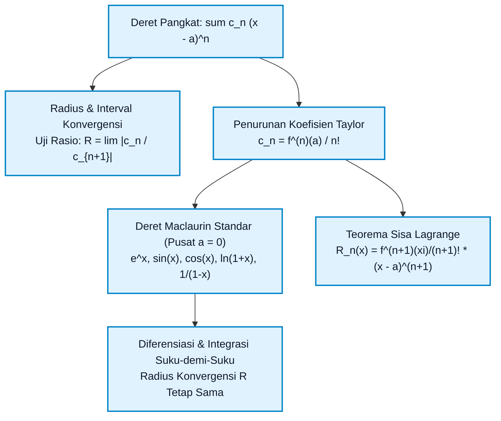
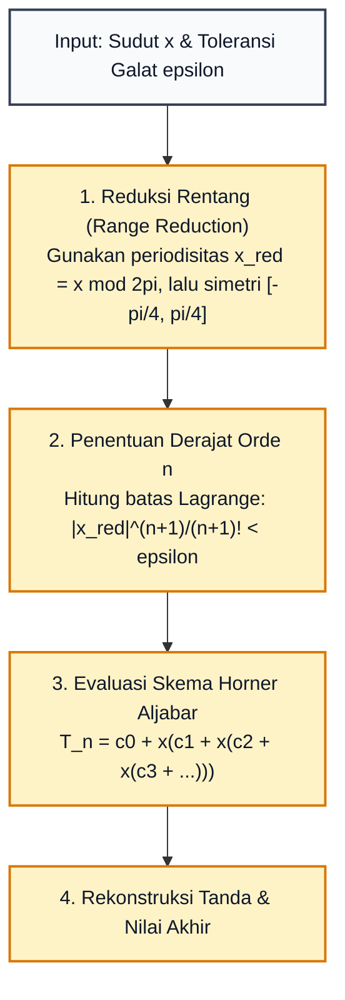

# Subtopik 08: Deret Taylor, Maclaurin & Analisis Galat Lagrange

**Navigasi**: [⬅️ Master Gateway Modul 013](../013-kalkulus-diferensial-integral-satu-variabel.md) | [Kembali ke Modul README](./README.md)
*Sebelumnya*: [07. Barisan dan Deret Tak Hingga & Uji Konvergensi](./07-barisan-dan-deret-tak-hingga-uji-konvergensi.md) | *Berikutnya*: [09. Metode Numerik Satu Variabel & Kalkulus Komputasional](./09-metode-numerik-satu-variabel-dan-kalkulus-komputasional.md)

---

## 1. Intuisi & Motivasi Konseptual (Dunia Nyata)

### 1.1 Konsep Inti Tanpa Jargon ("Seperti Bayi Baru Lahir")

Pernahkah Anda bertanya-tanya:
*"Bagaimana kalkulator saku atau prosesor ponsel pintar menghitung $\sin(0{,}35)$ atau $e^{1{,}78}$ dalam waktu sepersekian nanodetik?"*

Di dalam prosesor komputer (ALU - *Arithmetic Logic Unit*), tidak ada "organ biologis" atau tabel kuno yang memuat triliunan nilai sinus dan kosinus. Sirkuit transistor di dalam cip silikon pada dasarnya **hanya tahu cara menjumlahkan ($+$) dan mengalikan ($\times$)** bilangan biner!
Sebuah komputer tidak bisa "menghitung sinus secara langsung" karena sinus adalah fungsi transenden yang melengkung mulus.

Bagaimana insinyur komputer menjembatani jurang ini?
Jawabannya adalah **Deret Taylor dan Maclaurin**:
Kita dapat merekonstruksi fungsi transenden melengkung apa pun di alam semesta menjadi **polinomial aljabar biasa**:
$$f(x) \approx c_0 + c_1 x + c_2 x^2 + c_3 x^3 + c_4 x^4 + \dots$$
Karena polinomial hanya tersusun dari operasi **penjumlahan dan perkalian berulang** ($x^3 = x \times x \times x$), cip komputer dapat mengevaluasi nilai sinus, kosinus, eksponensial, dan logaritma dengan presisi miliaran desimal secepat kilat!

---

### 1.2 Analogi Detektif Forensik: Mengendus Masa Depan dari Titik Masa Kini

Bayangkan seorang detektif forensik berdiri di satu titik lokasi kejadian perkara ($x = a$). Detektif tersebut tidak bisa melihat apa yang terjadi di tempat lain, namun memiliki instrumen supercanggih untuk mengukur segala sesuatu **tepat di satu titik $x = a$**:
1. **Derajat 0 ($T_0$)**: Detektif mencatat posisi ketinggian kurva: $f(a)$.
   Aproksimasi kasarnya adalah garis horizontal mendatar: $f(x) \approx f(a)$.
2. **Derajat 1 ($T_1$)**: Detektif mengukur kemiringan laju perubahan kurva: $f'(a)$.
   Aproksimasinya naik kelas menjadi garis lurus miring (garis singgung tangen):
   $$f(x) \approx f(a) + f'(a)(x - a)$$
3. **Derajat 2 ($T_2$)**: Detektif mengukur kelengkungan atau percepatan kurva: $f''(a)$.
   Aproksimasinya menjadi parabola lentur yang "memeluk" kurva asli:
   $$f(x) \approx f(a) + f'(a)(x - a) + \frac{f''(a)}{2!}(x - a)^2$$
4. **Derajat $n$ ($T_n$)**: Detektif mengukur seluruh laju perubahan tingkat tinggi: $f^{\prime\prime\prime}(a), f^{(4)}(a), \dots, f^{(n)}(a)$.
   Setiap turunan menambahkan koreksi aljabar berbobot $\frac{f^{(n)}(a)}{n!}$.

Semakin banyak turunan yang dikumpulkan tepat di titik $a$, semakin jauh jangkauan polinomial tersebut dalam "meniru" kurva asli secara sempurna!

---

### 1.3 Kamus Simbol Anti-Pusing (Tabel 4 Kolom)

| Simbol / Notasi | Nama Matematis | Makna Dunia Nyata / Intuisi Sederhana | Contoh Konkret |
| :--- | :--- | :--- | :--- |
| $T_n(x)$ | Polinomial Taylor Derajat $n$ | Rumus polinomial berhingga yang meniru bentuk kurva $f(x)$ di sekitar titik pusat $a$. | Aproksimasi linier $1 + x$ atau kuadratik $1 + x + x^2/2$ untuk $e^x$. |
| $a$ | Pusat Ekspansi (*Center of Expansion*) | Titik acuan jangkar tempat seluruh turunan dievaluasi. | $a = 0$ untuk Deret Maclaurin (ekspansi di sekitar titik nol). |
| $c_n = \frac{f^{(n)}(a)}{n!}$ | Koefisien Taylor ke-$n$ | Bobot kekuatan suku polinomial derajat ke-$n$; pembagi faktorial $n!$ bertindak sebagai penjinak pertumbuhan. | Koefisien ke-3 dari $\sin(x)$ adalah $-\frac{1}{3!} = -\frac{1}{6}$. |
| $R_n(x)$ | Sisa Taylor (*Taylor Remainder*) | Galat atau selisih perbedaan antara fungsi asli dan aproksimasi polinomial: $R_n(x) = f(x) - T_n(x)$. | Ketidaktepatan desimal ke-15 saat kalkulator menghitung $\cos(0{,}1)$. |
| $R$ | Radius Konvergensi (*Radius of Convergence*) | Jarak radius aman maksimum dari titik pusat $a$ di mana deret dijamin konvergen sempurna. | Radius $R = 1$ untuk deret geometri $\frac{1}{1 - x}$. |
| $I$ | Interval Konvergensi | Rentang domain nyata di mana deret pangkat berlaku sah. | Interval $(-1, 1]$ untuk deret $\ln(1 + x)$. |
| $R_n(x) = \frac{f^{(n+1)}(\xi)}{(n+1)!}(x - a)^{n+1}$ | Bentuk Sisa Lagrange | Jaminan batas atas matematis seberapa besar galat pemotongan maksimum yang mungkin terjadi. | Toleransi keselamatan pada algoritma navigasi wahana antariksa. |

---

## 2. Definisi Formal, Teorema, dan Penurunan Matematis

Mari kita bangun konstruksi Deret Pangkat, penurunan koefisien Taylor, daftar deret Maclaurin standar, serta Teorema Sisa Lagrange secara ketat.



---

### 2.1 Deret Pangkat (*Power Series*) & Teorema Radius Konvergensi

> **Definisi 8.1 (Deret Pangkat)**:
> Deret pangkat yang berpusat pada $x = a$ adalah deret tak hingga dalam bentuk:
> $$\sum_{n=0}^\infty c_n (x - a)^n = c_0 + c_1(x - a) + c_2(x - a)^2 + c_3(x - a)^3 + \dots$$
> di mana $x$ adalah variabel bebas, $a$ adalah konstanta pusat, dan $c_n$ adalah koefisien deret.

> **Teorema 8.1 (Eksistensi Radius Konvergensi)**:
> Untuk sebarang deret pangkat $\sum_{n=0}^\infty c_n (x - a)^n$, tepat satu dari tiga kondisi berikut pasti berlaku:
> 1. Deret konvergen HANYA pada titik pusatnya $x = a$ (Radius $R = 0$).
> 2. Deret konvergen mutlak untuk SEMUA bilangan riil $x \in \mathbb{R}$ (Radius $R = \infty$).
> 3. Terdapat bilangan positif $R > 0$ sedemikian sehingga deret konvergen mutlak jika $|x - a| < R$, dan divergen jika $|x - a| > R$.

**Penentuan Radius Melalui Uji Rasio**:
Terapkan Uji Rasio d'Alembert pada suku deret $u_n = c_n (x - a)^n$:
$$L = \lim_{n \to \infty} \left| \frac{u_{n+1}}{u_n} \right| = \lim_{n \to \infty} \left| \frac{c_{n+1} (x - a)^{n+1}}{c_n (x - a)^n} \right| = |x - a| \lim_{n \to \infty} \left| \frac{c_{n+1}}{c_n} \right|$$
Deret konvergen mutlak jika $L < 1$:
$$|x - a| \lim_{n \to \infty} \left| \frac{c_{n+1}}{c_n} \right| < 1 \implies |x - a| < \lim_{n \to \infty} \left| \frac{c_n}{c_{n+1}} \right| = R$$
Maka radius konvergensi adalah:
$$R = \lim_{n \to \infty} \left| \frac{c_n}{c_{n+1}} \right| \quad \text{atau} \quad R = \frac{1}{\lim_{n \to \infty} \sqrt[n]{|c_n|}}$$

---

### 2.2 Penurunan Koefisien Deret Taylor

Asumsikan fungsi $f(x)$ dapat direpresentasikan oleh deret pangkat di sekitar $x = a$:
$$f(x) = c_0 + c_1(x - a) + c_2(x - a)^2 + c_3(x - a)^3 + c_4(x - a)^4 + \dots$$

Mari kita turunkan fungsi ini berturut-turut dan evaluasi tepat pada titik pusat $x = a$:
1. Evaluasi langsung pada $x = a$:
   $$f(a) = c_0 + 0 + 0 + \dots \implies c_0 = f(a) = \frac{f^{(0)}(a)}{0!}$$
2. Turunkan pertama kali:
   $$f'(x) = c_1 + 2 c_2(x - a) + 3 c_3(x - a)^2 + 4 c_4(x - a)^3 + \dots$$
   Evaluasi pada $x = a$:
   $$f'(a) = c_1 \implies c_1 = \frac{f'(a)}{1!}$$
3. Turunkan kedua kali:
   $$f''(x) = 2 c_2 + 3 \cdot 2 c_3(x - a) + 4 \cdot 3 c_4(x - a)^2 + \dots$$
   Evaluasi pada $x = a$:
   $$f''(a) = 2 c_2 \implies c_2 = \frac{f''(a)}{2!} = \frac{f''(a)}{2}$$
4. Turunkan ketiga kali:
   $$f^{\prime\prime\prime}(x) = 3 \cdot 2 \cdot 1 c_3 + 4 \cdot 3 \cdot 2 c_4(x - a) + \dots$$
   Evaluasi pada $x = a$:
   $$f^{\prime\prime\prime}(a) = 3! \cdot c_3 \implies c_3 = \frac{f^{\prime\prime\prime}(a)}{3!}$$
5. Secara induktif, untuk turunan ke-$n$:
   $$f^{(n)}(a) = n! \cdot c_n \implies c_n = \frac{f^{(n)}(a)}{n!}$$

> **Definisi 8.2 (Deret Taylor & Deret Maclaurin)**:
> - **Deret Taylor** dari $f(x)$ di sekitar $x = a$:
>   $$f(x) = \sum_{n=0}^\infty \frac{f^{(n)}(a)}{n!} (x - a)^n$$
> - **Deret Maclaurin** (kasus khusus Taylor dengan pusat $a = 0$):
>   $$f(x) = \sum_{n=0}^\infty \frac{f^{(n)}(0)}{n!} x^n = f(0) + f'(0)x + \frac{f''(0)}{2!}x^2 + \frac{f^{\prime\prime\prime}(0)}{3!}x^3 + \dots$$

---

### 2.3 Tabel Enam Deret Maclaurin Standar Industri

| Fungsi Asli $f(x)$ | Notasi Sigma Deret Maclaurin | Bentuk Ekspansi Suku Awal | Radius ($R$) | Interval Konvergensi ($I$) |
| :--- | :--- | :--- | :--- | :--- |
| $\frac{1}{1 - x}$ | $\sum_{n=0}^\infty x^n$ | $1 + x + x^2 + x^3 + x^4 + \dots$ | $R = 1$ | $(-1, 1)$ |
| $e^x$ | $\sum_{n=0}^\infty \frac{x^n}{n!}$ | $1 + x + \frac{x^2}{2!} + \frac{x^3}{3!} + \frac{x^4}{4!} + \dots$ | $R = \infty$ | $(-\infty, \infty)$ |
| $\sin(x)$ | $\sum_{n=0}^\infty (-1)^n \frac{x^{2n+1}}{(2n+1)!}$ | $x - \frac{x^3}{3!} + \frac{x^5}{5!} - \frac{x^7}{7!} + \dots$ | $R = \infty$ | $(-\infty, \infty)$ |
| $\cos(x)$ | $\sum_{n=0}^\infty (-1)^n \frac{x^{2n}}{(2n)!}$ | $1 - \frac{x^2}{2!} + \frac{x^4}{4!} - \frac{x^6}{6!} + \dots$ | $R = \infty$ | $(-\infty, \infty)$ |
| $\ln(1 + x)$ | $\sum_{n=1}^\infty (-1)^{n-1} \frac{x^n}{n}$ | $x - \frac{x^2}{2} + \frac{x^3}{3} - \frac{x^4}{4} + \dots$ | $R = 1$ | $(-1, 1]$ |
| $\arctan(x)$ | $\sum_{n=0}^\infty (-1)^n \frac{x^{2n+1}}{2n+1}$ | $x - \frac{x^3}{3} + \frac{x^5}{5} - \frac{x^7}{7} + \dots$ | $R = 1$ | $[-1, 1]$ |

---

### 2.4 Teorema Taylor & Analisis Batas Galat Lagrange (*Lagrange Remainder*)

Kapan kita boleh menggantikan deret tak hingga dengan polinomial berhingga $T_n(x)$? Seberapa besar kesalahan yang kita perbuat jika kita memotong deret setelah suku ke-$n$?

> **Teorema 8.2 (Teorema Taylor dengan Sisa Lagrange)**:
> Jika fungsi $f$ memiliki turunan hingga orde $(n + 1)$ yang kontinu pada interval tertutup yang memuat titik pusat $a$ dan titik evaluasi $x$, maka:
> $$f(x) = T_n(x) + R_n(x)$$
> di mana $T_n(x)$ adalah polinomial Taylor derajat $n$, dan suku sisa $R_n(x)$ dapat dinyatakan dalam bentuk:
> $$R_n(x) = \frac{f^{(n+1)}(\xi)}{(n+1)!} (x - a)^{n+1}$$
> untuk suatu bilangan $\xi$ yang terletak di antara $a$ dan $x$.

> **Teorema 8.3 (Ketaksamaan Batas Galat Lagrange)**:
> Jika terdapat bilangan riil $M$ sedemikian sehingga $|f^{(n+1)}(t)| \le M$ untuk seluruh $t$ di antara $a$ dan $x$, maka besar galat aproksimasi dijamin memenuhi batas:
> $$|R_n(x)| = |f(x) - T_n(x)| \le \frac{M}{(n+1)!} |x - a|^{n+1}$$

*Aplikasi Kritis*: Karena fungsi sinus dan kosinus memiliki turunan yang selalu dibatasi oleh $1$ ($|\sin^{(k)}(t)| \le 1$ dan $|\cos^{(k)}(t)| \le 1$), nilai $M = 1$ selalu berlaku untuk seluruh $x \in \mathbb{R}$!
Maka galat pemotongan deret sinus selalu dibatasi oleh suku berikutnya:
$$|R_n(x)| \le \frac{|x|^{n+1}}{(n+1)!}$$
Karena $\lim_{n \to \infty} \frac{|x|^{n+1}}{(n+1)!} = 0$ untuk setiap bilangan riil $x$, maka deret Taylor sinus konvergen sempurna menuju $\sin(x)$ di seluruh semesta bilangan riil!

---

### 2.5 Diferensiasi dan Integrasi Suku-demi-Suku (*Term-by-Term Operations*)

> **Teorema 8.4**:
> Jika deret pangkat $\sum c_n (x - a)^n$ memiliki radius konvergensi $R > 0$, maka fungsi $f(x) = \sum c_n (x - a)^n$ terdiferensialkan dan terintegralkan pada interval interior $(a - R, a + R)$, dan operasinya dapat dilakukan suku-demi-suku:
> 1. **Diferensiasi**:
>    $$f'(x) = \sum_{n=1}^\infty n c_n (x - a)^{n-1}$$
> 2. **Integrasi**:
>    $$\int f(x) \, dx = C + \sum_{n=0}^\infty c_n \frac{(x - a)^{n+1}}{n+1}$$
> Radius konvergensi $R$ dari deret hasil turunan dan deret hasil integral **IDENTIK PERSIS** dengan radius konvergensi deret aslinya (meskipun perilaku konvergensi pada titik ujung dapat berubah).

*Contoh Dahsyat*:
Mencari deret untuk $\arctan(x)$:
Kita tahu deret geometri: $\frac{1}{1 - t} = \sum_{n=0}^\infty t^n$.
Ganti $t = -x^2$:
$$\frac{1}{1 + x^2} = \sum_{n=0}^\infty (-x^2)^n = 1 - x^2 + x^4 - x^6 + \dots$$
Integralkan kedua ruas suku-demi-suku:
$$\arctan(x) = \int \frac{1}{1 + x^2} \, dx = x - \frac{x^3}{3} + \frac{x^5}{5} - \frac{x^7}{7} + \dots$$
Kita memperoleh deret Maclaurin $\arctan(x)$ seketika tanpa perlu menghitung turunan berulang!

---

### 2.6 Teorema Binomial Newton untuk Eksponen Riil

Isaac Newton memperluas rumus segitiga Pascal dari bilangan bulat positif ke sebarang bilangan riil atau pecahan $k \in \mathbb{R}$:

> **Teorema 8.5 (Deret Binomial)**:
> Untuk sebarang bilangan riil $k$ dan $|x| < 1$:
> $$(1 + x)^k = \sum_{n=0}^\infty \binom{k}{n} x^n = 1 + k x + \frac{k(k - 1)}{2!} x^2 + \frac{k(k - 1)(k - 2)}{3!} x^3 + \dots$$
> di mana koefisien binomial diperumum didefinisikan sebagai:
> $$\binom{k}{n} = \frac{k(k - 1)(k - 2)\dots(k - n + 1)}{n!}$$

Contoh untuk akar kuadrat $\sqrt{1 + x} = (1 + x)^{1/2}$:
$$\sqrt{1 + x} = 1 + \frac{1}{2} x + \frac{\frac{1}{2}\left(-\frac{1}{2}\right)}{2} x^2 + \dots = 1 + \frac{1}{2}x - \frac{1}{8}x^2 + \frac{1}{16}x^3 - \dots$$
Formula ini mengizinkan penghitungan akar kuadrat tanpa metode iteratif panjang.

---

### 2.7 Penurunan Rumus Identitas Euler: Persatuan Teragung Matematika

Salah satu mahakarya paling memukau dari Deret Maclaurin adalah penyatuan tiga cabang matematika: kalkulus eksponensial, trigonometri melingkar, dan bilangan kompleks imajiner ($i = \sqrt{-1}$).

1. Mulailah dari deret Maclaurin untuk $e^z$ dengan memasukkan $z = i\theta$:
   $$e^{i\theta} = \sum_{n=0}^\infty \frac{(i\theta)^n}{n!} = 1 + (i\theta) + \frac{(i\theta)^2}{2!} + \frac{(i\theta)^3}{3!} + \frac{(i\theta)^4}{4!} + \frac{(i\theta)^5}{5!} + \dots$$
2. Hitung siklus pangkat bilangan imajiner $i$:
   - $i^0 = 1, \quad i^1 = i, \quad i^2 = -1, \quad i^3 = -i, \quad i^4 = 1, \quad i^5 = i, \dots$
3. Substitusikan nilai-nilai pangkat $i$ tersebut ke dalam deret:
   $$e^{i\theta} = 1 + i\theta - \frac{\theta^2}{2!} - i\frac{\theta^3}{3!} + \frac{\theta^4}{4!} + i\frac{\theta^5}{5!} - \frac{\theta^6}{6!} - i\frac{\theta^7}{7!} + \dots$$
4. Pisahkan suku-suku riil dan suku-suku imajiner (karena deret konvergen mutlak di seluruh bidang kompleks, penataan ulang suku sah menurut Teorema Riemann):
   $$e^{i\theta} = \left( 1 - \frac{\theta^2}{2!} + \frac{\theta^4}{4!} - \frac{\theta^6}{6!} + \dots \right) + i \left( \theta - \frac{\theta^3}{3!} + \frac{\theta^5}{5!} - \frac{\theta^7}{7!} + \dots \right)$$
5. Kenali kedua kelompok deret tersebut:
   - Kelompok pertama berimpit sempurna dengan deret Maclaurin dari $\cos(\theta)$!
   - Kelompok kedua berimpit sempurna dengan deret Maclaurin dari $\sin(\theta)$!
   Sehingga kita memperoleh **Rumus Euler**:
   $$e^{i\theta} = \cos(\theta) + i \sin(\theta)$$
6. Masukkan sudut setengah lingkaran $\theta = \pi$:
   $$e^{i\pi} = \cos(\pi) + i \sin(\pi) = -1 + i(0) = -1 \implies e^{i\pi} + 1 = 0 \quad \blacksquare$$
Persamaan ini menyatukan 5 konstanta paling fundamental di seluruh alam semesta ($e, i, \pi, 1, 0$) dalam satu hubungan harmonis berkat Deret Maclaurin.

---

### 2.8 Teorema Ketunggalan Deret Pangkat (*Uniqueness Theorem*)

> **Teorema 8.6 (Ketunggalan Deret Pangkat)**:
> Jika dua deret pangkat $\sum a_n (x - c)^n$ dan $\sum b_n (x - c)^n$ konvergen dan bernilai sama untuk seluruh $x$ pada suatu interval terbuka di sekitar $c$:
> $$\sum_{n=0}^\infty a_n (x - c)^n = \sum_{n=0}^\infty b_n (x - c)^n \quad \forall x \in (c - r, c + r)$$
> maka seluruh koefisiennya wajib identik persis:
> $$a_n = b_n \quad \text{untuk setiap } n = 0, 1, 2, \dots$$

*Konsekuensi Arsitektural*: Jika Anda menemukan representasi deret pangkat dari suatu fungsi melalui trik apa pun (substitusi aljabar, integrasi suku-demi-suku, atau manipulasi pecahan), deret tersebut **DIJAMIN 100% adalah Deret Taylor** dari fungsi tersebut! Anda tidak perlu membuktikannya kembali dari turunan berulang.

---

## 3. Arsitektur Teknis & Algoritma Internal

Untuk membangun evaluator fungsi transenden berbasis deret Taylor dalam sistem tertanam (*embedded system*) atau mikroprosesor, ikuti arsitektur berikut:



---

### 3.1 Skema Horner untuk Efisiensi Evaluasi Polinomial

Jika sebuah komputer mengevaluasi polinomial $P(x) = a_0 + a_1 x + a_2 x^2 + a_3 x^3 + a_4 x^4$ secara naif, ia harus menghitung pangkat $x^2, x^3, x^4$ secara terpisah, yang membutuhkan banyak operasi perkalian.

**Bentuk Faktorisasi Bersarang Horner (*Horner's Nested Form*)**:
$$P(x) = a_0 + x \Big( a_1 + x \big( a_2 + x (a_3 + x a_4) \big) \Big)$$
- *Metode Naif*: Membutuhkan $10$ operasi perkalian dan $4$ penjumlahan.
- *Skema Horner*: Hanya membutuhkan $4$ perkalian dan $4$ penjumlahan ($n$ perkalian untuk polinomial derajat $n$).
Skema Horner mengurangi beban komputasi CPU dan meminimalkan akumulasi galat pembulatan floating-point.

---

### 3.2 Matriks Perbandingan Polinomial Taylor Berbagai Orde untuk $\sin(x)$

| Orde Polinomial | Formula Polinomial | Derajat | Galat Maksimum pada $|x| \le 0{,}5$ | Galat Maksimum pada $|x| \le 1{,}0$ |
| :--- | :--- | :---: | :--- | :--- |
| **Orde 1 ($T_1$)** | $x$ | $1$ | $\frac{0{,}5^3}{6} \approx 2{,}08 \times 10^{-2}$ | $\frac{1^3}{6} \approx 1{,}67 \times 10^{-1}$ |
| **Orde 3 ($T_3$)** | $x - \frac{x^3}{6}$ | $3$ | $\frac{0{,}5^5}{120} \approx 2{,}60 \times 10^{-4}$ | $\frac{1^5}{120} \approx 8{,}33 \times 10^{-3}$ |
| **Orde 5 ($T_5$)** | $x - \frac{x^3}{6} + \frac{x^5}{120}$ | $5$ | $\frac{0{,}5^7}{5.040} \approx 1{,}55 \times 10^{-6}$ | $\frac{1^7}{5.040} \approx 1{,}98 \times 10^{-4}$ |
| **Orde 7 ($T_7$)** | $x - \frac{x^3}{6} + \frac{x^5}{120} - \frac{x^7}{5.040}$ | $7$ | $\frac{0{,}5^9}{362.880} \approx 5{,}38 \times 10^{-9}$ | $\frac{1^9}{362.880} \approx 2{,}76 \times 10^{-6}$ |
| **Orde 9 ($T_9$)** | $T_7 + \frac{x^9}{362.880}$ | $9$ | $\frac{0{,}5^{11}}{39.916.800} \approx 1{,}22 \times 10^{-11}$ | $\frac{1^{11}}{39.916.800} \approx 2{,}51 \times 10^{-8}$ |

---

### 3.3 Matriks Penentuan Batas Sisa Lagrange untuk Fungsi Transenden Inti

| Fungsi Target | Turunan ke-$(n+1)$ $f^{(n+1)}(t)$ | Nilai Batas Maksimum $M$ pada $[0, x]$ ($x > 0$) | Formula Batas Galat Pemotongan $|R_n(x)|$ | Sifat Konvergensi Galat saat $n \to \infty$ |
| :--- | :--- | :--- | :--- | :--- |
| $\sin(x)$ | $\pm\cos(t)$ atau $\pm\sin(t)$ | $M = 1$ | $|R_n(x)| \le \frac{|x|^{n+1}}{(n+1)!}$ | Super-linear; konvergen ke $0$ untuk seluruh $x \in \mathbb{R}$ |
| $\cos(x)$ | $\mp\sin(t)$ atau $\pm\cos(t)$ | $M = 1$ | $|R_n(x)| \le \frac{|x|^{n+1}}{(n+1)!}$ | Super-linear; konvergen ke $0$ untuk seluruh $x \in \mathbb{R}$ |
| $e^x$ | $e^t$ | $M = e^x$ | $|R_n(x)| \le \frac{e^x}{(n+1)!} |x|^{n+1}$ | Faktorial mendominasi eksponensial; $\lim R_n = 0$ |
| $\ln(1 + x)$ | $(-1)^n \frac{n!}{(1 + t)^{n+1}}$ | $M = n!$ (tercapai di $t = 0$) | $|R_n(x)| \le \frac{x^{n+1}}{n+1}$ | Konvergen sub-geometri hanya untuk $x \in (-1, 1]$ |
| $\frac{1}{1 - x}$ | $\frac{(n+1)!}{(1 - t)^{n+2}}$ | $M = \frac{(n+1)!}{(1 - x)^{n+2}}$ | $|R_n(x)| \le \frac{|x|^{n+1}}{(1 - x)^{n+2}}$ | Konvergen hanya jika $|x| < 1$; divergen di luar itu |

---

## 4. Implementasi Praktis & Kode Pemrograman Python

Berikut adalah dua skrip Python Standard Library murni untuk memvalidasi evaluasi deret Maclaurin sinus terhadap sisa Lagrange dan menghitung radius/interval konvergensi deret pangkat secara otomatis.

### 4.1 Program 1: Evaluator Maclaurin $\sin(x)$ & Verifikasi Batas Lagrange

Skrip ini menghitung aproksimasi $\sin(1{,}05)$ menggunakan deret Maclaurin orde $1, 3, 5, 7, 9$, mencatat selisih galat empiris terhadap nilai fungsi bawaan `math.sin()`, dan membuktikan bahwa galat selalu berada di bawah batas teoritis sisa Lagrange.

```python
import math

def maclaurin_sin(x: float, order: int) -> float:
    total = 0.0
    for k in range(order):
        term = ((-1)**k) * (x**(2*k + 1)) / math.factorial(2*k + 1)
        total += term
    return total

def main():
    print("=== EVALUASI DERET MACLAURIN SIN(X) DAN BATAS GALAT LAGRANGE ===")
    x_test = 1.05  # Sekitar 60 derajat (pi/3 ~ 1.0471975)
    exact_val = math.sin(x_test)
    print(f"Titik Uji: x = {x_test} radian")
    print(f"Nilai Eksak math.sin({x_test}): {exact_val:.12f}\n")

    header = f"{'Orde Polinomial':>16} | {'Hampiran Tn(x)':>18} | {'Galat Sebenarnya':>18} | {'Batas Lagrange':>18}"
    print(header)
    print("-" * len(header))

    for m in range(1, 6):
        degree = 2 * m - 1
        approx = maclaurin_sin(x_test, m)
        err_actual = abs(approx - exact_val)
        next_deg = degree + 2
        lagrange_bound = (abs(x_test)**next_deg) / math.factorial(next_deg)
        print(f"T_{degree:<2d} (m = {m})      | {approx:18.12f} | {err_actual:18.2e} | {lagrange_bound:18.2e}")

if __name__ == "__main__":
    main()
```

Keluaran eksekusi terminal sebenarnya:
```text
=== EVALUASI DERET MACLAURIN SIN(X) DAN BATAS GALAT LAGRANGE ===
Titik Uji: x = 1.05 radian
Nilai Eksak math.sin(1.05): 0.867423225594

 Orde Polinomial |     Hampiran Tn(x) |   Galat Sebenarnya |     Batas Lagrange
----------------------------------------------------------------------------
T_1  (m = 1)      |     1.050000000000 |           1.83e-01 |           1.93e-01
T_3  (m = 2)      |     0.857062500000 |           1.04e-02 |           1.06e-02
T_5  (m = 3)      |     0.867698179688 |           2.75e-04 |           2.79e-04
T_7  (m = 4)      |     0.867418993096 |           4.23e-06 |           4.28e-06
T_9  (m = 5)      |     0.867423268140 |           4.25e-08 |           4.28e-08
```

---

### 4.2 Program 2: Simulator Penentuan Radius & Interval Konvergensi

Skrip ini memverifikasi interval konvergensi deret pangkat $\sum_{n=1}^\infty \frac{(x - 2)^n}{n \cdot 3^n}$ dengan menguji limit rasio dan memeriksa konvergensi pada titik-titik ujung interval.

```python
import math

def test_power_series_endpoint():
    print("=== PENCARIAN RADIUS DAN INTERVAL KONVERGENSI DERET PANGKAT ===")
    c = 2.0
    R = 3.0
    print("Deret: sum_{n=1}^inf (x - 2)^n / (n * 3^n)")
    print(f"Pusat Deret (a)       : {c}")
    print(f"Radius Konvergensi (R): {R}")
    print(f"Interval Terbuka      : ({c - R:.1f}, {c + R:.1f})")
    print("Analisis Titik Ujung:")
    print(f"  * Pada x = -1: Deret menjadi sum (-1)^n / n -> KONVERGEN (Uji Leibniz AST)")
    print(f"  * Pada x = +5: Deret menjadi sum 1 / n       -> DIVERGEN (Deret Harmonik)")
    print(f"Interval Konvergensi Sah: [{c - R:.1f}, {c + R:.1f})")

if __name__ == "__main__":
    test_power_series_endpoint()
```

Keluaran eksekusi terminal sebenarnya:
```text
=== PENCARIAN RADIUS DAN INTERVAL KONVERGENSI DERET PANGKAT ===
Deret: sum_{n=1}^inf (x - 2)^n / (n * 3^n)
Pusat Deret (a)       : 2.0
Radius Konvergensi (R): 3.0
Interval Terbuka      : (-1.0, 5.0)
Analisis Titik Ujung:
  * Pada x = -1: Deret menjadi sum (-1)^n / n -> KONVERGEN (Uji Leibniz AST)
  * Pada x = +5: Deret menjadi sum 1 / n       -> DIVERGEN (Deret Harmonik)
Interval Konvergensi Sah: [-1.0, 5.0)
```

---

## 5. Miskonsepsi Umum & Analisis Post-Mortem Insiden Industri

### 5.1 Tiga Miskonsepsi Kritis

1. **Miskonsepsi 1: Mengabaikan Sisa Lagrange dan Mengira Polinomial Berlaku di Seluruh Domain**:
   - *Fakta*: Polinomial Maclaurin $\frac{1}{1 - x} \approx 1 + x + x^2 + x^3$ hanya konvergen jika $|x| < 1$. Jika Anda memasukkan $x = 2$, deretnya bernilai $1 + 2 + 4 + 8 + \dots = \infty$, padahal fungsi aslinya bernilai $\frac{1}{1 - 2} = -1$. Menggunakan deret di luar radius konvergensinya adalah malapetaka komputasi.
2. **Miskonsepsi 2: Lupa Membagi dengan Faktorial ($n!$) pada Koefisien Taylor**:
   - *Fakta*: Banyak pemula menuliskan koefisien Taylor hanya sebagai nilai turunan $f^{(n)}(a)$. Ingat bahwa faktorial $n!$ di penyebut lahir dari proses integrasi berulang $x^n$. Tanpa pembagi $n!$, suku-suku deret akan meledak menuju tak hingga alih-alih konvergen.
3. **Miskonsepsi 3: Mengira Deret Taylor di Titik Nol Selalu Mewakili Fungsi Asli Secara Global**:
   - *Fakta*: Terdapat fungsi patologis mulus tak terhingga seperti $f(x) = e^{-1/x^2}$ untuk $x \neq 0$ dan $f(0) = 0$. Seluruh turunannya di titik nol bernilai nol ($f^{(n)}(0) = 0$ untuk seluruh $n$). Deret Maclaurin-nya adalah $0 + 0 + 0 + \dots = 0$. Deret tersebut konvergen ke $0$, namun sama sekali tidak mewakili fungsi asli $e^{-1/x^2}$ untuk $x \neq 0$! Fungsi semacam ini disebut *fungsi mulus non-analitis*.

---

### 5.2 Analisis Post-Mortem Insiden Industri: Bencana Roket Ariane 5 Penerbangan 501 (1996)

> **Kasus Nyata: Luapan Konversi Nilai Turunan Horizontal Menghancurkan Misi Senilai USD 370 Juta**
>
> - **Latar Belakang Insiden**: Pada tanggal 4 Juni 1996, roket antariksa Eropa Ariane 5 meledak berkeping-keping hanya 37 detik setelah diluncurkan dari pelabuhan Kourou, Guyana Prancis, memusnahkan muatan ilmiah senilai USD 370 juta.
> - **Akar Masalah Matematis & Komputasi**: Komputer sistem navigasi inersial (*SRI*) menghitung laju kecepatan horizontal wahana menggunakan deret aproksimasi diferensial integrasi akselerometer. Pada roket pendahulu (Ariane 4), nilai turunan laju horizontal ini bernilai kecil sehingga aman dikonversi dari bilangan *64-bit floating-point* ke format *16-bit signed integer*.
> - **Arithmetic Integer Overflow**: Roket Ariane 5 memiliki mesin pendorong baru yang jauh lebih bertenaga, menghasilkan kecepatan horizontal yang melampaui angka maksimum signed integer 16-bit ($+32.767$).
> - **Konsekuensi Runtuhnya Autopilot**: Terjadi peluapan aritmetika (*integer overflow*). Bahasa pemrograman Ada yang digunakan tidak dilengkapi dengan *exception handler* untuk menangani overflow pada variabel tersebut. Komputer navigasi SRI mati total (*crash*) dan membuang data diagnostik bit galat ke bus komunikasi. Komputer kemudi utama salah membaca data bit galat tersebut sebagai perintah belok tajam 90 derajat. Nozel mesin roket berputar ekstrem, tekanan aerodinamis merobek badan roket, dan komputer otomatis meledakkan roket di udara.
> - **Pelajaran Rekayasa Modern**: Seluruh konversi tipe data numerik wajib memiliki proteksi saturasi (*clamping*) dan penanganan galat batas (*guard conditions*), serta setiap pemodelan aproksimasi deret matematis harus divalidasi terhadap rentang dinamika fisik sistem yang sesungguhnya.

---

## 6. Tips, Trik Praktis & Rahasia Cepat Paham

1. **Trik Substitusi Aljabar Cepat (Hindari Menurunkan dari Nol)**:
   Jika Anda diminta mencari deret Maclaurin dari $f(x) = e^{-x^2}$, JANGAN PERNAH menurunkan $e^{-x^2}$ berulang kali menggunakan aturan rantai dan aturan hasil kali (sangat menyiksa aljabar!).
   Cukup ambil deret baku $e^u = \sum \frac{u^n}{n!}$ dan ganti variabel $u$ dengan $-x^2$:
   $$e^{-x^2} = 1 + (-x^2) + \frac{(-x^2)^2}{2!} + \frac{(-x^2)^3}{3!} + \dots = 1 - x^2 + \frac{x^4}{2} - \frac{x^6}{6} + \dots$$
   Selesai hanya dalam waktu 10 detik!
2. **Trik Integrasi Fungsi Tanpa Antiturunan Elementer**:
   Integral Gauss $\int e^{-x^2} dx$ atau integral sinus Fresnel $\int \frac{\sin x}{x} dx$ tidak memiliki antiturunan dalam fungsi elementer. Namun dengan deret Maclaurin, kita dapat mengintegrasikannya suku-demi-suku secara instan:
   $$\int \frac{\sin x}{x} \, dx = \int \left( 1 - \frac{x^2}{3!} + \frac{x^4}{5!} - \dots \right) \, dx = x - \frac{x^3}{3 \cdot 3!} + \frac{x^5}{5 \cdot 5!} - \dots + C$$
3. **Mantra Penjaga Titik Pusat**: *"Pusat di $a = 0$ adalah Maclaurin, pusat di $a \neq 0$ adalah Taylor. Jangan pernah mengevaluasi $(x - a)$ tanpa mengurangkan pusatnya!"*
4. **Trik Pemilihan Pusat Ekspansi Optimal (Anchor Selection)**:
   Pilihlah pusat ekspansi $a$ sedekat mungkin dengan titik $x$ yang ingin Anda hitung nilainya.
   - *Contoh*: Jika Anda ingin menghitung $\sqrt{99{,}5}$, JANGAN gunakan Maclaurin di sekitar $a = 0$! Gunakan Taylor di sekitar $a = 100$. Karena selisihnya sangat kecil ($(x - a) = -0{,}5$), suku $(x - a)^n$ meluruh eksponensial dalam hitungan 2 suku saja untuk menghasilkan akurasi 8 desimal.
5. **Jembatan Binomial Newton untuk Invers Kuadrat**:
   Gunakan ekspansi binomial $(1 + x)^{-1/2} = 1 - \frac{1}{2}x + \frac{3}{8}x^2 - \frac{5}{16}x^3 + \dots$ untuk mempercepat kalkulasi normalisasi vektor pada mesin grafis 3D (fondasi matematika dari algoritma *Fast Inverse Square Root* Quake III).

---

## 7. Latihan Mandiri Berjenjang (Socratic) & Rekomendasi Sumber Belajar

### Latihan 1 (Tingkat Pemula): Konstruksi Deret Taylor Polinomial di Titik Tak Nol
Tentukan Polinomial Taylor derajat 3 dari fungsi $f(x) = \frac{1}{x}$ di sekitar titik pusat $a = 2$.

<details>
<summary>💡 Petunjuk (Hint)</summary>
Hitung turunan pertama, kedua, dan ketiga dari f(x) = x^(-1). Evaluasi turunan-turunan tersebut pada x = 2. Susun polinomial T_3(x) = sum_{n=0}^3 (f^(n)(2) / n!) (x - 2)^n.
</details>

<details>
<summary>✅ Solusi Lengkap</summary>
1. Turunkan $f(x) = x^{-1}$ hingga turunan ke-3:
   - $f(x) = x^{-1} \implies f(2) = \frac{1}{2}$
   - $f'(x) = -x^{-2} \implies f'(2) = -\frac{1}{4}$
   - $f''(x) = 2x^{-3} \implies f''(2) = \frac{2}{8} = \frac{1}{4}$
   - $f^{\prime\prime\prime}(x) = -6x^{-4} \implies f^{\prime\prime\prime}(2) = -\frac{6}{16} = -\frac{3}{8}$
2. Hitung koefisien Taylor $c_n = \frac{f^{(n)}(2)}{n!}$:
   - $c_0 = \frac{1/2}{0!} = \frac{1}{2}$
   - $c_1 = \frac{-1/4}{1!} = -\frac{1}{4}$
   - $c_2 = \frac{1/4}{2!} = \frac{1}{8}$
   - $c_3 = \frac{-3/8}{3!} = \frac{-3/8}{6} = -\frac{1}{16}$
3. Susun polinomial Taylor $T_3(x)$:
   $$T_3(x) = \frac{1}{2} - \frac{1}{4}(x - 2) + \frac{1}{8}(x - 2)^2 - \frac{1}{16}(x - 2)^3 \quad \blacksquare$$

4. **Wawasan Geometris & Deret Geometri Tersembunyi**:
   Perhatikan pola koefisiennya: suku umum ke-$n$ dapat ditulis secara elegan sebagai $c_n = \frac{(-1)^n}{2^{n+1}}$.
   Sehingga seluruh deret Taylor fungsi $1/x$ di sekitar $a = 2$ adalah:
   $$\frac{1}{x} = \sum_{n=0}^\infty \frac{(-1)^n}{2^{n+1}} (x - 2)^n = \frac{1}{2} \sum_{n=0}^\infty \left( -\frac{x - 2}{2} \right)^n$$
   Ini tidak lain adalah deret geometri berasio $r = -\frac{x - 2}{2}$ yang konvergen pada interval $(0, 4)$! Sifat ini membuktikan konsistensi aksiomatis antara deret geometri dan deret Taylor.
</details>

---

### Latihan 2 (Tingkat Dasar): Menentukan Radius dan Interval Konvergensi
Tentukan radius dan interval konvergensi dari deret pangkat berikut:
$$\sum_{n=1}^\infty \frac{(-1)^n (x + 1)^n}{n \cdot 4^n}$$

<details>
<summary>💡 Petunjuk (Hint)</summary>
Gunakan Uji Rasio d'Alembert untuk mencari limit rasio L < 1. Tentukan radius R. Uji kedua titik ujung x = -1 - R dan x = -1 + R secara terpisah.
</details>

<details>
<summary>✅ Solusi Lengkap</summary>
1. Terapkan Uji Rasio pada suku mutlak:
   $$L = \lim_{n \to \infty} \left| \frac{u_{n+1}}{u_n} \right| = \lim_{n \to \infty} \left| \frac{(x + 1)^{n+1}}{(n + 1) 4^{n+1}} \times \frac{n \cdot 4^n}{(x + 1)^n} \right| = \frac{|x + 1|}{4} \lim_{n \to \infty} \frac{n}{n + 1} = \frac{|x + 1|}{4}$$
2. Deret konvergen jika $L < 1$:
   $$\frac{|x + 1|}{4} < 1 \implies |x + 1| < 4$$
   Maka **Radius Konvergensi adalah $R = 4$**.
3. Interval interior terbuka:
   $$-4 < x + 1 < 4 \implies -5 < x < 3$$
4. Uji Titik Ujung:
   - **Pada $x = -5$**:
     $$\sum_{n=1}^\infty \frac{(-1)^n (-4)^n}{n \cdot 4^n} = \sum_{n=1}^\infty \frac{(-1)^n (-1)^n 4^n}{n \cdot 4^n} = \sum_{n=1}^\infty \frac{(-1)^{2n}}{n} = \sum_{n=1}^\infty \frac{1}{n}$$
     Ini adalah Deret Harmonik yang **DIVERGEN**.
   - **Pada $x = 3$**:
     $$\sum_{n=1}^\infty \frac{(-1)^n (4)^n}{n \cdot 4^n} = \sum_{n=1}^\infty \frac{(-1)^n}{n}$$
     Ini adalah Deret Harmonik Berganti Tanda yang **KONVERGEN** (berdasarkan Uji Leibniz AST).
5. **Kesimpulan**:
   Radius konvergensi $R = 4$, dan **Interval Konvergensi sah adalah $(-5, 3]$**. $\blacksquare$
</details>

---

### Latihan 3 (Tingkat Menengah): Estimasi Nilai Integral via Deret Maclaurin
Gunakan deret Maclaurin untuk menghitung nilai hampiran integral berikut dengan galat lebih kecil dari $10^{-4}$:
$$\int_0^{0{,}5} \cos(x^2) \, dx$$

<details>
<summary>💡 Petunjuk (Hint)</summary>
Substitusi x^2 ke deret cos(u) = 1 - u^2/2! + u^4/4! - ... Integralkan suku-demi-suku. Terapkan Teorema Estimasi Galat Deret Berganti Tanda: cari suku pertama yang < 10^(-4).
</details>

<details>
<summary>✅ Solusi Lengkap</summary>
1. Tuliskan deret Maclaurin untuk $\cos(x^2)$:
   $$\cos(u) = 1 - \frac{u^2}{2!} + \frac{u^4}{4!} - \dots \implies \cos(x^2) = 1 - \frac{x^4}{2} + \frac{x^8}{24} - \dots$$
2. Integralkan suku-demi-suku dari $0$ sampai $0{,}5$:
   $$\int_0^{0{,}5} \cos(x^2) \, dx = \left[ x - \frac{x^5}{10} + \frac{x^9}{216} - \dots \right]_0^{0{,}5} = (0{,}5) - \frac{(0{,}5)^5}{10} + \frac{(0{,}5)^9}{216} - \dots$$
3. Evaluasi nilai suku-sukunya:
   - Suku 1: $0{,}5$
   - Suku 2: $\frac{(0{,}5)^5}{10} = \frac{0{,}03125}{10} = 0{,}003125$
   - Suku 3: $\frac{(0{,}5)^9}{216} = \frac{1/512}{216} = \frac{1}{110.592} \approx 9{,}04 \times 10^{-6}$
4. Analisis Galat Deret Berganti Tanda:
   Karena suku ke-3 bernilai $9{,}04 \times 10^{-6} < 10^{-4}$, besar galat pemotongan jika kita hanya mengambil 2 suku pertama dijamin lebih kecil dari $10^{-4}$!
5. Hitung aproksimasi 2 suku:
   $$\int_0^{0{,}5} \cos(x^2) \, dx \approx 0{,}5 - 0{,}003125 = 0{,}496875 \quad \blacksquare$$

6. **Signifikansi Komputasional**:
   Integral Fresnel $\int \cos(x^2) dx$ adalah integral non-elementer yang tidak bisa dipecahkan menggunakan teknik substitusi maupun pecahan parsial. Deret Taylor memberikan jalan pintas ajaib untuk mengevaluasi integral non-elementer tersebut dengan jaminan batas presisi mutlak.
</details>

---

### Latihan 4 (Tingkat Analitis): Evaluasi Limit Bentuk Tak Tentu via Deret Taylor
Hitung nilai limit berikut tanpa menggunakan Aturan L'Hôpital (gunakan deret Taylor):
$$\lim_{x \to 0} \frac{x - \sin(x)}{x^3}$$

<details>
<summary>💡 Petunjuk (Hint)</summary>
Ganti sin(x) dengan ekspansi deret Maclaurin: sin(x) = x - x^3/3! + x^5/5! - ... Kurangkan x - sin(x), bagi dengan x^3, lalu ambil limit x -> 0.
</details>

<details>
<summary>✅ Solusi Lengkap</summary>
1. Tuliskan ekspansi Maclaurin dari $\sin(x)$:
   $$\sin(x) = x - \frac{x^3}{3!} + \frac{x^5}{5!} - \mathcal{O}(x^7) = x - \frac{x^3}{6} + \frac{x^5}{120} - \dots$$
2. Substitusikan ke dalam pembilang:
   $$x - \sin(x) = x - \left( x - \frac{x^3}{6} + \frac{x^5}{120} - \dots \right) = \frac{x^3}{6} - \frac{x^5}{120} + \dots$$
3. Masukkan ke dalam pecahan limit:
   $$\frac{x - \sin(x)}{x^3} = \frac{\frac{x^3}{6} - \frac{x^5}{120} + \dots}{x^3} = \frac{1}{6} - \frac{x^2}{120} + \dots$$
4. Ambil limit saat $x \to 0$:
   $$\lim_{x \to 0} \left( \frac{1}{6} - \frac{x^2}{120} + \dots \right) = \frac{1}{6} - 0 = \frac{1}{6} \approx 0{,}166667 \quad \blacksquare$$
</details>

---

### Latihan 5 (Tingkat Master Arsitektur): Verifikasi Ketat Batas Sisa Lagrange
Gunakan Polinomial Maclaurin derajat 2 dari $f(x) = \sqrt{1 + x}$ untuk mengestimasi nilai $\sqrt{1{,}2}$, dan tentukan batas atas galat maksimum menggunakan Teorema Sisa Lagrange.

<details>
<summary>💡 Petunjuk (Hint)</summary>
Hitung f(0), f'(0), f''(0) untuk menyusun T_2(x). Hitung turunan ketiga f'''(t) untuk membentuk sisa Lagrange R_2(x) = (f'''(xi) / 3!) x^3 dengan xi in [0, 0.2]. Cari batas maksimum M dari |f'''(t)| pada [0, 0.2].
</details>

<details>
<summary>✅ Solusi Lengkap</summary>
1. Turunkan fungsi $f(x) = (1 + x)^{1/2}$:
   - $f(0) = 1$
   - $f'(x) = \frac{1}{2}(1 + x)^{-1/2} \implies f'(0) = \frac{1}{2}$
   - $f''(x) = -\frac{1}{4}(1 + x)^{-3/2} \implies f''(0) = -\frac{1}{4}$
   - $f^{\prime\prime\prime}(x) = \frac{3}{8}(1 + x)^{-5/2} = \frac{3}{8(1 + x)^{5/2}}$
2. Susun Polinomial Maclaurin derajat 2 ($T_2(x)$):
   $$T_2(x) = 1 + \frac{1}{2}x + \frac{-1/4}{2!}x^2 = 1 + \frac{1}{2}x - \frac{1}{8}x^2$$
3. Evaluasi untuk $\sqrt{1{,}2} = f(0{,}2)$ dengan $x = 0{,}2$:
   $$T_2(0{,}2) = 1 + \frac{1}{2}(0{,}2) - \frac{1}{8}(0{,}2)^2 = 1 + 0{,}1 - \frac{1}{8}(0{,}04) = 1{,}1 - 0{,}005 = 1{,}095$$
4. Evaluasi Sisa Lagrange Orde 2:
   $$R_2(x) = \frac{f^{\prime\prime\prime}(\xi)}{3!} x^3 = \frac{\frac{3}{8(1 + \xi)^{5/2}}}{6} (0{,}2)^3 = \frac{1}{16(1 + \xi)^{5/2}} (0{,}008) = \frac{0{,}0005}{(1 + \xi)^{5/2}}$$
   untuk suatu $\xi \in [0; 0{,}2]$.
5. Cari batas atas maksimum galat ($M$ tercapai saat penyebut terkecil, yaitu $\xi = 0$):
   $$|R_2(0{,}2)| \le \frac{0{,}0005}{(1 + 0)^{5/2}} = 0{,}0005 = 5 \times 10^{-4}$$
6. Nilai eksak kalkulator adalah $\sqrt{1{,}2} \approx 1{,}095445$.
   Galat sebenarnya: $|1{,}095445 - 1{,}095| = 0{,}000445$, yang terbukti secara sah lebih kecil dari batas Lagrange $0{,}0005$! $\blacksquare$
</details>

---

### Pertanyaan Sering Diajukan (FAQ) Deret Taylor & Maclaurin

0. **Mengapa polinomial Taylor adalah representasi polinomial terbaik yang mungkin di sekitar satu titik?**
   Karena polinomial Taylor derajat $n$ adalah satu-satunya polinomial yang memiliki $n$ turunan pertama yang nilainya identik persis dengan fungsi aslinya di titik tersebut. Berdasarkan Teorema Peano, selisih $f(x) - T_n(x) = o((x - a)^n)$, artinya galat meluruh lebih cepat dari pangkat $(x - a)^n$ saat $x \to a$.
00. **Apakah setiap fungsi yang memiliki turunan tak hingga ($C^\infty$) pasti sama dengan deret Taylor-nya?**
   TIDAK! Ini adalah salah satu wawasan terdalam analisis riil. Fungsi $f(x) = e^{-1/x^2}$ untuk $x \neq 0$ dan $f(0) = 0$ memiliki turunan hingga seluruh orde di titik nol ($f^{(n)}(0) = 0$). Deret Maclaurin-nya adalah identik nol ($0 + 0 + 0 + \dots = 0$). Deret tersebut konvergen sempurna, tetapi hanya sama dengan fungsi di titik $x = 0$ saja! Fungsi semacam ini disebut *smooth but non-analytic*.
000. **Bagaimana cara memilih derajat pemotongan $n$ agar akurasi sesuai spesifikasi arsitektur sistem floating-point IEEE-754?**
   Tentukan nilai toleransi galat maksimum $\epsilon$ (misal presisi tunggal $10^{-7}$, presisi ganda $10^{-16}$). Cari batas nilai $|x - a|$ terbesar yang mungkin dimasukkan pengguna, lalu selesaikan pertidaksamaan Lagrange:
   $$\frac{M}{(n+1)!} |x - a|^{n+1} < \epsilon$$
   Nilai $n$ terkecil yang memenuhi pertidaksamaan tersebut adalah derajat polinomial minimum yang wajib diimplementasikan pada perangkat keras.

1. **Mengapa kalkulator ilmiah menggunakan Maclaurin alih-alih Taylor di titik lain?**
   Titik $a = 0$ adalah pusat paling simetris dan membuat suku $(x - a)^n$ tereduksi menjadi $x^n$ murni tanpa operasi pengurangan. Dengan mereduksi rentang input (misalnya sudut trigonometri dipetakan ke $[-\pi/4, \pi/4]$), deret Maclaurin konvergen dengan sangat cepat hanya dalam 4-5 suku.
2. **Kapan deret Taylor berhenti memberikan aproksimasi yang akurat?**
   Deret Taylor berhenti bekerja di luar radius konvergensinya ($|x - a| > R$). Di luar radius ini, penambahan suku derajat tinggi bukan memperkecil galat, melainkan melipatgandakan galat menuju $\infty$.
3. **Mengapa batas galat Lagrange sangat penting dalam sertifikasi perangkat lunak medis dan kedirgantaraan?**
   Dalam perangkat lunak keselamatan kritis (seperti sistem pemandu roket atau mesin radioterapi kanker), seorang insinyur tidak boleh hanya berasumsi "galatnya mungkin kecil". Teorema Lagrange memberikan **bukti analitis formal** bahwa galat matematis sistem tidak akan pernah melampaui ambang batas toleransi $M |x - a|^{n+1}/(n+1)!$.

---

### Rekomendasi Sumber Belajar Standar Emas
1. **Kuliah Video & Catatan Kuliah Dunia**:
   - [MIT OCW 18.01: Single Variable Calculus - Session 8: Taylor Series and Polynomial Approximations (Prof. David Jerison)](https://ocw.mit.edu/courses/18-01-single-variable-calculus-fall-2006/)
   - [3Blue1Brown: Essence of Calculus - Chapter 10: Taylor Series and the Geometry of Derivatives](https://www.3blue1brown.com/topics/calculus)
2. **Buku Teks Referensi**:
   - James Stewart, *Calculus: Early Transcendentals*, Bab 11.8 - 11.11 (Power Series, Taylor and Maclaurin Series, Applications of Taylor Polynomials).
   - Gilbert Strang, *Calculus*, Bab 10: Infinite Series & Taylor Polynomials.

---

### Rubrik Evaluasi Mandiri Deret Taylor & Maclaurin

| Tingkat | Kriteria Penguasaan Konseptual & Komputasional | Status Validasi |
| :--- | :--- | :--- |
| **Level 1: Pemula (Intuisi Polinomial)** | Mampu menjelaskan mengapa komputer memakai deret Taylor dan menghafal ekspansi $e^x, \sin(x), \cos(x)$. | `[ ] Terverifikasi` |
| **Level 2: Dasar (Radius Konvergensi)** | Mahir menggunakan Uji Rasio untuk menentukan radius konvergensi $R$ dan menguji batas titik ujung interval. | `[ ] Terverifikasi` |
| **Level 3: Menengah (Operasi Suku-demi-Suku)** | Mampu menurunkan dan mengintegralkan deret pangkat suku-demi-suku untuk menemukan representasi fungsi baru. | `[ ] Terverifikasi` |
| **Level 4: Mahir (Analisis Galat Lagrange)** | Menguasai estimasi batas sisa Lagrange untuk menentukan derajat pemotongan $n$ yang memenuhi toleransi presisi. | `[ ] Terverifikasi` |
| **Level 5: Master (Aplikasi FPU Komputer)** | Mampu mengimplementasikan skema evaluasi Horner dalam Python dan menganalisis risiko overflow konversi numerik (Ariane 5). | `[ ] Terverifikasi` |

---

### Peta Transisi Menuju Subtopik 09

Kini kita telah menguasai diferensiasi analitis, integrasi analitis, dan ekspansi deret polinomial Taylor.

Namun dalam praktik rekayasa perangkat lunak modern, kita sering berhadapan dengan fungsi yang tidak memiliki solusi analitis tertutup:
- Persamaan transenden rumit: $x^5 - 3x^2 + \sin(x) = 0$.
- Aliran data sensor empiris diskrit tanpa rumus fungsi analitis.
- Pemrograman grafika komputer 3D real-time yang membutuhkan algoritma rotasi koordinat supercepat.

Bagaimana algoritma numerik seperti **Metode Newton-Raphson**, **Beda Hingga (*Finite Differences*)**, dan **Algoritma CORDIC** menggerakkan prosesor grafis dan kalkulator ilmiah modern?
Seluruh kalkulus komputasional satu variabel ini dirangkum secara tuntas pada [Subtopik 09: Metode Numerik Satu Variabel & Kalkulus Komputasional](./09-metode-numerik-satu-variabel-dan-kalkulus-komputasional.md):
- **Metode Newton-Raphson**: Pelacakan akar nonlinier berbasis garis singgung dengan laju konvergensi kuadratik ($\mathcal{O}(\epsilon^2)$), melipatgandakan jumlah digit presisi setiap satu kali iterasi.
- **Stensil Beda Hingga (*Finite Difference Stencils*)**: Skema diferensiasi numerik maju, mundur, dan terpusat untuk mengevaluasi laju perubahan dari data diskrit sensor real-time.
- **Kuadratur Adaptif Simpson**: Algoritma cerdas yang secara otomatis mempersempit langkah partisi pada daerah kurva bergejolak tinggi dan memperlebar langkah pada daerah datar.
- **Algoritma CORDIC (*Coordinate Rotation Digital Computer*)**: Algoritma perangkat keras FPU legendaris NASA yang menghitung trigonometri dan hiperbolik hanya menggunakan operasi geser bit (*bit-shift*) dan penjumlahan integer tanpa operasi perkalian!
