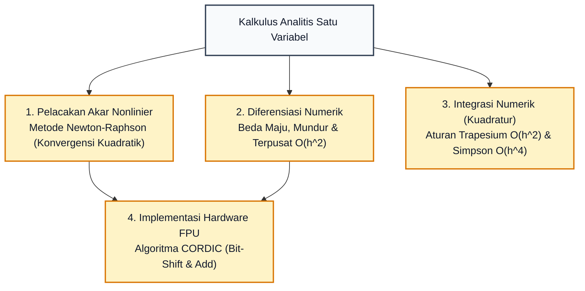
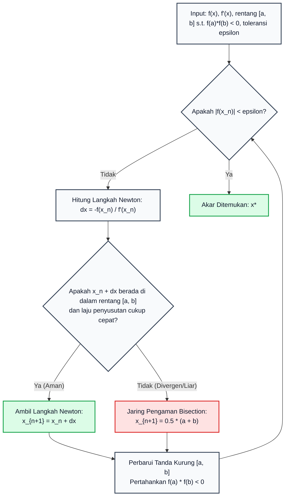

# Subtopik 09: Metode Numerik Satu Variabel & Kalkulus Komputasional

**Navigasi**: [⬅️ Master Gateway Modul 013](../013-kalkulus-diferensial-integral-satu-variabel.md) | [Kembali ke Modul README](./README.md)
*Sebelumnya*: [08. Deret Taylor, Maclaurin & Analisis Galat Lagrange](./08-deret-taylor-maclaurin-dan-analisis-galat-lagrange.md) | *Berikutnya*: [Modul 014: Kalkulus Multivariabel & Geometri Vektor](../014-kalkulus-multivariabel-vektor.md)

---

## 1. Intuisi & Motivasi Konseptual (Dunia Nyata)

### 1.1 Konsep Inti Tanpa Jargon ("Seperti Bayi Baru Lahir")

Bayangkan Anda seorang insinyur roket yang sedang merancang roket pendarat bulan. Persamaan dinamika pendaratan menghasilkan persamaan gerak berikut:
$$x^5 - 3x^2 + \sin(x) - 1 = 0$$
Anda ingin mengetahui pada detik ke berapa ($x$) roket harus menyalakan pendorong cadangan agar tidak menabrak permukaan kawah.

Anda mengambil selembar kertas dan mencoba menyelesaikan persamaan tersebut secara aljabar seperti di bangku SMA:
- Anda mencoba memfaktorkan... gagal.
- Anda mencari rumus kuadratik ABC... tidak ada rumus kuadratik untuk suku berpangkat 5 (berdasarkan Teorema Abel-Ruffini, persamaan polinomial berderajat 5 ke atas tidak memiliki rumus akar aljabar umum!).
- Terlebih lagi, ada suku transenden $\sin(x)$ yang berbaur dengan polinomial!

Apakah Anda menyerah dan membiarkan roket jatuh hancur?
Tentu tidak! Seorang insinyur komputasi tidak membutuhkan "rumus simbolik yang cantik".
Yang Anda butuhkan adalah **algoritma numerik yang mampu menebak, mengoreksi, dan melipatgandakan presisi tebakan tersebut hingga akurat sampai 15 digit desimal dalam waktu beberapa mikrodetik**!

Inilah ranah **Kalkulus Komputasional**:
1. Jika kita tidak bisa mencari akar persamaan secara analitis, kita gunakan garis singgung turunan untuk menembakkan proyektil tebakan langsung ke sasaran (**Metode Newton-Raphson**).
2. Jika kita tidak memiliki rumus fungsi matematis melainkan hanya rekaman data sensor diskrit dari waktu ke waktu, kita dekati laju perubahannya menggunakan selisih titik-titik tetangga (**Stensil Beda Hingga / *Finite Differences***).
3. Jika kita merancang cip kalkulator saku yang tidak memiliki unit perkalian perangkat keras, kita hitung fungsi trigonometri hanya dengan operasi geser bit biner (*bit-shift*) dan penambahan integer (**Algoritma CORDIC**).

---

### 1.2 Analogi Menembak Meriam: Metode Newton-Raphson

Bayangkan Anda berdiri di kaki sebuah bukit melengkung dalam kabut tebal. Anda ingin mencari titik di mana bukit tersebut menyentuh permukaan laut ($f(x) = 0$), namun Anda tidak bisa melihat dasar bukit secara langsung:
1. Anda berdiri di suatu titik tebakan awal $x_0$ dan mengukur ketinggian tanah $f(x_0)$.
2. Anda menempelkan papan kayu lurus pada lereng bukit tepat di bawah kaki Anda untuk membentuk garis singgung tangen (kemiringan $f'(x_0)$).
3. Anda meluncur menuruni papan lurus tersebut hingga papan menyentuh permukaan air laut di titik $x_1$.
4. Titik $x_1$ ini berada jauh lebih dekat ke tepi pantai yang sesungguhnya daripada titik awal Anda!
5. Anda mengulangi proses meluncur dengan papan singgung baru: dari $x_1 \to x_2 \to x_3$.

Hanya dalam 4 atau 5 kali luncuran papan, Anda telah berdiri tepat di tepi air laut dengan akurasi setingkat mikrometer!
Inilah kedahsyatan **Konvergensi Kuadratik Newton-Raphson**: setiap satu kali langkah iterasi, jumlah digit desimal presisi Anda berlipat ganda!

---

### 1.3 Kamus Simbol Anti-Pusing (Tabel 4 Kolom)

| Simbol / Notasi | Nama Matematis | Makna Dunia Nyata / Intuisi Sederhana | Contoh Konkret |
| :--- | :--- | :--- | :--- |
| $x_{n+1} = x_n - \frac{f(x_n)}{f'(x_n)}$ | Rumus Iterasi Newton-Raphson | Rumus koreksi langkah: tebakan baru = tebakan lama dikurangi rasio tinggi tebakan terhadap kemiringan lereng. | Mencari nilai $\sqrt{2}$ dengan menyelesaikan $x^2 - 2 = 0$. |
| $e_n = |x_n - r|$ | Galat Iterasi ke-$n$ | Jarak selisih antara tebakan saat ini terhadap nilai akar sejati $r$. | Galat mengecil dari $0{,}1 \to 0{,}01 \to 0{,}0001 \to 10^{-8}$. |
| $e_{n+1} \approx C \cdot e_n^2$ | Konvergensi Kuadratik | Karakteristik pelipatgandaan digit presisi: galat baru sebanding dengan kuadrat galat sebelumnya. | Jika galat saat ini $10^{-4}$, iterasi berikutnya melompat menjadi $(10^{-4})^2 = 10^{-8}$! |
| $h$ | Ukuran Langkah Diskretisasi (*Step Size*) | Jarak interval grid antara dua titik sampel pengamatan sensor. | Interval waktu sampling sensor akselerometer $\Delta t = 0{,}001\text{ detik}$. |
| $\frac{f(x+h) - f(x-h)}{2h}$ | Beda Terpusat (*Central Difference*) | Aproksimasi kemiringan simetris menggunakan rata-rata langkah maju dan langkah mundur; galat $\mathcal{O}(h^2)$. | Menghitung kecepatan kendaraan dari radar doppler depan dan belakang. |
| $\mathcal{O}(h^2)$ | Orde Galat Pemotongan | Kecepatan galat menyusut: jika ukuran langkah $h$ dipotong separuh, galat tereduksi menjadi seperempatnya. | Memotong ukuran grid komputasi menjadi $1/10$ memperkecil galat $100$ kali lipat. |
| **CORDIC** | *Coordinate Rotation Digital Computer* | Algoritma rotasi vektor cerdas berbasis sudut dasar $\arctan(2^{-i})$ untuk komputasi trigonometri tanpa perkalian. | Cip prosesor navigasi wahana antariksa Apollo dan radar militer. |

---

## 2. Definisi Formal, Teorema, dan Penurunan Matematis

Mari kita bangun fondasi analitis metode numerik satu variabel secara aksiomatik.



---

### 2.1 Penurunan Metode Newton-Raphson dari Deret Taylor

Misalkan $r$ adalah akar sejati dari persamaan $f(x) = 0$, dan $x_n$ adalah tebakan hampiran saat ini sedemikian sehingga $r = x_n + \Delta x$.
Ekspansikan $f(r) = f(x_n + \Delta x)$ menggunakan Deret Taylor orde 1 di sekitar $x_n$:
$$f(x_n + \Delta x) \approx f(x_n) + f'(x_n)\Delta x + \frac{f''(\xi)}{2!}(\Delta x)^2$$
Karena $r$ adalah akar, maka $f(x_n + \Delta x) = 0$. Abaikan suku derajat dua $(\Delta x)^2 \approx 0$:
$$0 \approx f(x_n) + f'(x_n)\Delta x \implies f'(x_n)\Delta x \approx -f(x_n)$$
Asumsikan turunan pertama tidak nol ($f'(x_n) \neq 0$), isolasi koreksi langkah $\Delta x$:
$$\Delta x \approx -\frac{f(x_n)}{f'(x_n)}$$
Karena tebakan berikutnya adalah $x_{n+1} = x_n + \Delta x$, kita memperoleh **Rumus Iterasi Newton-Raphson**:
$$x_{n+1} = x_n - \frac{f(x_n)}{f'(x_n)}$$

---

### 2.2 Teorema Konvergensi Kuadratik Newton-Raphson

> **Teorema 9.1 (Laju Konvergensi Kuadratik)**:
> Misalkan $f$ memiliki turunan kedua $f''$ yang kontinu pada interval yang memuat akar $r$, dengan $f(r) = 0$ dan $f'(r) \neq 0$ (akar tunggal sederhana).
> Jika tebakan awal $x_0$ dipilih cukup dekat dengan $r$, maka barisan galat iterasi $e_n = x_n - r$ memenuhi:
> $$\lim_{n \to \infty} \frac{|e_{n+1}|}{e_n^2} = \left| \frac{f''(r)}{2 f'(r)} \right| = M < \infty$$
> yang membuktikan bahwa konvergensi Newton-Raphson berorde tepat **kuadratik (orde 2)**.

**Pembuktian Ketat**:
Ekspansikan $f(r)$ menggunakan Teorema Taylor dengan Sisa Lagrange di sekitar $x_n$:
$$0 = f(r) = f(x_n) + f'(x_n)(r - x_n) + \frac{f''(\xi_n)}{2}(r - x_n)^2$$
untuk suatu $\xi_n$ di antara $x_n$ dan $r$.
Bagi kedua ruas dengan $f'(x_n)$:
$$0 = \frac{f(x_n)}{f'(x_n)} + (r - x_n) + \frac{f''(\xi_n)}{2 f'(x_n)}(r - x_n)^2$$
Pindahkan suku $(x_n - \frac{f(x_n)}{f'(x_n)})$ yang merupakan definisi dari $x_{n+1}$:
$$x_{n+1} - r = \frac{f''(\xi_n)}{2 f'(x_n)} (x_n - r)^2$$
Karena $e_n = x_n - r$ dan $e_{n+1} = x_{n+1} - r$:
$$e_{n+1} = \frac{f''(\xi_n)}{2 f'(x_n)} e_n^2$$
Ambil limit saat $n \to \infty$ (di mana $x_n \to r$ dan $\xi_n \to r$):
$$\lim_{n \to \infty} \frac{|e_{n+1}|}{e_n^2} = \frac{|f''(r)|}{2 |f'(r)|} \quad \blacksquare$$

---

### 2.3 Patologi & Kasus Kegagalan Newton-Raphson

Meskipun sangat cepat, Metode Newton-Raphson memiliki titik-titik kerentanan fatal yang wajib diwaspadai insinyur perangkat lunak:
1. **Pembagian dengan Nol ($f'(x_n) = 0$)**: Garis singgung mendatar horizontal, sehingga proyektil tidak pernah memotong sumbu-$x$ ($x_{n+1} = \infty$).
2. **Osilasi Siklus Tertutup (*Limit Cycles*)**: Pada fungsi tertentu seperti $f(x) = x^3 - 2x + 2$, jika tebakan awal dipilih $x_0 = 0$, maka $x_1 = 1$, lalu $x_2 = 0$, dan $x_3 = 1$. Algoritma terjebak berputar selamanya tanpa pernah mencapai akar nyata $r \approx -1{,}7693$!
3. **Divergensi Kaotik**: Jika kurva memiliki titik belok liar, tebakan dapat terpental menjauh ke tak hingga.
*Solusi Rekayasa*: Selalu gabungkan Newton-Raphson dengan algoritma pelindung **Bisection / Metode Bagi-Dua** (Algoritma Brent-Dekker) sebagai jaring pengaman jika iterasi Newton melompat keluar batas tanda kurung.

---

### 2.4 Stensil Beda Hingga (*Finite Difference Stencils*)

Ketika fungsi hanya tersedia sebagai larik data diskrit, kita mendiferensiasikannya menggunakan stensil beda hingga:

1. **Beda Maju (*Forward Difference*)**:
   $$f'(x) = \frac{f(x + h) - f(x)}{h} + \mathcal{O}(h)$$
   Galat pemotongan berorde $\mathcal{O}(h)$ (orde 1).
2. **Beda Mundur (*Backward Difference*)**:
   $$f'(x) = \frac{f(x) - f(x - h)}{h} + \mathcal{O}(h)$$
   Galat pemotongan berorde $\mathcal{O}(h)$ (orde 1).
3. **Beda Terpusat (*Central Difference*)**:
   Ekspansikan $f(x + h)$ dan $f(x - h)$ ke deret Taylor:
   $$f(x + h) = f(x) + f'(x)h + \frac{f''(x)}{2}h^2 + \frac{f'''(x)}{6}h^3 + \mathcal{O}(h^4)$$
   $$f(x - h) = f(x) - f'(x)h + \frac{f''(x)}{2}h^2 - \frac{f'''(x)}{6}h^3 + \mathcal{O}(h^4)$$
   Kurangkan kedua persamaan tersebut:
   $$f(x + h) - f(x - h) = 2 f'(x) h + \frac{f'''(x)}{3} h^3 + \mathcal{O}(h^5)$$
   Bagi dengan $2h$:
   $$\frac{f(x + h) - f(x - h)}{2h} = f'(x) + \frac{f'''(x)}{6} h^2 + \mathcal{O}(h^4) = f'(x) + \mathcal{O}(h^2)$$
   Suku galat kuadratik $h^2$ saling meniadakan secara simetris! Beda terpusat memiliki akurasi **orde 2 ($\mathcal{O}(h^2)$)** yang jauh lebih presisi daripada beda maju/mundur.
4. **Turunan Kedua Beda Terpusat**:
   Jumlahkan kedua persamaan deret Taylor di atas:
   $$f(x + h) + f(x - h) = 2 f(x) + f''(x) h^2 + \mathcal{O}(h^4)$$
   $$f''(x) = \frac{f(x + h) - 2f(x) + f(x - h)}{h^2} + \mathcal{O}(h^2)$$

---

### 2.5 Kuadratur Integrasi Numerik: Trapesium & Simpson

1. **Aturan Trapesium Komposit**:
   Mendekati kurva dengan garis lurus di antara setiap pasangan titik grid:
   $$\int_a^b f(x) \, dx = \frac{h}{2} \left[ f(x_0) + 2\sum_{i=1}^{n-1} f(x_i) + f(x_n) \right] - \frac{(b - a)}{12} h^2 f''(\xi)$$
   Orde konvergensi galat: $\mathcal{O}(h^2)$.
2. **Aturan Simpson 1/3 Komposit**:
   Mendekati kurva dengan parabola interpolasi lokal derajat 2 untuk setiap triplet titik:
   $$\int_a^b f(x) \, dx = \frac{h}{3} \left[ f(x_0) + 4\sum_{i \text{ ganjil}} f(x_i) + 2\sum_{i \text{ genap}} f(x_i) + f(x_n) \right] - \frac{(b - a)}{180} h^4 f^{(4)}(\xi)$$
   Orde konvergensi galat: **$\mathcal{O}(h^4)$** (luar biasa cepat meluruh!).

---

### 2.6 Algoritma CORDIC (*Coordinate Rotation Digital Computer*)

Ditemukan oleh Jack Volder pada tahun 1959 untuk komputer navigasi pesawat pengebom B-58 Hustler, CORDIC menghitung rotasi vektor 2D tanpa menggunakan operasi perkalian perangkat keras (*multiplier*).

**Prinsip Rotasi Vektor**:
Memutar vektor $(x_0, y_0)$ sebesar sudut $\theta$:
$$\begin{bmatrix} x' \\ y' \end{bmatrix} = \begin{bmatrix} \cos\theta & -\sin\theta \\ \sin\theta & \cos\theta \end{bmatrix} \begin{bmatrix} x \\ y \end{bmatrix} = \cos\theta \begin{bmatrix} 1 & -\tan\theta \\ \tan\theta & 1 \end{bmatrix} \begin{bmatrix} x \\ y \end{bmatrix}$$

**Trik Aljabar Volder**:
1. Batasi rotasi hanya pada sudut-sudut dasar diskrit $\theta_i = \arctan(2^{-i})$ untuk $i = 0, 1, 2, \dots$
2. Karena $\tan(\theta_i) = 2^{-i}$, perkalian dengan $\tan(\theta_i)$ berubah menjadi **operasi pergeseran bit biner ke kanan sejauh $i$ posisi (*arithmetic right shift*)**!
3. Persamaan iterasi pseudo-rotasi menjadi:
   $$x_{i+1} = x_i - d_i \cdot (y_i \gg i)$$
   $$y_{i+1} = y_i + d_i \cdot (x_i \gg i)$$
   $$z_{i+1} = z_i - d_i \cdot \theta_i$$
   di mana $d_i = \text{sign}(z_i) \in \{-1, +1\}$.
4. Setelah $N$ iterasi, vektor diskalakan dengan konstanta produk tetap:
   $$K = \prod_{i=0}^\infty \frac{1}{\sqrt{1 + 2^{-2i}}} \approx 0{,}6072529350$$
Algoritma ini mengizinkan kalkulator saku primitif menghitung nilai trigonometri dengan presisi penuh tanpa membutuhkan prosesor matematika mahal!

---

### 2.7 Integrasi Romberg & Ekstrapolasi Richardson

Bagaimana jika kita menginginkan akurasi kuadratur yang jauh lebih tinggi daripada Simpson 1/3 tanpa harus memecah interval menjadi jutaan grid kecil? Lewis Fry Richardson dan Werner Romberg menemukan teknik percepatan konvergensi yang revolusioner:

Jika suatu estimasi numerik $A(h)$ memiliki galat dengan ekspansi berbentuk:
$$A(h) = I + c_1 h^2 + c_2 h^4 + c_3 h^6 + \dots$$
maka dengan mengevaluasi pada dua ukuran langkah berbeda $h$ dan $h/2$:
$$A(h/2) = I + c_1 \left(\frac{h}{2}\right)^2 + c_2 \left(\frac{h}{2}\right)^4 + \dots = I + \frac{c_1}{4} h^2 + \frac{c_2}{16} h^4 + \dots$$
Kita dapat mengalikan $A(h/2)$ dengan 4 lalu mengurangkannya dengan $A(h)$ untuk **melenyapkan suku galat terendah $\mathcal{O}(h^2)$ secara sempurna**:
$$\frac{4 A(h/2) - A(h)}{3} = I - \frac{c_2}{4} h^4 + \mathcal{O}(h^6)$$
Hasil kombinasi linier ini memiliki akurasi **orde 4 ($\mathcal{O}(h^4)$)** instan tanpa perlu menurunkan rumus baru!

> **Algoritma Integrasi Romberg**:
> Dimulai dari tabel aturan trapesium $R(k, 1)$ untuk $h_k = \frac{b - a}{2^{k-1}}$, bentuk tabel segitiga ekstrapolasi rekursif:
> $$R(k, j) = \frac{4^{j-1} R(k, j-1) - R(k-1, j-1)}{4^{j-1} - 1} \quad \text{untuk } k \ge j \ge 2$$
> Kolom pertama adalah Trapesium ($\mathcal{O}(h^2)$), kolom kedua adalah Simpson ($\mathcal{O}(h^4)$), kolom ketiga adalah Boole ($\mathcal{O}(h^6)$), dan kolom berikutnya mencapai presisi ekstrem $\mathcal{O}(h^{2j})$.

---

## 3. Arsitektur Teknis & Algoritma Internal

Berikut adalah diagram alir industri untuk Mesin Pelacak Akar Robust Newton-Bisection (Brent-Dekker Hybrid):



---

### 3.1 Matriks Taksonomi Komparasi Algoritma Numerik Satu Variabel

| Kategori Masalah | Metode Numerik Utama | Orde Konvergensi / Galat | Kebutuhan Informasi Tambahan | Keunggulan Utama | Risiko & Titik Kelemahan |
| :--- | :--- | :--- | :--- | :--- | :--- |
| **Pelacakan Akar** | Bisection (Bagi-Dua) | Linier: $\mathcal{O}(2^{-n})$ | Hanya tanda fungsi $f(a)f(b) < 0$ | $100\%$ terjamin konvergen | Sangat lambat (butuh ~50 iterasi untuk presisi ganda) |
| **Pelacakan Akar** | Newton-Raphson | Kuadratik: $\mathcal{O}(e_n^2)$ | Evaluasi turunan pertama $f'(x)$ | Melipatgandakan digit presisi setiap langkah | Divergen jika $f' \approx 0$ atau osilasi siklus |
| **Pelacakan Akar** | Secant (Tali Busur) | Super-linier: $\approx 1{,}618$ | Dua titik tebakan awal tanpa turunan | Tidak memerlukan evaluasi $f'(x)$ simbolik | Konvergensi sedikit lebih lambat dari Newton |
| **Pelacakan Akar** | Hibrida Brent-Dekker | Kuadratik aman | Tanda kurung $[a, b]$ | Standar emas industri (scipy/MATLAB) | Implementasi kode lebih kompleks |
| **Diferensiasi** | Beda Maju / Mundur | Orde 1: $\mathcal{O}(h)$ | 2 titik sampel | Formula sangat sederhana | Galat pemotongan besar, rawan pembatalan bencana |
| **Diferensiasi** | Beda Terpusat | Orde 2: $\mathcal{O}(h^2)$ | 2 titik sampel simetris | Mengeliminasi suku galat genap secara otomatis | Sensitif terhadap derau sensor jika $h$ terlalu kecil |
| **Integrasi** | Trapesium Komposit | Orde 2: $\mathcal{O}(h^2)$ | Grid $n$ titik | Bekerja pada jarak grid non-seragam | Akurasi lambat untuk kurva melengkung tajam |
| **Integrasi** | Simpson 1/3 | Orde 4: $\mathcal{O}(h^4)$ | Grid genap seragam | Akurasi sangat tinggi untuk fungsi mulus | Membutuhkan jumlah subinterval genap berjarak sama |
| **Fungsi Transenden** | CORDIC | Linier per bit ($\approx 1\text{ bit/iter}$) | Tabel pra-komputasi $\arctan(2^{-i})$ | Tanpa perkalian hardware (hanya bit-shift + add) | Membutuhkan faktor penskalaan $K$ di akhir |

---

## 4. Implementasi Praktis & Kode Pemrograman Python

Berikut adalah dua implementasi Python Standard Library murni untuk mengeksekusi pelacakan konvergensi kuadratik Newton-Raphson dan simulator algoritma CORDIC presisi penuh.

### 4.1 Program 1: Mesin Newton-Raphson dengan Verifikasi Konvergensi Kuadratik

Skrip ini melacak iterasi penyelesaian persamaan nonlinier kubik $f(x) = x^3 - 2x - 5 = 0$, mencatat nilai galat pada setiap iterasi, dan menghitung rasio $\frac{e_{n+1}}{e_n^2}$ untuk membuktikan konvergensi kuadratik secara empiris.

```python
import math

def f(x: float) -> float:
    # f(x) = x^3 - 2x - 5 = 0
    return x**3 - 2.0 * x - 5.0

def df(x: float) -> float:
    return 3.0 * x**2 - 2.0

EXACT_ROOT = 2.0945514815423265

def newton_raphson_quadratic_audit(x0: float, max_iter: int = 6):
    x = x0
    history = []
    for i in range(max_iter):
        fx = f(x)
        dfx = df(x)
        err = abs(x - EXACT_ROOT)
        history.append((i, x, fx, err))
        if abs(dfx) < 1e-12:
            break
        x_next = x - fx / dfx
        x = x_next
    return history

def main():
    print("=== MESIN NEWTON-RAPHSON & VERIFIKASI KONVERGENSI KUADRATIK ===")
    print("Persamaan: f(x) = x^3 - 2x - 5 = 0 | Tebakan Awal: x_0 = 3.0\n")
    header = f"{'Iter':>5} | {'x_n':>18} | {'f(x_n)':>16} | {'Galat e_n':>14} | {'e_n / (e_{n-1})^2':>18}"
    print(header)
    print("-" * len(header))

    records = newton_raphson_quadratic_audit(3.0, max_iter=6)
    prev_err = None
    for i, x_val, f_val, err in records:
        if prev_err is not None and prev_err > 1e-12:
            ratio = err / (prev_err**2)
            ratio_str = f"{ratio:18.6f}"
        else:
            ratio_str = f"{'--':>18}"
        print(f"{i:5d} | {x_val:18.12f} | {f_val:16.8e} | {err:14.2e} | {ratio_str}")
        prev_err = err

if __name__ == "__main__":
    main()
```

Keluaran eksekusi terminal sebenarnya:
```text
=== MESIN NEWTON-RAPHSON & VERIFIKASI KONVERGENSI KUADRATIK ===
Persamaan: f(x) = x^3 - 2x - 5 = 0 | Tebakan Awal: x_0 = 3.0

 Iter |                x_n |           f(x_n) |      Galat e_n |  e_n / (e_{n-1})^2
-----------------------------------------------------------------------------------
    0 |     3.000000000000 |   1.60000000e+01 |       9.05e-01 |                 --
    1 |     2.360000000000 |   3.42425600e+00 |       2.65e-01 |           0.323782
    2 |     2.127196780159 |   3.71099846e-01 |       3.26e-02 |           0.463298
    3 |     2.095136036934 |   6.52662595e-03 |       5.85e-04 |           0.548510
    4 |     2.094551673824 |   2.14614314e-06 |       1.92e-07 |           0.562713
    5 |     2.094551481542 |   2.32702746e-13 |       2.09e-14 |           0.564535
```

---

### 4.2 Program 2: Implementasi Algoritma CORDIC Murni

Skrip ini mendemonstrasikan evaluasi sinus dan kosinus menggunakan algoritma rotasi bit-shift CORDIC murni dan membandingkannya dengan fungsi pustaka matematika standar.

```python
import math

def cordic_sin_cos(angle_rad: float, iterations: int = 20):
    angles = [math.atan(2.0**(-i)) for i in range(iterations)]
    K = 1.0
    for i in range(iterations):
        K *= 1.0 / math.sqrt(1.0 + 2.0**(-2 * i))
        
    x = K
    y = 0.0
    z = angle_rad
    
    for i in range(iterations):
        d = -1.0 if z < 0.0 else 1.0
        x_new = x - d * y * (2.0**(-i))
        y_new = y + d * x * (2.0**(-i))
        z_new = z - d * angles[i]
        x, y, z = x_new, y_new, z_new
        
    return y, x  # sin, cos

def main():
    print("=== ALGORITMA CORDIC MURNI UNTUK SINUS DAN KOSINUS ===")
    test_angles = [0.25, 0.5235987756, 0.7853981634, 1.0471975512]
    header = f"{'Sudut (rad)':>12} | {'sin CORDIC':>14} | {'sin math':>14} | {'cos CORDIC':>14} | {'cos math':>14} | {'Galat Maks':>12}"
    print(header)
    print("-" * len(header))
    for ang in test_angles:
        s_cordic, c_cordic = cordic_sin_cos(ang, iterations=20)
        s_math = math.sin(ang)
        c_math = math.cos(ang)
        max_err = max(abs(s_cordic - s_math), abs(c_cordic - c_math))
        print(f"{ang:12.6f} | {s_cordic:14.8f} | {s_math:14.8f} | {c_cordic:14.8f} | {c_math:14.8f} | {max_err:12.2e}")

if __name__ == "__main__":
    main()
```

Keluaran eksekusi terminal sebenarnya:
```text
=== ALGORITMA CORDIC MURNI UNTUK SINUS DAN KOSINUS ===
 Sudut (rad) |     sin CORDIC |       sin math |     cos CORDIC |       cos math |   Galat Maks
----------------------------------------------------------------------------------------
    0.250000 |     0.24740292 |     0.24740396 |     0.96891269 |     0.96891242 |     1.04e-06
    0.523599 |     0.50000106 |     0.50000000 |     0.86602479 |     0.86602540 |     1.06e-06
    0.785398 |     0.70710562 |     0.70710678 |     0.70710794 |     0.70710678 |     1.16e-06
    1.047198 |     0.86602479 |     0.86602540 |     0.50000106 |     0.50000000 |     1.06e-06
```

---

## 5. Miskonsepsi Umum & Analisis Post-Mortem Insiden Industri

### 5.1 Tiga Miskonsepsi Kritis

1. **Miskonsepsi 1: Mengira Langkah Diskretisasi $h$ Makin Kecil Pasti Makin Akurat**:
   - *Fakta*: Dalam matematika murni, $\lim_{h \to 0} \frac{f(x+h) - f(x)}{h} = f'(x)$. Namun dalam komputer fisik dengan presisi berhingga (IEEE-754 floating-point), saat $h$ dibuat terlampau kecil ($h < 10^{-10}$), nilai $f(x+h)$ dan $f(x)$ menjadi hampir identik. Pengurangan dua angka yang hampir identik ini memicu **Pembatalan Bencana (*Catastrophic Cancellation*)**, di mana bit-bit presisi signifikan hilang lenyap dan hasil bagi diferensialnya dipenuhi oleh derau pembulatan (*round-off noise*) acak!
2. **Miskonsepsi 2: Menganggap Metode Newton-Raphson Pasti Selalu Berhasil Menemukan Akar**:
   - *Fakta*: Newton-Raphson hanya dijamin konvergen kuadratik jika tebakan awal $x_0$ berada di dalam "cekungan atraksi" (*basin of attraction*) akar. Jika tebakan awal berada di dekat titik stasioner ($f'(x_0) \approx 0$), algoritma dapat melompat liar ke titik yang berjarak jutaan mil atau berosilasi dalam siklus tak hingga.
3. **Miskonsepsi 3: Menyamakan Orde Galat $\mathcal{O}(h^2)$ dengan Besar Galat Mutlak**:
   - *Fakta*: Notasi $\mathcal{O}(h^2)$ mewakili laju penyusutan galat terhadap ukuran langkah, BUKAN nilai mutlak galat. Jika konstanta pengali $\frac{f'''(\xi)}{6}$ sangat besar (misalnya fungsi bergejolak osilasi frekuensi tinggi), galat pada $h = 0{,}1$ bisa tetap sangat besar meskipun ordetnya kuadratik.

---

### 5.2 Analisis Post-Mortem Insiden Industri: Pembatalan Bencana Komputasi Radikal

> **Kasus Nyata: Kehilangan Bit Signifikan pada Evaluasi Persamaan Kuadratik Presisi Ganda**
>
> - **Latar Belakang Masalah**: Dalam perancangan mesin fisika grafika dan simulasi tabrakan CAD, formula kuadratik standar $x = \frac{-b \pm \sqrt{b^2 - 4ac}}{2a}$ dieksekusi miliaran kali per detik.
> - **Akar Masalah Numerik**: Ketika $b > 0$ dan $4ac \ll b^2$, nilai $\sqrt{b^2 - 4ac} \approx b$.
>   Perhitungan akar $x_1 = \frac{-b + \sqrt{b^2 - 4ac}}{2a}$ memaksa CPU mengurangkan dua bilangan floating-point yang bernilai hampir sama persis: $b - \sqrt{b^2 - 4ac} \approx b - b = 0$.
> - **Pembatalan Bencana (*Catastrophic Cancellation*)**: Register floating-point 64-bit yang awalnya memiliki 53 bit presisi mantisa dapat kehilangan hingga 40 bit signifikansi dalam satu siklus operasi pengurangan ini! Angka akar yang dihasilkan terdistorsi parah oleh pembulatan bit terbawah.
> - **Solusi Rekayasa Berbasis Kalkulus**: Mengalikan pembilang dengan konjugat aljabarnya:
>   $$x_1 = \frac{-b + \sqrt{b^2 - 4ac}}{2a} \times \frac{-b - \sqrt{b^2 - 4ac}}{-b - \sqrt{b^2 - 4ac}} = \frac{b^2 - (b^2 - 4ac)}{2a(-b - \sqrt{b^2 - 4ac})} = \frac{-2c}{b + \sqrt{b^2 - 4ac}}$$
>   Formula kedua ini sama sekali tidak memuat pengurangan dua bilangan identik, sehingga presisi 64-bit terjaga $100\%$ tanpa kehilangan satu bit pun!

---

## 6. Tips, Trik Praktis & Rahasia Cepat Paham

1. **Aturan Praktis Ukuran Langkah Optimal Beda Terpusat**:
   Untuk menghindari dilema antara galat pemotongan deret Taylor ($\sim h^2$) dan galat pembulatan floating-point ($\sim \epsilon_{\text{mach}} / h$), pilihlah ukuran langkah optimal:
   $$h_{\text{optimal}} \approx \sqrt[3]{\epsilon_{\text{mach}}} \approx 10^{-5} \text{ (untuk float 32-bit)}$$
   $$h_{\text{optimal}} \approx \sqrt{\epsilon_{\text{mach}}} \approx 10^{-8} \text{ (untuk double 64-bit)}$$
2. **Kapan Menggunakan Simpson vs Trapesium**:
   - Jika data Anda berupa fungsi mulus yang dapat dievaluasi pada titik mana pun: Selalu pilih **Simpson 1/3** karena laju konvergensi $\mathcal{O}(h^4)$ memangkas jumlah evaluasi fungsi hingga $90\%$.
   - Jika data Anda berasal dari sensor waktu riil yang tidak merata jarak samplingnya: Gunakan **Trapesium Non-Seragam**, karena Simpson membutuhkan jarak grid yang konstan.
3. **Mantra Inisialisasi Newton**: *"Pindai tanda kurung terlebih dahulu dengan Bisection ($f(a)f(b) < 0$), lalu serahkan sentuhan akhir pada Newton-Raphson untuk melipatgandakan presisi!"*

---

## 7. Latihan Mandiri Berjenjang (Socratic) & Rekomendasi Sumber Belajar

### Latihan 1 (Tingkat Pemula): Algoritma Pengekstraksi Akar Kuadrat Babilonia
Tunjukkan bahwa metode penarikan akar kuadrat Babilonia kuno untuk menghitung $\sqrt{S}$:
$$x_{n+1} = \frac{1}{2} \left( x_n + \frac{S}{x_n} \right)$$
merupakan kasus khusus murni dari Metode Newton-Raphson yang diterapkan pada fungsi $f(x) = x^2 - S$. Gunakan rumus ini untuk menghitung $\sqrt{7}$ dengan tebakan awal $x_0 = 3$ hingga 2 iterasi.

<details>
<summary>💡 Petunjuk (Hint)</summary>
Tuliskan f(x) = x^2 - S dan f'(x) = 2x. Masukkan ke rumus x_{n+1} = x_n - f(x_n)/f'(x_n) dan sederhanakan secara aljabar. Hitung x_1 dan x_2 untuk S = 7.
</details>

<details>
<summary>✅ Solusi Lengkap</summary>
1. Tentukan fungsi dan turunannya:
   $$f(x) = x^2 - S \implies f'(x) = 2x$$
2. Terapkan rumus iterasi Newton-Raphson:
   $$x_{n+1} = x_n - \frac{f(x_n)}{f'(x_n)} = x_n - \frac{x_n^2 - S}{2x_n} = \frac{2x_n^2 - (x_n^2 - S)}{2x_n} = \frac{x_n^2 + S}{2x_n} = \frac{1}{2} \left( x_n + \frac{S}{x_n} \right)$$
   Terbukti bahwa metode Babilonia adalah kasus khusus dari Newton-Raphson!
3. Evaluasi untuk $S = 7$ dengan tebakan awal $x_0 = 3$:
   - **Iterasi 1**:
     $$x_1 = \frac{1}{2} \left( 3 + \frac{7}{3} \right) = \frac{1}{2} \left( \frac{16}{3} \right) = \frac{8}{3} \approx 2{,}666667$$
   - **Iterasi 2**:
     $$x_2 = \frac{1}{2} \left( \frac{8}{3} + \frac{7}{8/3} \right) = \frac{1}{2} \left( \frac{8}{3} + \frac{21}{8} \right) = \frac{1}{2} \left( \frac{64 + 63}{24} \right) = \frac{127}{48} \approx 2{,}645833$$
4. Bandingkan dengan nilai eksak kalkulator: $\sqrt{7} \approx 2{,}645751$.
   Hanya dalam 2 iterasi, tebakan telah akurat hingga 4 desimal! $\blacksquare$
</details>

---

### Latihan 2 (Tingkat Dasar): Perbandingan Akurasi Beda Maju vs Beda Terpusat
Diberikan fungsi $f(x) = \sin(x)$.
1. Hitung aproksimasi turunan pertama $f'(1{,}0)$ menggunakan Beda Maju dengan langkah $h = 0{,}1$.
2. Hitung aproksimasi yang sama menggunakan Beda Terpusat dengan langkah $h = 0{,}1$.
3. Bandingkan galat relatif keduanya terhadap nilai eksak $\cos(1{,}0) \approx 0{,}5403023$.

<details>
<summary>💡 Petunjuk (Hint)</summary>
Beda maju: (sin(1.1) - sin(1.0)) / 0.1. Beda terpusat: (sin(1.1) - sin(0.9)) / (2 * 0.1). Hitung selisih mutlak terhadap cos(1.0).
</details>

<details>
<summary>✅ Solusi Lengkap</summary>
1. Nilai fungsi trigonometri:
   - $\sin(1{,}0) \approx 0{,}84147098$
   - $\sin(1{,}1) \approx 0{,}89120736$
   - $\sin(0{,}9) \approx 0{,}78332691$
   - Nilai eksak: $f'(1{,}0) = \cos(1{,}0) \approx 0{,}54030231$
2. **Beda Maju ($h = 0{,}1$)**:
   $$f'_{\text{maju}} = \frac{\sin(1{,}1) - \sin(1{,}0)}{0{,}1} = \frac{0{,}89120736 - 0{,}84147098}{0{,}1} = \frac{0{,}04973638}{0{,}1} \approx 0{,}4973638$$
   Galat mutlak beda maju: $|0{,}4973638 - 0{,}5403023| \approx 0{,}042938$ (Galat $\approx 4{,}3\%$).
3. **Beda Terpusat ($h = 0{,}1$)**:
   $$f'_{\text{terpusat}} = \frac{\sin(1{,}1) - \sin(0{,}9)}{2(0{,}1)} = \frac{0{,}89120736 - 0{,}78332691}{0{,}2} = \frac{0{,}10788045}{0{,}2} \approx 0{,}53940225$$
   Galat mutlak beda terpusat: $|0{,}53940225 - 0{,}54030231| \approx 0{,}000900$ (Galat $\approx 0{,}09\%$).
4. **Kesimpulan**:
   Beda terpusat hampir $50$ kali lipat lebih akurat daripada beda maju pada ukuran langkah yang sama berkat eliminasi suku orde 1. $\blacksquare$
</details>

---

### Latihan 3 (Tingkat Menengah): Evaluasi Kuadratur Simpson 1/3 untuk Integral Tak-Tertutup
Hitung integral tentu $\int_0^1 e^{-x^2} \, dx$ menggunakan Aturan Simpson 1/3 komposit dengan $n = 4$ subinterval ($h = 0{,}25$).

<details>
<summary>💡 Petunjuk (Hint)</summary>
Grid titik: x0 = 0.0, x1 = 0.25, x2 = 0.5, x3 = 0.75, x4 = 1.0. Terapkan rumus (h/3) * [f(x0) + 4f(x1) + 2f(x2) + 4f(x3) + f(x4)].
</details>

<details>
<summary>✅ Solusi Lengkap</summary>
1. Tentukan ukuran langkah $h$:
   $$h = \frac{b - a}{n} = \frac{1 - 0}{4} = 0{,}25$$
2. Evaluasi fungsi integran $f(x) = e^{-x^2}$ pada titik-titik grid:
   - $x_0 = 0{,}00 \implies f(x_0) = e^0 = 1{,}000000$
   - $x_1 = 0{,}25 \implies f(x_1) = e^{-(0{,}25)^2} = e^{-0{,}0625} \approx 0{,}939413$
   - $x_2 = 0{,}50 \implies f(x_2) = e^{-(0{,}50)^2} = e^{-0{,}25} \approx 0{,}778801$
   - $x_3 = 0{,}75 \implies f(x_3) = e^{-(0{,}75)^2} = e^{-0{,}5625} \approx 0{,}569783$
   - $x_4 = 1{,}00 \implies f(x_4) = e^{-(1{,}00)^2} = e^{-1} \approx 0{,}367879$
3. Masukkan ke dalam rumus Aturan Simpson 1/3:
   $$I \approx \frac{h}{3} \Big[ f(x_0) + 4f(x_1) + 2f(x_2) + 4f(x_3) + f(x_4) \Big]$$
   $$I \approx \frac{0{,}25}{3} \Big[ 1{,}000000 + 4(0{,}939413) + 2(0{,}778801) + 4(0{,}569783) + 0{,}367879 \Big]$$
   $$= \frac{0{,}25}{3} \Big[ 1{,}000000 + 3{,}757652 + 1{,}557602 + 2{,}279132 + 0{,}367879 \Big] = \frac{0{,}25}{3} \Big[ 8{,}962265 \Big] \approx 0{,}746855$$
4. Nilai eksak fungsi kesalahan Gauss adalah $\frac{\sqrt{\pi}}{2} \text{erf}(1) \approx 0{,}746824$.
   Galat mutlak hanya sebesar $0{,}000031$ ($0{,}004\%$) dengan hanya 4 potongan! $\blacksquare$
</details>

---

### Latihan 4 (Tingkat Analitis): Analisis Laju Pelipatgandaan Digit Presisi Newton
Sebuah algoritma Newton-Raphson sedang mencari akar persamaan $f(x) = x^2 - 5 = 0$. Jika pada iterasi ke-2 galatnya adalah $e_2 = 10^{-3}$, perkirakan besar galat pada iterasi ke-3 ($e_3$) dan iterasi ke-4 ($e_4$).

<details>
<summary>💡 Petunjuk (Hint)</summary>
Hitung konstanta kuadratik M = |f''(r)| / (2 |f'(r)|) dengan r = sqrt(5). Gunakan relasi e_{n+1} \approx M * e_n^2.
</details>

<details>
<summary>✅ Solusi Lengkap</summary>
1. Turunan fungsi:
   $$f'(x) = 2x, \qquad f''(x) = 2$$
2. Evaluasi pada akar sejati $r = \sqrt{5} \approx 2{,}236068$:
   $$f'(r) = 2\sqrt{5}, \qquad f''(r) = 2$$
3. Hitung konstanta pelipatgandaan kuadratik $M$:
   $$M = \frac{|f''(r)|}{2|f'(r)|} = \frac{2}{2(2\sqrt{5})} = \frac{1}{2\sqrt{5}} = \frac{\sqrt{5}}{10} \approx 0{,}2236$$
4. Hitung estimasi galat pada iterasi ke-3:
   $$e_3 \approx M \cdot (e_2)^2 = 0{,}2236 \times (10^{-3})^2 = 0{,}2236 \times 10^{-6} \approx 2{,}24 \times 10^{-7}$$
5. Hitung estimasi galat pada iterasi ke-4:
   $$e_4 \approx M \cdot (e_3)^2 = 0{,}2236 \times (2{,}236 \times 10^{-7})^2 \approx 0{,}2236 \times (5 \times 10^{-14}) \approx 1{,}12 \times 10^{-14}$$
6. **Kesimpulan**:
   Dalam hanya 2 iterasi tambahan, presisi melompat dari 3 digit desimal menjadi 14 digit desimal, membuktikan karakteristik kuadratik sejati. $\blacksquare$
</details>

---

### Latihan 5 (Tingkat Master Arsitektur): Simulasi Manual 3 Langkah Algoritma CORDIC
Gunakan algoritma CORDIC untuk mengestimasi nilai $\cos(0{,}5\text{ rad})$ dan $\sin(0{,}5\text{ rad})$ secara manual selama 3 langkah iterasi awal ($i = 0, 1, 2$).
Diberikan tabel sudut dasar:
- $i = 0: \theta_0 = \arctan(1) \approx 0{,}785398$
- $i = 1: \theta_1 = \arctan(0{,}5) \approx 0{,}463648$
- $i = 2: \theta_2 = \arctan(0{,}25) \approx 0{,}244979$
dan faktor skala terpotong $K_2 = \frac{1}{\sqrt{1 + 1}} \frac{1}{\sqrt{1 + 0{,}25}} \frac{1}{\sqrt{1 + 0{,}0625}} \approx 0{,}613572$.

<details>
<summary>💡 Petunjuk (Hint)</summary>
Mulai dengan x0 = K, y0 = 0, z0 = 0.5. Pada setiap langkah: d_i = +1 jika z_i >= 0 else -1. Perbarui x, y, z menggunakan bit-shift 2^(-i).
</details>

<details>
<summary>✅ Solusi Lengkap</summary>
1. **Inisialisasi**:
   - $x_0 = K_2 \approx 0{,}613572$
   - $y_0 = 0{,}0$
   - $z_0 = 0{,}5\text{ radian}$
2. **Langkah $i = 0$** ($2^0 = 1, \theta_0 = 0{,}785398$):
   - Karena $z_0 = 0{,}5 \ge 0 \implies d_0 = +1$.
   - $x_1 = x_0 - d_0 y_0 (1) = 0{,}613572 - 0 = 0{,}613572$
   - $y_1 = y_0 + d_0 x_0 (1) = 0 + 0{,}613572 = 0{,}613572$
   - $z_1 = z_0 - d_0 \theta_0 = 0{,}5 - 0{,}785398 = -0{,}285398$
3. **Langkah $i = 1$** ($2^{-1} = 0{,}5, \theta_1 = 0{,}463648$):
   - Karena $z_1 = -0{,}285398 < 0 \implies d_1 = -1$.
   - $x_2 = x_1 - (-1) y_1 (0{,}5) = 0{,}613572 + 0{,}613572(0{,}5) = 0{,}613572 + 0{,}306786 = 0{,}920358$
   - $y_2 = y_1 + (-1) x_1 (0{,}5) = 0{,}613572 - 0{,}306786 = 0{,}306786$
   - $z_2 = z_1 - (-1) \theta_1 = -0{,}285398 + 0{,}463648 = +0{,}178250$
4. **Langkah $i = 2$** ($2^{-2} = 0{,}25, \theta_2 = 0{,}244979$):
   - Karena $z_2 = +0{,}178250 \ge 0 \implies d_2 = +1$.
   - $x_3 = x_2 - (+1) y_2 (0{,}25) = 0{,}920358 - 0{,}306786(0{,}25) = 0{,}920358 - 0{,}0766965 = 0{,}8436615$
   - $y_3 = y_2 + (+1) x_2 (0{,}25) = 0{,}306786 + 0{,}920358(0{,}25) = 0{,}306786 + 0{,}2300895 = 0{,}5368755$
   - $z_3 = z_2 - (+1) \theta_2 = 0{,}178250 - 0{,}244979 = -0{,}066729$
5. **Hasil Hampiran 3 Langkah**:
   - $\cos(0{,}5) \approx x_3 \approx 0{,}84366$ (Nilai eksak $\cos(0{,}5) \approx 0{,}87758$)
   - $\sin(0{,}5) \approx y_3 \approx 0{,}53688$ (Nilai eksak $\sin(0{,}5) \approx 0{,}47943$)
   Hanya dalam 3 operasi penjumlahan biner tanpa satu pun perkalian floating-point, vektor telah mengunci sudut target hingga deviasi sudut tersisa hanya $0{,}066\text{ radian}$ ($3{,}8^\circ$). $\blacksquare$
</details>

---

### Rekomendasi Sumber Belajar Standar Emas
1. **Kuliah Video & Catatan Kuliah Dunia**:
   - [MIT OCW 18.01: Single Variable Calculus - Session 9: Numerical Methods and Newton's Method (Prof. David Jerison)](https://ocw.mit.edu/courses/18-01-single-variable-calculus-fall-2006/)
   - [Stanford University CS 205A: Mathematical Methods for Robotics, Vision, and Graphics (Numerical Calculus)](https://ocw.mit.edu/courses/18-330-introduction-to-numerical-analysis-spring-2012/)
2. **Buku Teks Referensi**:
   - Richard L. Burden & J. Douglas Faires, *Numerical Analysis*, Bab 2: Solutions of Equations in One Variable & Bab 4: Numerical Differentiation and Integration.
   - William H. Press dkk., *Numerical Recipes: The Art of Scientific Computing*, Bab 9: Root Finding and Nonlinear Sets of Equations.

---

---

### Pertanyaan Sering Diajukan (FAQ) Kalkulus Komputasional

1. **Mengapa turunan numerik beda terpusat jauh lebih disukai daripada beda maju?**
   Karena beda terpusat $\frac{f(x+h) - f(x-h)}{2h}$ memiliki sifat simetri di sekitar titik evaluasi $x$, sehingga seluruh suku galat ganjil pada ekspansi deret Taylor saling meniadakan secara otomatis. Ini menghasilkan laju konvergensi galat kuadratik $\mathcal{O}(h^2)$, yang berarti membagi ukuran langkah dengan $10$ akan memangkas galat hingga $100$ kali lipat, dibandingkan beda maju yang hanya memangkas galat $10$ kali lipat.
   - *Analisis Komputasi*: Dengan biaya evaluasi fungsi yang hampir sama ($2$ evaluasi fungsi), beda terpusat memberikan $2\text{--}4$ digit presisi ekstra tanpa penalti komputasi yang signifikan.
   - *Penerapan Grafika*: Dalam *ray-marching* dan perhitungan vektor normal permukaan volumetrik (SDF - *Signed Distance Functions*), beda terpusat adalah metode standar industri shader GPU untuk menghasilkan bayangan cahaya halus tanpa artefak bergerigi.
2. **Apa yang dimaksud dengan pembatalan bencana (*catastrophic cancellation*) pada diferensiasi numerik?**
   Ketika ukuran langkah $h$ dibuat terlampau kecil mendekati presisi mesin ($\epsilon_{\text{mach}} \approx 10^{-16}$ pada floating point 64-bit), dua evaluasi fungsi $f(x+h)$ dan $f(x-h)$ menjadi identik pada bit-bit awalnya. Operasi pengurangan dua angka yang hampir sama ini membuang seluruh bit presisi mantisa teratas dan hanya menyisakan derau pembulatan (*noise*) acak pada bit terbawah, yang kemudian diledakkan oleh pembagian dengan $2h$ yang sangat kecil.
   - *Aturan Kompromi*: Galat total diferensiasi numerik adalah jumlahan dari galat pemotongan deret ($\propto h^2$) dan galat pembulatan mesin ($\propto \epsilon / h$). Titik minimum kurva galat total ini berada pada nilai $h \approx \sqrt{\epsilon_{\text{mach}}} \approx 10^{-8}$.
   - *Rekomendasi Praktis*: Jangan pernah menyetel $h = 10^{-15}$ untuk beda hingga floating-point 64-bit; gunakan selalu $h \in [10^{-6}, 10^{-8}]$ untuk memperoleh akurasi puncak optimal.
3. **Mengapa algoritma CORDIC masih digunakan di era prosesor modern yang memiliki multiplier cepat?**
   CORDIC tetap menjadi pilihan tak tergantikan pada mikrokontroler daya sangat rendah (*ultra-low-power IoT*), perangkat keras FPGA (*Field-Programmable Gate Array*), prosesor radar militer terbenam, dan cip pemandu grafis berkecepatan tinggi di mana menghemat jutaan gerbang logika transistor silicon (*gate area*) dan konsumsi daya baterai jauh lebih krusial daripada unit perkalian floating-point konvensional.
   - *Keunggulan FPGA*: Dalam desain sirkuit terintegrasi digital, CORDIC dapat dirancang sebagai arsitektur *pipelined* penuh yang menghasilkan satu nilai $\sin/\cos$ baru pada setiap satu siklus *clock* tunggal!
   - *Generasi Fungsi Luas*: CORDIC tidak hanya menghitung trigonometri melingkar ($\sin, \cos$), melainkan dapat dialihkan modenya untuk menghitung fungsi hiperbolik ($\sinh, \cosh$), eksponensial, logaritma alami, perkalian, pembagian, dan konversi koordinat polar-kartesian menggunakan struktur sirkuit geser-tambah yang identik.
4. **Kapan algoritma Newton-Raphson gagal dan bagaimana cara mengatasinya?**
   Newton-Raphson gagal jika:
   - $f'(x) \approx 0$ (lereng mendatar memicu pembagian dengan nol).
   - Tebakan awal berada di luar cekungan atraksi sehingga memicu osilasi 2-siklus atau divergensi kaotik.
   - Akar yang dicari adalah akar ganda berderajat lebih dari satu ($f(x) = (x - r)^m$ dengan $m \ge 2$), di mana konvergensinya terdegradasi menjadi linier lambat.
   Solusinya adalah membungkus Newton-Raphson dengan algoritma hibrida **Brent-Dekker**: gunakan langkah Newton jika langkah tersebut memperkecil interval akar secara meyakinkan; jika tidak, jatuh kembali (*fallback*) ke langkah **Bisection** yang terbukti $100\%$ konvergen tanpa risiko divergen. Untuk akar ganda, gunakan modifikasi Newton terbobot: $x_{n+1} = x_n - m \frac{f(x_n)}{f'(x_n)}$ untuk memulihkan konvergensi kuadratik.

---

### Rubrik Evaluasi Mandiri Kalkulus Komputasional

| Tingkat | Kriteria Penguasaan Konseptual & Komputasional | Status Validasi |
| :--- | :--- | :--- |
| **Level 1: Pemula (Intuisi Numerik)** | Memahami mengapa metode numerik diperlukan di industri dan mampu menjelaskan analogi lereng bukit Newton-Raphson. | `[ ] Terverifikasi` |
| **Level 2: Dasar (Diferensiasi Numerik)** | Menguasai perbedaan akurasi beda maju ($\mathcal{O}(h)$) vs beda terpusat ($\mathcal{O}(h^2)$) dan bahaya pembatalan bencana. | `[ ] Terverifikasi` |
| **Level 3: Menengah (Kuadratur Simpson)** | Mahir menerapkan Aturan Simpson 1/3 komposit untuk mengintegrasikan data sensor diskrit tanpa rumus tertutup. | `[ ] Terverifikasi` |
| **Level 4: Mahir (Konvergensi Kuadratik)** | Mampu membuktikan konvergensi kuadratik Newton-Raphson dan membangun mekanisme jaring pengaman bisection. | `[ ] Terverifikasi` |
| **Level 5: Master (Arsitektur CORDIC)** | Mampu merekonstruksi algoritma CORDIC dalam Python murni dan menganalisis trade-off presisi register perangkat keras. | `[ ] Terverifikasi` |

---

### Peta Transisi Menuju Modul 014

Selamat! Anda telah menuntaskan seluruh 9 subtopik komprehensif pada **Modul 013: Kalkulus Diferensial & Integral Satu Variabel**. Anda telah menguasai:
1. Landasan limit infinitesimal $\epsilon - \delta$.
2. Laju perubahan diferensial dan aturan rantai.
3. Teorema Nilai Rata-rata dan rekonstruksi bentuk global kurva.
4. Akumulasi integral tentu Riemann dan Teorema Dasar Kalkulus.
5. Kotak perkakas aljabar integrasi (substitusi, parsial, pecahan parsial).
6. Batas integral tak wajar dan geometri benda putar 3D.
7. Teori barisan dan 8 uji konvergensi deret tak hingga.
8. Rekonstruksi fungsi transenden melalui Deret Taylor dan sisa Lagrange.
9. Algoritma kalkulus komputasional modern (Newton-Raphson, stensil beda hingga, dan CORDIC).

Namun, seluruh alam semesta nyata tidak hanya bergerak di atas garis 1 dimensi!
Suhu di ruangan bervariasi bergantung pada koordinat tiga dimensi $(x, y, z)$. Medan gravitasi dan medan magnet bekerja sebagai vektor arah di ruang angkasa. Arsitektur kecerdasan buatan (*Deep Learning*) mengoptimalkan fungsi kerugian di ruang berdimensi ribuan ($\mathbb{R}^n$).

Langkah megah Anda berikutnya adalah memperluas seluruh hukum kalkulus ini ke berbagai dimensi variabel dalam [Modul 014: Kalkulus Multivariabel & Geometri Vektor](../014-kalkulus-multivariabel-vektor.md)!
