# Modul 013: Kalkulus Diferensial & Integral Satu Variabel (Limit Infinitesimal, Turunan, Integral Riemann, Deret Taylor)

Selamat datang di direktori kurikulum resmi **Modul 013: Kalkulus Diferensial & Integral Satu Variabel**. Direktori ini dirancang secara khusus untuk membimbing siapa saja—mulai dari seseorang yang baru memulai dari nol mutlak tanpa latar belakang matematika lanjutan hingga insinyur perangkat lunak profesional—untuk menguasai fondasi kalkulus satu variabel secara mendalam, intuitif, dan aplikatif.

---

## 1. Peta Navigasi & Arsitektur Graf Ketergantungan Modular

Kurikulum ini dipecah ke dalam 9 subtopik terstruktur yang saling menopang secara berjenjang. Peta alir ketergantungan konsep disajikan di bawah ini:

```mermaid
flowchart TD
    subgraph Modul 013: Kalkulus Diferensial & Integral Satu Variabel
        B1["Bab 01: Limit, Kekontinuan & Definisi Epsilon-Delta"] --> B2["Bab 02: Turunan, Laju Perubahan & Aturan Rantai"]
        B2 --> B3["Bab 03: Teorema Nilai Rata-rata, Analisis Fungsi & L'Hopital"]
        B3 --> B4["Bab 04: Integral Riemann, Jumlahan Partisi & Teorema Dasar Kalkulus"]
        B4 --> B5["Bab 05: Teknik Pengintegralan: Substitusi, Parsial & Pecahan Parsial"]
        B5 --> B6["Bab 06: Integral Tak Wajar & Aplikasi Geometri/Fisika"]
        B4 & B6 --> B7["Bab 07: Barisan & Deret Tak Hingga: 8 Uji Konvergensi"]
        B7 --> B8["Bab 08: Deret Taylor, Maclaurin & Batas Galat Lagrange"]
        B8 --> B9["Bab 09: Metode Numerik Satu Variabel & Algoritma CORDIC FPU"]
    end

    classDef b1 fill:#e1f5fe,stroke:#0288d1,stroke-width:2px,color:#0f172a;
    classDef b2 fill:#f3e5f5,stroke:#7b1fa2,stroke-width:2px,color:#0f172a;
    classDef b3 fill:#e8f5e9,stroke:#388e3c,stroke-width:2px,color:#0f172a;
    class B1,B2,B3 b1;
    class B4,B5,B6 b2;
    class B7,B8,B9 b3;
```



---

## 2. Direktori 9 Subtopik & Estimasi Waktu Belajar

Setiap berkas subtopik di bawah ini disusun mengikuti standar mutu ketat 7-lapis: intuisi analogis dunia nyata, perumusan formal dan pembuktian matematis, diagram arsitektur teknis sistemik, implementasi kode Python murni dengan keluaran terminal sebenarnya, analisis post-mortem insiden industri, tips praktis, serta latihan berjenjang Sokratik.

| No | Berkas Subtopik | Pokok Bahasan Utama | Estimasi Waktu Belajar |
|---|---|---|---|
| **01** | [01-limit-kekontinuan-definisi-epsilon-delta.md](./01-limit-kekontinuan-definisi-epsilon-delta.md) | Intuisi infinitesimal, limit sepihak, definisi formal Cauchy $\epsilon-\delta$, Teorema Apit (*Squeeze Theorem*), dan limit di tak hingga. | 4 – 5 Jam |
| **02** | [02-turunan-laju-perubahan-aturan-rantai.md](./02-turunan-laju-perubahan-aturan-rantai.md) | Garis sekan ke garis singgung, aturan perkalian Leibniz & hasil bagi, aturan rantai (*Chain Rule*) multitingkat, dan diferensiasi implisit. | 4 – 5 Jam |
| **03** | [03-teorema-nilai-rata-rata-dan-analisis-fungsi.md](./03-teorema-nilai-rata-rata-dan-analisis-fungsi.md) | Teorema Rolle, Teorema Nilai Rata-rata (MVT), titik kritis & uji turunan, kecekungan, serta evaluasi 7 bentuk tak tentu via Aturan L'Hôpital. | 5 – 6 Jam |
| **04** | [04-integral-riemann-jumlah-riemann-teorema-dasar-kalkulus.md](./04-integral-riemann-jumlah-riemann-teorema-dasar-kalkulus.md) | Partisi jumlahan Riemann, definisi integral tentu, Teorema Dasar Kalkulus Bagian 1 & 2 (FTC I & II), serta Teorema Nilai Rata-rata Integral. | 5 – 6 Jam |
| **05** | [05-teknik-pengintegralan-substitusi-parsial-pecahan-parsial.md](./05-teknik-pengintegralan-substitusi-parsial-pecahan-parsial.md) | Substitusi $u$, integrasi parsial (metode tabular LIATE), substitusi trigonometri, dekomposisi pecahan parsial, dan substitusi Weierstrass. | 6 – 7 Jam |
| **06** | [06-integral-tak-wajar-dan-aplikasi-geometris-fisika.md](./06-integral-tak-wajar-dan-aplikasi-geometris-fisika.md) | Integral tak wajar Tipe 1 & 2, uji banding konvergensi $p$-integral, volume benda putar (cakram, cincin, tabung), dan panjang busur. | 5 – 6 Jam |
| **07** | [07-barisan-dan-deret-tak-hingga-uji-konvergensi.md](./07-barisan-dan-deret-tak-hingga-uji-konvergensi.md) | Barisan bilangan riil, deret geometri & teleskopik, 8 uji konvergensi (uji rasio D'Alembert, uji akar, uji integral), serta konvergensi mutlak vs bersyarat. | 6 – 7 Jam |
| **08** | [08-deret-taylor-maclaurin-dan-analisis-galat-lagrange.md](./08-deret-taylor-maclaurin-dan-analisis-galat-lagrange.md) | Polinomial Taylor, Deret Maclaurin fungsi transendental, sisa Taylor Lagrange (*Lagrange Error Bound*), serta radius dan interval konvergensi. | 6 – 7 Jam |
| **09** | [09-metode-numerik-satu-variabel-dan-kalkulus-komputasional.md](./09-metode-numerik-satu-variabel-dan-kalkulus-komputasional.md) | Newton-Raphson pencarian akar, diferensiasi beda hingga, kuadratur Simpson 1/3, dan implementasi algoritma CORDIC pada mikroprosesor FPU. | 5 – 6 Jam |

---

## 3. Kamus Notasi Simbol Kalkulus Anti-Pusing

Bagi pemula yang baru pertama kali mempelajari kalkulus, notasi matematika sering kali menjadi penghalang terbesar. Gunakan tabel referensi cepat ini untuk menerjemahkan simbol-simbol formal kalkulus ke bahasa manusia sehari-hari:

| Simbol Formal | Nama Notasi | Terjemahan Bahasa Manusia Sederhana | Analogi Fisik Dunia Nyata |
|---|---|---|---|
| $\lim_{x \to c} f(x) = L$ | Limit Fungsi | "Ketika input $x$ semakin mendekati angka $c$, nilai output $f(x)$ semakin merapat ke $L$" | Mobil mendekati garis finis sedekat mungkin tanpa menabrak pembatas |
| $\forall \epsilon > 0, \exists \delta > 0$ | Kuantor Cauchy $(\epsilon - \delta)$ | "Beri saya batas toleransi galat vertikal sekecil apa pun ($\epsilon$), saya selalu bisa menemukan batas toleransi horizontal ($\delta$)" | Standar toleransi pabrik lensa kamera: jika presisi diameter lensa dijaga, titik fokus dijamin tajam |
| $\frac{df}{dx} \text{ atau } f'(x)$ | Turunan Pertama (Derivative) | "Laju perubahan nilai $f(x)$ seketika per satu satuan perubahan infinitesimal pada $x$" | Jarum speedometer mobil yang menunjukkan kecepatan tepat pada detik ke-5 |
| $\frac{d^2f}{dx^2} \text{ atau } f''(x)$ | Turunan Kedua | "Laju perubahan dari laju perubahan (percepatan atau kelengkungan kurva)" | Gaya dorong yang Anda rasakan menekan tubuh ke sandaran jok saat pedal gas diinjak mendadak |
| $\int_a^b f(x) \, dx$ | Integral Tentu Riemann | "Jumlahan akumulasi seluruh potongan tipis persegi panjang dengan tinggi $f(x)$ dan lebar infinitesimal $dx$ dari titik $a$ ke $b$" | Mengumpulkan air hujan dalam ember: total liter air adalah akumulasi laju tetesan air sepanjang waktu |
| $\int f(x) \, dx$ | Integral Tak Tentu (Antiturunan) | "Mencari keluarga fungsi asli $F(x) + C$ yang jika diturunkan akan menghasilkan kembali $f(x)$" | Merekonstruksi jalur posisi penerbangan pesawat dari rekaman data akselerometer |
| $\sum_{n=0}^\infty a_n$ | Deret Tak Hingga | "Jumlahan deret bilangan yang diteruskan terus-menerus hingga suku ke tak terhingga" | Memotong kue menjadi $1/2$, lalu $1/4$, lalu $1/8$; jika seluruh potongan dijumlahkan, totalnya kembali menjadi 1 kue utuh |
| $R_n(x)$ | Sisa Galat Taylor Lagrange | "Selisih galat maksimal antara nilai fungsi sejati dan nilai polinomial aproksimasi derajat $n$" | Galat pembulatan desimal pada layar kalkulator saku |
| $\Delta x \text{ vs } dx$ | Selisih Hingga vs Infinitesimal | "$\Delta x$ adalah perubahan terukur berukuran besar (misal 1 detik), sedangkan $dx$ adalah perubahan yang dibuat sangat dekat ke nol" | $\Delta x$: lompatan jarum jam dinding; $dx$: aliran waktu yang mengalir mulus tanpa henti |
| $U(P, f) \text{ vs } L(P, f)$ | Jumlahan Darboux Atas & Bawah | "Batas atas estimasi luas menggunakan nilai maksimum kurva vs batas bawah menggunakan nilai minimum kurva" | Menjepit harga wajar saham di antara harga beli terendah dan harga jual tertinggi |
| $ds = \sqrt{1 + (f')^2} \, dx$ | Elemen Panjang Busur Infinitesimal | "Panjang potongan garis miring mikroskopis berdasarkan Teorema Pythagoras $ds^2 = dx^2 + dy^2$" | Menghitung jarak rute jalan tol berliku melintasi perbukitan |
| $\rho \text{ atau } R$ | Radius Konvergensi Deret Pangkat | "Jarak terjauh dari titik pusat $a$ di mana deret polinomial tak hingga dijamin menghasilkan angka riil terhingga" | Jangkauan sinyal hotspot Wi-Fi: sinyal hanya tertangkap jika Anda berada di dalam radius $R$ meter |
| $C^k$ | Kelas Kemulusan Fungsi | "Fungsi yang turunannya kontinu hingga turunan ke-$k$" | Rel kereta api cepat (Shinkansen) dirancang dengan kurva $C^2$ agar penumpang tidak terlempar sentrifugal mendadak |
| $\kappa(x)$ | Kelengkungan Geometris (Curvature) | "Tingkat seberapa tajam kurva membelok pada setiap titik: $\kappa = \frac{\|f''\|}{(1 + (f')^2)^{3/2}}$" | Radius tikungan tajam pada sirkuit balap Formula 1 |
| $L = \lim \left\|\frac{a_{n+1}}{a_n}\right\|$ | Rasio D'Alembert | "Rasio perbandingan ukuran suku berikutnya terhadap suku saat ini saat $n$ mendekati tak hingga" | Laju penyusutan modal investasi: jika modal berkurang menjadi separuhnya setiap bulan, saldo pasti menuju nol |

---

## 4. Fondasi 5-Menit Python untuk Kalkulus Komputasional

Kalkulus modern tidak lagi dihitung semata menggunakan manipulasi pensil dan kertas. Dalam rekayasa AI, fisika semikonduktor, dan sistem grafis komputer, kalkulus dioperasikan secara numerik melalui algoritma komputasi. 

Berikut adalah skrip Python mandiri yang mendemonstrasikan dua pilar kalkulus: turunan numerik diferensiasi beda tengah (*Central Difference*) dan integral numerik Aturan Simpson 1/3:

```python
"""
Fondasi 5-Menit Python untuk Kalkulus Komputasional
Mendemonstrasikan Aproksimasi Turunan Orde-2 dan Integral Numerik Simpson 1/3.
"""
from typing import Callable
import math

def central_difference(f: Callable[[float], float], x: float, h: float = 1e-5) -> float:
    """Menghitung turunan f'(x) dengan skema beda tengah berorde galat O(h^2)."""
    return (f(x + h) - f(x - h)) / (2.0 * h)

def simpson_rule(f: Callable[[float], float], a: float, b: float, n: int = 100) -> float:
    """Menghitung integral tentu integral_a^b f(x) dx menggunakan Aturan Simpson 1/3."""
    if n % 2 == 1:
        n += 1  # n wajib genap
    h = (b - a) / n
    total = f(a) + f(b)
    for i in range(1, n):
        x_i = a + i * h
        total += 4.0 * f(x_i) if i % 2 == 1 else 2.0 * f(x_i)
    return total * (h / 3.0)

if __name__ == "__main__":
    # Fungsi uji: f(x) = x^3 - 2x + 1
    # Turunan analitik: f'(x) = 3x^2 - 2
    # Integral analitik [0, 2]: [x^4/4 - x^2 + x]_0^2 = 4 - 4 + 2 = 2.0
    func = lambda x: x**3 - 2.0 * x + 1.0
    
    x_eval = 2.0
    exact_derivative = 3.0 * (x_eval**2) - 2.0  # 10.0
    approx_derivative = central_difference(func, x_eval)
    
    a_bound, b_bound = 0.0, 2.0
    exact_integral = 2.0
    approx_integral = simpson_rule(func, a_bound, b_bound, n=100)
    
    print(f"Turunan f'({x_eval}) Eksak: {exact_derivative:.6f} | Numerik: {approx_derivative:.6f}")
    print(f"Galat Absolut Turunan: {abs(exact_derivative - approx_derivative):.2e}")
    print(f"Integral [0, 2] Eksak: {exact_integral:.6f} | Numerik: {approx_integral:.6f}")
    print(f"Galat Absolut Integral: {abs(exact_integral - approx_integral):.2e}")
```

Keluaran eksekusi terminal sebenarnya:
```text
Turunan f'(2.0) Eksak: 10.000000 | Numerik: 10.000000
Galat Absolut Turunan: 1.99e-10
Integral [0, 2] Eksak: 2.000000 | Numerik: 2.000000
Galat Absolut Integral: 0.00e+00
```

---

## 5. Top 5 Studi Kasus Bencana Nyata Industri Akibat Kesalahan Kalkulus & Numerik

Menguasai kalkulus bukan sekadar urusan lulus ujian kuliah; kesalahan pemahaman kalkulus infinitesimal dan akumulasi galat numerik telah berulang kali memicu bencana kerugian triliunan rupiah dan merenggut korban jiwa di dunia industri:

1. **Kegagalan Baterai Rudal MIM-104 Patriot Dhahran (1991)**:
   - *Akar Masalah*: Waktu clock internal sistem diintegrasikan setiap $0{,}1$ detik menggunakan representasi bilangan biner titik tetap (*fixed-point*) 24-bit. Nilai $1/10$ menghasilkan bilangan biner berulang tak hingga yang terpotong. Setelah beroperasi terus menerus selama 100 jam, galat waktu akumulatif terintegrasi sebesar $0{,}3433$ detik.
   - *Konsekuensi*: Radar pelacak rudal meleset sejauh 687 meter, gagal mencegat rudal Scud yang datang, menewaskan 28 tentara.
2. **Ledakan Roket Ruang Angkasa Ariane 5 Penerbangan 501 (1996)**:
   - *Akar Masalah*: Nilai kecepatan horizontal roket yang dihitung dari integral akselerometer diubah dari format *floating-point* 64-bit ke bilangan bulat bertanda 16-bit tanpa proteksi pengecualian (*exception handler*). Nilai turunan laju percepatan melampaui batas maksimum integer 32.767, memicu *arithmetic overflow*.
   - *Konsekuensi*: Komputer pemandu salah menafsirkan *overflow* sebagai gerakan anomali 90 derajat, memerintahkan roket menikung tajam dan meledak 37 detik setelah peluncuran, kerugian mencapai USD 370 juta.
3. **Runtuhnya Anjungan Minyak Lepas Pantai Sleipner A Norwegia (1991)**:
   - *Akar Masalah*: Perangkat lunak analisis elemen hingga (NASTRAN) menggunakan metode integrasi numerik elemen segitiga yang meremehkan tegangan geser sebesar $47\%$. Ketebalan dinding beton pilar gravitasi dirancang terlalu tipis akibat galat integrasi persamaan diferensial tegangan elastisitas.
   - *Konsekuensi*: Dinding pilar retak saat anjungan ditenggelamkan ke laut, memicu keruntuhan total struktur ke dasar fjord dan gempa berkekuatan 3.0 skala Richter dengan kerugian total USD 700 juta.
4. **Kehancuran Wahana Antariksa Mars Climate Orbiter (1999)**:
   - *Akar Masalah*: Perangkat lunak ground-control menghitung integral impuls pendorong (*impulse integral* $\int F \, dt$) dalam satuan imperial pound-force-seconds, sedangkan sistem pesawat antariksa menginterpretasikannya dalam satuan metrik Newton-detik ($1\text{ lbf} = 4{,}44822\text{ N}$).
   - *Konsekuensi*: Lintasan orbit wahana meluncur terlalu rendah ke dalam atmosfer Mars dan hancur terbakar, kerugian USD 327 juta.
5. **Kekeliruan Pemotongan Indeks Bursa Saham Vancouver Stock Exchange (1982)**:
   - *Akar Masalah*: Indeks bursa saham dihitung ulang setiap kali terjadi transaksi dan dibulatkan ke bawah (*truncation*) hingga 3 desimal alih-alih dibulatkan secara benar (*symmetric rounding*).
   - *Konsekuensi*: Akumulasi pemotongan mikroskopis puluhan ribu transaksi per hari mengakibatkan indeks bursa tergerus hingga separuh nilainya dalam tempo 22 bulan, dari 1.000 poin melorot semu ke 524 poin sebelum kode diperbaiki.

---

## 6. Strategi Belajar 4 Minggu & Rubrik Penguasaan Mandiri

Untuk menyelesaikan Modul 013 secara optimal tanpa kelelahan kognitif, ikuti jadwal belajar mingguan berikut:

- **Minggu 1: Fondasi Limit & Diferensiasi**:
  - Pelajari Bab 01, Bab 02, dan Bab 03.
  - Latihan membuktikan limit dengan $\epsilon-\delta$, kuasai aturan rantai multi-variabel, dan analisis sketsa kurva fungsi menggunakan turunan pertama dan kedua.
- **Minggu 2: Integral Riemann & Teknik Pengintegralan Mahir**:
  - Pelajari Bab 04 dan Bab 05.
  - Kuasai pembuktian Teorema Dasar Kalkulus (FTC I & II) dan latih kecepatan menghitung integral parsial tabular dan pecahan parsial.
- **Minggu 3: Integral Tak Wajar, Geometri & Deret Tak Hingga**:
  - Pelajari Bab 06 dan Bab 07.
  - Selesaikan masalah volume benda putar menggunakan metode kulit tabung dan kuasai 8 uji konvergensi deret tak hingga.
- **Minggu 4: Deret Taylor, Metode Numerik & Proyek Terpadu**:
  - Pelajari Bab 08 dan Bab 09.
  - Hitung batas galat Lagrange pada ekspansi fungsi transendental dan implementasikan algoritma pencarian akar Newton-Raphson serta Aturan Simpson dalam Python.
  - Uji pemahaman Anda melalui kuis latihan Sokratik pada `tier-01-mathematics-drills.md` dan kartu Anki pada `deck-01-cognitive-logic-math.md`.

---

## 7. Glosarium 30 Istilah Inti Kalkulus Satu Variabel

1. **Infinitesimal**: Kuantitas yang lebih kecil dari bilangan riil positif apa pun, tetapi tidak sama dengan nol mutlak.
2. **Limit $(\epsilon-\delta)$**: Definisi formal ketelitian limit di mana toleransi output $\epsilon$ dijamin oleh keberadaan radius input $\delta$.
3. **Kontinuitas**: Sifat fungsi di mana tidak ada lompatan, lubang, atau asimtot, yaitu $\lim_{x \to c} f(x) = f(c)$.
4. **Diferensiabilitas**: Kondisi di mana fungsi memiliki garis singgung unik yang tidak tegak lurus pada suatu titik.
5. **Garis Sekan**: Garis lurus yang memotong kurva pada dua titik terpisah.
6. **Garis Singgung (Tangen)**: Garis lurus yang menyentuh kurva pada tepat satu titik lokal, merepresentasikan limit garis sekan saat $\Delta x \to 0$.
7. **Laju Perubahan Sesaat**: Nilai turunan pada suatu titik, mengukur kecepatan perubahan per satuan waktu infinitesimal.
8. **Aturan Rantai (Chain Rule)**: Rumus turunan fungsi komposisi $\frac{d}{dx}[f(g(x))] = f'(g(x)) \cdot g'(x)$.
9. **Turunan Implisit**: Teknik diferensiasi persamaan yang menghubungkan $x$ dan $y$ tanpa perlu menyatakan $y$ secara eksplisit sebagai $f(x)$.
10. **Laju Terkait (Related Rates)**: Masalah diferensial yang menghitung laju perubahan suatu variabel berdasarkan laju variabel lain yang saling bergantung terhadap waktu.
11. **Teorema Nilai Ekstrem (EVT)**: Jaminan bahwa fungsi kontinu pada interval tertutup $[a, b]$ pasti mencapai nilai maksimum mutlak dan minimum mutlak.
12. **Titik Kritis**: Titik di mana $f'(c) = 0$ atau $f'(c)$ tidak terdefinisi.
13. **Teorema Rolle**: Jika fungsi kontinu pada $[a, b]$, terturunkan pada $(a, b)$, dan $f(a) = f(b)$, maka terdapat $c \in (a, b)$ sehingga $f'(c) = 0$.
14. **Teorema Nilai Rata-rata (MVT)**: Terdapat titik $c$ di mana kemiringan garis singgung sesaat sama persis dengan kemiringan rata-rata $\frac{f(b) - f(a)}{b - a}$.
15. **Kecekungan (Concavity)**: Kelengkungan grafik fungsi ke atas ($f'' > 0$, seperti mangkuk) atau ke bawah ($f'' < 0$, seperti kubah).
16. **Titik Belok (Inflection Point)**: Titik di mana kurva berganti arah kecekungan dari cekung ke atas menjadi cekung ke bawah (atau sebaliknya).
17. **Aturan L'Hôpital**: Metode mengevaluasi limit bentuk tak tentu $0/0$ atau $\infty/\infty$ dengan mengambil turunan pembilang dan penyebut.
18. **Partisi Riemann**: Pembagian interval $[a, b]$ menjadi subinterval-subinterval kecil untuk mendekati luas area kurva.
19. **Integral Riemann**: Nilai limit jumlahan luas persegi panjang partisi saat lebar maksimum subinterval mendekati nol.
20. **Teorema Dasar Kalkulus I (FTC I)**: Diferensiasi dari fungsi akumulasi integral mengembalikan fungsi asli: $\frac{d}{dx} \int_a^x f(t) dt = f(x)$.
21. **Teorema Dasar Kalkulus II (FTC II)**: Evaluasi integral tentu melalui antiturunan: $\int_a^b f(x) dx = F(b) - F(a)$.
22. **Integrasi Parsial**: Aturan integral turunan dari perkalian: $\int u dv = uv - \int v du$.
23. **Pecahan Parsial**: Penguraian fungsi rasional $\frac{P(x)}{Q(x)}$ menjadi penjumlahan pecahan-pecahan sederhana yang mudah diintegralkan.
24. **Integral Tak Wajar**: Integral dengan batas integrasi tak hingga ($\pm \infty$) atau dengan integran yang memiliki asimtot tegak pada domain integrasi.
25. **Metode Kulit Tabung**: Teknik menghitung volume benda putar dengan mengintegrasikan silinder konsentris tipis.
26. **Deret Geometri**: Deret tak hingga dengan rasio tetap $r$, konvergen ke $\frac{a}{1 - r}$ jika $|r| < 1$.
27. **Uji Rasio D'Alembert**: Uji konvergensi deret berdasarkan limit rasio suku berurutan $L = \lim |a_{n+1}/a_n|$; konvergen mutlak jika $L < 1$.
28. **Polinomial Taylor**: Aproksimasi fungsi menggunakan polinomial derajat $n$ yang mencocokkan nilai turunan hingga ke-$n$ di sekitar titik pusat $a$.
29. **Batas Galat Lagrange**: Nilai batas atas absolut galat pemotongan polinomial Taylor berderajat $n$: $|R_n(x)| \le \frac{M}{(n+1)!} |x - a|^{n+1}$.
30. **Algoritma CORDIC**: Algoritma rotasi vektor berbasis bit-shift dan penjumlahan tabel sudut yang digunakan prosesor untuk menghitung fungsi trigonometri tanpa perkalian berat.

---

## 8. FAQ Pembelajar Kalkulus: Pertanyaan Paling Sering Diajukan Pemula

1. **Pertanyaan: Apakah $dx$ dalam integral itu angka biasa yang bisa dicoret aljabar?**  
   *Jawaban*: Dalam kalkulus standar modern, $dx$ adalah penanda diferensial yang menunjukkan variabel integrasi dan lebar partisi infinitesimal. Namun dalam analisis non-standar Robinson atau kalkulus bentuk diferensial, $dx$ dapat diperlakukan secara aljabar dengan aturan yang sangat ketat (seperti substitusi variabel $du = g'(x) dx$).
2. **Pertanyaan: Mengapa $\frac{0}{0}$ disebut bentuk tak tentu dan bukan tidak terdefinisi?**  
   *Jawaban*: Pembagian angka tetap seperti $5/0$ adalah tidak terdefinisi karena tidak ada angka riil yang memenuhi. Sebaliknya, $\lim \frac{f(x)}{g(x)}$ saat keduanya menuju nol disebut tak tentu (*indeterminate*) karena hasilnya bisa bernilai angka riil berapa pun ($2, -5, 0, \infty$) tergantung pada siapa yang mendekati nol lebih cepat.
3. **Pertanyaan: Mengapa fungsi kontinu tidak selalu terturunkan?**  
   *Jawaban*: Contoh klasiknya adalah fungsi nilai mutlak $f(x) = |x|$ pada $x = 0$. Garis kurva bersambung tanpa putus (kontinu), namun di titik $x = 0$ terdapat sudut tajam di mana kemiringan dari kiri adalah $-1$ dan dari kanan adalah $+1$. Karena limit kiri dan kanan tidak sama, fungsi tidak terturunkan di titik sudut tersebut.
4. **Pertanyaan: Mengapa deret Taylor untuk $\frac{1}{1-x}$ tidak berlaku untuk $x = 2$?**  
   *Jawaban*: Polinomial deret geometri $1 + x + x^2 + \dots$ memiliki radius konvergensi $R = 1$. Memasukkan $x = 2$ menghasilkan jumlahan $1 + 2 + 4 + 8 + \dots = \infty$, yang jelas tidak sama dengan $\frac{1}{1-2} = -1$. Teorema konvergensi Cauchy selalu menuntut kita memeriksa interval konvergensi sebelum mengevaluasi deret pangkat.
5. **Pertanyaan: Apa perbedaan mendasar antara diferensiasi simbolik dan diferensiasi numerik?**  
   *Jawaban*: Diferensiasi simbolik menerapkan aturan aljabar (seperti aturan rantai atau perkalian) untuk menghasilkan rumus rumus eksak analitis, sedangkan diferensiasi numerik menghitung nilai kemiringan menggunakan beda terhingga (seperti $(f(x+h) - f(x-h))/(2h)$) pada komputer.
6. **Pertanyaan: Kapan saya harus menggunakan metode cincin vs metode kulit tabung pada volume benda putar?**  
   *Jawaban*: Gunakan metode cincin jika integrasi dilakukan tegak lurus terhadap sumbu putar (misal irisan melintang $dx$ saat diputar terhadap sumbu $x$). Gunakan metode kulit tabung jika integrasi dilakukan sejajar dengan sumbu putar (misal irisan vertikal $dx$ saat diputar terhadap sumbu $y$). Pilihlah metode yang menghasilkan integral fungsi tunggal yang paling mudah diselesaikan tanpa perlu membalik fungsi $x = f^{-1}(y)$.
7. **Pertanyaan: Mengapa Aturan Simpson jauh lebih akurat daripada Aturan Trapesium padahal jumlah evaluasi titiknya hampir sama?**  
   *Jawaban*: Aturan Trapesium menghubungkan titik data dengan garis lurus (polinomial derajat 1) dengan galat sebanding $O(h^2)$, sedangkan Aturan Simpson memasang kurva parabola (polinomial derajat 2) melewati tiap 3 titik berurutan. Hebatnya, karena sifat simetri kelengkungan, Aturan Simpson secara ajaib eksak sempurna untuk polinomial hingga derajat 3 (kubik) dengan galat $O(h^4)$!
8. **Pertanyaan: Mengapa kita harus mempelajari kalkulus satu variabel sebelum multivariabel?**  
   *Jawaban*: Semua konsep multivariabel di Modul 014 (seperti gradien, turunan parsial, integral ganda, dan teorema divergensi Gauss) secara langsung menggeneralisasikan turunan dan integral satu variabel yang telah dipahami secara kokoh pada modul ini.
9. **Pertanyaan: Mengapa kalkulator saku bisa menghitung sinus dan cosinus dengan cepat?**  
   *Jawaban*: Sebagian besar mikroprosesor embedded menggunakan algoritma CORDIC (Coordinate Rotation Digital Computer) yang hanya membutuhkan operasi pergeseran bit (bit-shift) dan penambahan dari tabel konstanta arctan yang telah disimpan di memori ROM, tanpa perkalian floating point berat.

---

## 9. Rekomendasi Sumber Belajar Standar Emas Dunia

1. **Kuliah Daring & Visualisasi Kelas Dunia**:
   - [MIT OCW 18.01: Single Variable Calculus (Prof. David Jerison)](https://ocw.mit.edu/courses/18-01-single-variable-calculus-fall-2006/) — Rujukan kuliah video dan catatan terlengkap di dunia untuk fondasi kalkulus murni dan terapan.
   - [3Blue1Brown: Essence of Calculus Series (Grant Sanderson)](https://www.3blue1brown.com/topics/calculus) — Visualisasi geometris terbaik di seluruh alam semesta untuk membangun intuisi visual sebelum mempelajari penurunan rumus formal.
   - [Stanford University: Pre-Calculus to Calculus](https://online.stanford.edu/) — Rujukan analitis untuk transisi penalaran aljabar ke analisis riil infinitesimal.
2. **Buku Teks Referensi Standar Emas**:
   - James Stewart, *Calculus: Early Transcendentals*, Cengage Learning (Buku teks standar universitas teknik top dunia).
   - Michael Spivak, *Calculus*, Publish or Perish (Rujukan analitis terbaik untuk pembuktian rigor $\epsilon-\delta$ dan analisis riil satu variabel).
   - Tom M. Apostol, *Calculus, Volume 1: One-Variable Calculus with an Introduction to Linear Algebra*, Wiley (Buku teks rujukan klasik dengan pendekatan sejarah aksiomatik dari integral ke turunan).
   - Gilbert Strang, *Calculus*, Wellesley-Cambridge Press & MIT OCW (Buku teks akses terbuka legendaris yang memadukan intuisi kalkulus dan penerapan teknik).
   - Richard Courant & Fritz John, *Introduction to Calculus and Analysis*, Springer (Karya klasik monumen analisis matematika terapan).

---

> [!NOTE]
> Modul 013 dirancang sebagai gerbang transisi kognitif terpenting dari dunia diskrit (Modul 011 & 012) menuju dunia kontinu (Modul 014 Kalkulus Multivariabel, Modul 015 Persamaan Diferensial, dan Modul 017 Teori Probabilitas). Luangkan waktu untuk menyelesaikan seluruh latihan Sokratik mandiri secara aktif tanpa mengintip solusi terlebih dahulu.

