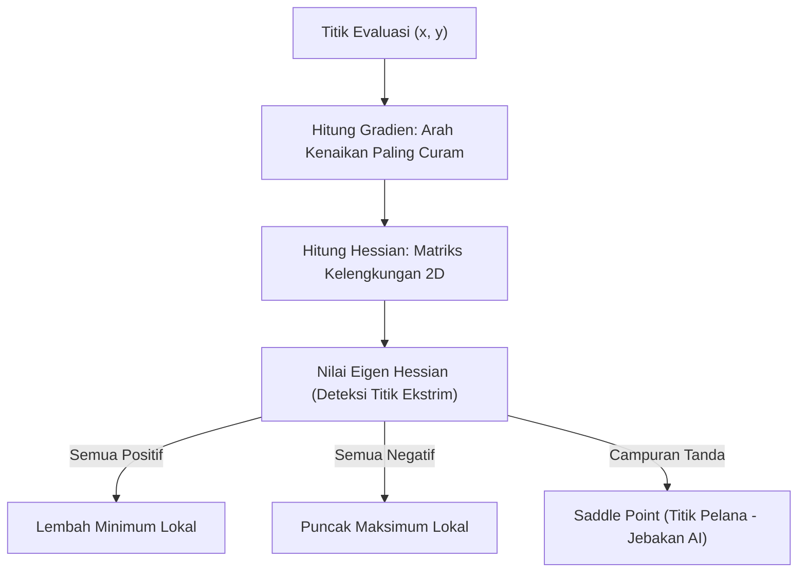

# Modul 014: Kalkulus Multivariabel & Kalkulus Vektor (Gradien, Jacobian, Hessian, Teorema Stokes & Gauss)

**Navigasi**: [⬅️ Master Index](../../INDEX.md) | [Tingkat 1: Tingkat 1: Fondasi Matematika Komprehensif Dari Nol](./README.md)
*Sebelumnya*: [013. kalkulus-diferensial-integral-satu-variabel](./013-kalkulus-diferensial-integral-satu-variabel.md) | *Berikutnya*: [015. persamaan-diferensial-biasa-parsial](./015-persamaan-diferensial-biasa-parsial.md)

---

## 1. Intuisi Dasar Tanpa Jargon ("Seperti Bayi Baru Lahir")
Jika kalkulus satu variabel seperti berjalan di jalan setapak 1D (hanya bisa maju atau mundur), maka **Kalkulus Multivariabel** seperti mendaki gunung di ruang 3D yang memiliki lereng, jurang, dan puncak. 

Di setiap titik tanah di lereng gunung, ada arah di mana tanah paling curam menanjak ke atas — itulah **Gradien ($\nabla f$)**. Dalam kecerdasan buatan (Machine Learning), 'gunung' tersebut adalah fungsi kesalahan model (loss), dan tujuan neural network adalah berjalan menuruni lereng ke lembah terdalam menggunakan arah gradien negatif (**Gradient Descent**)!

## 2. Fondasi Teoretis & Aksiomatik / Matematis
### 1. Gradien, Jacobian, dan Hessian
Untuk fungsi skalar skalar multivariabel $f: \mathbb{R}^n \to \mathbb{R}$:
- **Vektor Gradien**: Arah kenaikan tertajam dari fungsi:
  $$\nabla f(\mathbf{x}) = \left[ \frac{\partial f}{\partial x_1}, \frac{\partial f}{\partial x_2}, \dots, \frac{\partial f}{\partial x_n} \right]^T$$
- **Matriks Hessian (Turunan Kedua)**: Mengukur kelengkungan permukaan (curvature):
  $$H_{ij} = \frac{\partial^2 f}{\partial x_i \partial x_j}$$
  Jika $H$ definit positif ($\forall \lambda_i > 0$), titik kritis adalah minimum lokal.
- **Matriks Jacobian**: Untuk fungsi bernilai vektor $\mathbf{f}: \mathbb{R}^n \to \mathbb{R}^m$:
  $$J = \begin{bmatrix} \frac{\partial f_1}{\partial x_1} & \dots & \frac{\partial f_1}{\partial x_n} \\ \vdots & \ddots & \vdots \\ \frac{\partial f_m}{\partial x_1} & \dots & \frac{\partial f_m}{\partial x_n} \end{bmatrix}$$
[📚 Pelajari: MIT OCW 18.02 Multivariable Calculus](https://ocw.mit.edu/courses/18-02-multivariable-calculus-fall-2007/)

### 2. Teorema Fundamental Kalkulus Vektor
- **Teorema Divergensi Gauss**: Aliran fluks fluida yang keluar menembus permukaan tertutup $\partial V$ sama dengan total sumber divergensi di dalam volume $V$:
  $$\iint_{\partial V} \mathbf{F} \cdot d\mathbf{S} = \iiint_V (\nabla \cdot \mathbf{F}) dV$$
- **Teorema Stokes**: Sirkulasi fluida sepanjang kurva tertutup $\partial S$ sama dengan fluks pusaran (*curl*) yang menembus permukaan $S$:
  $$\oint_{\partial S} \mathbf{F} \cdot d\mathbf{r} = \iint_S (\nabla \times \mathbf{F}) \cdot d\mathbf{S}$$

## 3. Anatomi Teknis & Cara Kerja Internal


## 4. Implementasi Praktis & Kode / Simulasi Riil
```python
import numpy as np

def rosenbrock(x, y):
    """Fungsi Rosenbrock klasik (Lembah Pisang) untuk optimasi multivariabel."""
    return (1 - x)**2 + 100 * (y - x**2)**2

def rosenbrock_gradient(x, y):
    df_dx = -2 * (1 - x) - 400 * x * (y - x**2)
    df_dy = 200 * (y - x**2)
    return np.array([df_dx, df_dy])

def rosenbrock_hessian(x, y):
    d2f_dx2 = 2 - 400 * y + 1200 * x**2
    d2f_dxdy = -400 * x
    d2f_dy2 = 200.0
    return np.array([[d2f_dx2, d2f_dxdy], [d2f_dxdy, d2f_dy2]])

# Uji pada titik minimum global (1.0, 1.0)
pos = np.array([1.0, 1.0])
grad = rosenbrock_gradient(pos[0], pos[1])
H = rosenbrock_hessian(pos[0], pos[1])
eigenvalues = np.linalg.eigvals(H)

print(f"Gradien di titik (1, 1): {grad} (Harus [0, 0])")
print("Matriks Hessian di titik (1, 1):\n", H)
print("Eigenvalues Hessian:", eigenvalues)
assert np.all(eigenvalues > 0)
print("Matriks Definit Positif: Terbukti Minimum Lokal Sejati!")
```

## 5. Miskonsepsi & Jebakan Industri
1. **Saddle Points (Titik Pelana)**: Pada ruang dimensi tinggi (seperti neural network dengan jutaan parameter), gradien nol seringkali bukan titik minimum atau maksimum, melainkan titik pelana di mana beberapa arah melengkung ke atas dan arah lain melengkung ke bawah.

## 6. Proyek Latihan & Rubrik Penilaian Mandiri
### Level 1 (Dasar)
Hitung vektor gradien dari fungsi potensial listrik $V(x, y, z) = x^2 y - y z^3$ pada titik $(1, -2, 1)$.

### Level 2 (Menengah)
Verifikasi Teorema Divergensi Gauss untuk medan vektor $\mathbf{F} = [x, y, z]^T$ pada bola pejal satuan $x^2 + y^2 + z^2 \le 1$.

### Level 3 (Mahir)
Implementasikan algoritma optimasi Newton-Raphson multivariabel yang memanfaatkan invers Hessian $\mathbf{x}_{k+1} = \mathbf{x}_k - H^{-1} \nabla f$ dan bandingkan konvergensinya terhadap Gradient Descent murni.

## 7. Rekomendasi Sumber Belajar Standar Emas
- [Buku Standar: Vector Calculus (6th ed.) - Jerrold E. Marsden & Anthony Tromba (W. H. Freeman)](https://www.macmillanlearning.com/college/us/product/Vector-Calculus/p/1429215089)
- [Kuliah Terbuka: Stanford Online - Convex Optimization I (Stephen Boyd)](https://see.stanford.edu/Course/EE364A)
- [Khan Academy: Multivariable Calculus Video Course](https://www.khanacademy.org/math/multivariable-calculus)

---
*Navigasi Cepat*: [Ke Tingkat 1](./README.md) | [Ke Master Index](../../INDEX.md) | *Sebelumnya*: [013. kalkulus-diferensial-integral-satu-variabel](./013-kalkulus-diferensial-integral-satu-variabel.md) | *Berikutnya*: [015. persamaan-diferensial-biasa-parsial](./015-persamaan-diferensial-biasa-parsial.md)
