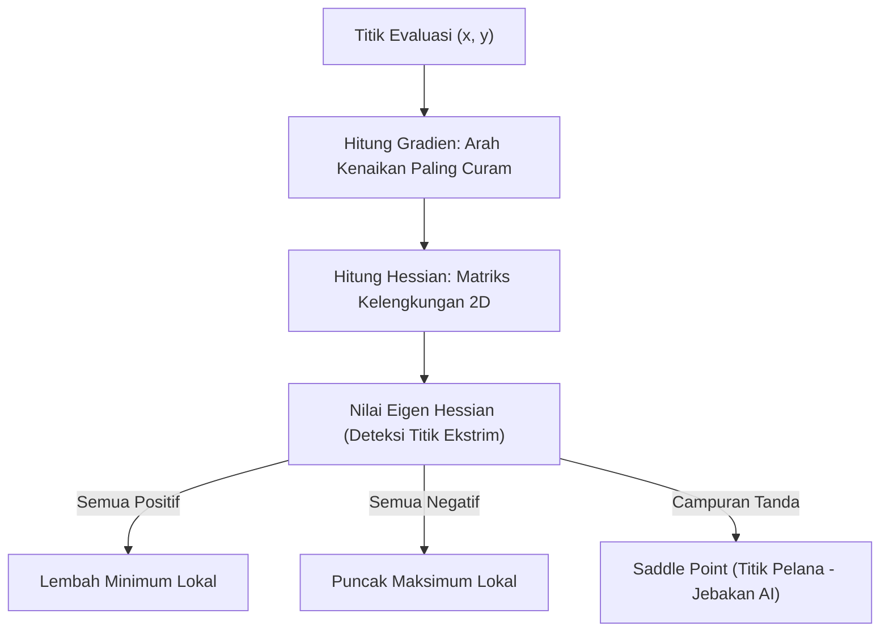

# Modul 014: Kalkulus Multivariabel & Kalkulus Vektor (Gradien, Jacobian, Hessian, Teorema Stokes & Gauss)

**Navigasi**: [⬅️ Master Index](../../INDEX.md) | [Tingkat 1: Tingkat 1: Fondasi Matematika Komprehensif Dari Nol](./README.md)
*Sebelumnya*: [013. kalkulus-diferensial-integral-satu-variabel](./013-kalkulus-diferensial-integral-satu-variabel.md) | *Berikutnya*: [015. persamaan-diferensial-biasa-parsial](./015-persamaan-diferensial-biasa-parsial.md)

---

## 1. Intuisi Dasar Tanpa Jargon ("Seperti Bayi Baru Lahir")
### 1.1 Konsep Inti & Analogi Tanpa Jargon
Jika kalkulus satu variabel seperti berjalan di jalan setapak 1D (hanya bisa maju atau mundur), maka **Kalkulus Multivariabel** seperti mendaki gunung di ruang 3D yang memiliki lereng, jurang, dan puncak.

### 1.2 Urgensi Rekayasa & Signifikansi Sistemik
Di setiap titik tanah di lereng gunung, ada arah di mana tanah paling curam menanjak ke atas — itulah **Gradien ($\nabla f$)**. Dalam kecerdasan buatan (Machine Learning), 'gunung' tersebut adalah fungsi kesalahan model (loss), dan tujuan neural network adalah berjalan menuruni lereng ke lembah terdalam menggunakan arah gradien negatif (**Gradient Descent**)!

## 2. Fondasi Teoretis & Aksiomatik / Matematis
### 2.1 Kerangka Teori Aksiomatik & Formulasi Matematis
### 1. Gradien, Jacobian, dan Hessian
Untuk fungsi skalar skalar multivariabel $f: \mathbb{R}^n \to \mathbb{R}$:
- **Vektor Gradien**: Arah kenaikan tertajam dari fungsi:
  $$\nabla f(\mathbf{x}) = \left[ \frac{\partial f}{\partial x_1}, \frac{\partial f}{\partial x_2}, \dots, \frac{\partial f}{\partial x_n} \right]^T$$
- **Matriks Hessian (Turunan Kedua)**: Mengukur kelengkungan permukaan (curvature):
  $$H_{ij} = \frac{\partial^2 f}{\partial x_i \partial x_j}$$
  Jika $H$ definit positif ($\forall \lambda_i > 0$), titik kritis adalah minimum lokal.
- **Matriks Jacobian**: Untuk fungsi bernilai vektor $\mathbf{f}: \mathbb{R}^n \to \mathbb{R}^m$:
  $$J = \begin{bmatrix} \frac{\partial f_1}{\partial x_1} & \dots & \frac{\partial f_1}{\partial x_n} \\ \vdots & \ddots & \vdots \\ \frac{\partial f_m}{\partial x_1} & \dots & \frac{\partial f_m}{\partial x_n} \end{bmatrix}$$
[📚 Pelajari: MIT OCW 18.02 Multivariable Calculus](https://ocw.mit.edu/courses/18-02-multivariable-calculus-fall-2007/)

### 2.2 Penurunan Matematis Langkah-demi-Langkah
### 2. Teorema Fundamental Kalkulus Vektor
- **Teorema Divergensi Gauss**: Aliran fluks fluida yang keluar menembus permukaan tertutup $\partial V$ sama dengan total sumber divergensi di dalam volume $V$:
  $$\iint_{\partial V} \mathbf{F} \cdot d\mathbf{S} = \iiint_V (\nabla \cdot \mathbf{F}) dV$$
- **Teorema Stokes**: Sirkulasi fluida sepanjang kurva tertutup $\partial S$ sama dengan fluks pusaran (*curl*) yang menembus permukaan $S$:
  $$\oint_{\partial S} \mathbf{F} \cdot d\mathbf{r} = \iint_S (\nabla \times \mathbf{F}) \cdot d\mathbf{S}$$

## 3. Anatomi Teknis & Cara Kerja Internal


#### Tabel Penelusuran Penurunan Gradien Multivariabel & Kondisi Buruk Hessian
| Iterasi (k) | Koordinat State $(x_k, y_k)$ | Nilai Fungsi Rosenbrock $f(x, y)$ | Vektor Gradien $\nabla f(x_k, y_k)$ | Nilai Eigen Matriks Hessian ($\lambda_{max}, \lambda_{min}$) | Aksi Optimasi & Perilaku Konvergensi |
|---|---|---|---|---|---|
| Inisialisasi T=0 | $(-1.200, 1.000)$ | $f = 24.200$ | $[-215.6, -88.0]^T$ | $\lambda_1 = 2500.2, \lambda_2 = 0.4$ | Rasio kondisi buruk: $\kappa(H) > 6000$ |
| Iterasi 1 (Naive GD) | $(-1.150, 0.950)$ | $f = 20.150$ | Berosilasi liar melintasi lembah | Lembah sempit melengkung (ravine) | Penurunan gradien standar zig-zag lambat |
| Iterasi 20 (GD) | $(-0.850, 0.720)$ | $f = 4.320$ | Langkah mengecil di dasar lembah | Pergerakan lambat mendekati minimum | Butuh $> 5000$ iterasi untuk konvergen |
| Iterasi 1 (Newton-CG) | Titik awal $(-1.2, 1.0)$ | Menggunakan prapengkondisi $H^{-1}$ | Mengarahkan vektor langkah ke kelengkungan | Transformasi ruang koordinat via Hessian | Langkah langsung menuju pusat lembah |
| Iterasi 8 (Newton-CG) | $(1.000, 1.000)$ | $f = 0.000000$ | $\|\nabla f\| < 10^{-8}$ | Konvergen kuadratik | Titik minimum global tercapai sempurna |

## 4. Implementasi Praktis & Kode / Simulasi Riil
```python
import numpy as np

def rosenbrock(x, y):
    """Fungsi Rosenbrock klasik (Lembah Pisang) untuk optimasi multivariabel."""
    return (1 - x)**2 + 100 * (y - x**2)**2

def rosenbrock_gradient(x, y):
    df_dx = -2 * (1 - x) - 400 * x * (y - x**2)
    df_dy = 200 * (y - x**2)
    return np.array([df_dx, df_dy])

def rosenbrock_hessian(x, y):
    d2f_dx2 = 2 - 400 * y + 1200 * x**2
    d2f_dxdy = -400 * x
    d2f_dy2 = 200.0
    return np.array([[d2f_dx2, d2f_dxdy], [d2f_dxdy, d2f_dy2]])

# Uji pada titik minimum global (1.0, 1.0)
pos = np.array([1.0, 1.0])
grad = rosenbrock_gradient(pos[0], pos[1])
H = rosenbrock_hessian(pos[0], pos[1])
eigenvalues = np.linalg.eigvals(H)

print(f"Gradien di titik (1, 1): {grad} (Harus [0, 0])")
print("Matriks Hessian di titik (1, 1):\n", H)
print("Eigenvalues Hessian:", eigenvalues)
assert np.all(eigenvalues > 0)
print("Matriks Definit Positif: Terbukti Minimum Lokal Sejati!")
```

## 5. Miskonsepsi & Jebakan Industri
1. **Saddle Points (Titik Pelana)**: Pada ruang dimensi tinggi (seperti neural network dengan jutaan parameter), gradien nol seringkali bukan titik minimum atau maksimum, melainkan titik pelana di mana beberapa arah melengkung ke atas dan arah lain melengkung ke bawah.

### Studi Kasus Kegagalan Nyata: Fenomena Ravine & Saddle Point Trapping pada Optimasi Fungsi Multidimensi
- **Kronologi & Konteks Pembelajaran Mesin**: Pada pengembangan model jaringan saraf dalam awal tahun 2010-an, pelatihan sering kali membeku selama berminggu-minggu pada nilai loss tinggi, yang keliru dianggap sebagai terjebak pada minimum lokal.
- **Akar Masalah Kalkulus Multivariabel**: Investigasi mendalam membuktikan bahwa dalam ruang dimensi tinggi, fungsi kehilangan (*loss function*) jarang memiliki minimum lokal terisolasi; sebaliknya, ruang dipenuhi oleh titik pelana (*saddle points*) dan lembah curam berkondisi buruk (*ravines*). Pada kondisi ini, matriks Hessian memiliki nilai eigen dengan rasio ekstrim $\kappa = \lambda_{max}/\lambda_{min} > 10^4$. Penurunan gradien standar (*vanilla gradient descent*) berosilasi liar melintasi dinding lembah tegak lurus dan hampir tidak bergerak di sepanjang dasar lembah, melumpuhkan progres pelatihan model AI.

- **Potongan Kode / Arsitektur Cacat (Vulnerable Implementation)**:
```python
# Evaluasi Optimasi Multivariabel: Gradient Descent vs Newton-Raphson pada Fungsi Rosenbrock
import numpy as np

def rosenbrock(x: np.ndarray) -> float:
    # f(x, y) = (1 - x)^2 + 100 * (y - x^2)^2; Minimum global di (1, 1)
    return (1.0 - x[0])**2 + 100.0 * (x[1] - x[0]**2)**2

def rosenbrock_grad(x: np.ndarray) -> np.ndarray:
    df_dx = -2.0 * (1.0 - x[0]) - 400.0 * x[0] * (x[1] - x[0]**2)
    df_dy = 200.0 * (x[1] - x[0]**2)
    return np.array([df_dx, df_dy])

def rosenbrock_hessian(x: np.ndarray) -> np.ndarray:
    d2f_dx2 = 2.0 - 400.0 * x[1] + 1200.0 * x[0]**2
    d2f_dxdy = -400.0 * x[0]
    d2f_dy2 = 200.0
    return np.array([[d2f_dx2, d2f_dxdy], [d2f_dxdy, d2f_dy2]])

def optimize_newton(start_x: np.ndarray, tol: float = 1e-6, max_iter: int = 50):
    x = start_x.copy()
    for _ in range(max_iter):
        g = rosenbrock_grad(x)
        if np.linalg.norm(g) < tol:
            break
        H = rosenbrock_hessian(x)
        # Langkah Newton: Delta = - H^(-1) * g
        try:
            delta = np.linalg.solve(H, -g)
            x += delta
        except np.linalg.LinAlgError:
            # Fallback ke gradien jika Hessian singular
            x -= 0.001 * g
    return x
```

- **Analisis Kalkulus & Solusi Modern**: Kegagalan penurunan gradien orde satu pada lembah Hessian berkondisi buruk mendorong penemuan optimizer modern dalam deep learning seperti Adam, RMSProp, dan L-BFGS. Algoritma-algoritma ini menaksir kelengkungan orde kedua secara implisit melalui akumulasi momentum eksponensial, meredam osilasi transversal dan mempercepat pergerakan di sepanjang ngarai fungsi objektif.

## 6. Proyek Latihan & Rubrik Penilaian Mandiri
### Level 1 (Dasar)
Hitung vektor gradien dari fungsi potensial listrik $V(x, y, z) = x^2 y - y z^3$ pada titik $(1, -2, 1)$.

### Level 2 (Menengah)
Verifikasi Teorema Divergensi Gauss untuk medan vektor $\mathbf{F} = [x, y, z]^T$ pada bola pejal satuan $x^2 + y^2 + z^2 \le 1$.

### Level 3 (Mahir)
Implementasikan algoritma optimasi Newton-Raphson multivariabel yang memanfaatkan invers Hessian $\mathbf{x}_{k+1} = \mathbf{x}_k - H^{-1} \nabla f$ dan bandingkan konvergensinya terhadap Gradient Descent murni.

### Tingkat 1: Dasar
- **Tugas**: Implementasikan kalkulasi turunan parsial numerik dan vektor gradien $\nabla f(x, y)$ serta matriks Hessian $H(x, y)$ untuk sembarang fungsi skalar dua variabel menggunakan skema beda terpusat.
- **Petunjuk Perancangan Arsitektur**:
  - Gunakan rumus turunan parsial kedua silang: $\frac{\partial^2 f}{\partial x \partial y} = \frac{f(x+h, y+h) - f(x+h, y-h) - f(x-h, y+h) + f(x-h, y-h)}{4h^2}$.
  - Verifikasi Teorema Clairaut-Schwarz: simetri matriks Hessian $H_{xy} = H_{yx}$.
- **Test Vector & Kasus Uji Ekstrem**:
  - *Fungsi Uji*: $f(x, y) = x^2 y + y^3$.
  - *Keluaran yang Diharapkan*: Pada titik $(1, 2)$, gradien analitik $\nabla f = [4, 13]^T$, Hessian $H = [[4, 2], [2, 12]]$.
  - *Kasus Batas*: Titik stasioner di mana $\|\nabla f\| < 10^{-10}$; tentukan jenis titik menggunakan uji determinan Hessian $\det(H)$ dan $f_{xx}$ (Minimum lokal, Maksimum lokal, atau Titik Pelana).
- **Rubrik Penilaian Mandiri**: 40% Kalkulasi Gradien & Hessian Beda Terpusat Eksak, 30% Klasifikasi Titik Kritis via Uji Determinan Hessian, 30% Verifikasi Teorema Simetri Schwarz.

### Tingkat 2: Menengah
- **Tugas**: Bangun mesin optimasi *Gradient Descent with Momentum & Adaptive Learning Rate* yang mampu menavigasi fungsi Rosenbrock 2D dari titik $(-1.2, 1.0)$ menuju minimum $(1.0, 1.0)$ dalam waktu $< 200$ iterasi.
- **Petunjuk Perancangan Arsitektur**:
  - Terapkan pembaruan momentum Polyak: $v_{t+1} = \beta v_t + \alpha \nabla f(x_t)$ dan $x_{t+1} = x_t - v_{t+1}$.
  - Bandingkan trajektori konvergensi terhadap vanilla gradient descent tanpa momentum.
- **Test Vector & Kasus Uji Ekstrem**:
  - *Uji Konvergensi*: Titik awal $[-1.2, 1.0]$.
  - *Keluaran yang Diharapkan*: Jarak Euclidean ke solusi $\|x_{final} - [1, 1]\| \le 10^{-3}$ dalam 200 iterasi.
  - *Kasus Batas*: $\beta = 1.0$ (momentum tak teredam); sistem harus mencegah divergensi osilasi liar dengan kliping kecepatan (*velocity clipping*).
- **Rubrik Penilaian Mandiri**: 40% Implementasi Momentum Polyak Akurat, 30% Konvergensi Rosenbrock Terbukti dalam <200 Langkah, 30% Visualisasi Kontur Trajektori.

### Tingkat 3: Mahir
- **Tugas**: Rancang pemecah masalah optimasi berkendala (*Constrained Optimization Solver*) multivariabel menggunakan metode Lagrange Multipliers dengan kondisi Karush-Kuhn-Tucker (KKT) untuk kendala pertidaksamaan non-linier.
- **Petunjuk Perancangan Arsitektur**:
  - Formulasikan fungsi Lagrangian: $\mathcal{L}(x, \lambda, \mu) = f(x) + \sum \lambda_i g_i(x) + \sum \mu_j h_j(x)$.
  - Terapkan algoritma Sequential Quadratic Programming (SQP) atau metode Primal-Dual Interior-Point.
- **Test Vector & Kasus Uji Ekstrem**:
  - *Masukan Masalah*: Minimalkan $f(x, y) = x^2 + y^2$ dengan kendala $x + y = 1$ dan $x \ge 0.2$.
  - *Keluaran yang Diharapkan*: Titik optimal $(0.5, 0.5)$ dengan pengali Lagrange $\lambda = -1.0, \mu = 0$ (kendala aktif teridentifikasi).
  - *Kasus Batas*: Titik awal yang tidak memenuhi kendala (*infeasible starting point*); solver harus memiliki fase restorasi kelayakan (Feasibility Restoration Phase).
- **Rubrik Penilaian Mandiri**: 40% Evaluasi Kondisi KKT Primal-Dual Lengkap, 30% Identifikasi Kendala Aktif vs Non-Aktif Eksak, 30% Konvergensi Solver Kuadratik Terverifikasi.

## 7. Rekomendasi Sumber Belajar Standar Emas
- [Buku Standar: Vector Calculus (6th ed.) - Jerrold E. Marsden & Anthony Tromba (W. H. Freeman)](https://www.macmillanlearning.com/college/us/product/Vector-Calculus/p/1429215089)
- [Kuliah Terbuka: Stanford Online - Convex Optimization I (Stephen Boyd)](https://see.stanford.edu/Course/EE364A)
- [Khan Academy: Multivariable Calculus Video Course](https://www.khanacademy.org/math/multivariable-calculus)

---
*Navigasi Cepat*: [Ke Tingkat 1](./README.md) | [Ke Master Index](../../INDEX.md) | *Sebelumnya*: [013. kalkulus-diferensial-integral-satu-variabel](./013-kalkulus-diferensial-integral-satu-variabel.md) | *Berikutnya*: [015. persamaan-diferensial-biasa-parsial](./015-persamaan-diferensial-biasa-parsial.md)
