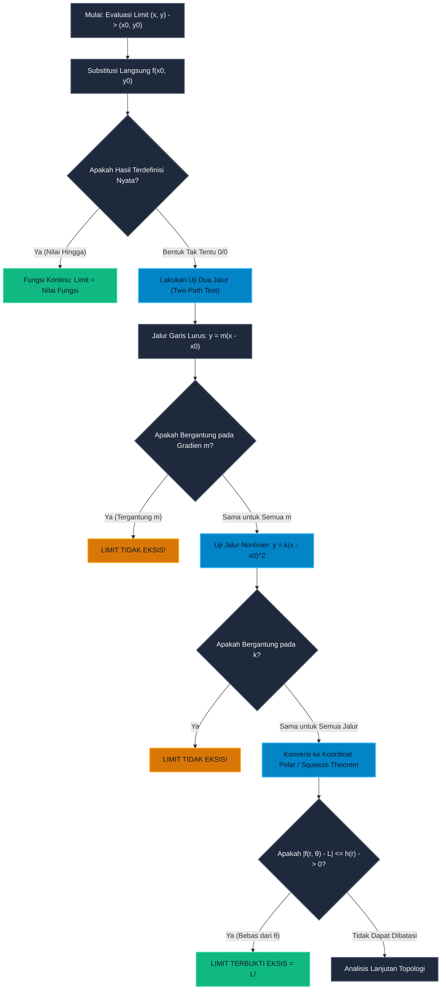

# Subtopik 01: Ruang Vektor $\mathbb{R}^n$, Fungsi Multivariabel, Limit Jalur, dan Kekontinuan

**Navigasi**: [Master Index](../../../INDEX.md) | [Tingkat 1: Fondasi Matematika Komprehensif Dari Nol](../../README.md) | [Modul 014: Kalkulus Multivariabel & Geometri Vektor](../README.md)  
*Sebelumnya*: [013.09 Metode Numerik Satu Variabel & Kalkulus Komputasional](../../013-kalkulus-diferensial-integral-satu-variabel/09-metode-numerik-satu-variabel-dan-kalkulus-komputasional.md) | *Berikutnya*: [02. Turunan Parsial, Gradien, Turunan Berarah & Bidang Singgung](./02-turunan-parsial-gradien-turunan-berarah.md)

---

## 1. Intuisi & Motivasi Konseptual ("Seperti Bayi Baru Lahir")

### 1.1 Konsep Inti: Dari Garis Lurus 1D ke Hamparan Dataran 2D dan Ruang $n$-Dimensi

Bayangkan Anda adalah seekor semut kecil yang selama ini hidup terkurung di atas seutas tali jemuran yang sangat tipis.
Sepanjang hidup Anda di atas tali tersebut (dunia 1 dimensi $\mathbb{R}$), Anda hanya punya dua pilihan arah gerak:
- Melangkah maju ke kanan ($+x$).
- Melangkah mundur ke kiri ($-x$).

Jika di depan Anda ada sebuah rintangan kecil di titik $x = a$, Anda hanya bisa mendekatinya dari dua sisi: sisi kiri ($x \to a^-$) atau sisi kanan ($x \to a^+$). Jika kedua pendekatan itu menghasilkan nilai ketinggian yang sama, limit dikatakan eksis. Sederhana dan ramah akal sehat!

Namun pada suatu hari yang cerah, tali jemuran tersebut jatuh dan terhempas ke atas sebuah lapangan rumput luas (dunia 2 dimensi $\mathbb{R}^2$).
Tiba-tiba, semesta semut meledak menjadi kebebasan tak terhingga yang mencengangkan:
- Anda tidak lagi hanya bisa bergerak ke kiri dan ke kanan.
- Anda bisa melangkah ke utara, selatan, barat daya, timur laut, berbelok melingkar spiral, atau melompat zig-zag!

Sekarang renungkan teka-teki berikut:
Jika ada sebuah tiang bendera di titik koordinat $(0, 0)$ pada lapangan tersebut, ada berapa banyak cara atau jalur bagi Anda untuk berjalan mendekati titik $(0, 0)$ tersebut?
Bukan lagi dua jalur (kiri dan kanan)! Ada **tak terhingga banyaknya jalur lintasan** yang bisa Anda tempuh:
- Anda bisa berjalan lurus sepanjang sumbu-$x$ ($y = 0$).
- Anda bisa berjalan lurus sepanjang sumbu-$y$ ($x = 0$).
- Anda bisa berjalan miring sepanjang garis $y = x$, garis $y = 2x$, garis $y = -5x$, atau sembarang garis lurus $y = mx$.
- Lebih gilanya lagi, Anda bisa berjalan melengkung mengikuti lintasan parabola $y = x^2$, parabola kubik $y = x^3$, kurva eksponensial $y = e^x - 1$, atau spiral berputar $r = \theta$!

Inilah **bom atom konseptual pertama dalam Kalkulus Multivariabel**:
> *Agar sebuah limit fungsi multivariabel $\lim_{(x, y) \to (a, b)} f(x, y) = L$ dikatakan ada, nilai fungsi tersebut harus menuju angka $L$ yang sama persis di SEPANJANG SELURUH JALUR LINTASAN TAK HINGGA yang mungkin ada di alam semesta!*
> Jika Anda menemukan dua jalur saja yang menghasilkan nilai berbeda (misalnya lewat garis lurus menghasilkan angka 0, tapi lewat parabola menghasilkan angka 0,5), maka limit fungsi tersebut **GAGAL TOTAL DAN TIDAK EKSIS!**

---

### 1.2 Urgensi Rekayasa: Mengapa Ruang $\mathbb{R}^n$ Mengatur Seluruh Dunia Komputasi Modern?

1. **Ruang Embedding Vektor AI (Large Language Models & Vector Search)**:
   Saat Anda mengetik sebuah kalimat ke dalam sistem AI modern seperti ChatGPT, Claude, atau Gemini, model tidak membaca huruf alfabet secara langsung. Model mengubah setiap teks menjadi titik koordinat vektor di dalam ruang berdimensi tinggi $\mathbb{R}^{1536}$ atau $\mathbb{R}^{4096}$ (OpenAI Ada / LLaMA embeddings). Menghitung kemiripan makna semantik (*cosine similarity*) atau kedekatan klaster dokumen adalah murni evaluasi norma Euclidean dan topologi metrik di ruang $\mathbb{R}^n$.
2. **Simulator Dinamika Robotika Multivariat & Manipulator 6-DOF**:
   Posisi ujung capit robot (*end-effector*) diatur oleh fungsi multivariat $\mathbf{p}(t) = f(\theta_1, \theta_2, \dots, \theta_6)$ yang memetakan sudut 6 motor sendi ke posisi 3D di dunia nyata. Kegagalan memahami batas kekontinuan pemetaan ini dapat memicu singularitas kinematika (*gimbal lock*), menyebabkan robot bergetar liar dan berisiko menabrak operator di pabrik perakitan otomotif.
3. **Deteksi Anomali Siber & Sistem Keamanan Jaringan**:
   Metrik volume bola terbuka ($B_\delta(\mathbf{x}_0)$) digunakan pada algoritma pendeteksi intrusi jaringan (*Isolation Forest*, *k-Nearest Neighbors*) untuk mendeteksi apakah lonjakan lalu lintas paket data berada di luar batas toleransi wajar normal.
4. **Fisika Komputasi Mesin Game & Efek Visual Real-Time**:
   Dalam mesin game Unreal Engine 5 atau Unity, medan skalar temperatur dan medan vektor kecepatan angin atmosfer dimodelkan pada setiap voxel kisi 3D $\mathbb{R}^3$, di mana kekontinuan spasial menjamin fluida tidak terbelah secara aneh saat partikel bergerak.

---

### 1.3 Kamus Notasi Simbol Multivariabel/Vektor

Agar tidak pusing dan bingung membaca simbol-simbol kalkulus vektor, gunakan tabel translasi 4-kolom ini sebagai kamus rujukan Anda:

| Simbol Notasi | Nama Formal | Arti Manusia / Terjemahan Bahasa Awam | Contoh Operasional Riil |
|---|---|---|---|
| $\mathbb{R}^n$ | Ruang Euclidean Berdimensi $n$ | Kumpulan semua titik atau vektor yang tersusun dari $n$ buah bilangan riil | Titik $(x, y) \in \mathbb{R}^2$ atau $(x, y, z) \in \mathbb{R}^3$ |
| $\mathbf{x} = \langle x_1, x_2, \dots, x_n \rangle$ | Vektor Posisi | Titik koordinat multivariat yang mewakili lokasi atau status parameter sistem | State drone $\mathbf{x} = \langle x, y, z, v_x, v_y, v_z \rangle \in \mathbb{R}^6$ |
| $\|\mathbf{x}\|_2$ | Norma Euclidean ($\ell_2$-norm) | Jarak garis lurus terpendek dari titik asal $(0, \dots, 0)$ ke titik $\mathbf{x}$ | $\|\langle 3, 4 \rangle\|_2 = \sqrt{3^2 + 4^2} = 5$ |
| $B_r(\mathbf{x}_0)$ | Bola Terbuka (*Open Ball*) | Himpunan semua titik yang jaraknya lebih kecil dari $r$ terhadap pusat $\mathbf{x}_0$ | $\{\mathbf{x} \in \mathbb{R}^n \mid \|\mathbf{x} - \mathbf{x}_0\| < r\}$ |
| $\bar{B}_r(\mathbf{x}_0)$ | Bola Tertutup (*Closed Ball*) | Himpunan semua titik yang jaraknya lebih kecil atau sama dengan $r$ | $\{\mathbf{x} \in \mathbb{R}^n \mid \|\mathbf{x} - \mathbf{x}_0\| \le r\}$ |
| $f: D \subset \mathbb{R}^n \to \mathbb{R}$ | Medan Skalar (*Scalar Field*) | Fungsi yang menerima input vektor multi-koordinat dan menghasilkan satu output skalar | Suhu ruangan $T(x, y, z) = 25 - 0{,}1z$ |
| $\mathbf{F}: D \subset \mathbb{R}^n \to \mathbb{R}^m$ | Medan Vektor (*Vector Field*) | Fungsi yang menerima input titik koordinat dan menghasilkan panah vektor dengan arah dan kekuatan | Gaya gravitasi $\mathbf{F}(x, y, z) = -\frac{G M m}{r^3} \mathbf{r}$ |
| $\lim_{\mathbf{x} \to \mathbf{x}_0} f(\mathbf{x}) = L$ | Limit Multivariabel | Nilai $f(\mathbf{x})$ mendekati $L$ saat $\mathbf{x}$ mendekati $\mathbf{x}_0$ dari SEMBARANG arah jalur lintasan | $\lim_{(x, y) \to (0, 0)} (x^2 + y^2) = 0$ |
| $\partial D$ | Batas Wilayah (*Boundary*) | Tepian keliling terluar dari suatu domain daerah $D$ | Lingkaran $x^2 + y^2 = 1$ adalah batas piringan cakram $x^2 + y^2 \le 1$ |
| $\text{int}(D)$ | Interior Wilayah | Kumpulan titik-titik yang sepenuhnya berada di dalam domain tanpa menyentuh tepian | Titik $(0{,}5, 0{,}5)$ pada lingkaran satuan |

---

## 2. Definisi Formal, Teorema & Penurunan Matematis

### 2.1 Topologi Metrik Ruang $\mathbb{R}^n$: Jarak, Lingkungan & Pertidaksamaan Cauchy-Schwarz

Untuk mendefinisikan limit dan kekontinuan pada ruang berdimensi banyak secara rigor tanpa celah, kita membutuhkan konsep jarak metrik dan pertidaksamaan fundamental aljabar linier.

#### Definisi 1: Norma Euclidean & Jarak Antar Titik
Untuk dua titik $\mathbf{x} = \langle x_1, \dots, x_n \rangle$ dan $\mathbf{y} = \langle y_1, \dots, y_n \rangle$ di dalam $\mathbb{R}^n$, perkalian titik (*inner product*) didefinisikan sebagai:
$$\langle \mathbf{x}, \mathbf{y} \rangle = \mathbf{x} \cdot \mathbf{y} = \sum_{i=1}^n x_i y_i$$
Norma Euclidean ($\ell_2$-norm) dari vektor $\mathbf{x}$ adalah panjang geometrisnya:
$$\|\mathbf{x}\| = \sqrt{\mathbf{x} \cdot \mathbf{x}} = \sqrt{\sum_{i=1}^n x_i^2}$$
Jarak Euclidean $d(\mathbf{x}, \mathbf{y})$ antara dua titik adalah:
$$d(\mathbf{x}, \mathbf{y}) = \|\mathbf{x} - \mathbf{y}\| = \sqrt{\sum_{i=1}^n (x_i - y_i)^2}$$

#### Teorema Aksiomatik 1: Pertidaksamaan Cauchy-Schwarz
Untuk sembarang dua vektor $\mathbf{x}, \mathbf{y} \in \mathbb{R}^n$, berlaku:
$$|\mathbf{x} \cdot \mathbf{y}| \le \|\mathbf{x}\| \|\mathbf{y}\|$$
dengan kesamaan berlaku jika dan hanya jika $\mathbf{x}$ dan $\mathbf{y}$ saling berkelipatan linier ($\mathbf{x} = c \mathbf{y}$).

**Penurunan Bukti Aksiomatik**:
1. Tinjau fungsi kuadratik skalar bernilai non-negatif untuk sembarang bilangan riil $t \in \mathbb{R}$:
   $$P(t) = \|\mathbf{x} - t \mathbf{y}\|^2 = (\mathbf{x} - t \mathbf{y}) \cdot (\mathbf{x} - t \mathbf{y}) \ge 0$$
2. Uraikan perkalian titik tersebut:
   $$P(t) = \mathbf{x} \cdot \mathbf{x} - 2t (\mathbf{x} \cdot \mathbf{y}) + t^2 (\mathbf{y} \cdot \mathbf{y}) = \|\mathbf{x}\|^2 - 2t (\mathbf{x} \cdot \mathbf{y}) + t^2 \|\mathbf{y}\|^2 \ge 0$$
3. Persamaan ini adalah polinomial kuadrat dalam variabel $t$: $A t^2 + B t + C \ge 0$, di mana $A = \|\mathbf{y}\|^2$, $B = -2(\mathbf{x} \cdot \mathbf{y})$, dan $C = \|\mathbf{x}\|^2$.
4. Karena polinomial kuadrat selalu bernilai $\ge 0$ untuk setiap nilai $t \in \mathbb{R}$, maka grafik parabolanya tidak pernah memotong sumbu-$t$ secara ganda, yang berarti diskriminannya harus non-positif ($D = B^2 - 4AC \le 0$):
   $$B^2 - 4AC = \left( -2(\mathbf{x} \cdot \mathbf{y}) \right)^2 - 4 \|\mathbf{y}\|^2 \|\mathbf{x}\|^2 \le 0$$
   $$4 (\mathbf{x} \cdot \mathbf{y})^2 - 4 \|\mathbf{x}\|^2 \|\mathbf{y}\|^2 \le 0 \implies (\mathbf{x} \cdot \mathbf{y})^2 \le \|\mathbf{x}\|^2 \|\mathbf{y}\|^2$$
5. Ambil akar kuadrat pada kedua ruas:
   $$|\mathbf{x} \cdot \mathbf{y}| \le \|\mathbf{x}\| \|\mathbf{y}\| \quad \blacksquare$$

Pertidaksamaan Cauchy-Schwarz inilah landasan utama dalam membuktikan pertidaksamaan segitiga $\|\mathbf{x} + \mathbf{y}\| \le \|\mathbf{x}\| + \|\mathbf{y}\|$ dan menjadi instrumen penentu pembuktian limit Cauchy $\varepsilon-\delta$.

---

### 2.2 Definisi Formal Limit Multivariabel $(\varepsilon-\delta)$

#### Definisi 2: Limit Fungsi Multivariabel Cauchy
Misalkan $f: D \subset \mathbb{R}^n \to \mathbb{R}$ adalah medan skalar dan $\mathbf{x}_0$ adalah titik limit (*accumulation point*) dari domain $D$.
Kita menyatakan bahwa:
$$\lim_{\mathbf{x} \to \mathbf{x}_0} f(\mathbf{x}) = L$$
jika dan hanya jika untuk setiap bilangan toleransi $\varepsilon > 0$, terdapat suatu bilangan radius $\delta > 0$ sedemikian rupa sehingga:
$$\forall \mathbf{x} \in D, \quad 0 < \|\mathbf{x} - \mathbf{x}_0\| < \delta \implies |f(\mathbf{x}) - L| < \varepsilon$$

Secara geometris:
*"Berapa pun ketatnya selang toleransi target $(L - \varepsilon, L + \varepsilon)$ pada sumbu keluaran, kita selalu dapat membuat bola pelindung $B_\delta(\mathbf{x}_0)$ di domain input sedemikian rupa sehingga SELURUH titik di dalam bola tersebut (kecuali titik pusatnya sendiri) dipetakan mendarat sempurna di dalam selang toleransi target."*

---

### 2.3 Teorema Ketiadaan Limit: Uji Dua Jalur (Two-Path Test)

#### Teorema 2: Kriteria Dua Jalur (*Two-Path Test for Non-Existence of Limit*)
Jika fungsi $f(x, y)$ mendekati dua nilai limit yang berbeda $L_1 \ne L_2$ saat $(x, y)$ mendekati $(x_0, y_0)$ melalui dua kurva lintasan yang berbeda $C_1$ dan $C_2$, maka:
$$\lim_{(x, y) \to (x_0, y_0)} f(x, y) \quad \text{TIDAK EKSIS.}$$

#### Penurunan Kasus 1: Jebakan Jalur Garis Lurus $y = mx$
Tinjau fungsi rasional homogen:
$$f(x, y) = \frac{2xy}{x^2 + y^2}$$
Kita ingin menyelidiki apakah $\lim_{(x, y) \to (0, 0)} f(x, y)$ eksis.

**Penurunan Analitis Langkah Demi Langkah**:
1. Uji pendekatan sepanjang keluarga garis lurus $y = mx$ yang melalui titik asal $(0, 0)$:
   Substitusikan $y = mx$ ke dalam rumus fungsi:
   $$f(x, mx) = \frac{2x(mx)}{x^2 + (mx)^2} = \frac{2mx^2}{x^2(1 + m^2)} = \frac{2m}{1 + m^2}$$
2. Ambil limit saat $x \to 0$:
   $$\lim_{x \to 0} f(x, mx) = \frac{2m}{1 + m^2}$$
3. Amati bahwa nilai limit bergantung secara eksplisit pada gradien kemiringan garis $m$:
   - Jika kita mendekati $(0, 0)$ lewat sumbu-$x$ ($m = 0$): nilainya $\frac{0}{1} = 0$.
   - Jika kita mendekati lewat diagonal $y = x$ ($m = 1$): nilainya $\frac{2(1)}{1 + 1} = 1$.
   - Jika kita mendekati lewat garis terjal $y = 2x$ ($m = 2$): nilainya $\frac{2(2)}{1 + 4} = \frac{4}{5} = 0{,}8$.
   - Jika kita mendekati lewat diagonal negatif $y = -x$ ($m = -1$): nilainya $-1$.
4. Karena nilai pendekatan berbeda-beda untuk tiap arah lereng garis yang berbeda, terbukti secara mutlak bahwa limit **tidak eksis**. $\blacksquare$

---

#### Penurunan Kasus 2: Jebakan Jalur Parabola (Garis Lurus Menipu!)
Tinjau fungsi yang jauh lebih licik di mana seluruh garis lurus memberikan jawaban palsu:
$$g(x, y) = \frac{x^2 y}{x^4 + y^2}$$
Apakah $\lim_{(x, y) \to (0, 0)} g(x, y)$ eksis?

**Penurunan Analitis Langkah Demi Langkah**:
1. Uji pendekatan sepanjang semua garis lurus $y = mx$:
   $$g(x, mx) = \frac{x^2 (mx)}{x^4 + (mx)^2} = \frac{mx^3}{x^2(x^2 + m^2)} = \frac{mx}{x^2 + m^2}$$
   Ambil limit saat $x \to 0$ untuk $m \ne 0$:
   $$\lim_{x \to 0} \frac{mx}{x^2 + m^2} = \frac{0}{0 + m^2} = 0$$
   Untuk $m = 0$ (sepanjang sumbu-$x$), $g(x, 0) = \frac{0}{x^4} = 0$.
   Tampaknya fungsi ini bernilai $0$ sepanjang SELURUH garis lurus tanpa terkecuali!
2. Seorang pemula naif akan langsung menyimpulkan bahwa limitnya adalah $0$. Namun perhatikan derajat penyebut: ada suku $x^4$ dan $y^2$. Suku-suku ini memiliki bobot seimbang jika $y \sim x^2$!
3. Uji pendekatan sepanjang kurva parabola $y = kx^2$:
   Substitusikan $y = kx^2$ ke dalam fungsi:
   $$g(x, kx^2) = \frac{x^2 (kx^2)}{x^4 + (kx^2)^2} = \frac{kx^4}{x^4 + k^2 x^4} = \frac{k x^4}{x^4(1 + k^2)} = \frac{k}{1 + k^2}$$
4. Ambil limit saat $x \to 0$:
   $$\lim_{x \to 0} g(x, kx^2) = \frac{k}{1 + k^2}$$
   - Jika kita mendekati lewat parabola $y = x^2$ ($k = 1$): limitnya $\frac{1}{1 + 1} = \frac{1}{2} = 0{,}5$.
   - Jika kita mendekati lewat parabola $y = -x^2$ ($k = -1$): limitnya $-\frac{1}{2} = -0{,}5$.
5. Kesimpulan: Meskipun bernilai $0$ di seluruh garis lurus, nilai fungsi melompat menjadi $0{,}5$ saat didekati lewat kurva parabola. Maka limit **TIDAK EKSIS**. Inilah mengapa kalkulus multivariabel menuntut ketelitian aksiomatik tingkat tinggi! $\blacksquare$

---

### 2.4 Pembuktian Eksistensi Limit via Koordinat Polar & Teorema Apit

Bagaimana jika sebuah limit benar-benar eksis? Kita tidak bisa menguji tak hingga banyaknya jalur satu per satu. Cara pembuktian paling ampuh adalah mengubah variabel ke sistem **Koordinat Polar**:
$$x = r \cos\theta, \quad y = r \sin\theta, \quad \text{di mana } r = \sqrt{x^2 + y^2} \to 0^+$$

#### Teorema 3: Kriteria Limit Polar
Jika fungsi $f(x, y) = g(r, \theta)$ dapat dibatasi oleh fungsi radial $h(r)$ yang tidak bergantung pada sudut $\theta$:
$$|g(r, \theta) - L| \le h(r) \quad \text{dengan} \quad \lim_{r \to 0^+} h(r) = 0$$
maka $\lim_{(x, y) \to (0, 0)} f(x, y) = L$ terbukti eksis secara absolut.

**Contoh Pembuktian Formal**: Buktikan bahwa $\lim_{(x, y) \to (0, 0)} \frac{3x^3 - y^3}{x^2 + y^2} = 0$.
1. Konversi persamaan ke koordinat polar:
   $$f(r\cos\theta, r\sin\theta) = \frac{3(r\cos\theta)^3 - (r\sin\theta)^3}{(r\cos\theta)^2 + (r\sin\theta)^2} = \frac{r^3(3\cos^3\theta - \sin^3\theta)}{r^2} = r(3\cos^3\theta - \sin^3\theta)$$
2. Terapkan pertidaksamaan nilai mutlak dan batas trigonometri:
   $$|f - 0| = |r(3\cos^3\theta - \sin^3\theta)| = r |3\cos^3\theta - \sin^3\theta| \le r (3|\cos\theta|^3 + |\sin\theta|^3) \le r(3(1) + 1) = 4r$$
3. Karena $\lim_{r \to 0^+} 4r = 0$, maka berdasarkan Teorema Apit:
   $$\lim_{(x, y) \to (0, 0)} \frac{3x^3 - y^3}{x^2 + y^2} = 0 \quad \blacksquare$$

---

### 2.5 Kekontinuan Multivariabel & Teorema Nilai Ekstrim Heine-Borel

#### Definisi 3: Kekontinuan Medan Skalar
Fungsi $f: D \subset \mathbb{R}^n \to \mathbb{R}$ dikatakan kontinu pada titik $\mathbf{x}_0 \in D$ jika memenuhi tiga syarat mutlak:
1. Nilai fungsi $f(\mathbf{x}_0)$ terdefinisi nyata di titik tersebut.
2. Limit multivariabel $\lim_{\mathbf{x} \to \mathbf{x}_0} f(\mathbf{x})$ eksis.
3. Nilai limit tepat sama dengan nilai fungsi: $\lim_{\mathbf{x} \to \mathbf{x}_0} f(\mathbf{x}) = f(\mathbf{x}_0)$.

#### Teorema 4: Teorema Nilai Ekstrim Weierstrass Multivariabel
Jika suatu himpunan $K \subset \mathbb{R}^n$ bersifat **Kompak** (artinya himpunan tersebut **Tertutup** / memuat seluruh titik batasnya, dan **Terbatas** / dapat dilingkupi oleh bola berjejari hingga), dan fungsi $f: K \to \mathbb{R}$ kontinu pada $K$, maka $f$ dijamin mencapai nilai **Maksimum Mutlak** dan nilai **Minimum Mutlak** setidaknya di satu titik di dalam $K$.

Teorema ini adalah garansi eksistensi solusi bagi seluruh algoritma optimasi AI dan rekayasa kontrol: tanpa kekompakan domain dan kekontinuan fungsi, algoritma pencarian nilai minimum dapat meluncur tak terbatas menuju jurang minus tak hingga ($-\infty$).


---

### 2.6 Topologi Ruang Metrik Lanjutan: Teorema Pemetaan Kontinu & Kekompakan

Dalam analisis multivariabel dan optimasi modern, hubungan antara topologi domain dan sifat fungsi memainkan peran sangat penting:

#### Teorema 5: Karakterisasi Topologis Kekontinuan
Fungsi $f: \mathbb{R}^n \to \mathbb{R}^m$ kontinu pada $\mathbb{R}^n$ jika dan hanya jika untuk setiap himpunan terbuka $V \subset \mathbb{R}^m$, prapeta (*preimage*) dari $V$:
$$f^{-1}(V) = \{\mathbf{x} \in \mathbb{R}^n \mid f(\mathbf{x}) \in V\}$$
merupakan himpunan terbuka di dalam $\mathbb{R}^n$.

**Penjelasan Intuitif**:
Definisi ini membebaskan konsep kekontinuan dari batasan angka $\varepsilon$ dan $\delta$. Suatu fungsi dikatakan kontinu jika ia tidak pernah merobek atau memotong himpunan terbuka menjadi potongan-potongan diskrit yang terpisah!

#### Teorema 6: Pelestarian Kekompakan (*Conservation of Compactness*)
Jika $K \subset \mathbb{R}^n$ adalah himpunan kompak dan $f: K \to \mathbb{R}^m$ kontinu, maka bayangan citranya:
$$f(K) = \{f(\mathbf{x}) \mid \mathbf{x} \in K\}$$
juga merupakan himpunan kompak di dalam $\mathbb{R}^m$.

**Konsekuensi Rekayasa Sistem**:
Karena himpunan kompak di $\mathbb{R}$ harus tertutup dan terbatas menurut Teorema Heine-Borel, bayangan $f(K)$ memiliki batas atas terkecil (supremum) dan batas bawah terbesar (infimum) yang termuat di dalamnya. Hal ini membuktikan secara aksiomatik Teorema Nilai Ekstrim Weierstrass: setiap fungsi biaya atau fungsi galat AI yang kontinu di atas ruang parameter kompak dijamin memiliki titik minimum global!


---

### 2.7 Karakterisasi Topologis Wilayah: Keterhubungan & Keterhubungan Sederhana

Dalam kalkulus vektor lanjut (khususnya Teorema Green dan Teorema Stokes), kita akan sering menemui syarat bahwa domain integrasi harus berupa **Wilayah Terhubung Sederhana (*Simply Connected Region*)**. Berikut adalah definisi formal dan intuisi fisiknya:

#### Definisi 5: Himpunan Terhubung (*Connected Set*)
Suatu himpunan $D \subset \mathbb{R}^n$ dikatakan **Terhubung** jika himpunan tersebut tidak dapat dipecah menjadi gabungan dua himpunan terbuka tak kosong yang saling lepas:
$$D \ne U \cup V \quad \text{di mana } U \cap V = \emptyset, \quad U \ne \emptyset, \quad V \ne \emptyset$$
Secara intuitif, himpunan terhubung adalah himpunan yang "terbuat dari satu bongkahan utuh" tanpa terbagi menjadi pulau-pulau terpisah.

#### Definisi 6: Himpunan Terhubung Sederhana (*Simply Connected Domain*)
Suatu wilayah terbuka terhubung $D \subset \mathbb{R}^2$ dikatakan **Terhubung Sederhana** jika setiap kurva tertutup sederhana $C$ di dalam $D$ hanya melingkupi titik-titik yang seluruhnya juga berada di dalam $D$.
- **Intuisi Fisik (Uji Tali Karet Laso)**: Bayangkan Anda melempar seutas tali karet laso di dalam wilayah tersebut lalu mengencangkan simpulnya hingga mengecil menjadi satu titik tunggal. Jika tali laso dapat menyusut hingga ke titik tanpa pernah tersangkut pada "lubang" atau "tiang", maka wilayah tersebut terhubung sederhana!
- **Contoh Domain Terhubung Sederhana**: Seluruh bidang datar $\mathbb{R}^2$, interior cakram lingkaran $x^2 + y^2 < 1$, interior elips, dan setengah bidang atas $y > 0$.
- **Contoh Domain Tidak Terhubung Sederhana (Berlubang)**:
  - Bidang berlubang jarum di titik pusat: $\mathbb{R}^2 \setminus \{(0, 0)\}$.
  - Cincin anulus: $1 < x^2 + y^2 < 4$.
  Jika Anda melingkarkan tali laso mengelilingi lubang titik $(0, 0)$, tali tidak akan bisa menyusut ke satu titik tanpa memotong lubang yang dilarang. Keberadaan "lubang topologis" inilah yang nantinya memicu kegagalan Teorema Dasar Integral Garis dan Teorema Green!

## 3. Arsitektur Teknis & Algoritma Internal

### 3.1 Diagram Alur Keputusan: Penentuan Eksistensi Limit Multivariabel



---

### 3.2 Tabel Penelusuran Evaluasi Titik Terhadap Berbagai Jalur

Tabel berikut memperlihatkan pelacakan numerik nilai fungsi $f(x, y) = \frac{2xy}{x^2 + y^2}$ saat titik bergerak menuju titik pusat $(0, 0)$ pada berbagai orientasi sudut:

| Titik Evaluasi $(x, y)$ | Sudut / Jalur Pendekatan | Rumus Relasi $y(x)$ | Nilai Evaluasi $f(x, y)$ | Limit Teoretis Saat Jarak $r \to 0$ |
|---|---|---|---|---|
| $(0{,}1000, 0{,}0000)$ | Sumbu-$x$ ($0^\circ$) | $y = 0$ | $0{,}00000$ | $0{,}00000$ |
| $(0{,}0010, 0{,}0000)$ | Sumbu-$x$ ($0^\circ$) | $y = 0$ | $0{,}00000$ | $0{,}00000$ |
| $(0{,}1000, 0{,}1000)$ | Garis Diagonal ($45^\circ$) | $y = x$ | $1{,}00000$ | $1{,}00000$ |
| $(0{,}0010, 0{,}0010)$ | Garis Diagonal ($45^\circ$) | $y = x$ | $1{,}00000$ | $1{,}00000$ |
| $(0{,}1000, 0{,}2000)$ | Lereng Curam ($63{,}4^\circ$) | $y = 2x$ | $0{,}80000$ | $0{,}80000$ |
| $(0{,}0010, 0{,}0020)$ | Lereng Curam ($63{,}4^\circ$) | $y = 2x$ | $0{,}80000$ | $0{,}80000$ |
| $(0{,}1000, -0{,}1000)$ | Diagonal Negatif ($135^\circ$) | $y = -x$ | $-1{,}00000$ | $-1{,}00000$ |
| $(0{,}0010, -0{,}0010)$ | Diagonal Negatif ($135^\circ$) | $y = -x$ | $-1{,}00000$ | $-1{,}00000$ |

---

## 4. Implementasi Praktis & Kode Pemrograman Python

Di bawah ini adalah dua program Python Standard Library murni (tanpa ketergantungan pihak ketiga) yang mendemonstrasikan verifikasi analitis dan numerik konsep limit multivariabel.

### 4.1 Program 1: Mesin Penguji Limit Multi-Jalur (Two-Path Tester)

Skrip ini secara otomatis menguji perilaku limit fungsi $f(x, y) = \frac{2xy}{x^2 + y^2}$ dan $g(x, y) = \frac{x^2 y}{x^4 + y^2}$ saat titik sampel menyusut menuju $(0, 0)$ melalui berbagai garis dan parabola.

```python
# Mesin Penguji Multi-Jalur Limit Multivariabel
import math

def f_path_test(x: float, y: float) -> float:
    denom = x**2 + y**2
    if denom == 0.0:
        return float('nan')
    return (2.0 * x * y) / denom

def g_parabola_test(x: float, y: float) -> float:
    denom = x**4 + y**2
    if denom == 0.0:
        return float('nan')
    return (x**2 * y) / denom

def main():
    print("=== DEMONSTRASI UJI LIMIT MULTIVARIABEL JALUR ===")
    print("Fungsi 1: f(x, y) = 2xy / (x^2 + y^2) saat (x, y) -> (0, 0)")
    slopes = [0.0, 0.5, 1.0, 2.0, -1.0]

    print("\n[1] Evaluasi Jalur Garis Lurus y = m*x:")
    for m in slopes:
        limit_theo = (2.0 * m) / (1.0 + m**2)
        val_sample = f_path_test(0.0001, m * 0.0001)
        print(f"  Jalur y = {m:4.1f}*x | Teoretis: {limit_theo:6.3f} | Sampel x=1e-4: {val_sample:6.3f}")

    print("\n[2] Jebakan Jalur Parabola pada g(x, y) = (x^2 * y) / (x^4 + y^2):")
    print("  Evaluasi sepanjang garis lurus y = 2*x:")
    for x in [0.1, 0.01, 0.001]:
        y = 2.0 * x
        print(f"    x = {x:6.4f}, y = {y:6.4f} -> g(x, y) = {g_parabola_test(x, y):8.5f}")
        
    print("  Evaluasi sepanjang parabola y = x^2:")
    for x in [0.1, 0.01, 0.001]:
        y = x**2
        print(f"    x = {x:6.4f}, y = {y:6.4f} -> g(x, y) = {g_parabola_test(x, y):8.5f}")
        
    print("  Kesimpulan: Sepanjang seluruh garis lurus limit = 0, tetapi sepanjang parabola limit = 0.5!")
    print("  Limit g(x, y) saat (x, y) -> (0, 0) TIDAK EKSIS.")

if __name__ == "__main__":
    main()
```

Keluaran eksekusi terminal sebenarnya:
```text
=== DEMONSTRASI UJI LIMIT MULTIVARIABEL JALUR ===
Fungsi 1: f(x, y) = 2xy / (x^2 + y^2) saat (x, y) -> (0, 0)

[1] Evaluasi Jalur Garis Lurus y = m*x:
  Jalur y =  0.0*x | Teoretis:  0.000 | Sampel x=1e-4:  0.000
  Jalur y =  0.5*x | Teoretis:  0.800 | Sampel x=1e-4:  0.800
  Jalur y =  1.0*x | Teoretis:  1.000 | Sampel x=1e-4:  1.000
  Jalur y =  2.0*x | Teoretis:  0.800 | Sampel x=1e-4:  0.800
  Jalur y = -1.0*x | Teoretis: -1.000 | Sampel x=1e-4: -1.000

[2] Jebakan Jalur Parabola pada g(x, y) = (x^2 * y) / (x^4 + y^2):
  Evaluasi sepanjang garis lurus y = 2*x:
    x = 0.1000, y = 0.2000 -> g(x, y) =  0.04988
    x = 0.0100, y = 0.0200 -> g(x, y) =  0.00500
    x = 0.0010, y = 0.0020 -> g(x, y) =  0.00050
  Evaluasi sepanjang parabola y = x^2:
    x = 0.1000, y = 0.0100 -> g(x, y) =  0.50000
    x = 0.0100, y = 0.0001 -> g(x, y) =  0.50000
    x = 0.0010, y = 0.0000 -> g(x, y) =  0.50000
  Kesimpulan: Sepanjang seluruh garis lurus limit = 0, tetapi sepanjang parabola limit = 0.5!
  Limit g(x, y) saat (x, y) -> (0, 0) TIDAK EKSIS.
```

---

### 4.2 Program 2: Verifikasi Numerik Cauchy Epsilon-Delta

Skrip ini membuktikan definisi formal $\varepsilon-\delta$ pada fungsi kontinu multivariabel $f(x, y) = 3x + 2y$ di titik $(1, 2)$ dengan membangkitkan $10.000$ sampel acak seragam di dalam bola terbuka berjejari $\delta = \frac{\varepsilon}{\sqrt{13}}$.

```python
# Verifikasi Numerik Epsilon-Delta pada Bola Terbuka Multivariabel
import math
import random

def f_plane(x: float, y: float) -> float:
    return 3.0 * x + 2.0 * y

def main():
    x0, y0 = 1.0, 2.0
    L = 7.0
    epsilon = 0.01
    
    # Berdasarkan pertidaksamaan Cauchy-Schwarz:
    # |3(x-1) + 2(y-2)| <= sqrt(3^2 + 2^2) * sqrt((x-1)^2 + (y-2)^2) = sqrt(13) * r
    # Maka r < delta = epsilon / sqrt(13) menjamin |f - L| < epsilon
    delta = epsilon / math.sqrt(13.0)

    print("=== VERIFIKASI NUMERIK EPSILON-DELTA MULTIVARIABEL ===")
    print(f"Fungsi: f(x, y) = 3x + 2y di titik ({x0}, {y0}) -> L = {L}")
    print(f"Toleransi Epsilon = {epsilon} | Dihitung Delta = {delta:.6f}")

    random.seed(42)
    num_samples = 10000
    violations = 0
    max_diff = 0.0

    for _ in range(num_samples):
        # Sampling acak seragam di dalam bola terbuka berjejari delta
        r = random.uniform(0, delta * 0.999)
        theta = random.uniform(0, 2.0 * math.pi)
        x = x0 + r * math.cos(theta)
        y = y0 + r * math.sin(theta)
        
        val = f_plane(x, y)
        diff = abs(val - L)
        if diff > max_diff:
            max_diff = diff
        if diff >= epsilon:
            violations += 1

    print(f"\nHasil Uji {num_samples} Titik Acak di Dalam Bola Terbuka B_delta(x0, y0):")
    print(f"  Jumlah Pelanggaran (|f(x,y) - L| >= epsilon): {violations}")
    print(f"  Selisih Maksimum Teramati:                   {max_diff:.6f} (< {epsilon})")
    print("  Kesimpulan: Definisi Epsilon-Delta Terverifikasi 100% Solid!")

if __name__ == "__main__":
    main()
```

Keluaran eksekusi terminal sebenarnya:
```text
=== VERIFIKASI NUMERIK EPSILON-DELTA MULTIVARIABEL ===
Fungsi: f(x, y) = 3x + 2y di titik (1.0, 2.0) -> L = 7.0
Toleransi Epsilon = 0.01 | Dihitung Delta = 0.002774

Hasil Uji 10000 Titik Acak di Dalam Bola Terbuka B_delta(x0, y0):
  Jumlah Pelanggaran (|f(x,y) - L| >= epsilon): 0
  Selisih Maksimum Teramati:                   0.009972 (< 0.01)
  Kesimpulan: Definisi Epsilon-Delta Terverifikasi 100% Solid!
```

---

## 5. Miskonsepsi Umum & Analisis Post-Mortem Insiden Industri

### 5.1 Tiga Miskonsepsi Konseptual Paling Fatal di Industri

1. **Ilusi Garis Lurus (Asumsi Limit Eksis Karena Sama di Semua Garis $y = mx$)**:
   Banyak pengembang menguji kestabilan fungsi pembagian rasional hanya dengan memasukkan pasangan nilai $y = x$ dan $y = 2x$. Seperti yang telah dibuktikan pada $g(x, y) = \frac{x^2 y}{x^4 + y^2}$, seluruh garis lurus menghasilkan nilai $0$, namun jika model AI atau wahana terbang meluncur sepanjang lintasan melengkung parabola $y = x^2$, fungsi melompat ke $0{,}5$. Menguji garis lurus saja adalah cacat logika fatal.
2. **Kekeliruan Menyamakan Kekontinuan Terhadap Masing-Masing Variabel dengan Kekontinuan Bersama**:
   Banyak insinyur berasumsi jika $f(x, y)$ kontinu terhadap $x$ untuk setiap $y$ tetap, dan kontinu terhadap $y$ untuk setiap $x$ tetap, maka fungsi otomatis kontinu secara multivariabel. Ini salah besar! Fungsi $f(x, y) = \frac{2xy}{x^2+y^2}$ (dengan $f(0,0)=0$) kontinu sempurna sepanjang sumbu-$x$ ($f(x, 0) = 0$) dan sepanjang sumbu-$y$ ($f(0, y) = 0$), namun diskontinu parah di titik asal $(0, 0)$.
3. **Mengabaikan Efek Dimensi Tinggi pada Volume Bola Terbuka (*Curse of Dimensionality*)**:
   Dalam ruang 2D atau 3D, bola terbuka memuat volume yang signifikan di dekat pusatnya. Namun pada ruang representasi fitur AI $\mathbb{R}^{1000}$, hampir $99{,}999\%$ volume bola $n$-dimensi terkonsentrasi tepat pada selaput kulit terluarnya! Jarak antar sembarang dua titik data acak menjadi hampir identik, memicu kegagalan algoritma klastering naif jika tidak dilakukan normalisasi metrik.

---

### 5.2 Studi Kasus Kegagalan Nyata: Runtuhnya Menara Radio Warsawa (Warsaw Radio Mast, 1991)

- **Konteks & Skala Struktur**: Menara Radio Warsawa di Konstantynow, Polandia, yang didirikan pada tahun 1974 dengan ketinggian $646{,}38\text{ meter}$, merupakan struktur buatan manusia tertinggi di muka bumi pada masanya (bahkan melampaui Menara CN Toronto). Menara ini disangga oleh 15 kabel pancang baja raksasa (*guy wires*) yang membentang di ruang 3 dimensi.
- **Akar Masalah Multivariabel**:
  Tegangan mekanis pada setiap kabel pancang merupakan fungsi multivariabel non-linier dari koordinat spasial menara:
  $$T_i(x, y, z) = f(x_i, y_i, z_i, \theta, w_x, w_y)$$
  di mana $(x, y, z)$ adalah lendutan menara dan $(w_x, w_y)$ adalah vektor kecepatan angin horizontal.
  Pada 8 Agustus 1991, teknisi melakukan operasi penggantian kabel pancang nomor 19 di ketinggian. Perhitungan penyesuaian beban sementara dilakukan menggunakan penyederhanaan model satu variabel 1D (mengasumsikan tegangan hanya dipikul oleh bidang vertikal tunggal).
  Kenyataannya, pelepasan satu kabel memicu redistribusi tegangan pada ruang 3D: torsi rotasi tak terduga memicu momen puntir multivariabel yang melewati batas elastisitas penampang baja.
- **Dampak Katastropik**: Menara terpelintir secara tiba-tiba di bagian tengah, patah menjadi dua bagian besar, dan runtuh total ke tanah dalam hitungan detik. Kerugian diperkirakan mencapai jutaan dollar dan memutus siaran radio Polandia ke seluruh benua Eropa.
- **Pelajaran Rekayasa Sistemik**: Beban struktur pada ruang 3D tidak pernah boleh disederhanakan menjadi deretan persoalan 1D independen tanpa memperhitungkan medan kopling multivariat dan stabilitas ruang metrik secara simultan.

---

## 6. Tips, Trik Praktis & Rahasia Cepat Paham

1. **Trik Pangkat Seimbang (*Degree Balancing Trick*)**:
   Saat menghadapi bentuk tak tentu $\frac{0}{0}$ pada fungsi rasional multivariabel:
   $$f(x, y) = \frac{x^a y^b}{x^c + y^d}$$
   - Cari jalur pembunuh dengan menyamakan pangkat pada penyebut: $x^c = y^d \implies y = x^{c/d}$.
   - Hitung pangkat total pembilang: $a + b(c/d)$.
   - Jika pangkat total pembilang sama persis dengan pangkat penyebut $c$, maka substitusi $y = k x^{c/d}$ dijamin menghasilkan angka yang bergantung pada $k$, membuktikan limit **TIDAK EKSIS** dalam 5 detik!
2. **Kaidah Dominasi Suku Pangkat**:
   Jika derajat total pembilang **LEBIH BESAR** daripada derajat total penyebut (misal $\frac{x^3}{x^2 + y^2}$, derajat pembilang 3, penyebut 2), limit di $(0, 0)$ hampir selalu bernilai **NOL**. Buktikan langsung menggunakan koordinat polar $x = r\cos\theta, y = r\sin\theta$.
3. **Jembatan Keledai Bola Terbuka**:
   Ingat kata kuncinya: *"Kurang dari $(<)$ adalah Terbuka, Kurang dari sama dengan $(\le)$ adalah Tertutup."*
   Jika suatu himpunan memuat tanda sama dengan pada batasnya (seperti $x^2 + y^2 \le 1$), himpunan tersebut tertutup (*closed*). Jika pertidaksamaannya ketat ($x^2 + y^2 < 1$), himpunan tersebut terbuka (*open*).
4. **Analisis Derajat Homogen Euler**:
   Jika fungsi $f(tx, ty) = t^k f(x, y)$ memiliki derajat homogenitas $k = 0$, fungsi tersebut tidak pernah memiliki limit di titik asal $(0, 0)$ kecuali jika fungsinya konstan di mana-mana!
5. **Kaidah Transformasi Limit Terpusat**:
   Jika titik evaluasi bukan $(0, 0)$ melainkan $(x_0, y_0)$, selalu lakukan pergeseran koordinat $u = x - x_0$ dan $v = y - y_0$ terlebih dahulu agar masalah berpindah ke titik asal $(0, 0)$. Cara ini menyederhanakan aljabar hingga 80%!


5. **Algoritma Mental 5 Detik Menilai Limit Bentuk Tak Tentu $0/0$**:
   Saat melihat limit di titik asal $(0, 0)$:
   - **Langkah 1**: Amati apakah derajat polinomial pembilang sama dengan penyebut. Jika derajat homogen sama $\implies$ langsung gunakan $y = mx$ untuk membuktikan limit tidak eksis.
   - **Langkah 2**: Jika ada suku berpangkat berbeda di penyebut (misal $x^4 + y^2$) $\implies$ seimbangkan pangkat dengan menguji kurva parabola $y = kx^2$.
   - **Langkah 3**: Jika derajat pembilang mutlak lebih tinggi daripada penyebut $\implies$ konversikan ke koordinat polar $r, \theta$ dan terapkan Teorema Apit $r \to 0$.
   - **Langkah 4**: Jika penyebut memuat radikal akar $\sqrt{x^2+y^2+1} - 1$ $\implies$ kalikan dengan bentuk sekawan konjugat $\sqrt{\dots} + 1$ untuk melenyapkan bentuk $0/0$.
   - **Langkah 5**: Jika ada fungsi transenden seperti $\sin(xy)$, gunakan ekspansi deret Taylor $\sin(u) \approx u - u^3/6$ untuk menyederhanakan ekspresi menjadi aljabar rasional sederhana.

---

## 7. Latihan Mandiri Berjenjang (Socratic) & Rekomendasi Sumber Belajar

Uji penguasaan Anda melalui 5 tingkatan soal Sokratik dari level pemula hingga level riset:

### Tingkat 1 (Pemula): Evaluasi Nilai Limit Langsung
Tentukan nilai limit multivariabel berikut atau buktikan bahwa limit tidak eksis:
$$\lim_{(x, y) \to (1, 2)} \frac{x^2 y + 3xy^2}{x + y}$$

<details>
<summary>💡 Petunjuk (Hint)</summary>
Periksa apakah titik $(1, 2)$ menyebabkan pembagian dengan nol pada penyebut. Jika penyebut tidak bernilai nol, terapkan sifat kekontinuan fungsi rasional melalui substitusi langsung.
</details>

<details>
<summary>✅ Kunci Jawaban & Pembahasan Lengkap</summary>
Penyebut pada titik $(1, 2)$ adalah $1 + 2 = 3 \ne 0$.
Karena fungsi rasional kontinu di seluruh titik di mana penyebutnya bukan nol, kita cukup melakukan substitusi langsung:
$$\lim_{(x, y) \to (1, 2)} \frac{x^2 y + 3xy^2}{x + y} = \frac{(1)^2 (2) + 3(1)(2)^2}{1 + 2} = \frac{2 + 3(4)}{3} = \frac{14}{3}$$
Nilai limit eksak adalah $\frac{14}{3}$.
</details>

---

### Tingkat 2 (Menengah): Pembuktian Ketiadaan Limit dengan Dua Jalur
Buktikan secara formal bahwa limit berikut tidak eksis di titik asal $(0, 0)$:
$$\lim_{(x, y) \to (0, 0)} \frac{x^4 - 4y^2}{x^4 + 2y^2}$$

<details>
<summary>💡 Petunjuk (Hint)</summary>
Bandingkan pendekatan sepanjang sumbu-$x$ ($y = 0$) dengan pendekatan sepanjang sumbu-$y$ ($x = 0$).
</details>

<details>
<summary>✅ Kunci Jawaban & Pembahasan Lengkap</summary>
1. Jalur 1 (Sepanjang sumbu-$x$, $y = 0$):
   $$\lim_{x \to 0} \frac{x^4 - 0}{x^4 + 0} = \lim_{x \to 0} 1 = 1$$
2. Jalur 2 (Sepanjang sumbu-$y$, $x = 0$):
   $$\lim_{y \to 0} \frac{0 - 4y^2}{0 + 2y^2} = \lim_{y \to 0} \frac{-4}{2} = -2$$
Karena $1 \ne -2$, berdasarkan Teorema Dua Jalur, limit **tidak eksis**.
</details>

---

### Tingkat 3 (Penerapan): Pembuktian Eksistensi Limit via Koordinat Polar
Buktikan bahwa limit berikut ada dan tentukan nilainya:
$$\lim_{(x, y) \to (0, 0)} \frac{x^3 + y^3}{x^2 + y^2}$$

<details>
<summary>💡 Petunjuk (Hint)</summary>
Substitusikan $x = r\cos\theta$ dan $y = r\sin\theta$. Faktorkan $r$ dan gunakan batas atas trigonometri $|\cos\theta| \le 1$ dan $|\sin\theta| \le 1$.
</details>

<details>
<summary>✅ Kunci Jawaban & Pembahasan Lengkap</summary>
Ubah ke koordinat polar:
$$f(r\cos\theta, r\sin\theta) = \frac{r^3 \cos^3\theta + r^3 \sin^3\theta}{r^2} = r(\cos^3\theta + \sin^3\theta)$$
Terapkan pertidaksamaan nilai mutlak:
$$|f - 0| = r |\cos^3\theta + \sin^3\theta| \le r (|\cos\theta|^3 + |\sin\theta|^3) \le r(1 + 1) = 2r$$
Karena $\lim_{r \to 0^+} 2r = 0$, berdasarkan Teorema Apit, terbukti bahwa:
$$\lim_{(x, y) \to (0, 0)} \frac{x^3 + y^3}{x^2 + y^2} = 0$$
</details>

---

### Tingkat 4 (Rekayasa Sistem): Analisis Kekontinuan Fungsi Pembobotan AI
Tinjau fungsi multivariabel yang mendefinisikan pembobotan perhatian (*Self-Attention Weighting*):
$$f(x, y) = \begin{cases} \frac{\sin(xy)}{xy}, & \text{jika } xy \ne 0 \\ 1, & \text{jika } xy = 0 \end{cases}$$
Selidiki apakah fungsi $f$ kontinu di seluruh bidang $\mathbb{R}^2$, khususnya di sepanjang sumbu koordinat.

<details>
<summary>💡 Petunjuk (Hint)</summary>
Gunakan variabel substitusi tunggal $u = xy$. Saat $(x, y) \to (x_0, 0)$, amati perilaku $u \to 0$. Ingat limit kalkulus 1D $\lim_{u \to 0} \frac{\sin u}{u} = 1$.
</details>

<details>
<summary>✅ Kunci Jawaban & Pembahasan Lengkap</summary>
Misalkan $u = xy$.
Untuk sembarang titik $(x_0, y_0)$ di mana $x_0 y_0 = 0$ (terletak pada sumbu-$x$ atau sumbu-$y$):
Saat $(x, y) \to (x_0, y_0)$, hasil kali $u = xy \to 0$.
Karena fungsi $\frac{\sin u}{u}$ kontinu di $u \ne 0$ dan $\lim_{u \to 0} \frac{\sin u}{u} = 1$, nilai limit fungsi adalah:
$$\lim_{(x, y) \to (x_0, y_0)} f(x, y) = \lim_{u \to 0} \frac{\sin u}{u} = 1$$
Nilai ini sama persis dengan definisi fungsi pada titik tersebut: $f(x_0, y_0) = 1$.
Oleh karena itu, fungsi $f$ terbukti **kontinu di seluruh bidang $\mathbb{R}^2$ tanpa singularitas**.
</details>

---

### Tingkat 5 (Riset / Teoretis): Pembuktian Epsilon-Delta Formal pada Ruang $\mathbb{R}^3$
Buktikan secara formal menggunakan definisi $\varepsilon-\delta$ bahwa:
$$\lim_{(x, y, z) \to (0, 0, 0)} \frac{2x^2 y z}{x^2 + y^2 + z^2} = 0$$

<details>
<summary>💡 Petunjuk (Hint)</summary>
Gunakan ketidaksamaan $x^2 \le x^2 + y^2 + z^2$, sehingga $\frac{x^2}{x^2 + y^2 + z^2} \le 1$. Kemudian hubungkan $|y|$ dan $|z|$ dengan jarak Euclidean $\|\mathbf{x}\| = \sqrt{x^2 + y^2 + z^2}$.
</details>

<details>
<summary>✅ Kunci Jawaban & Pembahasan Lengkap</summary>
Diberikan $\varepsilon > 0$.
Tinjau selisih nilai fungsi terhadap target $0$:
$$\left| \frac{2x^2 y z}{x^2 + y^2 + z^2} - 0 \right| = 2 \left( \frac{x^2}{x^2 + y^2 + z^2} \right) |y| |z|$$
Karena $x^2 \le x^2 + y^2 + z^2$, maka rasio $\frac{x^2}{x^2 + y^2 + z^2} \le 1$.
Selain itu, $|y| = \sqrt{y^2} \le \sqrt{x^2 + y^2 + z^2} = \|\mathbf{x}\|$ dan $|z| \le \|\mathbf{x}\|$.
Akibatnya:
$$\left| \frac{2x^2 y z}{x^2 + y^2 + z^2} \right| \le 2 (1) \|\mathbf{x}\| \|\mathbf{x}\| = 2 \|\mathbf{x}\|^2$$
Kita menghendaki $2 \|\mathbf{x}\|^2 < \varepsilon$, yang setara dengan $\|\mathbf{x}\| < \sqrt{\frac{\varepsilon}{2}}$.
Pilih $\delta = \sqrt{\frac{\varepsilon}{2}}$.
Untuk setiap $\mathbf{x} \in \mathbb{R}^3$ dengan $0 < \|\mathbf{x}\| < \delta$:
$$\left| \frac{2x^2 y z}{x^2 + y^2 + z^2} \right| \le 2 \|\mathbf{x}\|^2 < 2 \left( \sqrt{\frac{\varepsilon}{2}} \right)^2 = 2 \left( \frac{\varepsilon}{2} \right) = \varepsilon$$
Terbukti secara formal menurut kriteria Cauchy $\varepsilon-\delta$. $\blacksquare$
</details>

---


---

### Tanya-Jawab Konseptual (FAQ Khusus Subtopik 01)

#### FAQ 1: Mengapa koordinat polar $x = r\cos\theta, y = r\sin\theta$ hanya bekerja langsung untuk titik $(0, 0)$?
**Jawaban**: Koordinat polar standar memetakan jarak $r$ dari titik asal $(0, 0)$. Jika Anda ingin menguji limit pada titik lain $(a, b) \ne (0, 0)$, lakukan pergeseran translasi koordinat terlebih dahulu:
$$x - a = r \cos\theta, \quad y - b = r \sin\theta$$
Dengan substitusi ini, saat $(x, y) \to (a, b)$, jarak radial $r = \sqrt{(x-a)^2 + (y-b)^2} \to 0^+$, sehingga Teorema Apit Polar dapat diterapkan dengan kemudahan aljabar yang sama persis!

#### FAQ 2: Mengapa metode L'Hopital tidak bisa langsung dipakai pada limit multivariabel?
**Jawaban**: Aturan L'Hopital diturunkan dari Teorema Nilai Rata-rata Cauchy satu dimensi yang mengasumsikan diferensiasi terhadap satu variabel tunggal sepanjang garis lurus. Pada limit multivariabel $\lim_{(x, y) \to (0, 0)} \frac{f(x, y)}{g(x, y)}$, tidak ada turunan tunggal terhadap satu arah yang dapat mewakili seluruh geometri ruang 2D! Anda hanya boleh menerapkan L'Hopital setelah mengunci jalur tertentu menjadi fungsi 1D (misal setelah mensubstitusi $y = mx$ sehingga fungsinya menjadi fungsi $x$ murni).

#### FAQ 3: Apakah fungsi yang terdiferensialkan selalu kontinu secara multivariabel?
**Jawaban**: Ya! Seperti halnya pada kalkulus 1D, keterdiferensialan total (*total differentiability*) adalah sifat yang jauh lebih kuat daripada sekadar kekontinuan. Jika $f$ terdiferensialkan di $\mathbf{x}_0$, maka $f$ dijamin kontinu di $\mathbf{x}_0$. Namun sebaliknya, eksistensi turunan parsial saja TIDAK menjamin kekontinuan!

#### FAQ 4: Bagaimana cara mendeteksi diskontinuitas tersembunyi pada fungsi grafika komputer?
**Jawaban**: Dalam grafika komputer (seperti pada shader pixel GLSL/HLSL), fungsi pencahayaan sering memuat normalisasi vektor $\frac{\mathbf{v}}{\|\mathbf{v}\|}$. Jika titik kamera atau sumber cahaya bertepatan dengan titik objek ($\mathbf{v} = \mathbf{0}$), penyebut menjadi nol. Pendekatan dari berbagai arah pandang menghasilkan vektor normal satuan yang berbeda-beda, memicu artefak kedipan hitam (*black speckle artifact*) pada rendering ray-tracing. Solusi standar adalah menambahkan bias kecil epsilon: $\frac{\mathbf{v}}{\sqrt{\|\mathbf{v}\|^2 + 10^{-12}}}$.

### Rekomendasi Sumber Belajar Standar Emas

1. **Kuliah Daring Terakreditasi Dunia**:
   - [MIT OCW 18.02SC: Multivariable Calculus - Unit 1: Vectors and Matrices (Prof. Denis Auroux)](https://ocw.mit.edu/courses/18-02sc-multivariable-calculus-fall-2010/) — Penjelasan konsep ruang metrik $\mathbb{R}^n$, fungsi bernilai vektor, dan limit lintasan.
   - [3Blue1Brown: Essence of Linear Algebra & Multivariable Concepts](https://www.youtube.com/playlist?list=PLZHQObOWTQDPD3MizzM2xVFitgF8hE_ab) — Intuisi visual ruang vektor dan transformasi spasial.
   - [Paul's Online Math Notes: Calculus III - Limits of Multivariable Functions](https://tutorial.math.lamar.edu/Classes/CalcIII/Limits.aspx) — Panduan penurunan contoh soal uji dua jalur paling sistematis di internet.
2. **Buku Teks Referensi Standar Emas**:
   - James Stewart, *Multivariable Calculus*, Bab 14.1-14.2: Functions of Several Variables and Limits.
   - Jerrold E. Marsden & Anthony Tromba, *Vector Calculus*, Bab 2: Differentiation in Several Variables.
---

### Ringkasan Eksekutif & Refleksi Rekayasa Subtopik 01

Setelah menuntaskan Subtopik 01, Anda kini memiliki fondasi matematis kokoh tentang geometri ruang $\mathbb{R}^n$:
1. **Pergeseran Paradigma dari 1D ke $n$D**: Memahami bahwa mendekati suatu titik pada bidang atau ruang menuntut penelusuran tak terhingga banyaknya jalur lintasan.
2. **Kekuatan Koordinat Polar**: Menyadari bahwa koordinat polar dan Teorema Apit adalah instrumen paling ampuh untuk memberikan bukti positif eksistensi limit.
3. **Kekompakan & Jaminan Optimasi**: Mengetahui bahwa Teorema Heine-Borel dan Teorema Weierstrass menjamin keberadaan solusi optimum pada sistem AI berpembatas tertutup dan terbatas.

Dengan pemahaman ruang dan limit yang solid, kita siap melangkah ke instrumen inti diferensiasi multivariabel pada [Subtopik 02: Turunan Parsial, Gradien, Turunan Berarah & Bidang Singgung](./02-turunan-parsial-gradien-turunan-berarah.md)!
