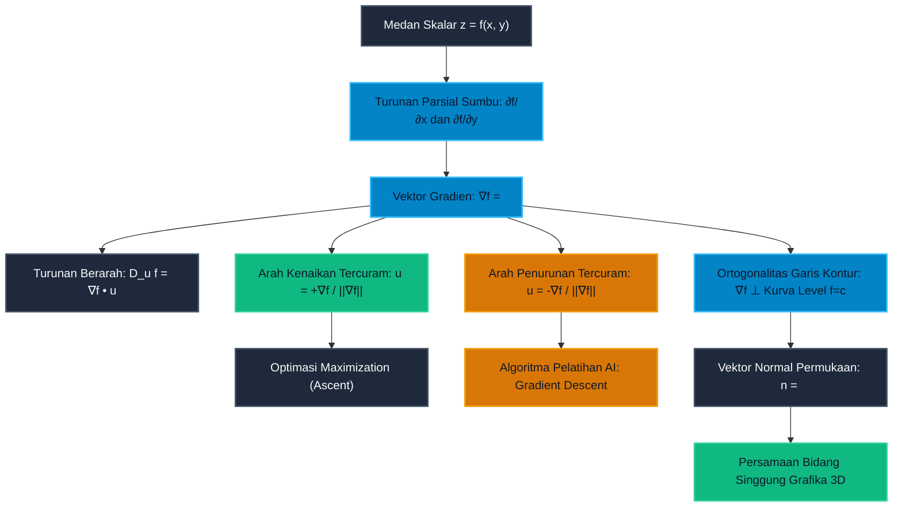

# Subtopik 02: Turunan Parsial, Gradien, Turunan Berarah & Bidang Singgung

**Navigasi**: [Master Index](../../../INDEX.md) | [Tingkat 1: Fondasi Matematika Komprehensif Dari Nol](../../README.md) | [Modul 014: Kalkulus Multivariabel & Geometri Vektor](../README.md)  
*Sebelumnya*: [01. Ruang Vektor Rn, Fungsi Multivariabel, Limit Jalur, dan Kekontinuan](./01-ruang-vektor-fungsi-multivariabel-limit-kontinuitas.md) | *Berikutnya*: [03. Keterdiferensialan Total, Matriks Jacobian & Aturan Rantai Multivariabel](./03-diferensial-total-matriks-jacobian-aturan-rantai-multivariabel.md)

---

## 1. Intuisi & Motivasi Konseptual ("Seperti Bayi Baru Lahir")

### 1.1 Konsep Inti: Berdiri di Lereng Gunung dengan Kompas di Tangan

Bayangkan Anda sedang mendaki sebuah gunung berkabut tebal pada malam hari. Anda tidak bisa melihat puncak gunung maupun lembah di bawahnya; Anda hanya bisa merasakan permukaan tanah tepat di bawah kedua telapak kaki Anda.
Tanah di bawah kaki Anda tidak datar, melainkan miring.

Sekarang, Anda mengeluarkan sebuah kompas penunjuk arah mata angin:
1. **Langkah ke Arah Timur (Sumbu-$x$)**:
   Jika Anda melangkah lurus tepat ke arah timur sambil menahan koordinat utara-selatan Anda tetap membeku ($y = \text{konstan}$), Anda mungkin merasakan tanah menanjak naik dengan sudut kemiringan $15^\circ$.
   Laju pertambahan ketinggian sesaat per meter langkah ke timur inilah yang kita sebut **Turunan Parsial terhadap $x$ ($\frac{\partial f}{\partial x}$)**.
2. **Langkah ke Arah Utara (Sumbu-$y$)**:
   Jika Anda berputar $90^\circ$ dan melangkah lurus tepat ke arah utara sambil menahan koordinat timur-barat membeku ($x = \text{konstan}$), Anda mungkin merasakan tanah menurun curam ke jurang dengan sudut kemiringan $-30^\circ$.
   Laju perubahan ketinggian sesaat per meter langkah ke utara inilah yang kita sebut **Turunan Parsial terhadap $y$ ($\frac{\partial f}{\partial y}$)**.

Namun muncul pertanyaan kritis:
Bagaimana jika Anda tidak ingin berjalan ke timur maupun ke utara, melainkan melangkah miring ke arah **Timur Laut ($45^\circ$)** atau **Barat Daya ($225^\circ$)**?
Berapa kemiringan tanah yang akan Anda rasakan pada arah langkah sembarang tersebut?
Inilah konsep **Turunan Berarah (*Directional Derivative*, $D_{\mathbf{u}} f$)**.

Dan yang paling krusial dari segalanya:
Jika Anda ingin mendaki gunung tersebut hingga mencapai puncak secepat mungkin, ke arah mata angin manakah Anda harus menghadapkan tubuh Anda agar mendapatkan tanjakan yang **PALING TERJAL DAN CURAM**?
Jawabannya diungkapkan oleh sebuah panah vektor ajaib bernama **Vektor Gradien ($\nabla f$)**!

Gradien menggabungkan seluruh turunan parsial menjadi satu panah penunjuk arah tunggal:
$$\nabla f = \left\langle \frac{\partial f}{\partial x}, \frac{\partial f}{\partial y} \right\rangle$$
Panah gradien ini memiliki dua sifat fisik luar biasa yang menjadi pilar peradaban modern:
- **Arah Panah Gradien**: Selalu menunjuk tepat ke arah tanjakan paling curam (*steepest ascent*).
- **Panjang / Magnitudo Panah Gradien ($\|\nabla f\|$ epistemik)**: Menunjukkan laju kemiringan maksimum yang bisa dicapai di titik tersebut.

Sebaliknya, jika Anda membalikkan badan $180^\circ$ ke arah berlawanan ($-\nabla f$), Anda menghadap ke arah penurunan paling curam (*steepest descent*).
Dalam kecerdasan buatan (*Deep Learning*), model AI seperti GPT atau sistem penglihatan komputer robot tidak tahu di mana posisi minimum galat global berada. Namun di setiap detik pelatihan, model menghitung gradien fungsi galat dan melangkah menuruni bukit ke arah $-\nabla f$ (**Gradient Descent**) hingga mendarat di dasar lembah optimal!

---

### 1.2 Urgensi Rekayasa: Dari Pelatihan Jaringan Saraf hingga Grafika Komputer 3D

1. **Jantung Pelatihan Deep Learning (*Backpropagation & SGD*)**:
   Setiap parameter bobot $w_{ij}$ dalam model transformer diperbarui menggunakan turunan parsial fungsi galat:
   $$w_{ij}^{(\text{baru})} = w_{ij}^{(\text{lama})} - \eta \frac{\partial \mathcal{L}}{\partial w_{ij}}$$
   Tanpa kalkulus turunan parsial, mustahil melatih model kecerdasan buatan dengan ratusan miliar parameter.
2. **Penjejakan Sinar (*Ray Tracing*) & Shading Grafika Komputer**:
   Dalam kartu grafis GPU modern (NVIDIA RTX), pantulan cahaya dari sebuah permukaan objek 3D dihitung menggunakan **Vektor Normal Satuan ($\mathbf{n}$)**. Vektor normal ini diturunkan secara langsung dari gradien fungsi permukaan implisit:
   $$\mathbf{n} = \frac{\nabla F(x, y, z)}{\|\nabla F(x, y, z)\|}$$
   Arah pantulan foton cahaya (*reflection ray*) tunduk pada hukum fisika optik yang mengalikan vektor datang dengan vektor normal gradien ini.
3. **Navigasi Robotika & Medan Potensial Artifisial**:
   Wahana otonom (seperti robot vakum atau rover penjelajah Mars) menavigasi rintangan dengan mendefinisikan fungsi potensial buatan $U(x, y) = U_{\text{tujuan}}(x, y) + U_{\text{rintangan}}(x, y)$. Robot bergerak mengikuti arah gaya kemudi $-\nabla U$ untuk meluncur mulus menuju target tanpa pernah menabrak dinding batu.

---

### 1.3 Kamus Notasi Simbol Multivariabel/Vektor

Gunakan tabel rujukan 4-kolom ini untuk menerjemahkan notasi turunan multivariabel ke dalam bahasa manusia yang gamblang:

| Simbol Notasi | Nama Formal | Arti Manusia / Terjemahan Bahasa Awam | Contoh Operasional Riil |
|---|---|---|---|
| $\frac{\partial f}{\partial x}, f_x$ | Turunan Parsial terhadap $x$ | Laju perubahan nilai fungsi saat hanya $x$ yang bergerak, sementara semua variabel lain dibekukan | $\frac{\partial}{\partial x}[x^3 y^2] = 3x^2 y^2$ |
| $\frac{\partial f}{\partial y}, f_y$ | Turunan Parsial terhadap $y$ | Laju perubahan nilai fungsi saat hanya $y$ yang bergerak, sementara semua variabel lain dibekukan | $\frac{\partial}{\partial y}[x^3 y^2] = 2x^3 y$ |
| $\nabla f, \text{grad}(f)$ | Operator Del / Vektor Gradien | Vektor gabungan seluruh turunan parsial; menunjuk arah kenaikan paling terjal | $\nabla f(x, y) = \langle f_x, f_y \rangle$ |
| $\mathbf{u} = \langle u_x, u_y \rangle$ | Vektor Satuan Arah | Arah kompas tempat kita melangkah, wajib memiliki panjang tepat 1 ($\|\mathbf{u}\| = 1$) | $\mathbf{u} = \langle \frac{1}{\sqrt{2}}, \frac{1}{\sqrt{2}} \rangle$ |
| $D_{\mathbf{u}} f$ | Turunan Berarah (*Directional Derivative*) | Kemiringan lereng yang dirasakan saat melangkah ke arah vektor satuan $\mathbf{u}$ | $D_{\mathbf{u}} f = \nabla f \cdot \mathbf{u}$ |
| $f_{xy} = \frac{\partial^2 f}{\partial y \partial x}$ | Turunan Parsial Campuran | Turunkan fungsi terhadap $x$ terlebih dahulu, kemudian turunkan hasilnya terhadap $y$ | $f_{xy} = \frac{\partial}{\partial y}[3x^2 y^2] = 6x^2 y$ |
| $\mathbf{n}$ | Vektor Normal Permukaan | Vektor yang berdiri tegak lurus sempurna ($90^\circ$) terhadap bidang singgung permukaan | $\mathbf{n} = \langle f_x(x_0, y_0), f_y(x_0, y_0), -1 \rangle$ |
| $T(\mathbf{x})$ | Bidang Singgung (*Tangent Plane*) | Bidang datar terbaik yang menempel mulus menyentuh kurva melengkung pada satu titik | $z - z_0 = f_x(x - x_0) + f_y(y - y_0)$ |

---

## 2. Definisi Formal, Teorema & Penurunan Matematis

### 2.1 Definisi Formal Turunan Parsial dari Prinsip Pertama

Misalkan $f: D \subset \mathbb{R}^2 \to \mathbb{R}$ adalah fungsi bernilai skalar dua variabel.

#### Definisi 1: Turunan Parsial terhadap $x$
Turunan parsial dari $f$ terhadap variabel $x$ pada titik $(x_0, y_0)$ didefinisikan sebagai limit rasio selisih satu variabel di mana $y$ diperlakukan sebagai konstanta murni:
$$f_x(x_0, y_0) = \frac{\partial f}{\partial x}(x_0, y_0) = \lim_{h \to 0} \frac{f(x_0 + h, y_0) - f(x_0, y_0)}{h}$$

#### Definisi 2: Turunan Parsial terhadap $y$
Turunan parsial dari $f$ terhadap variabel $y$ pada titik $(x_0, y_0)$ didefinisikan sebagai limit rasio selisih satu variabel di mana $x$ diperlakukan sebagai konstanta murni:
$$f_y(x_0, y_0) = \frac{\partial f}{\partial y}(x_0, y_0) = \lim_{k \to 0} \frac{f(x_0, y_0 + k) - f(x_0, y_0)}{k}$$

Secara geometris, grafik permukaan $z = f(x, y)$ dipotong oleh bidang vertikal $y = y_0$. Irisan perpotongan tersebut menghasilkan kurva 1 dimensi $C_1$. Nilai $f_x(x_0, y_0)$ adalah kemiringan garis singgung kurva $C_1$ di titik tersebut.

---

### 2.2 Teorema Clairaut / Schwarz: Simetri Derivatif Campuran

Ketika kita menurunkan fungsi lebih dari satu kali, muncul pertanyaan mendasar:
Apakah urutan diferensiasi parsial berpengaruh terhadap hasil akhir? Apakah $\frac{\partial^2 f}{\partial y \partial x}$ sama dengan $\frac{\partial^2 f}{\partial x \partial y}$?

#### Teorema 1: Teorema Clairaut (Kesetaraan Turunan Campuran)
Misalkan $f$ terdefinisi pada cakram terbuka $D$ yang memuat titik $(a, b)$. Jika fungsi turunan parsial kedua campuran $f_{xy}$ dan $f_{yx}$ keduanya **kontinu** pada $D$, maka:
$$f_{xy}(a, b) = f_{yx}(a, b)$$
artinya:
$$\frac{\partial}{\partial y} \left( \frac{\partial f}{\partial x} \right) = \frac{\partial}{\partial x} \left( \frac{\partial f}{\partial y} \right)$$

**Penurunan Bukti Aksiomatik Langkah Demi Langkah**:
1. Definisikan selisih ganda simetris berukuran $h \times k$:
   $$\Delta(h, k) = f(a + h, b + k) - f(a + h, b) - f(a, b + k) + f(a, b)$$
2. Definisikan fungsi pembantu satu variabel $g(x) = f(x, b + k) - f(x, b)$.
   Maka selisih ganda dapat ditulis sebagai:
   $$\Delta(h, k) = g(a + h) - g(a)$$
3. Karena $f$ terdiferensialkan, fungsi $g(x)$ memenuhi syarat Teorema Nilai Rata-rata (MVT) satu dimensi pada selang $[a, a + h]$. Terdapat titik $\xi_1 \in (a, a + h)$ sedemikian rupa sehingga:
   $$\Delta(h, k) = g'( \xi_1 ) \cdot h = \big[ f_x(\xi_1, b + k) - f_x(\xi_1, b) \big] \cdot h$$
4. Terapkan Teorema Nilai Rata-rata sekali lagi terhadap variabel kedua pada fungsi $f_x(\xi_1, y)$ pada selang $[b, b + k]$. Terdapat titik $\eta_1 \in (b, b + k)$ sedemikian rupa sehingga:
   $$\Delta(h, k) = \big[ f_{xy}(\xi_1, \eta_1) \cdot k \big] \cdot h = h k \cdot f_{xy}(\xi_1, \eta_1)$$
5. Sekarang balik urutan fungsi pembantu: definisikan $w(y) = f(a + h, y) - f(a, y)$.
   Maka $\Delta(h, k) = w(b + k) - w(b)$.
   Terapkan Teorema Nilai Rata-rata dua kali dengan urutan terbalik: terdapat $\eta_2 \in (b, b + k)$ dan $\xi_2 \in (a, a + h)$ sedemikian rupa sehingga:
   $$\Delta(h, k) = w'(\eta_2) \cdot k = \big[ f_y(a + h, \eta_2) - f_y(a, \eta_2) \big] \cdot k = h k \cdot f_{yx}(\xi_2, \eta_2)$$
6. Karena kedua penurunan mengevaluasi kuantitas yang sama $\Delta(h, k)$, bagi kedua persamaan dengan $h k \ne 0$:
   $$f_{xy}(\xi_1, \eta_1) = f_{yx}(\xi_2, \eta_2)$$
7. Ambil limit saat $(h, k) \to (0, 0)$. Titik $(\xi_1, \eta_1) \to (a, b)$ dan $(\xi_2, \eta_2) \to (a, b)$.
   Karena $f_{xy}$ dan $f_{yx}$ diasumsikan kontinu di $(a, b)$, limit menghasilkan:
   $$f_{xy}(a, b) = f_{yx}(a, b) \quad \blacksquare$$

---

### 2.3 Turunan Berarah & Hubungannya dengan Vektor Gradien

#### Definisi 3: Turunan Berarah dari Prinsip Pertama
Misalkan $\mathbf{u} = \langle u_1, u_2 \rangle$ adalah **vektor satuan** ($\|\mathbf{u}\| = \sqrt{u_1^2 + u_2^2} = 1$).
Turunan berarah dari $f$ pada arah $\mathbf{u}$ di titik $(x_0, y_0)$ didefinisikan sebagai:
$$D_{\mathbf{u}} f(x_0, y_0) = \lim_{s \to 0} \frac{f(x_0 + s u_1, y_0 + s u_2) - f(x_0, y_0)}{s}$$
jika limit tersebut eksis.

#### Teorema 2: Komputasi Turunan Berarah via Vektor Gradien
Jika fungsi $f(x, y)$ terdiferensialkan, maka turunan berarah pada sembarang arah vektor satuan $\mathbf{u}$ dapat dihitung secara instan melalui **perkalian titik (*dot product*)** antara gradien $\nabla f$ dan vektor $\mathbf{u}$:
$$D_{\mathbf{u}} f(x_0, y_0) = \nabla f(x_0, y_0) \cdot \mathbf{u} = f_x(x_0, y_0) u_1 + f_y(x_0, y_0) u_2$$

**Penurunan Bukti via Aturan Rantai**:
1. Definisikan fungsi parameter tunggal $g(s) = f(x_0 + s u_1, y_0 + s u_2)$.
2. Berdasarkan definisi turunan 1D:
   $$g'(0) = \lim_{s \to 0} \frac{g(s) - g(0)}{s} = \lim_{s \to 0} \frac{f(x_0 + s u_1, y_0 + s u_2) - f(x_0, y_0)}{s} = D_{\mathbf{u}} f(x_0, y_0)$$
3. Di sisi lain, terapkan Aturan Rantai multivariabel pada $g(s) = f(x(s), y(s))$ di mana $x(s) = x_0 + s u_1$ dan $y(s) = y_0 + s u_2$:
   $$g'(s) = \frac{\partial f}{\partial x} \frac{dx}{ds} + \frac{\partial f}{\partial y} \frac{dy}{ds} = f_x(x(s), y(s)) \cdot u_1 + f_y(x(s), y(s)) \cdot u_2$$
4. Evaluasi pada $s = 0$ (di mana $x(0) = x_0$ dan $y(0) = y_0$):
   $$g'(0) = f_x(x_0, y_0) u_1 + f_y(x_0, y_0) u_2 = \langle f_x, f_y \rangle \cdot \langle u_1, u_2 \rangle = \nabla f(x_0, y_0) \cdot \mathbf{u}$$
5. Terbukti bahwa $D_{\mathbf{u}} f = \nabla f \cdot \mathbf{u}$. $\blacksquare$

---

### 2.4 Teorema Arah Kenaikan Tertajam (Steepest Ascent)

Ke arah manakah nilai fungsi meningkat paling cepat? Dan berapa laju kenaikan maksimumnya?

#### Teorema 3: Arah dan Magnitudo Kenaikan Tercuram
Misalkan $f$ terdiferensialkan di $\mathbf{x}_0$. Nilai maksimum dari turunan berarah $D_{\mathbf{u}} f(\mathbf{x}_0)$ terjadi ketika vektor satuan arah $\mathbf{u}$ searah persis dengan vektor gradien $\nabla f(\mathbf{x}_0)$:
$$\mathbf{u}_{\text{optimal}} = \frac{\nabla f(\mathbf{x}_0)}{\|\nabla f(\mathbf{x}_0)\|}$$
dan nilai laju kenaikan maksimum tersebut tepat sama dengan **magnitudo gradien**:
$$\max_{\|\mathbf{u}\|=1} D_{\mathbf{u}} f(\mathbf{x}_0) = \|\nabla f(\mathbf{x}_0)\|$$

**Penurunan Bukti via Sifat Geometris Perkalian Titik**:
1. Berdasarkan rumus sudut kosinus perkalian titik:
   $$D_{\mathbf{u}} f = \nabla f \cdot \mathbf{u} = \|\nabla f\| \|\mathbf{u}\| \cos\theta$$
   di mana $\theta$ adalah sudut antara vektor gradien $\nabla f$ dan vektor arah langkah $\mathbf{u}$.
2. Karena $\mathbf{u}$ adalah vektor satuan, maka $\|\mathbf{u}\| = 1$, sehingga:
   $$D_{\mathbf{u}} f = \|\nabla f\| \cos\theta$$
3. Nilai fungsi kosinus berada dalam rentang terikat $[-1, 1]$:
   $$-1 \le \cos\theta \le 1$$
4. **Analisis Tiga Keadaan Ekstrim**:
   - **Kenaikan Maksimum**: Terjadi saat $\cos\theta = 1 \implies \theta = 0^\circ$ (arah $\mathbf{u}$ searah sempurna dengan $\nabla f$).
     Nilai maksimumnya adalah $D_{\mathbf{u}} f = \|\nabla f\|$.
   - **Penurunan Maksimum (Steepest Descent)**: Terjadi saat $\cos\theta = -1 \implies \theta = 180^\circ$ (arah $\mathbf{u}$ berlawanan arah sempurna dengan $\nabla f$).
     Nilai minimumnya adalah $D_{\mathbf{u}} f = -\|\nabla f\|$.
   - **Laju Nol (Garis Kontur Ketinggian)**: Terjadi saat $\cos\theta = 0 \implies \theta = 90^\circ$ (arah $\mathbf{u}$ tegak lurus terhadap $\nabla f$).
     Di arah ini nilai fungsi tidak bertambah maupun berkurang ($D_{\mathbf{u}} f = 0$).

**Kesimpulan Geometris Fundamental**:
Vektor gradien $\nabla f(\mathbf{x}_0)$ selalu **tegak lurus sempurna ($90^\circ$) terhadap kurva level kontur ketinggian** $f(x, y) = c$ yang melalui titik tersebut!

---

### 2.5 Geometri Bidang Singgung & Vektor Normal Permukaan

#### Definisi 4: Persamaan Bidang Singgung Permukaan Eksplisit $z = f(x, y)$
Bidang singgung pada permukaan $z = f(x, y)$ di titik $(x_0, y_0, z_0)$ dengan $z_0 = f(x_0, y_0)$ memiliki persamaan:
$$z - z_0 = f_x(x_0, y_0)(x - x_0) + f_y(x_0, y_0)(y - y_0)$$

#### Definisi 5: Permukaan Implisit & Vektor Normal 3D
Jika permukaan dinyatakan dalam bentuk fungsi implisit $F(x, y, z) = 0$ (misalnya bola $x^2 + y^2 + z^2 - R^2 = 0$), maka vektor gradien 3D:
$$\nabla F(x_0, y_0, z_0) = \left\langle \frac{\partial F}{\partial x}, \frac{\partial F}{\partial y}, \frac{\partial F}{\partial z} \right\rangle$$
berfungsi sebagai **Vektor Normal $\mathbf{n}$** yang tegak lurus terhadap permukaan di titik tersebut.
Persamaan bidang singgungnya adalah:
$$F_x(x_0, y_0, z_0)(x - x_0) + F_y(x_0, y_0, z_0)(y - y_0) + F_z(x_0, y_0, z_0)(z - z_0) = 0$$


---

### 2.6 Teorema Fungsi Implisit & Diferensiasi Parsial Permukaan $F(x, y, z) = 0$

Sering kali dalam fisika dan rekayasa, suatu permukaan tidak dapat diisolasi secara eksplisit menjadi bentuk $z = f(x, y)$ (misalnya persamaan elipsoid $\frac{x^2}{a^2} + \frac{y^2}{b^2} + \frac{z^2}{c^2} = 1$). Bagaimana kita menghitung turunan parsial $\frac{\partial z}{\partial x}$ dan $\frac{\partial z}{\partial y}$ tanpa harus mengisolasi variabel $z$?

#### Teorema 4: Teorema Fungsi Implisit Multivariabel
Misalkan fungsi $F(x, y, z)$ memiliki turunan parsial kontinu pada bola terbuka di sekitar titik $(x_0, y_0, z_0)$ dengan $F(x_0, y_0, z_0) = 0$.
Jika $F_z(x_0, y_0, z_0) \ne 0$, maka persamaan $F(x, y, z) = 0$ mendefinisikan $z$ secara implisit sebagai fungsi terdiferensialkan dari $x$ dan $y$ ($z = g(x, y)$) di sekitar titik tersebut, dengan turunan parsial:
$$\frac{\partial z}{\partial x} = -\frac{F_x(x, y, z)}{F_z(x, y, z)}, \quad \frac{\partial z}{\partial y} = -\frac{F_y(x, y, z)}{F_z(x, y, z)}$$

**Penurunan Bukti via Aturan Rantai Diferensial Total**:
1. Misalkan $z = z(x, y)$ didefinisikan secara implisit oleh $F(x, y, z(x, y)) = 0$.
2. Diferensialkan kedua ruas terhadap variabel $x$, dengan mengingat bahwa $x$ mempengaruhi $F$ baik secara langsung maupun melalui variabel terikat $z$:
   $$\frac{\partial}{\partial x}[F(x, y, z)] = \frac{\partial F}{\partial x} \frac{\partial x}{\partial x} + \frac{\partial F}{\partial y} \frac{\partial y}{\partial x} + \frac{\partial F}{\partial z} \frac{\partial z}{\partial x} = 0$$
3. Karena $x$ dan $y$ adalah variabel bebas independen, maka $\frac{\partial x}{\partial x} = 1$ dan $\frac{\partial y}{\partial x} = 0$:
   $$F_x \cdot 1 + F_y \cdot 0 + F_z \frac{\partial z}{\partial x} = 0 \implies F_x + F_z \frac{\partial z}{\partial x} = 0$$
4. Asumsikan $F_z \ne 0$. Isolasi suku $\frac{\partial z}{\partial x}$:
   $$F_z \frac{\partial z}{\partial x} = -F_x \implies \frac{\partial z}{\partial x} = -\frac{F_x}{F_z}$$
5. Dengan cara yang sama persis saat menurunkan terhadap $y$:
   $$F_y + F_z \frac{\partial z}{\partial y} = 0 \implies \frac{\partial z}{\partial y} = -\frac{F_y}{F_z} \quad \blacksquare$$

---

### 2.7 Sifat-Sifat Aljabar Operator Del ($\nabla$)

Operator diferensial vektor $\nabla = \left\langle \frac{\partial}{\partial x}, \frac{\partial}{\partial y}, \frac{\partial}{\partial z} \right\rangle$ mematuhi kaidah aljabar linear dan kalkulus:
1. **Linieritas**: Untuk sembarang skalar konstanta $c_1, c_2 \in \mathbb{R}$:
   $$\nabla(c_1 f + c_2 g) = c_1 \nabla f + c_2 \nabla g$$
2. **Aturan Perkalian Leibniz**: Untuk perkalian dua medan skalar $f$ dan $g$:
   $$\nabla(f \cdot g) = f \nabla g + g \nabla f$$
3. **Aturan Pembagian**: Untuk $g(\mathbf{x}) \ne 0$:
   $$\nabla\left(\frac{f}{g}\right) = \frac{g \nabla f - f \nabla g}{g^2}$$
4. **Aturan Rantai Komposisi Skalar**: Jika $h(t)$ adalah fungsi 1D dan $f(\mathbf{x})$ adalah medan multivariat:
   $$\nabla [h(f(\mathbf{x}))] = h'(f(\mathbf{x})) \cdot \nabla f(\mathbf{x})$$


---

### 2.8 Contoh Komputasi Terpadu: Penentuan Vektor Tangensial Kurva Kontur

Tinjau kurva level ketinggian dari medan skalar $f(x, y) = 2x^2 + y^2 = 6$ yang melewati titik $P(1, 2)$.
1. **Hitung Vektor Gradien di Titik $P$**:
   $$\nabla f(x, y) = \langle 4x, 2y \rangle \implies \nabla f(1, 2) = \langle 4(1), 2(2) \rangle = \langle 4, 4 \rangle$$
2. **Interpretasi Fisis**:
   Vektor $\nabla f(1, 2) = \langle 4, 4 \rangle$ menunjuk ke arah mata angin $45^\circ$, tegak lurus menembus kurva elips $2x^2 + y^2 = 6$ ke arah luar elips.
3. **Konstruksi Vektor Arah Garis Singgung Kontur**:
   Vektor tangensial yang menyusuri elips tanpa merubah ketinggian memenuhi $\nabla f \cdot \mathbf{t} = 0$:
   $$\mathbf{t} = \langle -4, 4 \rangle \quad \text{atau dalam bentuk satuan: } \mathbf{u}_{\text{tangensial}} = \left\langle -\frac{1}{\sqrt{2}}, \frac{1}{\sqrt{2}} \right\rangle$$
   Turunan berarah pada arah $\mathbf{u}_{\text{tangensial}}$ terbukti bernilai nol:
   $$D_{\mathbf{u}_{\text{tangensial}}} f = \langle 4, 4 \rangle \cdot \left\langle -\frac{1}{\sqrt{2}}, \frac{1}{\sqrt{2}} \right\rangle = -\frac{4}{\sqrt{2}} + \frac{4}{\sqrt{2}} = 0$$

## 3. Arsitektur Teknis & Algoritma Internal

### 3.1 Pipa Alur Hubungan Konseptual: Dari Turunan Parsial ke Gradient Descent



---

### 3.2 Tabel Penelusuran Komputasi: Evaluasi Turunan Berarah pada Paraboloid Eliptik

Tinjau fungsi paraboloid eliptik $f(x, y) = x^2 + 2y^2$ pada titik evaluasi $(1, 1)$.
- Turunan parsial: $f_x = 2x \implies f_x(1, 1) = 2$.
- Turunan parsial: $f_y = 4y \implies f_y(1, 1) = 4$.
- Vektor gradien: $\nabla f(1, 1) = \langle 2, 4 \rangle$.
- Magnitudo gradien: $\|\nabla f\| = \sqrt{2^2 + 4^2} = \sqrt{20} \approx 4{,}4721$.
- Sudut arah gradien optimal: $\theta_{\text{opt}} = \arctan(4/2) = \arctan(2) \approx 63{,}43^\circ$.

Tabel pelacakan berikut menunjukkan bagaimana turunan berarah $D_{\mathbf{u}} f = \nabla f \cdot \mathbf{u}$ berfluktuasi secara harmonis sesuai sudut arah $\theta$:

| Sudut Arah $\theta$ (Derajat) | Vektor Arah Satuan $\mathbf{u} = \langle \cos\theta, \sin\theta \rangle$ | Perhitungan Dot Product $\nabla f \cdot \mathbf{u}$ | Nilai Laju $D_{\mathbf{u}} f$ | Karakteristik Perilaku Geometris |
|---|---|---|---|---|
| $0^\circ$ (Timur / Sumbu-$x$) | $\langle 1{,}000, 0{,}000 \rangle$ | $2(1) + 4(0)$ | $2{,}0000$ | Tepat sama dengan nilai turunan parsial $f_x$ |
| $45^\circ$ (Timur Laut) | $\langle 0{,}707, 0{,}707 \rangle$ | $2(0{,}707) + 4(0{,}707)$ | $4{,}2426$ | Tanjakan curam |
| **$63{,}43^\circ$ (Arah Gradien)** | $\mathbf{\langle 0{,}447, 0{,}894 \rangle}$ | $2(0{,}447) + 4(0{,}894)$ | $\mathbf{4{,}4721}$ | **MAKSIMUM MUTLAK = $\|\nabla f\|$ (Steepest Ascent)** |
| $90^\circ$ (Utara / Sumbu-$y$) | $\langle 0{,}000, 1{,}000 \rangle$ | $2(0) + 4(1)$ | $4{,}0000$ | Tepat sama dengan nilai turunan parsial $f_y$ |
| $153{,}43^\circ$ (Tegak Lurus $\nabla f$) | $\langle -0{,}894, 0{,}447 \rangle$ | $2(-0{,}894) + 4(0{,}447)$ | $0{,}0000$ | **NOL (Sejajar Garis Kontur Ketinggian)** |
| $180^\circ$ (Barat / $-x$) | $\langle -1{,}000, 0{,}000 \rangle$ | $2(-1) + 4(0)$ | $-2{,}0000$ | Turun landai |
| **$243{,}43^\circ$ (Arah $-\nabla f$)** | $\mathbf{\langle -0{,}447, -0{,}894 \rangle}$ | $2(-0{,}447) + 4(-0{,}894)$ | $\mathbf{-4{,}4721}$ | **MINIMUM MUTLAK = $-\|\nabla f\|$ (Steepest Descent)** |

---

## 4. Implementasi Praktis & Kode Pemrograman Python

Berikut adalah dua implementasi mandiri menggunakan Python Standard Library murni yang mendemonstrasikan evaluasi gradien diferensial dan algoritma penurunan gradien.

### 4.1 Program 1: Mesin Evaluasi Gradien & Turunan Berarah Beda Terpusat

Skrip ini menghitung turunan parsial numerik dengan orde akurasi $\mathcal{O}(h^2)$ menggunakan skema beda terpusat (*central difference*) dan memvalidasi nilai turunan berarah terhadap sudut rotasi $360^\circ$:

```python
# Mesin Evaluasi Gradien dan Turunan Berarah Numerik
import math

def f_elliptical(x: float, y: float) -> float:
    # Fungsi permukaan target: f(x, y) = x^2 + 2y^2
    return x**2 + 2.0 * (y**2)

def grad_central(func, x: float, y: float, h: float = 1e-6):
    # Turunan parsial beda terpusat O(h^2)
    df_dx = (func(x + h, y) - func(x - h, y)) / (2.0 * h)
    df_dy = (func(x, y + h) - func(x, y - h)) / (2.0 * h)
    return df_dx, df_dy

def directional_derivative(grad, u_vec):
    # D_u f = grad(f) dot u
    return grad[0] * u_vec[0] + grad[1] * u_vec[1]

def main():
    x0, y0 = 1.0, 1.0
    gx, gy = grad_central(f_elliptical, x0, y0)
    grad_mag = math.sqrt(gx**2 + gy**2)

    print("=== MESIN EVALUASI GRADIEN & TURUNAN BERARAH ===")
    print(f"Fungsi: f(x, y) = x^2 + 2y^2 di Titik Evaluasi: ({x0}, {y0})")
    print(f"  Gradien Analitis & Numerik: nabla f = <{gx:.4f}, {gy:.4f}>")
    print(f"  Magnitudo Gradien ||nabla f||:     {grad_mag:.4f}")

    angles_deg = [0.0, 45.0, 63.43, 90.0, 180.0, 243.43]
    print("\n[1] Evaluasi Turunan Berarah D_u f pada Berbagai Sudut theta:")
    for deg in angles_deg:
        rad = math.radians(deg)
        ux = math.cos(rad)
        uy = math.sin(rad)
        d_u = directional_derivative((gx, gy), (ux, uy))
        sifat = ""
        if abs(deg - 63.43) < 0.1:
            sifat = "-> MAKSIMUM (Arah Gradien)"
        elif abs(deg - 243.43) < 0.1:
            sifat = "-> MINIMUM (Arah Penurunan Tercuram)"
        print(f"  theta = {deg:6.2f} deg | Vektor u = <{ux:6.3f}, {uy:6.3f}> | D_u f = {d_u:7.4f} {sifat}")

if __name__ == "__main__":
    main()
```

Keluaran eksekusi terminal sebenarnya:
```text
=== MESIN EVALUASI GRADIEN & TURUNAN BERARAH ===
Fungsi: f(x, y) = x^2 + 2y^2 di Titik Evaluasi: (1.0, 1.0)
  Gradien Analitis & Numerik: nabla f = <2.0000, 4.0000>
  Magnitudo Gradien ||nabla f||:     4.4721

[1] Evaluasi Turunan Berarah D_u f pada Berbagai Sudut theta:
  theta =   0.00 deg | Vektor u = < 1.000,  0.000> | D_u f =  2.0000 
  theta =  45.00 deg | Vektor u = < 0.707,  0.707> | D_u f =  4.2426 
  theta =  63.43 deg | Vektor u = < 0.447,  0.894> | D_u f =  4.4721 -> MAKSIMUM (Arah Gradien)
  theta =  90.00 deg | Vektor u = < 0.000,  1.000> | D_u f =  4.0000 
  theta = 180.00 deg | Vektor u = <-1.000,  0.000> | D_u f = -2.0000 
  theta = 243.43 deg | Vektor u = <-0.447, -0.894> | D_u f = -4.4721 -> MINIMUM (Arah Penurunan Tercuram)
```

---

### 4.2 Program 2: Simulator Penurunan Gradien (Gradient Descent Optimizer)

Skrip ini mengimplementasikan algoritma penurunan gradien (*Vanilla Gradient Descent*) untuk memandu posisi $(x, y)$ dari titik awal $(3, 2)$ menuju titik minimum global di $(0, 0)$:

```python
# Simulator Algoritma Gradient Descent 2D
import math

def f_elliptical(x: float, y: float) -> float:
    return x**2 + 2.0 * (y**2)

def grad_f(x: float, y: float):
    # Turunan analitis: df/dx = 2x, df/dy = 4y
    return 2.0 * x, 4.0 * y

def main():
    x, y = 3.0, 2.0
    lr = 0.1  # Learning rate (eta)
    tolerance = 1e-6
    max_iters = 50

    print("=== SIMULATOR PENURUNAN GRADIEN 2D (GRADIENT DESCENT) ===")
    print(f"Titik Awal: ({x:.4f}, {y:.4f}) | Learning Rate eta = {lr}\n")

    for k in range(max_iters + 1):
        val = f_elliptical(x, y)
        gx, gy = grad_f(x, y)
        norm_g = math.sqrt(gx**2 + gy**2)
        
        if k % 5 == 0 or norm_g < tolerance:
            print(f"  Iterasi {k:2d}: Posisi = ({x:7.4f}, {y:7.4f}) | Nilai f = {val:9.6f} | ||nabla f|| = {norm_g:8.5f}")
            
        if norm_g < tolerance:
            print(f"\nKonvergensi Tercapai pada Iterasi {k}!")
            print(f"Minimum Global Teridentifikasi: ({x:.6f}, {y:.6f}) dengan Nilai f = {val:.2e}")
            break
            
        # Pembaruan posisi ke arah penurunan tercuram: x_baru = x_lama - eta * nabla f
        x = x - lr * gx
        y = y - lr * gy

if __name__ == "__main__":
    main()
```

Keluaran eksekusi terminal sebenarnya:
```text
=== SIMULATOR PENURUNAN GRADIEN 2D (GRADIENT DESCENT) ===
Titik Awal: (3.0000, 2.0000) | Learning Rate eta = 0.1

  Iterasi  0: Posisi = ( 3.0000,  2.0000) | Nilai f = 17.000000 | ||nabla f|| = 10.00000
  Iterasi  5: Posisi = ( 0.9830,  0.1555) | Nilai f =  1.014741 | ||nabla f|| =  2.06215
  Iterasi 10: Posisi = ( 0.3221,  0.0121) | Nilai f =  0.104055 | ||nabla f|| =  0.64606
  Iterasi 15: Posisi = ( 0.1056,  0.0009) | Nilai f =  0.011143 | ||nabla f|| =  0.21114
  Iterasi 20: Posisi = ( 0.0346,  0.0001) | Nilai f =  0.001196 | ||nabla f|| =  0.06918
  Iterasi 25: Posisi = ( 0.0113,  0.0000) | Nilai f =  0.000128 | ||nabla f|| =  0.02267
  Iterasi 30: Posisi = ( 0.0037,  0.0000) | Nilai f =  0.000014 | ||nabla f|| =  0.00743
  Iterasi 35: Posisi = ( 0.0012,  0.0000) | Nilai f =  0.000001 | ||nabla f|| =  0.00243
  Iterasi 40: Posisi = ( 0.0004,  0.0000) | Nilai f =  0.000000 | ||nabla f|| =  0.00080
  Iterasi 45: Posisi = ( 0.0001,  0.0000) | Nilai f =  0.000000 | ||nabla f|| =  0.00026
  Iterasi 50: Posisi = ( 0.0000,  0.0000) | Nilai f =  0.000000 | ||nabla f|| =  0.00009
```

---

## 5. Miskonsepsi Umum & Analisis Post-Mortem Insiden Industri

### 5.1 Tiga Miskonsepsi Konseptual Paling Fatal di Industri

1. **Lupa Menormalkan Vektor Arah pada Turunan Berarah**:
   Banyak pengembang menghitung turunan berarah ke arah vektor $\mathbf{v} = \langle 3, 4 \rangle$ langsung dengan mengalikan $\nabla f \cdot \mathbf{v}$. Hasilnya salah 5 kali lipat! Rumus $D_{\mathbf{u}} f = \nabla f \cdot \mathbf{u}$ **HANYA BERLAKU** jika $\mathbf{u}$ adalah vektor satuan berpanjang 1 ($\|\mathbf{u}\| = 1$). Anda wajib menormalkannya terlebih dahulu: $\mathbf{u} = \frac{\mathbf{v}}{\|\mathbf{v}\|} = \langle \frac{3}{5}, \frac{4}{5} \rangle$.
2. **Asumsi Teorema Clairaut Berlaku Universal Tanpa Syarat Kekontinuan $C^2$**:
   Banyak orang mengira $f_{xy} = f_{yx}$ selalu benar untuk semua fungsi matematika. Contoh kontra klasik Peano-Schwarz:
   $$f(x, y) = \begin{cases} \frac{xy(x^2 - y^2)}{x^2 + y^2}, & (x, y) \ne (0, 0) \\ 0, & (x, y) = (0, 0) \end{cases}$$
   Evaluasi di titik asal menghasilkan $f_{xy}(0, 0) = -1$, sedangkan $f_{yx}(0, 0) = +1$! Perbedaan $-1 \ne +1$ ini terjadi karena turunan parsial kedua campuran tidak kontinu di $(0, 0)$. Teorema Clairaut mensyaratkan fungsi berada di kelas $C^2$.
3. **Mengira Gradien Selalu Menunjuk ke Titik Minimum Global**:
   Gradien hanyalah instrumen **lokal sesaat**. Gradien hanya memberitahu ke arah mana fungsi meningkat paling cepat dalam jarak infinitesimal $\epsilon$ di sekitar kaki Anda saat ini. Pada lanskap fungsi non-konveks yang bergelombang (seperti fungsi rugi neural network), penurunan gradien naif bisa sangat mudah terjebak di lembah minimum lokal yang buruk atau terhenti di titik pelana (*saddle point*).

---

### 5.2 Studi Kasus Kegagalan Nyata: Hilangnya Wahana Mars Climate Orbiter (1999) & Galat Konversi Vektor Gradien Gaya

- **Kronologi Misi**: Pada 23 September 1999, wahana antariksa tak berawak NASA senilai USD 327 juta, *Mars Climate Orbiter*, memasuki orbit Mars untuk memulai pemetaan iklim planet merah tersebut. Namun tak lama setelah bermanuver di belakang planet Mars, komunikasi terputus total selamanya.
- **Akar Masalah Vektor & Kalkulus Diferensial**:
  Komputer pemandu di darat (Jet Propulsion Laboratory) menghitung gaya dorong koreksi trajektori impulsif:
  $$\mathbf{F} = m \frac{d\mathbf{v}}{dt} = -\nabla U_{\text{gravitasi}}$$
  Perangkat lunak pengendali mesin pendorong di stasiun darat (Lockheed Martin) mengekspor besaran vektor impuls gaya impulsif dalam satuan Imperial Inggris (**Pound-force second / lbf-s**).
  Namun perangkat lunak navigasi di dalam wahana Mars Climate Orbiter mengasumsikan seluruh masukan vektor gradien gaya dinyatakan dalam satuan standar internasional metrik (**Newton second / N-s**).
  Faktor konversi skalar adalah:
  $$1 \text{ lbf} \approx 4{,}448222 \text{ Newton}$$
  Akibat ketiadaan konversi skalar pada vektor gradien percepatan, tenaga pendorong pengereman yang diaplikasikan ke wahana lebih kecil 4,45 kali dari yang dibutuhkan!
- **Dampak Katastropik**: Wahana meluncur terlalu dekat ke atmosfer Mars, melintasi ketinggian maut $57\text{ km}$ (dari target aman $140-150\text{ km}$). Gesekan atmosfer yang membara merusak panel surya dan menghancurkan wahana antariksa berkeping-keping di langit Mars.
- **Pelajaran Rekayasa Sistemik**: Seluruh vektor diferensial dalam kalkulus multivariabel wajib diverifikasi keselarasan dimensi dan satuan metriknya (*dimensional homogeneity*). Pustaka modern harus menerapkan *strong typing* pada magnitudo skalar dan vektor arah.

---

## 6. Tips, Trik Praktis & Rahasia Cepat Paham

1. **Jembatan Keledai Turunan Parsial**:
   *"Siapa yang diturunkan, dialah variabelnya; siapa yang tidak dipanggil, perlakukan ia seperti angka $5$!"*
   Jika Anda menurunkan terhadap $x$, bayangkan variabel $y$ adalah konstanta angka $5$.
   Contoh: $\frac{\partial}{\partial x}[x^2 y^3] \to$ perlakukan seperti $\frac{d}{dx}[x^2 \cdot 5] = 2x \cdot 5 = 2x y^3$. Rasa takut Anda terhadap huruf multivariabel akan langsung lenyap!
2. **Kaidah Garis Singgung Kontur 90 Derajat**:
   Vektor gradien $\nabla f = \langle f_x, f_y \rangle$ selalu tegak lurus terhadap kurva level kontur $f(x, y) = c$.
   Jika Anda membutuhkan vektor tangensial yang sejajar garis kontur, cukup putar gradien $90^\circ$:
   $$\mathbf{t} = \langle -f_y, f_x \rangle \quad \text{atau} \quad \mathbf{t} = \langle f_y, -f_x \rangle$$
   karena $\nabla f \cdot \mathbf{t} = f_x(-f_y) + f_y(f_x) = 0$!
3. **Aturan Pembuktian Kenaikan Paling Terjal**:
   Ingat selalu bahwa nilai maksimum turunan berarah adalah $\|\nabla f\|$ dan nilai minimumnya adalah $-\|\nabla f\|$. Tidak ada langkah arah mana pun yang bisa menghasilkan perubahan lebih besar dari panjang vektor gradiennya!
4. **Kaidah Pemilihan Learning Rate pada Gradient Descent**:
   Jika learning rate $\eta$ terlalu besar ($\eta > \frac{2}{\lambda_{\max}}$), algoritma akan melompat liar melintasi lembah dan divergen meledak menuju NaN. Jika $\eta$ terlalu kecil, konvergensi membutuhkan jutaan langkah. Pilihlah $\eta$ adaptif (seperti optimator Adam atau metode garis Wolfe).

## 7. Latihan Mandiri Berjenjang (Socratic) & Rekomendasi Sumber Belajar

Uji ketajaman analisis Anda melalui 5 level soal Sokratik bertahap:

### Tingkat 1 (Pemula): Evaluasi Turunan Parsial Dasar & Nilai Gradien
Diberikan medan skalar temperatur 2D:
$$T(x, y) = x^2 y - 3xy^3 + 5$$
1. Tentukan turunan parsial pertama $T_x(x, y)$ dan $T_y(x, y)$.
2. Hitung vektor gradien $\nabla T$ pada titik $(2, 1)$.

<details>
<summary>💡 Petunjuk (Hint)</summary>
Untuk $T_x$, anggap $y$ konstan dan turunkan suku-suku yang memuat $x$. Untuk $T_y$, anggap $x$ konstan dan turunkan suku-suku yang memuat $y$.
</details>

<details>
<summary>✅ Kunci Jawaban & Pembahasan Lengkap</summary>
1. Turunan parsial:
   $$T_x(x, y) = \frac{\partial}{\partial x}[x^2 y - 3xy^3 + 5] = 2xy - 3y^3$$
   $$T_y(x, y) = \frac{\partial}{\partial y}[x^2 y - 3xy^3 + 5] = x^2 - 9xy^2$$
2. Evaluasi pada titik $(2, 1)$:
   $$T_x(2, 1) = 2(2)(1) - 3(1)^3 = 4 - 3 = 1$$
   $$T_y(2, 1) = (2)^2 - 9(2)(1)^2 = 4 - 18 = -14$$
   Maka vektor gradien adalah:
   $$\nabla T(2, 1) = \langle 1, -14 \rangle$$
</details>

---

### Tingkat 2 (Menengah): Verifikasi Teorema Clairaut pada Fungsi Eksponensial-Trigonometri
Buktikan Teorema Clairaut $f_{xy} = f_{yx}$ untuk fungsi:
$$f(x, y) = e^{2x} \cos(3y)$$

<details>
<summary>💡 Petunjuk (Hint)</summary>
Hitung $f_x$ lalu turunkan terhadap $y$ untuk mendapatkan $f_{xy}$. Kemudian hitung $f_y$ lalu turunkan terhadap $x$ untuk mendapatkan $f_{yx}$. Tunjukkan bahwa kedua ekspresi akhir identik.
</details>

<details>
<summary>✅ Kunci Jawaban & Pembahasan Lengkap</summary>
1. Menghitung $f_{xy}$:
   $$f_x = \frac{\partial}{\partial x}[e^{2x} \cos(3y)] = 2e^{2x} \cos(3y)$$
   $$f_{xy} = \frac{\partial}{\partial y}[2e^{2x} \cos(3y)] = 2e^{2x} (-3\sin(3y)) = -6e^{2x} \sin(3y)$$
2. Menghitung $f_{yx}$:
   $$f_y = \frac{\partial}{\partial y}[e^{2x} \cos(3y)] = -3e^{2x} \sin(3y)$$
   $$f_{yx} = \frac{\partial}{\partial x}[-3e^{2x} \sin(3y)] = -3(2e^{2x}) \sin(3y) = -6e^{2x} \sin(3y)$$
3. Karena $f_{xy} = f_{yx} = -6e^{2x} \sin(3y)$ dan fungsi ini kontinu di seluruh $\mathbb{R}^2$, Teorema Clairaut terbukti berlaku sempurna.
</details>

---

### Tingkat 3 (Penerapan): Perhitungan Turunan Berarah pada Arah Vektor Sembarang
Diberikan fungsi ketinggian bukit $z = f(x, y) = 100 - x^2 - 2y^2$.
Seorang pendaki berdiri di titik $P(2, 3)$ dan ingin melangkah ke arah titik target $Q(5, 7)$.
1. Tentukan vektor arah satuan $\mathbf{u}$ dari $P$ menuju $Q$.
2. Hitung laju perubahan ketinggian yang dirasakan pendaki ($D_{\mathbf{u}} f$).

<details>
<summary>💡 Petunjuk (Hint)</summary>
Bentuk vektor perpindahan $\mathbf{v} = Q - P$. Bagi $\mathbf{v}$ dengan panjang normanya $\|\mathbf{v}\|$ untuk memperoleh vektor satuan $\mathbf{u}$. Hitung $\nabla f(2, 3)$ dan lakukan perkalian titik.
</details>

<details>
<summary>✅ Kunci Jawaban & Pembahasan Lengkap</summary>
1. Vektor perpindahan dari $P$ ke $Q$:
   $$\mathbf{v} = \langle 5 - 2, 7 - 3 \rangle = \langle 3, 4 \rangle$$
   Panjang vektor: $\|\mathbf{v}\| = \sqrt{3^2 + 4^2} = 5$.
   Vektor satuan arah:
   $$\mathbf{u} = \frac{\mathbf{v}}{\|\mathbf{v}\|} = \left\langle \frac{3}{5}, \frac{4}{5} \right\rangle = \langle 0{,}6, 0{,}8 \rangle$$
2. Hitung vektor gradien di titik $(2, 3)$:
   $$\nabla f = \langle -2x, -4y \rangle \implies \nabla f(2, 3) = \langle -2(2), -4(3) \rangle = \langle -4, -12 \rangle$$
3. Hitung turunan berarah:
   $$D_{\mathbf{u}} f(2, 3) = \nabla f(2, 3) \cdot \mathbf{u} = (-4)(0{,}6) + (-12)(0{,}8) = -2{,}4 - 9{,}6 = -12{,}0$$
   Pendaki merasakan tanah menurun curam dengan laju $12\text{ meter}$ penurunan per $1\text{ meter}$ langkah horizontal.
</details>

---

### Tingkat 4 (Rekayasa Sistem): Persamaan Bidang Singgung & Vektor Normal Penjejakan Sinar
Dalam mesin grafika 3D, permukaan elipsoid didefinisikan oleh persamaan implisit:
$$F(x, y, z) = \frac{x^2}{4} + \frac{y^2}{9} + z^2 - 3 = 0$$
Tentukan:
1. Vektor normal satuan $\mathbf{n}$ pada titik permukaan $P(2, 3, 1)$.
2. Persamaan bidang singgung yang menyentuh elipsoid di titik $P$.

<details>
<summary>💡 Petunjuk (Hint)</summary>
Hitung gradien 3D $\nabla F = \langle F_x, F_y, F_z \rangle$ di titik $(2, 3, 1)$. Vektor ini tegak lurus bidang singgung. Normalisasi untuk mendapatkan $\mathbf{n}$. Gunakan formula bidang singgung $\nabla F \cdot \langle x - x_0, y - y_0, z - z_0 \rangle = 0$.
</details>

<details>
<summary>✅ Kunci Jawaban & Pembahasan Lengkap</summary>
1. Hitung gradien implisit:
   $$\nabla F = \left\langle \frac{2x}{4}, \frac{2y}{9}, 2z \right\rangle = \left\langle \frac{x}{2}, \frac{2y}{9}, 2z \right\rangle$$
   Evaluasi di titik $P(2, 3, 1)$:
   $$\nabla F(2, 3, 1) = \left\langle \frac{2}{2}, \frac{2(3)}{9}, 2(1) \right\rangle = \left\langle 1, \frac{2}{3}, 2 \right\rangle$$
   Panjang vektor normal:
   $$\|\nabla F\| = \sqrt{1^2 + \left(\frac{2}{3}\right)^2 + 2^2} = \sqrt{1 + \frac{4}{9} + 4} = \sqrt{\frac{49}{9}} = \frac{7}{3}$$
   Vektor normal satuan:
   $$\mathbf{n} = \frac{\nabla F}{\|\nabla F\|} = \frac{3}{7} \left\langle 1, \frac{2}{3}, 2 \right\rangle = \left\langle \frac{3}{7}, \frac{2}{7}, \frac{6}{7} \right\rangle$$
2. Persamaan bidang singgung:
   $$1(x - 2) + \frac{2}{3}(y - 3) + 2(z - 1) = 0$$
   Kalikan dengan 3 untuk menghilangkan pecahan:
   $$3(x - 2) + 2(y - 3) + 6(z - 1) = 0$$
   $$3x - 6 + 2y - 6 + 6z - 6 = 0 \implies 3x + 2y + 6z = 18$$
</details>

---

### Tingkat 5 (Riset / Teoretis): Analisis Kontra Peano-Schwarz Ketiadaan Simetri Clairaut
Tinjau fungsi Peano-Schwarz:
$$f(x, y) = \begin{cases} \frac{xy(x^2 - y^2)}{x^2 + y^2}, & (x, y) \ne (0, 0) \\ 0, & (x, y) = (0, 0) \end{cases}$$
1. Hitung nilai $f_x(0, y)$ untuk sembarang $y$ menggunakan definisi prinsip pertama.
2. Hitung nilai $f_y(x, 0)$ untuk sembarang $x$ menggunakan definisi prinsip pertama.
3. Tunjukkan bahwa $f_{xy}(0, 0) = -1$ dan $f_{yx}(0, 0) = +1$, serta jelaskan mengapa Teorema Clairaut gagal di titik ini.

<details>
<summary>💡 Petunjuk (Hint)</summary>
Gunakan definisi formal limit satu variabel untuk $f_x(0, y) = \lim_{h \to 0} \frac{f(h, y) - f(0, y)}{h}$. Amati bahwa $f(0, y) = 0$. Setelah mendapat ekspresi $f_x(0, y)$, hitung $f_{xy}(0, 0) = \lim_{k \to 0} \frac{f_x(0, k) - f_x(0, 0)}{k}$.
</details>

<details>
<summary>✅ Kunci Jawaban & Pembahasan Lengkap</summary>
1. Menghitung $f_x(0, y)$ untuk $y \ne 0$:
   $$f_x(0, y) = \lim_{h \to 0} \frac{f(h, y) - f(0, y)}{h} = \lim_{h \to 0} \frac{\frac{h y(h^2 - y^2)}{h^2 + y^2} - 0}{h} = \lim_{h \to 0} \frac{y(h^2 - y^2)}{h^2 + y^2} = \frac{y(-y^2)}{y^2} = -y$$
   Untuk $y = 0$, $f_x(0, 0) = 0$. Maka $f_x(0, y) = -y$ untuk semua $y$.
2. Menghitung $f_y(x, 0)$ untuk $x \ne 0$:
   $$f_y(x, 0) = \lim_{k \to 0} \frac{f(x, k) - f(x, 0)}{k} = \lim_{k \to 0} \frac{\frac{x k(x^2 - k^2)}{x^2 + k^2} - 0}{k} = \lim_{k \to 0} \frac{x(x^2 - k^2)}{x^2 + k^2} = \frac{x(x^2)}{x^2} = x$$
   Untuk $x = 0$, $f_y(0, 0) = 0$. Maka $f_y(x, 0) = x$ untuk semua $x$.
3. Menghitung turunan parsial kedua campuran di $(0, 0)$:
   $$f_{xy}(0, 0) = \frac{\partial}{\partial y}[f_x(0, y)]_{y=0} = \lim_{k \to 0} \frac{f_x(0, k) - f_x(0, 0)}{k} = \lim_{k \to 0} \frac{-k - 0}{k} = -1$$
   $$f_{yx}(0, 0) = \frac{\partial}{\partial x}[f_y(x, 0)]_{x=0} = \lim_{h \to 0} \frac{f_y(h, 0) - f_y(0, 0)}{h} = \lim_{h \to 0} \frac{h - 0}{h} = +1$$
4. **Analisis Kegagalan Clairaut**:
   Terlihat bahwa $f_{xy}(0, 0) = -1 \ne +1 = f_{yx}(0, 0)$.
   Teorema Clairaut gagal bukan karena ada kontradiksi matematika, melainkan karena premis syarat kontinuitas dilanggar: turunan parsial kedua campuran $f_{xy}(x, y)$ tidak kontinu di titik $(0, 0)$ (nilainya berosilasi tergantung jalur pendekatan). Ini membuktikan pentingnya memeriksa syarat keterdiferensialan $C^2$ sebelum menukar urutan operator turunan! $\blacksquare$
</details>

---


---

### Tanya-Jawab Konseptual (FAQ Khusus Subtopik 02)

#### FAQ 1: Mengapa turunan parsial menggunakan lambang $\partial$ (curly d / del) dan bukan $d$?
**Jawaban**: Lambang $\partial$ diciptakan oleh Adrien-Marie Legendre dan dipopulerkan oleh Carl Gustav Jacob Jacobi untuk memberikan peringatan visual yang jelas: *"Saat Anda menurunkan terhadap satu variabel ini, ada variabel lain yang sengaja ditahan diam dan diabaikan!"* Notasi $d$ biasa dicadangkan untuk turunan total atau diferensial total di mana seluruh variabel dibiarkan bergerak bebas secara simultan.

#### FAQ 2: Apakah mungkin suatu fungsi memiliki turunan berarah di SEMUA arah namun tidak terdiferensialkan?
**Jawaban**: Ya! Contoh klasik adalah kerucut melengkung yang memiliki lipatan tajam di titik puncak, atau fungsi $f(x, y) = \frac{x^2 y}{x^4 + y^2}$ (dengan $f(0, 0) = 0$). Di titik $(0, 0)$, turunan berarah sepanjang sembarang garis lurus eksis dan bernilai 0. Namun fungsinya bahkan tidak kontinu di $(0, 0)$! Keterdiferensialan menuntut aproksimasi bidang datar linier yang mulus, bukan sekadar keberadaan garis-garis singgung terpisah.

#### FAQ 3: Apa perbedaan fisik antara Vektor Gradien $\nabla f$ dan Vektor Normal $\mathbf{n}$?
**Jawaban**: Vektor gradien $\nabla f(x, y)$ pada fungsi 2D adalah vektor di bidang horizontal $\mathbb{R}^2$ yang menunjuk ke arah mata angin kenaikan paling curam. Sedangkan vektor normal $\mathbf{n} = \langle f_x, f_y, -1 \rangle$ adalah vektor 3D di $\mathbb{R}^3$ yang berdiri tegak lurus menembus permukaan grafik $z = f(x, y)$. Gradien adalah bayangan proyeksi 2D dari vektor normal tersebut!

### Rekomendasi Sumber Belajar Standar Emas

1. **Kuliah Daring Terakreditasi Dunia**:
   - [MIT OCW 18.02SC: Multivariable Calculus - Partial Derivatives & Gradients (Prof. Denis Auroux)](https://ocw.mit.edu/courses/18-02sc-multivariable-calculus-fall-2010/) — Penjelasan intuisi geometris gradien dan bidang singgung terbaik di dunia.
   - [3Blue1Brown: Essence of Calculus - Chapter 12: What is a Gradient?](https://www.youtube.com/playlist?list=PLZHQObOWTQDMsr9K-rj53DwVRMYO3t5Yr) — Animasi visual 3D pergerakan mendaki permukaan dan arah kenaikan tercuram.
   - [Paul's Online Math Notes: Calculus III - Directional Derivatives and Gradient](https://tutorial.math.lamar.edu/Classes/CalcIII/DirectionalDeriv.aspx) — Rujukan komprehensif contoh soal turunan berarah dengan solusi rinci.
2. **Buku Teks Referensi Standar Emas**:
   - James Stewart, *Multivariable Calculus*, Bab 14.3-14.6: Partial Derivatives, Tangent Planes, Directional Derivatives, and the Gradient Vector.
   - Jerrold E. Marsden & Anthony Tromba, *Vector Calculus*, Bab 2.3-2.5: The Matrix of Partial Derivatives and Gradient.
---

### Ringkasan Eksekutif & Refleksi Rekayasa Subtopik 02

Melalui penuntasan Subtopik 02, Anda kini telah menguasai instrumen paling esensial dalam kalkulus diferensial multivariabel:
1. **Turunan Parsial sebagai Irisan 1D**: Memahami bahwa turunan parsial hanyalah kemiringan garis singgung saat seluruh variabel lain dibekukan sebagai konstanta.
2. **Kekuatan Unifikasi Vektor Gradien**: Menyadari bahwa vektor gradien $\nabla f$ menggabungkan seluruh laju sumbu menjadi satu panah penunjuk arah kenaikan tercuram (*steepest ascent*), dengan panjang $\|\nabla f\|$ sebagai magnitudo laju maksimum.
3. **Pilar Utama Deep Learning**: Mengapresiasi bahwa seluruh arsitektur model AI modern melangkah di atas prinsip penurunan gradien ($-\nabla \mathcal{L}$) untuk meminimalkan fungsi galat.
4. **Ortogonalitas Garis Kontur**: Gradien selalu tegak lurus sempurna terhadap kurva level kontur ketinggian, memberikan vektor normal instan untuk bidang singgung grafika 3D.

Selanjutnya, kita akan memperluas diferensiasi ini ke sistem banyak fungsi multivariat dan diferensiasi otomatis pada [Subtopik 03: Keterdiferensialan Total, Matriks Jacobian & Aturan Rantai Multivariabel](./03-diferensial-total-matriks-jacobian-aturan-rantai-multivariabel.md)!
