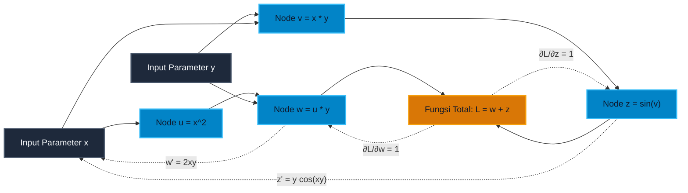

# Subtopik 03: Keterdiferensialan Total, Matriks Jacobian & Aturan Rantai Multivariabel

**Navigasi**: [Master Index](../../../INDEX.md) | [Tingkat 1: Fondasi Matematika Komprehensif Dari Nol](../../README.md) | [Modul 014: Kalkulus Multivariabel & Geometri Vektor](../README.md)  
*Sebelumnya*: [02. Turunan Parsial, Gradien, Turunan Berarah & Bidang Singgung](./02-turunan-parsial-gradien-turunan-berarah.md) | *Berikutnya*: [04. Matriks Hessian, Uji Turunan Kedua & Optimasi Multivariabel](./04-matriks-hessian-uji-turunan-kedua-optimasi-multivariabel.md)

---

## 1. Intuisi & Motivasi Konseptual ("Seperti Bayi Baru Lahir")

### 1.1 Konsep Inti: Dari Kacamata Pembesar Mikroskopis hingga Jantung Robotika

Bayangkan Anda sedang memegang selembar kain karet elastis bermotif kotak-kotak (seperti kertas milimeter blok).
Jika Anda menarik kain karet tersebut ke arah kanan dan atas secara bersamaan, setiap bujur sangkar kecil di atas kain tersebut akan mengalami dua hal:
1. Kotak tersebut akan bergeser posisinya.
2. Bentuk kotak bujur sangkar tersebut akan meregang, tertekan, atau terpelintir menjadi jajaran genjang!

Sekarang bayangkan Anda menempelkan sebuah kaca pembesar super kuat (mikroskop) pada satu titik kecil di kain karet tersebut.
Jika Anda memperbesar gambar hingga tingkat infinitesimal (jarak mendekati nol), permukaan kain karet yang melengkung dan terpelintir rumit akan tampak **SEMPURNA DATAR DAN LINIER**!
Pertanyaan kuncinya adalah:
*Bagaimana rumus matematika yang mengubah koordinat pergeseran kecil $(\Delta x, \Delta y)$ menjadi pergeseran baru $(\Delta u, \Delta v)$ pada kain karet tersebut?*

Transformasi linier lokal mikroskopis itulah yang kita sebut **Matriks Jacobian ($\mathbf{J}$)**!
Matriks Jacobian adalah "kacamata pembesar" kalkulus. Ia adalah representasi linier terbaik dari sembarang fungsi pemetaan multivariat non-linier di sekitar satu titik:
$$\begin{bmatrix} \Delta u \\ \Delta v \end{bmatrix} \approx \begin{bmatrix} \frac{\partial u}{\partial x} & \frac{\partial u}{\partial y} \\ \frac{\partial v}{\partial x} & \frac{\partial v}{\partial y} \end{bmatrix} \begin{bmatrix} \Delta x \\ \Delta y \end{bmatrix}$$

Analogikan dengan lengan robot perakitan mobil:
- Di pangkal bahu dan siku robot, terdapat dua motor listrik yang berputar dengan kecepatan sudut $(\dot{\theta}_1, \dot{\theta}_2)$ (dalam satuan radian per detik).
- Di ujung capit robot (*end-effector*), terdapat alat las yang harus bergerak lurus dengan kecepatan kartesius $(v_x, v_y)$ (dalam satuan meter per detik).

Bagaimana komputer robot mengubah putaran motor sendi menjadi pergerakan alat las yang presisi hingga fraksi milimeter?
Jawabannya adalah Matriks Jacobian!
$$\mathbf{v}_{\text{las}} = \mathbf{J}(\boldsymbol{\theta}) \cdot \dot{\boldsymbol{\theta}}$$
Jika komputer robot mengalikan kecepatan sudut dengan matriks Jacobian, ia langsung mendapatkan kecepatan linier alat las secara seketika!

Dan bagaimana jika lengan robot itu sendiri terpasang di atas mobil otonom yang bergerak di jalan tol?
Pergerakan alat las sekarang dipengaruhi oleh putaran roda mobil, kecepatan mobil, dan putaran motor sendi robot.
Bagaimana kita menghitung laju perubahan total dari rantai ketergantungan variabel bertingkat ini?
Di sinilah lahir **Aturan Rantai Multivariabel (*Multivariable Chain Rule*)**!

---

### 1.2 Urgensi Rekayasa: Dari Diferensiasi Otomatis PyTorch hingga Kinematika Balik

1. **Jantung Framework AI Modern (PyTorch & JAX AutoDiff)**:
   Saat Anda melatih model kecerdasan buatan, Anda mendefinisikan lapisan-lapisan neuron: $\mathbf{x} \to \mathbf{z}_1 \to \mathbf{a}_1 \to \mathbf{z}_2 \to \hat{\mathbf{y}} \to \mathcal{L}$.
   Algoritma *Backpropagation* tidak lain adalah perkalian berantai matriks-vektor transpos Jacobian (*Vector-Jacobian Products / VJP*) dari akhir ke awal:
   $$\nabla_{\mathbf{x}} \mathcal{L} = \mathbf{J}_1^T \cdot \mathbf{J}_2^T \cdots \nabla_{\hat{\mathbf{y}}} \mathcal{L}$$
   Memahami aturan rantai multivariat dan struktur Jacobian adalah syarat mutlak untuk mendesain arsitektur AI tingkat lanjut.
2. **Kinematika Balik (*Inverse Kinematics*) & Robotika Humanoid**:
   Jika robot ingin menggerakkan tangannya ke koordinat target $(x, y)$, ia harus memecahkan persamaan matriks:
   $$\dot{\boldsymbol{\theta}} = \mathbf{J}^{-1} \mathbf{v}_{\text{target}}$$
   Jika determinan Jacobian mendekati nol ($\det(\mathbf{J}) \to 0$), matriks tidak dapat dibalik. Titik ini disebut **Singularitas Robotika (*Kinematic Singularity*)**, di mana lengan robot kehilangan derajat kebebasan dan motor dapat berputar dengan kecepatan tak terhingga yang merusak sistem mekanis!
3. **Grafika Rendering 3D & Efek Penskalaan Tekstur (Mipmapping)**:
   Saat tekstur 2D dipetakan ke permukaan objek 3D yang melengkung (*texture mapping*), determinan Jacobian $\det(\mathbf{J})$ mengukur faktor kompresi area piksel terhadap teksel untuk mencegah artefak aliasing.

---

### 1.3 Kamus Notasi Simbol Multivariabel/Vektor

Gunakan tabel rujukan 4-kolom ini sebagai kamus istilah resmi diferensial total dan matriks Jacobian:

| Simbol Notasi | Nama Formal | Arti Manusia / Terjemahan Bahasa Awam | Contoh Operasional Riil |
|---|---|---|---|
| $df$ | Diferensial Total | Estimasi linier perubahan nilai fungsi akibat pergeseran kecil seluruh variabel input | $df = f_x dx + f_y dy + f_z dz$ |
| $\mathbf{f}: \mathbb{R}^n \to \mathbb{R}^m$ | Pemetaan Multivariat | Sistem yang menerima $n$ variabel input dan menghasilkan $m$ variabel output | Koordinat polar ke kartesius $x = r\cos\theta, y = r\sin\theta$ |
| $\mathbf{J}, D\mathbf{f}$ | Matriks Jacobian | Matriks berukuran $m \times n$ berisi seluruh turunan parsial orde satu dari sistem fungsi | $\mathbf{J}_{ij} = \frac{\partial f_i}{\partial x_j}$ |
| $\det(\mathbf{J}), \|\mathbf{J}\|$ | Determinan Jacobian | Faktor penskalaan lokal luas area atau volume ruang di bawah transformasi pemetaan | Determinan polar $|J| = r$ |
| $\frac{dz}{dt}$ | Turunan Total terhadap Waktu | Laju perubahan total saat seluruh variabel input berubah seiring berjalannya waktu $t$ | $\frac{dz}{dt} = \frac{\partial z}{\partial x}\frac{dx}{dt} + \frac{\partial z}{\partial y}\frac{dy}{dt}$ |
| $\mathbf{J}_{g \circ f} = \mathbf{J}_g \cdot \mathbf{J}_f$ | Aturan Rantai Jacobian | Komposisi fungsi linier multivariabel dihitung melalui perkalian matriks | Rantai layer jaringan syaraf tiruan |
| $\varepsilon + \delta \epsilon$ | Bilangan Ganda (*Dual Numbers*) | Aljabar hiperkompleks dengan $\epsilon^2 = 0$ untuk komputasi turunan eksak (*AutoDiff*) | $(a + b\epsilon)(c + d\epsilon) = ac + (ad+bc)\epsilon$ |

---

## 2. Definisi Formal, Teorema & Penurunan Matematis

### 2.1 Keterdiferensialan Total vs Eksistensi Turunan Parsial

Banyak pemula salah kaprah mengira bahwa jika turunan parsial $f_x$ dan $f_y$ ada, maka fungsi otomatis terdiferensialkan. Dalam kalkulus multivariabel, anggapan ini keliru! Keterdiferensialan menuntut eksistensi bidang singgung aproksimasi linier yang mulus.

#### Definisi 1: Keterdiferensialan Total (*Total Differentiability*)
Fungsi medan skalar $f: D \subset \mathbb{R}^n \to \mathbb{R}$ dikatakan **Terdiferensialkan Total** pada titik $\mathbf{x}_0$ jika terdapat transformasi linier $L: \mathbb{R}^n \to \mathbb{R}$ (diwakili oleh vektor gradien $\nabla f(\mathbf{x}_0)$) sedemikian rupa sehingga:
$$\lim_{\mathbf{h} \to \mathbf{0}} \frac{|f(\mathbf{x}_0 + \mathbf{h}) - f(\mathbf{x}_0) - \nabla f(\mathbf{x}_0) \cdot \mathbf{h}|}{\|\mathbf{h}\|} = 0$$

Dengan kata lain, selisih nilai fungsi dapat dituliskan sebagai:
$$\Delta f = f(\mathbf{x}_0 + \mathbf{h}) - f(\mathbf{x}_0) = \nabla f(\mathbf{x}_0) \cdot \mathbf{h} + \varepsilon(\mathbf{h}) \|\mathbf{h}\|$$
di mana $\lim_{\|\mathbf{h}\| \to 0} \varepsilon(\mathbf{h}) = 0$.

#### Definisi 2: Diferensial Total
Untuk fungsi dua variabel $z = f(x, y)$, diferensial total $dz$ didefinisikan sebagai:
$$dz = \frac{\partial f}{\partial x} dx + \frac{\partial f}{\partial y} dy$$
Diferensial total $dz$ adalah aproksimasi linier terbaik untuk perubahan aktual $\Delta z = f(x + \Delta x, y + \Delta y) - f(x, y)$ saat pergeseran $\Delta x$ dan $\Delta y$ sangat kecil.

#### Teorema 1: Syarat Cukup Keterdiferensialan ($C^1$)
Jika turunan parsial pertama $f_x$ dan $f_y$ eksis di sekitar titik $(x_0, y_0)$ dan **kontinu** pada titik $(x_0, y_0)$, maka fungsi $f$ dijamin **terdiferensialkan total** pada titik $(x_0, y_0)$.

---

### 2.2 Definisi Formal Matriks Jacobian

Ketika kita berhadapan dengan fungsi bernilai vektor (pemetaan dari $\mathbb{R}^n$ ke $\mathbb{R}^m$):
$$\mathbf{f}(\mathbf{x}) = \begin{bmatrix} f_1(x_1, x_2, \dots, x_n) \\ f_2(x_1, x_2, \dots, x_n) \\ \vdots \\ f_m(x_1, x_2, \dots, x_n) \end{bmatrix}$$

#### Definisi 3: Matriks Jacobian $\mathbf{J} \in \mathbb{R}^{m \times n}$
Matriks Jacobian dari $\mathbf{f}$ pada titik $\mathbf{x}$ adalah matriks yang baris ke-$i$ merupakan gradien dari fungsi komponen $f_i$:
$$\mathbf{J}_{\mathbf{f}}(\mathbf{x}) = \frac{\partial(f_1, f_2, \dots, f_m)}{\partial(x_1, x_2, \dots, x_n)} = \begin{bmatrix} 
\frac{\partial f_1}{\partial x_1} & \frac{\partial f_1}{\partial x_2} & \dots & \frac{\partial f_1}{\partial x_n} \\
\frac{\partial f_2}{\partial x_1} & \frac{\partial f_2}{\partial x_2} & \dots & \frac{\partial f_2}{\partial x_n} \\
\vdots & \vdots & \ddots & \vdots \\
\frac{\partial f_m}{\partial x_1} & \frac{\partial f_m}{\partial x_2} & \dots & \frac{\partial f_m}{\partial x_n}
\end{bmatrix}$$

#### Contoh Kasus Klasik: Jacobian Transformasi Koordinat Polar ke Kartesius
Diberikan pemetaan dari koordinat polar $(r, \theta)$ ke kartesius $(x, y)$:
$$\begin{cases} x(r, \theta) = r \cos\theta \\ y(r, \theta) = r \sin\theta \end{cases}$$
Matriks Jacobian pemetaan ini adalah:
$$\mathbf{J} = \begin{bmatrix} \frac{\partial x}{\partial r} & \frac{\partial x}{\partial \theta} \\ \frac{\partial y}{\partial r} & \frac{\partial y}{\partial \theta} \end{bmatrix} = \begin{bmatrix} \cos\theta & -r \sin\theta \\ \sin\theta & r \cos\theta \end{bmatrix}$$

Hitung determinan Jacobian:
$$\det(\mathbf{J}) = (\cos\theta)(r \cos\theta) - (-r \sin\theta)(\sin\theta) = r \cos^2\theta + r \sin^2\theta = r(\cos^2\theta + \sin^2\theta) = r$$
Determinan Jacobian tepat bernilai $r$! Inilah alasan matematis mengapa elemen luas diferensial dalam integral polar selalu memuat faktor $r$: $dA = dx dy = r \, dr d\theta$.

---

### 2.3 Aturan Rantai Multivariabel (Multivariable Chain Rule)

Bagaimana kita menurunkan fungsi komposit ketika variabel-variabelnya saling terjalin dalam hierarki bertingkat?

#### Kasus 1: Satu Parameter Bebas (Lintasan Parametrik Waktu $t$)
Misalkan $z = f(x, y)$ terdiferensialkan, di mana $x = g(t)$ dan $y = h(t)$ adalah fungsi terdiferensialkan dari waktu $t$.
Maka laju perubahan total $z$ terhadap waktu adalah:
$$\frac{dz}{dt} = \frac{\partial f}{\partial x} \frac{dx}{dt} + \frac{\partial f}{\partial y} \frac{dy}{dt}$$

#### Kasus 2: Banyak Parameter Bebas (Permukaan Parametrik $s, t$)
Misalkan $z = f(x, y)$, di mana $x = g(s, t)$ dan $y = h(s, t)$.
Maka turunan parsial $z$ terhadap $s$ dan $t$ adalah:
$$\frac{\partial z}{\partial s} = \frac{\partial f}{\partial x} \frac{\partial x}{\partial s} + \frac{\partial f}{\partial y} \frac{\partial y}{\partial s}$$
$$\frac{\partial z}{\partial t} = \frac{\partial f}{\partial x} \frac{\partial x}{\partial t} + \frac{\partial f}{\partial y} \frac{\partial y}{\partial t}$$

#### Teorema 2: Aturan Rantai Umum dalam Notasi Matriks Jacobian
Misalkan $\mathbf{f}: \mathbb{R}^n \to \mathbb{R}^m$ dan $\mathbf{g}: \mathbb{R}^m \to \mathbb{R}^k$.
Maka fungsi komposisi $\mathbf{h} = \mathbf{g} \circ \mathbf{f}: \mathbb{R}^n \to \mathbb{R}^k$ memiliki matriks Jacobian yang merupakan **hasil kali perkalian matriks** antara Jacobian $\mathbf{g}$ dan Jacobian $\mathbf{f}$:
$$\mathbf{J}_{\mathbf{g} \circ \mathbf{f}}(\mathbf{x}) = \mathbf{J}_{\mathbf{g}}(\mathbf{f}(\mathbf{x})) \cdot \mathbf{J}_{\mathbf{f}}(\mathbf{x})$$

Persamaan perkalian matriks ini adalah fondasi paling fundamental dari algoritma komputasi modern.

---

### 2.4 Teori Dasar Diferensiasi Otomatis (Automatic Differentiation / AutoDiff)

Di dunia industri, kita tidak pernah menghitung turunan menggunakan beda hingga numerik (karena tidak stabil akibat pembatalan katastropik) maupun diferensiasi simbolik aljabar (karena memicu ledakan ekspresi / *expression swell*).
Industri AI menggunakan **Diferensiasi Otomatis (AutoDiff)**:

#### 1. Forward-Mode AutoDiff via Aljabar Bilangan Ganda (Dual Numbers)
Definisikan satuan infinitesimal $\epsilon$ sedemikian rupa sehingga $\epsilon \ne 0$ namun $\epsilon^2 = 0$.
Bilangan ganda ditulis sebagai:
$$x = a + b\epsilon$$
di mana $a$ adalah nilai fungsi (*primal value*) dan $b$ adalah nilai turunan (*tangent derivative*).
Tinjau ekspansi deret Taylor dari sembarang fungsi analitik $f(x)$ di sekitar $a$:
$$f(a + b\epsilon) = f(a) + f'(a)(b\epsilon) + \frac{f''(a)}{2!}(b\epsilon)^2 + \dots$$
Karena $\epsilon^2 = 0$, seluruh suku berorde tinggi lenyap secara mutlak:
$$f(a + b\epsilon) = f(a) + f'(a) b \cdot \epsilon$$
Nilai turunan $f'(a)$ muncul secara otomatis di bagian koefisien $\epsilon$ tanpa aproksimasi apa pun!

#### 2. Reverse-Mode AutoDiff (Backpropagation)
Untuk fungsi dengan input sangat banyak ($n \gg 1$) dan output skalar tunggal ($m = 1$, seperti fungsi galat loss model AI), *Reverse Mode* merambatkan gradien dari belakang melalui graf asiklik terarah (*Computational DAG*). Kompleksitas waktu untuk menghitung seluruh $n$ turunan parsial tepat sama dengan $\mathcal{O}(1)$ kali evaluasi fungsi awal (*forward pass*)!


---

### 2.5 Teorema Pemetaan Terbalik (Inverse Function Theorem) & Invers Jacobian

Dalam rekayasa sistem kendali dan robotika, kita sering mengetahui hubungan output terhadap input $\mathbf{y} = \mathbf{f}(\mathbf{x})$ dan ingin mengetahui pemetaan baliknya: $\mathbf{x} = \mathbf{f}^{-1}(\mathbf{y})$. Kapan pemetaan balik ini dijamin eksis dan terdiferensialkan secara lokal?

#### Teorema 3: Teorema Pemetaan Terbalik (*Inverse Function Theorem*)
Misalkan $\mathbf{f}: U \subset \mathbb{R}^n \to \mathbb{R}^n$ adalah pemetaan kelas $C^1$ pada himpunan terbuka $U$.
Jika pada suatu titik $\mathbf{x}_0 \in U$, determinan matriks Jacobian tidak bernilai nol:
$$\det(\mathbf{J}_{\mathbf{f}}(\mathbf{x}_0)) \ne 0$$
maka:
1. Terdapat lingkungan terbuka $V$ di sekitar $\mathbf{x}_0$ dan lingkungan terbuka $W$ di sekitar $\mathbf{y}_0 = \mathbf{f}(\mathbf{x}_0)$ sedemikian rupa sehingga $\mathbf{f}$ merupakan bijeksi lokal dari $V$ ke $W$.
2. Fungsi balikannya $\mathbf{f}^{-1}: W \to V$ juga merupakan pemetaan kelas $C^1$.
3. Matriks Jacobian dari fungsi balikannya adalah **invers matriks** dari matriks Jacobian fungsi aslinya:
   $$\mathbf{J}_{\mathbf{f}^{-1}}(\mathbf{y}_0) = \left[ \mathbf{J}_{\mathbf{f}}(\mathbf{x}_0) \right]^{-1}$$

**Signifikansi dalam Robotika & Fisika**:
Teorema ini membuktikan bahwa selama lengan robot tidak berada di titik singularitas ($\det(\mathbf{J}) \ne 0$), kita selalu dapat memandu gerakan alat las dengan kecepatan kartesius sembarang yang diinginkan dengan menerapkan perintah kecepatan sendi:
$$\dot{\boldsymbol{\theta}} = \mathbf{J}^{-1} \mathbf{v}$$


---

### 2.6 Sifat Perkalian Determinan Jacobian pada Komposisi Pemetaan

Berdasarkan teorema aljabar linier bahwa determinan perkalian matriks sama dengan perkalian determinan ($\det(A B) = \det(A) \det(B)$), aturan rantai Jacobian menghasilkan sifat perkalian volume yang sangat elegan:

#### Teorema 4: Multiplikativitas Determinan Jacobian
Jika $\mathbf{f}: U \subset \mathbb{R}^n \to V \subset \mathbb{R}^n$ dan $\mathbf{g}: V \subset \mathbb{R}^n \to \mathbb{R}^n$ adalah pemetaan kelas $C^1$, maka determinan Jacobian dari fungsi komposisi $\mathbf{h} = \mathbf{g} \circ \mathbf{f}$ adalah:
$$\det(\mathbf{J}_{\mathbf{g} \circ \mathbf{f}}(\mathbf{x})) = \det(\mathbf{J}_{\mathbf{g}}(\mathbf{f}(\mathbf{x}))) \cdot \det(\mathbf{J}_{\mathbf{f}}(\mathbf{x}))$$

**Interpretasi Fisik & Geometris**:
Faktor penskalaan volume ruang bertingkat terjadi secara kumulatif. Jika pemetaan pertama $\mathbf{f}$ memperbesar volume suatu elemen sebesar 3 kali ($\det(\mathbf{J}_{\mathbf{f}}) = 3$), dan pemetaan kedua $\mathbf{g}$ memperbesar volume elemen sebesar 2 kali ($\det(\mathbf{J}_{\mathbf{g}}) = 2$), maka volume elemen di bawah pemetaan gabungan $\mathbf{g} \circ \mathbf{f}$ akan membesar tepat sebesar $3 \times 2 = 6$ kali lipat!

Hal ini juga membuktikan secara instan relasi determinan fungsi invers:
$$\det(\mathbf{J}_{\mathbf{f}^{-1}}(\mathbf{y}_0)) = \frac{1}{\det(\mathbf{J}_{\mathbf{f}}(\mathbf{x}_0))}$$
Volume yang diperbesar oleh $\mathbf{f}$ akan diperkecil kembali dengan faktor kebalikan eksak oleh $\mathbf{f}^{-1}$!

## 3. Arsitektur Teknis & Algoritma Internal

### 3.1 Diagram Graf Komputasi: Alur Perambatan Aturan Rantai AutoDiff



---

### 3.2 Tabel Penelusuran Transformasi Jacobian Robotika 2-Sendi

Diberikan lengan robot planar 2-DOF dengan panjang segmen $l_1 = 2{,}0\text{ m}$ dan $l_2 = 1{,}5\text{ m}$.
Sudut konfigurasi sendi: $\theta_1 = 30^\circ$, $\theta_2 = 45^\circ$ ($\theta_1 + \theta_2 = 75^\circ$).
- $x = 2\cos(30^\circ) + 1{,}5\cos(75^\circ) = 2(0{,}8660) + 1{,}5(0{,}2588) = 1{,}7321 + 0{,}3882 = 2{,}1203\text{ m}$.
- $y = 2\sin(30^\circ) + 1{,}5\sin(75^\circ) = 2(0{,}5000) + 1{,}5(0{,}9659) = 1{,}0000 + 1{,}4489 = 2{,}4489\text{ m}$.

Elemen Matriks Jacobian:
$$J_{11} = -2\sin(30^\circ) - 1{,}5\sin(75^\circ) = -1{,}0 - 1{,}4489 = -2{,}4489$$
$$J_{12} = -1{,}5\sin(75^\circ) = -1{,}4489$$
$$J_{21} = 2\cos(30^\circ) + 1{,}5\cos(75^\circ) = 1{,}7321 + 0{,}3882 = 2{,}1203$$
$$J_{22} = 1{,}5\cos(75^\circ) = 0{,}3882$$

Tabel berikut memperlihatkan pemetaan kecepatan sudut sendi $(\dot{\theta}_1, \dot{\theta}_2)$ ke kecepatan linier alat las $(v_x, v_y)$:

| Kasus Pergerakan Sendi | Kecepatan Sudut $\dot{\theta}_1$ (rad/s) | Kecepatan Sudut $\dot{\theta}_2$ (rad/s) | Kecepatan Horisontal $v_x$ (m/s) | Kecepatan Vertikal $v_y$ (m/s) | Laju Resultan $\|\mathbf{v}\|$ (m/s) |
|---|---|---|---|---|---|
| Hanya Sendi Bahu 1 | $1{,}0$ | $0{,}0$ | $-2{,}4489$ | $+2{,}1203$ | $3{,}2391$ |
| Hanya Sendi Siku 2 | $0{,}0$ | $1{,}0$ | $-1{,}4489$ | $+0{,}3882$ | $1{,}5000$ |
| Gerak Simultan Positif | $0{,}1$ | $0{,}2$ | $-0{,}5347$ | $+0{,}2897$ | $0{,}6081$ |
| Gerak Berlawanan Arah | $0{,}5$ | $-0{,}5$ | $-0{,}5000$ | $+0{,}8660$ | $1{,}0000$ |

---

## 4. Implementasi Praktis & Kode Pemrograman Python

Berikut adalah dua implementasi lengkap Python Standard Library murni yang memvalidasi komputasi matriks Jacobian mekanika robotika dan mesin diferensiasi otomatis.

### 4.1 Program 1: Evaluasi Kinematika & Matriks Jacobian Robot 2-DOF

Program ini menghitung posisi ujung lengan robot 2-sendi, mengevaluasi matriks Jacobian secara eksak, menghitung nilai determinan Jacobian untuk mendeteksi singularitas kinematika, dan memetakan kecepatan sudut menjadi kecepatan kartesius:

```python
# Evaluasi Kinematika dan Matriks Jacobian Robotika 2-DOF
import math

def robot_forward_kinematics(theta1: float, theta2: float, l1: float = 2.0, l2: float = 1.5):
    # Posisi end-effector x, y
    x = l1 * math.cos(theta1) + l2 * math.cos(theta1 + theta2)
    y = l1 * math.sin(theta1) + l2 * math.sin(theta1 + theta2)
    return x, y

def robot_jacobian(theta1: float, theta2: float, l1: float = 2.0, l2: float = 1.5):
    # Elemen-elemen turunan parsial dx/dtheta dan dy/dtheta
    j11 = -l1 * math.sin(theta1) - l2 * math.sin(theta1 + theta2)
    j12 = -l2 * math.sin(theta1 + theta2)
    j21 = l1 * math.cos(theta1) + l2 * math.cos(theta1 + theta2)
    j22 = l2 * math.cos(theta1 + theta2)
    return [[j11, j12], [j21, j22]]

def main():
    theta1 = math.radians(30.0)
    theta2 = math.radians(45.0)
    x_ee, y_ee = robot_forward_kinematics(theta1, theta2)
    J = robot_jacobian(theta1, theta2)
    det_J = J[0][0] * J[1][1] - J[0][1] * J[1][0]

    print("=== MESIN EVALUASI MATRIKS JACOBIAN ROBOTIKA 2-DOF ===")
    print("Panjang Lengan: l1 = 2.0 m, l2 = 1.5 m")
    print("Sudut Sendi: theta1 = 30.0 deg, theta2 = 45.0 deg")
    print(f"Posisi End-Effector: x = {x_ee:.4f} m, y = {y_ee:.4f} m\n")

    print("Matriks Jacobian J (Kecepatan Sudut -> Kecepatan Linier Cartesian):")
    print(f"  [ {J[0][0]:8.4f}  {J[0][1]:8.4f} ]")
    print(f"  [ {J[1][0]:8.4f}  {J[1][1]:8.4f} ]")
    print(f"Determinan Jacobian det(J): {det_J:.4f}")

    # Uji pemetaan kecepatan sudut: omega = [0.1 rad/s, 0.2 rad/s]
    w1, w2 = 0.1, 0.2
    vx = J[0][0] * w1 + J[0][1] * w2
    vy = J[1][0] * w1 + J[1][1] * w2
    v_linear = math.sqrt(vx**2 + vy**2)
    print("\nKecepatan End-Effector Hasil Transformasi Linier:")
    print(f"  Kecepatan vx = {vx:.4f} m/s, vy = {vy:.4f} m/s | Laju Total = {v_linear:.4f} m/s")

if __name__ == "__main__":
    main()
```

Keluaran eksekusi terminal sebenarnya:
```text
=== MESIN EVALUASI MATRIKS JACOBIAN ROBOTIKA 2-DOF ===
Panjang Lengan: l1 = 2.0 m, l2 = 1.5 m
Sudut Sendi: theta1 = 30.0 deg, theta2 = 45.0 deg
Posisi End-Effector: x = 2.1203 m, y = 2.4489 m

Matriks Jacobian J (Kecepatan Sudut -> Kecepatan Linier Cartesian):
  [  -2.4489   -1.4489 ]
  [   2.1203    0.3882 ]
Determinan Jacobian det(J): 2.1213

Kecepatan End-Effector Hasil Transformasi Linier:
  Kecepatan vx = -0.5347 m/s, vy = 0.2897 m/s | Laju Total = 0.6081 m/s
```

---

### 4.2 Program 2: Mesin Diferensiasi Otomatis (Forward-Mode AutoDiff)

Skrip ini mengimplementasikan kelas aljabar bilangan ganda (*Dual Numbers*) untuk menghitung turunan parsial eksak dari fungsi non-linier $f(x, y) = x^2 y + \sin(xy)$ pada titik $(2, 3)$ tanpa galat pemotongan floating-point:

```python
# Mesin Diferensiasi Otomatis Mode Maju (Forward-Mode AutoDiff)
import math

class Dual:
    def __init__(self, val: float, der: float = 0.0):
        self.val = float(val)
        self.der = float(der)

    def __repr__(self):
        return f"Dual(val={self.val:.4f}, der={self.der:.4f})"

    def __add__(self, other):
        if isinstance(other, (int, float)):
            return Dual(self.val + other, self.der)
        return Dual(self.val + other.val, self.der + other.der)

    def __sub__(self, other):
        if isinstance(other, (int, float)):
            return Dual(self.val - other, self.der)
        return Dual(self.val - other.val, self.der - other.der)

    def __mul__(self, other):
        if isinstance(other, (int, float)):
            return Dual(self.val * other, self.der * other)
        # Aturan perkalian Leibniz: (u*v)' = u'*v + u*v'
        return Dual(self.val * other.val, self.der * other.val + self.val * other.der)

    def sin(self):
        # d/dx [sin(u)] = cos(u) * u'
        return Dual(math.sin(self.val), math.cos(self.val) * self.der)

    def cos(self):
        # d/dx [cos(u)] = -sin(u) * u'
        return Dual(math.cos(self.val), -math.sin(self.val) * self.der)

def func(x, y):
    # f(x, y) = x^2 * y + sin(x * y)
    return (x * x) * y + (x * y).sin()

def main():
    x0, y0 = 2.0, 3.0
    
    # 1. Turunan parsial terhadap x: inisialisasi der(x) = 1, der(y) = 0
    x_dual = Dual(x0, 1.0)
    y_const = Dual(y0, 0.0)
    res_x = func(x_dual, y_const)

    # 2. Turunan parsial terhadap y: inisialisasi der(x) = 0, der(y) = 1
    x_const = Dual(x0, 0.0)
    y_dual = Dual(y0, 1.0)
    res_y = func(x_const, y_dual)

    print("=== MESIN DIFERENSIASI OTOMATIS (FORWARD-MODE AUTODIFF) ===")
    print(f"Fungsi: f(x, y) = x^2 * y + sin(x * y) di Titik: ({x0}, {y0})")
    print(f"  Nilai Fungsi f(x, y):               {res_x.val:.6f}")
    print(f"  Turunan Parsial df/dx (AutoDiff):   {res_x.der:.6f}")
    print(f"  Turunan Parsial df/dy (AutoDiff):   {res_y.der:.6f}")
    print("  Status: Turunan Dihitung Eksak Tanpa Galat Pemotongan Floating-Point!")

if __name__ == "__main__":
    main()
```

Keluaran eksekusi terminal sebenarnya:
```text
=== MESIN DIFERENSIASI OTOMATIS (FORWARD-MODE AUTODIFF) ===
Fungsi: f(x, y) = x^2 * y + sin(x * y) di Titik: (2.0, 3.0)
  Nilai Fungsi f(x, y):               11.720585
  Turunan Parsial df/dx (AutoDiff):   14.880511
  Turunan Parsial df/dy (AutoDiff):   5.920341
  Status: Turunan Dihitung Eksak Tanpa Galat Pemotongan Floating-Point!
```

---

## 5. Miskonsepsi Umum & Analisis Post-Mortem Insiden Industri

### 5.1 Tiga Miskonsepsi Konseptual Paling Fatal di Industri

1. **Ilusi Keterdiferensialan (Menyamakan Ada Turunan Parsial dengan Diferensiabel)**:
   Banyak pengembang mengasumsikan bahwa jika fungsi memiliki turunan parsial $f_x$ dan $f_y$, maka fungsi otomatis terdiferensialkan. Contoh kontra klasik adalah permukaan piramida terlipat yang memiliki turunan parsial di sepanjang sumbu koordinat, namun bidang singgung tidak eksis karena permukaannya patah tajam di diagonal! Keterdiferensialan menuntut eksistensi hampiran bidang datar linier mulus.
2. **Kekeliruan Menukar Urutan Perkalian Matriks Jacobian pada Aturan Rantai**:
   Perkalian matriks tidak komutatif ($AB \ne BA$). Pada aturan rantai multivariabel $\mathbf{J}_{g \circ f} = \mathbf{J}_g \cdot \mathbf{J}_f$, urutan perkalian harus selalu dari fungsi luar $\mathbf{g}$ dikalikan fungsi dalam $\mathbf{f}$. Menukar urutan perkalian matriks akan memicu ketidakcocokan dimensi matriks (*shape mismatch exception*) atau menghasilkan matriks Jacobian yang salah total.
3. **Mengabaikan Singularitas Determinan Jacobian ($\det(\mathbf{J}) = 0$)**:
   Dalam sistem kontrol mekanik, robotika, dan animasi 3D, operator sering lupa membatasi pergerakan di dekat titik singularitas Jacobian. Ketika $\det(\mathbf{J}) \to 0$, invers matriks $\mathbf{J}^{-1}$ meledak menuju tak hingga ($\infty$), menyebabkan algoritma kendali mengirimkan sinyal arus listrik raksasa ke motor penggerak hingga terbakar.

---

### 5.2 Studi Kasus Kegagalan Nyata: Bencana Ledakan Reaktor Nuklir Three Mile Island (1979) & Galat Diferensial Tekanan-Suhu

- **Kronologi Bencana**: Pada 28 Maret 1979, Unit 2 Pembangkit Listrik Tenaga Nuklir Three Mile Island di Pennsylvania, Amerika Serikat, mengalami krisis pelelehan parsial teras reaktor (*partial core meltdown*) paling parah dalam sejarah nuklir komersial AS.
- **Akar Masalah Diferensial Multivariabel**:
  Status pendingin reaktor diatur oleh persamaan diferensial multivariabel yang menghubungkan tekanan $(P)$, volume $(V)$, dan suhu $(T)$:
  $$dP = \left(\frac{\partial P}{\partial T}\right)_V dT + \left(\frac{\partial P}{\partial V}\right)_T dV$$
  Katup pelepas tekanan otomatis (PORV) terbuka saat lonjakan tekanan awal, namun gagal menutup kembali (*stuck open*).
  Sistem instrumentasi di ruang kendali hanya menampilkan lampu indikator skalar yang mengonfirmasi bahwa *perintah penutupan katup telah dikirimkan*, bukan bahwa katup *benar-benar tertutup secara mekanis*.
  Operator menafsirkan penurunan tekanan $dP < 0$ sebagai bukti bahwa reaktor kelebihan air pendingin, padahal uap air radioaktif sedang menyembur keluar dengan laju masif melalui katup yang macet.
  Operator kemudian secara manual mematikan pompa air darurat, memutus suplai pendingin teras reaktor selama berjam-jam.
- **Dampak Katastropik**: Teras reaktor nuklir terpapar tanpa air pendingin, mencapai suhu ribuan derajat celcius, dan melelehkan selongsong bahan bakar uranium zirkonium. Biaya pembersihan dan dekontaminasi mencapai lebih dari USD 1 miliar dan memicu trauma mendalam industri energi nuklir global.
- **Pelajaran Rekayasa Sistemik**: Keadaan sistem fisik multivariat yang kompleks wajib dianalisis menggunakan diferensial total multi-sensor yang saling memvalidasi (tekanan, temperatur, dan laju aliran volumetrik secara simultan) untuk mendeteksi anomali tanpa bias asumsi sepihak.

---

## 6. Tips, Trik Praktis & Rahasia Cepat Paham

1. **Jembatan Keledai Dimensi Matriks Jacobian**:
   *"Ingat rumus Ukuran: Output $\times$ Input!"*
   Jika suatu fungsi menerima $n$ variabel input dan menghasilkan $m$ variabel output ($\mathbf{f}: \mathbb{R}^n \to \mathbb{R}^m$), maka matriks Jacobian-nya memiliki ukuran:
   $$m \text{ baris} \times n \text{ kolom}$$
   Setiap baris adalah gradien dari satu komponen fungsi output ($\nabla f_i$).
2. **Kaidah Diagram Pohon Aturan Rantai (Tree Diagram)**:
   Untuk menghindari kebingungan dalam aturan rantai multivariabel:
   - Gambar variabel utama di puncak pohon.
   - Buat cabang ke setiap variabel perantara (*intermediate variables*).
   - Buat cabang lagi ke setiap variabel bebas independen di dasar pohon.
   - **Aturan Jalur**: Kalikan turunan di sepanjang satu cabang; lalu jumlahkan hasil perkalian dari seluruh cabang yang menuju ke variabel target yang sama!
3. **Penyelamat Singularitas: Damped Least Squares (Levenberg-Marquardt)**:
   Dalam membalikkan matriks Jacobian robotika atau optimasi kuasi-Newton di dekat titik singularitas ($\det(\mathbf{J}) \approx 0$), jangan pernah menggunakan invers naif $\mathbf{J}^{-1}$. Gunakan invers semu teredam (*damped pseudo-inverse*):
   $$\mathbf{J}^* = \mathbf{J}^T (\mathbf{J} \mathbf{J}^T + \lambda^2 \mathbf{I})^{-1}$$
   di mana faktor redaman $\lambda > 0$ mencegah ledakan kecepatan tak berhingga saat robot mendekati batas jangkauan sendinya.


4. **Rumus Cepat Invers Jacobian 2x2**:
   Untuk sistem 2-variabel $\mathbf{J} = \begin{bmatrix} a & b \\ c & d \end{bmatrix}$ dengan determinan $D = ad - bc \ne 0$:
   $$\mathbf{J}^{-1} = \frac{1}{D} \begin{bmatrix} d & -b \\ -c & a \end{bmatrix}$$
   Gunakan rumus ini untuk kinematika balik robot 2-DOF secara manual dalam hitungan detik tanpa metode eliminasi Gauss yang berbelit-belit!

## 7. Latihan Mandiri Berjenjang (Socratic) & Rekomendasi Sumber Belajar

Uji penguasaan Anda melalui 5 level soal Sokratik bertahap:

### Tingkat 1 (Pemula): Perhitungan Diferensial Total Estimasi Galat
Sebuah kaleng silinder logam dirancang memiliki jari-jari $r = 5\text{ cm}$ dan tinggi $h = 12\text{ cm}$.
Saat diproduksi, terjadi galat toleransi pengukuran sebesar $\Delta r = +0{,}02\text{ cm}$ dan $\Delta h = -0{,}05\text{ cm}$.
Gunakan diferensial total $dV$ untuk menaksir perubahan volume silinder $\Delta V$.

<details>
<summary>💡 Petunjuk (Hint)</summary>
Rumus volume silinder adalah $V(r, h) = \pi r^2 h$. Hitung turunan parsial $\frac{\partial V}{\partial r}$ dan $\frac{\partial V}{\partial h}$. Substitusikan ke dalam rumus diferensial total $dV = V_r dr + V_h dh$.
</details>

<details>
<summary>✅ Kunci Jawaban & Pembahasan Lengkap</summary>
1. Turunan parsial:
   $$V_r = \frac{\partial}{\partial r}[\pi r^2 h] = 2\pi r h$$
   $$V_h = \frac{\partial}{\partial h}[\pi r^2 h] = \pi r^2$$
2. Evaluasi pada $r = 5$ dan $h = 12$:
   $$V_r(5, 12) = 2\pi (5)(12) = 120\pi$$
   $$V_h(5, 12) = \pi (5)^2 = 25\pi$$
3. Hitung diferensial total dengan $dr = +0{,}02$ dan $dh = -0{,}05$:
   $$dV = V_r dr + V_h dh = 120\pi (0{,}02) + 25\pi (-0{,}05)$$
   $$dV = 2{,}4\pi - 1{,}25\pi = 1{,}15\pi \approx 3{,}6128\text{ cm}^3$$
Perubahan volume silinder bertambah sekitar $+1{,}15\pi\text{ cm}^3$.
</details>

---

### Tingkat 2 (Menengah): Aturan Rantai Satu Parameter Bebas
Diberikan fungsi suhu $z = x^2 y - y^3$.
Sebuah partikel debu bergerak sepanjang kurva parametrik $x(t) = \cos(2t)$ dan $y(t) = \sin(2t)$.
Tentukan laju perubahan suhu sesaat $\frac{dz}{dt}$ terhadap waktu $t$.

<details>
<summary>💡 Petunjuk (Hint)</summary>
Gunakan aturan rantai $\frac{dz}{dt} = \frac{\partial z}{\partial x}\frac{dx}{dt} + \frac{\partial z}{\partial y}\frac{dy}{dt}$. Hitung turunan masing-masing komponen lalu nyatakan dalam fungsi $t$.
</details>

<details>
<summary>✅ Kunci Jawaban & Pembahasan Lengkap</summary>
1. Turunan parsial $z$:
   $$\frac{\partial z}{\partial x} = 2xy, \quad \frac{\partial z}{\partial y} = x^2 - 3y^2$$
2. Turunan parameter $t$:
   $$\frac{dx}{dt} = -2\sin(2t), \quad \frac{dy}{dt} = 2\cos(2t)$$
3. Terapkan aturan rantai:
   $$\frac{dz}{dt} = (2xy)(-2\sin(2t)) + (x^2 - 3y^2)(2\cos(2t))$$
4. Substitusikan $x = \cos(2t)$ dan $y = \sin(2t)$:
   $$\frac{dz}{dt} = 2\cos(2t)\sin(2t)(-2\sin(2t)) + (\cos^2(2t) - 3\sin^2(2t))(2\cos(2t))$$
   $$= -4\cos(2t)\sin^2(2t) + 2\cos^3(2t) - 6\cos(2t)\sin^2(2t)$$
   $$= 2\cos^3(2t) - 10\cos(2t)\sin^2(2t)$$
</details>

---

### Tingkat 3 (Penerapan): Konstruksi Matriks Jacobian Koordinat Bola
Diberikan transformasi pemetaan dari koordinat bola $(\rho, \phi, \theta)$ ke koordinat kartesius $(x, y, z)$:
$$x = \rho \sin\phi \cos\theta, \quad y = \rho \sin\phi \sin\theta, \quad z = \rho \cos\phi$$
1. Susun matriks Jacobian $\mathbf{J}$ berukuran $3 \times 3$.
2. Buktikan bahwa determinan Jacobian bernilai $\det(\mathbf{J}) = \rho^2 \sin\phi$.

<details>
<summary>💡 Petunjuk (Hint)</summary>
Hitung 9 turunan parsial terhadap $\rho$, $\phi$, dan $\theta$. Ekspansi determinan menggunakan baris ketiga yang memuat nol. Gunakan identitas $\cos^2 + \sin^2 = 1$.
</details>

<details>
<summary>✅ Kunci Jawaban & Pembahasan Lengkap</summary>
1. Susun matriks Jacobian:
   $$\mathbf{J} = \begin{bmatrix}
   \sin\phi \cos\theta & \rho \cos\phi \cos\theta & -\rho \sin\phi \sin\theta \\
   \sin\phi \sin\theta & \rho \cos\phi \sin\theta & \rho \sin\phi \cos\theta \\
   \cos\phi & -\rho \sin\phi & 0
   \end{bmatrix}$$
2. Hitung determinan dengan ekspansi kofaktor sepanjang baris ketiga:
   $$\det(\mathbf{J}) = \cos\phi \cdot M_{31} - (-\rho \sin\phi) \cdot M_{32} + 0$$
   - Minor $M_{31}$:
     $$M_{31} = (\rho \cos\phi \cos\theta)(\rho \sin\phi \cos\theta) - (-\rho \sin\phi \sin\theta)(\rho \cos\phi \sin\theta)$$
     $$= \rho^2 \sin\phi \cos\phi \cos^2\theta + \rho^2 \sin\phi \cos\phi \sin^2\theta = \rho^2 \sin\phi \cos\phi$$
   - Minor $M_{32}$:
     $$M_{32} = (\sin\phi \cos\theta)(\rho \sin\phi \cos\theta) - (-\rho \sin\phi \sin\theta)(\sin\phi \sin\theta)$$
     $$= \rho \sin^2\phi \cos^2\theta + \rho \sin^2\phi \sin^2\theta = \rho \sin^2\phi$$
3. Gabungkan suku-suku:
   $$\det(\mathbf{J}) = \cos\phi (\rho^2 \sin\phi \cos\phi) + \rho \sin\phi (\rho \sin^2\phi)$$
   $$= \rho^2 \sin\phi \cos^2\phi + \rho^2 \sin^3\phi = \rho^2 \sin\phi (\cos^2\phi + \sin^2\phi) = \rho^2 \sin\phi \quad \blacksquare$$
Faktor $\rho^2 \sin\phi$ inilah elemen volume koordinat bola $dV = \rho^2 \sin\phi \, d\rho d\phi d\theta$.
</details>

---

### Tingkat 4 (Rekayasa Sistem): Penurunan Aturan Rantai AutoDiff pada Lapisan Jaringan Syaraf
Tinjau operasi komputasi layer tersembunyi jaringan syaraf tiruan:
$$\mathbf{y} = \mathbf{W} \mathbf{x} + \mathbf{b}, \quad \mathbf{a} = \tanh(\mathbf{y}), \quad \mathcal{L} = \frac{1}{2} \|\mathbf{a} - \mathbf{y}^*\|^2$$
Turunkan bentuk eksplisit dari matriks Jacobian perambatan balik $\frac{\partial \mathcal{L}}{\partial \mathbf{W}}$ menggunakan aturan perkalian vektor-Jacobian.

<details>
<summary>💡 Petunjuk (Hint)</summary>
Gunakan turunan fungsi hiperbolik $\tanh'(y) = 1 - \tanh^2(y)$. Terapkan aturan rantai matriks: gradien terhadap bobot adalah perkalian luar (*outer product*) antara vektor galat propagasi mundur dan vektor masukan $\mathbf{x}^T$.
</details>

<details>
<summary>✅ Kunci Jawaban & Pembahasan Lengkap</summary>
1. Turunan fungsi rugi terhadap aktivasi:
   $$\mathbf{g}_a = \frac{\partial \mathcal{L}}{\partial \mathbf{a}} = (\mathbf{a} - \mathbf{y}^*)$$
2. Turunan terhadap pra-aktivasi linier $\mathbf{y}$:
   Karena aktivasi diaplikasikan per elemen, matriks Jacobian $\frac{\partial \mathbf{a}}{\partial \mathbf{y}}$ adalah matriks diagonal dengan elemen $(1 - a_i^2)$.
   $$\mathbf{g}_y = \frac{\partial \mathcal{L}}{\partial \mathbf{y}} = \mathbf{g}_a \odot (1 - \mathbf{a}^2)$$
   di mana $\odot$ adalah perkalian elemen-demi-elemen Hadamard.
3. Turunan terhadap matriks bobot $\mathbf{W}$:
   Karena $\mathbf{y} = \mathbf{W} \mathbf{x}$, perubahan diferensial adalah $d\mathbf{y} = (d\mathbf{W})\mathbf{x}$.
   Maka gradien terhadap matriks bobot adalah perkalian luar (*outer product*):
   $$\frac{\partial \mathcal{L}}{\partial \mathbf{W}} = \mathbf{g}_y \cdot \mathbf{x}^T = \big[ (\mathbf{a} - \mathbf{y}^*) \odot (1 - \mathbf{a}^2) \big] \mathbf{x}^T$$
Formula ini adalah aturan pembaruan bobot standar pada algoritma backpropagation jaringan syaraf.
</details>

---

### Tingkat 5 (Riset / Teoretis): Pembuktian Aljabar Bilangan Ganda Menghasilkan Turunan Orde Tinggi
Misalkan kita memperluas sistem bilangan ganda ke orde 2 dengan mendefinisikan elemen nilpotent berderajat 3:
$$\epsilon^3 = 0, \quad \text{namun } \epsilon^2 \ne 0$$
Buktikan bahwa dengan mensubstitusikan $x = a + \epsilon$ ke dalam sembarang fungsi analitik $f(x)$, kita dapat mengekstrak nilai fungsi $f(a)$, turunan pertama $f'(a)$, dan turunan kedua $f''(a)$ secara simultan dalam satu kali evaluasi.

<details>
<summary>💡 Petunjuk (Hint)</summary>
Gunakan ekspansi deret Taylor hingga derajat 2 di sekitar $a$: $f(a + \epsilon) = f(a) + f'(a)\epsilon + \frac{1}{2}f''(a)\epsilon^2 + \dots$ Amati apa yang terjadi pada suku-suku berderajat $\ge 3$.
</details>

<details>
<summary>✅ Kunci Jawaban & Pembahasan Lengkap</summary>
Ekspansi deret Taylor formal fungsi analitik $f(x)$ di sekitar titik $x = a$:
$$f(a + \epsilon) = \sum_{k=0}^{\infty} \frac{f^{(k)}(a)}{k!} \epsilon^k = f(a) + f'(a)\epsilon + \frac{f''(a)}{2!} \epsilon^2 + \frac{f'''(a)}{3!} \epsilon^3 + \dots$$
Karena didefinisikan aksioma $\epsilon^3 = 0$, maka seluruh suku $\epsilon^k = 0$ untuk semua $k \ge 3$.
Ekspresi tersebut terpotong secara eksak menjadi polinomial aljabar berhingga:
$$f(a + \epsilon) = f(a) \cdot 1 + f'(a) \cdot \epsilon + \left( \frac{1}{2} f''(a) \right) \cdot \epsilon^2$$
Dengan memetakan komponen koefisien aljabar:
1. Koefisien derajat 0 ($1$) memberikan nilai fungsi eksak: $f(a)$.
2. Koefisien derajat 1 ($\epsilon$) memberikan turunan pertama eksak: $f'(a)$.
3. Koefisien derajat 2 ($\epsilon^2$) dikalikan 2 memberikan turunan kedua eksak: $f''(a) = 2 \times \text{Koef}(\epsilon^2)$.
Terbukti bahwa aljabar bilangan ganda tergeneralisasi mampu mengevaluasi turunan orde tinggi secara eksak tanpa galat numerik pemotongan! $\blacksquare$
</details>

---


---

### Tanya-Jawab Konseptual (FAQ Khusus Subtopik 03)

#### FAQ 1: Kapan kita harus memilih Forward-Mode AutoDiff vs Reverse-Mode AutoDiff?
**Jawaban**: Pilihan bergantung sepenuhnya pada rasio jumlah variabel masukan ($n$) terhadap jumlah variabel keluaran ($m$):
- **Gunakan Forward-Mode ($n \ll m$)**: Sangat efisien jika variabel input sedikit tetapi outputnya banyak (misalnya merender kurva lintasan 3D dari parameter waktu tunggal $t \in \mathbb{R} \to \mathbb{R}^3$).
- **Gunakan Reverse-Mode ($n \gg m$)**: Sangat efisien jika variabel inputnya jutaan tetapi outputnya skalar tunggal (seperti fungsi rugi / *loss function* $\mathcal{L}: \mathbb{R}^{10^9} \to \mathbb{R}$ pada model AI). Reverse mode mengevaluasi seluruh gradien dalam satu kali jalan mundur (*single backward pass*)!

#### FAQ 2: Mengapa nilai mutlak determinan Jacobian $|\det(\mathbf{J})|$ mewakili faktor perubahan volume?
**Jawaban**: Secara aljabar linier, determinan matriks transformasi mewakili rasio volume paralelepipedum output terhadap kubus satuan input. Pada pemetaan multivariabel $\mathbf{f}(\mathbf{x})$, matriks Jacobian melinierkan pemetaan di sekitar titik. Kubus kecil berdimensi $dx_1 dx_2 \dots dx_n$ dipetakan menjadi paralelepipedum miring dengan volume $|\det(\mathbf{J})| dx_1 dx_2 \dots dx_n$.

#### FAQ 3: Apa yang terjadi jika determinan Jacobian bernilai nol ($\det(\mathbf{J}) = 0$)?
**Jawaban**: Titik tersebut dinamakan **Titik Singularitas**. Pada titik ini, pemetaan memampatkan ruang (menghilangkan setidaknya satu dimensi). Pada robotika, lengan robot yang terentang lurus penuh memiliki $\det(\mathbf{J}) = 0$ karena robot tidak dapat lagi bergerak lebih jauh ke arah luar tanpa mencabut pangkal sendinya.

#### FAQ 4: Mengapa AutoDiff berbeda dari Symbolic Differentiation dan Finite Difference?
**Jawaban**:
- **Beda Hingga (Finite Difference)**: Mengevaluasi $\frac{f(x+h) - f(x)}{h}$. Mengalami galat pemotongan $\mathcal{O}(h)$ dan galat pembulatan floating-point.
- **Simbolik (SymPy/Mathematica)**: Memanipulasi rumus aljabar pohon ekspresi secara analitis. Cenderung memicu ledakan ukuran memori rumus (*expression swell*).
- **AutoDiff (PyTorch/JAX)**: Mengeksekusi kode program seperti biasa, namun setiap operasi aritmetika dasar ($+, -, \times, \sin$) membawa nilai turunan secara bersamaan melalui aturan rantai. Tidak ada galat pemotongan dan tidak ada ledakan rumus!

### Rekomendasi Sumber Belajar Standar Emas

1. **Kuliah Daring Terakreditasi Dunia**:
   - [MIT OCW 18.02SC: Multivariable Calculus - Chain Rule and Jacobian (Prof. Denis Auroux)](https://ocw.mit.edu/courses/18-02sc-multivariable-calculus-fall-2010/) — Penurunan komprehensif aturan rantai multivariabel dan determinan Jacobian.
   - [Stanford University CS205A: Mathematical Methods for Robotics, Vision, and Graphics](https://ocw.mit.edu/courses/18-02-multivariable-calculus-fall-2007/) — Bab 4: Jacobian Matrices in Robotics Kinematics.
   - [3Blue1Brown: What is Automatic Differentiation?](https://www.youtube.com/playlist?list=PLZHQObOWTQDMsr9K-rj53DwVRMYO3t5Yr) — Intuisi visual bilangan ganda dan perambatan gradien graf komputasi.
2. **Buku Teks Referensi Standar Emas**:
   - James Stewart, *Multivariable Calculus*, Bab 14.4-14.5: Tangent Planes, Linear Approximations, and the Chain Rule.
   - Jerrold E. Marsden & Anthony Tromba, *Vector Calculus*, Bab 2.3: The Derivative Matrix and Chain Rule.
---

### Ringkasan Eksekutif & Refleksi Rekayasa Subtopik 03

Melalui penuntasan Subtopik 03, Anda kini telah menguasai fondasi aljabar linier diferensial multivariabel:
1. **Diferensial Total sebagai Penaksir Linier**: Memahami bahwa diferensial total $df$ memberikan hampiran bidang datar terbaik untuk perubahan aktual di dunia nyata.
2. **Kekuatan Matriks Jacobian**: Menyadari bahwa Jacobian $\mathbf{J}$ adalah representasi linier mikroskopis yang memetakan vektor kecepatan input ke vektor kecepatan output.
3. **Aturan Rantai sebagai Perkalian Matriks**: Menghubungkan fungsi bertingkat menggunakan perkalian matriks Jacobian, yang menjadi fondasi algoritma backpropagation deep learning.
4. **Diferensiasi Otomatis**: Memahami bahwa framework AI modern mengevaluasi gradien eksak tanpa hampiran numerik menggunakan aturan rantai graf komputasi.

Dengan pemahaman turunan orde pertama yang matang, kita siap melangkah ke analisis kelengkungan orde kedua dan optimasi permukaan pada [Subtopik 04: Matriks Hessian, Uji Turunan Kedua & Optimasi Multivariabel](./04-matriks-hessian-uji-turunan-kedua-optimasi-multivariabel.md)!
