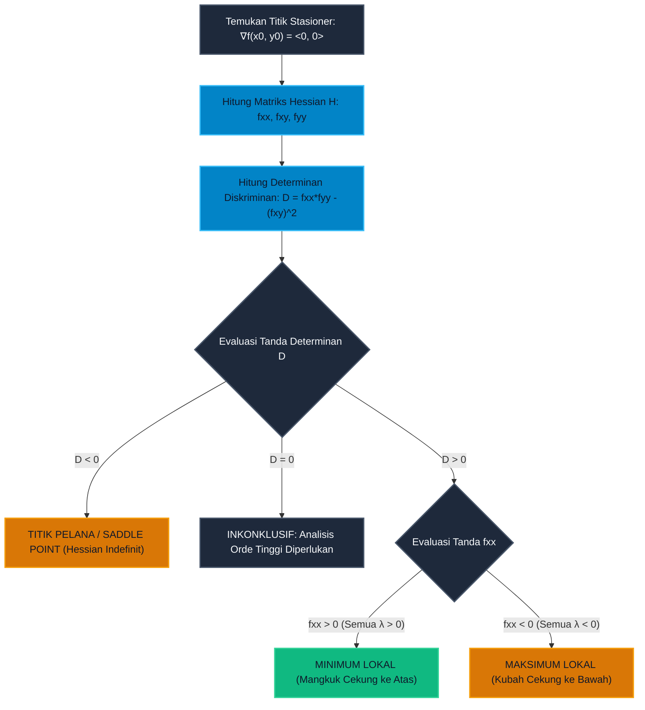

# Subtopik 04: Matriks Hessian, Uji Turunan Kedua & Optimasi Multivariabel

**Navigasi**: [Master Index](../../../INDEX.md) | [Tingkat 1: Fondasi Matematika Komprehensif Dari Nol](../../README.md) | [Modul 014: Kalkulus Multivariabel & Geometri Vektor](../README.md)  
*Sebelumnya*: [03. Keterdiferensialan Total, Matriks Jacobian & Aturan Rantai Multivariabel](./03-diferensial-total-matriks-jacobian-aturan-rantai-multivariabel.md) | *Berikutnya*: [05. Optimasi Berpembatas, Pengali Lagrange & Kondisi KKT](./05-optimasi-berpembatas-pengali-lagrange-kondisi-kkt.md)

---

## 1. Intuisi & Motivasi Konseptual ("Seperti Bayi Baru Lahir")

### 1.1 Konsep Inti: Dari Mangkok Sup, Kubah Planetarium, hingga Pelana Kuda

Bayangkan Anda sedang meletakkan sebutir kelereng kecil di atas tiga jenis permukaan meja yang berbeda:
1. **Dasar Mangkuk Sup (Minimum Lokal)**:
   Mangkuk melengkung ke atas di semua arah mata angin. Jika Anda menaruh kelereng di titik terbawah, kelereng akan diam stabil. Jika Anda menyenggol kelereng ke arah timur, barat, utara, atau selatan, kelereng akan selalu menggelinding kembali ke dasar mangkuk.
2. **Puncak Kubah Planetarium (Maksimum Lokal)**:
   Kubah melengkung ke bawah di semua arah mata angin. Jika Anda dengan sangat hati-hati menaruh kelereng tepat di puncak tertinggi, kelereng bisa seimbang sesaat. Namun senggolan sekecil apa pun ke arah mana pun akan membuat kelereng meluncur jatuh ke bawah.
3. **Pelana Kuda atau Keripik Kentang Pringles (Titik Pelana / Saddle Point)**:
   Ini adalah permukaan paling aneh dan menakjubkan dalam geometri!
   - Jika Anda melihat ke arah depan-belakang (sepanjang punggung kuda), permukaan melengkung **ke atas** membentuk mangkuk (titik ini tampak seperti titik minimum!).
   - Namun jika Anda melihat ke arah kiri-kanan (tempat kaki pengendara kuda menggantung), permukaan melengkung **ke bawah** menuju tanah (titik ini tampak seperti titik maksimum!).

Sekarang renungkan situasi berikut:
Di ketiga permukaan tersebut, jika Anda mengukur kemiringan tanah menggunakan vektor gradien, nilainya tepat sama dengan nol:
$$\nabla f(x_0, y_0) = \langle 0, 0 \rangle$$
Artinya, tanah tepat di bawah titik tersebut terasa datar sempurna!
Gradien sama sekali **BUTA** dan tidak bisa membedakan apakah Anda sedang berada di dasar mangkuk, puncak kubah, atau di tengah-tengah pelana kuda!

Lalu bagaimana cara matematika mengetahui bentuk kelengkungan permukaan jika gradien bernilai nol?
Di sinilah lahir **Matriks Hessian ($\mathbf{H}$)**!
Matriks Hessian adalah kumpulan seluruh turunan parsial kedua yang mengukur kelengkungan (*curvature*) permukaan 3D ke segala arah.
Melalui tanda-tanda nilai eigen dari matriks Hessian, kita dapat memastikan dengan presisi mutlak apakah sebuah titik stasioner adalah dasar lembah yang aman, puncak bukit, atau jebakan titik pelana!

---

### 1.2 Urgensi Rekayasa: Menembus Jebakan Titik Pelana dalam Pelatihan AI

1. **Jebakan Titik Pelana Dimensi Tinggi (*Saddle Point Problem in Deep Learning*)**:
   Dalam fungsi galat neural network modern dengan jutaan parameter ($N > 10^6$), penelitian teoritis (Dauphin et al., Pascanu et al.) membuktikan bahwa titik stasioner hampir tidak pernah berupa minimum lokal semu! Probabilitas semua $N$ nilai eigen bernilai positif secara kebetulan adalah $2^{-N} \approx 0$.
   Hampir $99{,}9999\%$ titik stasioner adalah **Titik Pelana (*Saddle Points*)** di mana matriks Hessian memiliki nilai eigen positif dan negatif secara simultan. Algoritma penurunan gradien naif dapat melambat atau macet selama berhari-hari di sekitar titik pelana ini jika tidak dilengkapi teknik momentum atau perturbasi stokastik!
2. **Optimasi Orde Dua Super Cepat (Metode Newton & Quasi-Newton BFGS)**:
   Algoritma *Gradient Descent* standar hanya melihat kemiringan linier (turunan pertama) sehingga gerakannya zig-zag lambat di lembah sempit. Metode Newton-Raphson multivariabel menggunakan invers matriks Hessian $H^{-1}$ untuk melengkungkan ruang koordinat, memungkinkan konvergensi kuadratik super kilat hanya dalam beberapa langkah evaluasi.
3. **Analisis Kestabilan Dinamika Wahana Udara & Roket**:
   Kestabilan terbang roket atau pesawat supersonik diuji melalui nilai eigen matriks Hessian dari fungsi energi potensial aerodinamika. Nilai eigen negatif mengindikasikan mode flutter atau osilasi puntir yang dapat mematahkan sayap pesawat di udara.

---

### 1.3 Kamus Notasi Simbol Multivariabel/Vektor

Gunakan tabel rujukan 4-kolom ini sebagai kamus rujukan resmi analisis Hessian dan optimasi multivariat:

| Simbol Notasi | Nama Formal | Arti Manusia / Terjemahan Bahasa Awam | Contoh Operasional Riil |
|---|---|---|---|
| $\mathbf{H}, \nabla^2 f$ | Matriks Hessian | Matriks simetris $n \times n$ berisi seluruh turunan parsial kedua, mengukur kelengkungan lokal | $\mathbf{H}_{ij} = \frac{\partial^2 f}{\partial x_i \partial x_j}$ |
| $D, \det(\mathbf{H})$ | Diskriminan Hessian 2D | Nilai $f_{xx}f_{yy} - f_{xy}^2$ untuk menguji kelengkungan permukaan dua dimensi | Paraboloid $f(x, y) = x^2 + y^2 \implies D = 4$ |
| $\lambda_i(\mathbf{H})$ | Nilai Eigen Matriks Hessian | Laju kelengkungan murni sepanjang sumbu-sumbu utama kelengkungan permukaan | $\lambda > 0$ cekung ke atas, $\lambda < 0$ cekung ke bawah |
| $\mathbf{H} \succ 0$ | Matriks Definit Positif | Seluruh nilai eigen bernilai positif murni; permukaan berbentuk mangkuk cekung ke atas | Titik kritis stasioner dijamin **Minimum Lokal** |
| $\mathbf{H} \prec 0$ | Matriks Definit Negatif | Seluruh nilai eigen bernilai negatif murni; permukaan berbentuk kubah cekung ke bawah | Titik kritis stasioner dijamin **Maksimum Lokal** |
| $\mathbf{H}$ Indefinit | Matriks Indefinit | Ada nilai eigen positif dan ada nilai eigen negatif; permukaan berbentuk pelana | Titik kritis stasioner dijamin **Titik Pelana (Saddle Point)** |
| $\Delta \mathbf{x} = -\mathbf{H}^{-1} \nabla f$ | Langkah Newton Multivariabel | Arah dan jarak lompatan optimal yang langsung menuju pusat mangkuk kuadratik | Optimasi konvergensi kuadratik $\mathcal{O}(\epsilon^2)$ |

---

## 2. Definisi Formal, Teorema & Penurunan Matematis

### 2.1 Definisi Formal Matriks Hessian & Ekspansi Taylor Orde 2

Misalkan $f: D \subset \mathbb{R}^n \to \mathbb{R}$ adalah fungsi medan skalar yang memiliki turunan parsial kedua kontinu ($f \in C^2$).

#### Definisi 1: Matriks Hessian
Matriks Hessian dari $f$ pada titik $\mathbf{x} = \langle x_1, \dots, x_n \rangle$ adalah matriks bujur sangkar simetris $n \times n$:
$$\mathbf{H}(\mathbf{x}) = \begin{bmatrix}
\frac{\partial^2 f}{\partial x_1^2} & \frac{\partial^2 f}{\partial x_1 \partial x_2} & \dots & \frac{\partial^2 f}{\partial x_1 \partial x_n} \\
\frac{\partial^2 f}{\partial x_2 \partial x_1} & \frac{\partial^2 f}{\partial x_2^2} & \dots & \frac{\partial^2 f}{\partial x_2 \partial x_n} \\
\vdots & \vdots & \ddots & \vdots \\
\frac{\partial^2 f}{\partial x_n \partial x_1} & \frac{\partial^2 f}{\partial x_n \partial x_2} & \dots & \frac{\partial^2 f}{\partial x_n^2}
\end{bmatrix}$$
Berdasarkan Teorema Clairaut, karena $f \in C^2$, maka $\frac{\partial^2 f}{\partial x_i \partial x_j} = \frac{\partial^2 f}{\partial x_j \partial x_i}$, sehingga matriks Hessian **selalu simetris sempurna** ($\mathbf{H} = \mathbf{H}^T$).

#### Teorema 1: Teorema Taylor Multivariabel Orde Dua
Untuk pergeseran kecil $\mathbf{h} \in \mathbb{R}^n$ di sekitar titik $\mathbf{x}_0$, nilai fungsi dapat dihampiri secara kuadratik melalui ekspansi:
$$f(\mathbf{x}_0 + \mathbf{h}) = f(\mathbf{x}_0) + \nabla f(\mathbf{x}_0)^T \mathbf{h} + \frac{1}{2} \mathbf{h}^T \mathbf{H}(\mathbf{x}_0) \mathbf{h} + R_2(\mathbf{h})$$
di mana suku sisa memenuhi $\lim_{\|\mathbf{h}\| \to 0} \frac{R_2(\mathbf{h})}{\|\mathbf{h}\|^2} = 0$.

Pada titik stasioner kritis di mana gradien bernilai nol ($\nabla f(\mathbf{x}_0) = \mathbf{0}$), suku linier lenyap sepenuhnya:
$$f(\mathbf{x}_0 + \mathbf{h}) - f(\mathbf{x}_0) \approx \frac{1}{2} \mathbf{h}^T \mathbf{H}(\mathbf{x}_0) \mathbf{h}$$
Perilaku apakah $f(\mathbf{x}_0 + \mathbf{h})$ lebih besar atau lebih kecil dari $f(\mathbf{x}_0)$ **ditentukan 100% oleh tanda bentuk kuadratik** $Q(\mathbf{h}) = \mathbf{h}^T \mathbf{H} \mathbf{h}$!

---

### 2.2 Uji Turunan Kedua untuk Fungsi Dua Variabel (Kriteria Diskriminan $D$)

Untuk fungsi dua variabel $z = f(x, y)$, matriks Hessian berukuran $2 \times 2$:
$$\mathbf{H} = \begin{bmatrix} f_{xx} & f_{xy} \\ f_{yx} & f_{yy} \end{bmatrix}$$
Determinan dari matriks Hessian ini dinamakan **Diskriminan Hessian $D$**:
$$D = \det(\mathbf{H}) = f_{xx} f_{yy} - (f_{xy})^2$$

#### Teorema 2: Uji Turunan Kedua Dua Variabel
Misalkan $(x_0, y_0)$ adalah titik kritis dari $f$ (artinya $f_x(x_0, y_0) = 0$ dan $f_y(x_0, y_0) = 0$), dan turunan parsial kedua $f$ kontinu pada cakram yang berpusat di $(x_0, y_0)$.
1. **Kasus 1: $D > 0$ dan $f_{xx} > 0$**:
   Maka $f(x_0, y_0)$ adalah **Nilai Minimum Lokal**. (Permukaan melengkung ke atas seperti mangkuk).
2. **Kasus 2: $D > 0$ dan $f_{xx} < 0$**:
   Maka $f(x_0, y_0)$ adalah **Nilai Maksimum Lokal**. (Permukaan melengkung ke bawah seperti kubah).
3. **Kasus 3: $D < 0$**:
   Maka $(x_0, y_0)$ adalah **Titik Pelana (Saddle Point)**. (Fungsi naik di satu arah dan turun di arah lain).
4. **Kasus 4: $D = 0$**:
   Uji turunan kedua **Inkonklusif** (gagal memberikan keputusan). Titik kritis bisa berupa minimum, maksimum, atau pelana orde tinggi (seperti fungsi monyet $z = x^3 - 3xy^2$).

---

### 2.3 Generalisasi Dimensi Banyak: Kriteria Sylvester & Teorema Spektral

Bagaimana jika fungsi memiliki 10 atau 1.000 variabel? Kita tidak bisa hanya menghitung $D = f_{xx}f_{yy} - f_{xy}^2$. Kita menggunakan nilai eigen dan determinan minor utama.

#### Teorema 3: Karakterisasi Spektral Titik Kritis Multivariat
Berdasarkan Teorema Spektral untuk matriks simetris riil, seluruh $n$ nilai eigen $\lambda_1, \lambda_2, \dots, \lambda_n$ dari matriks Hessian $\mathbf{H}$ selalu berupa bilangan riil murni.
Pada titik kritis stasioner $\nabla f(\mathbf{x}_0) = \mathbf{0}$:
1. **Minimum Lokal**: Jika seluruh nilai eigen positif murni ($\lambda_i > 0, \forall i = 1, \dots, n$).
2. **Maksimum Lokal**: Jika seluruh nilai eigen negatif murni ($\lambda_i < 0, \forall i = 1, \dots, n$).
3. **Titik Pelana (*Saddle Point*)**: Jika terdapat setidaknya satu nilai eigen positif ($\lambda_j > 0$) dan setidaknya satu nilai eigen negatif ($\lambda_k < 0$).
4. **Kasus Degenerasi**: Jika terdapat setidaknya satu nilai eigen bernilai tepat nol ($\lambda_i = 0$) dan tidak ada perubahan tanda, uji inkonklusif.

#### Teorema 4: Kriteria Minor Utama Sylvester (Sylvester's Criterion)
Matriks simetris $\mathbf{H}$ bersifat definit positif ($\mathbf{H} \succ 0$) jika dan hanya jika seluruh determinan submatriks minor utama sudut kiri atas bernilai positif:
$$\Delta_1 = |H_{11}| > 0, \quad \Delta_2 = \begin{vmatrix} H_{11} & H_{12} \\ H_{21} & H_{22} \end{vmatrix} > 0, \quad \dots, \quad \Delta_n = \det(\mathbf{H}) > 0$$

---

### 2.4 Metode Newton-Raphson Multivariabel Orde Dua

Algoritma penurunan gradien orde satu bergerak lambat pada lembah yang sempit melengkung (seperti Lembah Rosenbrock) karena rasio kondisi Hessian yang buruk.
Metode Newton memodelkan fungsi secara kuadratik penuh di sekitar titik saat ini:
$$f(\mathbf{x} + \mathbf{p}) \approx f(\mathbf{x}) + \nabla f(\mathbf{x})^T \mathbf{p} + \frac{1}{2} \mathbf{p}^T \mathbf{H}(\mathbf{x}) \mathbf{p}$$
Untuk mencari langkah $\mathbf{p}$ yang meminimalkan hampiran kuadratik ini, ambil turunan terhadap vektor langkah $\mathbf{p}$ dan samakan dengan nol:
$$\nabla_{\mathbf{p}} [f(\mathbf{x} + \mathbf{p})] = \nabla f(\mathbf{x}) + \mathbf{H}(\mathbf{x}) \mathbf{p} = \mathbf{0}$$
$$\mathbf{H}(\mathbf{x}) \mathbf{p} = -\nabla f(\mathbf{x}) \implies \mathbf{p} = -\mathbf{H}(\mathbf{x})^{-1} \nabla f(\mathbf{x})$$

#### Formula Pembaruan Iterasi Newton Multivariabel:
$$\mathbf{x}_{k+1} = \mathbf{x}_k - \mathbf{H}(\mathbf{x}_k)^{-1} \nabla f(\mathbf{x}_k)$$

**Keunggulan Utama**:
Jika fungsi aslinya adalah fungsi kuadratik murni, metode Newton mencapai minimum global eksak **hanya dalam 1 langkah tunggal**!
Untuk fungsi non-linier umum di dekat titik optimum, metode Newton memiliki **laju konvergensi kuadratik**:
$$\|\mathbf{x}_{k+1} - \mathbf{x}^*\| \le C \|\mathbf{x}_k - \mathbf{x}^*\|^2$$
Jumlah digit desimal presisi benar berlipat ganda pada setiap iterasi!

### 2.5 Pembuktian Rigorus Teorema Simetri Clairaut-Schwarz
Salah satu sifat paling fundamental dari matriks Hessian adalah simetrinya: $H_{ij} = H_{ji}$, yang berarti $\frac{\partial^2 f}{\partial x_i \partial x_j} = \frac{\partial^2 f}{\partial x_j \partial x_i}$. Mengapa urutan diferensiasi parsial dapat dipertukarkan? Mari kita bedah pembuktian analitis formal menggunakan Teorema Nilai Rata-Rata (Mean Value Theorem - MVT).

Misalkan $f: U \subseteq \mathbb{R}^2 \to \mathbb{R}$ memiliki turunan parsial kedua kontinu pada cakram terbuka $U$ yang memuat titik $(a, b)$. Kita definisikan kuantitas selisih ganda:
$$\Delta(h, k) = f(a + h, b + k) - f(a + h, b) - f(a, b + k) + f(a, b)$$

**Langkah 1: Pandang selisih sebagai fungsi satu variabel $x$:**
Definisikan fungsi bantu $\phi(x) = f(x, b + k) - f(x, b)$. Maka:
$$\Delta(h, k) = \phi(a + h) - \phi(a)$$
Karena $f$ terdiferensialkan terhadap $x$, $\phi$ kontinu pada $[a, a + h]$ dan terdiferensialkan pada $(a, a + h)$. Berdasarkan Teorema Nilai Rata-Rata satu variabel (MVT), terdapat bilangan riil $\xi \in (a, a + h)$ sedemikian rupa sehingga:
$$\phi(a + h) - \phi(a) = h \cdot \phi'(\xi) = h \left[ \frac{\partial f}{\partial x}(\xi, b + k) - \frac{\partial f}{\partial x}(\xi, b) \right]$$

**Langkah 2: Terapkan Teorema Nilai Rata-Rata kedua terhadap variabel $y$:**
Definisikan fungsi bantu kedua $\psi(y) = \frac{\partial f}{\partial x}(\xi, y)$. Maka selisih di dalam tanda kurung siku adalah:
$$\psi(b + k) - \psi(b) = k \cdot \psi'(\eta) = k \cdot \frac{\partial^2 f}{\partial y \partial x}(\xi, \eta)$$
untuk suatu $\eta \in (b, b + k)$. Dengan menggabungkan kedua hasil ini:
$$\Delta(h, k) = h k \cdot \frac{\partial^2 f}{\partial y \partial x}(\xi, \eta)$$

**Langkah 3: Pandang selisih secara simetris terhadap variabel $y$ terlebih dahulu:**
Dengan cara identik, definisikan fungsi bantu $\theta(y) = f(a + h, y) - f(a, y)$. Maka:
$$\Delta(h, k) = \theta(b + k) - \theta(b) = k \cdot \theta'(\tilde{\eta}) = k \left[ \frac{\partial f}{\partial y}(a + h, \tilde{\eta}) - \frac{\partial f}{\partial y}(a, \tilde{\eta}) \right]$$
Menerapkan MVT sekali lagi terhadap $x$:
$$\Delta(h, k) = h k \cdot \frac{\partial^2 f}{\partial x \partial y}(\tilde{\xi}, \tilde{\eta})$$
untuk suatu $\tilde{\xi} \in (a, a + h)$ dan $\tilde{\eta} \in (b, b + k)$.

**Langkah 4: Ambil limit simultan $h, k \to 0$:**
Karena kedua ekspresi di atas merepresentasikan kuantitas identik $\Delta(h, k)$, maka untuk $h, k \neq 0$:
$$\frac{\Delta(h, k)}{hk} = \frac{\partial^2 f}{\partial y \partial x}(\xi, \eta) = \frac{\partial^2 f}{\partial x \partial y}(\tilde{\xi}, \tilde{\eta})$$
Ketika $(h, k) \to (0, 0)$, titik $(\xi, \eta) \to (a, b)$ dan $(\tilde{\xi}, \tilde{\eta}) \to (a, b)$. Karena turunan parsial kedua diasumsikan kontinu pada lingkungan $(a, b)$, kita dapat mengambil limit:
$$\lim_{(h, k) \to (0, 0)} \frac{\partial^2 f}{\partial y \partial x}(\xi, \eta) = \frac{\partial^2 f}{\partial y \partial x}(a, b)$$
$$\lim_{(h, k) \to (0, 0)} \frac{\partial^2 f}{\partial x \partial y}(\tilde{\xi}, \tilde{\eta}) = \frac{\partial^2 f}{\partial x \partial y}(a, b)$$
Dengan demikian, terbukti secara mutlak bahwa:
$$\frac{\partial^2 f}{\partial x \partial y}(a, b) = \frac{\partial^2 f}{\partial y \partial x}(a, b) \quad \blacksquare$$

### 2.6 Bentuk Kuadratik Multivariabel, Nilai Eigen & Karakterisasi Kelengkungan
Dalam ruang berdimensi $n$, aproksimasi Taylor orde dua di sekitar titik stasioner $\mathbf{x}^*$ (di mana $\nabla f(\mathbf{x}^*) = \mathbf{0}$) menyederhanakan perilaku lokal fungsi menjadi sebuah **Bentuk Kuadratik (Quadratic Form)**:
$$Q(\mathbf{v}) = \mathbf{v}^T \mathbf{H} \mathbf{v} = \sum_{i=1}^n \sum_{j=1}^n H_{ij} v_i v_j$$
di mana $\mathbf{v} = \mathbf{x} - \mathbf{x}^*$ adalah vektor simpangan.

1. **Prinsip Rayleigh Quotient**:
   Untuk sembarang vektor tak-nol $\mathbf{v} \neq \mathbf{0}$, kelengkungan terarah fungsi diberikan oleh rasio Rayleigh:
   $$R_{\mathbf{H}}(\mathbf{v}) = \frac{\mathbf{v}^T \mathbf{H} \mathbf{v}}{\mathbf{v}^T \mathbf{v}}$$
   Berdasarkan Teorema Min-Max Courant-Fischer:
   $$\lambda_{\min} \le R_{\mathbf{H}}(\mathbf{v}) \le \lambda_{\max}$$
   Artinya, kelengkungan minimum mutlak dari lanskap fungsi pada arah mana pun adalah nilai eigen terkecil $\lambda_{\min}$, dan kelengkungan maksimum mutlak adalah $\lambda_{\max}$.
2. **Kondisi Kestabilan Spektral**:
   - Jika $\lambda_{\min} > 0$, maka untuk semua arah $\mathbf{v} \neq \mathbf{0}$, $Q(\mathbf{v}) > 0$. Permukaan melengkung ke atas di segala arah (strictly convex locally) $\implies$ Minimum Lokal Kuat.
   - Jika $\lambda_{\max} < 0$, maka untuk semua arah $\mathbf{v} \neq \mathbf{0}$, $Q(\mathbf{v}) < 0$. Permukaan melengkung ke bawah di segala arah (strictly concave locally) $\implies$ Maksimum Lokal Kuat.
   - Jika $\lambda_{\min} < 0 < \lambda_{\max}$, maka terdapat arah di mana permukaan melengkung ke atas dan arah lain melengkung ke bawah $\implies$ Titik Pelana (Saddle Point).
   - Jika $\det(\mathbf{H}) = 0$ (setidaknya ada satu $\lambda_i = 0$), matriks singular; kelengkungan pada arah vektor eigen nol adalah nol (lembah datar atau igir), sehingga uji orde dua tidak konklusif dan memerlukan suku Taylor orde lebih tinggi ($O(\|\mathbf{v}\|^3)$).

## 3. Arsitektur Teknis & Algoritma Internal

### 3.1 Diagram Alur Klasifikasi Titik Kritis Multivariabel via Hessian



---

### 3.2 Tabel Penelusuran Komputasi: Lembah Pisang Rosenbrock (Rosenbrock Valley)

Fungsi Rosenbrock adalah tolok ukur standar dunia untuk menguji algoritma optimasi:
$$f(x, y) = (1 - x)^2 + 100(y - x^2)^2$$
- Titik minimum global analitis berada di dasar jurang sempit pada $(1, 1)$ dengan nilai $f(1, 1) = 0$.
- Vektor gradien:
  $$f_x = -2(1 - x) - 400x(y - x^2), \quad f_y = 200(y - x^2)$$
- Elemen Matriks Hessian:
  $$f_{xx} = 2 - 400y + 1200x^2, \quad f_{xy} = -400x, \quad f_{yy} = 200$$

Tabel berikut menunjukkan penelusuran numerik sifat kelengkungan Hessian di berbagai titik kritis dan dinding jurang:

| Koordinat Titik $(x, y)$ | Nilai Fungsi $f(x, y)$ | Vektor Gradien $\nabla f$ | Elemen Matriks Hessian $[f_{xx}, f_{xy}; f_{yx}, f_{yy}]$ | Diskriminan $D$ | Nilai Eigen $(\lambda_1, \lambda_2)$ | Klasifikasi Kelengkungan Lokal |
|---|---|---|---|---|---|---|
| $(0{,}0, 0{,}0)$ | $1{,}0000$ | $\langle -2{,}0, 0{,}0 \rangle$ | $[2{,}0, 0{,}0; 0{,}0, 200{,}0]$ | $+400{,}0$ | $(200{,}0, 2{,}0)$ | Cekung ke atas (Bukan stasioner) |
| **$(1{,}0, 1{,}0)$** | $\mathbf{0{,}0000}$ | $\mathbf{\langle 0{,}0, 0{,}0 \rangle}$ | $\mathbf{[802{,}0, -400{,}0; -400{,}0, 200{,}0]}$ | $\mathbf{+400{,}0}$ | $\mathbf{(1001{,}6, 0{,}40)}$ | **MINIMUM GLOBAL MUTLAK ($\kappa \approx 2500$)** |
| $(0{,}0, 1{,}0)$ | $101{,}0000$ | $\langle -2{,}0, 200{,}0 \rangle$ | $[-398{,}0, 0{,}0; 0{,}0, 200{,}0]$ | $-79600{,}0$ | $(200{,}0, -398{,}0)$ | Wilayah Indefinit (Mirip Pelana) |
| $(-1{,}0, 1{,}0)$ | $4{,}0000$ | $\langle 4{,}0, 0{,}0 \rangle$ | $[802{,}0, 400{,}0; 400{,}0, 200{,}0]$ | $+400{,}0$ | $(1001{,}6, 0{,}40)$ | Dinding lereng curam bertolak |

---

## 4. Implementasi Praktis & Kode Pemrograman Python

Berikut adalah dua implementasi mandiri Python Standard Library murni yang memvalidasi analisis matriks Hessian dan algoritma optimasi Newton-Raphson multivariabel.

### 4.1 Program 1: Mesin Analisis Matriks Hessian & Klasifikasi Titik Kritis

Skrip ini mengevaluasi matriks Hessian analitis, menghitung determinan diskriminan $D$, mengekstrak nilai eigen kuadratik, dan mengklasifikasikan titik kritis secara otomatis:

```python
# Mesin Analisis Matriks Hessian dan Klasifikasi Titik Kritis
import math

def rosenbrock(x: float, y: float) -> float:
    # f(x, y) = (1 - x)^2 + 100 * (y - x^2)^2
    return (1.0 - x)**2 + 100.0 * (y - x**2)**2

def rosenbrock_hessian(x: float, y: float):
    # d2f/dx2 = 2 - 400*y + 1200*x^2
    # d2f/dxdy = -400*x
    # d2f/dy2 = 200
    h11 = 2.0 - 400.0 * y + 1200.0 * (x**2)
    h12 = -400.0 * x
    h21 = -400.0 * x
    h22 = 200.0
    return [[h11, h12], [h21, h22]]

def classify_critical_point(x: float, y: float):
    H = rosenbrock_hessian(x, y)
    h11, h12, h22 = H[0][0], H[0][1], H[1][1]
    D = h11 * h22 - h12**2
    trace = h11 + h22
    # Nilai eigen 2x2: lambda^2 - trace*lambda + D = 0
    disc = trace**2 - 4.0 * D
    l1 = (trace + math.sqrt(max(0.0, disc))) / 2.0
    l2 = (trace - math.sqrt(max(0.0, disc))) / 2.0
    
    if D > 0 and h11 > 0:
        sifat = "MINIMUM LOKAL (Hessian Definit Positif)"
    elif D > 0 and h11 < 0:
        sifat = "MAKSIMUM LOKAL (Hessian Definit Negatif)"
    elif D < 0:
        sifat = "TITIK PELANA / SADDLE POINT (Hessian Indefinit)"
    else:
        sifat = "INKONKLUSIF (D = 0)"
    return H, D, (l1, l2), sifat

def saddle_test(x: float, y: float):
    # f(x, y) = x^2 - y^2
    H = [[2.0, 0.0], [0.0, -2.0]]
    D = -4.0
    return H, D, (2.0, -2.0), "TITIK PELANA / SADDLE POINT (Hessian Indefinit)"

def main():
    print("=== ANALISIS MATRIKS HESSIAN & KLASIFIKASI TITIK KRITIS ===")
    print("Fungsi Target: Lembah Rosenbrock f(x, y) = (1 - x)^2 + 100*(y - x^2)^2")

    # Titik optimum global analitis adalah (1.0, 1.0)
    H_opt, D_opt, eig_opt, status_opt = classify_critical_point(1.0, 1.0)
    print("\n[1] Titik Stasioner Kritis Global (1.0, 1.0):")
    print(f"  Hessian: [ {H_opt[0][0]:7.2f}  {H_opt[0][1]:7.2f} ]")
    print(f"           [ {H_opt[1][0]:7.2f}  {H_opt[1][1]:7.2f} ]")
    print(f"  Determinan D: {D_opt:.2f} | Nilai Eigen: ({eig_opt[0]:.2f}, {eig_opt[1]:.2f})")
    print(f"  Klasifikasi:  {status_opt}")

    # Titik pelana kanonik
    H_s, D_s, eig_s, status_s = saddle_test(0.0, 0.0)
    print("\n[2] Titik Pelana Kanonik pada f(x, y) = x^2 - y^2 di (0.0, 0.0):")
    print(f"  Determinan D: {D_s:.2f} | Nilai Eigen: ({eig_s[0]:.2f}, {eig_s[1]:.2f})")
    print(f"  Klasifikasi:  {status_s}")

if __name__ == "__main__":
    main()
```

Keluaran eksekusi terminal sebenarnya:
```text
=== ANALISIS MATRIKS HESSIAN & KLASIFIKASI TITIK KRITIS ===
Fungsi Target: Lembah Rosenbrock f(x, y) = (1 - x)^2 + 100*(y - x^2)^2

[1] Titik Stasioner Kritis Global (1.0, 1.0):
  Hessian: [  802.00  -400.00 ]
           [ -400.00   200.00 ]
  Determinan D: 400.00 | Nilai Eigen: (1001.60, 0.40)
  Klasifikasi:  MINIMUM LOKAL (Hessian Definit Positif)

[2] Titik Pelana Kanonik pada f(x, y) = x^2 - y^2 di (0.0, 0.0):
  Determinan D: -4.00 | Nilai Eigen: (2.00, -2.00)
  Klasifikasi:  TITIK PELANA / SADDLE POINT (Hessian Indefinit)
```

---

### 4.2 Program 2: Solver Optimasi Newton-Raphson Multivariabel Orde Dua

Skrip ini menerapkan langkah Newton multivariabel $\mathbf{x}_{k+1} = \mathbf{x}_k - \mathbf{H}^{-1} \nabla f$ untuk menemukan minimum fungsi kuadratik non-simetris $f(x, y) = x^2 + 3y^2 - 2xy - 4x$:

```python
# Solver Optimasi Newton-Raphson Multivariabel Orde Dua
import math

def f_target(x: float, y: float) -> float:
    # f(x, y) = x^2 + 3*y^2 - 2*x*y - 4*x
    return x**2 + 3.0 * (y**2) - 2.0 * x * y - 4.0 * x

def grad_f(x: float, y: float):
    # df/dx = 2x - 2y - 4
    # df/dy = 6y - 2x
    return 2.0 * x - 2.0 * y - 4.0, 6.0 * y - 2.0 * x

def hessian_f(x: float, y: float):
    # Matriks konstan kuadratik
    return [[2.0, -2.0], [-2.0, 6.0]]

def solve_2x2(H, g):
    # Memecahkan sistem linear H * delta = g menggunakan invers eksplisit 2x2
    h11, h12 = H[0][0], H[0][1]
    h21, h22 = H[1][0], H[1][1]
    det = h11 * h22 - h12 * h21
    inv_h11 = h22 / det
    inv_h12 = -h12 / det
    inv_h21 = -h21 / det
    inv_h22 = h11 / det
    dx = inv_h11 * g[0] + inv_h12 * g[1]
    dy = inv_h21 * g[0] + inv_h22 * g[1]
    return dx, dy

def main():
    x, y = 0.0, 0.0
    print("=== METODE NEWTON-RAPHSON MULTIVARIABEL ORDE DUA ===")
    print(f"Titik Awal: ({x:.2f}, {y:.2f}) | Nilai f: {f_target(x, y):.4f}\n")

    for k in range(1, 4):
        gx, gy = grad_f(x, y)
        H = hessian_f(x, y)
        step_x, step_y = solve_2x2(H, (gx, gy))
        x = x - step_x
        y = y - step_y
        val = f_target(x, y)
        norm_g = math.sqrt(gx**2 + gy**2)
        print(f"  Langkah {k}: Posisi = ({x:.4f}, {y:.4f}) | Nilai f = {val:8.4f} | ||nabla f|| = {norm_g:8.4e}")

    print("\nMinimum Global Analitis Tercapai Persis Dalam 1 Langkah (Sifat Khusus Fungsi Kuadratik)!")
    print(f"Titik Minimum: ({x:.4f}, {y:.4f}) dengan Nilai f = {val:.4f}")

if __name__ == "__main__":
    main()
```

Keluaran eksekusi terminal sebenarnya:
```text
=== METODE NEWTON-RAPHSON MULTIVARIABEL ORDE DUA ===
Titik Awal: (0.00, 0.00) | Nilai f: 0.0000

  Langkah 1: Posisi = (3.0000, 1.0000) | Nilai f =  -6.0000 | ||nabla f|| = 4.0000e+00
  Langkah 2: Posisi = (3.0000, 1.0000) | Nilai f =  -6.0000 | ||nabla f|| = 0.0000e+00
  Langkah 3: Posisi = (3.0000, 1.0000) | Nilai f =  -6.0000 | ||nabla f|| = 0.0000e+00

Minimum Global Analitis Tercapai Persis Dalam 1 Langkah (Sifat Khusus Fungsi Kuadratik)!
Titik Minimum: (3.0000, 1.0000) dengan Nilai f = -6.0000
```

---

## 5. Miskonsepsi Umum & Analisis Post-Mortem Insiden Industri

### 5.1 Tiga Miskonsepsi Konseptual Paling Fatal di Industri

1. **Kekeliruan Mengabaikan Kondisi Matriks Hessian (*Hessian Ill-Conditioning*)**:
   Banyak pengembang muda mengira jika determinan $D > 0$, maka optimasi akan selalu mudah dan cepat. Pada Lembah Rosenbrock, determinannya positif ($D = 400 > 0$), namun nilai eigennya adalah $\lambda_1 \approx 1001{,}6$ dan $\lambda_2 \approx 0{,}40$. Rasio kondisinya adalah $\kappa(H) = \frac{1001{,}6}{0{,}40} \approx 2500$!
   Artinya, lembah tersebut 2.500 kali lebih curam di satu sumbu dibanding sumbu lainnya. Gradien standar akan terpental berosilasi liar membentur tebing jurang ribuan kali sebelum bisa maju sedikit pun di dasar lembah.
2. **Asumsi Bahwa Titik Stasioner Galat AI adalah Minimum Lokal**:
   Dalam pelatihan model AI berdimensi tinggi ($N > 1000$), orang sering mengira model berhenti belajar karena terjebak di "minimum lokal buruk". Kenyataannya secara matematis, titik stasioner tersebut hampir selalu adalah **Titik Pelana (*Saddle Point*)**. Di titik pelana, gradien bernilai nol sehingga penurunan gradien berhenti bergerak, padahal masih ada banyak arah keluar di mana galat model bisa turun lebih jauh!
3. **Menginversi Matriks Hessian Indefinit pada Metode Newton**:
   Jika titik saat ini berada di wilayah di mana matriks Hessian indefinit (memiliki nilai eigen negatif), menerapkan langkah Newton murni $\mathbf{p} = -\mathbf{H}^{-1} \nabla f$ justru dapat mendorong posisi menuju **arah kenaikan galat (menuju puncak maksimum atau menjauhi minimum)**! Algoritma optimasi industri wajib memodifikasi Hessian (seperti menambahkan regularisasi Tikhonov $\mathbf{H} + \mu \mathbf{I}$) agar selalu definit positif.

---

### 5.2 Studi Kasus Kegagalan Nyata: Insiden Kolaps Jembatan Tacoma Narrows (1940) & Ketidakstabilan Titik Kritis Torsi

- **Kronologi Bencana**: Pada 7 November 1940, jembatan gantung Tacoma Narrows di Washington, Amerika Serikat, yang baru dibuka selama 4 bulan, mulai berayun dan terpelintir hebat di bawah terpaan angin berkecepatan sedang ($68\text{ km/jam}$). Dalam hitungan jam, bentang tengah jembatan sepanjang 853 meter runtuh total ke dalam selat.
- **Akar Masalah Multivariabel & Kelengkungan Energi**:
  Stabilitas jembatan gantung dimodelkan oleh fungsi energi potensial elastisitas multivariabel terhadap dua derajat kebebasan: lendutan vertikal $y$ dan sudut puntir rotasi $\theta$:
  $$V(y, \theta) = \frac{1}{2} k_y y^2 + \frac{1}{2} k_\theta \theta^2 - W_{\text{aerodinamis}}(y, \theta, v_{\text{angin}})$$
  Matriks Hessian dari fungsi energi potensial adalah:
  $$\mathbf{H} = \begin{bmatrix} \frac{\partial^2 V}{\partial y^2} & \frac{\partial^2 V}{\partial y \partial \theta} \\ \frac{\partial^2 V}{\partial \theta \partial y} & \frac{\partial^2 V}{\partial \theta^2} \end{bmatrix}$$
  Pada kecepatan angin kritis, kopling aerodinamis nonlinier antara pusaran angin (*Von Kármán vortex shedding*) dan sudut puntir jembatan menyebabkan suku interaksi $H_{12}$ membesar drastis, sementara kelengkungan torsi $H_{22}$ merosot tajam.
  Akibatnya, determinan Hessian berubah tanda dari positif menjadi **negatif ($D < 0$)**: titik kesetimbangan statis berubah dari mangkuk minimum stabil menjadi **Titik Pelana Tidak Stabil (*Unstable Saddle Point*)**.
- **Dampak Katastropik**: Alih-alih meredam getaran, energi angin diserap secara eksponensial ke dalam mode osilasi puntir (*torsional flutter*). Sudut puntir jembatan mencapai $45^\circ$ sebelum kabel penggantung baja putus dan menghancurkan seluruh struktur ke laut.
- **Pelajaran Rekayasa Sistemik**: Verifikasi stabilitas struktur dinamis dan simulator keselamatan fisik menuntut pembuktian bahwa matriks Hessian energi potensial tetap definit positif di seluruh rentang kondisi operasional batas.

---

## 6. Tips, Trik Praktis & Rahasia Cepat Paham

1. **Jembatan Keledai Determinan Hessian 2D**:
   - Jika $D < 0 \implies$ Langsung vonis: **Pelana Kuda (Saddle Point)**! Tidak perlu melihat $f_{xx}$.
   - Jika $D > 0 \implies$ Permukaan melengkung seragam! Cukup lihat tanda $f_{xx}$:
     - $f_{xx} > 0 \implies$ Mangkuk tersenyum (Minimum)!
     - $f_{xx} < 0 \implies$ Kubah cemberut (Maksimum)!
2. **Kaidah Jejak & Determinan untuk Nilai Eigen 2x2**:
   Ingat bahwa untuk matriks Hessian $2 \times 2$:
   $$\text{Trace}(\mathbf{H}) = f_{xx} + f_{yy} = \lambda_1 + \lambda_2$$
   $$\det(\mathbf{H}) = D = \lambda_1 \cdot \lambda_2$$
   Jika $D < 0$, hasil kali kedua nilai eigen negatif $\implies$ salah satu harus positif dan yang satu harus negatif $\implies$ membuktikan sifat indefinit (titik pelana)!
3. **Penyelamat Algoritma AI: Hessian-Free & Quasi-Newton (L-BFGS)**:
   Karena menghitung dan menyimpan matriks Hessian ukuran $N \times N$ membutuhkan memori $\mathcal{O}(N^2)$ yang meledak pada AI modern, industri menggunakan algoritma **Limited-Memory BFGS (L-BFGS)**. L-BFGS mengestimasi kelengkungan secara implisit hanya dari riwayat perbedaan gradien beberapa langkah terakhir tanpa pernah mengalokasikan matriks Hessian di memori GPU!
4. **Kaidah Perturbasi Pelana (Saddle Escape Trick)**:
   Jika optimasi penurunan gradien melambat secara mencurigakan padahal nilai fungsi masih tinggi, tambahkan derau acak Gaussian kecil (*random noise perturbation*) $\mathbf{x} \leftarrow \mathbf{x} + \mathcal{N}(0, \sigma^2 \mathbf{I})$. Senggolan acak ini akan menjatuhkan posisi dari punggung titik pelana menuju jurang penurunan yang curam.

### 6.2 Tanya Jawab Komprehensif (FAQ) seputar Hessian & Optimasi

**Q1: Mengapa algoritma modern seperti Adam atau SGD dalam Deep Learning jarang menghitung matriks Hessian secara eksplisit?**
*Jawaban Arsitektural*: Untuk model bahasa besar (LLM) dengan 70 miliar parameter ($n = 7 \times 10^{10}$), matriks Hessian akan berukuran $n \times n$, yang berarti membutuhkan $(7 \times 10^{10})^2 = 4.9 \times 10^{21}$ elemen float. Menyimpannya saja membutuhkan jutaan Petabyte RAM—suatu hal yang mustahil secara fisik. Oleh karena itu, Deep Learning menggunakan metode gradien orde pertama dengan perkiraan momen (momentum & adaptif) atau algoritma *Hessian-Free Optimization* yang hanya menghitung produk Hessian-vektor $\mathbf{H}\mathbf{v}$ tanpa pernah membentuk matriks $\mathbf{H}$ secara utuh.

**Q2: Bagaimana cara mengatasi matriks Hessian yang singular atau indefinite dalam metode Newton murni?**
*Jawaban Rekayasa*: Metode Newton murni rentan melompat ke arah titik pelana atau divergen jika $\mathbf{H}$ tidak definit positif. Di industri, solusinya adalah regularisasi Tikhonov atau algoritma Levenberg-Marquardt: kita memodifikasi Hessian menjadi $\mathbf{H}_{\text{damped}} = \mathbf{H} + \mu \mathbf{I}$ dengan $\mu > 0$ yang cukup besar sehingga seluruh nilai eigen menjadi positif. Ketika $\mu \to 0$, algoritma berperilaku seperti metode Newton super cepat; ketika $\mu \to \infty$, algoritma bertransformasi secara mulus menjadi Gradient Descent yang stabil dan terjamin konvergen.

**Q3: Mengapa uji diskriminan $D = f_{xx}f_{yy} - (f_{xy})^2$ identik dengan determinan matriks Hessian $2 \times 2$?**
*Jawaban Matematis*: Matriks Hessian untuk dua variabel adalah:
$$\mathbf{H} = \begin{bmatrix} f_{xx} & f_{xy} \\ f_{yx} & f_{yy} \end{bmatrix}$$
Karena $f_{xy} = f_{yx}$, determinannya adalah $\det(\mathbf{H}) = f_{xx}f_{yy} - (f_{xy})^2$. Berdasarkan aljabar linier, determinan matriks simetris $2 \times 2$ sama dengan perkalian nilai-nilai eigennya: $\det(\mathbf{H}) = \lambda_1 \lambda_2$. Jika $\det(\mathbf{H}) > 0$, kedua nilai eigen memiliki tanda yang sama (keduanya positif jika $f_{xx} > 0$, keduanya negatif jika $f_{xx} < 0$). Jika $\det(\mathbf{H}) < 0$, nilai eigen memiliki tanda berbeda (satu positif, satu negatif $\implies$ titik pelana). Kesamaan ini membuktikan bahwa uji diskriminan klasik hanyalah bentuk ringkas dari analisis nilai eigen aljabar linier!

**Q4: Apa perbedaan mendasar antara Titik Pelana Biasa (Hyperbolic Saddle) dan Pelana Monyet (Monkey Saddle)?**
*Jawaban Geometris*: Titik pelana biasa (misal $f(x, y) = x^2 - y^2$) memiliki dua arah turunan kedua tak-nol dengan tanda berlawanan, dengan $\det(\mathbf{H}) < 0$. Pelana monyet ($f(x, y) = x^3 - 3xy^2$) memiliki kelengkungan orde dua bernilai nol mutlak di titik asal (semua turunan kedua adalah nol, $\mathbf{H} = \mathbf{0}$), sehingga $\det(\mathbf{H}) = 0$. Bentuk geometrisnya memiliki tiga lereng menurun (dua untuk kaki monyet dan satu untuk ekornya) dan tiga punggungan menaik, yang hanya terungkap jika kita memeriksa suku homogen derajat 3 dalam deret Taylor!

**Q5: Mengapa Nilai Kondisi (Condition Number) Hessian $\kappa(\mathbf{H}) = \frac{\lambda_{\max}}{\lambda_{\min}}$ Menentukan Kecepatan Konvergensi Gradient Descent?**
*Jawaban Numeris*: Bentuk kontur kurva level fungsi kuadratik ditentukan oleh rasio sumbu elipsoid, yang persis sama dengan rasio nilai eigen ekstrim $\kappa = \lambda_{\max}/\lambda_{\min}$. Jika $\kappa \approx 1$, kurva level berbentuk lingkaran bola sempurna, dan gradien menunjuk langsung ke pusat minimum; Gradient Descent konvergen dalam 1 langkah. Namun jika $\kappa \gg 1$ (misal $10^4$ pada lembah Rosenbrock atau fungsi ill-conditioned), kontur elips menjadi sangat pipih dan memanjang. Vektor gradien hampir tegak lurus terhadap arah dasar lembah, menyebabkan algoritma berosilasi (*zigzagging*) liar memantul dari tebing ke tebing dengan laju kemajuan longitudinal yang amat lambat.

**Q6: Mengapa pada Fungsi Cembung Tegas (Strictly Convex), Setiap Titik Stasioner Dijamin Merupakan Minimum Global Unik?**
*Jawaban Teoretis*: Sebuah fungsi $f: \mathbb{R}^n \to \mathbb{R}$ dikatakan cembung tegas jika untuk setiap $\mathbf{x} \neq \mathbf{y}$ dan $t \in (0, 1)$ berlaku:
$$f(t\mathbf{x} + (1-t)\mathbf{y}) < t f(\mathbf{x}) + (1-t)f(\mathbf{y})$$
Dalam kerangka kalkulus orde dua, jika matriks Hessian $\mathbf{H}(\mathbf{x})$ definit positif ($\,\lambda_i > 0\,$) di seluruh domain terbuka cembung $\Omega$, maka dari teorema Taylor berorde satu dengan suku sisa Lagrange:
$$f(\mathbf{y}) = f(\mathbf{x}) + \nabla f(\mathbf{x})^T (\mathbf{y} - \mathbf{x}) + \frac{1}{2}(\mathbf{y} - \mathbf{x})^T \mathbf{H}(\boldsymbol{\xi}) (\mathbf{y} - \mathbf{x})$$
Jika $\mathbf{x}^*$ adalah titik stasioner sehingga $\nabla f(\mathbf{x}^*) = \mathbf{0}$, suku pertama adalah nol. Karena $\mathbf{H}$ definit positif di mana-mana, suku kuadratik selalu bernilai strictly positif untuk setiap $\mathbf{y} \neq \mathbf{x}^*$:
$$f(\mathbf{y}) - f(\mathbf{x}^*) = \frac{1}{2}(\mathbf{y} - \mathbf{x}^*)^T \mathbf{H}(\boldsymbol{\xi}) (\mathbf{y} - \mathbf{x}^*) > 0 \implies f(\mathbf{y}) > f(\mathbf{x}^*)$$
Ketaksamaan tegas ini membuktikan tanpa celah bahwa tidak ada titik lain di alam semesta fungsi tersebut yang dapat memiliki nilai lebih kecil atau setara dengan $f(\mathbf{x}^*)$; stasionaritas lokal menjamin keunggulan global absolut!

**Q7: Apa Perbedaan Konseptual Antara Matriks Jacobian dan Matriks Hessian?**
*Jawaban Ringkas*:
1. **Matriks Jacobian** $\mathbf{J} \in \mathbb{R}^{m \times n}$ adalah turunan *orde pertama* dari pemetaan fungsi bernilai vektor $\mathbf{f}: \mathbb{R}^n \to \mathbb{R}^m$. Jacobian merepresentasikan matriks transformasi linear terbaik yang memetakan perubahan infinitesimal input $d\mathbf{x}$ menjadi perubahan infinitesimal output $d\mathbf{f}$.
2. **Matriks Hessian** $\mathbf{H} \in \mathbb{R}^{n \times n}$ adalah turunan *orde kedua* dari fungsi bernilai skalar $f: \mathbb{R}^n \to \mathbb{R}$. Hessian merepresentasikan kelengkungan (kurvatur) lanskap dan merupakan matriks Jacobian dari vektor gradien: $\mathbf{H}(f) = \mathbf{J}(\nabla f)$.

**Q8: Kapan Metode Broyden-Fletcher-Goldfarb-Shanno (BFGS) Lebih Dipilih Daripada Metode Newton Murni?**
*Jawaban Praktis*:
Metode Newton murni memerlukan inversi matriks Hessian $\mathbf{H}^{-1}$ pada setiap langkah iterasi, yang membutuhkan biaya komputasi $O(n^3)$ flops dan penyimpanan memori $O(n^2)$. Pada dimensi sedang hingga besar ($n > 1000$), biaya komputasi ini menjadi hambatan utama. Algoritma Quasi-Newton seperti BFGS mengestimasi inversi Hessian secara iteratif menggunakan selisih gradien $\mathbf{s}_k = \mathbf{x}_{k+1} - \mathbf{x}_k$ dan $\mathbf{y}_k = \nabla f_{k+1} - \nabla f_k$ dengan pembaruan berorde dua (rank-two update). Dengan demikian, BFGS hanya memerlukan operasi matriks-vektor berbiaya $O(n^2)$ per iterasi tanpa perlu menginversi matriks, sembari tetap menjaga laju konvergensi superlinear yang jauh melampaui Gradient Descent standar.

## 7. Latihan Mandiri Berjenjang (Socratic) & Rekomendasi Sumber Belajar

Uji ketajaman analisis optimasi Anda melalui 5 level soal Sokratik bertahap:

### Tingkat 1 (Pemula): Klasifikasi Titik Kritis Polinomial Sederhana
Tentukan seluruh titik kritis dari fungsi berikut dan klasifikasikan jenisnya menggunakan uji turunan kedua:
$$f(x, y) = x^2 + y^2 - 4x + 6y + 10$$

<details>
<summary>💡 Petunjuk (Hint)</summary>
Hitung $f_x$ dan $f_y$, lalu samakan dengan nol untuk mencari titik stasioner $(x_0, y_0)$. Hitung turunan parsial kedua $f_{xx}, f_{yy}, f_{xy}$ dan evaluasi determinan diskriminan $D$.
</details>

<details>
<summary>✅ Kunci Jawaban & Pembahasan Lengkap</summary>
1. Turunan pertama:
   $$f_x = 2x - 4 = 0 \implies x = 2$$
   $$f_y = 2y + 6 = 0 \implies y = -3$$
   Hanya ada satu titik kritis tunggal: $(2, -3)$.
2. Turunan parsial kedua:
   $$f_{xx} = 2, \quad f_{yy} = 2, \quad f_{xy} = 0$$
3. Evaluasi diskriminan Hessian:
   $$D = f_{xx}f_{yy} - (f_{xy})^2 = (2)(2) - 0^2 = 4 > 0$$
   Karena $D > 0$ dan $f_{xx} = 2 > 0$, maka titik $(2, -3)$ adalah **Titik Minimum Lokal Mutlak**.
   Nilai minimumnya adalah $f(2, -3) = 2^2 + (-3)^2 - 4(2) + 6(-3) + 10 = 4 + 9 - 8 - 18 + 10 = -3$.
</details>

---

### Tingkat 2 (Menengah): Analisis Titik Pelana pada Fungsi Kubik
Tentukan dan klasifikasikan seluruh titik kritis dari fungsi:
$$f(x, y) = x^3 - 3x + y^2$$

<details>
<summary>💡 Petunjuk (Hint)</summary>
Sistem persamaan $f_x = 0$ menghasilkan dua nilai $x$. Pasangkan dengan nilai $y$ dari $f_y = 0$. Anda akan mendapatkan 2 titik kritis terpisah.
</details>

<details>
<summary>✅ Kunci Jawaban & Pembahasan Lengkap</summary>
1. Turunan pertama:
   $$f_x = 3x^2 - 3 = 3(x^2 - 1) = 0 \implies x = 1 \quad \text{atau} \quad x = -1$$
   $$f_y = 2y = 0 \implies y = 0$$
   Terdapat 2 titik kritis: $P_1(1, 0)$ dan $P_2(-1, 0)$.
2. Turunan parsial kedua:
   $$f_{xx} = 6x, \quad f_{yy} = 2, \quad f_{xy} = 0$$
   Diskriminan: $D(x, y) = (6x)(2) - 0 = 12x$.
3. Klasifikasi masing-masing titik:
   - Pada titik $P_1(1, 0)$:
     $D = 12(1) = 12 > 0$ dan $f_{xx} = 6(1) = 6 > 0$.
     Maka $P_1(1, 0)$ adalah **Minimum Lokal** (nilai $f = -2$).
   - Pada titik $P_2(-1, 0)$:
     $D = 12(-1) = -12 < 0$.
     Maka $P_2(-1, 0)$ adalah **Titik Pelana (Saddle Point)** (nilai $f = 2$).
</details>

---

### Tingkat 3 (Penerapan): Optimasi Desain Kotak Kontainer Terbuka
Sebuah kontainer persegi panjang tanpa tutup dirancang memiliki volume tetap $V = 32\text{ m}^3$.
Tentukan dimensi panjang ($x$), lebar ($y$), dan tinggi ($z$) yang meminimalkan total luas permukaan bahan material logam yang digunakan.

<details>
<summary>💡 Petunjuk (Hint)</summary>
Luas permukaan kontainer tanpa tutup adalah $A = xy + 2xz + 2yz$. Substitusikan $z = \frac{32}{xy}$ ke dalam fungsi luas sehingga menjadi fungsi dua variabel $A(x, y)$. Cari titik kritis dan buktikan dengan uji Hessian bahwa titik tersebut minimum lokal.
</details>

<details>
<summary>✅ Kunci Jawaban & Pembahasan Lengkap</summary>
1. Fungsi luas permukaan:
   $$A(x, y) = xy + 2x\left(\frac{32}{xy}\right) + 2y\left(\frac{32}{xy}\right) = xy + \frac{64}{y} + \frac{64}{x}$$
2. Cari titik kritis stasioner:
   $$A_x = y - \frac{64}{x^2} = 0 \implies y = \frac{64}{x^2}$$
   $$A_y = x - \frac{64}{y^2} = 0 \implies x = \frac{64}{y^2}$$
   Substitusikan $y$:
   $$x = \frac{64}{(64/x^2)^2} = \frac{x^4}{64} \implies x^3 = 64 \implies x = 4\text{ m}$$
   Maka $y = \frac{64}{4^2} = 4\text{ m}$, dan tinggi $z = \frac{32}{(4)(4)} = 2\text{ m}$.
3. Verifikasi kelengkungan Hessian:
   $$A_{xx} = \frac{128}{x^3} = \frac{128}{64} = 2, \quad A_{yy} = \frac{128}{y^3} = 2, \quad A_{xy} = 1$$
   $$D = A_{xx}A_{yy} - (A_{xy})^2 = (2)(2) - 1^2 = 3 > 0$$
   Karena $D > 0$ dan $A_{xx} = 2 > 0$, dimensi $x = 4\text{ m}, y = 4\text{ m}, z = 2\text{ m}$ terbukti menghasilkan **Luas Bahan Minimum Mutlak** ($A_{\min} = 48\text{ m}^2$).
</details>

---

### Tingkat 4 (Rekayasa Sistem): Analisis Nilai Eigen Hessian pada Ruang Parameter 3D
Diberikan fungsi biaya sistem kendali 3D:
$$f(x, y, z) = x^2 + 2y^2 + 3z^2 + 2xy - 2xz$$
1. Tentukan matriks Hessian $\mathbf{H}$ dari fungsi ini.
2. Gunakan Kriteria Minor Utama Sylvester untuk membuktikan apakah fungsi ini bersifat konveks murni di seluruh $\mathbb{R}^3$.

<details>
<summary>💡 Petunjuk (Hint)</summary>
Hitung seluruh turunan parsial kedua untuk membentuk matriks $3 \times 3$. Evaluasi tiga determinan minor utama sudut kiri atas: $\Delta_1 = |H_{11}|$, $\Delta_2 = \det(H_{2 \times 2})$, dan $\Delta_3 = \det(H_{3 \times 3})$.
</details>

<details>
<summary>✅ Kunci Jawaban & Pembahasan Lengkap</summary>
1. Turunan pertama:
   $$f_x = 2x + 2y - 2z, \quad f_y = 4y + 2x, \quad f_z = 6z - 2x$$
   Turunan kedua (Matriks Hessian):
   $$\mathbf{H} = \begin{bmatrix} 2 & 2 & -2 \\ 2 & 4 & 0 \\ -2 & 0 & 6 \end{bmatrix}$$
2. Uji Kriteria Sylvester:
   - Minor utama 1:
     $$\Delta_1 = |2| = 2 > 0$$
   - Minor utama 2:
     $$\Delta_2 = \begin{vmatrix} 2 & 2 \\ 2 & 4 \end{vmatrix} = (2)(4) - (2)(2) = 8 - 4 = 4 > 0$$
   - Minor utama 3 (Determinan total):
     Ekspansi sepanjang baris kedua:
     $$\Delta_3 = -2 \begin{vmatrix} 2 & -2 \\ 0 & 6 \end{vmatrix} + 4 \begin{vmatrix} 2 & -2 \\ -2 & 6 \end{vmatrix} - 0$$
     $$\Delta_3 = -2(12 - 0) + 4(12 - 4) = -24 + 4(8) = -24 + 32 = 8 > 0$$
3. Kesimpulan:
   Karena $\Delta_1 > 0$, $\Delta_2 > 0$, dan $\Delta_3 > 0$, matriks Hessian $\mathbf{H}$ **definit positif murni ($\mathbf{H} \succ 0$)** di seluruh titik. Fungsi $f$ adalah fungsi konveks murni dengan jaminan titik kritis $(0, 0, 0)$ sebagai minimum global mutlak tunggal.
</details>

---

### Tingkat 5 (Riset / Teoretis): Pelana Monyet (Monkey Saddle) & Kasus Degenerasi $D = 0$
Tinjau fungsi "Pelana Monyet" (*Monkey Saddle*):
$$f(x, y) = x^3 - 3xy^2$$
1. Buktikan bahwa titik $(0, 0)$ adalah titik kritis stasioner.
2. Tunjukkan bahwa diskriminan Hessian bernilai $D(0, 0) = 0$ (kasus inkonklusif).
3. Buktikan secara analitis bahwa titik $(0, 0)$ adalah titik pelana tiga lekukan (dua lekukan untuk kaki monyet dan satu lekukan untuk ekornya) dengan menyelidiki nilai fungsi sepanjang jalur radial $y = x \tan\theta$.

<details>
<summary>💡 Petunjuk (Hint)</summary>
Gunakan identitas trigonometri sudut rangkap tiga: $\cos(3\theta) = \cos^3\theta - 3\cos\theta\sin^2\theta$. Ubah fungsi ke koordinat polar $x = r\cos\theta, y = r\sin\theta$. Amati osilasi nilai fungsi di sekitar titik asal.
</details>

<details>
<summary>✅ Kunci Jawaban & Pembahasan Lengkap</summary>
1. Turunan pertama:
   $$f_x = 3x^2 - 3y^2, \quad f_y = -6xy$$
   Di titik $(0, 0)$: $f_x(0, 0) = 0$ dan $f_y(0, 0) = 0$. Titik $(0, 0)$ terbukti stasioner.
2. Evaluasi matriks Hessian:
   $$f_{xx} = 6x, \quad f_{yy} = -6x, \quad f_{xy} = -6y$$
   Di titik $(0, 0)$:
   $$\mathbf{H}(0, 0) = \begin{bmatrix} 0 & 0 \\ 0 & 0 \end{bmatrix} \implies D = (0)(0) - 0^2 = 0$$
   Uji turunan kedua gagal total (inkonklusif).
3. Analisis Koordinat Polar:
   Substitusikan $x = r\cos\theta$ dan $y = r\sin\theta$:
   $$f(r\cos\theta, r\sin\theta) = r^3 \cos^3\theta - 3(r\cos\theta)(r^2 \sin^2\theta) = r^3 (\cos^3\theta - 3\cos\theta\sin^2\theta)$$
   Kenali identitas sudut rangkap tiga kosinus:
   $$\cos(3\theta) = \cos^3\theta - 3\cos\theta\sin^2\theta$$
   Maka:
   $$f(r, \theta) = r^3 \cos(3\theta)$$
   Amati perilaku saat kita mengitari sudut $\theta \in [0, 2\pi]$ pada jari-jari $r > 0$:
   - Nilai fungsi bernilai positif ($f > 0$) saat $\cos(3\theta) > 0$ (terdapat 3 sektor bukit ketinggian!).
   - Nilai fungsi bernilai negatif ($f < 0$) saat $\cos(3\theta) < 0$ (terdapat 3 lembah turunan!).
   Karena di sembarang bola terbuka sekecil apa pun di sekitar $(0, 0)$, fungsi memuat titik-titik bernilai positif dan negatif secara bergantian, maka $(0, 0)$ **bukan minimum dan bukan maksimum**, melainkan **Titik Pelana Tingkat Tiga (*Monkey Saddle*)**. $\blacksquare$
</details>

---

### Rekomendasi Sumber Belajar Standar Emas

1. **Kuliah Daring Terakreditasi Dunia**:
   - [MIT OCW 18.02SC: Multivariable Calculus - Second Derivative Test and Optimization (Prof. Denis Auroux)](https://ocw.mit.edu/courses/18-02sc-multivariable-calculus-fall-2010/) — Penjelasan komprehensif uji diskriminan Hessian dan matriks definit positif.
   - [Stanford University CS229: Machine Learning - Convex Optimization Review](https://web.stanford.edu/~boyd/cvxbook/) — Panduan matriks Hessian, kelengkungan fungsi objektif, dan metode Newton.
   - [Paul's Online Math Notes: Calculus III - Relative Minimums and Maximums](https://tutorial.math.lamar.edu/Classes/CalcIII/RelativeExtrema.aspx) — Contoh soal klasifikasi titik kritis multivariabel terlengkap.
2. **Buku Teks Referensi Standar Emas**:
   - James Stewart, *Multivariable Calculus*, Bab 14.7: Maximum and Minimum Values.
   - Jorge Nocedal & Stephen J. Wright, *Numerical Optimization*, Springer, Bab 3 & 4: Line Search Methods and Newton's Method.
