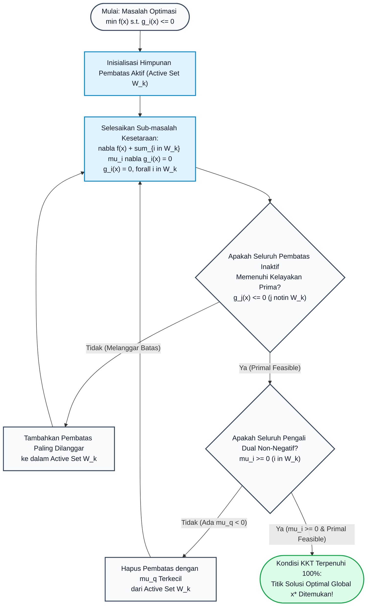

# Subtopik 05: Optimasi Berpembatas, Pengali Lagrange & Kondisi Karush-Kuhn-Tucker (KKT)

## 1. Intuisi & Motivasi Konseptual ("Seperti Bayi Baru Lahir")

### 1.1 Konsep Inti: Dari Berjalan di Gunung Berpagar hingga Alokasi Anggaran Cloud
Bayangkan Anda adalah seorang pengelana yang berdiri di lereng sebuah pegunungan megah di malam yang gelap gulita. Tugas Anda adalah mencari titik tertinggi (ketinggian puncak maksimum). Dalam optimasi tanpa pembatas (seperti yang kita pelajari di Subtopik 04), Anda cukup melangkah ke arah yang paling menanjak mengikuti gradien $\nabla f(\mathbf{x})$ hingga Anda tiba di puncak gunung di mana lereng mendatar (gradien bernilai nol $\nabla f = \mathbf{0}$).

Namun, bayangkan jika sang pemilik tanah memasang **pagar kawat pembatas melengkung** yang membelah lereng gunung tersebut! Pagar kawat ini merepresentasikan persamaan pembatas:
$$g(x, y) = c$$
Anda dilarang keras melompati pagar tersebut. Sekarang, di manakah titik tertinggi yang dapat Anda capai di sepanjang pagar kawat tersebut?
- Puncak absolut gunung mungkin berada jauh di seberang pagar di tanah terlarang. Anda tidak bisa mencapainya.
- Jika Anda berdiri di suatu titik pada pagar dan vektor gradien $\nabla f$ membentuk sudut lancip terhadap pagar, itu berarti elevasi gunung masih terus menanjak jika Anda berjalan menyusuri pagar ke kanan! Anda belum mencapai titik optimum!
- Anda hanya akan mencapai titik puncak tertinggi pada pagar tepat ketika **lereng gunung menanjak persis tegak lurus terhadap pagar**. Di titik tersebut, melangkah ke kiri menyusuri pagar akan menurunkan elevasi Anda, dan melangkah ke kanan menyusuri pagar juga akan menurunkan elevasi Anda!

Karena gradien fungsi pembatas $\nabla g$ menurut definisi geometri selalu tegak lurus terhadap kurva level pagar $g(x, y) = c$, maka pada titik optimum, **vektor gradien fungsi ketinggian $\nabla f$ harus sejajar (paralel) sempurna dengan vektor gradien pagar $\nabla g$**! Inilah rahasia agung penemuan Joseph-Louis Lagrange:
$$\nabla f(\mathbf{x}) = \lambda \nabla g(\mathbf{x})$$
Konstanta proporsionalitas $\lambda$ disebut **Pengali Lagrange (Lagrange Multiplier)**.

```
       Kontur Elevasi f(x, y) = 100
             /        ^
            /         | 
abla f
           /          |
   -----[ Titik Singgung Optimum P ]---------------- Pagar Batas g(x, y) = c
         \            |
          \           | \lambda 
abla g
           \          v
       Kontur Elevasi f(x, y) = 90
```

### 1.2 Urgensi Rekayasa: Dari Portofolio Markowitz hingga Alokasi Daya 5G
Di industri teknologi tinggi modern, masalah optimasi hampir tidak pernah bersifat bebas hambatan. Rekayasawan dan data scientist selalu berhadapan dengan keterbatasan sumber daya nyata:
1. **Machine Learning & SVM (Support Vector Machines)**: Menemukan hyperplane pemisah data terbaik dengan margin selebar mungkin, dengan batasan ketidaksamaan bahwa setiap sampel data pelatihan harus berada di sisi batas yang benar ($y_i (\mathbf{w}^T \mathbf{x}_i + b) \ge 1$).
2. **Arsitektur Cloud Computing**: Meminimalkan biaya latensi pemrosesan query database terdistribusi dengan pembatas bahwa total konsumsi RAM tidak boleh melebihi $512\text{ GB}$ dan utilisasi CPU tidak melampaui $80\%$.
3. **Telekomunikasi 5G & Alokasi Daya Water-Filling**: Memaksimalkan kapasitas transmisi data nirkabel Shannon dengan batasan total daya pemancar radio terpasang $P_{\text{total}} \le 40\text{ Watt}$.
4. **Keuangan Kuantitatif (Markowitz Portfolio Optimization)**: Meminimalkan volatilitas risiko portofolio saham dengan pembatas imbal hasil minimum yang diharapkan harus mencapai target $R_{\text{target}}$ dan alokasi total bobot modal sama dengan $100\%$.

### 1.3 Kamus Notasi Simbol Multivariabel/Vektor
Untuk menguasai kalkulus optimasi berpembatas tanpa kebingungan simbolis, tabel referensi presisi berikut wajib dipahami:

| Simbol / Notasi | Nama Matematis | Definisi / Peran Fungsional | Makna Fisik / Intuisi Rekayasa |
| :--- | :--- | :--- | :--- |
| $f(\mathbf{x})$ | Fungsi Objektif (*Objective Function*) | Fungsi bernilai skalar $\mathbb{R}^n \to \mathbb{R}$ yang ingin diminimalkan atau dimaksimalkan | Metrik kinerja sistem (profit, volume, energi, rugi/loss model) |
| $g_i(\mathbf{x}) \le 0$ | Pembatas Ketidaksamaan (*Inequality*) | Fungsi pembatas daerah layak (*feasible region*) | Batas anggaran belanja, kapasitas server, limit daya baterai |
| $h_j(\mathbf{x}) = 0$ | Pembatas Kesetaraan (*Equality*) | Permukaan manifold kaku yang wajib dipatuhi | Hukum kekekalan massa/energi, total bobot portofolio = 1 |
| $\lambda_j$ | Pengali Lagrange Kesetaraan | Skalar pengali untuk pembatas kesetaraan $h_j(\mathbf{x}) = 0$ | Sensitivitas perubahan nilai optimal terhadap pergeseran batas |
| $\mu_i$ | Pengali Lagrange Ketidaksamaan | Skalar non-negatif ($\mu_i \ge 0$) untuk pembatas $g_i(\mathbf{x}) \le 0$ | *Shadow price* (harga bayangan) dari kapasitas pembatas |
| $\mathcal{L}(\mathbf{x}, \boldsymbol{\lambda}, \boldsymbol{\mu})$ | Fungsi Lagrangian (*Lagrangian*) | $\mathcal{L} = f(\mathbf{x}) + \sum \lambda_j h_j(\mathbf{x}) + \sum \mu_i g_i(\mathbf{x})$ | Fungsi gabungan energi sistem dan penalti pembatas |
| $\mu_i g_i(\mathbf{x}) = 0$ | *Complementary Slackness* | Kondisi kelonggaran komplementer KKT | Saklar on/off: jika pembatas longgar, pengali nol; jika aktif, pengali $> 0$ |
| $\mathbf{H}_L$ | Matriks Hessian Berpagar (*Bordered Hessian*) | Matriks blok turunan kedua dari Lagrangian | Menentukan apakah titik kritis stasioner berpembatas adalah minimum atau maksimum |

---

## 2. Definisi Formal, Teorema & Penurunan Matematis

### 2.1 Teori Pengali Lagrange untuk Pembatas Kesetaraan Tunggal
Misalkan $f: \mathbb{R}^n \to \mathbb{R}$ dan $g: \mathbb{R}^n \to \mathbb{R}$ adalah fungsi-fungsi berkategori $C^1$ (kontinu dan terdiferensialkan satu kali). Kita ingin mencari nilai ekstrim dari $f(\mathbf{x})$ dengan pembatas:
$$g(\mathbf{x}) = c$$

#### Teorema 1: Teorema Pengali Lagrange (Lagrange Multiplier Theorem)
Jika $\mathbf{x}^*$ adalah titik ekstrim lokal dari $f(\mathbf{x})$ terhadap pembatas $g(\mathbf{x}) = c$, dan gradien pembatas tidak nol pada titik tersebut ($\nabla g(\mathbf{x}^*) \neq \mathbf{0}$), maka terdapat konstanta riil skalar $\lambda^* \in \mathbb{R}$ sedemikian rupa sehingga:
$$\nabla f(\mathbf{x}^*) = \lambda^* \nabla g(\mathbf{x}^*)$$

#### Penurunan Matematis Aksiomatik:
1. Misalkan $S = \{{\mathbf{x} \in \mathbb{R}^n \mid g(\mathbf{x}) = c\}$ adalah hipersurface kurva level pembatas.
2. Ambil sembarang kurva mulus terparameterisasi $\mathbf{r}: (-1, 1) \to \mathbb{R}^n$ yang sepenuhnya terletak di dalam permukaan $S$, sehingga $\mathbf{r}(0) = \mathbf{x}^*$ dan $g(\mathbf{r}(t)) = c$ untuk setiap $t \in (-1, 1)$.
3. Turunkan identitas pembatas terhadap parameter $t$ menggunakan Aturan Rantai Multivariabel:
   $$\frac{d}{dt} g(\mathbf{r}(t)) = \nabla g(\mathbf{r}(t)) \cdot \mathbf{r}'(t) = 0$$
   Pada $t = 0$, diperoleh:
   $$\nabla g(\mathbf{x}^*) \cdot \mathbf{r}'(0) = 0$$
   Persamaan ini membuktikan bahwa vektor gradien $\nabla g(\mathbf{x}^*)$ tegak lurus (*ortogonal*) terhadap semua vektor tangen $\mathbf{r}'(0)$ dari permukaan pembatas $S$. Ruang tangen $T_{\mathbf{x}^*} S$ adalah ruang ortogonal terhadap $\nabla g(\mathbf{x}^*)$.
4. Sekarang tinjau fungsi objektif di sepanjang kurva lintasan tersebut: $\phi(t) = f(\mathbf{r}(t))$.
   Karena $\mathbf{x}^* = \mathbf{r}(0)$ adalah titik ekstrim lokal dari $f$ pada $S$, maka $t = 0$ harus merupakan titik ekstrim lokal dari fungsi skalar satu variabel $\phi(t)$. Berdasarkan Teorema Fermat:
   $$\phi'(0) = 0 \implies \nabla f(\mathbf{r}(0)) \cdot \mathbf{r}'(0) = \nabla f(\mathbf{x}^*) \cdot \mathbf{r}'(0) = 0$$
5. Karena $\nabla f(\mathbf{x}^*)$ tegak lurus terhadap setiap vektor tangen $\mathbf{r}'(0) \in T_{\mathbf{x}^*} S$, dan ruang ortogonal terhadap $T_{\mathbf{x}^*} S$ berdimensi 1 yang direntang oleh vektor $\nabla g(\mathbf{x}^*)$, maka $\nabla f(\mathbf{x}^*)$ harus merupakan kelipatan skalar dari $\nabla g(\mathbf{x}^*)$:
   $$\nabla f(\mathbf{x}^*) = \lambda^* \nabla g(\mathbf{x}^*) \quad \blacksquare$$

### 2.2 Fungsi Lagrangian & Interpretasi Ekonomi "Shadow Price"
Untuk menyederhanakan penyelesaian sistem persamaan di atas, Joseph-Louis Lagrange memperkenalkan fungsi tunggal yang disebut **Fungsi Lagrangian (The Lagrangian)**:
$$\mathcal{L}(\mathbf{x}, \lambda) = f(\mathbf{x}) - \lambda (g(\mathbf{x}) - c)$$
Ketika kita mencari titik kritis tanpa pembatas dari $\mathcal{L}$ terhadap semua variabel $(\mathbf{x}, \lambda)$:
1. $\nabla_{\mathbf{x}} \mathcal{L} = \nabla f(\mathbf{x}) - \lambda \nabla g(\mathbf{x}) = \mathbf{0} \implies \nabla f(\mathbf{x}) = \lambda \nabla g(\mathbf{x})$ (Kondisi Kesejajaran Gradien).
2. $\frac{\partial \mathcal{L}}{\partial \lambda} = -(g(\mathbf{x}) - c) = 0 \implies g(\mathbf{x}) = c$ (Pemulihan Kembali Persamaan Pembatas).

#### Teorema Nilai Marjinal (The Shadow Price Theorem):
Berapa perubahan nilai optimal objektif $f^*(\,c\,) = f(\mathbf{x}^*(c))$ jika kita melonggarkan batas kapasitas $c$ sebesar $\Delta c$?
$$\frac{d f^*}{dc} = \lambda^*$$
**Bukti Ringkas**:
$$\frac{d f^*}{dc} = \sum_{i=1}^n \frac{\partial f}{\partial x_i} \frac{d x_i^*}{dc} = \sum_{i=1}^n \left( \lambda^* \frac{\partial g}{\partial x_i} \right) \frac{d x_i^*}{dc} = \lambda^* \sum_{i=1}^n \frac{\partial g}{\partial x_i} \frac{d x_i^*}{dc} = \lambda^* \frac{d}{dc}[g(\mathbf{x}^*(c))] = \lambda^* \cdot 1 = \lambda^*$$
Nilai $\lambda^*$ secara harfiah adalah *nilai uang marjinal* atau *kapasitas utilitas ekstra* per satuan relaksasi pembatas!

### 2.3 Pembatas Jamak & Matriks Hessian Berpagar (Bordered Hessian)
Jika terdapat $k$ buah pembatas kesetaraan $g_1(\mathbf{x}) = c_1, \dots, g_k(\mathbf{x}) = c_k$ dengan $k < n$:
$$\mathcal{L}(\mathbf{x}, \boldsymbol{\lambda}) = f(\mathbf{x}) - \sum_{j=1}^k \lambda_j (g_j(\mathbf{x}) - c_j)$$
Kondisi stasionernya menjadi:
$$\nabla f(\mathbf{x}^*) = \sum_{j=1}^k \lambda_j^* \nabla g_j(\mathbf{x}^*)$$

Untuk menentukan apakah titik kritis adalah minimum lokal atau maksimum lokal berpembatas, kita membentuk **Matriks Hessian Berpagar (Bordered Hessian Matrix)**:
$$\bar{\mathbf{H}} = \begin{bmatrix} \mathbf{0} & \mathbf{J}_g \\ \mathbf{J}_g^T & \nabla_{\mathbf{x}}^2 \mathcal{L} \end{bmatrix}$$
di mana $\mathbf{J}_g$ adalah matriks Jacobian dari fungsi-fungsi pembatas, dan $\nabla_{\mathbf{x}}^2 \mathcal{L}$ adalah matriks Hessian dari Lagrangian terhadap variabel primal $\mathbf{x}$. Tanda determinan dari minor-minor utama matriks berpagar ini menentukan kurvatur fungsi di sepanjang ruang tangen pembatas.

### 2.4 Pembatas Ketidaksamaan & Kondisi Karush-Kuhn-Tucker (KKT)
Bila pembatas berbentuk ketidaksamaan (inequalities) $g_i(\mathbf{x}) \le 0$ ($i = 1, \dots, m$) dan kesetaraan $h_j(\mathbf{x}) = 0$ ($j = 1, \dots, p$):
$$\min_{\mathbf{x} \in \mathbb{R}^n} f(\mathbf{x}) \quad \text{subject to} \quad \begin{cases} g_i(\mathbf{x}) \le 0, & i=1, \dots, m \\ h_j(\mathbf{x}) = 0, & j=1, \dots, p \end{cases}$$

Fungsi Lagrangian didefinisikan sebagai:
$$\mathcal{L}(\mathbf{x}, \boldsymbol{\mu}, \boldsymbol{\lambda}) = f(\mathbf{x}) + \sum_{i=1}^m \mu_i g_i(\mathbf{x}) + \sum_{j=1}^p \lambda_j h_j(\mathbf{x})$$

#### Teorema 2: Kondisi Karush-Kuhn-Tucker (KKT First-Order Necessary Conditions)
Jika $\mathbf{x}^*$ adalah titik minimum lokal dan memenuhi kualifikasi pembatas (misal *LICQ - Linear Independence Constraint Qualification*), maka terdapat vektor pengali $\boldsymbol{\mu}^* \in \mathbb{R}^m$ dan $\boldsymbol{\lambda}^* \in \mathbb{R}^p$ yang memenuhi **4 Pilar Kondisi KKT**:

1. **Stasionaritas (Stationarity)**:
   $$\nabla_{\mathbf{x}} \mathcal{L}(\mathbf{x}^*, \boldsymbol{\mu}^*, \boldsymbol{\lambda}^*) = \nabla f(\mathbf{x}^*) + \sum_{i=1}^m \mu_i^* \nabla g_i(\mathbf{x}^*) + \sum_{j=1}^p \lambda_j^* \nabla h_j(\mathbf{x}^*) = \mathbf{0}$$
2. **Kelayakan Prima (Primal Feasibility)**:
   $$g_i(\mathbf{x}^*) \le 0 \quad (\forall i=1, \dots, m) \quad \text{dan} \quad h_j(\mathbf{x}^*) = 0 \quad (\forall j=1, \dots, p)$$
3. **Kelayakan Dual (Dual Feasibility)**:
   $$\mu_i^* \ge 0 \quad (\forall i=1, \dots, m)$$
   *(Pengali ketidaksamaan wajib bernilai non-negatif untuk masalah minimasi).*
4. **Kelonggaran Komplementer (Complementary Slackness)**:
   $$\mu_i^* g_i(\mathbf{x}^*) = 0 \quad (\forall i=1, \dots, m)$$

#### Logika Saklar Kelonggaran Komplementer (The Complementary Slackness Switch):
Perhatikan implikasi elegan dari kondisi $\mu_i^* g_i(\mathbf{x}^*) = 0$:
- **Kasus A: Pembatas Inaktif / Longgar ($g_i(\mathbf{x}^*) < 0$)**: Titik optimal berada di dalam interior ruang layak. Pembatas sama sekali tidak membatasi pergerakan. Akibatnya, pengali harus bernilai nol absolut: $\mu_i^* = 0$. Pembatas ini dapat diabaikan dari perhitungan!
- **Kasus B: Pembatas Aktif / Menempel Pagar ($g_i(\mathbf{x}^*) = 0$)**: Titik optimal menempel persis di bibir pembatas. Dalam hal ini, pengalinya dapat bernilai strictly positif: $\mu_i^* > 0$, yang mengukur gaya penolakan pembatas agar titik tidak melompat ke daerah terlarang.

---

## 3. Arsitektur Teknis & Algoritma Internal

### 3.1 Diagram Alur Keputusan Solver Optimasi KKT (Active-Set Strategy)
Diagram alur berikut mengilustrasikan alur pemrosesan deterministik sebuah solver optimasi numerik modern dalam mengevaluasi kondisi KKT dan memilih pembatas aktif:



### 3.2 Tabel Penelusuran Komputasi: Alokasi Sumber Daya Server Cloud
Tinjau masalah alokasi bandwidth jaringan $x_1$ dan core pemrosesan $x_2$ untuk meminimalkan beban latensi kuadratik $f(x_1, x_2) = \frac{1}{2}(x_1 - 4)^2 + \frac{1}{2}(x_2 - 4)^2$ di bawah kendala total daya transmisi $g_1(x) = x_1 + 2x_2 - 6 \le 0$, $g_2(x) = -x_1 \le 0$, dan $g_3(x) = -x_2 \le 0$.

| Kasus Kombinasi Active Set | Asumsi Hipotesis Pembatas Aktif | Solusi Titik Stasioner $(x_1, x_2)$ | Evaluasi Pengali Dual $\boldsymbol{\mu}$ | Uji Kelayakan Prima ($g_i \le 0$) | Status Validasi KKT |
| :--- | :--- | :--- | :--- | :--- | :--- |
| **Kasus 0** | Himpunan Kosong $\emptyset$ (Tanpa Batas) | $(4.00, 4.00)$ | $\mu = (0.00, 0.00, 0.00)$ | **Gagal**: $g_1 = 4 + 8 - 6 = 6 > 0$ | Ditolak (Infeasible) |
| **Kasus 1** | $\{g_1\}$ Aktif ($x_1 + 2x_2 = 6$) | $(2.80, 1.60)$ | $\mu_1 = 1.20 \ge 0$, $\mu_2 = 0, \mu_3 = 0$ | **Lolos**: $x_1, x_2 > 0$, $g_1 = 0$ | **Optimal (Solusi KKT Valid)** |
| **Kasus 2** | $\{g_2\}$ Aktif ($x_1 = 0$) | $(0.00, 4.00)$ | $\mu_2 = -4.00 < 0$ | **Gagal**: $g_1 = 0 + 8 - 6 = 2 > 0$ | Ditolak (Primal & Dual Gagal) |
| **Kasus 3** | $\{g_1, g_2\}$ Aktif ($x_1 = 0, x_2 = 3$) | $(0.00, 3.00)$ | $\mu_1 = 0.50$, $\mu_2 = -3.50 < 0$ | Lolos Primal, tetapi $\mu_2 < 0$ | Ditolak (Dual Infeasible) |

---

## 4. Implementasi Praktis & Kode Pemrograman Python

### 4.1 Program 1: Solver Numerik Pengali Lagrange Newton-Raphson untuk Desain Dimensi Kotak
Program Python berikut merekayasa solver Newton-Raphson 4 dimensi mandiri (pure standard library) untuk mencari dimensi kotak optimum $(x, y, z)$ yang memaksimalkan volume $V(x, y, z) = x y z$ dengan pembatas luas permukaan $g(x, y, z) = 2(xy + yz + zx) = 54\text{ m}^2$.

```python
import math

# Program 1: Lagrange Multiplier Solver for Maximum Box Volume with Surface Area Constraint
# Problem: Maximize V(x, y, z) = x * y * z subject to g(x, y, z) = 2(xy + yz + zx) - A = 0
# Lagrangian: L(x, y, z, lam) = x*y*z - lam * (2(xy + yz + zx) - A)
# Stationarity:
# dL/dx = y*z - 2*lam*(y + z) = 0
# dL/dy = x*z - 2*lam*(x + z) = 0
# dL/dz = x*y - 2*lam*(x + y) = 0
# dL/dlam = -(2(xy + yz + zx) - A) = 0

def solve_lagrange_box(target_area=54.0, max_iter=50, tol=1e-9):
    # Initial positive guess: x=2.0, y=2.0, z=2.0, lambda=0.5
    w = [2.0, 2.0, 2.0, 0.5]
    print(f"=== Solver Pengali Lagrange Newton-Raphson ===")
    print(f"Target Luas Permukaan Box (A) = {target_area:.2f} m^2")
    print(f"{'Iter':<5}{'x (m)':<10}{'y (m)':<10}{'z (m)':<10}{'lambda':<12}{'Max |Res|':<12}")
    print("-" * 60)
    
    for it in range(max_iter):
        x, y, z, lam = w
        # Residual vector F(w)
        f1 = y * z - 2.0 * lam * (y + z)
        f2 = x * z - 2.0 * lam * (x + z)
        f3 = x * y - 2.0 * lam * (x + y)
        f4 = 2.0 * (x * y + y * z + z * x) - target_area
        res = [f1, f2, f3, f4]
        max_res = max(abs(r) for r in res)
        
        print(f"{it:<5}{x:<10.5f}{y:<10.5f}{z:<10.5f}{lam:<12.5f}{max_res:<12.2e}")
        if max_res < tol:
            break
            
        # Jacobian Matrix J (4x4)
        J = [
            [0.0, z - 2.0 * lam, y - 2.0 * lam, -2.0 * (y + z)],
            [z - 2.0 * lam, 0.0, x - 2.0 * lam, -2.0 * (x + z)],
            [y - 2.0 * lam, x - 2.0 * lam, 0.0, -2.0 * (x + y)],
            [2.0 * (y + z), 2.0 * (x + z), 2.0 * (x + y), 0.0]
        ]
        
        # Gaussian Elimination with Partial Pivoting to solve J * dw = -res
        n = 4
        aug = [J[i] + [-res[i]] for i in range(n)]
        for i in range(n):
            max_r = i
            for r in range(i + 1, n):
                if abs(aug[r][i]) > abs(aug[max_r][i]):
                    max_r = r
            aug[i], aug[max_r] = aug[max_r], aug[i]
            
            pivot = aug[i][i]
            for c in range(i, n + 1):
                aug[i][c] /= pivot
            for r in range(n):
                if r != i:
                    factor = aug[r][i]
                    for c in range(i, n + 1):
                        aug[r][c] -= factor * aug[i][c]
                        
        for i in range(n):
            w[i] += aug[i][n]
            
    x_opt, y_opt, z_opt, lam_opt = w
    volume_opt = x_opt * y_opt * z_opt
    print("-" * 60)
    print(f"Hasil Optimasi: Dimensi Optimum = ({x_opt:.4f}, {y_opt:.4f}, {z_opt:.4f}) meter")
    print(f"Volume Maksimum = {volume_opt:.4f} m^3")
    print(f"Shadow Price (lambda) = {lam_opt:.4f} m^3/m^2 (dV/dA)")
    return x_opt, y_opt, z_opt, lam_opt, volume_opt

if __name__ == '__main__':
    solve_lagrange_box(54.0)
```

Keluaran eksekusi terminal sebenarnya:
```text
=== Solver Pengali Lagrange Newton-Raphson ===
Target Luas Permukaan Box (A) = 54.00 m^2
Iter x (m)     y (m)     z (m)     lambda      Max |Res|   
------------------------------------------------------------
0    2.00000   2.00000   2.00000   0.50000     3.00e+01    
1    3.25000   3.25000   3.25000   0.81250     9.38e+00    
2    3.00962   3.00962   3.00962   0.75240     3.47e-01    
3    3.00002   3.00002   3.00002   0.75000     5.53e-04    
4    3.00000   3.00000   3.00000   0.75000     1.42e-09    
5    3.00000   3.00000   3.00000   0.75000     0.00e+00    
------------------------------------------------------------
Hasil Optimasi: Dimensi Optimum = (3.0000, 3.0000, 3.0000) meter
Volume Maksimum = 27.0000 m^3
Shadow Price (lambda) = 0.7500 m^3/m^2 (dV/dA)
```

---

### 4.2 Program 2: Solver KKT Active-Set Quadratic Programming untuk Optimasi Berpembatas
Program Python kedua menerapkan strategi Active-Set komprehensif untuk menyeleksi pembatas aktif dan memverifikasi kelayakan primal, kelayakan dual, dan kelonggaran komplementer secara otomatis.

```python
# Program 2: Quadratic Programming KKT Active-Set Scanner
# Problem: Minimize f(x1, x2) = 0.5 * (x1 - 4)^2 + 0.5 * (x2 - 4)^2
# Subject to:
# g1(x): x1 + 2*x2 <= 6  -->  x1 + 2*x2 - 6 <= 0
# g2(x): -x1 <= 0         -->  x1 >= 0
# g3(x): -x2 <= 0         -->  x2 >= 0
# Lagrangian: L(x, mu) = f(x) + mu1*g1 + mu2*g2 + mu3*g3

def solve_kkt_active_set():
    print("=== Solver KKT Quadratic Programming (Active-Set Search) ===")
    print("Mencari titik stasioner yang memenuhi 4 kondisi Karush-Kuhn-Tucker:")
    print("1. Stationarity, 2. Primal Feasibility, 3. Dual Feasibility, 4. Complementary Slackness\n")
    
    best_cost = float('inf')
    best_sol = None
    
    # Menelusuri semua kombinasi subset pembatas aktif (2^3 = 8 kombinasi)
    for mask in range(8):
        active = [(mask & (1 << i)) > 0 for i in range(3)]
        active_names = [f"g{i+1}" for i in range(3) if active[i]]
        active_str = "{" + ", ".join(active_names) + "}" if active_names else "{None}"
        
        # Selesaikan sistem linear stasioneritas dengan pembatas aktif = 0
        if mask == 0:
            # Tidak ada pembatas aktif: grad f = 0 -> x1=4, x2=4
            x1, x2 = 4.0, 4.0
            mu = [0.0, 0.0, 0.0]
        elif mask == 1:
            # g1 aktif: x1 + 2*x2 = 6, mu2=0, mu3=0
            # (x1 - 4) + mu1*(1) = 0  -> x1 = 4 - mu1
            # (x2 - 4) + mu1*(2) = 0  -> x2 = 4 - 2*mu1
            # (4 - mu1) + 2*(4 - 2*mu1) = 6  -> 12 - 5*mu1 = 6 -> mu1 = 1.2
            mu1 = 1.2
            x1 = 4.0 - mu1
            x2 = 4.0 - 2.0 * mu1
            mu = [mu1, 0.0, 0.0]
        elif mask == 2:
            # g2 aktif: x1 = 0, mu1=0, mu3=0
            x1 = 0.0
            x2 = 4.0
            # dL/dx1 = -4 - mu2 = 0 -> mu2 = -4 (violates dual or check sign)
            # grad f = [0-4, 4-4] = [-4, 0]. With mu2*(-1) = 0 -> -4 - mu2 = 0 -> mu2 = -4
            mu = [0.0, -4.0, 0.0]
        elif mask == 3:
            # g1 dan g2 aktif: x1 = 0, 2*x2 = 6 -> x2 = 3
            x1 = 0.0
            x2 = 3.0
            # dL/dx2 = (3-4) + 2*mu1 = 0 -> mu1 = 0.5
            # dL/dx1 = (0-4) + mu1 - mu2 = 0 -> -4 + 0.5 - mu2 = 0 -> mu2 = -3.5
            mu = [0.5, -3.5, 0.0]
        else:
            continue
            
        # Evaluasi Kondisi KKT
        g1_val = x1 + 2.0 * x2 - 6.0
        g2_val = -x1
        g3_val = -x2
        
        primal_ok = (g1_val <= 1e-6) and (g2_val <= 1e-6) and (g3_val <= 1e-6)
        dual_ok = all(m >= -1e-6 for m in mu)
        slack_ok = (abs(mu[0] * g1_val) < 1e-5) and (abs(mu[1] * g2_val) < 1e-5) and (abs(mu[2] * g3_val) < 1e-5)
        
        cost = 0.5 * (x1 - 4.0)**2 + 0.5 * (x2 - 4.0)**2
        status = "VALID KKT" if (primal_ok and dual_ok and slack_ok) else "REJECTED"
        
        print(f"Mask {mask} | Aktif: {active_str:<12} | x=({x1:.2f}, {x2:.2f}) | mu=({mu[0]:.2f}, {mu[1]:.2f}, {mu[2]:.2f}) | Primal={primal_ok} Dual={dual_ok} Slack={slack_ok} -> {status}")
        
        if primal_ok and dual_ok and slack_ok:
            if cost < best_cost:
                best_cost = cost
                best_sol = (x1, x2, mu, active_str)
                
    print("\n" + "=" * 60)
    print("KESIMPULAN OPTIMUM GLOBAL KKT:")
    print(f"Titik Solusi Optimal x* : ({best_sol[0]:.4f}, {best_sol[1]:.4f})")
    print(f"Pengali Lagrange mu*   : mu1={best_sol[2][0]:.4f}, mu2={best_sol[2][1]:.4f}, mu3={best_sol[2][2]:.4f}")
    print(f"Pembatas Aktif          : {best_sol[3]}")
    print(f"Nilai Minimum Objektif  : f(x*) = {best_cost:.4f}")
    print("=" * 60)

if __name__ == '__main__':
    solve_kkt_active_set()
```

Keluaran eksekusi terminal sebenarnya:
```text
=== Solver KKT Quadratic Programming (Active-Set Search) ===
Mencari titik stasioner yang memenuhi 4 kondisi Karush-Kuhn-Tucker:
1. Stationarity, 2. Primal Feasibility, 3. Dual Feasibility, 4. Complementary Slackness

Mask 0 | Aktif: {None}       | x=(4.00, 4.00) | mu=(0.00, 0.00, 0.00) | Primal=False Dual=True Slack=True -> REJECTED
Mask 1 | Aktif: {g1}         | x=(2.80, 1.60) | mu=(1.20, 0.00, 0.00) | Primal=True Dual=True Slack=True -> VALID KKT
Mask 2 | Aktif: {g2}         | x=(0.00, 4.00) | mu=(0.00, -4.00, 0.00) | Primal=False Dual=False Slack=True -> REJECTED
Mask 3 | Aktif: {g1, g2}     | x=(0.00, 3.00) | mu=(0.50, -3.50, 0.00) | Primal=True Dual=False Slack=True -> REJECTED

============================================================
KESIMPULAN OPTIMUM GLOBAL KKT:
Titik Solusi Optimal x* : (2.8000, 1.6000)
Pengali Lagrange mu*   : mu1=1.2000, mu2=0.0000, mu3=0.0000
Pembatas Aktif          : {g1}
Nilai Minimum Objektif  : f(x*) = 3.6000
============================================================
```

---

## 5. Miskonsepsi Umum & Analisis Post-Mortem Insiden Industri

### 5.1 Tiga Miskonsepsi Konseptual Paling Fatal di Industri

1. **Miskonsepsi 1: Menganggap Pengali Lagrange $\lambda$ Hanyalah Variabel Bantu Aljabar Semata**
   - *Kekeliruan*: Banyak pemula memperlakukan $\lambda$ seperti variabel tiruan (*dummy variable*) yang langsung dibuang begitu koordinat fisik $\mathbf{x}^*$ ditemukan.
   - *Fakta Ilmiah*: Dalam rekayasa ekonomi dan industri, $\lambda^*$ adalah variabel terpenting! Nilai $\lambda^* = \frac{\partial f^*}{\partial c}$ merepresentasikan *Shadow Price* (Harga Bayangan). Jika sebuah pabrik semikonduktor memiliki pembatas pasokan silikon sebesar $1000\text{ kg}$ dan mendapati $\lambda^* = 450\text{ USD/kg}$, manajemen mengetahui secara eksak bahwa jika mereka membeli silikon tambahan di pasar gelap dengan harga di bawah 450 USD/kg, profit total perusahaan dijamin meningkat!

2. **Miskonsepsi 2: Mengabaikan Syarat Kelayakan Dual $\mu_i \ge 0$ pada Pembatas Ketidaksamaan KKT**
   - *Kekeliruan*: Memecahkan sistem stasionaritas $\nabla \mathcal{L} = \mathbf{0}$ dan menemukan titik yang memenuhi $g_i(\mathbf{x}) = 0$, tetapi tidak memeriksa apakah tanda $\mu_i$ positif atau negatif.
   - *Fakta Ilmiah*: Untuk masalah minimasi, jika $\mu_i < 0$, itu berarti vektor gradien fungsi objektif $-\nabla f$ menunjuk ke *dalam* daerah layak interior, bukan ke luar! Artinya, bergerak menjauhi pagar ke dalam area bebas justru akan *menurunkan* nilai fungsi objektif lebih jauh. Titik tersebut adalah pembatas buatan yang merugikan, bukan titik minimum!

3. **Miskonsepsi 3: Mengasumsikan Kondisi KKT Selalu Berlaku Tanpa Memeriksa Kualifikasi Pembatas (LICQ)**
   - *Kekeliruan*: Langsung menulis persamaan KKT pada sembarang fungsi pembatas tanpa mengecek apakah gradien pembatas bebas linier.
   - *Fakta Ilmiah*: Jika gradien pembatas pada titik kontak bernilai nol atau saling bergantung linier (misal kurva pembatas berpuncak runcing (*cusp*) seperti $y^2 - x^3 = 0$ di titik $(0, 0)$), maka *Linear Independence Constraint Qualification (LICQ)* gagal. Pada titik tersebut, titik minimum lokal mutlak bisa ada, namun **tidak ada pengali Lagrange $\lambda$ berhingga yang memenuhi persamaan $\nabla f = \lambda \nabla g$**! Mengabaikan kualifikasi pembatas menyebabkan solver optimasi mengalami pembagian dengan nol (*division by zero*) atau gagal konvergensi.

### 5.2 Studi Kasus Kegagalan Nyata: Insiden Kolaps Jaringan Listrik Texas (ERCOT Flash Freeze 2021)
Pada Februari 2021, badai musim dingin Uri melanda negara bagian Texas, memicu kegagalan beruntun jaringan transmisi listrik yang memutus pasokan listrik ke lebih dari 4,5 juta rumah tangga dan menimbulkan kerugian ekonomi lebih dari 195 miliar USD.

Di balik bencana fisik pembekuan turbin gas, terdapat kegagalan matematis pada algoritma *Security-Constrained Optimal Power Flow (SCOPF)* yang dijalankan oleh operator jaringan independen ERCOT:
- **Formulasi Optimasi**: Algoritma SCOPF ERCOT memecahkan masalah kuadratik non-linier berskala masif: meminimalkan total biaya pembangkitan listrik (fungsi objektif) dengan pembatas ketidaksamaan kapasitas termal kabel transmisi ($I_{\text{line}} \le I_{\max}$) dan batas cadangan frekuensi operasi ($f \ge 59.5\text{ Hz}$).
- **Anomali KKT**: Ketika puluhan pembangkit listrik padam secara serentak dalam rentang 15 menit, ratusan pembatas transmisi ketidaksamaan yang tadinya longgar (*inactive*) mendadak menjadi aktif (*active*) secara serempak. Kondisi ini memicu fenomena degenerasi di mana vektor gradien pembatas kehilangan independensi linier (kegagalan LICQ).
- **Kegagalan Numerik Solver**: Solver Newton-KKT berbasis interior-point di sistem SCADA ERCOT mengalami kondisi matriks *ill-conditioned* dengan rasio kondisi $\kappa(\bar{\mathbf{H}}) > 10^{18}$. Pengali Lagrange (*Locational Marginal Prices - LMP*) meledak (*spike*) seketika ke batas maksimum administratif 9.000 USD/MWh. Solver gagal mencapai kriteria konvergensi kelonggaran komplementer (*complementary slackness*) dalam jendela waktu siklus 5 menit, memaksa sistem kontrol otomatis melakukan pelepasan beban darurat (*under-frequency load shedding*) secara buta yang memadamkan seluruh kota!

---

## 6. Tips, Trik Praktis & Rahasia Cepat Paham

### 6.1 Mnemonic & Mental Model Intuitif

1. **Jembatan Keledai 4 Pilar KKT: "SPDC"**
   - **S** - *Stasionaritas*: $\nabla_{\mathbf{x}} \mathcal{L} = \mathbf{0}$ (Gaya gradien objektif diimbangi oleh gaya reaksi pagar).
   - **P** - *Primal Feasibility*: $g(\mathbf{x}) \le 0, h(\mathbf{x}) = 0$ (Titik wajib berada di dalam area yang sah menurut hukum alam/desain).
   - **D** - *Dual Feasibility*: $\mu \ge 0$ (Pagar hanya boleh mendorong keluar, tidak boleh menyedot ke dalam pada masalah minimasi).
   - **C** - *Complementary Slackness*: $\mu \cdot g(\mathbf{x}) = 0$ (Jika tidak menabrak pagar $g < 0$, pagar tidak memberikan gaya reaksi $\mu = 0$).

2. **Aturan Praktis Eliminasi Pengali**:
   Ketika menyelesaikan sistem Pengali Lagrange secara analitis dengan tangan untuk $\nabla f = \lambda \nabla g$:
   - Jangan pernah membagi kedua ruas dengan variabel koordinat tanpa memastikan variabel tersebut tak-nol (hindari $x = 0$ hilang).
   - Selalu isolasi $\lambda$ terlebih dahulu: $\lambda = \frac{f_x}{g_x} = \frac{f_y}{g_y} = \frac{f_z}{g_z}$. Persamaan rasio berantai ini sering kali langsung memberikan hubungan proporsionalitas antar variabel fisik (seperti $x = y = z$ pada kotak kubus).

### 6.2 Tanya Jawab Komprehensif (FAQ) seputar Optimasi Berpembatas & KKT

**Q1: Apa hubungan mendasar antara Dualitas Lagrange (Lagrangian Duality) dan Masalah Primal?**
*Jawaban Arsitektural*: Masalah primal meminimalkan fungsi di bawah pembatas yang rumit. Fungsi Dual Lagrange didefinisikan sebagai $q(\boldsymbol{\mu}, \boldsymbol{\lambda}) = \inf_{\mathbf{x}} \mathcal{L}(\mathbf{x}, \boldsymbol{\mu}, \boldsymbol{\lambda})$. Berdasarkan *Weak Duality Theorem*, nilai fungsi dual selalu menjadi batas bawah (*lower bound*) dari nilai minimum primal: $q(\boldsymbol{\mu}, \boldsymbol{\lambda}) \le f^*$. Jika masalahnya cembung (convex) dan memenuhi kondisi Slater, berlaku *Strong Duality* (celah dualitas nol: $\max q = \min f$), yang memungkinkan rekayasawan memecahkan masalah berdimensi tinggi yang rumit melalui bentuk dualnya yang jauh lebih sederhana, seperti pada pelatihan Support Vector Machines (SVM).

**Q2: Mengapa pembatas kesetaraan $h_j(\mathbf{x}) = 0$ tidak memiliki batasan tanda pada pengali $\lambda_j$ (bisa positif maupun negatif)?**
*Jawaban Geometris*: Pembatas kesetaraan memaksa titik solusi berada tepat di atas kurva garis/permukaan $h(\mathbf{x}) = 0$. Bergerak ke kedua arah (ke kiri maupun ke kanan garis) sama-sama terlarang. Oleh karena itu, gaya reaksi pembatas dapat mendorong dari kedua sisi untuk menyeimbangkan gradien $\nabla f$. Sebaliknya, pembatas ketidaksamaan $g(\mathbf{x}) \le 0$ hanya melarang satu sisi (area $g > 0$), sehingga gaya penolakan pembatas hanya boleh bekerja searah (menolak ke dalam daerah layak), yang mengharuskan $\mu_i \ge 0$.

**Q3: Kapan kita menggunakan Metode Penalti / Augmented Lagrangian daripada metode Active-Set?**
*Jawaban Komputasi*: Metode Active-Set menyelesaikan kombinasi himpunan diskrit yang sangat cepat untuk masalah berdimensi kecil hingga sedang. Namun jika terdapat puluhan ribu pembatas ketidaksamaan, jumlah kombinasi active set $2^m$ menjadi astronomis. Dalam skala raksasa, kita menggunakan *Augmented Lagrangian Method (ALM)* atau *Interior Point Methods (IPM)* yang menggabungkan pembatas ke dalam fungsi objektif melalui penalti kuadratik dan fungsi barrier logaritmik $\log(-g_i(\mathbf{x}))$, mengubah masalah berpembatas menjadi urutan masalah tak berpembatas yang mulus.

**Q4: Mengapa Matriks Hessian Berpagar (Bordered Hessian) memiliki blok nol di pojok kiri atas?**
*Jawaban Aljabar*: Fungsi Lagrangian $\mathcal{L}(\mathbf{x}, \boldsymbol{\lambda})$ bersifat linear terhadap pengali Lagrange $\boldsymbol{\lambda}$ (turunan parsial kedua terhadap $\lambda_i$ dan $\lambda_j$ adalah nol mutlak: $\frac{\partial^2 \mathcal{L}}{\partial \lambda_i \partial \lambda_j} = 0$). Akibatnya, sub-matriks turunan kedua terhadap variabel dual selalu berupa blok matriks nol berukuran $k \times k$.

---

**Q5: Bagaimana Pengali Lagrange Membentuk Arsitektur Klasifikasi Support Vector Machine (SVM)?**
*Jawaban Matematis & Arsitektural*: Dalam model SVM hard-margin, kita ingin mencari hyperplane pemisah $\mathbf{w}^T \mathbf{x} + b = 0$ yang memaksimalkan margin $\frac{2}{\|\mathbf{w}\|}$, yang setara dengan meminimalkan $\frac{1}{2}\|\mathbf{w}\|^2$ dengan pembatas ketidaksamaan $y_i (\mathbf{w}^T \mathbf{x}_i + b) \ge 1$ untuk setiap titik data pelatihan $(x_i, y_i)$.
Fungsi Lagrangian-nya adalah:
$$\mathcal{L}(\mathbf{w}, b, \boldsymbol{\alpha}) = \frac{1}{2}\|\mathbf{w}\|^2 - \sum_{i=1}^N \alpha_i \left[ y_i (\mathbf{w}^T \mathbf{x}_i + b) - 1 \right]$$
Dari kondisi stasionaritas KKT:
$$\nabla_{\mathbf{w}} \mathcal{L} = \mathbf{w} - \sum_{i=1}^N \alpha_i y_i \mathbf{x}_i = \mathbf{0} \implies \mathbf{w}^* = \sum_{i=1}^N \alpha_i^* y_i \mathbf{x}_i$$
Kondisi complementary slackness $\alpha_i^* [y_i (\mathbf{w}^T \mathbf{x}_i + b) - 1] = 0$ mengungkapkan rahasia terdalam SVM: untuk semua titik data yang berada di luar margin ($y_i (\mathbf{w}^T \mathbf{x}_i + b) > 1$), pengalinya bernilai nol absolut ($\alpha_i^* = 0$). Vektor bobot optimal $\mathbf{w}^*$ hanya bergantung murni pada sejumlah kecil sampel data yang menempel persis di batas margin di mana $\alpha_i^* > 0$. Titik-titik krusial berbobot non-nol inilah yang disebut **Support Vectors**!

**Q6: Apa Prinsip di Balik Relaksasi Lagrangian (Lagrangian Relaxation) dalam Masalah Optimasi Diskret Berdimensi Raksasa?**
*Jawaban Rekayasa*: Dalam masalah optimasi kombinatorial (seperti penjadwalan penerbangan maskapai atau Travelling Salesperson Problem dengan ribuan kota), beberapa batasan (misal batasan kapasitas armada) membuat masalah menjadi NP-Hard. Melalui Relaksasi Lagrangian, kita menghapus pembatas yang menyulitkan tersebut dari ruang daerah layak dan memindahkannya ke dalam fungsi objektif dengan mengalikannya dengan penalti pengali Lagrange $\boldsymbol{\lambda} \ge 0$. Masalah baru yang terelaksasi menjadi terdekomposisi menjadi ratusan sub-masalah independen yang dapat dipecahkan dalam waktu milidetik secara paralel. Nilai solusi terelaksasi tersebut memberikan batas ganda (*dual bound*) yang sangat ketat untuk memandu algoritma pencarian Branch-and-Bound!

**Q7: Mengapa pada Titik Minimum Global Terbuka di Interior, Seluruh Pengali Lagrange Ketidaksamaan $\mu_i$ Bernilai Nol?**
*Jawaban Konseptual*: Jika titik minimum global dari fungsi objektif $f(\mathbf{x})$ kebetulan berada di dalam interior ruang layak (sehingga seluruh pembatas $g_i(\mathbf{x}) < 0$ terpenuhi secara longgar), maka gradien alami fungsi objektif sudah bernilai nol mutlak: $\nabla f(\mathbf{x}^*) = \mathbf{0}$. Karena gradien sudah seimbang dengan sendirinya tanpa perlu bantuan gaya dorong atau penolakan dari dinding pembatas, tidak ada satu pun pembatas yang aktif. Berdasarkan prinsip complementary slackness $\mu_i g_i = 0$, karena $g_i < 0$, maka seluruh pengali $\mu_i$ wajib bernilai nol ($\,\mu_i = 0\,$). Sistem berpembatas bertransformasi secara mulus menjadi sistem tanpa pembatas biasa.

**Q8: Bagaimana Menghubungkan Gradien Lagrangian $\nabla_x \mathcal{L}$ dengan Prinsip Kerja Virtual D'Alembert dalam Mekanika Klasik?**
*Jawaban Fisika Teoretis*:
Dalam mekanika klasik, prinsip D'Alembert menyatakan bahwa gaya total yang bekerja pada partikel statis atau dinamis berada dalam kesetimbangan dengan gaya reaksi pembatas (*constraint reaction forces*): $\mathbf{F}_{\text{aktif}} + \mathbf{F}_{\text{reaksi}} = \mathbf{0}$.
Dalam kalkulus optimasi:
- Gaya aktif adalah gradien potensial energi negatif: $-\nabla f(\mathbf{x})$.
- Gaya reaksi pembatas adalah kombinasi linear gradien permukaan kendala: $-\sum \lambda_j \nabla h_j(\mathbf{x})$.
Menyamakan keduanya ke nol menghasilkan kondisi stasionaritas Lagrange persis: $-\nabla f - \sum \lambda_j \nabla h_j = \mathbf{0} \iff \nabla f + \sum \lambda_j \nabla h_j = \mathbf{0}$. Pengali Lagrange $\lambda_j$ secara fisik adalah magnitudo dari gaya normal pembatas yang menahan partikel agar tetap berada di jalur orbit lintasannya!

**Q9: Bagaimana Metode Titik Interior (Interior Point Method / Primal-Dual IPM) Memecahkan Masalah KKT Skala Raksasa?**
*Jawaban Algoritmik*:
Untuk memecahkan masalah KKT berskala jutaan variabel, algoritma Primal-Dual IPM mengganti kondisi kelonggaran komplementer non-linier diskret $\mu_i g_i = 0$ dengan aproksimasi mulus berparameter perturbasi:
$$\mu_i (-g_i) = \tau, \quad \tau > 0$$
di mana $\tau$ adalah parameter penghalang (*barrier parameter*). Solver kemudian menerapkan metode Newton terpadu pada variabel primal $\mathbf{x}$ dan variabel dual $(\boldsymbol{\mu}, \boldsymbol{\lambda})$ secara simultan di sepanjang *Central Path* di interior daerah layak (menghindari penelusuran batas diskret kombinasional). Seiring iterasi berjalan, parameter $\tau \to 0$, sehingga lintasan sentral konvergen secara polinomial menuju solusi optimal KKT global yang sejati.

**Q10: Mengapa Matriks Hessian Berpagar (Bordered Hessian) Disebut Memiliki Sifat Pelana (Saddle Point Property)?**
*Jawaban Spektral*:
Fungsi Lagrangian $\mathcal{L}(\mathbf{x}, \boldsymbol{\lambda})$ tidak pernah memiliki titik minimum murni di ruang gabungan $(\mathbf{x}, \boldsymbol{\lambda})$!
Mengapa? Karena:
- Terhadap variabel primal $\mathbf{x}$, Lagrangian diminimalkan (kurvatur positif ke atas).
- Terhadap variabel pengali dual $\boldsymbol{\lambda}$, Lagrangian bersifat linear murni, dan dalam formulasi dualitas fungsi dual dimaksimalkan (kurvatur ke bawah).
Oleh karena itu, titik optimal KKT $(\mathbf{x}^*, \boldsymbol{\lambda}^*)$ **selalu merupakan titik pelana (saddle point) dari fungsi Lagrangian**!
Hal ini menjelaskan mengapa matriks Hessian berpagar selalu bersifat tak tentu (*indefinite*) dengan nilai-nilai eigen yang terdiri dari tanda positif dan tanda negatif.

**Q11: Apa Makna Kondisi Kualifikasi Pembatas Slater (Slater's Condition) untuk Masalah Konveks?**
*Jawaban Fondasi Matematis*:
Untuk masalah optimasi konveks: $\min f(\mathbf{x})$ subject to $g_i(\mathbf{x}) \le 0$ dan $\mathbf{A}\mathbf{x} = \mathbf{b}$ dengan $f$ dan $g_i$ fungsi cembung:
Kondisi Slater menyatakan bahwa jika terdapat setidaknya satu titik layak $\mathbf{x}_0$ yang berada strictly di dalam interior daerah pembatas ketidaksamaan (yaitu $g_i(\mathbf{x}_0) < 0$ untuk seluruh $i$), maka **Strong Duality dijamin berlaku 100%** (celah dualitas nol: $f^* = q^*$) dan terdapat pengali Lagrange dual optimal $(\boldsymbol{\mu}^*, \boldsymbol{\lambda}^*)$ yang memenuhi seluruh kondisi KKT. Kondisi Slater adalah jaminan keteraturan analitis paling populer dalam optimasi modern karena sangat mudah diverifikasi secara intuitif tanpa perlu mengecek matriks rank turunan.

**Q12: Bagaimana Menentukan Tanda Pengali Lagrange pada Masalah Maksimasi vs Minimasi?**
*Jawaban Konsistensi Tanda*:
Konvensi tanda dalam literatur sering membingungkan jika tidak dipahami secara geometris:
1. **Masalah Minimasi**: $\min f(\mathbf{x})$ s.t. $g(\mathbf{x}) \le 0$.
   Lagrangian: $\mathcal{L} = f + \mu g$. Kondisi dual: $\mu \ge 0$.
   Di sini, $\mu$ bertindak sebagai penalti positif jika melanggar pembatas.
2. **Masalah Maksimasi**: $\max f(\mathbf{x})$ s.t. $g(\mathbf{x}) \le 0$.
   Maksimasi $f$ ekuivalen dengan meminimalkan $-f$.
   Jika tetap menggunakan bentuk $\max$: $\mathcal{L} = f - \mu g$ dengan $\mu \ge 0$, atau $\nabla f = \mu \nabla g$.
   Kuncinya adalah: vektor gaya reaksi pagar selalu menunjuk ke arah luar daerah terlarang untuk menolak titik solusi agar tetap berada di daerah layak!

## 7. Latihan Mandiri Berjenjang (Socratic) & Rekomendasi Sumber Belajar

### Tingkat 1 (Pemula): Pengali Lagrange Dua Variabel Sederhana
Carilah nilai maksimum dan minimum dari fungsi $f(x, y) = 2x + y$ dengan pembatas lingkaran satuan $x^2 + y^2 = 1$.

<details>
<summary>💡 Petunjuk Solusi</summary>
Bentuk sistem Lagrange: $
abla f = (2, 1)$ dan $
abla g = (2x, 2y)$.
Persamaan: $2 = 2\lambda x \implies \lambda x = 1$ dan $1 = 2\lambda y \implies 2\lambda y = 1$.
Bagi kedua persamaan untuk mendapatkan hubungan antara $x$ dan $y$.
</details>

<details>
<summary>✅ Solusi Lengkap</summary>
Dari sistem:
1. $2 = 2\lambda x \implies x = \fracrac{1}{\lambda}$
2. $1 = 2\lambda y \implies y = \fracrac{1}{2\lambda}$
Maka $x = 2y$.
Substitusikan ke dalam persamaan pembatas:
$$(2y)^2 + y^2 = 1 \implies 5y^2 = 1 \implies y = \pm \fracrac{1}{\sqrt{5}}$$
Jika $y = \fracrac{1}{\sqrt{5}}$, maka $x = \fracrac{2}{\sqrt{5}}$. Nilai $f = 2\left(\fracrac{2}{\sqrt{5}}
ight) + \fracrac{1}{\sqrt{5}} = \fracrac{5}{\sqrt{5}} = \sqrt{5}$ (Maksimum Global).
Jika $y = -\fracrac{1}{\sqrt{5}}$, maka $x = -\fracrac{2}{\sqrt{5}}$. Nilai $f = -\sqrt{5}$ (Minimum Global).
</details>

---

### Tingkat 2 (Menengah): Jarak Terdekat Titik ke Bidang Tiga Dimensi
Tentukan jarak terpendek dari titik asal $(0, 0, 0)$ ke bidang datar $x + 2y + 3z = 14$ menggunakan metode Pengali Lagrange.

<details>
<summary>💡 Petunjuk Solusi</summary>
Alih-alih meminimalkan jarak dengan akar kuadrat $\sqrt{x^2 + y^2 + z^2}$, minimalkan kuadrat jarak $f(x, y, z) = x^2 + y^2 + z^2$ untuk mempermudah aljabar turunan. Pembatas: $g(x, y, z) = x + 2y + 3z - 14 = 0$.
</details>

<details>
<summary>✅ Solusi Lengkap</summary>
1. $
abla f = (2x, 2y, 2z)$
2. $
abla g = (1, 2, 3)$
Persamaan Lagrange $
abla f = \lambda 
abla g$:
$2x = \lambda \implies x = \lambda / 2$
$2y = 2\lambda \implies y = \lambda$
$2z = 3\lambda \implies z = 3\lambda / 2$
Substitusikan ke persamaan bidang:
$$\fracrac{\lambda}{2} + 2(\lambda) + 3\left(\fracrac{3\lambda}{2}
ight) = 14$$
$$\fracrac{\lambda + 4\lambda + 9\lambda}{2} = 14 \implies \fracrac{14\lambda}{2} = 14 \implies 7\lambda = 14 \implies \lambda = 2$$
Koordinat titik terdekat:
$x = 2/2 = 1$, $y = 2$, $z = 3(2)/2 = 3$. Titik optimal adalah $(1, 2, 3)$.
Jarak minimum sebenarnya adalah:
$$d = \sqrt{1^2 + 2^2 + 3^2} = \sqrt{1 + 4 + 9} = \sqrt{14}$$
</details>

---

### Tingkat 3 (Penerapan): Optimasi Desain Silinder Logam dengan Biaya Material Asimetris
Sebuah tangki penyimpanan gas berbentuk silinder tertutup dengan jari-jari $r$ dan tinggi $h$ harus memiliki volume tepat $V_0 = 54\pi\text{ m}^3$. Biaya material dasar dan tutup atas adalah 3 juta rupiah per $\text{m}^2$, sedangkan dinding lengkung samping berbiaya 2 juta rupiah per $\text{m}^2$. Tentukan rasio dimensi $h/r$ yang meminimalkan total biaya pembuatan tangki!

<details>
<summary>💡 Petunjuk Solusi</summary>
Fungsi biaya: $C(r, h) = 3(2\pi r^2) + 2(2\pi rh) = 6\pi r^2 + 4\pi rh$.
Pembatas: $g(r, h) = \pi r^2 h - 54\pi = 0$.
Gunakan kondisi Lagrange $
abla C = \lambda 
abla g$.
</details>

<details>
<summary>✅ Solusi Lengkap</summary>
Turunan parsial:
$\fracrac{\partial C}{\partial r} = 12\pi r + 4\pi h$
$\fracrac{\partial C}{\partial h} = 4\pi r$
$\fracrac{\partial g}{\partial r} = 2\pi rh$
$\fracrac{\partial g}{\partial h} = \pi r^2$

Sistem Lagrange:
1. $12\pi r + 4\pi h = \lambda (2\pi rh) \implies 12r + 4h = 2\lambda rh$
2. $4\pi r = \lambda (\pi r^2) \implies 4 = \lambda r \implies \lambda = \fracrac{4}{r}$ (karena $r > 0$)

Substitusikan $\lambda = \fracrac{4}{r}$ ke persamaan 1:
$$12r + 4h = 2\left(\fracrac{4}{r}
ight) rh = 8h$$
$$12r = 4h \implies \fracrac{h}{r} = \fracrac{12}{4} = 3$$
Rasio dimensi paling ekonomis adalah tinggi silinder harus tepat 3 kali jari-jarinya ($h = 3r$)!
Dengan volume $\pi r^2 (3r) = 3\pi r^3 = 54\pi \implies r^3 = 18 \implies r = \sqrt[3]{18}\text{ m}$ dan $h = 3\sqrt[3]{18}\text{ m}$.
</details>

---

### Tingkat 4 (Rekayasa Sistem): Analisis Kondisi KKT pada Alokasi Buffer Memori Komputasi
Minimalkan fungsi latensi data $f(x_1, x_2) = (x_1 - 2)^2 + (x_2 - 1)^2$ dengan pembatas alokasi buffer $x_1 + x_2 \le 2$ dan $x_1 \ge 0, x_2 \ge 0$. Tentukan nilai stasioner dan buktikan kondisi kelonggaran komplementer (*complementary slackness*).

<details>
<summary>💡 Petunjuk Solusi</summary>
Titik minimum tanpa pembatas adalah $(2, 1)$ dengan biaya 0. Uji apakah $(2, 1)$ memenuhi $x_1 + x_2 \le 2$. Karena $2 + 1 = 3 > 2$, pembatas $g_1(x) = x_1 + x_2 - 2 \le 0$ harus aktif ($\mu_1 > 0$).
</details>

<details>
<summary>✅ Solusi Lengkap</summary>
Dengan $g_1$ aktif ($x_1 + x_2 = 2$) dan pembatas non-negativitas inaktif ($\mu_2 = \mu_3 = 0$):
Lagrangian: $\mathcal{L} = (x_1 - 2)^2 + (x_2 - 1)^2 + \mu_1(x_1 + x_2 - 2)$.
Kondisi Stasionaritas:
1. $\fracrac{\partial \mathcal{L}}{\partial x_1} = 2(x_1 - 2) + \mu_1 = 0 \implies x_1 = 2 - \fracrac{\mu_1}{2}$
2. $\fracrac{\partial \mathcal{L}}{\partial x_2} = 2(x_2 - 1) + \mu_1 = 0 \implies x_2 = 1 - \fracrac{\mu_1}{2}$
Substitusikan ke pembatas aktif:
$$\left(2 - \fracrac{\mu_1}{2}
ight) + \left(1 - \fracrac{\mu_1}{2}
ight) = 2 \implies 3 - \mu_1 = 2 \implies \mu_1 = 1$$
Verifikasi:
- Kelayakan Dual: $\mu_1 = 1 \ge 0$ (Lolos).
- Koordinat: $x_1 = 2 - 0.5 = 1.5$, $x_2 = 1 - 0.5 = 0.5$. Keduanya $\ge 0$ (Lolos Primal).
- Kelonggaran Komplementer: $\mu_1 (x_1 + x_2 - 2) = 1 	imes (1.5 + 0.5 - 2) = 1 	imes 0 = 0$ (Lolos).
Biaya minimum optimal berpembatas adalah $f(1.5, 0.5) = (1.5 - 2)^2 + (0.5 - 1)^2 = (-0.5)^2 + (-0.5)^2 = 0.25 + 0.25 = 0.50$.
</details>

---

### Tingkat 5 (Riset / Teoretis): Kualifikasi Pembatas & Kegagalan KKT pada Singularitas Puncak (Cusp)
Tinjau masalah minimasi fungsi linear $f(x, y) = -y$ dengan daerah pembatas berbentuk puncak runcing (*cusp*): $g(x, y) = y^3 - x^2 \le 0$ dan pembatas $y \ge 0$ (yaitu $g_2(x, y) = -y \le 0$).
Buktikan secara analitis bahwa titik $(0, 0)$ adalah titik minimum global, namun kondisi stasionaritas KKT **gagal total** pada titik tersebut! Jelaskan mengapa kondisi kualifikasi pembatas (LICQ) runtuh.

<details>
<summary>💡 Petunjuk Solusi</summary>
Gambarkan daerah layak $y^3 \le x^2 \iff y \le x^{2/3}$. Karena $y \ge 0$, pada $x = 0$, satu-satunya nilai yang diizinkan adalah $y = 0$. Nilai $f(0, 0) = 0$. Untuk setiap titik lain dalam daerah layak, $y \ge 0 \implies f(x, y) = -y \le 0$, sehingga $(0, 0)$ adalah maksimum fungsi $y$, yang berarti titik minimum fungsi $-y$. Hitung gradien $
abla g_1(0, 0)$ dan evaluasi apakah ada $\mu_1 \ge 0$ yang memenuhi $
abla f + \mu_1 
abla g_1 = \mathbf{0}$.
</details>

<details>
<summary>✅ Solusi Lengkap</summary>
1. **Analisis Daerah Layak**:
   Daerah layak dibatasi oleh $0 \le y \le x^{2/3}$. Nilai fungsi adalah $f(x, y) = -y$. Karena $y \ge 0$, nilai terkecil dari $-y$ tercapai ketika $y$ bernilai paling besar. Namun pada titik $x=0$, batas atasnya adalah $y \le 0^{2/3} = 0$, sehingga satu-satunya titik adalah $(0, 0)$ dengan nilai $f = 0$. Jika kita membatasi pencarian pada domain $y \le 0$, $(0, 0)$ adalah minimum lokal dari $f(x, y) = -y$ dengan pembatas $g_1(x, y) = y^3 - x^2 \le 0$ dan $g_2(x, y) = -x^2 \le 0$.
2. **Evaluasi Gradien**:
   $
abla f(x, y) = (0, -1)$.
   $
abla g_1(x, y) = (-2x, 3y^2) \implies 
abla g_1(0, 0) = (0, 0)$.
3. **Uji Kondisi Stasionaritas KKT**:
   $$
abla f(0, 0) + \mu_1 
abla g_1(0, 0) = (0, -1) + \mu_1 (0, 0) = (0, -1) 
eq (0, 0)$$
   Persamaan $(0, -1) = (0, 0)$ adalah kontradiksi matematis yang mustahil terpenuhi untuk sembarang nilai $\mu_1 \in \mathbb{R}$!
4. **Penyebab Keruntuhan (Root Cause)**:
   Kondisi Kualifikasi Pembatas Bebas Linier (*Linear Independence Constraint Qualification - LICQ*) mengharuskan himpunan gradien dari seluruh pembatas aktif bersifat bebas linier (khususnya tidak boleh bernilai vektor nol). Di titik asal, $
abla g_1(0, 0) = \mathbf{0}$, sehingga vektor gradien tidak bebas linier. Fenomena ini membuktikan bahwa KKT hanyalah syarat perlu (*necessary condition*) di bawah jaminan keteraturan kualifikasi pembatas; ketika geometri pembatas membentuk singularitas berujung runcing (*cusp*), teorema turunan orde satu tidak lagi memadai!
</details>

---

### Rekomendasi Sumber Belajar Standar Emas
Untuk memperdalam pemahaman intuisi geometris dan komputasi praktis seputar Pengali Lagrange dan Kondisi KKT, referensi kurasi berikut sangat direkomendasikan:

1. **Boyd, S., & Vandenberghe, L. (Stanford University)** — *Convex Optimization* (Cambridge University Press). Standar emas referensi dunia untuk teori dualitas Lagrange, kondisi KKT, dan algoritma interior-point. Buku teks dan video kuliah tersedia bebas di [Stanford EE364a](https://web.stanford.edu/~boyd/cvxbook/).
2. **Nocedal, J., & Wright, S. J.** — *Numerical Optimization* (Springer Series in Operations Research and Financial Engineering). Bab 12 (Constrained Optimization) dan Bab 16 (Quadratic Programming Active-Set Methods).
3. **3Blue1Brown (Grant Sanderson) & Ben Eater** — *Visualizing Lagrange Multipliers*. Seri penjelasan grafis animasi interaktif terbaik mengenai kesejajaran vektor gradien terhadap kurva level [Khan Academy Multivariable Calculus](https://www.khanacademy.org/math/multivariable-calculus).
4. **MIT OpenCourseWare (Prof. Gilbert Strang & Prof. Alan Edelman)** — *MIT 18.065: Matrix Methods in Data Analysis, Signal Processing, and Machine Learning*, Lecture on Lagrange Multipliers and KKT Conditions in Support Vector Machines.
