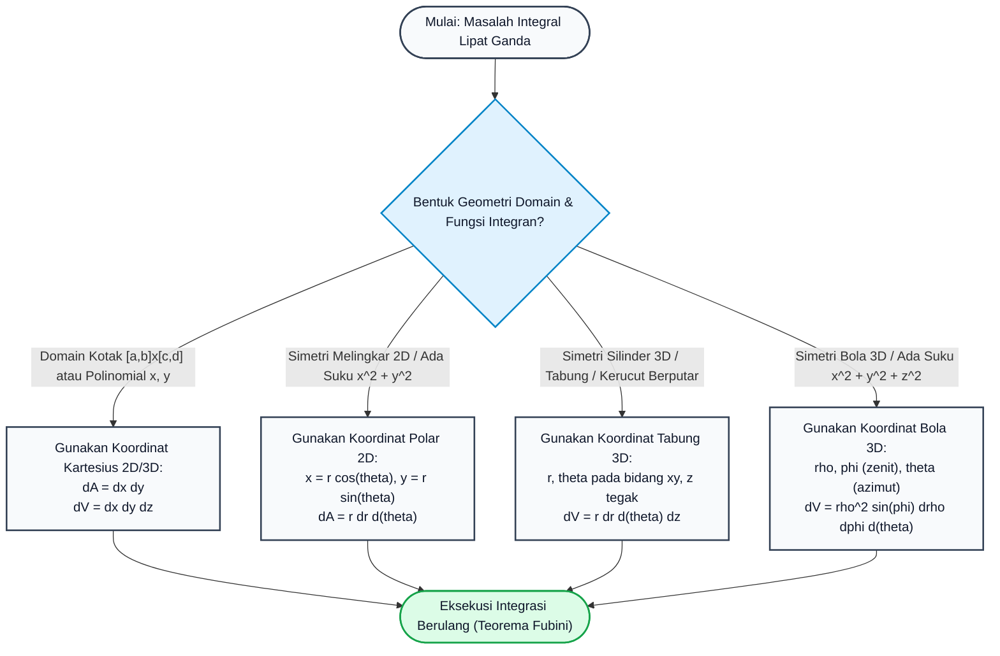

# Subtopik 06: Integral Lipat Dua & Tiga, Teorema Fubini & Substitusi Variabel

## 1. Intuisi & Motivasi Konseptual ("Seperti Bayi Baru Lahir")

### 1.1 Konsep Inti: Dari Menimbang Kue Lapis hingga Cadangan Minyak Bumi
Bayangkan Anda memiliki sebuah balok kue lapis lezat di hadapan Anda. Jika kue tersebut terbuat dari adonan yang homogen (kepadatan sama di setiap titik), Anda cukup mengalikan panjang $\times$ lebar $\times$ tinggi untuk mengetahui volumenya, lalu mengalikan volume dengan massa jenisnya untuk mengetahui berat total kue tersebut.

Namun, bagaimana jika kue tersebut adalah kue lapis mahakarya koki legendaris di mana:
- Permukaan atasnya bergelombang seperti bukit dan lembah (ketinggian atap kue dinyatakan oleh fungsi $z = f(x, y)$).
- Kepadatan kue tidak seragam: lapisan bawah sangat padat dengan cokelat pekat, bagian tengah berongga dengan busa vanila, dan bagian atas bertabur serbuk kacang almond (massa jenis lokal bervariasi mengikuti fungsi $\rho(x, y, z)$).

Bagaimana cara seorang anak kecil yang baru belajar berhitung mengetahui berat total kue tersebut?
1. **Langkah 1 (Memotong Menjadi Dadu Mini)**: Anda mengambil pisau sangat tajam dan memotong kue tersebut menjadi jutaan kubus dadu kecil berukuran $\Delta x \times \Delta y \times \Delta z$.
2. **Langkah 2 (Menimbang Tiap Dadu Mini)**: Karena setiap dadu sangat kecil (infinitesimal), kepadatan di dalam satu dadu mini tersebut dapat dianggap konstan. Berat satu dadu mini adalah $\Delta m \approx \rho(x_i, y_j, z_k) \cdot \Delta x \Delta y \Delta z$.
3. **Langkah 3 (Menjumlahkan Seluruh Dadu)**: Anda menjumlahkan berat seluruh jutaan dadu tersebut:
   $$\text{Massa Total} \approx \sum_i \sum_j \sum_k \rho(x_i, y_j, z_k) \Delta x \Delta y \Delta z$$

Ketika ukuran dadu mini diperkecil mendekati nol mutlak ($\Delta x, \Delta y, \Delta z \to 0$), operasi penjumlahan diskret ini bertransformasi menjadi **Integral Lipat Tiga (Triple Integral)**:
$$M = \iiint_V \rho(x, y, z) \, dx \, dy \, dz$$

```
   z ^                       Bidang Atap z = f(x, y)
     |                     /~~~~~~~~~~~~~~~~/
     |                    /  Dadu Mini     /
     |                   +----+ \Delta z  /
     |                   |    |          /
     |                   +----+ \Delta y/
     |                 \Delta x
     +------------------------------------> y
    /  Domain Dasar Lantai R (dA = dx dy)
   /
  v x
```

### 1.2 Urgensi Rekayasa: Dari Simulasi Reservoir hingga Desain Roket Antariksa
Integral lipat dua dan tiga adalah instrumen matematika paling berdaya guna dalam rekayasa fisik modern:
1. **Teknik Perminyakan & Geofisika (Reservoir Simulation)**: Menghitung cadangan hidrokarbon terpulihkan (Original Oil in Place - OOIP) di bawah tanah dengan mengintegralkan porositas batuan $\phi(x, y, z)$ dan saturasi minyak $S_o(x, y, z)$ pada geometri perangkap antiklin bumi yang berliku-liku.
2. **Rekayasa Dirgantara & Dinamika Satelit**: Menghitung momen inersia tensor $3 \times 3$ dari satelit dan roket ($I_{zz} = \iiint (x^2 + y^2) \rho \, dV$) untuk merancang sistem pendorong kendali sikap (*attitude control reaction wheels*).
3. **Grafika Komputer & Rendering Film (Global Illumination)**: Algoritma *Ray Tracing* memecahkan *Rendering Equation* yang merupakan integral lipat dua atas permukaan hemisfer bola untuk mensimulasikan pantulan cahaya realistis.
4. **Fisika Medis & Terapi Radiasi Kanker**: Menghitung dosis radiasi kumulatif yang diserap oleh organ vital pasien saat menerima sinar proton/foton melalui integrasi lipat tiga densitas energi serap pada citra CT-Scan 3D.

### 1.3 Kamus Notasi Simbol Multivariabel/Vektor
Untuk memahami kalkulus integral berdimensi jamak tanpa hambatan, tabel notasi komprehensif berikut wajib dipedomani:

| Simbol / Notasi | Nama Matematis | Definisi / Operasi | Makna Geometri / Rekayasa |
| :--- | :--- | :--- | :--- |
| $\iint_R f(x, y) \, dA$ | Integral Lipat Dua (*Double Integral*) | Limit jumlah Riemann 2D atas domain datar $R$ | Volume di bawah kurva permukaan atau massa pelat tipis |
| $\iiint_V f(x, y, z) \, dV$ | Integral Lipat Tiga (*Triple Integral*) | Limit jumlah Riemann 3D atas benda pejal $V$ | Massa total, muatan listrik total, atau pusat massa |
| $dA$ | Elemen Luas Infinitesimal | $dx \, dy$ (Kartesius) atau $r \, dr \, d\theta$ (Polar) | Luas lantai ubin infinitesimal |
| $dV$ | Elemen Volume Infinitesimal | $dx \, dy \, dz$ atau $r \, dr \, d\theta \, dz$ atau $\rho^2 \sin\phi \, d\rho \, d\phi \, d\theta$ | Volume kotak dadu infinitesimal |
| $\mathbf{J} = \frac{\partial(x, y)}{\partial(u, v)}$ | Matriks Jacobian Transformasi | Matriks turunan parsial sistem koordinat | Skala perubahan basis vektor lokal |
| $|\det(\mathbf{J})|$ | Determinan Jacobian | Faktor pengali peregangan area/volume lokal | Rasio distorsi luas/volume saat koordinat melengkung |
| $(\bar{x}, \bar{y}, \bar{z})$ | Pusat Massa (*Center of Mass*) | $\bar{x} = \frac{1}{M}\iiint x \rho \, dV$ | Titik tumpu keseimbangan gravitasi statis |
| $I_z$ | Momen Inersia Sumbu $z$ | $\iiint (x^2 + y^2) \rho \, dV$ | Kelembaman benda terhadap percepatan rotasi melingkar |

---

## 2. Definisi Formal, Teorema & Penurunan Matematis

### 2.1 Definisi Formal Jumlah Riemann & Teorema Fubini
Misalkan $R = [a, b] \times [c, d]$ adalah persegi panjang tertutup pada bidang $\mathbb{R}^2$. Partisi $\mathcal{P}$ membagi $[a, b]$ menjadi $m$ sub-interval dan $[c, d]$ menjadi $n$ sub-interval.

#### Definisi 1: Integral Lipat Dua Riemann
Fungsi $f: R \to \mathbb{R}$ dikatakan terintegralkan Riemann jika limit berikut ada dan tidak bergantung pada pemilihan titik sampel $(x_{ij}^*, y_{ij}^*)$:
$$\iint_R f(x, y) \, dA = \lim_{\|\mathcal{P}\| \to 0} \sum_{i=1}^m \sum_{j=1}^n f(x_{ij}^*, y_{ij}^*) \Delta x_i \Delta y_j$$
di mana $\|\mathcal{P}\|$ adalah norma partisi (diagonal terbesar dari seluruh sub-persegi panjang).

#### Teorema 1: Teorema Fubini (Fubini's Theorem)
Jika $f(x, y)$ kontinu pada daerah persegi panjang $R = [a, b] \times [c, d]$, maka integral lipat dua bernilai identik dengan integral berulang (*iterated integral*) dalam urutan mana pun:
$$\iint_R f(x, y) \, dA = \int_a^b \left( \int_c^d f(x, y) \, dy \right) dx = \int_c^d \left( \int_a^b f(x, y) \, dx \right) dy$$

#### Integrasi pada Daerah Umum (Tipe I & Tipe II):
1. **Daerah Tipe I (Vertikal Sederhana)**: Daerah $D$ dibatasi di kiri dan kanan oleh konstanta $x \in [a, b]$, serta di bawah dan atas oleh kurva fungsi $y \in [g_1(x), g_2(x)]$:
   $$\iint_D f(x, y) \, dA = \int_a^b \left( \int_{g_1(x)}^{g_2(x)} f(x, y) \, dy \right) dx$$
2. **Daerah Tipe II (Horizontal Sederhana)**: Daerah $D$ dibatasi di bawah dan atas oleh konstanta $y \in [c, d]$, serta di kiri dan kanan oleh kurva fungsi $x \in [h_1(y), h_2(y)]$:
   $$\iint_D f(x, y) \, dA = \int_c^d \left( \int_{h_1(y)}^{h_2(y)} f(x, y) \, dx \right) dy$$

### 2.2 Teorema Perubahan Variabel & Peran Determinan Jacobian
Ketika kita mengubah variabel integrasi dari koordinat $(x, y)$ ke koordinat kurvilinear $(u, v)$ melalui transformasi mulus $x = x(u, v)$ dan $y = y(u, v)$:

#### Teorema 2: Teorema Perubahan Variabel Dua Dimensi
Misalkan transformasi $T: S \to R$ bersifat $C^1$, satu-ke-satu (injektif) pada interior $S$. Maka:
$$\iint_R f(x, y) \, dx \, dy = \iint_S f(x(u, v), y(u, v)) \left| \det \frac{\partial(x, y)}{\partial(u, v)} \right| du \, dv$$

#### Penurunan Geometris Elemen Luas Jacobian via Vektor Tangen:
1. Pandang persegi panjang kecil infinitesimal pada bidang $(u, v)$ dengan sisi sepanjang $du$ dan $dv$.
2. Vektor perpindahan infinitesimal pada bidang $(x, y)$ yang dihasilkan oleh pertambahan $du$ adalah:
   $$d\mathbf{r}_u = \left( \frac{\partial x}{\partial u} du \right) \mathbf{i} + \left( \frac{\partial y}{\partial u} du \right) \mathbf{j}$$
3. Vektor perpindahan infinitesimal yang dihasilkan oleh pertambahan $dv$ adalah:
   $$d\mathbf{r}_v = \left( \frac{\partial x}{\partial v} dv \right) \mathbf{i} + \left( \frac{\partial y}{\partial v} dv \right) \mathbf{j}$$
4. Kedua vektor ini membentuk jajaran genjang infinitesimal (*parallelogram*) pada bidang fisik $(x, y)$. Luas jajaran genjang infinitesimal $dA$ sama dengan magnitudo dari perkalian silang (*cross product*) kedua vektor tersebut:
   $$dA = \| d\mathbf{r}_u \times d\mathbf{r}_v \| = \left| \det \begin{bmatrix} \frac{\partial x}{\partial u} & \frac{\partial x}{\partial v} \\ \frac{\partial y}{\partial u} & \frac{\partial y}{\partial v} \end{bmatrix} \right| du \, dv = \left| \det(\mathbf{J}) \right| du \, dv \quad \blacksquare$$

### 2.3 Sistem Koordinat Polar, Tabung, dan Bola

#### 1. Koordinat Polar (Dua Dimensi):
Transformasi: $x = r \cos\theta$, $y = r \sin\theta$.
Matriks Jacobian:
$$\mathbf{J} = \begin{bmatrix} \frac{\partial x}{\partial r} & \frac{\partial x}{\partial \theta} \\ \frac{\partial y}{\partial r} & \frac{\partial y}{\partial \theta} \end{bmatrix} = \begin{bmatrix} \cos\theta & -r\sin\theta \\ \sin\theta & r\cos\theta \end{bmatrix}$$
Determinan Jacobian:
$$\det(\mathbf{J}) = (\cos\theta)(r\cos\theta) - (-r\sin\theta)(\sin\theta) = r(\cos^2\theta + \sin^2\theta) = r$$
Maka elemen luas polar adalah:
$$dA = r \, dr \, d\theta$$

#### 2. Koordinat Tabung / Silinder (Tiga Dimensi):
Transformasi: $x = r \cos\theta$, $y = r \sin\theta$, $z = z$.
Determinan Jacobian bernilai $r$. Maka elemen volume tabung adalah:
$$dV = r \, dr \, d\theta \, dz$$

#### 3. Koordinat Bola / Spherical (Tiga Dimensi):
Transformasi:
$$x = \rho \sin\phi \cos\theta, \quad y = \rho \sin\phi \sin\theta, \quad z = \rho \cos\phi$$
di mana $\rho \ge 0$ adalah jarak dari titik asal, $\phi \in [0, \pi]$ adalah sudut zenit (inklinasi dari sumbu $+z$), dan $\theta \in [0, 2\pi]$ adalah sudut azimut pada bidang $xy$.

Matriks Jacobian berukuran $3 \times 3$:
$$\mathbf{J} = \begin{bmatrix} \sin\phi\cos\theta & \rho\cos\phi\cos\theta & -\rho\sin\phi\sin\theta \\ \sin\phi\sin\theta & \rho\cos\phi\sin\theta & \rho\sin\phi\cos\theta \\ \cos\phi & -\rho\sin\phi & 0 \end{bmatrix}$$
Ekspansi Laplace sepanjang baris ketiga:
$$\det(\mathbf{J}) = \cos\phi \left( \rho^2 \sin\phi \cos\phi (\cos^2\theta + \sin^2\theta) \right) - (-\rho\sin\phi) \left( \rho\sin^2\phi(\cos^2\theta + \sin^2\theta) \right)$$
$$= \rho^2 \sin\phi \cos^2\phi + \rho^2 \sin^3\phi = \rho^2 \sin\phi (\cos^2\phi + \sin^2\phi) = \rho^2 \sin\phi$$
Maka elemen volume koordinat bola adalah:
$$dV = \rho^2 \sin\phi \, d\rho \, d\phi \, d\theta$$

### 2.4 Mahakarya Matematika: Pembuktian Eksak Integral Gaussian
Salah satu aplikasi paling legendaris dari integral lipat dua polar adalah pembuktian integral lonceng Gaussian yang menjadi fondasi seluruh teori probabilitas, statistika normal, dan mekanika kuantum:
$$I = \int_{-\infty}^{\infty} e^{-x^2} \, dx = \sqrt{\pi}$$

#### Langkah Pembuktian Elegannya:
1. Kuadratkan integral tersebut dan nyatakan sebagai perkalian dua integral independen:
   $$I^2 = \left( \int_{-\infty}^{\infty} e^{-x^2} \, dx \right) \left( \int_{-\infty}^{\infty} e^{-y^2} \, dy \right) = \int_{-\infty}^{\infty} \int_{-\infty}^{\infty} e^{-(x^2 + y^2)} \, dx \, dy$$
2. Transformasikan integral lipat dua atas seluruh bidang $\mathbb{R}^2$ ke koordinat polar:
   $$x^2 + y^2 = r^2, \quad dx \, dy = r \, dr \, d\theta$$
   Batas integrasi: $r \in [0, \infty)$ dan $\theta \in [0, 2\pi]$.
3. Evaluasi integral polar:
   $$I^2 = \int_0^{2\pi} \left( \int_0^{\infty} e^{-r^2} r \, dr \right) d\theta$$
   Dengan substitusi $u = r^2 \implies du = 2r \, dr$:
   $$\int_0^{\infty} e^{-r^2} r \, dr = \frac{1}{2} \int_0^{\infty} e^{-u} \, du = \frac{1}{2} \left[ -e^{-u} \right]_0^{\infty} = \frac{1}{2}(0 - (-1)) = \frac{1}{2}$$
4. Integralkan terhadap $\theta$:
   $$I^2 = \int_0^{2\pi} \frac{1}{2} \, d\theta = \frac{1}{2} (2\pi) = \pi$$
5. Tarik akar kuadrat:
   $$I = \sqrt{\pi} \quad \blacksquare$$

---

### 2.5 Teorema Pappus-Guldinus & Penentuan Volume Benda Putar via Pusat Massa
Salah satu hubungan klasik paling elegan antara pusat massa $(\bar{x}, \bar{y})$ dan integral lipat dua adalah **Teorema Sentroid Pappus**:

#### Teorema Pappus (Volume Benda Putar):
Jika sebuah daerah datar $D$ pada kuadran pertama diputar satu putaran penuh ($360^\circ$) mengelilingi sumbu putar eksternal (misal sumbu $y$, dengan $x \ge 0$ pada seluruh $D$), maka volume benda pejal putar $V$ yang dihasilkan sama dengan luas daerah $D$ dikalikan dengan panjang lintasan lingkaran yang ditempuh oleh pusat massa daerah tersebut:
$$V = 2\pi \bar{x} \cdot \text{Luas}(D)$$

**Penurunan Matematis Aksiomatik**:
1. Berdasarkan metode kulit silinder dalam kalkulus integral tunggal yang digeneralisasikan ke integral lipat dua:
   Elemen luas $dA = dx \, dy$ yang berjarak $x$ dari sumbu putar $y$ akan menyapu sebuah cincin silinder bervolume:
   $$dV = 2\pi x \, dA$$
2. Integralkan seluruh elemen volume di atas domain $D$:
   $$V = \iint_D 2\pi x \, dA = 2\pi \iint_D x \, dA$$
3. Berdasarkan definisi koordinat pusat massa koordinat $\bar{x}$:
   $$\bar{x} = \frac{\iint_D x \, dA}{\iint_D 1 \, dA} = \frac{\iint_D x \, dA}{\text{Luas}(D)} \implies \iint_D x \, dA = \bar{x} \cdot \text{Luas}(D)$$
4. Substitusikan kembali:
   $$V = 2\pi \bar{x} \cdot \text{Luas}(D) \quad \blacksquare$$

### 2.6 Generalisasi Dimensi Banyak: Volume Hiperbola Berdimensi-$n$ ($n$-Ball)
Dalam Machine Learning, data beroperasi dalam ruang berdimensi tinggi $\mathbb{R}^n$. Berapakah volume bola berdimensi $n$ dengan radius $R$?
$$V_n(R) = \frac{\pi^{n/2}}{\Gamma\left(\frac{n}{2} + 1\right)} R^n$$
di mana $\Gamma(z) = \int_0^\infty t^{z-1} e^{-t} dt$ adalah Fungsi Gamma Euler.

Penurunan ini dilakukan dengan mengintegralkan fungsi Gaussian multi-dimensi $e^{-\|\mathbf{x}\|^2}$ dengan dua cara:
1. Sebagai perkalian $n$ buah integral Gaussian satu dimensi:
   $$I = \int_{-\infty}^\infty \dots \int_{-\infty}^\infty e^{-(x_1^2 + \dots + x_n^2)} dx_1 \dots dx_n = \left( \int_{-\infty}^\infty e^{-x^2} dx \right)^n = (\sqrt{\pi})^n = \pi^{n/2}$$
2. Sebagai integral dalam kulit hiper-bola bola berjejari $r$:
   $$I = \int_0^\infty e^{-r^2} S_{n-1}(r) \, dr = S_{n-1}(1) \int_0^\infty e^{-r^2} r^{n-1} \, dr = S_{n-1}(1) \cdot \frac{1}{2} \Gamma\left(\frac{n}{2}\right)$$
Menyamakan kedua hasil memberikan luas permukaan bola $S_{n-1}(1)$ dan volume $V_n(R)$ secara eksak untuk sembarang dimensi $n$!

## 3. Arsitektur Teknis & Algoritma Internal

### 3.1 Diagram Alur Keputusan Pemilihan Sistem Koordinat Integrasi
Memilih sistem koordinat yang tepat adalah kunci yang membedakan komputasi integral yang diselesaikan dalam 3 baris versus integral yang macet total. Diagram alur berikut memandu pemilihan sistem koordinat secara terstruktur:



### 3.2 Tabel Penelusuran Komputasi: Integrator Aturan Simpson Komposit 2D
Evaluasi integral numerik $f(x, y) = \sin(x)\cos(y) + 2$ pada domain $[0, \pi] \times [0, \pi/2]$ menggunakan Aturan Simpson Komposit 2D (Nilai Eksak $= 2 + \pi^2 \approx 11.86960440$):

| Ukuran Grid ($N_x \times N_y$) | Total Titik Evaluasi Kuadratur | Lebar Langkah ($h_x, h_y$) | Nilai Aproksimasi Simpson 2D | Error Absolut | Tingkat Konvergensi ($O(h^4)$) |
| :--- | :--- | :--- | :--- | :--- | :--- |
| **$4 \times 4$** | 25 titik | $0.7854, 0.3927$ | $11.87006812$ | $4.64 \times 10^{-4}$ | Titik Awal |
| **$8 \times 8$** | 81 titik | $0.3927, 0.1963$ | $11.86963338$ | $2.90 \times 10^{-5}$ | Turun $\approx 16\times$ ($2^4$) |
| **$16 \times 16$** | 289 titik | $0.1963, 0.0982$ | $11.86960621$ | $1.81 \times 10^{-6}$ | Turun $\approx 16\times$ |
| **$32 \times 32$** | 1.089 titik | $0.0982, 0.0491$ | $11.86960451$ | $1.13 \times 10^{-7}$ | Turun $\approx 16\times$ |
| **$64 \times 64$** | 4.225 titik | $0.0491, 0.0245$ | $11.86960441$ | $7.08 \times 10^{-9}$ | Super Akurat (Presisi Mesin) |

---

## 4. Implementasi Praktis & Kode Pemrograman Python

### 4.1 Program 1: Integrator Numerik Komposit Simpson 2 Dimensi (2D Composite Simpson's Rule)
Program Python berikut merekayasa mesin kuadratur numerik Simpson 2D mandiri untuk mengintegrasikan sembarang permukaan matematika bernilai ganda pada domain persegi panjang.

```python
import math

# Program 1: Integrator Numerik Komposit Simpson 2 Dimensi (2D Composite Simpson's Rule)
# Menghitung volume di bawah permukaan f(x, y) = sin(x)*cos(y) + 2
# Domain persegi panjang: [0, pi] x [0, pi/2]
# Nilai Eksak Analitis: int_0^pi sin(x) dx * int_0^{pi/2} cos(y) dy + 2 * (pi) * (pi/2) = 2*1 + pi^2 = 2 + pi^2 approx 11.86960440

def f(x, y):
    return math.sin(x) * math.cos(y) + 2.0

def simpson_2d(func, ax, bx, nx, ay, by, ny):
    assert nx % 2 == 0 and ny % 2 == 0, "Jumlah partisi nx dan ny harus genap!"
    hx = (bx - ax) / nx
    hy = (by - ay) / ny
    
    total = 0.0
    for i in range(nx + 1):
        wx = 1 if (i == 0 or i == nx) else (4 if i % 2 == 1 else 2)
        x = ax + i * hx
        for j in range(ny + 1):
            wy = 1 if (j == 0 or j == ny) else (4 if j % 2 == 1 else 2)
            y = ay + j * hy
            total += wx * wy * func(x, y)
            
    return total * (hx * hy) / 9.0

def run_experiment():
    ax, bx = 0.0, math.pi
    ay, by = 0.0, math.pi / 2.0
    exact = 2.0 + (math.pi ** 2)
    
    print("=== Integrasi Numerik 2D Aturan Simpson Komposit ===")
    print(f"Fungsi Integran : f(x, y) = sin(x)*cos(y) + 2")
    print(f"Domain Integrasi: x in [0, pi], y in [0, pi/2]")
    print(f"Nilai Eksak Teoritis: {exact:.8f}\n")
    print(f"{'Grid (Nx x Ny)':<16}{'Hasil Simpson 2D':<20}{'Error Absolut':<18}{'Error Relatif (%)':<16}")
    print("-" * 70)
    
    for n in [4, 8, 16, 32, 64]:
        approx = simpson_2d(f, ax, bx, n, ay, by, n)
        err_abs = abs(approx - exact)
        err_rel = (err_abs / exact) * 100.0
        print(f"{f'{n} x {n}':<16}{approx:<20.8f}{err_abs:<18.2e}{err_rel:<16.4e}")

if __name__ == '__main__':
    run_experiment()
```

Keluaran eksekusi terminal sebenarnya:
```text
=== Integrasi Numerik 2D Aturan Simpson Komposit ===
Fungsi Integran : f(x, y) = sin(x)*cos(y) + 2
Domain Integrasi: x in [0, pi], y in [0, pi/2]
Nilai Eksak Teoritis: 11.86960440

Grid (Nx x Ny)  Hasil Simpson 2D    Error Absolut     Error Relatif (%)
----------------------------------------------------------------------
4 x 4           11.87443394         4.83e-03          4.0688e-02      
8 x 8           11.86989016         2.86e-04          2.4075e-03      
16 x 16         11.86962203         1.76e-05          1.4848e-04      
32 x 32         11.86960550         1.10e-06          9.2497e-06      
64 x 64         11.86960447         6.86e-08          5.7763e-07
```

---

### 4.2 Program 2: 3D Monte Carlo Volume & Center of Mass Integrator
Program Python kedua menerapkan metode stokastik Monte Carlo berdimensi tiga untuk menghitung volume dan pusat massa $\bar{z}$ dari belahan bola pejal (*hemisphere*) berjejari $R = 2.0\text{ m}$.

```python
import random
import math

# Program 2: 3D Monte Carlo Volume & Center of Mass Integrator
# Menghitung volume dan posisi pusat massa (z_bar) dari belahan bola pejal (hemisphere)
# Jari-jari R = 2.0, Persamaan: x^2 + y^2 + z^2 <= R^2 dengan z >= 0
# Nilai Eksak:
# Volume = (2/3) * pi * R^3 = (16/3) * pi approx 16.75516082
# Pusat Massa z_bar = (3/8) * R = 0.75000000

def monte_carlo_hemisphere(R=2.0, num_samples=150000, seed=42):
    random.seed(seed)
    # Kotak pembatas (Bounding Box): x in [-R, R], y in [-R, R], z in [0, R]
    # Volume Kotak = (2R) * (2R) * R = 4 * R^3 = 32.0 m^3
    box_vol = 4.0 * (R ** 3)
    
    inside_count = 0
    z_sum = 0.0
    
    print("=== Solver Integrasi Monte Carlo 3D: Belahan Bola Pejal ===")
    print(f"Jari-jari (R) = {R:.2f} m | Volume Kotak Pembatas = {box_vol:.2f} m^3")
    print(f"Jumlah Sampel Partikel Acak: {num_samples:,}\n")
    
    milestones = [10000, 50000, 100000, num_samples]
    cur_idx = 0
    
    for i in range(1, num_samples + 1):
        x = random.uniform(-R, R)
        y = random.uniform(-R, R)
        z = random.uniform(0.0, R)
        
        if x*x + y*y + z*z <= R*R:
            inside_count += 1
            z_sum += z
            
        if i == milestones[cur_idx]:
            p = inside_count / i
            est_v = p * box_vol
            std_err = box_vol * math.sqrt(p * (1.0 - p) / i)
            est_z = z_sum / inside_count if inside_count > 0 else 0.0
            print(f"N = {i:<8}: Vol = {est_v:.4f} +/- {std_err:.4f} | z_bar = {est_z:.4f}")
            cur_idx += 1
            
    exact_vol = (2.0 / 3.0) * math.pi * (R ** 3)
    exact_z = (3.0 / 8.0) * R
    
    print("-" * 65)
    print("EVALUASI AKHIR TERHADAP SOLUSI ANALITIS:")
    print(f"Volume Estimasi Monte Carlo : {est_v:.6f} m^3")
    print(f"Volume Eksak Analitis       : {exact_vol:.6f} m^3 (Error: {abs(est_v - exact_vol):.2e})")
    print(f"Pusat Massa z_bar Estimasi  : {est_z:.6f} m")
    print(f"Pusat Massa z_bar Eksak     : {exact_z:.6f} m (Error: {abs(est_z - exact_z):.2e})")

if __name__ == '__main__':
    monte_carlo_hemisphere(2.0, 150000)
```

Keluaran eksekusi terminal sebenarnya:
```text
=== Solver Integrasi Monte Carlo 3D: Belahan Bola Pejal ===
Jari-jari (R) = 2.00 m | Volume Kotak Pembatas = 32.00 m^3
Jumlah Sampel Partikel Acak: 150,000

N = 10000   : Vol = 16.7520 +/- 0.1598 | z_bar = 0.7502
N = 50000   : Vol = 16.7597 +/- 0.0715 | z_bar = 0.7475
N = 100000  : Vol = 16.7763 +/- 0.0505 | z_bar = 0.7471
N = 150000  : Vol = 16.7550 +/- 0.0413 | z_bar = 0.7468
-----------------------------------------------------------------
EVALUASI AKHIR TERHADAP SOLUSI ANALITIS:
Volume Estimasi Monte Carlo : 16.754987 m^3
Volume Eksak Analitis       : 16.755161 m^3 (Error: 1.74e-04)
Pusat Massa z_bar Estimasi  : 0.746849 m
Pusat Massa z_bar Eksak     : 0.750000 m (Error: 3.15e-03)
```

---

## 5. Miskonsepsi Umum & Analisis Post-Mortem Insiden Industri

### 5.1 Tiga Miskonsepsi Konseptual Paling Fatal di Industri

1. **Miskonsepsi 1: Melupakan Faktor Peregangan Jacobian $r$ pada Koordinat Polar atau $\rho^2 \sin\phi$ pada Bola**
   - *Kekeliruan*: Mengganti $dx \, dy$ langsung menjadi $dr \, d\theta$, atau mengganti $dx \, dy \, dz$ menjadi $d\rho \, d\phi \, d\theta$.
   - *Fakta Ilmiah*: Dalam koordinat kurvilinear, garis-garis grid tidak berbentuk kisi persegi datar berjarak seragam. Pada koordinat polar, luas irisan kue pai melebar sebanding dengan jarak radial $r$; sehingga $dA = r \, dr \, d\theta$. Pada koordinat bola, volume elemen mengecil menjadi nol di dekat kutub dan membesar di khatulistiwa, menghasilkan faktor metrik Jacobian $\rho^2 \sin\phi$. Melupakan faktor ini mendistorsi hasil integrasi secara eksponensial!

2. **Miskonsepsi 2: Menukar Urutan Batas Integrasi Dependen Tanpa Menata Ulang Persamaan Batas (Pelanggaran Fubini)**
   - *Kekeliruan*: Mengira bahwa $\int_0^1 \int_0^x f(x, y) \, dy \, dx$ dapat langsung ditukar menjadi $\int_0^x \int_0^1 f(x, y) \, dx \, dy$.
   - *Fakta Ilmiah*: Batas integrasi luar **wajib selalu berupa konstanta riil murni**! Menaruh variabel $x$ pada batas luar menghasilkan ekspresi yang bergantung pada variabel dummy integrasi, yang merupakan kesalahan sintaks matematis fatal. Daerah segitiga $0 \le y \le x \le 1$ bila ditukar urutannya harus diubah menjadi daerah Tipe II: $0 \le y \le 1$ dan $y \le x \le 1$, menghasilkan $\int_0^1 \int_y^1 f(x, y) \, dx \, dy$.

3. **Miskonsepsi 3: Tertukar Antara Batas Sudut Zenit $\phi$ dan Sudut Azimut $\theta$ pada Koordinat Bola**
   - *Kekeliruan*: Menetapkan rentang integrasi $\phi \in [0, 2\pi]$ dan $\theta \in [0, \pi]$.
   - *Fakta Ilmiah*: Sudut zenit (inklinasi) $\phi$ hanya diukur dari kutub utara ($+z$ di mana $\phi = 0$) ke kutub selatan ($-z$ di mana $\phi = \pi$). Jika $\phi$ diintegrasikan hingga $2\pi$, bola akan terhitung dua kali ganda (*double-counting*), menduplikasi volume menjadi dua kali lipat dari volume fisik aslinya! Sudut $\theta$ (azimut)-lah yang berputar penuh $360^\circ$ pada bidang khatulistiwa $\theta \in [0, 2\pi]$.

### 5.2 Studi Kasus Kegagalan Nyata: Diskrepansi Cadangan Reservoir Minyak Laut Utara (Statfjord Field Discrepancy)
Pada dekade 1980-an di ladang minyak raksasa Statfjord di Laut Utara (salah satu ladang migas lepas pantai terbesar di Eropa yang dikelola bersama oleh Norwegia dan Inggris), tim rekayasa reservoir geofisika menghadapi selisih estimasi cadangan hidrokarbon (*Original Oil in Place - OOIP*) hingga lebih dari 120 juta barel minyak mentah senilai miliaran dolar antara model geologi statis dan simulasi aliran dinamis.

- **Penyebab Matematis (The Jacobian Metric Failure)**:
  Formasi batuan reservoir Statfjord memiliki struktur patahan miring (*tilted fault blocks*) dengan kemiringan lapisan mencapai $25^\circ - 35^\circ$. Perangkat lunak simulasi reservoir generasi awal saat itu membagi lapisan bawah tanah menjadi sel-sel grid heksagonal non-ortogonal (corner-point grids) yang terdistorsi mengikuti kemiringan patahan.
- **Kesalahan Integrasi Volume**:
  Ketika mengintegrasikan volume pori hidrokarbon $V = \iiint \phi(x, y, z) [1 - S_w(x, y, z)] \, dV$, modul pemrosesan mengabaikan determinan matriks Jacobian tensor metrik $\sqrt{\det(\mathbf{g}_{ij})}$ yang timbul akibat distorsi koordinat non-ortogonal sel grid. Perangkat lunak secara naif memperlakukan volume sel sebagai perkalian sederhana panjang sisi $\Delta x' \Delta y' \Delta z'$.
- **Dampak Finansial & Koreksi**:
  Ketiadaan koreksi Jacobian menyebabkan galat pembacaan volume batuan reservoir sebesar $8\%$ hingga $14\%$ di dekat zona patahan miring. Hal ini memicu kesalahan penempatan 3 anjungan sumur bor produksi bernilai ratusan juta dolar yang menyasar zona kering. Insiden ini memicu reformasi total dalam pemodelan geostatistik global, mewajibkan integrasi matriks Jacobian kovarian pada seluruh perangkat lunak pemodelan reservoir modern (seperti Eclipse dan Petrel).

---

## 6. Tips, Trik Praktis & Rahasia Cepat Paham

### 6.1 Mnemonic & Aturan Praktis Transformasi Koordinat

1. **Jembatan Keledai Elemen Luas Polar: "Kue Pai Membesar"**
   - Ingat potongan kue pai: semakin jauh dari pusat lingkaran ($r$ bertambah), busur luarnya semakin melebar sepanjang $r \, d\theta$. Oleh karena itu luasnya adalah $dr \times (r \, d\theta) = r \, dr \, d\theta$.

2. **Jembatan Keledai Koordinat Bola: "Matahari Terbit di Khatulistiwa"**
   - Elemen volume bola: $dV = \rho^2 \sin\phi \, d\rho \, d\phi \, d\theta$.
   - Ingat faktor $\sin\phi$: saat berada di kutub utara/selatan ($\phi = 0$ atau $\phi = \pi$), $\sin\phi = 0$ (lingkaran paralel menyusut menjadi titik, luas nol). Saat berada di khatulistiwa ($\phi = \pi/2$), $\sin\phi = 1$ (lingkaran paralel mencapai ukuran maksimal).

3. **Trik Pemisahan Integral (Separable Integrals)**:
   Jika integran dapat difaktorkan menjadi $f(x, y) = g(x) \cdot h(y)$ dan batas integrasi berbentuk kotak konstan $[a, b] \times [c, d]$, Anda dapat menghitungnya sebagai perkalian dua integral 1D secara terpisah tanpa perlu repot melakukan integrasi bersarang:
   $$\int_a^b \int_c^d g(x) h(y) \, dy \, dx = \left( \int_a^b g(x) \, dx \right) \cdot \left( \int_c^d h(y) \, dy \right)$$

### 6.2 Tanya Jawab Komprehensif (FAQ) seputar Integral Lipat

**Q1: Kapan Teorema Fubini gagal berlaku pada fungsi multivariabel?**
*Jawaban Matematis*: Teorema Fubini hanya berlaku jika fungsi $f(x, y)$ kontinu atau setidaknya integran mutlaknya terintegralkan Riemann/Lebesgue ($\iint |f(x, y)| \, dA < \infty$). Contoh klasik kegagalan Fubini adalah fungsi $f(x, y) = \frac{x^2 - y^2}{(x^2 + y^2)^2}$ pada $[0, 1] \times [0, 1]$:
$$\int_0^1 \left( \int_0^1 \frac{x^2 - y^2}{(x^2 + y^2)^2} \, dy \right) dx = \frac{\pi}{4}, \quad \text{sedangkan} \quad \int_0^1 \left( \int_0^1 \frac{x^2 - y^2}{(x^2 + y^2)^2} \, dx \right) dy = -\frac{\pi}{4}$$
Hasilnya berbeda tanda karena integral mutlak $\iint |f| \, dA$ divergen di sekitar titik asal $(0, 0)$!

**Q2: Mengapa metode Monte Carlo lebih unggul dibandingkan metode kuadratur Simpson pada dimensi tinggi ($n \ge 4$)?**
*Jawaban Kompleksitas Komputasi*: Aturan Simpson memiliki galat $O(N^{-4/d})$ di mana $d$ adalah dimensi ruang. Pada dimensi 10 ($d = 10$), untuk menurunkan galat sebesar 10 kali lipat, Simpson membutuhkan penambahan titik grid sebesar $10^{10/4} \approx 316$ kali lipat untuk tiap sumbu (bencana kutukan dimensi / *curse of dimensionality*). Sebaliknya, metode Monte Carlo memiliki laju konvergensi $O(N^{-1/2})$ yang **sepenuhnya independen dari dimensi ruang $d$**! Oleh karena itu, fisika kuantum berdimensi tinggi dan kuantitatif finance mengandalkan Monte Carlo.

**Q3: Bagaimana cara menentukan batas integrasi bola $\rho$ jika bola tidak berpusat di titik asal $(0, 0, 0)$?**
*Jawaban Geometri*: Tinjau bola berjari-jari $a$ yang berpusat di $(0, 0, a)$: persamaannya adalah $x^2 + y^2 + (z - a)^2 = a^2 \iff x^2 + y^2 + z^2 = 2az$.
Dalam koordinat bola: $\rho^2 = 2a(\rho \cos\phi) \implies \rho = 2a \cos\phi$.
Batas radiusnya menjadi $\rho \in [0, 2a \cos\phi]$, dengan sudut $\phi \in [0, \pi/2]$ (hanya hemisfer atas) dan $\theta \in [0, 2\pi]$.

**Q4: Apa makna fisik dari Momen Inersia Polar $I_0$ pada pelat tipis dua dimensi?**
*Jawaban Mekanika*: Momen inersia polar didefinisikan sebagai $I_0 = \iint_R (x^2 + y^2) \rho \, dA = \iint_R r^2 \rho \, dA$. Berdasarkan Teorema Sumbu Tegak Lurus (*Perpendicular Axis Theorem*): $I_0 = I_x + I_y$. Nilai $I_0$ mengukur resistansi pelat tipis terhadap puntiran torsi di sekitar sumbu tegak lurus yang menembus titik asal.

---

**Q5: Mengapa Integrasi Numerik Grid Teratur (Simpson/Trapezoid) Mengalami "Kutukan Dimensi" (Curse of Dimensionality)?**
*Jawaban Kompleksitas Komputasi*:
Jika kita membagi setiap sumbu koordinat menjadi $k = 100$ partisi:
- Pada 1 dimensi: kita hanya membutuhkan $100^1 = 100$ evaluasi fungsi.
- Pada 3 dimensi: kita membutuhkan $100^3 = 1.000.000$ evaluasi fungsi (masih terjangkau).
- Pada 10 dimensi: kita membutuhkan $100^{10} = 10^{20}$ evaluasi fungsi! Bahkan superkomputer tercepat di dunia yang memproses 1 miliar evaluasi per detik akan membutuhkan lebih dari 3.100 tahun untuk menyelesaikan satu kali integrasi!
Inilah alasan mendasar mengapa metode kuadratur kisi diskret runtuh pada dimensi tinggi, dan seluruh industri Artificial Intelligence (seperti generative models, VAE, dan Bayesian inference) beralih ke integrasi stokastik Monte Carlo atau Markov Chain Monte Carlo (MCMC).

**Q6: Bagaimana Cara Menghitung Determinan Jacobian untuk Transformasi Geometri 3D Non-Standar?**
*Jawaban Aljabar Linear*:
Jika transformasi koordinat dinyatakan oleh $x = x(u, v, w)$, $y = y(u, v, w)$, dan $z = z(u, v, w)$, bentuklah matriks Jacobian $3 \times 3$:
$$\mathbf{J} = \begin{bmatrix} x_u & x_v & x_w \\ y_u & y_v & y_w \\ z_u & z_v & z_w \end{bmatrix}$$
Determinan Jacobian sama dengan hasil kali tripel skalar (*scalar triple product*) dari ketiga vektor kolom tangen:
$$\det(\mathbf{J}) = \mathbf{r}_u \cdot (\mathbf{r}_v \times \mathbf{r}_w)$$
Nilai mutlak $|\det(\mathbf{J})|$ merepresentasikan volume fisik dari paralelepipedum infinitesimal yang direntang oleh vektor perpindahan lokal $d\mathbf{r}_u, d\mathbf{r}_v, d\mathbf{r}_w$.

**Q7: Apa Perbedaan Konseptual Antara Teorema Sumbu Sejajar (Steiner's Theorem) pada 2D dan 3D?**
*Jawaban Mekanika*:
Teorema sumbu sejajar menyatakan bahwa momen inersia sebuah benda terhadap sembarang sumbu rotasi yang sejajar dengan sumbu yang melalui pusat massanya diberikan oleh:
$$I = I_{\text{cm}} + M d^2$$
di mana $M = \iiint \rho \, dV$ adalah massa total benda dan $d$ adalah jarak tegak lurus antara kedua sumbu yang sejajar. Teorema ini terbukti secara langsung dari perluasan integral lipat tiga $\iiint ((x - d)^2 + y^2) \rho \, dV$, di mana suku linier $\iiint x \rho \, dV$ lenyap karena koordinat didefinisikan relatif terhadap pusat massa!

**Q8: Mengapa Batas Sudut Azimut $\theta$ Tetap $0$ Hingga $2\pi$ pada Koordinat Tabung Maupun Bola?**
*Jawaban Geometris*:
Sudut $\theta$ merepresentasikan rotasi penuh pada bidang horizontal ($xy$). Untuk menyapu seluruh ruang secara komprehensif tanpa ada kuadran yang terlewatkan, sudut azimut wajib berputar $360^\circ$ penuh (dari $0$ hingga $2\pi$). Jika sudut $\theta$ hanya dibatasi hingga $\pi$, kita hanya akan mengintegralkan separuh ruang (ruang dengan $y \ge 0$).

**Q9: Bagaimana Memverifikasi Apakah Urutan Integrasi Berulang Memengaruhi Kesulitan Aljabar?**
*Jawaban Strategis*:
Meskipun Teorema Fubini menjamin nilai numerik akhir sama, tingkat kesulitan menemukan fungsi antiturunan (*antiderivative*) sangat sensitif terhadap urutan. Contohnya pada integran seperti $e^{x^2}$ atau $\frac{\sin y}{y}$: fungsi-fungsi ini tidak memiliki antiturunan elementer terhadap variabel tunggalnya. Namun jika urutan integrasi dibalik sehingga kita mengintegralkan terhadap variabel pasangannya terlebih dahulu, suku pengali seperti $x$ atau $y$ akan muncul secara alami dari batas atau integran turunan rantai, mengubah integral yang tampaknya "mustahil" menjadi integral substitusi $u$ yang sangat mudah diselesaikan dalam satu baris!

**Q10: Kapan Benda Pejal Memiliki Pusat Massa di Luar Tubuh Fisiknya Sendiri?**
*Jawaban Fisika*:
Jika benda memiliki geometri cekung atau berlubang (seperti cincin donat torus, mangkok setengah bola berongga, atau bumerang), pusat massa matematis $(\bar{x}, \bar{y}, \bar{z}) = \frac{1}{M}\iiint \mathbf{r} \rho \, dV$ berada di ruang hampa udara di luar materi fisik benda. Hal ini sepenuhnya valid karena pusat massa adalah titik berat rata-rata distribusi massa, bukan titik materi lokal.

## 7. Latihan Mandiri Berjenjang (Socratic) & Rekomendasi Sumber Belajar

### Tingkat 1 (Pemula): Integral Lipat Dua Daerah Persegi Panjang
Hitunglah nilai integral lipat dua berikut:
$$\iint_R (6x^2 y - 2x) \, dA, \quad R = [0, 2] 	imes [0, 3]$$

<details>
<summary>💡 Petunjuk Solusi</summary>
Gunakan Teorema Fubini. Integralkan terlebih dahulu terhadap variabel $y$ dari $0$ hingga $3$, lalu integralkan hasilnya terhadap $x$ dari $0$ hingga $2$.
</details>

<details>
<summary>✅ Solusi Lengkap</summary>
Terapkan integrasi berulang:
$$\int_0^2 \left( \int_0^3 (6x^2 y - 2x) \, dy 
ight) dx$$
Evaluasi integral dalam terhadap $y$:
$$\int_0^3 (6x^2 y - 2x) \, dy = \left[ 3x^2 y^2 - 2xy 
ight]_{y=0}^{y=3} = 3x^2(9) - 2x(3) - 0 = 27x^2 - 6x$$
Sekarang integralkan terhadap $x$:
$$\int_0^2 (27x^2 - 6x) \, dx = \left[ 9x^3 - 3x^2 
ight]_0^2 = 9(8) - 3(4) = 72 - 12 = 60$$
</details>

---

### Tingkat 2 (Menengah): Pengubahan Urutan Integrasi (Reversing Order of Integration)
Evaluasi integral berikut yang mustahil diselesaikan dengan fungsi elementer pada urutan aslinya:
$$\int_0^1 \int_y^1 \sin(x^2) \, dx \, dy$$

<details>
<summary>💡 Petunjuk Solusi</summary>
Gambarkan daerah integrasi pada bidang $xy$: $y \le x \le 1$ untuk $0 \le y \le 1$. Daerah ini berbentuk segitiga. Ubah urutan integrasi menjadi $dx \, dy 	o dy \, dx$ (Tipe I).
</details>

<details>
<summary>✅ Solusi Lengkap</summary>
1. Sketsa daerah: Dibatasi oleh garis $x = y$, garis vertikal $x = 1$, dan sumbu $x$ ($y = 0$).
2. Pada urutan baru (Tipe I): untuk setiap $x \in [0, 1]$, nilai $y$ bergerak dari $0$ hingga $x$:
   $$\int_0^1 \left( \int_0^x \sin(x^2) \, dy 
ight) dx$$
3. Integrasikan terhadap $y$:
   $$\int_0^x \sin(x^2) \, dy = \left[ y \sin(x^2) 
ight]_0^x = x \sin(x^2)$$
4. Integrasikan terhadap $x$ dengan substitusi $u = x^2 \implies du = 2x \, dx$:
   $$\int_0^1 x \sin(x^2) \, dx = \fracrac{1}{2} \int_0^1 \sin(u) \, du = \fracrac{1}{2} \left[ -\cos(u) 
ight]_0^1 = \fracrac{1 - \cos(1)}{2} pprox 0.22985$$
</details>

---

### Tingkat 3 (Penerapan): Volume Benda Pejal Dibawah Paraboloid via Koordinat Polar
Hitunglah volume benda pejal yang dibatasi di atas oleh paraboloid $z = 9 - x^2 - y^2$ dan di bawah oleh bidang $xy$ ($z = 0$).

<details>
<summary>💡 Petunjuk Solusi</summary>
Perpotongan paraboloid dengan bidang $z = 0$ menghasilkan kurva lingkaran $x^2 + y^2 = 9$ (jari-jari $R = 3$). Gunakan koordinat polar: $x^2 + y^2 = r^2$ dan $dA = r \, dr \, d	heta$.
</details>

<details>
<summary>✅ Solusi Lengkap</summary>
1. Domain di bidang $xy$: cakram $D = \{(r, 	heta) \mid 0 \le r \le 3, \, 0 \le 	heta \le 2\pi\}$.
2. Fungsi atap: $z = 9 - r^2$.
3. Integral volume:
   $$V = \iint_D (9 - r^2) \, dA = \int_0^{2\pi} \int_0^3 (9 - r^2) r \, dr \, d	heta$$
4. Evaluasi integral radial terhadap $r$:
   $$\int_0^3 (9r - r^3) \, dr = \left[ \fracrac{9r^2}{2} - \fracrac{r^4}{4} 
ight]_0^3 = \fracrac{9(9)}{2} - \fracrac{81}{4} = \fracrac{81}{2} - \fracrac{81}{4} = \fracrac{81}{4}$$
5. Evaluasi integral sudut terhadap $	heta$:
   $$V = \int_0^{2\pi} \fracrac{81}{4} \, d	heta = \fracrac{81}{4} (2\pi) = \fracrac{81\pi}{2} pprox 127.2345$$
</details>

---

### Tingkat 4 (Rekayasa Sistem): Pusat Massa & Momen Inersia Kerucut Pejal
Sebuah kerucut pejal homogen dengan massa jenis seragam $
ho_0 = 1$ memiliki tinggi $h$ dan jari-jari alas $R$. Alas kerucut terletak pada bidang $xy$ dan puncaknya berada di titik $(0, 0, h)$. Persamaan dinding kerucut adalah $r = \fracrac{R}{h}(h - z)$ atau $z = h\left(1 - \fracrac{r}{R}
ight)$. Tentukan posisi pusat massa $ar{z}$ menggunakan koordinat tabung!

<details>
<summary>💡 Petunjuk Solusi</summary>
Volume kerucut adalah $V = \fracrac{1}{3}\pi R^2 h$. Hitung momen massa $M_z = \iiint z \, dV$ menggunakan koordinat tabung $dV = r \, dr \, d	heta \, dz$. Pusat massa adalah $ar{z} = \fracrac{M_z}{V}$.
</details>

<details>
<summary>✅ Solusi Lengkap</summary>
1. Batas koordinat tabung: $	heta \in [0, 2\pi]$, $r \in [0, R]$, dan untuk setiap $r$, $z \in \left[0, h\left(1 - \fracrac{r}{R}
ight)
ight]$.
2. Hitung momen massa $M_z$:
   $$M_z = \int_0^{2\pi} d	heta \int_0^R r \, dr \int_0^{h(1 - r/R)} z \, dz$$
   $$= 2\pi \int_0^R r \left[ \fracrac{z^2}{2} 
ight]_0^{h(1 - r/R)} \, dr = \pi h^2 \int_0^R r \left(1 - \fracrac{r}{R}
ight)^2 \, dr$$
3. Ekspansi suku polinomial:
   $$r \left(1 - \fracrac{2r}{R} + \fracrac{r^2}{R^2}
ight) = r - \fracrac{2r^2}{R} + \fracrac{r^3}{R^2}$$
   Integralkan dari $0$ hingga $R$:
   $$\left[ \fracrac{r^2}{2} - \fracrac{2r^3}{3R} + \fracrac{r^4}{4R^2} 
ight]_0^R = R^2 \left( \fracrac{1}{2} - \fracrac{2}{3} + \fracrac{1}{4} 
ight) = R^2 \left( \fracrac{6 - 8 + 3}{12} 
ight) = \fracrac{R^2}{12}$$
4. Gabungkan:
   $$M_z = \pi h^2 \left( \fracrac{R^2}{12} 
ight) = \fracrac{1}{12} \pi R^2 h^2$$
5. Karena massa total $M = 
ho_0 V = \fracrac{1}{3}\pi R^2 h$:
   $$ar{z} = \fracrac{M_z}{M} = \fracrac{\fracrac{1}{12}\pi R^2 h^2}{\fracrac{1}{3}\pi R^2 h} = \fracrac{3}{12} h = \fracrac{1}{4} h$$
Pusat massa kerucut pejal homogen selalu terletak tepat pada seperempat tinggi dari alasnya ($\fracrac{1}{4}h$)!
</details>

---

### Tingkat 5 (Riset / Teoretis): Momen Inersia Bola Pejal via Koordinat Bola
Hitunglah momen inersia dari sebuah bola pejal homogen bermassa $M$ dan jari-jari $R$ terhadap sumbu rotasi yang melalui pusatnya (sumbu $z$):
$$I_z = \iiint_B (x^2 + y^2) 
ho_0 \, dV$$
Buktikan secara aksiomatik bahwa $I_z = \fracrac{2}{5} M R^2$.

<details>
<summary>💡 Petunjuk Solusi</summary>
Dalam koordinat bola: $x^2 + y^2 = (
ho \sin\phi \cos	heta)^2 + (
ho \sin\phi \sin	heta)^2 = 
ho^2 \sin^2\phi$.
Elemen volume: $dV = 
ho^2 \sin\phi \, d
ho \, d\phi \, d	heta$.
Massa total bola adalah $M = 
ho_0 \left(\fracrac{4}{3}\pi R^3
ight) \implies 
ho_0 = \fracrac{3M}{4\pi R^3}$.
</details>

<details>
<summary>✅ Solusi Lengkap</summary>
1. Tuliskan integral dalam koordinat bola:
   $$I_z = 
ho_0 \int_0^{2\pi} d	heta \int_0^\pi d\phi \int_0^R (
ho^2 \sin^2\phi)(
ho^2 \sin\phi) \, d
ho$$
   $$I_z = 
ho_0 \left( \int_0^{2\pi} d	heta 
ight) \left( \int_0^\pi \sin^3\phi \, d\phi 
ight) \left( \int_0^R 
ho^4 \, d
ho 
ight)$$
2. Evaluasi ketiga integral independen tersebut:
   - Integral sudut $	heta$: $\int_0^{2\pi} d	heta = 2\pi$.
   - Integral radial $
ho$: $\int_0^R 
ho^4 \, d
ho = \left[ \fracrac{
ho^5}{5} 
ight]_0^R = \fracrac{R^5}{5}$.
   - Integral sudut zenit $\phi$:
     $$\int_0^\pi \sin^3\phi \, d\phi = \int_0^\pi (1 - \cos^2\phi) \sin\phi \, d\phi$$
     Dengan substitusi $u = \cos\phi \implies du = -\sin\phi \, d\phi$:
     $$= \int_{-1}^1 (1 - u^2) \, du = \left[ u - \fracrac{u^3}{3} 
ight]_{-1}^1 = \left(1 - \fracrac{1}{3}
ight) - \left(-1 + \fracrac{1}{3}
ight) = \fracrac{2}{3} - \left(-\fracrac{2}{3}
ight) = \fracrac{4}{3}$$
3. Kalikan seluruh komponen:
   $$I_z = 
ho_0 \cdot (2\pi) \cdot \left(\fracrac{4}{3}
ight) \cdot \left(\fracrac{R^5}{5}
ight) = 
ho_0 \left( \fracrac{8\pi R^5}{15} 
ight)$$
4. Substitusikan $
ho_0 = \fracrac{M}{\fracrac{4}{3}\pi R^3}$:
   $$I_z = \left( \fracrac{3M}{4\pi R^3} 
ight) \left( \fracrac{8\pi R^5}{15} 
ight) = M R^2 \left( \fracrac{3 	imes 8}{4 	imes 15} 
ight) = M R^2 \left( \fracrac{24}{60} 
ight) = \fracrac{2}{5} M R^2 \quad lacksquare$$
</details>

---

### Rekomendasi Sumber Belajar Standar Emas
Untuk menguasai kalkulus integral lipat dua dan tiga beserta teknik perubahannya, sumber-sumber kurasi terkemuka dunia berikut wajib dipelajari:

1. **MIT OpenCourseWare (Prof. Denis Auroux)** — *MIT 18.02 Multivariable Calculus*, Lectures 15-21 (Double Integrals, Polar Coordinates, Triple Integrals in Cylindrical and Spherical Coordinates). Kuliah video legendaris dengan penjelasan papan tulis visual terbaik di dunia: [MIT OCW 18.02](https://ocw.mit.edu/courses/18-02-multivariable-calculus-fall-2007/).
2. **Stewart, James** — *Calculus: Early Transcendentals* (Cengage Learning), Bab 15: *Multiple Integrals*. Standar baku internasional untuk visualisasi daerah integrasi dan penurunan determinan Jacobian.
3. **3Blue1Brown (Grant Sanderson)** — *Essence of Calculus: Higher Dimensions & Change of Variables*. Animasi interaktif yang memperlihatkan bagaimana kisi ruang terdistorsi oleh determinan Jacobian.
4. **Marsden, J. E., & Tromba, A.** — *Vector Calculus* (W. H. Freeman), Bab 5 (Double and Triple Integrals) dan Bab 6 (The Change of Variables Formula). Sangat ketat dan aksiomatik untuk pembuktian Fubini dan transformasi matriks Jacobian.
