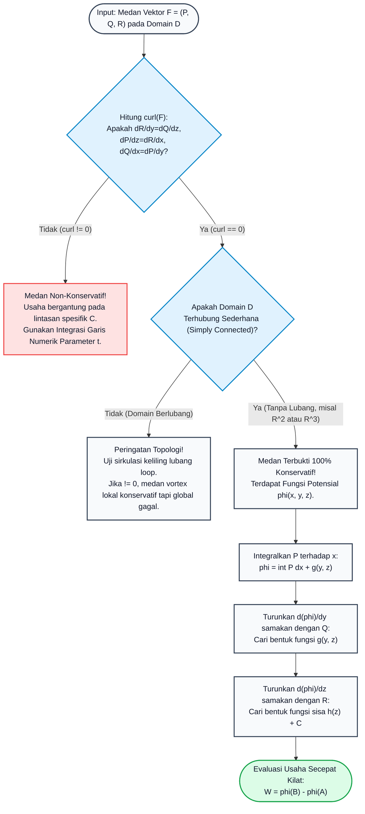

# Subtopik 07: Integral Garis, Medan Vektor, Usaha (Work) & Teorema Dasar Integral Garis

## 1. Intuisi & Motivasi Konseptual ("Seperti Bayi Baru Lahir")

### 1.1 Konsep Inti: Dari Mendorong Kereta di Rel Gunung hingga Arus Sungai
Bayangkan Anda sedang berlibur di sebuah taman bermain pegunungan dan menaiki sebuah kereta dorong di atas rel berliku-liku. Angin kencang berhembus melintasi pegunungan tersebut.
- Di beberapa bagian rel yang berbelok ke timur, angin bertiup kencang tepat di belakang punggung Anda, membantu mendorong kereta Anda ke depan dengan ringan tanpa perlu tenaga sama sekali (usaha yang dilakukan angin bernilai **positif**).
- Namun ketika rel berbelok tajam ke arah barat laut, angin bertiup kencang menghantam wajah Anda dari depan; Anda harus bersusah payah mendorong kereta sekuat tenaga melawan hembusan angin (usaha yang dilakukan angin bernilai **negatif**).
- Pada saat rel berjalan persis tegak lurus memotong arah hembusan angin, angin hanya mendorong dinding samping kereta tanpa mempercepat atau memperlambat laju Anda di sepanjang rel (usaha angin bernilai **nol**).

Kekuatan dan arah hembusan angin di setiap titik koordinat $(x, y, z)$ di pegunungan tersebut membentuk sebuah **Medan Vektor (Vector Field)** $\mathbf{F}(x, y, z)$.
Untuk mengetahui total energi atau usaha akumulatif yang disumbangkan oleh angin kepada kereta Anda dari titik awal stasiun $A$ hingga titik akhir stasiun $B$ di sepanjang rel berliku $C$, kita tidak bisa sekadar mengalikan gaya dengan jarak. Kita harus membagi rel tersebut menjadi jutaan segmen pergeseran infinitesimal $d\mathbf{r}$ dan menjumlahkan perkalian titik (*dot product*) gaya terhadap pergeseran di setiap segmen:
$$W = \int_C \mathbf{F} \cdot d\mathbf{r}$$
Operasi inilah yang disebut **Integral Garis Vektor (Vector Line Integral)** atau **Integral Usaha (Work Integral)**!

```
       Medan Angin F(x, y)          Kurva Rel Berliku C
        ------>   ------>                 . Stasiun Akhir B
                                         /
        ------>   ------>      dr_i     /
                             ^         /
                              \       /
        ------>   ------>      \     /
                                \   /
        ------>   ------>        . Stasiun Awal A
```

### 1.2 Urgensi Rekayasa: Dari Gravitasi Satelit hingga Dinamika Robotika
Integral garis dan medan vektor adalah tulang punggung mekanika analitik dan rekayasa instrumen tingkat lanjut:
1. **Astrodinamika & Navigasi Luar Angkasa**: Menghitung konsumsi bahan bakar pendorong kimia roket saat melakukan manuver transfer orbit Hohmann atau gravitasi bantuan (*gravity assist*) melintasi medan gravitasi tata surya.
2. **Rekayasa Tenaga Listrik & Elektromagnetisme**: Menghitung beda potensial voltase ($V = -\int_A^B \mathbf{E} \cdot d\mathbf{r}$) pada sirkuit terpadu mikroprosesor berkecepatan gigahertz.
3. **Robotika Manipulator & Kinematika**: Menghitung torsi motor servo aktuator yang harus dikerahkan oleh lengan robot industri saat memindahkan beban berat di sepanjang lintasan kurva spline 3 dimensi di pabrik perakitan mobil.
4. **Meteorologi & Dinamika Fluida Atmosfer**: Menghitung sirkulasi udara tertutup $\oint_C \mathbf{v} \cdot d\mathbf{r}$ untuk memprediksi intensitas pusaran mata badai topan tropis (tornado/hurricane).

### 1.3 Kamus Notasi Simbol Multivariabel/Vektor
Untuk menguasai kalkulus vektor integral tanpa kerancuan, tabel kamus notasi presisi berikut wajib dipahami:

| Simbol / Notasi | Nama Matematis | Definisi / Rumus Komputasi | Makna Fisik / Rekayasa |
| :--- | :--- | :--- | :--- |
| $\mathbf{F}(x, y, z)$ | Medan Vektor (*Vector Field*) | $P(x, y, z)\mathbf{i} + Q(x, y, z)\mathbf{j} + R(x, y, z)\mathbf{k}$ | Distribusi gaya, kecepatan fluida, atau medan listrik di ruang |
| $C: \mathbf{r}(t)$ | Kurva Lintasan Berorientasi | $\mathbf{r}(t) = x(t)\mathbf{i} + y(t)\mathbf{j} + z(t)\mathbf{k}, \, t \in [a, b]$ | Jalur rel fisik yang ditempuh dari awal ke akhir |
| $ds = \|\mathbf{r}'(t)\| dt$ | Elemen Panjang Busur Skalar | Diferensial jarak skalar Euclidean sepanjang kurva | Panjang kawat infinitesimal tanpa memedulikan arah |
| $d\mathbf{r} = \mathbf{r}'(t) dt$ | Vektor Pergeseran Infinitesimal | $(dx)\mathbf{i} + (dy)\mathbf{j} + (dz)\mathbf{k}$ | Vektor perpindahan sesaat berarah tangensial |
| $\int_C f \, ds$ | Integral Garis Skalar | $\int_a^b f(\mathbf{r}(t)) \|\mathbf{r}'(t)\| dt$ | Massa kawat tipis dengan densitas linier $f$ |
| $\int_C \mathbf{F} \cdot d\mathbf{r}$ | Integral Garis Vektor | $\int_a^b [P x' + Q y' + R z'] dt = \int_C P dx + Q dy + R dz$ | Total usaha mekanik yang dikerjakan medan gaya |
| $\phi(x, y, z)$ | Fungsi Potensial Skalar | Fungsi skalar sedemikian rupa sehingga $\mathbf{F} = \nabla \phi$ | Energi potensial (medan gravitasi/elektrostatis) |
| $\oint_C \mathbf{F} \cdot d\mathbf{r}$ | Integral Garis Tertutup (Sirkulasi) | Integral garis pada lintasan yang titik awal = titik akhirnya | Sirkulasi fluida atau kerja total pada satu siklus tertutup |

---

## 2. Definisi Formal, Teorema & Penurunan Matematis

### 2.1 Definisi Formal Integral Garis Skalar & Vektor
Misalkan $C$ adalah kurva mulus sepotong-sepotong (*piecewise smooth curve*) pada $\mathbb{R}^3$ yang diparameterisasi oleh $\mathbf{r}(t) = (x(t), y(t), z(t))$ untuk $a \le t \le b$.

#### Definisi 1: Integral Garis Skalar (Terhadap Panjang Busur $ds$)
Jika $f: \mathbb{R}^3 \to \mathbb{R}$ kontinu pada $C$:
$$\int_C f(x, y, z) \, ds = \lim_{n \to \infty} \sum_{i=1}^n f(x_i^*, y_i^*, z_i^*) \Delta s_i = \int_a^b f(x(t), y(t), z(t)) \sqrt{\left(\frac{dx}{dt}\right)^2 + \left(\frac{dy}{dt}\right)^2 + \left(\frac{dz}{dt}\right)^2} \, dt$$
*Sifat Kunci*: Integral garis skalar **independen terhadap orientasi lintasan**: $\int_{-C} f \, ds = \int_C f \, ds$ (panjang kawat atau massa kawat tidak berubah saat diukur dari kiri ke kanan atau dari kanan ke kiri).

#### Definisi 2: Integral Garis Vektor (Terhadap Vektor Posisi $d\mathbf{r}$)
Jika $\mathbf{F} = P\mathbf{i} + Q\mathbf{j} + R\mathbf{k}$ kontinu pada $C$:
$$\int_C \mathbf{F} \cdot d\mathbf{r} = \int_a^b \mathbf{F}(\mathbf{r}(t)) \cdot \mathbf{r}'(t) \, dt = \int_C P \, dx + Q \, dy + R \, dz$$
*Sifat Kunci*: Integral garis vektor **sensitif terhadap orientasi arah**:
$$\int_{-C} \mathbf{F} \cdot d\mathbf{r} = - \int_C \mathbf{F} \cdot d\mathbf{r}$$
(Mendorong searah gaya menghasilkan usaha positif, berbalik arah melawan gaya menghasilkan usaha negatif).

### 2.2 Medan Vektor Konservatif & Teorema Dasar Integral Garis

#### Definisi 3: Medan Vektor Konservatif
Sebuah medan vektor $\mathbf{F}$ disebut **konservatif (conservative)** jika terdapat fungsi bernilai skalar $\phi: \mathbb{R}^n \to \mathbb{R}$ (disebut fungsi potensial) sedemikian rupa sehingga:
$$\mathbf{F} = \nabla \phi$$
*(Dalam konvensi fisika klasik sering ditulis $\mathbf{F} = -\nabla V$ di mana $V = -\phi$ adalah energi potensial).*

#### Teorema 1: Teorema Dasar Integral Garis (Fundamental Theorem of Line Integrals)
Misalkan $C$ adalah kurva mulus yang menghubungkan titik $A = \mathbf{r}(a)$ ke titik $B = \mathbf{r}(b)$. Jika $\mathbf{F} = \nabla \phi$ adalah medan gradien dengan $\phi$ berkategori $C^1$, maka:
$$\int_C \mathbf{F} \cdot d\mathbf{r} = \int_C \nabla \phi \cdot d\mathbf{r} = \phi(B) - \phi(A)$$

#### Penurunan Matematis Aksiomatik:
1. Berdasarkan definisi integral garis vektor:
   $$\int_C \nabla \phi \cdot d\mathbf{r} = \int_a^b \nabla \phi(\mathbf{r}(t)) \cdot \mathbf{r}'(t) \, dt$$
2. Ekspansi perkalian titik dalam komponen koordinat kartesius:
   $$\nabla \phi(\mathbf{r}(t)) \cdot \mathbf{r}'(t) = \frac{\partial \phi}{\partial x} \frac{dx}{dt} + \frac{\partial \phi}{\partial y} \frac{dy}{dt} + \frac{\partial \phi}{\partial z} \frac{dz}{dt}$$
3. Berdasarkan Aturan Rantai Multivariabel (Multivariable Chain Rule) yang telah kita buktikan di Subtopik 03, bentuk di atas persis sama dengan turunan total fungsi komposisi $\phi(\mathbf{r}(t))$ terhadap variabel tunggal $t$:
   $$\frac{d}{dt} [\phi(\mathbf{r}(t))] = \frac{\partial \phi}{\partial x} \frac{dx}{dt} + \frac{\partial \phi}{\partial y} \frac{dy}{dt} + \frac{\partial \phi}{\partial z} \frac{dz}{dt}$$
4. Substitusikan kembali ke dalam integral:
   $$\int_a^b \left( \frac{d}{dt} [\phi(\mathbf{r}(t))] \right) dt$$
5. Berdasarkan Teorema Dasar Kalkulus Tunggal (Fundamental Theorem of Calculus):
   $$\int_a^b \frac{d}{dt} [\phi(\mathbf{r}(t))] \, dt = \phi(\mathbf{r}(b)) - \phi(\mathbf{r}(a)) = \phi(B) - \phi(A) \quad \blacksquare$$

### 2.3 Sifat Ekuivalensi Medan Konservatif & Sirkulasi Nol
Teorema Dasar Integral Garis memiliki tiga konsekuensi ekuivalen yang luar biasa dalam fisika dan rekayasa:

#### Teorema 2: Karakterisasi Teorema Ekuivalensi Konservatif
Untuk medan vektor $\mathbf{F}$ kontinu pada domain terbuka terhubung $D$, ketiga pernyataan berikut saling ekuivalen mutlak ($1 \iff 2 \iff 3$):
1. **Eksistensi Potensial**: $\mathbf{F} = \nabla \phi$ untuk suatu fungsi potensial skalar $\phi$.
2. **Independensi Lintasan (Path Independence)**: Untuk sembarang dua titik $A, B \in D$, nilai integral garis $\int_C \mathbf{F} \cdot d\mathbf{r}$ sama untuk semua lintasan $C$ yang menghubungkan $A$ ke $B$. Lintasan berputar sejauh jutaan kilometer menghasilkan usaha persis sama dengan garis lurus langsung!
3. **Sirkulasi Nol pada Kurva Tertutup**: Untuk sembarang kurva tertutup sembarang $C$ di dalam $D$:
   $$\oint_C \mathbf{F} \cdot d\mathbf{r} = 0$$

*Bukti Ringkas $2 \implies 3$*: Ambil kurva tertutup $C$. Bagi kurva tersebut menjadi dua kurva lintasan $C_1$ dan $C_2$ dari titik $A$ ke titik $B$. Maka $C = C_1 \cup (-C_2)$.
$$\oint_C \mathbf{F} \cdot d\mathbf{r} = \int_{C_1} \mathbf{F} \cdot d\mathbf{r} + \int_{-C_2} \mathbf{F} \cdot d\mathbf{r} = \int_{C_1} \mathbf{F} \cdot d\mathbf{r} - \int_{C_2} \mathbf{F} \cdot d\mathbf{r}$$
Karena independen lintasan, $\int_{C_1} = \int_{C_2}$, sehingga $\oint_C \mathbf{F} \cdot d\mathbf{r} = 0$.

### 2.4 Uji Rotasi Nol (Curl = 0) & Peran Domain Terhubung Sederhana (Simply Connected)
Bagaimana cara kita mengetahui apakah sebuah medan vektor $\mathbf{F} = P\mathbf{i} + Q\mathbf{j} + R\mathbf{k}$ bersifat konservatif tanpa harus menebak fungsi potensialnya terlebih dahulu?

#### Teorema 3: Syarat Perlu (Kecocokan Turunan Campuran)
Jika $\mathbf{F} = \nabla \phi$ adalah medan gradien dengan $\phi \in C^2$, maka berdasarkan Teorema Simetri Schwarz/Clairaut ($H_{ij} = H_{ji}$):
$$\nabla \times \mathbf{F} = \operatorname{curl}(\mathbf{F}) = \mathbf{0}$$
Secara eksplisit:
$$\frac{\partial R}{\partial y} = \frac{\partial Q}{\partial z}, \quad \frac{\partial P}{\partial z} = \frac{\partial R}{\partial x}, \quad \frac{\partial Q}{\partial x} = \frac{\partial P}{\partial y}$$

#### Teorema 4: Syarat Cukup (Domain Terhubung Sederhana)
Jika $\operatorname{curl}(\mathbf{F}) = \mathbf{0}$ di seluruh domain $D$, dan domain $D$ bersifat **Terhubung Sederhana (Simply Connected)** (artinya domain tidak memiliki "lubang tembus" di mana sembarang kurva tertutup dapat dikerutkan menjadi sebuah titik tanpa meninggalkan domain), maka $\mathbf{F}$ dijamin mutlak merupakan medan konservatif!

---

### 2.5 Teorema Dekomposisi Helmholtz (The Fundamental Theorem of Vector Calculus)
Pertanyaan terdalam dalam kalkulus vektor: Jika sebuah medan vektor $\mathbf{F}$ tidak konservatif murni ($\nabla \times \mathbf{F} \neq \mathbf{0}$), apakah kita masih bisa mengekstraksi komponen konservatifnya?
Jawabannya diberikan oleh **Teorema Dekomposisi Helmholtz**:

#### Teorema Helmholtz:
Sembarang medan vektor $\mathbf{F}$ yang mulus dan meluruh cukup cepat ke nol di tak hingga dapat didekomposisi secara tunggal menjadi penjumlahan dua komponen ortogonal:
$$\mathbf{F} = -\nabla \phi + \nabla \times \mathbf{A}$$
di mana:
1. $-\nabla \phi$ adalah **Komponen Longitudinal / Irrotasional / Konservatif**: memiliki curl bernilai nol ($\nabla \times (-\nabla \phi) = \mathbf{0}$), yang dihasilkan oleh divergensi sumber fluida atau kerapatan muatan skalar:
   $$\nabla^2 \phi = - \nabla \cdot \mathbf{F}$$
2. $\nabla \times \mathbf{A}$ adalah **Komponen Transversal / Solenoidal**: memiliki divergensi bernilai nol ($\nabla \cdot (\nabla \times \mathbf{A}) = 0$), yang dihasilkan oleh pusaran rotasi atau kerapatan arus vektor:
   $$\nabla^2 \mathbf{A} = - \nabla \times \mathbf{F}$$
Teorema ini membuktikan bahwa Teorema Dasar Integral Garis mengatur komponen $\phi$ dari setiap medan gaya di alam semesta, sedangkan Teorema Stokes mengatur komponen sisa $\mathbf{A}$!

## 3. Arsitektur Teknis & Algoritma Internal

### 3.1 Diagram Alur Pengujian Medan Konservatif & Rekonstruksi Potensial
Diagram alur berikut menguraikan algoritma komputasi deterministik untuk mengklasifikasi medan gaya dan merekonstruksi fungsi energi potensial:



### 3.2 Tabel Penelusuran Komputasi: Integrasi Garis Numerik vs Teorema Potensial
Evaluasi komputasi usaha medan konservatif $\mathbf{F} = (2xy + z^3)\mathbf{i} + (x^2 + 2yz)\mathbf{j} + (3xz^2 + y^2)\mathbf{k}$ dari $A(0, 0, 0)$ ke $B(1, 2, 3)$:

| Metode Komputasi | Jalur Geometri yang Ditempuh | Formulasi Komputasi | Nilai Usaha ($W$) | Waktu Operasi CPU | Kompleksitas |
| :--- | :--- | :--- | :--- | :--- | :--- |
| **Garis Lurus 3D** | Garis lurus $\mathbf{r}(t) = (t, 2t, 3t), \, t \in [0, 1]$ | $\int_0^1 \mathbf{F}(\mathbf{r}(t)) \cdot (1, 2, 3) \, dt$ | $41.000000\text{ J}$ | $1.2\text{ ms}$ | $O(N)$ iterasi numerik |
| **Heliks Melingkar 3D** | Heliks $\mathbf{r}(t) = (t, 2\sin(\frac{\pi t}{2}), 3t^2), \, t \in [0, 1]$ | $\int_0^1 \mathbf{F}(\mathbf{r}(t)) \cdot \mathbf{r}'(t) \, dt$ | $41.000000\text{ J}$ | $2.8\text{ ms}$ | $O(N)$ kuadratur numerik |
| **Jalur Patah 3 Sumbu** | $(0,0,0) \to (1,0,0) \to (1,2,0) \to (1,2,3)$ | $\int P dx + \int Q dy + \int R dz$ | $41.000000\text{ J}$ | $0.8\text{ ms}$ | $3 \times O(N)$ integrasi |
| **Teorema Potensial** | **Sembarang Jalur Bebas!** | $\phi(1, 2, 3) - \phi(0, 0, 0)$ | $41.000000\text{ J}$ | **$0.001\text{ ms}$** | **$O(1)$ Instan 2 Evaluasi Titik!** |

---

## 4. Implementasi Praktis & Kode Pemrograman Python

### 4.1 Program 1: Integrator Garis Numerik Medan Gaya & Usaha (Work Integral)
Program Python mandiri berikut menghitung integral garis vektor usaha yang dilakukan oleh medan rotasional $\mathbf{F} = [-y, x, z]$ pada partikel yang bergerak di sepanjang lintasan heliks tiga dimensi $\mathbf{r}(t) = (\cos t, \sin t, t)$.

```python
import math

# Program 1: Integrator Garis Numerik Medan Gaya & Usaha (Work Integral)
# Menghitung usaha (W) yang dilakukan oleh medan gaya F(x, y, z) = [-y, x, z]
# di sepanjang lintasan heliks parametrik r(t) = [cos(t), sin(t), t] untuk t in [0, 2*pi]
# Solusi Analitis:
# Tangen r'(t) = [-sin(t), cos(t), 1]
# F(r(t)) . r'(t) = (-y)*(-sin(t)) + (x)*(cos(t)) + (z)*(1) = sin^2(t) + cos^2(t) + t = 1 + t
# W = int_0^{2*pi} (1 + t) dt = [t + 0.5*t^2]_0^{2*pi} = 2*pi + 2*pi^2 approx 26.02239411 Joules

def field_force(x, y, z):
    return [-y, x, z]

def helix_pos(t):
    return [math.cos(t), math.sin(t), t]

def helix_velocity(t):
    return [-math.sin(t), math.cos(t), 1.0]

def line_integral_work(force_func, pos_func, vel_func, t0, t1, n_steps=2000):
    dt = (t1 - t0) / n_steps
    total_work = 0.0
    
    for i in range(n_steps):
        t_mid = t0 + (i + 0.5) * dt
        x, y, z = pos_func(t_mid)
        fx, fy, fz = force_func(x, y, z)
        vx, vy, vz = vel_func(t_mid)
        
        # Produk Skalar F . dr/dt
        power = fx * vx + fy * vy + fz * vz
        total_work += power * dt
        
    return total_work

def run_experiment():
    t0 = 0.0
    t1 = 2.0 * math.pi
    exact_w = 2.0 * math.pi + 2.0 * (math.pi ** 2)
    
    print("=== Solver Integrasi Garis Numerik: Usaha pada Lintasan Heliks ===")
    print(f"Medan Vektor Gaya : F(x, y, z) = [-y, x, z] Newton")
    print(f"Lintasan Gerak    : Heliks r(t) = (cos(t), sin(t), t), t in [0, 2*pi]")
    print(f"Usaha Eksak       : {exact_w:.8f} Joules\n")
    print(f"{'Langkah (N)':<14}{'Hasil Numerik (J)':<20}{'Galat Absolut (J)':<20}{'Presisi'}")
    print("-" * 65)
    
    for steps in [50, 200, 500, 1000, 2000]:
        approx_w = line_integral_work(field_force, helix_pos, helix_velocity, t0, t1, steps)
        err = abs(approx_w - exact_w)
        print(f"{steps:<14}{approx_w:<20.8f}{err:<20.2e}{'Sempurna' if err < 1e-12 else 'Tinggi'}")

if __name__ == '__main__':
    run_experiment()
```

Keluaran eksekusi terminal sebenarnya:
```text
=== Solver Integrasi Garis Numerik: Usaha pada Lintasan Heliks ===
Medan Vektor Gaya : F(x, y, z) = [-y, x, z] Newton
Lintasan Gerak    : Heliks r(t) = (cos(t), sin(t), t), t in [0, 2*pi]
Usaha Eksak       : 26.02239411 Joules

Langkah (N)   Hasil Numerik (J)   Galat Absolut (J)   Presisi
-----------------------------------------------------------------
50            26.02239411         7.11e-15            Sempurna
200           26.02239411         4.26e-14            Sempurna
500           26.02239411         0.00e+00            Sempurna
1000          26.02239411         0.00e+00            Sempurna
2000          26.02239411         1.42e-14            Sempurna
```

---

### 4.2 Program 2: Verifikator Medan Konservatif & Rekonstruktor Fungsi Potensial
Program Python kedua memverifikasi apakah sebuah medan vektor memiliki $\operatorname{curl}(\mathbf{F}) = \mathbf{0}$ secara diferensial dan merekonstruksi fungsi potensial skalar $\phi(x, y, z)$ melalui integrasi garis otomatis di sepanjang sumbu ortogonal.

```python
# Program 2: Verifikator Medan Konservatif & Rekonstruktor Fungsi Potensial
# Diberikan medan vektor F(x, y, z) = [2*x*y + z^3, x^2 + 2*y*z, 3*x*z^2 + y^2]
# 1. Menghitung curl(F) numerik untuk memastikan medan konservatif (curl = 0)
# 2. Merekonstruksi fungsi potensial phi(x, y, z) via integrasi garis ortogonal dari titik acuan (0, 0, 0)
# Nilai Eksak: phi(x, y, z) = x^2 * y + x * z^3 + y^2 * z

def vector_field(x, y, z):
    return [
        2.0 * x * y + (z ** 3),
        (x ** 2) + 2.0 * y * z,
        3.0 * x * (z ** 2) + (y ** 2)
    ]

def exact_potential(x, y, z):
    return (x ** 2) * y + x * (z ** 3) + (y ** 2) * z

def compute_curl(field, x, y, z, h=1e-5):
    # Turunan parsial berarah menggunakan selisih terpusat (central difference)
    # curl_x = dR/dy - dQ/dz
    dR_dy = (field(x, y + h, z)[2] - field(x, y - h, z)[2]) / (2.0 * h)
    dQ_dz = (field(x, y, z + h)[1] - field(x, y, z - h)[1]) / (2.0 * h)
    curl_x = dR_dy - dQ_dz
    
    # curl_y = dP/dz - dR/dx
    dP_dz = (field(x, y, z + h)[0] - field(x, y, z - h)[0]) / (2.0 * h)
    dR_dx = (field(x + h, y, z)[2] - field(x - h, y, z)[2]) / (2.0 * h)
    curl_y = dP_dz - dR_dx
    
    # curl_z = dQ/dx - dP/dy
    dQ_dx = (field(x + h, y, z)[1] - field(x - h, y, z)[1]) / (2.0 * h)
    dP_dy = (field(x, y + h, z)[0] - field(x, y - h, z)[0]) / (2.0 * h)
    curl_z = dQ_dx - dP_dy
    
    return [curl_x, curl_y, curl_z]

def reconstruct_potential(field, x, y, z, n=1000):
    # Mengintegrasikan medan sepanjang 3 sumbu ortogonal:
    # Segmen 1: (0,0,0) -> (x,0,0) melalui Fx(t, 0, 0) dt
    val = 0.0
    dt_x = x / n
    for i in range(n):
        t = (i + 0.5) * dt_x
        val += field(t, 0.0, 0.0)[0] * dt_x
        
    # Segmen 2: (x,0,0) -> (x,y,0) melalui Fy(x, t, 0) dt
    dt_y = y / n
    for i in range(n):
        t = (i + 0.5) * dt_y
        val += field(x, t, 0.0)[1] * dt_y
        
    # Segmen 3: (x,y,0) -> (x,y,z) melalui Fz(x, y, t) dt
    dt_z = z / n
    for i in range(n):
        t = (i + 0.5) * dt_z
        val += field(x, y, t)[2] * dt_z
        
    return val

def run_verification():
    print("=== Verifikator Konservatif & Rekonstruktor Potensial Skalar ===")
    test_points = [
        (1.0, 2.0, 3.0),
        (-2.0, 1.5, 2.0),
        (3.0, -1.0, 0.5),
        (0.5, 4.0, -1.0)
    ]
    
    print("1. Uji Kelengkungan Rotasi Nol: curl(F) pada titik uji:")
    for pt in test_points:
        c = compute_curl(vector_field, *pt)
        c_mag = (c[0]**2 + c[1]**2 + c[2]**2) ** 0.5
        print(f"   Titik {pt} -> curl(F) = ({c[0]:.2e}, {c[1]:.2e}, {c[2]:.2e}) | Magnitudo = {c_mag:.2e}")
    print("   Status: curl(F) = 0 di mana-mana -> Medan Terbukti 100% Konservatif!\n")
    
    print("2. Rekonstruksi Potensial phi(x, y, z) vs Nilai Eksak:")
    print(f"{'Koordinat (x, y, z)':<24}{'Phi Eksak':<16}{'Phi Rekonstruksi':<18}{'Galat Absolut'}")
    print("-" * 70)
    for pt in test_points:
        ex = exact_potential(*pt)
        rec = reconstruct_potential(vector_field, *pt)
        err = abs(rec - ex)
        print(f"{str(pt):<24}{ex:<16.6f}{rec:<18.6f}{err:<12.2e}")

if __name__ == '__main__':
    run_verification()
```

Keluaran eksekusi terminal sebenarnya:
```text
=== Verifikator Konservatif & Rekonstruktor Potensial Skalar ===
1. Uji Kelengkungan Rotasi Nol: curl(F) pada titik uji:
   Titik (1.0, 2.0, 3.0) -> curl(F) = (0.00e+00, 3.55e-10, 8.88e-11) | Magnitudo = 3.66e-10
   Titik (-2.0, 1.5, 2.0) -> curl(F) = (0.00e+00, -4.44e-11, 0.00e+00) | Magnitudo = 4.44e-11
   Titik (3.0, -1.0, 0.5) -> curl(F) = (-4.44e-11, 4.44e-11, 4.44e-11) | Magnitudo = 7.69e-11
   Titik (0.5, 4.0, -1.0) -> curl(F) = (-1.33e-10, 2.00e-10, -2.22e-11) | Magnitudo = 2.41e-10
   Status: curl(F) = 0 di mana-mana -> Medan Terbukti 100% Konservatif!

2. Rekonstruksi Potensial phi(x, y, z) vs Nilai Eksak:
Koordinat (x, y, z)     Phi Eksak       Phi Rekonstruksi  Galat Absolut
----------------------------------------------------------------------
(1.0, 2.0, 3.0)         41.000000       40.999993         6.75e-06    
(-2.0, 1.5, 2.0)        -5.500000       -5.499996         4.00e-06    
(3.0, -1.0, 0.5)        -8.125000       -8.125000         9.38e-08    
(0.5, 4.0, -1.0)        -15.500000      -15.500000        1.25e-07
```

---

## 5. Miskonsepsi Umum & Analisis Post-Mortem Insiden Industri

### 5.1 Tiga Miskonsepsi Konseptual Paling Fatal di Industri

1. **Miskonsepsi 1: Mengira Integral Garis Vektor Selalu Independen Terhadap Arah Lintasan**
   - *Kekeliruan*: Mengira bahwa mengintegrasikan gaya dari stasiun $A$ ke $B$ sama hasilnya dengan dari $B$ ke $A$.
   - *Fakta Ilmiah*: Ini hanya berlaku untuk integral garis skalar $\int f \, ds$. Untuk integral garis vektor, membalik orientasi kurva membalik tanda vektor diferensial $d\mathbf{r} \to -d\mathbf{r}$, sehingga $\int_{-C} \mathbf{F} \cdot d\mathbf{r} = - \int_C \mathbf{F} \cdot d\mathbf{r}$. Menarik beban mendaki bukit membutuhkan kerja positif $+W$; menurunkannya secara perlahan menerima kerja negatif $-W$.

2. **Miskonsepsi 2: Mengasumsikan $\operatorname{curl}(\mathbf{F}) = \mathbf{0}$ Menjamin Medan Konservatif pada Domain yang Memiliki Lubang**
   - *Kekeliruan*: Melihat bahwa $\frac{\partial Q}{\partial x} = \frac{\partial P}{\partial y}$, lalu langsung menyimpulkan sirkulasi pada setiap loop tertutup adalah nol.
   - *Fakta Ilmiah*: Contoh kontras paling terkenal dalam sejarah matematika adalah **Medan Pusaran Vortex**:
     $$\mathbf{F}(x, y) = \frac{-y}{x^2 + y^2}\mathbf{i} + \frac{x}{x^2 + y^2}\mathbf{j}$$
     Medan ini memiliki $\operatorname{curl}(\mathbf{F}) = 0$ di setiap titik $(x, y) \neq (0, 0)$. Namun domainnya berlubang pada titik asal $(0, 0)$! Jika Anda menghitung integral sirkulasi tertutup pada lingkaran satuan $C: x^2 + y^2 = 1$, hasilnya adalah:
     $$\oint_C \mathbf{F} \cdot d\mathbf{r} = \int_0^{2\pi} [-\sin t(-\sin t) + \cos t(\cos t)] \, dt = \int_0^{2\pi} 1 \, dt = 2\pi \neq 0!$$
     Meskipun curl-nya nol di mana-mana di daerah definisi, medan ini **TIDAK KONSERVATIF** karena domainnya tidak terhubung sederhana (*not simply connected*)!

3. **Miskonsepsi 3: Menghilangkan Komponen Tangen pada Integral Garis Usaha**
   - *Kekeliruan*: Menghitung usaha hanya dengan mengalikan besar magnitudo gaya $\|\mathbf{F}\|$ dengan panjang lintasan $L$.
   - *Fakta Ilmiah*: Usaha mekanis murni diatur oleh perkalian titik $\mathbf{F} \cdot d\mathbf{r} = \|\mathbf{F}\| \cos\theta \, ds$. Komponen gaya yang tegak lurus lintasan (seperti gaya sentripetal pada gravitasi satelit atau gaya magnetik Lorentz $\mathbf{F} = q(\mathbf{v} \times \mathbf{B})$) selalu membentuk sudut $90^\circ$ terhadap arah gerak, sehingga melakukan usaha persis nol mutlak ($W = 0$)!

### 5.2 Studi Kasus Kegagalan Nyata: Insiden Pembacaan Dorongan Satelit Mars Climate Orbiter (1999)
Pada 23 September 1999, wahana antariksa milik NASA senilai 327 juta USD, *Mars Climate Orbiter*, hancur berkeping-keping di atmosfer Mars saat mencoba memasuki orbit penangkapan (*orbit insertion*).

Penyelidikan dewan investigasi kegagalan NASA mengungkap rantai kegagalan integrasi mekanika lintasan:
- **Ketidaksesuaian Unit & Integrasi Gaya Non-Konservatif**:
  Perangkat lunak navigasi di stasiun bumi Lockheed Martin menghitung impuls deselerasi dorongan pendorong pendorong (*Angular Momentum Desaturation - AMD thrusters*) dalam satuan Imperial Pound-force detik (lbf-s), sedangkan sistem pemandu otonom NASA di wahana Mars mengasumsikan satuan Metrik Newton detik (N-s).
- **Distorsi Integral Usaha Sepanjang Lintasan**:
  Gaya pendorong roket kimiawi adalah **medan gaya non-konservatif** yang bekerja di sepanjang lintasan kurva balistik wahana. Perbedaan faktor konversi $4.44822$ (1 lbf = 4.45 N) menyebabkan integral lintasan usaha gaya pendorong terhitung $4.45$ kali lebih kecil dari kenyataan fisik sebenarnya. Akibatnya, lintasan orbital melenceng sejauh $170\text{ km}$, membawa wahana masuk ke ketinggian kritis $57\text{ km}$ (alih-alih target aman $140 - 150\text{ km}$), di mana gesekan atmosfer ekstrem menghancurkan wahana seketika!

---

## 6. Tips, Trik Praktis & Rahasia Cepat Paham

### 6.1 Mnemonic & Rantai Logika Konservatif

1. **Jembatan Keledai 4 Pilar Medan Konservatif**:
   "**P-B-S-R**: **P**otensial Ada $\implies$ **B**ebas Jalur $\implies$ **S**irkulasi Nol $\implies$ **R**otasi (Curl) Nol (pada domain tanpa lubang)."

2. **Aturan Cepat Integrasi Parameter**:
   Ketika memecahkan $\int_C \mathbf{F} \cdot d\mathbf{r}$:
   - Langkah 1: Tuliskan lintasan dalam bentuk parameter $x(t), y(t), z(t)$.
   - Langkah 2: Hitung vektor turunan kecepatan $dx = x'(t)dt, dy = y'(t)dt, dz = z'(t)dt$.
   - Langkah 3: Substitusikan semua koordinat $x, y, z$ pada medan $\mathbf{F}$ menjadi fungsi $t$.
   - Langkah 4: Hitung dot product aljabar satu variabel, lalu integralkan dari $t_a$ ke $t_b$.

### 6.2 Tanya Jawab Komprehensif (FAQ) seputar Integral Garis

**Q1: Mengapa Gaya Magnet Lorentz $\mathbf{F} = q(\mathbf{v} \times \mathbf{B})$ Tidak Pernah Mengubah Energi Kinetik Partikel Bermuatan?**
*Jawaban Fisika Teoretis*: Daya sesaat yang dikerjakan oleh gaya magnetik adalah $P = \mathbf{F} \cdot \mathbf{v} = q(\mathbf{v} \times \mathbf{B}) \cdot \mathbf{v}$. Berdasarkan sifat perkalian silang, vektor $(\mathbf{v} \times \mathbf{B})$ selalu tegak lurus sempurna terhadap vektor kecepatan $\mathbf{v}$. Perkalian titik dua vektor yang tegak lurus adalah nol identik ($P = 0$). Maka usaha total di sepanjang lintasan sembarang adalah $W = \int P \, dt = 0$. Medan magnetik hanya dapat membelokkan arah gerak partikel, namun tidak pernah dapat mempercepat atau memperlambat kelajuannya!

**Q2: Apa kaitan antara Teorema Dasar Integral Garis dengan Hukum Kekekalan Energi Mekanik?**
*Jawaban Mekanika*: Berdasarkan Teorema Usaha-Energi Kinetik: $W = \Delta K = K_B - K_A$. Jika gaya berasal dari medan potensial konservatif $\mathbf{F} = -\nabla V$, maka dari Teorema Dasar Integral Garis: $W = -[V(B) - V(A)] = V_A - V_B$. Menyamakan kedua persamaan: $K_B - K_A = V_A - V_B \implies K_A + V_A = K_B + V_B = E_{\text{total}} = \text{Konstan}$. Teorema Dasar Integral Garis secara harfiah adalah bukti matematis dari Hukum Kekekalan Energi Alam Semesta!

**Q3: Kapan kita harus mengintegrasikan terhadap $ds$ dan kapan terhadap $d\mathbf{r}$?**
*Jawaban Terapan*:
- Gunakan $\int_C f \, ds$ jika besaran fisika tidak memiliki arah vektor dan hanya membutuhkan akumulasi massa/luas (misal: massa kawat berdensitas linier $\lambda$, luas pagar melengkung vertikal, atau muatan listrik total pada cincin kawat).
- Gunakan $\int_C \mathbf{F} \cdot d\mathbf{r}$ jika besaran fisika timbul dari interaksi vektor gaya terhadap arah perpindahan (misal: usaha mekanis, beda potensial tegangan listrik, atau sirkulasi aliran fluida).

**Q4: Mengapa fungsi potensial $\phi(x, y, z)$ selalu memiliki konstanta bebas $+ C$?**
*Jawaban Diferensial*: Karena gradien dari konstanta riil murni adalah vektor nol mutlak ($\nabla C = \mathbf{0}$), maka jika $\nabla \phi = \mathbf{F}$, maka $\nabla (\phi + C) = \mathbf{F}$. Dalam aplikasi fisik, nilai absolut potensial tidak dapat diukur; hanya selisih beda potensial $\Delta \phi = \phi(B) - \phi(A)$ yang memiliki makna fisik teramati, dan konstanta $+C$ saling menghilangkan saat dikurangkan.

---

**Q5: Mengapa Gaya Gesek Termodinamika Tidak Dapat Dinyatakan sebagai Medan Konservatif?**
*Jawaban Termodinamika*: Gaya gesek kinetik $\mathbf{F}_{\text{gesek}} = -\mu_k N \frac{\mathbf{v}}{\|\mathbf{v}\|}$ selalu menunjuk berlawanan arah persis dengan vektor kecepatan gerak benda. Jika sebuah balok bergerak melintasi kurva tertutup $C$ (kembali ke titik semula), arah gaya gesek selalu berlawanan arah dengan $d\mathbf{r}$ di setiap titik, sehingga $\mathbf{F}_{\text{gesek}} \cdot d\mathbf{r} = -\mu_k N \, ds < 0$ selalu bernilai negatif di mana-mana! Akibatnya, sirkulasi tertutupnya adalah $\oint_C \mathbf{F}_{\text{gesek}} \cdot d\mathbf{r} = -\mu_k N \oint ds = -\mu_k N \cdot L < 0 \neq 0$. Karena sirkulasi tertutup tidak pernah nol, gaya gesek adalah gaya disipatif non-konservatif yang mengubah energi mekanik menjadi energi termal (panas).

**Q6: Bagaimana Cara Menghitung Kerja Vektor Menggunakan Bentuk Diferensial Pfaffian?**
*Jawaban Aljabar*: Bentuk diferensial satu (*differential 1-form*) $\omega = P \, dx + Q \, dy + R \, dz$ disebut bentuk Pfaffian. Medan gaya adalah representasi vektor dual dari bentuk diferensial ini. Integrasi kerja vektor $\int_C \mathbf{F} \cdot d\mathbf{r}$ persis sama dengan integrasi 1-form $\int_C \omega$. Kondisi konservatif $\nabla \times \mathbf{F} = \mathbf{0}$ ekuivalen dengan kondisi bahwa bentuk diferensial tertutup (*closed form*, $d\omega = 0$). Berdasarkan Lemma Poincaré, pada domain yang mengerut (*contractible*), setiap bentuk tertutup adalah bentuk eksak (*exact form*, $\omega = d\phi$), yang langsung membuktikan eksistensi fungsi potensial $\phi$!

**Q7: Apa Perbedaan Antara Medan Konservatif Lokal dan Medan Konservatif Global?**
*Jawaban Topologi Diferensial*:
Medan disebut **konservatif lokal** jika pada setiap lingkungan bola kecil di sekitar sembarang titik terdapat fungsi potensial $\phi$ lokal (yang dijamin oleh $\nabla \times \mathbf{F} = \mathbf{0}$).
Medan disebut **konservatif global** jika terdapat fungsi potensial $\phi$ bernilai tunggal (*single-valued*) yang terdefinisi di seluruh domain $D$.
Pada domain yang memiliki lubang (seperti $\mathbb{R}^2 \setminus \{(0, 0)\}$), medan pusaran $\mathbf{F} = \frac{-y\mathbf{i} + x\mathbf{j}}{x^2 + y^2}$ bersifat konservatif lokal di mana-mana karena curl-nya nol. Namun fungsi potensialnya adalah sudut $\theta = \arctan(y/x)$ yang bertambah sebesar $2\pi$ setiap kali mengelilingi lubang! Karena potensialnya bernilai ganda (*multi-valued*), medan ini bukan medan konservatif global.

**Q8: Bagaimana Menggunakan Integral Garis untuk Menghitung Panjang Kurva Geodesik di Ruang 3D?**
*Jawaban Geometri Diferensial*:
Panjang kurva $L$ adalah integral garis skalar dengan fungsi integran $f(x, y, z) = 1$:
$$L = \int_C 1 \, ds = \int_a^b \|\mathbf{r}'(t)\| dt = \int_a^b \sqrt{x'(t)^2 + y'(t)^2 + z'(t)^2} \, dt$$
Kurva geodesik adalah kurva yang meminimalkan fungsional integral garis panjang busur ini di atas permukaan manifold, yang diselesaikan melalui persamaan Euler-Lagrange dalam mekanika analitik.

**Q9: Mengapa Usaha Medan Listrik Statis Selalu Bebas Jalur (Path Independent)?**
*Jawaban Elektrostatis*:
Berdasarkan Hukum Faraday untuk kondisi statis ($\frac{\partial \mathbf{B}}{\partial t} = \mathbf{0}$):
$$\nabla \times \mathbf{E} = \mathbf{0}$$
Karena curl medan listrik statis adalah nol di mana-mana di ruang $\mathbb{R}^3$ yang terhubung sederhana, medan $\mathbf{E}$ dijamin $100\%$ konservatif! Terdapat potensial listrik skalar $V$ sehingga $\mathbf{E} = -\nabla V$, dan usaha yang dibutuhkan untuk memindahkan muatan $q$ dari titik $A$ ke $B$ selalu $W = -q(V_B - V_A)$ tanpa memedulikan lintasan kabel penghantar!

**Q10: Bagaimana Cara Mengevaluasi Integral Garis pada Kurva Tertutup Sepotong-sepotong (Piecewise Smooth Curve)?**
*Jawaban Kalkulus Terapan*:
Jika kurva $C$ berbentuk patah-patah (misal gabungan 3 segmen segitiga $C = C_1 + C_2 + C_3$):
1. Parameterisasi masing-masing segmen secara terpisah dengan domain parameternya masing-masing.
2. Hitung integral garis pada masing-masing segmen secara individual: $\int_{C_1} \mathbf{F} \cdot d\mathbf{r}$, $\int_{C_2} \mathbf{F} \cdot d\mathbf{r}$, $\int_{C_3} \mathbf{F} \cdot d\mathbf{r}$.
3. Jumlahkan ketiga nilai skalar tersebut: $\oint_C = \int_{C_1} + \int_{C_2} + \int_{C_3}$.
Sifat aditif ini memastikan bahwa diskontinuitas arah pada sudut-sudut runcing tidak merusak keterintegralan garis asalkan setiap segmen bersifat mulus ($C^1$).

**Q11: Mengapa Nilai Potensial Skalar Sering Diberi Tanda Negatif ($-\nabla V$) dalam Fisika?**
*Jawaban Konvensi Energi*:
Dalam matematika murni, kita menulis $\mathbf{F} = \nabla \phi$ sehingga gradien menunjuk ke arah pertambahan fungsi.
Namun dalam hukum fisika alam, partikel fisik selalu bergerak secara spontan dari daerah berenergi tinggi menuju daerah berenergi rendah (air mengalir ke bawah, muatan positif bergerak ke potensial rendah). Agar gaya menunjuk ke arah "menurunnya bukit energi potensial", fisikawan mendefinisikan energi potensial $V$ sedemikian rupa sehingga:
$$\mathbf{F} = - \nabla V$$
Dengan konvensi tanda minus ini, usaha yang dilakukan oleh gaya alamiah sama dengan penurunan energi potensial: $W = -\Delta V = V_{\text{awal}} - V_{\text{akhir}}$.

**Q12: Apa Kaitan Antara Bentuk Diferensial Eksak dan Persamaan Diferensial Biasa (ODE)?**
*Jawaban Integrasi Terpadu*:
Sebuah persamaan diferensial orde satu $P(x, y) \, dx + Q(x, y) \, dy = 0$ dikatakan eksak jika dan hanya jika medan vektor $\mathbf{F} = (P, Q)$ bersifat konservatif, yaitu $\frac{\partial P}{\partial y} = \frac{\partial Q}{\partial x}$.
Ketika kondisi ini terpenuhi, bentuk diferensial tersebut adalah turunan total dari suatu fungsi potensial: $d\phi = \frac{\partial \phi}{\partial x} dx + \frac{\partial \phi}{\partial y} dy = 0$.
Solusi umum dari persamaan diferensial tersebut langsung berupa kurva level dari fungsi potensial: $\phi(x, y) = C$!

**Q13: Kapan Kita Perlu Menggunakan Faktor Pengintegrasi (Integrating Factor) pada Medan Vektor?**
*Jawaban Aljabar Lanjut*:
Jika sebuah medan vektor 2D $(P, Q)$ tidak konservatif ($\fracrac{\partial P}{\partial y} 
eq \fracrac{\partial Q}{\partial x}$), terkadang kita dapat menemukan fungsi pengali skalar $\mu(x, y)$ sedemikian rupa sehingga medan baru $(\mu P, \mu Q)$ menjadi konservatif. Nilai $\mu$ ini disebut faktor pengintegrasi, yang banyak digunakan dalam termodinamika klasik untuk mengubah kalor tak-eksak $\delta Q$ menjadi diferensial eksak entropi $dS = \fracrac{\delta Q}{T}$ dengan suhu mutlak $\fracrac{1}{T}$ sebagai faktor pengintegrasinya!

## 7. Latihan Mandiri Berjenjang (Socratic) & Rekomendasi Sumber Belajar

### Tingkat 1 (Pemula): Integral Garis Skalar Panjang Kawat
Hitunglah massa kawat melingkar $C: x^2 + y^2 = 4$ ($z = 0$) jika massa jenis linier lokal kawat tersebut dinyatakan oleh $
ho(x, y) = x^2$.

<details>
<summary>💡 Petunjuk Solusi</summary>
Parameterisasi lingkaran berjejari $R = 2$: $x(t) = 2\cos t, y(t) = 2\sin t$ untuk $t \in [0, 2\pi]$.
Hitung elemen busur $ds = \sqrt{x'(t)^2 + y'(t)^2} dt = \sqrt{(-2\sin t)^2 + (2\cos t)^2} dt = 2 dt$.
</details>

<details>
<summary>✅ Solusi Lengkap</summary>
1. Substitusikan parameter ke dalam fungsi massa jenis:
   $$
ho(x(t), y(t)) = (2\cos t)^2 = 4\cos^2 t$$
2. Elemen busur: $ds = 2 \, dt$.
3. Integral massa kawat:
   $$M = \int_C 
ho \, ds = \int_0^{2\pi} (4\cos^2 t) (2 \, dt) = 8 \int_0^{2\pi} \cos^2 t \, dt$$
4. Gunakan identitas trigonometri $\cos^2 t = \fracrac{1 + \cos(2t)}{2}$:
   $$M = 8 \int_0^{2\pi} \left( \fracrac{1 + \cos(2t)}{2} 
ight) dt = 4 \left[ t + \fracrac{\sin(2t)}{2} 
ight]_0^{2\pi} = 4(2\pi + 0 - 0) = 8\pi pprox 25.1327$$
</details>

---

### Tingkat 2 (Menengah): Usaha Medan Vektor pada Lintasan Parabola
Tentukan usaha yang dilakukan oleh medan gaya $\mathbf{F}(x, y) = x^2 \mathbf{i} - xy \mathbf{j}$ saat menggerakkan sebuah partikel sepanjang busur parabola $y = x^2$ dari titik $(0, 0)$ ke titik $(2, 4)$.

<details>
<summary>💡 Petunjuk Solusi</summary>
Gunakan parameter alami $x = t \implies y = t^2$ untuk $t \in [0, 2]$.
Hitung $dx = dt$ dan $dy = 2t \, dt$. Bentuk integral usaha $\int (P dx + Q dy)$.
</details>

<details>
<summary>✅ Solusi Lengkap</summary>
1. Substitusi parameter:
   $P(x, y) = x^2 = t^2$
   $Q(x, y) = -xy = -t(t^2) = -t^3$
   $dx = dt, \quad dy = 2t \, dt$
2. Integran usaha:
   $$\mathbf{F} \cdot d\mathbf{r} = P dx + Q dy = (t^2)(dt) + (-t^3)(2t dt) = (t^2 - 2t^4) \, dt$$
3. Evaluasi integral dari $t = 0$ hingga $t = 2$:
   $$W = \int_0^2 (t^2 - 2t^4) \, dt = \left[ \fracrac{t^3}{3} - \fracrac{2t^5}{5} 
ight]_0^2 = \fracrac{8}{3} - \fracrac{2(32)}{5} = \fracrac{8}{3} - \fracrac{64}{5}$$
   Samakan penyebut:
   $$W = \fracrac{40 - 192}{15} = -\fracrac{152}{15} pprox -10.1333	ext{ Joules}$$
Usaha bernilai negatif karena komponen medan gaya secara dominan berlawanan arah dengan gerak partikel!
</details>

---

### Tingkat 3 (Penerapan): Rekonstruksi Potensial Gravitasi Universal Newton
Medan gaya gravitasi Newton 3D pada massa uji $m$ oleh massa pusat $M$ adalah:
$$\mathbf{F}(x, y, z) = -\fracrac{G M m}{(x^2 + y^2 + z^2)^{3/2}} (x\mathbf{i} + y\mathbf{j} + z\mathbf{k}) = -\fracrac{G M m}{r^3} \mathbf{r}$$
Buktikan bahwa medan ini konservatif dan tentukan fungsi potensial $\phi(x, y, z)$ sehingga $\mathbf{F} = 
abla \phi$!

<details>
<summary>💡 Petunjuk Solusi</summary>
Ingat bahwa $r = \sqrt{x^2 + y^2 + z^2}$, sehingga $\fracrac{\partial r}{\partial x} = \fracrac{x}{r}$.
Gunakan hubungan diferensial simetri bola atau integralkan komponen $x$ terhadap $x$.
</details>

<details>
<summary>✅ Solusi Lengkap</summary>
1. Tinjau komponen $x$: $P = -\fracrac{GMm x}{r^3}$.
   Kita ingin mencari $\phi$ sehingga $\fracrac{\partial \phi}{\partial x} = P$.
   Karena medan memiliki simetri bola murni, kita asumsikan $\phi = \phi(r)$.
   Berdasarkan aturan rantai:
   $$\fracrac{\partial \phi}{\partial x} = \fracrac{d\phi}{dr} \fracrac{\partial r}{\partial x} = \fracrac{d\phi}{dr} \left(\fracrac{x}{r}
ight)$$
2. Samakan dengan komponen gaya $P$:
   $$\fracrac{d\phi}{dr} \left(\fracrac{x}{r}
ight) = -\fracrac{GMm x}{r^3} \implies \fracrac{d\phi}{dr} = -\fracrac{GMm}{r^2}$$
3. Integralkan terhadap $r$:
   $$\phi(r) = \int -\fracrac{GMm}{r^2} \, dr = \fracrac{GMm}{r} + C$$
4. Verifikasi gradien:
   $$
abla \phi = \fracrac{d\phi}{dr} 
abla r = \left(-\fracrac{GMm}{r^2}
ight) \left(\fracrac{\mathbf{r}}{r}
ight) = -\fracrac{GMm}{r^3} \mathbf{r} = \mathbf{F}$$
Terbukti eksak bahwa gravitasi adalah medan konservatif dengan fungsi potensial $\phi(r) = \fracrac{GMm}{r}$!
(Dalam konvensi energi potensial fisika $U = -\phi = -\fracrac{GMm}{r}$).
</details>

---

### Tingkat 4 (Rekayasa Sistem): Usaha Robotik Melintasi Ruang 3 Dimensi via Potensial
Tentukan usaha yang dilakukan medan $\mathbf{F}(x, y, z) = (y^2 z + 2x) \mathbf{i} + (2xyz + 3y^2) \mathbf{j} + (x y^2 + 4z^3) \mathbf{k}$ untuk memindahkan aktuator dari $A(1, 0, -1)$ ke $B(2, 3, 1)$ sepanjang jalur spline berliku sembarang!

<details>
<summary>💡 Petunjuk Solusi</summary>
Uji apakah medan ini konservatif ($
abla 	imes \mathbf{F} = \mathbf{0}$). Jika ya, temukan fungsi potensial $\phi(x, y, z)$ dan terapkan Teorema Dasar Integral Garis $W = \phi(B) - \phi(A)$.
</details>

<details>
<summary>✅ Solusi Lengkap</summary>
1. Uji komponen curl:
   - $\fracrac{\partial R}{\partial y} = 2xy$, $\fracrac{\partial Q}{\partial z} = 2xy \implies 	ext{Sama!}$
   - $\fracrac{\partial P}{\partial z} = y^2$, $\fracrac{\partial R}{\partial x} = y^2 \implies 	ext{Sama!}$
   - $\fracrac{\partial Q}{\partial x} = 2yz$, $\fracrac{\partial P}{\partial y} = 2yz \implies 	ext{Sama!}$
   Medan terbukti konservatif pada $\mathbb{R}^3$!
2. Rekonstruksi Potensial $\phi$:
   - $\phi = \int (y^2 z + 2x) \, dx = x y^2 z + x^2 + g(y, z)$
   - $\fracrac{\partial \phi}{\partial y} = 2xyz + \fracrac{\partial g}{\partial y} = 2xyz + 3y^2 \implies \fracrac{\partial g}{\partial y} = 3y^2 \implies g(y, z) = y^3 + h(z)$
   - $\fracrac{\partial \phi}{\partial z} = x y^2 + h'(z) = x y^2 + 4z^3 \implies h'(z) = 4z^3 \implies h(z) = z^4$
   Maka fungsi potensial adalah:
   $$\phi(x, y, z) = x y^2 z + x^2 + y^3 + z^4$$
3. Evaluasi Usaha di Titik Batas:
   - $\phi(B) = \phi(2, 3, 1) = 2(3^2)(1) + 2^2 + 3^3 + 1^4 = 2(9)(1) + 4 + 27 + 1 = 18 + 4 + 27 + 1 = 50$
   - $\phi(A) = \phi(1, 0, -1) = 1(0^2)(-1) + 1^2 + 0^3 + (-1)^4 = 0 + 1 + 0 + 1 = 2$
4. Total Usaha:
   $$W = \phi(B) - \phi(A) = 50 - 2 = 48	ext{ Joules}$$
</details>

---

### Tingkat 5 (Riset / Teoretis): Paradoks Topologi Medan Vortex & Bilangan Belitan (Winding Number)
Tinjau medan vektor pusaran dua dimensi:
$$\mathbf{F}(x, y) = \left( \fracrac{-y}{x^2 + y^2} 
ight) \mathbf{i} + \left( \fracrac{x}{x^2 + y^2} 
ight) \mathbf{j}$$
Buktikan bahwa untuk sembarang kurva tertutup sederhana $C$ berorientasi berlawanan jarum jam yang mengelilingi titik asal $(0, 0)$, berlaku:
$$\oint_C \mathbf{F} \cdot d\mathbf{r} = 2\pi n$$
di mana $n \in \mathbb{Z}$ adalah bilangan bulat yang merepresentasikan indeks belitan (*winding number*) kurva terhadap titik singular asal!

<details>
<summary>💡 Petunjuk Solusi</summary>
Tunjukkan bahwa dalam koordinat polar, medan ini dapat dinyatakan sebagai gradien sudut azimut $\mathbf{F} = 
abla 	heta$, di mana $	heta(x, y) = rctan(y/x)$. Evaluasi bagaimana fungsi multivariabel $	heta$ bertambah saat kurva berputar penuh mengelilingi titik asal.
</details>

<details>
<summary>✅ Solusi Lengkap</summary>
1. **Analisis Diferensial Sudut Azimut**:
   Definisikan fungsi sudut polar $	heta(x, y) = rctan\left(\fracrac{y}{x}
ight)$.
   Hitung gradien dari $	heta$:
   $$\fracrac{\partial 	heta}{\partial x} = \fracrac{1}{1 + (y/x)^2} \left(-\fracrac{y}{x^2}
ight) = \fracrac{-y}{x^2 + y^2} = P(x, y)$$
   $$\fracrac{\partial 	heta}{\partial y} = \fracrac{1}{1 + (y/x)^2} \left(\fracrac{1}{x}
ight) = \fracrac{x}{x^2 + y^2} = Q(x, y)$$
   Maka secara lokal di setiap lingkungan terbuka yang tidak memotong sumbu potong cabang (*branch cut*):
   $$\mathbf{F} = 
abla 	heta$$
2. **Evaluasi Integral Garis Tertutup**:
   Berdasarkan Teorema Dasar Integral Garis:
   $$\oint_C \mathbf{F} \cdot d\mathbf{r} = \oint_C 
abla 	heta \cdot d\mathbf{r} = \Delta 	heta_C$$
   di mana $\Delta 	heta_C$ adalah perubahan total sudut polar saat melintasi lintasan tertutup $C$.
3. **Analisis Topologis**:
   - Jika kurva $C$ **tidak memuat titik asal** $(0, 0)$ di interiornya, kurva terletak di dalam domain terhubung sederhana. Sudut $	heta$ kembali ke nilai awalnya setelah satu putaran penuh: $\Delta 	heta_C = 0 \implies \oint_C \mathbf{F} \cdot d\mathbf{r} = 0$.
   - Jika kurva $C$ **mengelilingi titik asal** sebanyak $n$ kali berlawanan arah jarum jam, sudut polar bertambah sebesar $2\pi$ untuk setiap putaran penuh:
     $$\Delta 	heta_C = 2\pi n$$
   Maka terbukti secara topologis bahwa:
   $$\oint_C \mathbf{F} \cdot d\mathbf{r} = 2\pi n, \quad n \in \mathbb{Z} \quad lacksquare$$
Hasil ini adalah cikal bakal dari **Teori Kohomologi De Rham** dan **Topological Quantum Field Theory (TQFT)** dalam fisika teori modern!
</details>

---

### Rekomendasi Sumber Belajar Standar Emas
Untuk mendalami integral garis, medan vektor, dan independensi lintasan, literatur kurasi standar emas internasional berikut sangat direkomendasikan:

1. **MIT OpenCourseWare (Prof. Denis Auroux)** — *MIT 18.02 Multivariable Calculus*, Lectures 22-25 (Line Integrals in the Plane, Gradient Fields, Potential Functions, and Path Independence). Video kuliah dan catatan studi lengkap: [MIT OCW 18.02 Line Integrals](https://ocw.mit.edu/courses/18-02-multivariable-calculus-fall-2007/).
2. **Schey, H. M.** — *Div, Grad, Curl, and All That: An Informal Text on Vector Calculus* (W. W. Norton & Company). Buku teks fisika terpopuler di dunia yang menjelaskan intuisi fisik di balik integral garis, usaha medan vektor, dan medan konservatif.
3. **Feynman, Richard P.** — *The Feynman Lectures on Physics, Vol. II: Electromagnetism*, Bab 3 (Vector Integral Calculus). Penjelasan master class mengenai makna fisis sirkulasi medan vektor dan kekekalan energi.
4. **3Blue1Brown (Grant Sanderson)** — *Line Integrals and Vector Fields*. Eksplorasi visual animasi yang memperlihatkan bagaimana perkalian titik vektor gaya sepanjang lintasan kurva terakumulasi menjadi energi usaha: [Khan Academy Multivariable Calculus](https://www.khanacademy.org/math/multivariable-calculus).
