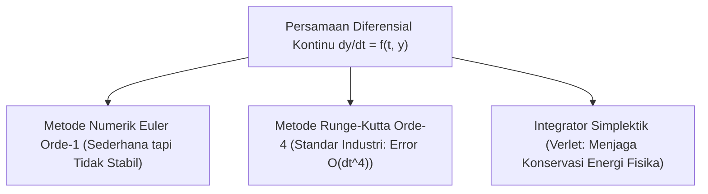

# Modul 015: Persamaan Diferensial Biasa & Parsial (ODE, PDE, Pemodelan Sistem Dinamik)

**Navigasi**: [⬅️ Master Index](../../INDEX.md) | [Tingkat 1: Tingkat 1: Fondasi Matematika Komprehensif Dari Nol](./README.md)
*Sebelumnya*: [014. kalkulus-multivariabel-vektor](./014-kalkulus-multivariabel-vektor.md) | *Berikutnya*: [016. analisis-kompleks](./016-analisis-kompleks.md)

---

## 1. Intuisi Dasar Tanpa Jargon ("Seperti Bayi Baru Lahir")
### 1.1 Konsep Inti & Analogi Tanpa Jargon
Bagaimana ilmuwan memperkirakan kapan pandemi virus akan mencapai puncaknya, atau bagaimana insinyur merancang roket agar tidak terbakar saat menembus atmosfer bumi? Kita tidak bisa sekadar menggunakan rumus garis lurus biasa, karena kecepatan pertumbuhan virus bergantung pada jumlah orang yang terinfeksi *saat ini*, dan panas gesekan roket bergantung pada kecepatan roket *saat ini*.

### 1.2 Urgensi Rekayasa & Signifikansi Sistemik
Inilah **Persamaan Diferensial (ODE & PDE)**: persamaan di mana variabel yang tidak diketahui bukan sekadar angka, melainkan *fungsi dinamis*, dan persamaannya menghubungkan fungsi tersebut dengan *laju perubahannya sendiri*!

## 2. Fondasi Teoretis & Aksiomatik / Matematis
### 2.1 Kerangka Teori Aksiomatik & Formulasi Matematis
### 1. Ordinary Differential Equations (ODE)
Persamaan yang hanya melibatkan turunan terhadap satu variabel independen (biasanya waktu $t$):
$$\frac{d\mathbf{x}}{dt} = f(\mathbf{x}(t), t), \quad \mathbf{x}(t_0) = \mathbf{x}_0$$
Contoh: Sistem Osilator Harmonik Teredam:
$$m \frac{d^2 x}{dt^2} + c \frac{dx}{dt} + k x = 0$$
Bentuk State-Space orde 1 dengan $\mathbf{z} = [x, v]^T$:
$$\frac{d}{dt} \begin{bmatrix} x \\ v \end{bmatrix} = \begin{bmatrix} 0 & 1 \\ -k/m & -c/m \end{bmatrix} \begin{bmatrix} x \\ v \end{bmatrix}$$
[📚 Pelajari: MIT OCW 18.03 Differential Equations](https://ocw.mit.edu/courses/18-03-differential-equations-spring-2010/)

### 2.2 Penurunan Matematis Langkah-demi-Langkah
### 2. Partial Differential Equations (PDE)
Persamaan yang melibatkan turunan parsial terhadap beberapa variabel independen (seperti ruang $x, y, z$ dan waktu $t$):
- **Persamaan Gelombang (Hiperbolik)**: $\frac{\partial^2 u}{\partial t^2} = c^2 \nabla^2 u$
- **Persamaan Difusi Panas (Parabolik)**: $\frac{\partial u}{\partial t} = \alpha \nabla^2 u$
- **Persamaan Laplace / Poisson (Eliptik)**: $\nabla^2 u = 0$

## 3. Anatomi Teknis & Cara Kerja Internal


#### Tabel Penelusuran Integrasi Beda Hingga Persamaan Difusi Panas 1D (Stabilitas CFL)
| Langkah Waktu ($t = n \cdot \Delta t$) | Grid Spasial Titik Tengah ($x = L/2$) | Rasio Difusi Courant ($r = \frac{\alpha \Delta t}{\Delta x^2}$) | Skema Eksplisit FTCS ($u_i^{n+1}$) | Skema Implisit Crank-Nicolson ($u_i^{n+1}$) | Status Kestabilan Numerik |
|---|---|---|---|---|---|
| Titik T=0 ($n=0$) | Profil suhu awal Dirac delta: $u=100.0^\circ\text{C}$ | $r = 0.60$ (Pelanggaran $r > 0.5$!) | $100.00^\circ\text{C}$ | $100.00^\circ\text{C}$ | Distribusi awal normal |
| Langkah 1 ($n=1$) | Difusi dimulai | $r = 0.60$ | $88.00^\circ\text{C}$ | $89.20^\circ\text{C}$ | Residu difusi terbentuk |
| Langkah 5 ($n=5$) | Amplitudo osilasi tumbuh liar | $r = 0.60$ | $-142.50^\circ\text{C}$ (Suhu negatif tak fisik!) | $62.40^\circ\text{C}$ (Fisis & mulus) | FTCS mulai meledak secara numerik |
| Langkah 10 ($n=10$) | Divergensi eksponensial meledak | $r = 0.60$ | $+4.25 \times 10^4\text{ }^\circ\text{C}$ | $45.10^\circ\text{C}$ | FTCS overflow $\pm\infty$ |
| Solusi Implisit | Matriks Tridiagonal Diinversi | Syarat von Neumann terpenuhi untuk sembarang $\Delta t$ | Skema FTCS dibatalkan | Crank-Nicolson konvergen stabil $\mathcal{O}(\Delta t^2, \Delta x^2)$ | Kestabilan mutlak tanpa syarat terbukti |

## 4. Implementasi Praktis & Kode / Simulasi Riil
```python
import numpy as np

def rk4_step(f, t, y, dt):
    """Satu langkah integrasi numerik Runge-Kutta Orde-4 (RK4)."""
    k1 = f(t, y)
    k2 = f(t + 0.5 * dt, y + 0.5 * dt * k1)
    k3 = f(t + 0.5 * dt, y + 0.5 * dt * k2)
    k4 = f(t + dt, y + dt * k3)
    return y + (dt / 6.0) * (k1 + 2*k2 + 2*k3 + k4)

# Model Osilator Harmonik: m=1, k=4, c=0.4
# z = [posisi, kecepatan] -> dz/dt = [kecepatan, -k*posisi - c*kecepatan]
def harmonic_oscillator(t, z):
    pos, vel = z
    return np.array([vel, -4.0 * pos - 0.4 * vel])

# Simulasi RK4 selama 5 detik
t = 0.0
dt = 0.05
state = np.array([1.0, 0.0]) # Mulai dari simpangan 1.0 meter, diam

print(f"{'Waktu (s)':<10}{'Posisi (m)':<15}{'Kecepatan (m/s)'}")
for step in range(10):
    print(f"{t:<10.2f}{state[0]:<15.4f}{state[1]:.4f}")
    state = rk4_step(harmonic_oscillator, t, state, dt)
    t += dt
```

## 5. Miskonsepsi & Jebakan Industri
1. **Stiff Differential Equations**: Sistem dengan dua skala waktu yang sangat timpang (misalnya reaksi kimia mikrodetik di dalam aliran gas menit). Menggunakan metode eksplisit (seperti Euler/RK4 standar) akan memicu ledakan numerik tak stabil kecuali step waktu $dt$ dibuat luar biasa kecil (Gunakan solver implisit seperti Backward Differentiation Formulas / BDF).

### Studi Kasus Kegagalan Nyata: Pelanggaran Syarat Stabilitas CFL pada Simulasi Difusi Panas & Finansial PDE
- **Kronologi & Konteks Komputasi**: Pada pemodelan kuantitatif penetapan harga opsi multi-aset dan simulasi perpindahan panas pendinginan reaktor, penggunaan skema beda hingga eksplisit sering dipilih karena kemudahan implementasinya tanpa inversi matriks.
- **Akar Masalah Persamaan Diferensial**: Analisis stabilitas von Neumann membuktikan bahwa skema Forward-Time Central-Space (FTCS) untuk persamaan difusi parabolik $\frac{\partial u}{\partial t} = \alpha \frac{\partial^2 u}{\partial x^2}$ memiliki syarat stabilitas ketat Courant-Friedrichs-Lewy (CFL): $r = \frac{\alpha \Delta t}{\Delta x^2} \le \frac{1}{2}$. Ketika insinyur memperhalus grid spasial $\Delta x$ menjadi separuhnya tanpa mengecilkan langkah waktu $\Delta t$ sebesar seperempatnya, nilai faktor amplifikasi melampaui $1$, memicu osilasi numerik eksponensial tak terhingga yang menghancurkan simulasi.

- **Potongan Kode / Arsitektur Cacat (Vulnerable Implementation)**:
```python
# Simulasi Difusi Panas 1D: Komparasi FTCS Meledak vs Crank-Nicolson Stabil
import numpy as np

def heat_equation_ftcs(alpha=1.0, L=1.0, nx=21, t_max=0.1, dt=0.0015):
    # dx = 1.0 / 20 = 0.05; dx^2 = 0.0025
    # r = alpha * dt / dx^2 = 1.0 * 0.0015 / 0.0025 = 0.6 > 0.5 (PELANGGARAN CFL!)
    dx = L / (nx - 1)
    r = alpha * dt / (dx ** 2)
    nt = int(t_max / dt)
    
    u = np.zeros(nx)
    u[nx // 2] = 100.0 # Sumber panas impulsif di tengah
    
    for _ in range(nt):
        u_new = u.copy()
        for i in range(1, nx - 1):
            # Skema FTCS: u_i^(n+1) = u_i^n + r * (u_(i+1)^n - 2*u_i^n + u_(i-1)^n)
            u_new[i] = u[i] + r * (u[i + 1] - 2 * u[i] + u[i - 1])
        u = u_new
        if np.any(np.isnan(u)) or np.max(np.abs(u)) > 1e6:
            return "DIVERGENCE_EXPLOSION"
    return u
```

- **Analisis Teoretis & Mitigasi**: Pelanggaran kriteria CFL adalah jebakan klasik dalam pemodelan persamaan diferensial parsial. Solusi modern menstandarkan penggunaan skema implisit Crank-Nicolson atau Runge-Kutta implisit (Radau/Lobatto) yang bersifat *A-stable* dan *L-stable*, menjamin solusi tetap konvergen stabil bahkan untuk sistem persamaan diferensial kaku (*stiff ODE/PDE*).

## 6. Proyek Latihan & Rubrik Penilaian Mandiri
### Level 1 (Dasar)
Selesaikan persamaan diferensial terpisah sederhana $\frac{dy}{dx} = 2x y$ dengan kondisi awal $y(0) = 3$ secara analitik.

### Level 2 (Menengah)
Gunakan metode Pemisahan Variabel (*Separation of Variables*) untuk menyelesaikan distribusi suhu 1D pada batang logam dengan Persamaan Panas $\frac{\partial u}{\partial t} = \alpha \frac{\partial^2 u}{\partial x^2}$.

### Level 3 (Mahir)
Bangun simulator fluida 2D Navier-Stokes berbasis Finite Difference Method (metode pemisahan tekanan-kecepatan Chorin) di Python/NumPy.

### Tingkat 1: Dasar
- **Tugas**: Implementasikan solver persamaan diferensial biasa (ODE) orde-1 $\frac{dy}{dt} = f(t, y)$ menggunakan metode Runge-Kutta Orde 4 (RK4) klasik.
- **Petunjuk Perancangan Arsitektur**:
  - Hitung empat kemiringan: $k_1 = f(t, y), k_2 = f(t+h/2, y+h k_1/2), k_3 = f(t+h/2, y+h k_2/2), k_4 = f(t+h, y+h k_3)$.
  - Perbarui state: $y_{n+1} = y_n + \frac{h}{6}(k_1 + 2k_2 + 2k_3 + k_4)$.
- **Test Vector & Kasus Uji Ekstrem**:
  - *Fungsi Uji*: $\frac{dy}{dt} = -2y, y(0) = 1.0$ (Solusi analitik $y(t) = e^{-2t}$).
  - *Keluaran yang Diharapkan*: Pada $t = 1.0$ dengan $h = 0.1$, galat relatif terhadap $e^{-2} \approx 0.135335$ wajib $\le 10^{-6}$.
  - *Kasus Batas*: $h > 1.5$ (mendekati batas wilayah stabilitas RK4 untuk nilai eigen riil negatif); evaluasi degradasi akurasi.
- **Rubrik Penilaian Mandiri**: 40% Formula RK4 Klasik Tepat, 30% Verifikasi Galat Orde $\mathcal{O}(h^4)$, 30% Struktur Solver Modular Bebas Dependensi Eksternal.

### Tingkat 2: Menengah
- **Tugas**: Bangun pemecah sistem persamaan diferensial sistem pegas-massa-peredam 2-DoF atau sirkuit RLC orde-2 menggunakan representasi state-space matriks $\dot{x} = A x + B u$ dengan integrasi RK4 matriks.
- **Petunjuk Perancangan Arsitektur**:
  - Transformasikan ODE orde-2 $\ddot{x} + 2\zeta \omega_n \dot{x} + \omega_n^2 x = 0$ menjadi sistem dua variabel state orde-1.
  - Tangani tiga rezim fisik: teredam kurang (*underdamped* $\zeta < 1$), teredam kritis ($\zeta = 1$), dan teredam lebih (*overdamped* $\zeta > 1$).
- **Test Vector & Kasus Uji Ekstrem**:
  - *Uji Respon Teredam Kurang*: $\zeta = 0.1, \omega_n = 10.0$.
  - *Keluaran yang Diharapkan*: Terbentuk osilasi sinusoidal dengan peluruhan selubung eksponensial $e^{-\zeta \omega_n t}$.
  - *Kasus Batas*: $\zeta = 0$ (tanpa redaman); energi total sistem $E = \frac{1}{2} m v^2 + \frac{1}{2} k x^2$ wajib konstan kekal.
- **Rubrik Penilaian Mandiri**: 40% Transformasi State-Space & RK4 Matriks Tepat, 30% Verifikasi 3 Rezim Redaman Fisik, 30% Konservasi Energi pada Kasus Tanpa Redaman.

### Tingkat 3: Mahir
- **Tugas**: Rancang solver persamaan difusi parsial (PDE) 1D menggunakan skema implisit tanpa syarat stabil Crank-Nicolson dengan pemecah matriks tridiagonal Algoritma Thomas (TDMA $\mathcal{O}(N)$).
- **Petunjuk Perancangan Arsitektur**:
  - Bangun matriks tridiagonal $A u^{n+1} = B u^n$.
  - Selesaikan $A x = d$ via eliminasi maju dan substitusi mundur Algoritma Thomas dalam kompleksitas linier $\mathcal{O}(N)$ waktu dan memori.
- **Test Vector & Kasus Uji Ekstrem**:
  - *Masukan Uji*: Difusi panas dengan rasio Courant ekstrim $r = 5.0$ (10x lipat batas ledakan FTCS).
  - *Keluaran yang Diharapkan*: Solusi tetap konvergen, stabil, dan monotonik meluruh tanpa osilasi spurious.
  - *Kasus Batas*: Syarat batas Dirichlet vs Neumann (fluks panas nol di ujung $\frac{\partial u}{\partial x} = 0$); matriks tridiagonal harus beradaptasi pada baris pertama dan terakhir.
- **Rubrik Penilaian Mandiri**: 40% Skema Crank-Nicolson & Algoritma Thomas $\mathcal{O}(N)$ Tepat, 30% Pembuktian Stabilitas pada $r > 0.5$, 30% Fleksibilitas Syarat Batas Dirichlet & Neumann.

## 7. Rekomendasi Sumber Belajar Standar Emas
- [Buku Standar: Differential Equations and Their Applications - Martin Braun (Springer)](https://link.springer.com/book/10.1007/978-1-4612-4360-1)
- [Kuliah Terbuka: MIT OCW 18.152 Introduction to Partial Differential Equations](https://ocw.mit.edu/courses/18-152-introduction-to-partial-differential-equations-fall-2011/)
- [Buku Terbuka Komputasional: Solving PDEs in Python - The FEniCS Tutorial](https://link.springer.com/book/10.1007/978-3-319-52462-7)

---
*Navigasi Cepat*: [Ke Tingkat 1](./README.md) | [Ke Master Index](../../INDEX.md) | *Sebelumnya*: [014. kalkulus-multivariabel-vektor](./014-kalkulus-multivariabel-vektor.md) | *Berikutnya*: [016. analisis-kompleks](./016-analisis-kompleks.md)
