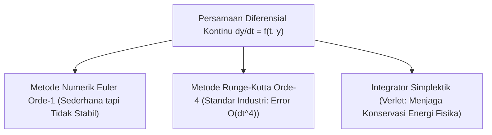

# Modul 015: Persamaan Diferensial Biasa & Parsial (ODE, PDE, Pemodelan Sistem Dinamik)

**Navigasi**: [⬅️ Master Index](../../INDEX.md) | [Tingkat 1: Tingkat 1: Fondasi Matematika Komprehensif Dari Nol](./README.md)
*Sebelumnya*: [014. kalkulus-multivariabel-vektor](./014-kalkulus-multivariabel-vektor.md) | *Berikutnya*: [016. analisis-kompleks](./016-analisis-kompleks.md)

---

## 1. Intuisi Dasar Tanpa Jargon ("Seperti Bayi Baru Lahir")
Bagaimana ilmuwan memperkirakan kapan pandemi virus akan mencapai puncaknya, atau bagaimana insinyur merancang roket agar tidak terbakar saat menembus atmosfer bumi? Kita tidak bisa sekadar menggunakan rumus garis lurus biasa, karena kecepatan pertumbuhan virus bergantung pada jumlah orang yang terinfeksi *saat ini*, dan panas gesekan roket bergantung pada kecepatan roket *saat ini*. 

Inilah **Persamaan Diferensial (ODE & PDE)**: persamaan di mana variabel yang tidak diketahui bukan sekadar angka, melainkan *fungsi dinamis*, dan persamaannya menghubungkan fungsi tersebut dengan *laju perubahannya sendiri*!

## 2. Fondasi Teoretis & Aksiomatik / Matematis
### 1. Ordinary Differential Equations (ODE)
Persamaan yang hanya melibatkan turunan terhadap satu variabel independen (biasanya waktu $t$):
$$\frac{d\mathbf{x}}{dt} = f(\mathbf{x}(t), t), \quad \mathbf{x}(t_0) = \mathbf{x}_0$$
Contoh: Sistem Osilator Harmonik Teredam:
$$m \frac{d^2 x}{dt^2} + c \frac{dx}{dt} + k x = 0$$
Bentuk State-Space orde 1 dengan $\mathbf{z} = [x, v]^T$:
$$\frac{d}{dt} \begin{bmatrix} x \\ v \end{bmatrix} = \begin{bmatrix} 0 & 1 \\ -k/m & -c/m \end{bmatrix} \begin{bmatrix} x \\ v \end{bmatrix}$$
[📚 Pelajari: MIT OCW 18.03 Differential Equations](https://ocw.mit.edu/courses/18-03-differential-equations-spring-2010/)

### 2. Partial Differential Equations (PDE)
Persamaan yang melibatkan turunan parsial terhadap beberapa variabel independen (seperti ruang $x, y, z$ dan waktu $t$):
- **Persamaan Gelombang (Hiperbolik)**: $\frac{\partial^2 u}{\partial t^2} = c^2 \nabla^2 u$
- **Persamaan Difusi Panas (Parabolik)**: $\frac{\partial u}{\partial t} = \alpha \nabla^2 u$
- **Persamaan Laplace / Poisson (Eliptik)**: $\nabla^2 u = 0$

## 3. Anatomi Teknis & Cara Kerja Internal


## 4. Implementasi Praktis & Kode / Simulasi Riil
```python
import numpy as np

def rk4_step(f, t, y, dt):
    """Satu langkah integrasi numerik Runge-Kutta Orde-4 (RK4)."""
    k1 = f(t, y)
    k2 = f(t + 0.5 * dt, y + 0.5 * dt * k1)
    k3 = f(t + 0.5 * dt, y + 0.5 * dt * k2)
    k4 = f(t + dt, y + dt * k3)
    return y + (dt / 6.0) * (k1 + 2*k2 + 2*k3 + k4)

# Model Osilator Harmonik: m=1, k=4, c=0.4
# z = [posisi, kecepatan] -> dz/dt = [kecepatan, -k*posisi - c*kecepatan]
def harmonic_oscillator(t, z):
    pos, vel = z
    return np.array([vel, -4.0 * pos - 0.4 * vel])

# Simulasi RK4 selama 5 detik
t = 0.0
dt = 0.05
state = np.array([1.0, 0.0]) # Mulai dari simpangan 1.0 meter, diam

print(f"{'Waktu (s)':<10}{'Posisi (m)':<15}{'Kecepatan (m/s)'}")
for step in range(10):
    print(f"{t:<10.2f}{state[0]:<15.4f}{state[1]:.4f}")
    state = rk4_step(harmonic_oscillator, t, state, dt)
    t += dt
```

## 5. Miskonsepsi & Jebakan Industri
1. **Stiff Differential Equations**: Sistem dengan dua skala waktu yang sangat timpang (misalnya reaksi kimia mikrodetik di dalam aliran gas menit). Menggunakan metode eksplisit (seperti Euler/RK4 standar) akan memicu ledakan numerik tak stabil kecuali step waktu $dt$ dibuat luar biasa kecil (Gunakan solver implisit seperti Backward Differentiation Formulas / BDF).

## 6. Proyek Latihan & Rubrik Penilaian Mandiri
### Level 1 (Dasar)
Selesaikan persamaan diferensial terpisah sederhana $\frac{dy}{dx} = 2x y$ dengan kondisi awal $y(0) = 3$ secara analitik.

### Level 2 (Menengah)
Gunakan metode Pemisahan Variabel (*Separation of Variables*) untuk menyelesaikan distribusi suhu 1D pada batang logam dengan Persamaan Panas $\frac{\partial u}{\partial t} = \alpha \frac{\partial^2 u}{\partial x^2}$.

### Level 3 (Mahir)
Bangun simulator fluida 2D Navier-Stokes berbasis Finite Difference Method (metode pemisahan tekanan-kecepatan Chorin) di Python/NumPy.

## 7. Rekomendasi Sumber Belajar Standar Emas
- [Buku Standar: Differential Equations and Their Applications - Martin Braun (Springer)](https://link.springer.com/book/10.1007/978-1-4612-4360-1)
- [Kuliah Terbuka: MIT OCW 18.152 Introduction to Partial Differential Equations](https://ocw.mit.edu/courses/18-152-introduction-to-partial-differential-equations-fall-2011/)
- [Buku Terbuka Komputasional: Solving PDEs in Python - The FEniCS Tutorial](https://link.springer.com/book/10.1007/978-3-319-52462-7)

---
*Navigasi Cepat*: [Ke Tingkat 1](./README.md) | [Ke Master Index](../../INDEX.md) | *Sebelumnya*: [014. kalkulus-multivariabel-vektor](./014-kalkulus-multivariabel-vektor.md) | *Berikutnya*: [016. analisis-kompleks](./016-analisis-kompleks.md)
