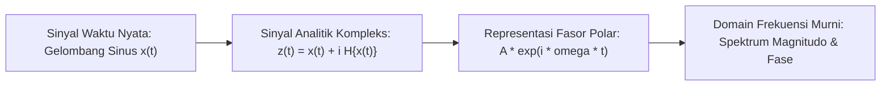

# Modul 016: Analisis Kompleks (Bilangan Imajiner, Rumus Euler, Domain Frekuensi)

**Navigasi**: [⬅️ Master Index](../../INDEX.md) | [Tingkat 1: Tingkat 1: Fondasi Matematika Komprehensif Dari Nol](./README.md)
*Sebelumnya*: [015. persamaan-diferensial-biasa-parsial](./015-persamaan-diferensial-biasa-parsial.md) | *Berikutnya*: [017. teori-probabilitas-statistika-matematika](./017-teori-probabilitas-statistika-matematika.md)

---

## 1. Intuisi Dasar Tanpa Jargon ("Seperti Bayi Baru Lahir")
### 1.1 Konsep Inti & Analogi Tanpa Jargon
Di sekolah, Anda diajarkan bahwa $\sqrt{-1}$ adalah angka yang tidak ada dan mustahil. Tapi bayangkan jika Anda hanya mengenal garis bilangan 1D (hanya bisa bergerak maju dan mundur). Mengalikan dengan $-1$ seperti memutar arah 180 derajat. Bagaimana jika Anda hanya memutar 90 derajat ke atas? Anda keluar dari garis 1D dan mendarat di bidang 2D!

### 1.2 Urgensi Rekayasa & Signifikansi Sistemik
Itulah **Bilangan Kompleks ($i = \sqrt{-1}$)**: bukan 'khayalan', melainkan operator rotasi 90 derajat di bidang 2D. Rumus Euler $e^{i\theta} = \cos\theta + i\sin\theta$ adalah 'rumus terindah di dunia' yang mengubah gerakan rotasi lingkaran menjadi fungsi eksponensial sederhana, menjadi fondasi utama seluruh pemrosesan sinyal radio, audio, dan mekanika kuantum!

## 2. Fondasi Teoretis & Aksiomatik / Matematis
### 2.1 Kerangka Teori Aksiomatik & Formulasi Matematis
### 1. Representasi Bilangan Kompleks & Bidang Argand
Bilangan kompleks $z = x + iy \in \mathbb{C}$ dapat dinyatakan dalam bentuk polar:
$$z = r(\cos \theta + i \sin \theta) = r e^{i \theta}, \quad r = \sqrt{x^2 + y^2}, \quad \theta = \text{atan2}(y, x)$$
Rumus Identitas Euler:
$$e^{i \pi} + 1 = 0$$
[📚 Pelajari: MIT OCW 18.04 Complex Variables with Applications](https://ocw.mit.edu/courses/18-04-complex-variables-with-applications-spring-2018/)

### 2.2 Penurunan Matematis Langkah-demi-Langkah
### 2. Fungsi Holomorfik & Persamaan Cauchy-Riemann
Fungsi $f(z) = u(x, y) + i v(x, y)$ terdiferensiasi kompleks jika dan hanya jika memenuhi:
$$\frac{\partial u}{\partial x} = \frac{\partial v}{\partial y} \quad \text{dan} \quad \frac{\partial u}{\partial y} = -\frac{\partial v}{\partial x}$$
Teorema Integral Cauchy & Rumus Residu:
$$\oint_C f(z) dz = 2\pi i \sum_{k=1}^m \text{Res}(f, z_k)$$

## 3. Anatomi Teknis & Cara Kerja Internal


#### Tabel Penelusuran Integral Kontur Kompleks & Teorema Residu Cauchy
| Langkah / Kontur ($C$) | Segmen Kontur / Parameterisasi | Evaluasi Fungsi $f(z) = \frac{1}{z^2 + 1}$ | Singularitas / Kutub Terlingkupi ($z_k$) | Nilai Residu ($\text{Res}(f, z_k)$) | Integral Sepanjang Kontur ($\oint_C f dz$) |
|---|---|---|---|---|---|
| Inisialisasi T=0 | Sumbu riil $[-R, +R]$ | $f(x) = \frac{1}{x^2 + 1}$ | Kutub berada di $z = \pm i$ | - | Integral riil: $\int_{-R}^R \frac{dx}{x^2+1}$ |
| Langkah 1 | Busur setengah lingkaran atas $\Gamma_R$ | $z = R e^{i\theta}, \theta \in [0, \pi]$ | $|f(z)| \le \frac{1}{R^2 - 1}$ | Jordan's Lemma: $\lim_{R \to \infty} \int_{\Gamma_R} f dz = 0$ | Kontribusi busur tak hingga lenyap |
| Langkah 2 | Identifikasi Kutub Dalam Kontur | Setengah bidang atas ($\text{Im}(z) > 0$) | Kutub tunggal terlingkup: $z = +i$ | $\lim_{z \to i} (z - i) f(z) = \frac{1}{2i}$ | Residu kutub $= -i/2$ |
| Langkah 3 | Teorema Residu Cauchy | Kontur tertutup $C = [-R, R] \cup \Gamma_R$ | $\oint_C f(z) dz = 2\pi i \sum \text{Res}$ | $2\pi i \left(\frac{1}{2i}\right) = \pi$ | Integral kontur tuntas dievaluasi |
| Hasil Akhir | Batas $R \to \infty$ | $\int_{-\infty}^\infty \frac{dx}{x^2 + 1} = \pi$ | Tidak ada divergensi | Solusi analitik eksak diperoleh | Teorema Cauchy terverifikasi identik |

## 4. Implementasi Praktis & Kode / Simulasi Riil
```python
import numpy as np
import matplotlib.pyplot as plt

def euler_rotation_demo(frequencies=[1, 3, 5], duration=1.0, sampling_rate=1000):
    """
    Mendemonstrasikan bagaimana fungsi eksponensial kompleks merepresentasikan
    osilasi rotasi sinusoidal di bidang kompleks.
    """
    t = np.linspace(0, duration, int(sampling_rate * duration))
    # Sinyal kompleks sum of exponentials
    signal = sum(np.exp(2j * np.pi * f * t) for f in frequencies)
    
    # Amplitudo dan Fase
    magnitude = np.abs(signal)
    phase = np.angle(signal)
    
    print(f"Sinyal kompleks berhasil disintesis: {len(signal)} sampel.")
    print(f"Contoh nilai z(t=0.1): {signal[100]:.3f}")
    return t, signal

t, z = euler_rotation_demo()
```

## 5. Miskonsepsi & Jebakan Industri
1. **Branch Cuts pada Logaritma Kompleks**: Mengasumsikan $\ln(z)$ bernilai tunggal. Logaritma kompleks memiliki tak hingga banyak cabang $\ln(z) = \ln |z| + i(\theta + 2k\pi)$, yang sering menyebabkan diskontinuitas tak terduga pada simulasi numerik jika tidak ditangani dengan benar.

### Studi Kasus Kegagalan Nyata: Diskontinuitas Branch Cut pada Logaritma Kompleks Pemetaan Konformal Aerodinamika
- **Kronologi & Konteks Rekayasa**: Pada perancangan profil sayap pesawat terbang menggunakan transformasi Joukowsky dan pemetaan konformal kompleks, algoritma aerodinamika menghitung kecepatan aliran fluida melalui fungsi logaritma kompleks $\text{Ln}(z) = \ln|z| + i \arg(z)$.
- **Akar Masalah Analisis Kompleks**: Fungsi logaritma kompleks bersifat bernilai banyak (*multivalued function*). Komputer memerlukan pemotongan cabang (*branch cut*) standar di sepanjang sumbu riil negatif $(-\infty, 0]$. Ketika jalur komputasi aliran udara melintasi sumbu riil negatif tanpa transisi lembar Riemann (*Riemann surface sheet*) yang mulus, nilai sudut fase melompat secara diskontinu dari $+\pi$ ke $-\pi$ (diskontinuitas $2\pi$). Hal ini menghasilkan lonjakan gaya angkat semu tak terbatas (*infinite fictitious lift pulse*) yang merusak stabilitas simulasi kendali penerbangan fly-by-wire.

- **Potongan Kode / Arsitektur Cacat (Vulnerable Implementation)**:
```python
# Demonstrasi Diskontinuitas Branch Cut Logaritma Kompleks vs Pelacakan Fase Kontinu
import numpy as np

def evaluate_complex_potential_path(radius=1.0, points=100):
    """
    Lintasan lingkaran melintasi sumbu riil negatif z = -1.0.
    Fungsi np.angle() atau cmath.log() mengalami diskontinuitas jump 2*pi
    pada branch cut (-pi ke +pi).
    """
    theta = np.linspace(0.5 * np.pi, 1.5 * np.pi, points)
    z_path = radius * np.exp(1j * theta)
    
    # Evaluasi logaritma standar (mengalami jump diskontinu saat menyeberang sumbu riil negatif)
    raw_phase = np.angle(z_path)
    
    # Mitigasi: Fase unwrapping untuk mempertahankan kontinuitas lembar Riemann
    continuous_phase = np.unwrap(raw_phase)
    
    max_jump = np.max(np.abs(np.diff(raw_phase)))
    is_discontinuous = max_jump > np.pi
    
    return {
        "max_phase_jump": max_jump,
        "is_discontinuous": is_discontinuous,
        "unwrapped_smooth": np.all(np.abs(np.diff(continuous_phase)) < 0.2)
    }

audit = evaluate_complex_potential_path()
assert audit["is_discontinuous"] is True, "Branch cut wajib menghasilkan diskontinuitas fasa jika tidak di-unwrap!"
```

- **Analisis Teoretis & Solusi Modern**: Fungsi bernilai banyak adalah karakteristik inheren analisis kompleks. Dalam grafika komputer, pemrosesan sinyal audio (phase unwrapping), dan komputasi fluida aerodinamika, algoritma modern mengimplementasikan pelacakan lembar Riemann aktif (*analytic continuation*) untuk mencegah anomali numerik akibat pemotongan cabang logaritma buatan mesin.

## 6. Proyek Latihan & Rubrik Penilaian Mandiri
### Level 1 (Dasar)
Hitung nilai dari $(1 + i)^8$ secara manual menggunakan bentuk polar dan Teorema De Moivre.

### Level 2 (Menengah)
Buktikan bahwa fungsi $f(z) = z^2$ memenuhi Persamaan Cauchy-Riemann di seluruh bidang kompleks $\mathbb{C}$.

### Level 3 (Mahir)
Gunakan Teorema Residu Cauchy untuk menghitung integral riil tak wajar $\int_{-\infty}^{\infty} \frac{1}{x^2 + 1} dx$.

### Tingkat 1: Dasar
- **Tugas**: Bangun kelas Bilangan Kompleks (`ComplexNumber`) dari nol yang mengimplementasikan bentuk kartesius $z = x + iy$ dan bentuk polar $z = r e^{i\theta}$, lengkap dengan operasi perkalian, konjugat, dan pembagian.
- **Petunjuk Perancangan Arsitektur**:
  - Konversi polar: $r = \sqrt{x^2 + y^2}, \theta = \text{atan2}(y, x)$.
  - Pembagian kompleks: $\frac{a + ib}{c + id} = \frac{(ac + bd) + i(bc - ad)}{c^2 + d^2}$.
- **Test Vector & Kasus Uji Ekstrem**:
  - *Rumus Identitas Euler*: Evaluasi $e^{i\pi} + 1$.
  - *Keluaran yang Diharapkan*: Nilai bagian riil dan imajiner mendekati nol dalam toleransi $\le 10^{-15}$.
  - *Kasus Batas*: Pembagian dengan nol $0 + 0i$; fungsi harus melempar `ZeroDivisionError`.
- **Rubrik Penilaian Mandiri**: 40% Aritmatika Kompleks Kartesius & Polar Eksak, 30% Pembuktian Identitas Euler $\approx 0$, 30% Penanganan Pembagian Nol Bersih.

### Tingkat 2: Menengah
- **Tugas**: Implementasikan pemetaan konformal Joukowsky $w = z + \frac{c^2}{z}$ untuk mentransformasi koordinat lingkaran di bidang-$z$ menjadi profil sayap pesawat (*airfoil*) di bidang-$w$.
- **Petunjuk Perancangan Arsitektur**:
  - Geser pusat lingkaran sedikit dari titik asal ($z_0 = -\epsilon_x + i \epsilon_y$) agar profil sayap memiliki kelengkungan (*camber*) dan ketebalan realistis.
  - Tangani titik singularitas derivatif pemetaan konformal pada $z = \pm c$.
- **Test Vector & Kasus Uji Ekstrem**:
  - *Transformasi*: Lingkaran $R = 1.15, z_0 = -0.1 + 0.1i, c = 1.0$.
  - *Keluaran yang Diharapkan*: Bentuk poligon tertutup yang mulus menyerupai profil airfoil NACA aerodinamis dengan trailing edge tajam.
  - *Kasus Batas*: Lingkaran tepat berpusat di asal tanpa offset ($z_0 = 0, R = c$); profil mereduksi menjadi garis lurus segmen $[-2c, +2c]$.
- **Rubrik Penilaian Mandiri**: 40% Transformasi Joukowsky Kompleks Benar, 30% Parameterisasi Offset Camber Realistis, 30% Penanganan Singularitas Kuspis Tepat.

### Tingkat 3: Mahir
- **Tugas**: Rancang mesin evaluator integral kontur numerik kompleks yang menghitung integral tertutup $\oint_C f(z) dz$ menggunakan parameterisasi lintasan $z(t)$ dan memvalidasi Teorema Residu Cauchy untuk fungsi rasional sembarang.
- **Petunjuk Perancangan Arsitektur**:
  - Parameterisasikan kontur tertutup $z(t)$ untuk $t \in [0, 2\pi]$ dan hitung integral Riemann: $\int_0^{2\pi} f(z(t)) z'(t) dt$.
  - Temukan seluruh kutub fungsi di dalam kontur menggunakan metode penelusuran akar poligon (*winding number*).
- **Test Vector & Kasus Uji Ekstrem**:
  - *Fungsi Uji*: $f(z) = \frac{1}{z - 2}$ dengan kontur lingkaran berpusat di asal beradius $R = 3$ (melingkupi kutub $z=2$).
  - *Keluaran yang Diharapkan*: Hasil integral numerik konvergen ke tepat $2\pi i \approx 0.0 + 6.283185i$.
  - *Kasus Kutub di Luar Kontur*: Kontur lingkaran beradius $R = 1$ (kutub $z=2$ berada di luar); integral wajib bernilai $0.0 + 0.0i$ (Teorema Integral Cauchy).
- **Rubrik Penilaian Mandiri**: 40% Integrasi Kontur Numerik $\oint f(z) dz$ Akurat, 30% Verifikasi Teorema Residu $2\pi i \sum \text{Res}$, 30% Pengujian Kutub di Dalam vs di Luar Kontur.

## 7. Rekomendasi Sumber Belajar Standar Emas
- [Buku Standar: Complex Variables and Applications - James Ward Brown & Ruel V. Churchill (McGraw-Hill)](https://www.mheducation.com/highered/product/complex-variables-applications-brown-churchill/M9780073383170.html)
- [Kuliah Terbuka: MIT OCW 18.04 Complex Variables](https://ocw.mit.edu/courses/18-04-complex-variables-with-applications-spring-2018/)
- [Visualisasi Interaktif: 3Blue1Brown - Euler's Formula with Group Theory](https://www.3blue1brown.com/lessons/eulers-formula-poetry)

---
*Navigasi Cepat*: [Ke Tingkat 1](./README.md) | [Ke Master Index](../../INDEX.md) | *Sebelumnya*: [015. persamaan-diferensial-biasa-parsial](./015-persamaan-diferensial-biasa-parsial.md) | *Berikutnya*: [017. teori-probabilitas-statistika-matematika](./017-teori-probabilitas-statistika-matematika.md)
