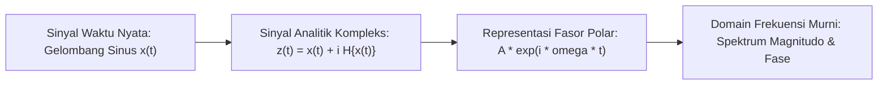

# Modul 016: Analisis Kompleks (Bilangan Imajiner, Rumus Euler, Domain Frekuensi)

**Navigasi**: [⬅️ Master Index](../../INDEX.md) | [Tingkat 1: Tingkat 1: Fondasi Matematika Komprehensif Dari Nol](./README.md)
*Sebelumnya*: [015. persamaan-diferensial-biasa-parsial](./015-persamaan-diferensial-biasa-parsial.md) | *Berikutnya*: [017. teori-probabilitas-statistika-matematika](./017-teori-probabilitas-statistika-matematika.md)

---

## 1. Intuisi Dasar Tanpa Jargon ("Seperti Bayi Baru Lahir")
Di sekolah, Anda diajarkan bahwa $\sqrt{-1}$ adalah angka yang tidak ada dan mustahil. Tapi bayangkan jika Anda hanya mengenal garis bilangan 1D (hanya bisa bergerak maju dan mundur). Mengalikan dengan $-1$ seperti memutar arah 180 derajat. Bagaimana jika Anda hanya memutar 90 derajat ke atas? Anda keluar dari garis 1D dan mendarat di bidang 2D!

Itulah **Bilangan Kompleks ($i = \sqrt{-1}$)**: bukan 'khayalan', melainkan operator rotasi 90 derajat di bidang 2D. Rumus Euler $e^{i\theta} = \cos\theta + i\sin\theta$ adalah 'rumus terindah di dunia' yang mengubah gerakan rotasi lingkaran menjadi fungsi eksponensial sederhana, menjadi fondasi utama seluruh pemrosesan sinyal radio, audio, dan mekanika kuantum!

## 2. Fondasi Teoretis & Aksiomatik / Matematis
### 1. Representasi Bilangan Kompleks & Bidang Argand
Bilangan kompleks $z = x + iy \in \mathbb{C}$ dapat dinyatakan dalam bentuk polar:
$$z = r(\cos \theta + i \sin \theta) = r e^{i \theta}, \quad r = \sqrt{x^2 + y^2}, \quad \theta = \text{atan2}(y, x)$$
Rumus Identitas Euler:
$$e^{i \pi} + 1 = 0$$
[📚 Pelajari: MIT OCW 18.04 Complex Variables with Applications](https://ocw.mit.edu/courses/18-04-complex-variables-with-applications-spring-2018/)

### 2. Fungsi Holomorfik & Persamaan Cauchy-Riemann
Fungsi $f(z) = u(x, y) + i v(x, y)$ terdiferensiasi kompleks jika dan hanya jika memenuhi:
$$\frac{\partial u}{\partial x} = \frac{\partial v}{\partial y} \quad \text{dan} \quad \frac{\partial u}{\partial y} = -\frac{\partial v}{\partial x}$$
Teorema Integral Cauchy & Rumus Residu:
$$\oint_C f(z) dz = 2\pi i \sum_{k=1}^m \text{Res}(f, z_k)$$

## 3. Anatomi Teknis & Cara Kerja Internal


## 4. Implementasi Praktis & Kode / Simulasi Riil
```python
import numpy as np
import matplotlib.pyplot as plt

def euler_rotation_demo(frequencies=[1, 3, 5], duration=1.0, sampling_rate=1000):
    """
    Mendemonstrasikan bagaimana fungsi eksponensial kompleks merepresentasikan
    osilasi rotasi sinusoidal di bidang kompleks.
    """
    t = np.linspace(0, duration, int(sampling_rate * duration))
    # Sinyal kompleks sum of exponentials
    signal = sum(np.exp(2j * np.pi * f * t) for f in frequencies)
    
    # Amplitudo dan Fase
    magnitude = np.abs(signal)
    phase = np.angle(signal)
    
    print(f"Sinyal kompleks berhasil disintesis: {len(signal)} sampel.")
    print(f"Contoh nilai z(t=0.1): {signal[100]:.3f}")
    return t, signal

t, z = euler_rotation_demo()
```

## 5. Miskonsepsi & Jebakan Industri
1. **Branch Cuts pada Logaritma Kompleks**: Mengasumsikan $\ln(z)$ bernilai tunggal. Logaritma kompleks memiliki tak hingga banyak cabang $\ln(z) = \ln |z| + i(\theta + 2k\pi)$, yang sering menyebabkan diskontinuitas tak terduga pada simulasi numerik jika tidak ditangani dengan benar.

## 6. Proyek Latihan & Rubrik Penilaian Mandiri
### Level 1 (Dasar)
Hitung nilai dari $(1 + i)^8$ secara manual menggunakan bentuk polar dan Teorema De Moivre.

### Level 2 (Menengah)
Buktikan bahwa fungsi $f(z) = z^2$ memenuhi Persamaan Cauchy-Riemann di seluruh bidang kompleks $\mathbb{C}$.

### Level 3 (Mahir)
Gunakan Teorema Residu Cauchy untuk menghitung integral riil tak wajar $\int_{-\infty}^{\infty} \frac{1}{x^2 + 1} dx$.

## 7. Rekomendasi Sumber Belajar Standar Emas
- [Buku Standar: Complex Variables and Applications - James Ward Brown & Ruel V. Churchill (McGraw-Hill)](https://www.mheducation.com/highered/product/complex-variables-applications-brown-churchill/M9780073383170.html)
- [Kuliah Terbuka: MIT OCW 18.04 Complex Variables](https://ocw.mit.edu/courses/18-04-complex-variables-with-applications-spring-2018/)
- [Visualisasi Interaktif: 3Blue1Brown - Euler's Formula with Group Theory](https://www.3blue1brown.com/lessons/eulers-formula-poetry)

---
*Navigasi Cepat*: [Ke Tingkat 1](./README.md) | [Ke Master Index](../../INDEX.md) | *Sebelumnya*: [015. persamaan-diferensial-biasa-parsial](./015-persamaan-diferensial-biasa-parsial.md) | *Berikutnya*: [017. teori-probabilitas-statistika-matematika](./017-teori-probabilitas-statistika-matematika.md)
