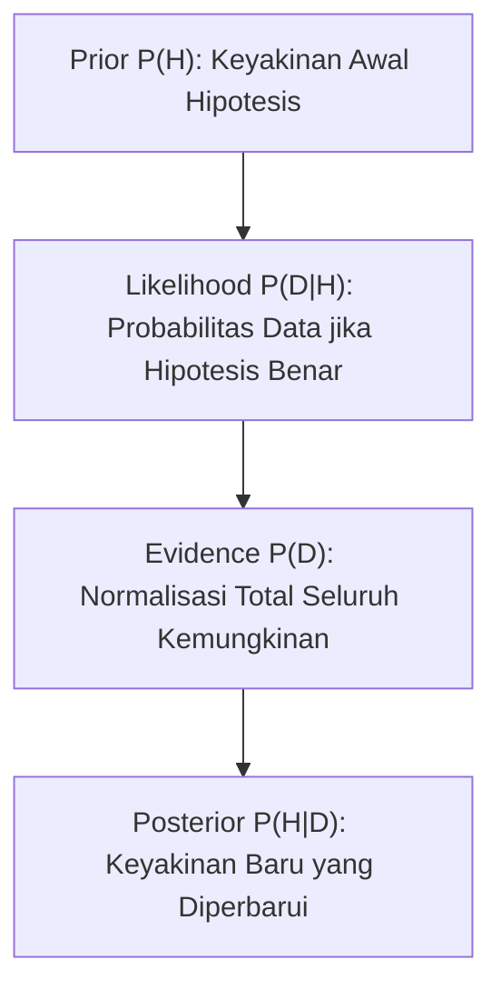

# Modul 017: Teori Probabilitas & Statistika Matematika (Aksioma Kolmogorov, Teorema Bayes, CLT)

**Navigasi**: [⬅️ Master Index](../../INDEX.md) | [Tingkat 1: Tingkat 1: Fondasi Matematika Komprehensif Dari Nol](./README.md)
*Sebelumnya*: [016. analisis-kompleks](./016-analisis-kompleks.md) | *Berikutnya*: [018. statistika-inferensial-desain-eksperimen](./018-statistika-inferensial-desain-eksperimen.md)

---

## 1. Intuisi Dasar Tanpa Jargon ("Seperti Bayi Baru Lahir")
Jika Anda melempar koin 10 kali dan semuanya keluar gambar kepala, apakah lemparan ke-11 pasti keluar angka ekor? Kebanyakan orang mengira 'sudah saatnya ekor keluar' (Kekeliruan Penjudi / *Gambler's Fallacy*). Padahal koin tidak memiliki memori; setiap lemparan tetap independen dengan probabilitas 50%!

**Teori Probabilitas & Statistika Matematika** adalah bahasa resmi untuk mengukur ketidakpastian. Di dunia modern, data selalu berisik (*noisy*). Aksioma Kolmogorov mendefinisikan aturan main ketidakpastian secara mutlak, sedangkan Teorema Bayes adalah algoritma ilmiah untuk memperbarui keyakinan kita saat ada bukti baru yang ditemukan!

## 2. Fondasi Teoretis & Aksiomatik / Matematis
### 1. Aksioma Probabilitas Kolmogorov
Diberikan ruang sampel $\Omega$ dan aljabar-$\sigma$ $\mathcal{F}$:
1. Non-negativitas: $\forall E \in \mathcal{F}, P(E) \ge 0$
2. Normalisasi: $P(\Omega) = 1$
3. Aditivitas Terhitung: Untuk kejadian saling lepas $E_1, E_2, \dots$:
$$P\left(\bigcup_{i=1}^\infty E_i\right) = \sum_{i=1}^\infty P(E_i)$$
[📚 Pelajari: MIT OCW 6.041 Probabilistic Systems Analysis](https://ocw.mit.edu/courses/6-041-probabilistic-systems-analysis-and-applied-probability-fall-2010/)

### 2. Teorema Bayes & Central Limit Theorem (CLT)
- **Teorema Bayes**:
  $$P(A|B) = \frac{P(B|A) \cdot P(A)}{P(B)} = \frac{P(B|A) P(A)}{P(B|A)P(A) + P(B|\neg A)P(\neg A)}$$
- **Central Limit Theorem (CLT)**:
  Jika $X_1, X_2, \dots, X_n$ adalah variabel acak i.i.d. dengan rata-rata $\mu$ dan varians $\sigma^2 < \infty$, maka rata-rata sampel $\bar{X}_n$ akan berdistribusi normal saat $n \to \infty$:
  $$\frac{\bar{X}_n - \mu}{\sigma / \sqrt{n}} \xrightarrow{d} \mathcal{N}(0, 1)$$

## 3. Anatomi Teknis & Cara Kerja Internal


## 4. Implementasi Praktis & Kode / Simulasi Riil
```python
import numpy as np

def verify_central_limit_theorem(sample_size=30, num_simulations=10000):
    """
    Membuktikan Teorema Limit Pusat (CLT):
    Rata-rata dari variabel acak Uniform (non-Gaussian) akan membentuk kurva lonceng Gaussian.
    """
    # Ambil sampel dari distribusi seragam (Uniform [0, 1])
    samples = np.random.uniform(0.0, 1.0, size=(num_simulations, sample_size))
    sample_means = np.mean(samples, axis=1)
    
    mean_of_means = np.mean(sample_means)
    std_of_means = np.std(sample_means)
    
    theoretical_mean = 0.5
    theoretical_std = np.sqrt(1/12) / np.sqrt(sample_size)
    
    print(f"Rata-rata Sampel Aktual: {mean_of_means:.4f} (Teoretis: {theoretical_mean})")
    print(f"Standar Deviasi Aktual: {std_of_means:.4f} (Teoretis: {theoretical_std:.4f})")
    assert abs(mean_of_means - theoretical_mean) < 0.01
    print("CLT Terbukti Valid: Distribusi konvergen ke Normal Gaussian!")

verify_central_limit_theorem()
```

## 5. Miskonsepsi & Jebakan Industri
1. **Base Rate Fallacy**: Mengabaikan probabilitas awal (*prior*). Contoh: Tes penyakit dengan akurasi 99% pada penyakit langka (1 per 10.000 orang) menghasilkan probabilitas orang yang positif benar-benar sakit hanya $\approx 1\%$, bukan 99%!

## 6. Proyek Latihan & Rubrik Penilaian Mandiri
### Level 1 (Dasar)
Gunakan Teorema Bayes untuk menghitung probabilitas bahwa sebuah email adalah spam jika memuat kata 'gratis', dengan data prior spam = 20%, P('gratis'|spam) = 80%, P('gratis'|bukan spam) = 5%.

### Level 2 (Menengah)
Buktikan bahwa Varians dari jumlah dua variabel acak independen adalah $\text{Var}(X + Y) = \text{Var}(X) + \text{Var}(Y)$.

### Level 3 (Mahir)
Implementasikan sampler Markov Chain Monte Carlo (MCMC) Metropolis-Hastings dalam Python untuk mengambil sampel dari distribusi posterior non-standar.

## 7. Rekomendasi Sumber Belajar Standar Emas
- [Buku Standar: Introduction to Probability - Dimitri P. Bertsekas & John N. Tsitsiklis (Athena Scientific)](https://athenasc.com/probbook.html)
- [Kuliah Terbuka: Harvard Statistics 110 - Probability (Joe Blitzstein)](https://projects.iq.harvard.edu/stat110)
- [Simulator Interaktif: Seeing Theory - A Visual Introduction to Probability and Data](https://seeing-theory.brown.edu/)

---
*Navigasi Cepat*: [Ke Tingkat 1](./README.md) | [Ke Master Index](../../INDEX.md) | *Sebelumnya*: [016. analisis-kompleks](./016-analisis-kompleks.md) | *Berikutnya*: [018. statistika-inferensial-desain-eksperimen](./018-statistika-inferensial-desain-eksperimen.md)
