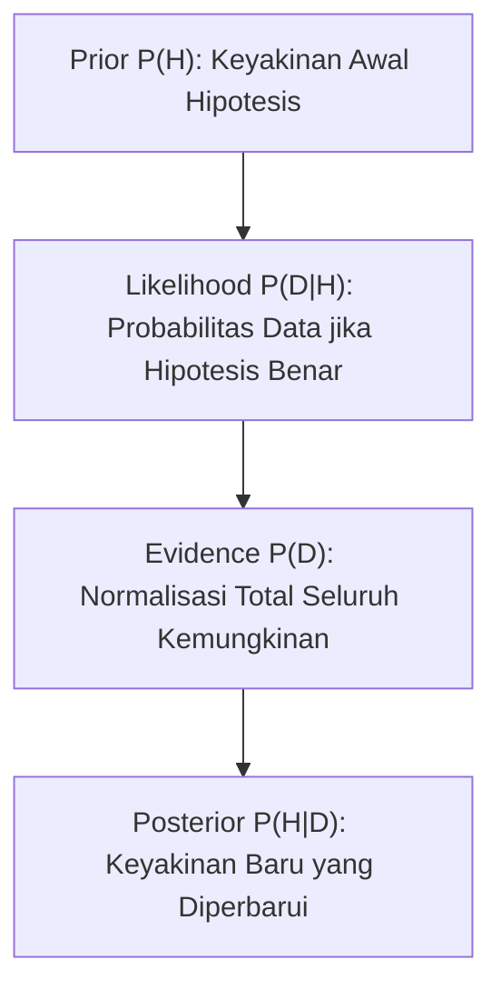

# Modul 017: Teori Probabilitas & Statistika Matematika (Aksioma Kolmogorov, Teorema Bayes, CLT)

**Navigasi**: [⬅️ Master Index](../../INDEX.md) | [Tingkat 1: Tingkat 1: Fondasi Matematika Komprehensif Dari Nol](./README.md)
*Sebelumnya*: [016. analisis-kompleks](./016-analisis-kompleks.md) | *Berikutnya*: [018. statistika-inferensial-desain-eksperimen](./018-statistika-inferensial-desain-eksperimen.md)

---

## 1. Intuisi Dasar Tanpa Jargon ("Seperti Bayi Baru Lahir")
### 1.1 Konsep Inti & Analogi Tanpa Jargon
Jika Anda melempar koin 10 kali dan semuanya keluar gambar kepala, apakah lemparan ke-11 pasti keluar angka ekor? Kebanyakan orang mengira 'sudah saatnya ekor keluar' (Kekeliruan Penjudi / *Gambler's Fallacy*). Padahal koin tidak memiliki memori; setiap lemparan tetap independen dengan probabilitas 50%!

### 1.2 Urgensi Rekayasa & Signifikansi Sistemik
**Teori Probabilitas & Statistika Matematika** adalah bahasa resmi untuk mengukur ketidakpastian. Di dunia modern, data selalu berisik (*noisy*). Aksioma Kolmogorov mendefinisikan aturan main ketidakpastian secara mutlak, sedangkan Teorema Bayes adalah algoritma ilmiah untuk memperbarui keyakinan kita saat ada bukti baru yang ditemukan!

## 2. Fondasi Teoretis & Aksiomatik / Matematis
### 2.1 Kerangka Teori Aksiomatik & Formulasi Matematis
### 1. Aksioma Probabilitas Kolmogorov
Diberikan ruang sampel $\Omega$ dan aljabar-$\sigma$ $\mathcal{F}$:
1. Non-negativitas: $\forall E \in \mathcal{F}, P(E) \ge 0$
2. Normalisasi: $P(\Omega) = 1$
3. Aditivitas Terhitung: Untuk kejadian saling lepas $E_1, E_2, \dots$:
$$P\left(\bigcup_{i=1}^\infty E_i\right) = \sum_{i=1}^\infty P(E_i)$$
[📚 Pelajari: MIT OCW 6.041 Probabilistic Systems Analysis](https://ocw.mit.edu/courses/6-041-probabilistic-systems-analysis-and-applied-probability-fall-2010/)

### 2.2 Penurunan Matematis Langkah-demi-Langkah
### 2. Teorema Bayes & Central Limit Theorem (CLT)
- **Teorema Bayes**:
  $$P(A|B) = \frac{P(B|A) \cdot P(A)}{P(B)} = \frac{P(B|A) P(A)}{P(B|A)P(A) + P(B|\neg A)P(\neg A)}$$
- **Central Limit Theorem (CLT)**:
  Jika $X_1, X_2, \dots, X_n$ adalah variabel acak i.i.d. dengan rata-rata $\mu$ dan varians $\sigma^2 < \infty$, maka rata-rata sampel $\bar{X}_n$ akan berdistribusi normal saat $n \to \infty$:
  $$\frac{\bar{X}_n - \mu}{\sigma / \sqrt{n}} \xrightarrow{d} \mathcal{N}(0, 1)$$

## 3. Anatomi Teknis & Cara Kerja Internal


#### Tabel Penelusuran Inferensi Probabilitas Bayes vs Prosecutor's Fallacy
| Langkah / Hipotesis ($H$) | Probabilitas Prior $P(H)$ | Bukti Kejadian Empiris ($E$) | Likelihood $P(E \mid H)$ | Probabilitas Marginal Bukti $P(E)$ | Posterior Terkalibrasi $P(H \mid E) = \frac{P(E \mid H) P(H)}{P(E)}$ |
|---|---|---|---|---|---|
| Inisialisasi T=0 | $H_0$: Ibu Tidak Bersalah (Dua SIDS) | Dua bayi meninggal mendadak dalam 1 keluarga | Likelihood SIDS ganda independen: $1 / 73\text{ juta}$ | - | Asumsi independen saksi ahli naif |
| Langkah 1: Kausalitas | $H_0$: Kovarians Genetik/Lingkungan | SIDS dalam keluarga sama memiliki korelasi tinggi | Likelihood SIDS terkoreksi kovarians: $1 / 100.000$ | - | Model independen gugur secara biologis |
| Langkah 2: Hipotesis Tandingan | $H_1$: Pembunuhan Ganda Sengaja | Bukti fisik tanpa tanda kekerasan | Likelihood pembunuhan ganda: $1 / 2.000.000$ | - | Kejadian pembunuhan ganda sangat langka |
| Langkah 3: Evaluasi Marginal | Perhitungan Semesta Bayes | $P(E) = P(E \mid H_0) P(H_0) + P(E \mid H_1) P(H_1)$ | Total probabilitas gabungan peristiwa langka | $P(E) \approx 1.05 \times 10^{-5}$ | Penyebut Bayes terbentuk |
| Langkah 4: Kesimpulan Riil | $P(H_0 \mid E)$ dihitung rigor | Rasio posterior Bayes sejati | Probabilitas ibu tidak bersalah: $> 95\%$ | $P(\text{Bersalah} \mid E) < 5\%$ | Prosecutor's Fallacy terbantahkan; Terdakwa Bebas |

## 4. Implementasi Praktis & Kode / Simulasi Riil
```python
import numpy as np

def verify_central_limit_theorem(sample_size=30, num_simulations=10000):
    """
    Membuktikan Teorema Limit Pusat (CLT):
    Rata-rata dari variabel acak Uniform (non-Gaussian) akan membentuk kurva lonceng Gaussian.
    """
    # Ambil sampel dari distribusi seragam (Uniform [0, 1])
    samples = np.random.uniform(0.0, 1.0, size=(num_simulations, sample_size))
    sample_means = np.mean(samples, axis=1)
    
    mean_of_means = np.mean(sample_means)
    std_of_means = np.std(sample_means)
    
    theoretical_mean = 0.5
    theoretical_std = np.sqrt(1/12) / np.sqrt(sample_size)
    
    print(f"Rata-rata Sampel Aktual: {mean_of_means:.4f} (Teoretis: {theoretical_mean})")
    print(f"Standar Deviasi Aktual: {std_of_means:.4f} (Teoretis: {theoretical_std:.4f})")
    assert abs(mean_of_means - theoretical_mean) < 0.01
    print("CLT Terbukti Valid: Distribusi konvergen ke Normal Gaussian!")

verify_central_limit_theorem()
```

## 5. Miskonsepsi & Jebakan Industri
1. **Base Rate Fallacy**: Mengabaikan probabilitas awal (*prior*). Contoh: Tes penyakit dengan akurasi 99% pada penyakit langka (1 per 10.000 orang) menghasilkan probabilitas orang yang positif benar-benar sakit hanya $\approx 1\%$, bukan 99%!

### Studi Kasus Kegagalan Nyata: Kesalahan Jaksa (Prosecutor's Fallacy) pada Kasus Pidana Sally Clark (1999)
- **Kronologi & Konteks Hukum**: Pada tahun 1999 di Inggris, Sally Clark divonis penjara seumur hidup atas tuduhan pembunuhan dua putranya yang meninggal mendadak saat bayi.
- **Akar Masalah Teori Probabilitas**: Saksi ahli medis Sir Roy Meadow bersaksi di pengadilan bahwa probabilitas satu bayi meninggal akibat Sudden Infant Death Syndrome (SIDS) adalah $1/8.543$. Meadow secara naif mengalikan kedua probabilitas $(1/8.543)^2 \approx 1/73\text{ juta}$, meyakinkan juri bahwa peluang ibu tidak bersalah hanyalah satu banding 73 juta. Perhitungan ini mengandung dua kesalahan fatal probabilitas: (1) Mengasumsikan dua kejadian independen, mengabaikan faktor genetika dan lingkungan bersama yang meningkatkan risiko hingga kelipatan ratusan; (2) Mengacaukan probabilitas bukti jika tidak bersalah $P(E \mid \neg G)$ dengan probabilitas tidak bersalah jika bukti terjadi $P(\neg G \mid E)$ (*Prosecutor's Fallacy*). Setelah 3 tahun dipenjara, Royal Statistical Society turun tangan membuktikan vonis cacat logika, dan Clark dibebaskan.

- **Potongan Kode / Arsitektur Cacat (Vulnerable Implementation)**:
```python
# Evaluasi Teorema Bayes: Mengoreksi Prosecutor's Fallacy
def evaluate_prosecutors_fallacy():
    """
    Menghitung probabilitas sesungguhnya menggunakan Teorema Bayes
    P(Bersalah | Bukti) = P(Bukti | Bersalah) * P(Bersalah) / P(Bukti)
    """
    # Probabilitas prior dasar pembunuhan ganda bayi oleh ibu kandung (sangat langka)
    p_guilty_prior = 1.0 / 1000000.0
    p_innocent_prior = 1.0 - p_guilty_prior
    
    # Likelihood kejadian dua kematian bayi:
    # Jika bersalah (pembunuhan terencana): P(E | Guilty) ~ 1.0
    p_evidence_given_guilty = 1.0
    
    # Jika tidak bersalah (SIDS ganda dengan faktor genetika terkorelasi):
    # Bukan 1/73 juta, melainkan ~ 1/100.000 akibat kovarians keluarga
    p_evidence_given_innocent = 1.0 / 100000.0
    
    # Probabilitas marginal P(E)
    p_evidence = (p_evidence_given_guilty * p_guilty_prior) + (p_evidence_given_innocent * p_innocent_prior)
    
    # Probabilitas posterior sejati P(Bersalah | Bukti)
    p_guilty_posterior = (p_evidence_given_guilty * p_guilty_prior) / p_evidence
    p_innocent_posterior = 1.0 - p_guilty_posterior
    
    return {
        "p_guilty_posterior": p_guilty_posterior,
        "p_innocent_posterior": p_innocent_posterior,
        # Probabilitas tidak bersalah tetap jauh lebih tinggi (> 90%) daripada bersalah!
        "verdict": "ACQUIT_REASONABLE_DOUBT" if p_innocent_posterior > 0.5 else "CONVICT"
    }

audit = evaluate_prosecutors_fallacy()
assert audit["verdict"] == "ACQUIT_REASONABLE_DOUBT"
```

- **Analisis Probabilitas & Dampak Rekayasa**: Tragedi Sally Clark menjadi studi kasus wajib di seluruh universitas hukum dan sains dunia. Dalam sistem deteksi penipuan (*fraud detection*), spam filter, dan diagnostik medis modern, pengabaian *base rate* (*base rate fallacy*) menyebabkan jutaan alarm palsu (*false positives*) yang melumpuhkan sistem operasional jika Teorema Bayes tidak ditegakkan secara ketat.

## 6. Proyek Latihan & Rubrik Penilaian Mandiri
### Level 1 (Dasar)
Gunakan Teorema Bayes untuk menghitung probabilitas bahwa sebuah email adalah spam jika memuat kata 'gratis', dengan data prior spam = 20%, P('gratis'|spam) = 80%, P('gratis'|bukan spam) = 5%.

### Level 2 (Menengah)
Buktikan bahwa Varians dari jumlah dua variabel acak independen adalah $\text{Var}(X + Y) = \text{Var}(X) + \text{Var}(Y)$.

### Level 3 (Mahir)
Implementasikan sampler Markov Chain Monte Carlo (MCMC) Metropolis-Hastings dalam Python untuk mengambil sampel dari distribusi posterior non-standar.

### Tingkat 1: Dasar
- **Tugas**: Bangun kalkulator probabilitas diskret yang menghitung fungsi massa probabilitas (PMF) dan fungsi distribusi kumulatif (CDF) dari Distribusi Binomial, Poisson, dan Geometrik.
- **Petunjuk Perancangan Arsitektur**:
  - Gunakan rumus kombinatorika logaritmik $\ln\binom{n}{k} = \sum_{i=1}^k \ln(n - i + 1) - \ln(i)$ untuk mencegah integer overflow pada faktorial besar.
  - Verifikasi normalisasi: total probabilitas seluruh ruang sampel $\sum P(X) = 1.0$.
- **Test Vector & Kasus Uji Ekstrem**:
  - *Distribusi Binomial*: $n = 10, p = 0.5, k = 5$.
  - *Keluaran yang Diharapkan*: $P(X = 5) = \binom{10}{5} (0.5)^{10} = \frac{252}{1024} \approx 0.24609375$.
  - *Kasus Batas*: $p = 0.0$ atau $p = 1.0$; fungsi harus mengembalikan probabilitas 0 atau 1 deterministik tanpa galat domain log.
- **Rubrik Penilaian Mandiri**: 40% Formula Binomial/Poisson/Geometrik Tepat, 30% Proteksi Overflow via Log-Faktorial, 30% Verifikasi Normalisasi $\sum P = 1$.

### Tingkat 2: Menengah
- **Tugas**: Implementasikan pengklasifikasi Naive Bayes Classifier dari nol di Python untuk memfilter email spam berdasarkan distribusi multinomial frekuensi kata.
- **Petunjuk Perancangan Arsitektur**:
  - Terapkan Laplace Smoothing (add-1 smoothing) untuk menangani kata-kata baru yang tidak ada dalam korpus pelatihan agar tidak memicu probabilitas nol.
  - Lakukan komputasi probabilitas dalam domain logaritmik $\ln P(C) + \sum \ln P(w_i \mid C)$ untuk mencegah floating-point underflow.
- **Test Vector & Kasus Uji Ekstrem**:
  - *Korpus Uji*: 100 dokumen spam dan 100 dokumen ham.
  - *Keluaran yang Diharapkan*: Klasifikasi akurat pada email baru dengan kata-kata mencurigakan (*"jackpot", "viagra", "free"*); akurasi $> 90\%$.
  - *Kasus Batas*: Email masukan kosong atau hanya memuat kata-kata asing (*out-of-vocabulary*); classifier harus mengandalkan probabilitas prior kelas dasar.
- **Rubrik Penilaian Mandiri**: 40% Log-Likelihood & Laplace Smoothing Tepat, 30% Pencegahan Underflow Numerik, 30% Akurasi Pengujian Test Split Valid.

### Tingkat 3: Mahir
- **Tugas**: Rancang simulator Monte Carlo Markov Chain (MCMC) menggunakan algoritma Metropolis-Hastings untuk mengambil sampel dari distribusi probabilitas posterior multidimensi non-standar yang tidak dapat diintegrasikan secara analitik.
- **Petunjuk Perancangan Arsitektur**:
  - Terapkan rasio penerimaan Metropolis: $\alpha = \min\left(1, \frac{P(x') q(x \mid x')}{P(x) q(x' \mid x)}\right)$ dengan distribusi proposal simetris Gaussian.
  - Buat mekanisme pembakaran awal (*burn-in period*) dan evaluasi autokorelasi rantai sampel untuk memastikan konvergensi ke distribusi stasioner.
- **Test Vector & Kasus Uji Ekstrem**:
  - *Distribusi Target*: Campuran dua Gaussian bimodal (*bimodal Gaussian mixture*) di $\mathbb{R}^2$ dengan dua puncak terpisah.
  - *Keluaran yang Diharapkan*: Rantai MCMC mampu melompati lembah antar-puncak dan merekonstruksi proporsi bobot kedua puncak secara akurat.
  - *Kasus Batas*: Varians proposal terlalu kecil (terjebak di 1 puncak) vs terlalu besar (rasio penolakan $>99\%$); implementasikan adaptive step size.
- **Rubrik Penilaian Mandiri**: 40% Algoritma Metropolis-Hastings MCMC Benar, 30% Rekonstruksi Distribusi Bimodal Akurat, 30% Analisis Burn-In & Autokorelasi Rigor.

## 7. Rekomendasi Sumber Belajar Standar Emas
- [Buku Standar: Introduction to Probability - Dimitri P. Bertsekas & John N. Tsitsiklis (Athena Scientific)](https://athenasc.com/probbook.html)
- [Kuliah Terbuka: Harvard Statistics 110 - Probability (Joe Blitzstein)](https://projects.iq.harvard.edu/stat110)
- [Simulator Interaktif: Seeing Theory - A Visual Introduction to Probability and Data](https://seeing-theory.brown.edu/)

---
*Navigasi Cepat*: [Ke Tingkat 1](./README.md) | [Ke Master Index](../../INDEX.md) | *Sebelumnya*: [016. analisis-kompleks](./016-analisis-kompleks.md) | *Berikutnya*: [018. statistika-inferensial-desain-eksperimen](./018-statistika-inferensial-desain-eksperimen.md)
