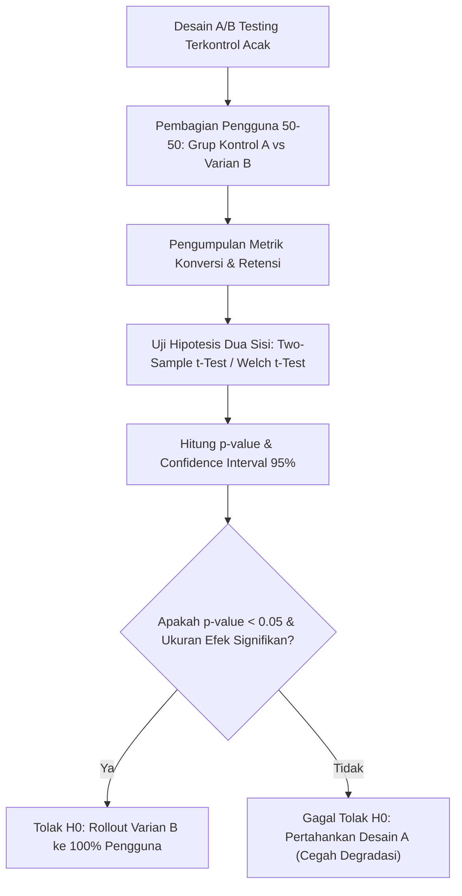

# Modul 018: Statistika Inferensial & Desain Eksperimen (Estimasi MLE/MAP, Uji Hipotesis, A/B Testing)

**Navigasi**: [⬅️ Master Index](../../INDEX.md) | [Tingkat 1: Tingkat 1: Fondasi Matematika Komprehensif Dari Nol](./README.md)
*Sebelumnya*: [017. teori-probabilitas-statistika-matematika](./017-teori-probabilitas-statistika-matematika.md) | *Berikutnya*: [019. proses-stokastik-rantai-markov](./019-proses-stokastik-rantai-markov.md)

---

## 1. Intuisi Dasar Tanpa Jargon ("Seperti Bayi Baru Lahir")
Bayangkan Anda seorang dokter yang sedang menguji obat penurun demam baru pada 100 pasien. Setelah diberi obat, 60 pasien sembuh dalam tempo 2 jam. Apakah obat Anda benar-benar ampuh berkhasiat? Atau jangan-jangan ke-60 orang itu sembuh sendiri secara kebetulan?

Anda tidak bisa memberikan obat ke seluruh 8 miliar manusia di bumi untuk memastikannya. Anda hanya memiliki sampel kecil.
**Statistika Inferensial** adalah seni mengambil keputusan rasional di bawah ketidakpastian: bagaimana menyimpulkan sifat seluruh populasi raksasa secara tepat hanya dari segelintir sampel data terbatas, lengkap dengan batas toleransi kesalahannya.
[📚 Pelajari: MIT Statistics for Applications](https://ocw.mit.edu/courses/18-650-statistics-for-applications-fall-2016/)

## 2. Fondasi Teoretis & Aksiomatik / Matematis
### 18.1 Estimasi Titik: Maximum Likelihood Estimation (MLE) ([MIT 18.650](https://ocw.mit.edu/courses/18-650-statistics-for-applications-fall-2016/))
Diberikan sampel independen berdistribusi identik (i.i.d.) $\mathbf{X} = \{x_1, \dots, x_n\}$ dari distribusi dengan parameter $\theta$. Fungsi likelihood:
$$L(\theta) = \prod_{i=1}^n f(x_i; \theta)$$
Fungsi log-likelihood:
$$\ell(\theta) = \ln L(\theta) = \sum_{i=1}^n \ln f(x_i; \theta)$$
Estimator MLE adalah nilai parameter $\hat{\theta}_{\text{MLE}}$ yang memaksimalkan $\ell(\theta)$:
$$\hat{\theta}_{\text{MLE}} = \arg\max_\theta \ell(\theta) \implies \left. \frac{\partial \ell(\theta)}{\partial \theta} \right|_{\hat{\theta}} = 0$$

### 18.2 Uji Hipotesis Neyman-Pearson & p-value ([NIST Engineering Statistics](https://www.itl.nist.gov/div898/handbook/))
- **Hipotesis Nol ($H_0$)**: Tidak ada efek (perbedaan murni kebetulan acak).
- **Hipotesis Alternatif ($H_1$)**: Terdapat efek riil signifikan.
Statistik uji $Z$ untuk uji beda dua rata-rata sampel besar:
$$Z = \frac{\bar{X}_1 - \bar{X}_2}{\sqrt{\frac{\sigma_1^2}{n_1} + \frac{\sigma_2^2}{n_2}}}$$
- **p-value**: Probabilitas memperoleh statistik uji seekstrem atau lebih ekstrem dari yang teramati jika $H_0$ benar.
- Jika $p\text{-value} < \alpha$ (tingkat signifikansi, misal $\alpha = 0.05$), tolak $H_0$.

## 3. Anatomi Teknis & Cara Kerja Internal

Tipe Kesalahan Inferensial:
- **Tipe I Error ($lpha$)**: *False Positive* — Menyimpulkan ada efek padahal sebenarnya tidak ada.
- **Tipe II Error ($eta$)**: *False Negative* — Gagal mendeteksi efek yang sebenarnya nyata.
- **Statistical Power ($1 - eta$)**: Kemampuan eksperimen untuk mendeteksi efek nyata dengan benar (standar industri: minimal 80%).

## 4. Implementasi Praktis & Kode / Simulasi Riil
import numpy as np
from scipy import stats

def ab_test_significance(control_conversions: int, control_total: int,
                         variant_conversions: int, variant_total: int,
                         alpha: float = 0.05) -> dict:
    """
    Melakukan uji signifikansi proporsi A/B testing dua populasi (Two-Proportion Z-Test).
    """
    p1 = control_conversions / control_total
    p2 = variant_conversions / variant_total
    
    # Proporsi gabungan di bawah asumsi H0 (p1 == p2)
    p_pool = (control_conversions + variant_conversions) / (control_total + variant_total)
    se = np.sqrt(p_pool * (1 - p_pool) * (1 / control_total + 1 / variant_total))
    
    z_stat = (p2 - p1) / se
    p_value = 2 * (1 - stats.norm.cdf(abs(z_stat))) # Uji dua arah
    
    is_significant = p_value < alpha
    return {
        "control_rate": p1,
        "variant_rate": p2,
        "relative_uplift_pct": ((p2 - p1) / p1) * 100.0,
        "z_stat": z_stat,
        "p_value": p_value,
        "statistically_significant": is_significant
    }

res = ab_test_significance(control_conversions=450, control_total=10000,
                           variant_conversions=530, variant_total=10000)

print(f"Konversi Kontrol: {res['control_rate']*100:.2f}% | Varian: {res['variant_rate']*100:.2f}%")
print(f"Uplift: {res['relative_uplift_pct']:+.2f}% | p-value: {res['p_value']:.4f}")
print(f"Keputusan Signifikan: {res['statistically_significant']}")

## 5. Miskonsepsi & Jebakan Industri
1. **p-Hacking & Early Peeking**: Memeriksa p-value setiap 10 menit saat eksperimen A/B testing berjalan dan menghentikan pengujian seketika saat $p < 0.05$, melipatgandakan *false positive rate* hingga 30-40%.
2. **Confusing Statistical Significance with Practical Significance**: Mengklaim kemenangan peningkatan waktu muat halaman 0.01ms sebagai 'sangat signifikan' karena sampel 10 juta pengguna, padahal dampaknya nol terhadap pengalaman pengguna.
3. **Survivor Bias (Bias Kesintasan)**: Hanya menganalisis pengguna yang tetap aktif di aplikasi dan menyimpulkan fitur baru disukai, mengabaikan fakta bahwa pengguna yang membenci fitur baru tersebut telah langsung uninstall.

## 6. Proyek Latihan & Rubrik Penilaian Mandiri
### Tingkat 1 (Pemula) - Konstruksi Confidence Interval Bootstrap
Tulis skrip Python yang menerima array data numerik kecil ($N=30$) dan membuat interval kepercayaan 95% untuk rata-rata menggunakan metode *non-parametric bootstrapping* (10.000 kali resampling dengan pengembalian) tanpa asumsi distribusi normal.

### Tingkat 2 (Menengah) - Kalkulator Ukuran Sampel Minimum (Power Analysis)
Implementasikan fungsi untuk menghitung ukuran sampel minimum per variasi dalam A/B testing berdasarkan metrik dasar (*baseline conversion rate*), *Minimum Detectable Effect* (MDE), $lpha = 0.05$, dan *Power* $(1-eta) = 0.80$.

### Tingkat 3 (Mahir) - Uji Hipotesis Sekuensial Adaptif (mSPRT)
Rancang dan implementasikan algoritma *mixture Sequential Probability Ratio Test* (mSPRT) yang memungkinkan continuous monitoring A/B testing tanpa terkena penalti inflasi p-value uji ganda (*multiple testing problem*).

#### Rubrik Penilaian
- **40% Ketepatan Teori Probabilitas**: Formulasi hipotesis nol $H_0$ dan pengujian dua arah dieksekusi benar.
- **30% Kontrol Kesalahan Tipe I & II**: Mengatasi inflasi alpha pada pengujian berulang (*Bonferroni correction* atau *FDR*).
- **30% Validitas Komputasi Statistik**: Perhitungan Z-score, t-distribution derajat kebebasan akurat.

## 7. Rekomendasi Sumber Belajar Standar Emas
| Kategori | Judul Sumber & Tautan Langsung | Deskripsi Singkat |
|---|---|---|
| 📖 Buku Teks | [Statistical Inference (Casella & Berger)](https://epdf.pub/statistical-inference-second-edition.html) | Kitab rujukan matematika statistik inferensial standar program pascasarjana. |
| 🎓 Kuliah Terbuka | [MIT OCW 18.650 Statistics for Applications](https://ocw.mit.edu/courses/18-650-statistics-for-applications-fall-2016/) | Estimasi parametrik, non-parametrik, MLE, Bayesian, dan pengujian hipotesis. |
| 🔬 Makalah Seminal | [The Probable Error of a Mean ("Student" / W.S. Gosset, 1908)](https://doi.org/10.2307/2331554) | Paper pendiri distribusi t-Student yang melahirkan statistika sampel kecil. |
| 💻 Lab Interaktif | [Seeing Theory: A Visual Introduction to Probability and Statistics](https://seeing-theory.brown.edu/) | Situs visualisasi interaktif dari Brown University untuk inferensi statistik. |

---
*Navigasi Cepat*: [Ke Tingkat 1](./README.md) | [Ke Master Index](../../INDEX.md) | *Sebelumnya*: [017. teori-probabilitas-statistika-matematika](./017-teori-probabilitas-statistika-matematika.md) | *Berikutnya*: [019. proses-stokastik-rantai-markov](./019-proses-stokastik-rantai-markov.md)
