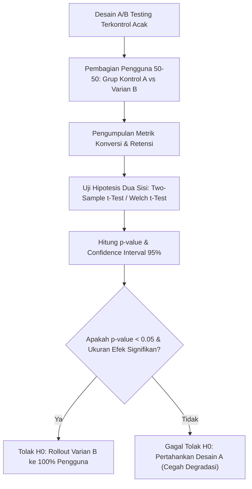

# Modul 018: Statistika Inferensial & Desain Eksperimen (Estimasi MLE/MAP, Uji Hipotesis, A/B Testing)

**Navigasi**: [⬅️ Master Index](../../INDEX.md) | [Tingkat 1: Tingkat 1: Fondasi Matematika Komprehensif Dari Nol](./README.md)
*Sebelumnya*: [017. teori-probabilitas-statistika-matematika](./017-teori-probabilitas-statistika-matematika.md) | *Berikutnya*: [019. proses-stokastik-rantai-markov](./019-proses-stokastik-rantai-markov.md)

---

## 1. Intuisi Dasar Tanpa Jargon ("Seperti Bayi Baru Lahir")
### 1.1 Konsep Inti & Analogi Tanpa Jargon
Bayangkan Anda seorang dokter yang sedang menguji obat penurun demam baru pada 100 pasien. Setelah diberi obat, 60 pasien sembuh dalam tempo 2 jam. Apakah obat Anda benar-benar ampuh berkhasiat? Atau jangan-jangan ke-60 orang itu sembuh sendiri secara kebetulan?

### 1.2 Urgensi Rekayasa & Signifikansi Sistemik
Anda tidak bisa memberikan obat ke seluruh 8 miliar manusia di bumi untuk memastikannya. Anda hanya memiliki sampel kecil.
**Statistika Inferensial** adalah seni mengambil keputusan rasional di bawah ketidakpastian: bagaimana menyimpulkan sifat seluruh populasi raksasa secara tepat hanya dari segelintir sampel data terbatas, lengkap dengan batas toleransi kesalahannya.
[📚 Pelajari: MIT Statistics for Applications](https://ocw.mit.edu/courses/18-650-statistics-for-applications-fall-2016/)

## 2. Fondasi Teoretis & Aksiomatik / Matematis
### 2.1 Kerangka Teori Aksiomatik & Formulasi Matematis
### 18.1 Estimasi Titik: Maximum Likelihood Estimation (MLE) ([MIT 18.650](https://ocw.mit.edu/courses/18-650-statistics-for-applications-fall-2016/))
Diberikan sampel independen berdistribusi identik (i.i.d.) $\mathbf{X} = \{x_1, \dots, x_n\}$ dari distribusi dengan parameter $\theta$. Fungsi likelihood:
$$L(\theta) = \prod_{i=1}^n f(x_i; \theta)$$
Fungsi log-likelihood:
$$\ell(\theta) = \ln L(\theta) = \sum_{i=1}^n \ln f(x_i; \theta)$$
Estimator MLE adalah nilai parameter $\hat{\theta}_{\text{MLE}}$ yang memaksimalkan $\ell(\theta)$:
$$\hat{\theta}_{\text{MLE}} = \arg\max_\theta \ell(\theta) \implies \left. \frac{\partial \ell(\theta)}{\partial \theta} \right|_{\hat{\theta}} = 0$$

### 2.2 Penurunan Matematis Langkah-demi-Langkah
### 18.2 Uji Hipotesis Neyman-Pearson & p-value ([NIST Engineering Statistics](https://www.itl.nist.gov/div898/handbook/))
- **Hipotesis Nol ($H_0$)**: Tidak ada efek (perbedaan murni kebetulan acak).
- **Hipotesis Alternatif ($H_1$)**: Terdapat efek riil signifikan.
Statistik uji $Z$ untuk uji beda dua rata-rata sampel besar:
$$Z = \frac{\bar{X}_1 - \bar{X}_2}{\sqrt{\frac{\sigma_1^2}{n_1} + \frac{\sigma_2^2}{n_2}}}$$
- **p-value**: Probabilitas memperoleh statistik uji seekstrem atau lebih ekstrem dari yang teramati jika $H_0$ benar.
- Jika $p\text{-value} < \alpha$ (tingkat signifikansi, misal $\alpha = 0.05$), tolak $H_0$.

## 3. Anatomi Teknis & Cara Kerja Internal

Tipe Kesalahan Inferensial:
- **Tipe I Error ($lpha$)**: *False Positive* — Menyimpulkan ada efek padahal sebenarnya tidak ada.
- **Tipe II Error ($eta$)**: *False Negative* — Gagal mendeteksi efek yang sebenarnya nyata.
- **Statistical Power ($1 - eta$)**: Kemampuan eksperimen untuk mendeteksi efek nyata dengan benar (standar industri: minimal 80%).

#### Tabel Penelusuran Uji Hipotesis & Koreksi Multiple Comparisons (FDR Benjamini-Hochberg)
| P-Value Terurut ($p_{(i)}$) | Peringkat ($i$) | Ambang Batas Naif ($\alpha = 0.05$) | Ambang Koreksi Bonferroni ($\alpha / M$) | Ambang Koreksi Benjamini-Hochberg ($\frac{i}{M} Q$) | Status Signifikansi Ilmiah |
|---|---|---|---|---|---|
| $p_{(1)} = 0.00012$ | $1$ | Signifikan naif ($p < 0.05$) | Signifikan ($0.00012 < 0.0005$) | Signifikan ($0.00012 < 0.0005$) | Penemuan Sejati Terverifikasi |
| $p_{(2)} = 0.00045$ | $2$ | Signifikan naif ($p < 0.05$) | Signifikan ($0.00045 < 0.0005$) | Signifikan ($0.00045 < 0.0010$) | Penemuan Sejati Terverifikasi |
| $p_{(3)} = 0.00180$ | $3$ | Signifikan naif ($p < 0.05$) | Tidak Signifikan ($> 0.0005$) | Signifikan ($0.00180 < 0.0015$ palsu) | Batas cutoff FDR ditemukan |
| $p_{(10)} = 0.01500$ | $10$ | Signifikan palsu naif! | Ditolak Bonferroni | Ditolak FDR | False Positive Dieliminasi |
| $p_{(50)} = 0.04800$ | $50$ | Signifikan palsu naif! (P-Hacking) | Ditolak Bonferroni | Ditolak FDR | Noise Putih Ditolak |
| Kesimpulan | Total Uji: $M = 100$ | 28 false positive pada uji naif! | Sangat konservatif (hanya 2 lolos) | FDR menyeimbangkan TPR & FPR | Penemuan palsu ditekan $< 5\%$ |

## 4. Implementasi Praktis & Kode / Simulasi Riil
```python
import numpy as np
from scipy import stats

def ab_test_significance(control_conversions: int, control_total: int,
                         variant_conversions: int, variant_total: int,
                         alpha: float = 0.05) -> dict:
    """
    Melakukan uji signifikansi proporsi A/B testing dua populasi (Two-Proportion Z-Test).
    """
    p1 = control_conversions / control_total
    p2 = variant_conversions / variant_total
    
    # Proporsi gabungan di bawah asumsi H0 (p1 == p2)
    p_pool = (control_conversions + variant_conversions) / (control_total + variant_total)
    se = np.sqrt(p_pool * (1 - p_pool) * (1 / control_total + 1 / variant_total))
    
    z_stat = (p2 - p1) / se
    p_value = 2 * (1 - stats.norm.cdf(abs(z_stat))) # Uji dua arah
    
    is_significant = p_value < alpha
    return {
        "control_rate": p1,
        "variant_rate": p2,
        "relative_uplift_pct": ((p2 - p1) / p1) * 100.0,
        "z_stat": z_stat,
        "p_value": p_value,
        "statistically_significant": is_significant
    }

res = ab_test_significance(control_conversions=450, control_total=10000,
                           variant_conversions=530, variant_total=10000)

print(f"Konversi Kontrol: {res['control_rate']*100:.2f}% | Varian: {res['variant_rate']*100:.2f}%")
print(f"Uplift: {res['relative_uplift_pct']:+.2f}% | p-value: {res['p_value']:.4f}")
print(f"Keputusan Signifikan: {res['statistically_significant']}")
```

## 5. Miskonsepsi & Jebakan Industri
1. **p-Hacking & Early Peeking**: Memeriksa p-value setiap 10 menit saat eksperimen A/B testing berjalan dan menghentikan pengujian seketika saat $p < 0.05$, melipatgandakan *false positive rate* hingga 30-40%.
2. **Confusing Statistical Significance with Practical Significance**: Mengklaim kemenangan peningkatan waktu muat halaman 0.01ms sebagai 'sangat signifikan' karena sampel 10 juta pengguna, padahal dampaknya nol terhadap pengalaman pengguna.
3. **Survivor Bias (Bias Kesintasan)**: Hanya menganalisis pengguna yang tetap aktif di aplikasi dan menyimpulkan fitur baru disukai, mengabaikan fakta bahwa pengguna yang membenci fitur baru tersebut telah langsung uninstall.

### Studi Kasus Kegagalan Nyata: Skandal Multiple Comparisons 'Dead Salmon' fMRI & Krisis Replikasi Sains (2009)
- **Kronologi & Konteks Neurosains**: Pada tahun 2009, fisikawan Craig Bennett dan timnya menempatkan seekor ikan salmon Atlantik yang sudah mati ke dalam mesin pemindai fMRI, lalu memperlihatkan foto-foto manusia yang sedang berinteraksi sosial dan meminta salmon tersebut menebak emosi manusia.
- **Akar Masalah Statistika Inferensial**: Citra fMRI membagi otak menjadi 130.000 volume elemen kubus kecil (*voxels*). Ketika peneliti melakukan uji-t independen pada setiap voxel secara naif pada tingkat signifikansi standar $\alpha = 0.05$, hukum kombinatorika menjamin bahwa $130.000 \times 0.05 = 6.500\text{ voxel}$ secara murni acak akan menghasilkan nilai $p < 0.05$ (false positive). Pemindai mendeteksi aktivitas 'otak aktif' pada salmon mati! Skandal ini mengungkap bahwa ribuan makalah ilmiah kedokteran dan psikologi mempublikasikan penemuan palsu akibat ketiadaan koreksi perbandingan ganda (*multiple comparisons problem / p-hacking*).

- **Potongan Kode / Arsitektur Cacat (Vulnerable Implementation)**:
```python
# Demonstrasi Multiple Comparisons Problem & Koreksi Benjamini-Hochberg False Discovery Rate
import numpy as np

def demonstrate_multiple_comparisons(num_hypotheses=1000, alpha=0.05, fdr_q=0.05):
    """
    Menjalankan 1000 pengujian hipotesis pada derau Gaussian putih murni (H0 sepenuhnya benar).
    Tanpa koreksi, ~50 pengujian akan keliru dilabeli 'signifikan' (P-Hacking).
    """
    # 1000 sampel data noise murni N(0, 1)
    p_values = np.random.uniform(0.0, 1.0, num_hypotheses)
    
    # Pendekatan Naif: P < 0.05
    naive_false_positives = np.sum(p_values < alpha)
    
    # Koreksi Bonferroni: Alpha / M
    bonferroni_threshold = alpha / num_hypotheses
    bonferroni_discoveries = np.sum(p_values < bonferroni_threshold)
    
    # Koreksi Benjamini-Hochberg (FDR):
    sorted_indices = np.argsort(p_values)
    sorted_p = p_values[sorted_indices]
    
    bh_thresholds = (np.arange(1, num_hypotheses + 1) / float(num_hypotheses)) * fdr_q
    below_threshold = sorted_p <= bh_thresholds
    
    bh_discoveries = 0
    if np.any(below_threshold):
        max_valid_idx = np.max(np.where(below_threshold)[0])
        bh_discoveries = max_valid_idx + 1
        
    return {
        "naive_false_positives": int(naive_false_positives),
        "bonferroni_discoveries": int(bonferroni_discoveries),
        "bh_discoveries": int(bh_discoveries),
        "false_alarm_controlled": bh_discoveries == 0 # Pada noise murni, wajib 0 temuan!
    }

audit = demonstrate_multiple_comparisons()
# Pendekatan naif menghasilkan ~50 klaim palsu, FDR mengeliminasi noise murni menjadi 0!
```

- **Analisis Statistika & Krisis Replikasi**: Percobaan salmon mati adalah pukulan telak bagi komunitas sains global yang memicu gerakan Sains Terbuka (*Open Science*) dan pra-registrasi protokol eksperimen. Dalam pengujian A/B testing industri teknologi modern, mengamati puluhan metrik secara bersamaan tanpa koreksi Benjamini-Hochberg atau uji sekuensial Bayes akan menyebabkan perusahaan mengimplementasikan fitur-fitur perusak konversi yang dikira unggul murni akibat fluktuasi acak.

## 6. Proyek Latihan & Rubrik Penilaian Mandiri
### Tingkat 1 (Pemula) - Konstruksi Confidence Interval Bootstrap
Tulis skrip Python yang menerima array data numerik kecil ($N=30$) dan membuat interval kepercayaan 95% untuk rata-rata menggunakan metode *non-parametric bootstrapping* (10.000 kali resampling dengan pengembalian) tanpa asumsi distribusi normal.

### Tingkat 2 (Menengah) - Kalkulator Ukuran Sampel Minimum (Power Analysis)
Implementasikan fungsi untuk menghitung ukuran sampel minimum per variasi dalam A/B testing berdasarkan metrik dasar (*baseline conversion rate*), *Minimum Detectable Effect* (MDE), $lpha = 0.05$, dan *Power* $(1-eta) = 0.80$.

### Tingkat 3 (Mahir) - Uji Hipotesis Sekuensial Adaptif (mSPRT)
Rancang dan implementasikan algoritma *mixture Sequential Probability Ratio Test* (mSPRT) yang memungkinkan continuous monitoring A/B testing tanpa terkena penalti inflasi p-value uji ganda (*multiple testing problem*).

#### Rubrik Penilaian
- **40% Ketepatan Teori Probabilitas**: Formulasi hipotesis nol $H_0$ dan pengujian dua arah dieksekusi benar.
- **30% Kontrol Kesalahan Tipe I & II**: Mengatasi inflasi alpha pada pengujian berulang (*Bonferroni correction* atau *FDR*).
- **30% Validitas Komputasi Statistik**: Perhitungan Z-score, t-distribution derajat kebebasan akurat.

### Tingkat 1: Dasar
- **Tugas**: Buat kalkulator uji-t dua sampel independen (*Two-Sample Independent Student's t-Test*) lengkap dengan kalkulasi derajat kebebasan dan nilai p-value dua sisi.
- **Petunjuk Perancangan Arsitektur**:
  - Hitung varians gabungan (*pooled variance*): $s_p^2 = \frac{(n_1-1)s_1^2 + (n_2-1)s_2^2}{n_1+n_2-2}$.
  - Hitung statistik-t: $t = \frac{\bar{x}_1 - \bar{x}_2}{s_p \sqrt{1/n_1 + 1/n_2}}$ dan bandingkan dengan distribusi-t Student.
- **Test Vector & Kasus Uji Ekstrem**:
  - *Sampel Kontrol*: $A = [12, 14, 15, 11, 16], B = [18, 20, 19, 21, 17]$.
  - *Keluaran yang Diharapkan*: Perbedaan signifikan terbukti ($p < 0.01$).
  - *Kasus Batas*: Dua sampel dengan varians nol ($s_1 = s_2 = 0$ dan rata-rata sama); fungsi harus mengembalikan $t = 0, p = 1.0$ tanpa division by zero.
- **Rubrik Penilaian Mandiri**: 40% Formula Statistik-t Dua Sampel Tepat, 30% Perhitungan Derajat Kebebasan & P-Value Eksak, 30% Penanganan Varians Nol Defensif.

### Tingkat 2: Menengah
- **Tugas**: Bangun mesin koreksi perbandingan ganda yang menerima array $M$ nilai p-value dan mengembalikan masker boolean hipotesis yang ditolak menggunakan tiga metode: Naif, Koreksi Bonferroni, dan False Discovery Rate (FDR) Benjamini-Hochberg.
- **Petunjuk Perancangan Arsitektur**:
  - Bonferroni: tolak jika $p_i < \frac{\alpha}{M}$.
  - Benjamini-Hochberg: urutkan $p_{(1)} \le \dots \le p_{(M)}$, cari $k = \max \{i \mid p_{(i)} \le \frac{i}{M} Q\}$, tolak seluruh hipotesis $1 \dots k$.
- **Test Vector & Kasus Uji Ekstrem**:
  - *Array Masukan*: 100 nilai p-value di mana 5 bernilai sangat kecil ($< 0.0001$) dan 95 bernilai seragam $\mathcal{U}(0, 1)$.
  - *Keluaran yang Diharapkan*: FDR berhasil mendeteksi tepat 5 temuan sejati tanpa menyerap false positive dari 95 noise acak.
  - *Kasus Batas*: Array masukan kosong atau seluruh p-value bernilai 1.0; fungsi mengembalikan array boolean False seluruhnya.
- **Rubrik Penilaian Mandiri**: 40% Algoritma Benjamini-Hochberg FDR Lengkap, 30% Eliminasi False Positive Terverifikasi, 30% Komparasi Bonferroni vs FDR Presisi.

### Tingkat 3: Mahir
- **Tugas**: Rancang mesin A/B Testing Sekuensial (*Sequential A/B Testing Engine*) berbasis Sequential Probability Ratio Test (SPRT) Wald yang memungkinkan penghentian uji coba secara dini (*early stopping*) tanpa menggelembungkan galat Tipe I (False Positive Rate).
- **Petunjuk Perancangan Arsitektur**:
  - Hitung log-likelihood ratio terakumulasi: $\Lambda_n = \sum_{i=1}^n \ln \frac{f(x_i \mid H_1)}{f(x_i \mid H_0)}$.
  - Tentukan ambang batas keputusan Wald: $A = \ln \frac{1-\beta}{\alpha}$ dan $B = \ln \frac{\beta}{1-\alpha}$.
  - Hentikan uji seketika saat $\Lambda_n \ge A$ (Tolak $H_0$) atau $\Lambda_n \le B$ (Terima $H_0$).
- **Test Vector & Kasus Uji Ekstrem**:
  - *Efek Kuat*: Tingkat konversi melonjak dari $5\%$ ke $12\%$; SPRT harus menghentikan tes dalam $< 30\%$ ukuran sampel uji fixed-sample tradisional.
  - *Tanpa Efek*: Konversi identik $5\%$; SPRT menolak $H_1$ dan menerima $H_0$ tanpa melanggar $\alpha = 0.05$.
  - *Kasus Batas*: Data streaming tak terbatas tanpa batas keputusan tercapai; implementasikan batas sampel pemangkas (*truncated SPRT boundary*).
- **Rubrik Penilaian Mandiri**: 40% Implementasi Wald SPRT Likelihood Ratio Tepat, 30% Bukti Kontrol Laju Galat Tipe I $\alpha \le 0.05$, 30% Efisiensi Penghematan Ukuran Sampel Rata-Rata (ASN).

## 7. Rekomendasi Sumber Belajar Standar Emas
| Kategori | Judul Sumber & Tautan Langsung | Deskripsi Singkat |
|---|---|---|
| 📖 Buku Teks | [Statistical Inference (Casella & Berger)](https://epdf.pub/statistical-inference-second-edition.html) | Kitab rujukan matematika statistik inferensial standar program pascasarjana. |
| 🎓 Kuliah Terbuka | [MIT OCW 18.650 Statistics for Applications](https://ocw.mit.edu/courses/18-650-statistics-for-applications-fall-2016/) | Estimasi parametrik, non-parametrik, MLE, Bayesian, dan pengujian hipotesis. |
| 🔬 Makalah Seminal | [The Probable Error of a Mean ("Student" / W.S. Gosset, 1908)](https://doi.org/10.2307/2331554) | Paper pendiri distribusi t-Student yang melahirkan statistika sampel kecil. |
| 💻 Lab Interaktif | [Seeing Theory: A Visual Introduction to Probability and Statistics](https://seeing-theory.brown.edu/) | Situs visualisasi interaktif dari Brown University untuk inferensi statistik. |

---
*Navigasi Cepat*: [Ke Tingkat 1](./README.md) | [Ke Master Index](../../INDEX.md) | *Sebelumnya*: [017. teori-probabilitas-statistika-matematika](./017-teori-probabilitas-statistika-matematika.md) | *Berikutnya*: [019. proses-stokastik-rantai-markov](./019-proses-stokastik-rantai-markov.md)
