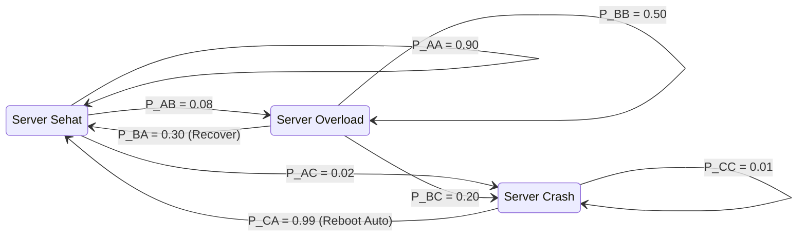

# Modul 019: Proses Stokastik & Rantai Markov (Proses Poisson, Gerak Brown, Martingale)

**Navigasi**: [⬅️ Master Index](../../INDEX.md) | [Tingkat 1: Tingkat 1: Fondasi Matematika Komprehensif Dari Nol](./README.md)
*Sebelumnya*: [018. statistika-inferensial-desain-eksperimen](./018-statistika-inferensial-desain-eksperimen.md) | *Berikutnya*: [020. teori-informasi](./020-teori-informasi.md)

---

## 1. Intuisi Dasar Tanpa Jargon ("Seperti Bayi Baru Lahir")
Bayangkan seekor semut berjalan di atas lantai ubin. Setiap detik, ia melempar koin: kepala melangkah ke ubin depan, ekor melangkah ke ubin belakang. Di mana posisi semut setelah 1.000 detik?

Anda tidak bisa memprediksi lokasi pasti semut karena gerakannya acak. Namun, Anda bisa memprediksi **distribusi kemungkinan** keberadaannya: semut kemungkinan besar masih berada di dekat titik awal, dan sangat mustahil berada 1.000 ubin jauhnya!

Inilah **Proses Stokastik & Rantai Markov**:
Model matematika untuk sistem yang berevolusi seiring waktu di bawah pengaruh keacakan. Keajaiban sifat Markov adalah: **Masa depan hanya bergantung pada keadaan Anda saat ini, bukan pada sejarah masa lalu Anda**.
[📚 Pelajari: Markov Chains Visual Interactive](https://setosa.io/ev/markov-chains/)

## 2. Fondasi Teoretis & Aksiomatik / Matematis
### 19.1 Rantai Markov Waktu Diskrit (DTMC) & Sifat Markov ([MIT 6.041 Probabilistic Systems](https://ocw.mit.edu/courses/6-041-probabilistic-systems-analysis-and-applied-probability-fall-2010/))
Barisan variabel acak $\{X_n, n \ge 0\}$ dengan ruang keadaan diskrit $S$ memenuhi **Sifat Markov** jika:
$$P(X_{n+1} = j \mid X_n = i, X_{n-1} = i_{n-1}, \dots, X_0 = i_0) = P(X_{n+1} = j \mid X_n = i) = P_{ij}$$
Matriks probabilitas transisi satu langkah $\mathbf{P} = [P_{ij}]$ memenuhi:
$$P_{ij} \ge 0, \quad \sum_{j \in S} P_{ij} = 1$$

### 19.2 Distribusi Stasioner & Teorema Ergodi ([Ross Stochastic Processes](https://www.wiley.com/en-us/Stochastic+Processes%2C+2nd+Edition-p-9780471120629))
Distribusi probabilitas $\boldsymbol{\pi}$ disebut stasioner jika:
$$\boldsymbol{\pi} \mathbf{P} = \boldsymbol{\pi}, \quad \text{dengan} \quad \sum_{i} \pi_i = 1$$
Jika rantai Markov bersifat *irreducible* (semua keadaan saling terhubung) dan *aperiodik*, maka distribusi probabilitas keadaan konvergen ke distribusi stasioner unik tak peduli keadaan awal:
$$\lim_{n \to \infty} P(X_n = j \mid X_0 = i) = \pi_j$$

### 19.3 Proses Poisson & Gerak Brown (Wiener Process) ([Stanford Stats](https://web.stanford.edu/class/stats217/))
- **Proses Poisson**: Menghitung kedatangan peristiwa acak berkecepatan rata-rata $\lambda$:
  $$P(N(t) = k) = \frac{(\lambda t)^k e^{-\lambda t}}{k!}$$
- **Gerak Brown (Wiener Process $W_t$)**:
  1. $W_0 = 0$
  2. Inkrement independen: $W_t - W_s \sim \mathcal{N}(0, t - s)$ untuk $t > s$.
  3. Trayektori kontinu di mana-mana tetapi tidak terdiferensiasi di titik mana pun.

## 3. Anatomi Teknis & Cara Kerja Internal

Alur eksekusi internal simulasi Markov:
1. **Representasi Matriks Sparse**: Digunakan untuk graf keadaan dengan jutaan node (PageRank).
2. **Markov Chain Monte Carlo (MCMC)**: Menggunakan algoritma Metropolis-Hastings untuk mengambil sampel dari distribusi posterior berdimensi tinggi dalam fisika statistik dan machine learning.

## 4. Implementasi Praktis & Kode / Simulasi Riil
import numpy as np

def calculate_stationary_distribution(transition_matrix: np.ndarray) -> np.ndarray:
    """
    Menghitung distribusi stasioner pi dari matriks transisi P via pemecahan sistem linier.
    pi * P = pi  <=>  pi * (P - I) = 0, dengan sum(pi) = 1
    """
    n = transition_matrix.shape[0]
    # Ubah sistem persamaan: gantikan persamaan terakhir dengan kondisi normalisasi
    A = transition_matrix.T - np.eye(n)
    A[-1] = np.ones(n)
    b = np.zeros(n)
    b[-1] = 1.0
    
    pi = np.linalg.solve(A, b)
    return pi

# Matriks transisi cuaca: [Cerah, Hujan, Berawan]
P = np.array([
    [0.70, 0.10, 0.20],
    [0.25, 0.50, 0.25],
    [0.30, 0.30, 0.40]
])

pi = calculate_stationary_distribution(P)
print(f"Peluang Stasioner Jangka Panjang:")
print(f"Cerah   : {pi[0]*100:.2f}%")
print(f"Hujan   : {pi[1]*100:.2f}%")
print(f"Berawan : {pi[2]*100:.2f}%")

## 5. Miskonsepsi & Jebakan Industri
1. **Assuming Memorylessness for Processes with Deep State**: Mengasumsikan sistem antrian server adalah Markovian murni (Poisson), padahal latensi tail request sangat bergantung pada ukuran cache yang terisi dari request-request sebelumnya.
2. **Periodicity Trap**: Mencoba menghitung limit $\mathbf{P}^n$ pada rantai Markov periodik (misal partikel berosilasi bolak-balik antara keadaan 0 dan 1), di mana limit tidak pernah konvergen.
3. **Absorbing State Oversight**: Tidak mendeteksi adanya absorbing state (keadaan yang jika dimasuki tidak bisa ditinggalkan, seperti kondisi `Crash` permanen), yang membuat probabilitas stasioner keadaan lain runtuh menjadi nol.

## 6. Proyek Latihan & Rubrik Penilaian Mandiri
### Tingkat 1 (Pemula) - Generator Teks Berbasis Rantai Markov
Tulis skrip Python yang membaca korpus teks buku pendek, membangun matriks frekuensi transisi kata berorde-1 ($P(w_{t+1} \mid w_t)$), dan membangkitkan paragraf teks acak 50 kata baru secara probabilistik.

### Tingkat 2 (Menengah) - Simulasi Teori Antrian M/M/1
Simulasikan sistem antrian server tunggal model M/M/1 (kedatangan Poisson $\lambda$, waktu pelayanan eksponensial $\mu$). Plot rata-rata panjang antrian di memori server saat intensitas trafik $
ho = \lambda / \mu$ mendekati 1.0 ($100\%$ utilisasi) untuk membuktikan ledakan latensi hiperbolik $L = rac{
ho}{1 - 
ho}$.

### Tingkat 3 (Mahir) - Algoritma PageRank Berbasis Random Walk
Implementasikan algoritma PageRank pada graf web berisi 10.000 node menggunakan metode *Power Iteration* dengan *damping factor* $d = 0.85$. Tunjukkan bahwa penambahan teleportasi acak mengatasi masalah spider traps dan dead ends.

#### Rubrik Penilaian
- **40% Ketepatan Teori Stokastik**: Matriks transisi stokastik valid (jumlah baris tepat 1.0).
- **30% Analisis Konvergensi**: Mampu menguji konvergensi distribusi stasioner via eigenvalue dominan ($\lambda = 1$).
- **30% Validitas Simulasi**: Variabel waktu kedatangan dan transisi acak dimodelkan dengan generator pseudo-random yang tepat.

## 7. Rekomendasi Sumber Belajar Standar Emas
| Kategori | Judul Sumber & Tautan Langsung | Deskripsi Singkat |
|---|---|---|
| 📖 Buku Teks | [Introduction to Stochastic Processes (Lawler)](https://www.routledge.com/Introduction-to-Stochastic-Processes/Lawler/p/book/9781584886518) | Buku pengantar matematika proses stokastik dan rantai Markov yang sangat jernih. |
| 🎓 Kuliah Terbuka | [MIT OCW 6.041 Probabilistic Systems Analysis](https://ocw.mit.edu/courses/6-041-probabilistic-systems-analysis-and-applied-probability-fall-2010/) | Kuliah legendaris John Tsitsiklis mengenai probabilitas dan proses stokastik. |
| 🔬 Makalah Seminal | [The Theory of Queues with Applications to Automata (Kendall, 1953)](https://doi.org/10.1111/j.2517-6161.1953.tb00139.x) | Paper pendiri notasi sistem antrian Kendall (M/M/1, M/G/1). |
| 💻 Lab Interaktif | [Markov Chains Visualized (Victor Powell / Setosa)](https://setosa.io/ev/markov-chains/) | Simulasi interaktif graf transisi keadaan Markov berbasis web. |

---
*Navigasi Cepat*: [Ke Tingkat 1](./README.md) | [Ke Master Index](../../INDEX.md) | *Sebelumnya*: [018. statistika-inferensial-desain-eksperimen](./018-statistika-inferensial-desain-eksperimen.md) | *Berikutnya*: [020. teori-informasi](./020-teori-informasi.md)
