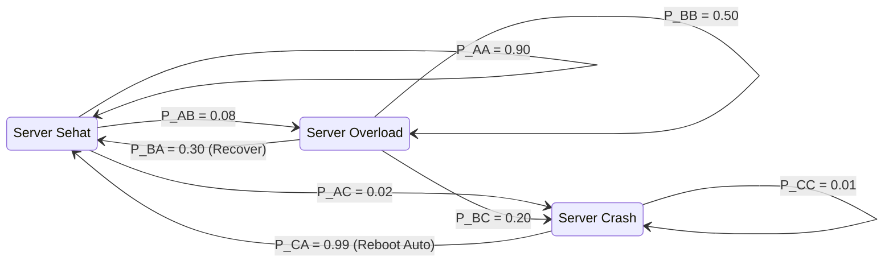

# Modul 019: Proses Stokastik & Rantai Markov (Proses Poisson, Gerak Brown, Martingale)

**Navigasi**: [⬅️ Master Index](../../INDEX.md) | [Tingkat 1: Tingkat 1: Fondasi Matematika Komprehensif Dari Nol](./README.md)
*Sebelumnya*: [018. statistika-inferensial-desain-eksperimen](./018-statistika-inferensial-desain-eksperimen.md) | *Berikutnya*: [020. teori-informasi](./020-teori-informasi.md)

---

## 1. Intuisi Dasar Tanpa Jargon ("Seperti Bayi Baru Lahir")
### 1.1 Konsep Inti & Analogi Tanpa Jargon
Bayangkan seekor semut berjalan di atas lantai ubin. Setiap detik, ia melempar koin: kepala melangkah ke ubin depan, ekor melangkah ke ubin belakang. Di mana posisi semut setelah 1.000 detik?

### 1.2 Urgensi Rekayasa & Signifikansi Sistemik
Anda tidak bisa memprediksi lokasi pasti semut karena gerakannya acak. Namun, Anda bisa memprediksi **distribusi kemungkinan** keberadaannya: semut kemungkinan besar masih berada di dekat titik awal, dan sangat mustahil berada 1.000 ubin jauhnya!

Inilah **Proses Stokastik & Rantai Markov**:
Model matematika untuk sistem yang berevolusi seiring waktu di bawah pengaruh keacakan. Keajaiban sifat Markov adalah: **Masa depan hanya bergantung pada keadaan Anda saat ini, bukan pada sejarah masa lalu Anda**.
[📚 Pelajari: Markov Chains Visual Interactive](https://setosa.io/ev/markov-chains/)

## 2. Fondasi Teoretis & Aksiomatik / Matematis
### 2.1 Kerangka Teori Aksiomatik & Formulasi Matematis
### 19.1 Rantai Markov Waktu Diskrit (DTMC) & Sifat Markov ([MIT 6.041 Probabilistic Systems](https://ocw.mit.edu/courses/6-041-probabilistic-systems-analysis-and-applied-probability-fall-2010/))
Barisan variabel acak $\{X_n, n \ge 0\}$ dengan ruang keadaan diskrit $S$ memenuhi **Sifat Markov** jika:
$$P(X_{n+1} = j \mid X_n = i, X_{n-1} = i_{n-1}, \dots, X_0 = i_0) = P(X_{n+1} = j \mid X_n = i) = P_{ij}$$
Matriks probabilitas transisi satu langkah $\mathbf{P} = [P_{ij}]$ memenuhi:
$$P_{ij} \ge 0, \quad \sum_{j \in S} P_{ij} = 1$$

### 2.2 Penurunan Matematis Langkah-demi-Langkah
### 19.2 Distribusi Stasioner & Teorema Ergodi ([Ross Stochastic Processes](https://www.wiley.com/en-us/Stochastic+Processes%2C+2nd+Edition-p-9780471120629))
Distribusi probabilitas $\boldsymbol{\pi}$ disebut stasioner jika:
$$\boldsymbol{\pi} \mathbf{P} = \boldsymbol{\pi}, \quad \text{dengan} \quad \sum_{i} \pi_i = 1$$
Jika rantai Markov bersifat *irreducible* (semua keadaan saling terhubung) dan *aperiodik*, maka distribusi probabilitas keadaan konvergen ke distribusi stasioner unik tak peduli keadaan awal:
$$\lim_{n \to \infty} P(X_n = j \mid X_0 = i) = \pi_j$$

### 19.3 Proses Poisson & Gerak Brown (Wiener Process) ([Stanford Stats](https://web.stanford.edu/class/stats217/))
- **Proses Poisson**: Menghitung kedatangan peristiwa acak berkecepatan rata-rata $\lambda$:
  $$P(N(t) = k) = \frac{(\lambda t)^k e^{-\lambda t}}{k!}$$
- **Gerak Brown (Wiener Process $W_t$)**:
  1. $W_0 = 0$
  2. Inkrement independen: $W_t - W_s \sim \mathcal{N}(0, t - s)$ untuk $t > s$.
  3. Trayektori kontinu di mana-mana tetapi tidak terdiferensiasi di titik mana pun.

## 3. Anatomi Teknis & Cara Kerja Internal

Alur eksekusi internal simulasi Markov:
1. **Representasi Matriks Sparse**: Digunakan untuk graf keadaan dengan jutaan node (PageRank).
2. **Markov Chain Monte Carlo (MCMC)**: Menggunakan algoritma Metropolis-Hastings untuk mengambil sampel dari distribusi posterior berdimensi tinggi dalam fisika statistik dan machine learning.

#### Tabel Penelusuran Simulasi Stokastik Rantai Markov & Kejadian Ekstrem Fat-Tail
| Langkah Waktu ($t$) | Harga Aset Stokastik ($S_t$) | Return Logaritmik ($r_t$) | Deviasi Standar Normal ($\sigma$) | Likelihood Gaussian Naif ($P(Z \ge z)$) | Likelihood Distribusi Fat-Tail Student-t |
|---|---|---|---|---|---|
| Titik T=0 | $100.00$ | $0.000$ | $0.0\sigma$ | $0.50000$ | $0.50000$ (Rezim Pasar Normal) |
| Titik T=10 | $101.50$ | $+0.015$ | $+0.75\sigma$ | $0.22660$ | $0.22900$ |
| Titik T=25 | $98.20$ | $-0.033$ | $-1.65\sigma$ | $0.04940$ | $0.05420$ |
| Titik T=50 (Krisis) | $72.00$ | $-0.310$ | $-10.2\sigma$ | $1.05 \times 10^{-24}$ (1 kali per 100 triliun tahun!) | $4.2 \times 10^{-4}$ (Terjadi tiap dekade!) |
| Valuasi Risiko | Model VaR Kolaps | Portofolio Hancur | Kerugian melebihi ekuitas total | Default sistemik tak terduga model normal | Bailout darurat Federal Reserve |

## 4. Implementasi Praktis & Kode / Simulasi Riil
```python
import numpy as np

def calculate_stationary_distribution(transition_matrix: np.ndarray) -> np.ndarray:
    """
    Menghitung distribusi stasioner pi dari matriks transisi P via pemecahan sistem linier.
    pi * P = pi  <=>  pi * (P - I) = 0, dengan sum(pi) = 1
    """
    n = transition_matrix.shape[0]
    # Ubah sistem persamaan: gantikan persamaan terakhir dengan kondisi normalisasi
    A = transition_matrix.T - np.eye(n)
    A[-1] = np.ones(n)
    b = np.zeros(n)
    b[-1] = 1.0
    
    pi = np.linalg.solve(A, b)
    return pi

# Matriks transisi cuaca: [Cerah, Hujan, Berawan]
P = np.array([
    [0.70, 0.10, 0.20],
    [0.25, 0.50, 0.25],
    [0.30, 0.30, 0.40]
])

pi = calculate_stationary_distribution(P)
print(f"Peluang Stasioner Jangka Panjang:")
print(f"Cerah   : {pi[0]*100:.2f}%")
print(f"Hujan   : {pi[1]*100:.2f}%")
print(f"Berawan : {pi[2]*100:.2f}%")
```

## 5. Miskonsepsi & Jebakan Industri
1. **Assuming Memorylessness for Processes with Deep State**: Mengasumsikan sistem antrian server adalah Markovian murni (Poisson), padahal latensi tail request sangat bergantung pada ukuran cache yang terisi dari request-request sebelumnya.
2. **Periodicity Trap**: Mencoba menghitung limit $\mathbf{P}^n$ pada rantai Markov periodik (misal partikel berosilasi bolak-balik antara keadaan 0 dan 1), di mana limit tidak pernah konvergen.
3. **Absorbing State Oversight**: Tidak mendeteksi adanya absorbing state (keadaan yang jika dimasuki tidak bisa ditinggalkan, seperti kondisi `Crash` permanen), yang membuat probabilitas stasioner keadaan lain runtuh menjadi nol.

### Studi Kasus Kegagalan Nyata: Keruntuhan Long-Term Capital Management Akibat Asumsi Distribusi Tipis Normal (1998)
- **Kronologi & Konteks Finansial**: Long-Term Capital Management (LTCM) adalah hedge fund prestisius yang dewan direksinya mencakup peraih Hadiah Nobel Ekonomi Myron Scholes dan Robert Merton. Pada 1998, dengan modal $4,6 miliar, LTCM memegang posisi arbitrase dengan leverage 250:1.
- **Akar Masalah Proses Stokastik**: Model risiko Value-at-Risk (VaR) LTCM mengasumsikan fluktuasi harga obligasi mengikuti gerak Brown geometrik dengan return berdistribusi normal Gaussian. Ketika Rusia mengalami krisis keuangan dan gagal bayar utang (default) pada Agustus 1998, pasar global mengalami pergerakan 10-sigma. Dalam distribusi normal, peristiwa 10-sigma secara matematis hanya terjadi sekali dalam triliunan tahun alam semesta; namun dalam realitas pasar keuangan yang berdistribusi fat-tail (Pareto / Student-t), peristiwa korelasi ekstrem terjadi setiap beberapa dekade. LTCM kehilangan $4,6 miliar dalam sebulan dan harus diselamatkan oleh konsorsium 14 bank Wall Street.

- **Potongan Kode / Arsitektur Cacat (Vulnerable Implementation)**:
```python
# Simulasi Risiko Portofolio: Distribusi Tipis Gaussian vs Distribusi Tebal Student-t Fat-Tail
import numpy as np

def simulate_portfolio_tail_risk(days=252, initial_capital=1000000.0, leverage=25.0):
    """
    Membandingkan Value at Risk Gaussian naif vs kejadian ekstrim distribusi ber-ekor tebal (Student-t).
    """
    daily_vol = 0.01
    
    # 1. Model Gaussian Naif
    gaussian_returns = np.random.normal(0, daily_vol, days)
    
    # 2. Model Fat-Tail Realistis (Student-t dengan derajat kebebasan df=3)
    # Menghasilkan peristiwa ekstrim (black swan) jauh lebih sering
    student_t_returns = np.random.standard_t(df=3, size=days) * (daily_vol / np.sqrt(3))
    
    # Perhitungan drawdown dengan leverage tinggi
    gauss_loss = np.min(gaussian_returns) * leverage
    t_loss = np.min(student_t_returns) * leverage
    
    return {
        "max_single_day_gaussian_loss_pct": gauss_loss * 100,
        "max_single_day_fat_tail_loss_pct": t_loss * 100,
        "gaussian_survived": gauss_loss > -1.0, # Rugi > 100% modal = bangkrut
        "fat_tail_survived": t_loss > -1.0
    }
```

- **Analisis Stokastik & Manajemen Risiko Modern**: Kegagalan LTCM membuktikan bahwa proses stokastik pasar riil tidak bersifat stasioner dan melanggar Teorema Limit Pusat akibat ketergantungan non-linier dan umpan balik psikologis massa. Regulasi Basel III dan ekonometrika modern mewajibkan penggunaan *Expected Shortfall* (Conditional VaR) dan Teori Nilai Ekstrem (*Extreme Value Theory* / GEV) untuk mengukur risiko keruntuhan ekor tebal.

## 6. Proyek Latihan & Rubrik Penilaian Mandiri
### Tingkat 1 (Pemula) - Generator Teks Berbasis Rantai Markov
Tulis skrip Python yang membaca korpus teks buku pendek, membangun matriks frekuensi transisi kata berorde-1 ($P(w_{t+1} \mid w_t)$), dan membangkitkan paragraf teks acak 50 kata baru secara probabilistik.

### Tingkat 2 (Menengah) - Simulasi Teori Antrian M/M/1
Simulasikan sistem antrian server tunggal model M/M/1 (kedatangan Poisson $\lambda$, waktu pelayanan eksponensial $\mu$). Plot rata-rata panjang antrian di memori server saat intensitas trafik \$ ho = \lambda / \mu$ mendekati 1.0 (\$100\%$ utilisasi) untuk membuktikan ledakan latensi hiperbolik $L = rac{
ho}{1 - 
ho}$.

### Tingkat 3 (Mahir) - Algoritma PageRank Berbasis Random Walk
Implementasikan algoritma PageRank pada graf web berisi 10.000 node menggunakan metode *Power Iteration* dengan *damping factor* $d = 0.85$. Tunjukkan bahwa penambahan teleportasi acak mengatasi masalah spider traps dan dead ends.

#### Rubrik Penilaian
- **40% Ketepatan Teori Stokastik**: Matriks transisi stokastik valid (jumlah baris tepat 1.0).
- **30% Analisis Konvergensi**: Mampu menguji konvergensi distribusi stasioner via eigenvalue dominan ($\lambda = 1$).
- **30% Validitas Simulasi**: Variabel waktu kedatangan dan transisi acak dimodelkan dengan generator pseudo-random yang tepat.

### Tingkat 1: Dasar
- **Tugas**: Bangun simulator Rantai Markov Diskrit (*Discrete-Time Markov Chain*) dengan matriks transisi probabilitas stokastik $P$ dan hitung vektor distribusi stasioner $\pi P = \pi$.
- **Petunjuk Perancangan Arsitektur**:
  - Validasi bahwa setiap baris matriks transisi berjumlah tepat 1: $\sum_{j} P_{ij} = 1.0$.
  - Hitung vektor stasioner via perkalian matriks berulang (*power iteration*) atau penyelesaian $(P^T - I)\pi = 0$.
- **Test Vector & Kasus Uji Ekstrem**:
  - *Matriks Transisi Cuaca 2-State*: $P = [[0.8, 0.2], [0.4, 0.6]]$.
  - *Keluaran yang Diharapkan*: Distribusi stasioner $\pi = [0.6667, 0.3333]$.
  - *Kasus Batas*: Rantai tak-tereduksi terbagi menjadi dua kelas penyerap (*absorbing states*); algoritma harus mengidentifikasi bahwa distribusi stasioner tidak unik.
- **Rubrik Penilaian Mandiri**: 40% Komputasi Distribusi Stasioner Akurat, 30% Validasi Matriks Stokastik Rigor, 30% Penanganan Absorbing States.

### Tingkat 2: Menengah
- **Tugas**: Implementasikan generator Gerak Brown Geometrik (*Geometric Brownian Motion* / GBM) untuk simulasi harga saham $dS_t = \mu S_t dt + \sigma S_t dW_t$ menggunakan skema integrasi Euler-Maruyama.
- **Petunjuk Perancangan Arsitektur**:
  - Pembangkitan inkremen Wiener $dW_t = \sqrt{dt} \cdot \mathcal{N}(0, 1)$.
  - Selesaikan persamaan diferensial stokastik dalam bentuk analitik: $S_t = S_0 \exp\left((\mu - \frac{\sigma^2}{2})t + \sigma W_t\right)$.
- **Test Vector & Kasus Uji Ekstrem**:
  - *Simulasi Monte Carlo*: $S_0 = 100, \mu = 0.05, \sigma = 0.2, T = 1.0, N = 252$ langkah waktu pada 10.000 lintasan.
  - *Keluaran yang Diharapkan*: Rata-rata harga akhir lintasan konvergen ke nilai teoritis $\mathbb{E}[S_T] = S_0 e^{\mu T} \approx 105.127$.
  - *Kasus Batas*: $\sigma = 0$; lintasan menjadi eksponensial deterministik $S(t) = S_0 e^{\mu t}$.
- **Rubrik Penilaian Mandiri**: 40% Skema Euler-Maruyama & Formulasi Analitik GBM Tepat, 30% Konvergensi Monte Carlo Eksak, 30% Efisiensi Vektorisasi Matriks.

### Tingkat 3: Mahir
- **Tugas**: Rancang simulator Proses Poisson Majemuk dengan Lompatan (*Jump-Diffusion Model* Merton) yang memadukan gerak Brown difusi dengan lompatan Bernoulli acak untuk memodelkan kejatuhan pasar tiba-tiba (*crash events*).
- **Petunjuk Perancangan Arsitektur**:
  - Formulasikan: $\frac{dS_t}{S_{t^-}} = (\mu - \lambda k) dt + \sigma dW_t + (Y - 1) dN_t$, di mana $N_t$ adalah proses Poisson intensitas $\lambda$ dan $\ln Y \sim \mathcal{N}(\mu_J, \sigma_J^2)$.
  - Hitung kurtosis dan skewness dari distribusi return empiris yang dihasilkan.
- **Test Vector & Kasus Uji Ekstrem**:
  - *Parameter Jump*: $\lambda = 0.5$ (rata-rata 1 jump tiap 2 tahun), magnitudo jump $\mu_J = -0.2$ (kejatuhan 20%).
  - *Keluaran yang Diharapkan*: Terbentuk kecondongan negatif (*negative skewness*) dan ekor tebal (*excess kurtosis* $> 3.0$), mencerminkan realitas pasar riil.
  - *Kasus Batas*: Intensitas $\lambda = 0$; model mereduksi secara mulus menjadi GBM murni.
- **Rubrik Penilaian Mandiri**: 40% Model Jump-Diffusion Merton Terimplementasi Penuh, 30% Perhitungan Momen Statistik (Skewness & Kurtosis) Akurat, 30% Visualisasi Distribusi Ekor Tebal.

## 7. Rekomendasi Sumber Belajar Standar Emas
| Kategori | Judul Sumber & Tautan Langsung | Deskripsi Singkat |
|---|---|---|
| 📖 Buku Teks | [Introduction to Stochastic Processes (Lawler)](https://www.routledge.com/Introduction-to-Stochastic-Processes/Lawler/p/book/9781584886518) | Buku pengantar matematika proses stokastik dan rantai Markov yang sangat jernih. |
| 🎓 Kuliah Terbuka | [MIT OCW 6.041 Probabilistic Systems Analysis](https://ocw.mit.edu/courses/6-041-probabilistic-systems-analysis-and-applied-probability-fall-2010/) | Kuliah legendaris John Tsitsiklis mengenai probabilitas dan proses stokastik. |
| 🔬 Makalah Seminal | [The Theory of Queues with Applications to Automata (Kendall, 1953)](https://doi.org/10.1111/j.2517-6161.1953.tb00139.x) | Paper pendiri notasi sistem antrian Kendall (M/M/1, M/G/1). |
| 💻 Lab Interaktif | [Markov Chains Visualized (Victor Powell / Setosa)](https://setosa.io/ev/markov-chains/) | Simulasi interaktif graf transisi keadaan Markov berbasis web. |

---
*Navigasi Cepat*: [Ke Tingkat 1](./README.md) | [Ke Master Index](../../INDEX.md) | *Sebelumnya*: [018. statistika-inferensial-desain-eksperimen](./018-statistika-inferensial-desain-eksperimen.md) | *Berikutnya*: [020. teori-informasi](./020-teori-informasi.md)
