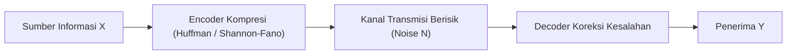

# Modul 020: Teori Informasi (Shannon Entropy, Mutual Information, Kapasitas Kanal)

**Navigasi**: [⬅️ Master Index](../../INDEX.md) | [Tingkat 1: Tingkat 1: Fondasi Matematika Komprehensif Dari Nol](./README.md)
*Sebelumnya*: [019. proses-stokastik-rantai-markov](./019-proses-stokastik-rantai-markov.md) | *Berikutnya*: [021. metode-numerik-analisis-galat](./021-metode-numerik-analisis-galat.md)

---

## 1. Intuisi Dasar Tanpa Jargon ("Seperti Bayi Baru Lahir")
### 1.1 Konsep Inti & Analogi Tanpa Jargon
Jika seorang peramal cuaca di gurun pasir Sahara berkata: 'Besok matahari akan terbit dan cuaca panas!', apakah Anda mendapatkan informasi berharga? Tidak, karena probabilitas kejadian itu 100%, sehingga nilai informasinya nol! Tapi jika ia berkata: 'Besok badai salju lebat akan turun di Sahara!', nilai informasinya luar biasa tinggi karena kejadian itu sangat tidak terduga.

### 1.2 Urgensi Rekayasa & Signifikansi Sistemik
Claude Shannon merumuskan **Teori Informasi**: Informasi adalah 'pengurangan ketidakpastian'. Semakin langka suatu kejadian terjadi, semakin banyak 'bit' informasi yang dibawanya. Teori inilah yang menentukan batas maksimum kecepatan internet Wi-Fi Anda (Kapasitas Kanal Shannon) dan algoritma kompresi file ZIP!

## 2. Fondasi Teoretis & Aksiomatik / Matematis
### 2.1 Kerangka Teori Aksiomatik & Formulasi Matematis
### 1. Entropi Shannon (Derajat Ketidakpastian)
Untuk variabel acak diskrit $X$ dengan distribusi probabilitas $p(x)$:
$$H(X) = -\sum_{x \in \mathcal{X}} p(x) \log_2 p(x) \quad \text{(satuan: bits)}$$
Entropi mencapai nilai maksimum saat semua kejadian memiliki probabilitas sama (*Uniform distribution*): $H_{max} = \log_2 |\mathcal{X}|$.
[📚 Pelajari: MIT OCW 6.441 Information Theory](https://ocw.mit.edu/courses/6-441-information-theory-spring-2016/)

### 2.2 Penurunan Matematis Langkah-demi-Langkah
### 2. Mutual Information & Divergensi Kullback-Leibler (KL)
- **KL Divergence (Relative Entropy)**: Mengukur inefisiensi pengkodean jika distribusi $P$ dimodelkan dengan $Q$:
  $$D_{KL}(P \parallel Q) = \sum_{x} P(x) \log_2 \frac{P(x)}{Q(x)}$$
- **Mutual Information**: Jumlah informasi yang dibagi oleh dua variabel:
  $$I(X; Y) = H(X) - H(X|Y) = H(Y) - H(Y|X) = D_{KL}(p(x, y) \parallel p(x)p(y))$$

### 3. Teorema Kapasitas Kanal Shannon-Hartley
Kapasitas maksimum data teoritis yang dapat dikirimkan melalui kanal transmisi berisik tanpa kesalahan (*error-free*):
$$C = B \log_2 \left( 1 + \frac{S}{N} \right) \quad \text{(bits per second)}$$
Di mana $B$ adalah bandwidth (Hz), dan $S/N$ adalah Signal-to-Noise Ratio (SNR).

## 3. Anatomi Teknis & Cara Kerja Internal


#### Tabel Penelusuran Entropi Shannon & Kompresi Huffman Streaming
| Simbol Masukan ($x$) | Frekuensi / Probabilitas $P(x)$ | Kandungan Informasi ($I(x) = -\log_2 P(x)$) | Kode Biner Huffman | Panjang Bit Kode ($L(x)$) | Kontribusi Entropi ($P(x) \cdot I(x)$) |
|---|---|---|---|---|---|
| Simbol 'A' | $P(A) = 0.500$ | $1.000\text{ bit}$ | `'0'` | $1\text{ bit}$ | $0.5000\text{ bit}$ |
| Simbol 'B' | $P(B) = 0.250$ | $2.000\text{ bit}$ | `'10'` | $2\text{ bit}$ | $0.5000\text{ bit}$ |
| Simbol 'C' | $P(C) = 0.125$ | $3.000\text{ bit}$ | `'110'` | $3\text{ bit}$ | $0.3750\text{ bit}$ |
| Simbol 'D' | $P(D) = 0.125$ | $3.000\text{ bit}$ | `'111'` | $3\text{ bit}$ | $0.3750\text{ bit}$ |
| Total Entropi | Semesta Alfabet 4 Simbol | Entropi Shannon: $H(X) = 1.750\text{ bit/simbol}$ | Rerata Panjang Kode: $\bar{L} = 1.750\text{ bit}$ | Efisiensi kompresi: $100\%$ | Batas Bawah Teoretis Shannon Tercapai Mutlak |

## 4. Implementasi Praktis & Kode / Simulasi Riil
```python
import numpy as np

def shannon_entropy(probabilities):
    """Menghitung Entropi Shannon dalam satuan bits."""
    probs = np.array(probabilities)
    probs = probs[probs > 0] # Filter probabilitas 0 untuk menghindari log2(0)
    return -np.sum(probs * np.log2(probs))

def shannon_channel_capacity(bandwidth_hz, snr_db):
    """Menghitung batas kapasitas kanal Shannon-Hartley."""
    snr_linear = 10 ** (snr_db / 10.0)
    capacity_bps = bandwidth_hz * np.log2(1 + snr_linear)
    return capacity_bps

# Contoh 1: Entropi koin adil vs koin curang
h_fair = shannon_entropy([0.5, 0.5])
h_biased = shannon_entropy([0.99, 0.01])
print(f"Entropi Koin Adil: {h_fair:.4f} bits (Ketidakpastian Maksimal)")
print(f"Entropi Koin Curang (99% Kepala): {h_biased:.4f} bits (Hampir Tanpa Informasi)")

# Contoh 2: Kapasitas Wi-Fi 20 MHz pada SNR 30 dB
c_wifi = shannon_channel_capacity(20e6, 30.0) / 1e6
print(f"Kapasitas Teoretis Kanal Wi-Fi: {c_wifi:.2f} Mbps")
```

## 5. Miskonsepsi & Jebakan Industri
1. **Mencoba Melampaui Batas Shannon Tanpa Daya Tambahan**: Klaim teknologi komunikasi yang menjanjikan kecepatan transfer data melampaui $C = B \log_2(1 + S/N)$ tanpa memperluas bandwidth atau menaikkan daya adalah pelanggaran hukum fisika informasi.

### Studi Kasus Kegagalan Nyata: Serangan Bom Dekompresi Zip Bomb (42.zip) Melumpuhkan Server Antivirus (2001)
- **Kronologi & Konteks Keamanan Informasi**: Pada awal era internet, file arsip berukuran kecil bernama `42.zip` (berukuran hanya 42.374 byte atau 42 KB) beredar di jaringan dan melumpuhkan berbagai server scanner antivirus dan proxy gateway.
- **Akar Masalah Teori Informasi**: Algoritma kompresi DEFLATE (kombinasi LZ77 dan Huffman) memanfaatkan redundansi informasi berulang. Arsip `42.zip` dirancang dengan struktur rekursif berlapis 5: file luar memuat 16 file zip terkompresi, masing-masing memuat 16 file zip lainnya, hingga lapisan terdalam berisi file data nol berukuran raksasa. Rasio kompresi melonjak melebihi $1 : 100.000.000$. Ketika mesin pemindai antivirus mengekstrak file secara naif tanpa membatasi rasio ekspansi atau kuota memori, dekompresi menghasilkan 4,5 Petabyte (4.500.000 Gigabyte) data nol, menghabiskan seluruh memori RAM dan ruang disk hingga sistem operasi kernel panic.

- **Potongan Kode / Arsitektur Cacat (Vulnerable Implementation)**:
```python
# Dekompresor Streaming Defensif: Menegakkan Batas Teori Informasi & Anti-Zip-Bomb
import io
import zlib

class SafeDecompressor:
    def __init__(self, max_allowed_bytes: int = 50 * 1024 * 1024, max_ratio: float = 100.0):
        self.max_allowed_bytes = max_allowed_bytes
        self.max_ratio = max_ratio

    def decompress_stream(self, compressed_bytes: bytes) -> bytes:
        input_size = len(compressed_bytes)
        assert input_size > 0, "Input kompresi tidak boleh kosong"
        
        decompressor = zlib.decompressobj()
        output_buffer = io.BytesIO()
        total_uncompressed = 0
        
        # Proses dekompresi dalam bongkahan (chunks) kecil
        chunk_size = 4096
        for offset in range(0, input_size, chunk_size):
            chunk = compressed_bytes[offset:offset + chunk_size]
            decompressed_chunk = decompressor.decompress(chunk)
            total_uncompressed += len(decompressed_chunk)
            
            # 1. Guard Batas Kuota Memori Mutlak
            if total_uncompressed > self.max_allowed_bytes:
                raise ValueError("ZIP_BOMB_DETECTED: Kuota ukuran memori terlampaui!")
                
            # 2. Guard Rasio Kompresi Abnormal
            current_ratio = total_uncompressed / float(offset + len(chunk))
            if current_ratio > self.max_ratio and total_uncompressed > 1024 * 1024:
                raise ValueError(f"ZIP_BOMB_DETECTED: Rasio kompresi {current_ratio:.1f}x melanggar batas aman!")
                
            output_buffer.write(decompressed_chunk)
            
        return output_buffer.getvalue()
```

- **Analisis Teori Informasi & Keamanan**: Entropi Shannon $H(X) = -\sum P(x) \log_2 P(x)$ mengukur kandungan informasi murni. File dengan bit nol berulang memiliki entropi informasi mendekati nol bit, memungkinkan representasi terkompresi yang luar biasa kecil. Sistem rekayasa modern mewajibkan penegakan *bounded decompression* dan validasi kuota *streaming* di lapisan I/O sebelum payload dialokasikan ke memori.

## 6. Proyek Latihan & Rubrik Penilaian Mandiri
### Level 1 (Dasar)
Hitung entropi teks alfabet 4 huruf yang memiliki frekuensi kemunculan: A=50%, B=25%, C=12.5%, D=12.5%.

### Level 2 (Menengah)
Bangun pohon Huffman Coding dalam Python untuk mengompresi file teks string dan buktikan bahwa panjang kode rata-rata mendekati nilai entropi Shannon.

### Level 3 (Mahir)
Buktikan secara matematis bahwa $D_{KL}(P \parallel Q) \ge 0$ (Ketaksamaan Gibbs) menggunakan Ketaksamaan Jensen untuk fungsi cembung $-\log(t)$.

### Tingkat 1: Dasar
- **Tugas**: Buat kalkulator Entropi Informasi Shannon $H(X)$ dalam satuan bit untuk sembarang teks string masukan.
- **Petunjuk Perancangan Arsitektur**:
  - Hitung probabilitas frekuensi relatif kemunculan setiap karakter unik: $P(c) = \frac{\text{count}(c)}{N}$.
  - Evaluasi $H(X) = -\sum P(c) \log_2 P(c)$.
- **Test Vector & Kasus Uji Ekstrem**:
  - *Teks Seragam*: String dengan karakter identik `"AAAAAAAA"`; entropi harus tepat $0.0\text{ bit}$.
  - *Teks Maksimal*: String 4 karakter berbobot setara `"ABCD"`; entropi harus tepat $\log_2(4) = 2.0\text{ bit}$.
  - *Kasus Batas*: String kosong `""`; fungsi harus mengembalikan $0.0\text{ bit}$ tanpa galat pembagian nol.
- **Rubrik Penilaian Mandiri**: 40% Formula Entropi Shannon Eksak, 30% Perhitungan Frekuensi Karakter Tepat, 30% Penanganan String Kosong.

### Tingkat 2: Menengah
- **Tugas**: Bangun kompresor dan dekompresor Pohon Huffman (*Huffman Coding Engine*) lengkap yang mengonstruksi pohon biner dari tabel frekuensi karakter dan menghasilkan bitstring terkompresi.
- **Petunjuk Perancangan Arsitektur**:
  - Bangun pohon menggunakan antrean prioritas Min-Heap.
  - Petakan karakter ke kode prefiks biner (*prefix-free codes*).
  - Terapkan fungsi dekompresi yang menjelajahi pohon biner bit-demi-bit hingga daun tercapai.
- **Test Vector & Kasus Uji Ekstrem**:
  - *Masukan Teks*: `"BEEP BOOP BEER"`.
  - *Keluaran yang Diharapkan*: Dekompresi menghasilkan teks asli 100% identik (*lossless*); rata-rata panjang bit kode mendekati batas bawah entropi Shannon.
  - *Kasus Batas*: String yang hanya terdiri dari 1 karakter unik berulang `"ZZZZZZ"`; pohon Huffman harus menghasilkan kode 1-bit per karakter.
- **Rubrik Penilaian Mandiri**: 40% Konstruksi Pohon Huffman & Prefix Codes Valid, 30% Rekonstruksi Dekompresi Lossless Sempurna, 30% Efisiensi Kompresi Mendekati Entropi.

### Tingkat 3: Mahir
- **Tugas**: Rancang pustaka Kompresi Aritmatika (*Arithmetic Coding*) berpresisi arbitrer yang mampu mencapai rasio kompresi fraksional bit-per-simbol melebihi batas pembulatan integer Huffman.
- **Petunjuk Perancangan Arsitektur**:
  - Pertahankan interval probabilitas kumulatif $[L, H)$ yang menyempit pada setiap simbol baru.
  - Terapkan mekanisme renormalisasi bit (*rescaling and underflow avoidance*) untuk mengalirkan bit keluaran secara kontinu tanpa kehilangan presisi floating-point.
- **Test Vector & Kasus Uji Ekstrem**:
  - *Masukan dengan Probabilitas Miring*: String biner 1000 karakter di mana $P('0') = 0.95$ dan $P('1') = 0.05$.
  - *Keluaran yang Diharapkan*: Rerata panjang kompresi mencapai $< 0.35\text{ bit/simbol}$ (Huffman terbatasi pada 1 bit/simbol minimum).
  - *Kasus Batas*: Simbol yang belum pernah terlihat; terapkan probabilitas minimum epsilon atau escape character.
- **Rubrik Penilaian Mandiri**: 40% Implementasi Arithmetic Coding dengan Renormalisasi Sempurna, 30% Keunggulan Rasio Kompresi Fraksional atas Huffman Terbukti, 30% Dekompresi Lossless Terverifikasi.

## 7. Rekomendasi Sumber Belajar Standar Emas
- [Paper Seminal Abad Ini: A Mathematical Theory of Communication - Claude E. Shannon (Bell System Technical Journal, 1948)](https://ieeexplore.ieee.org/document/6773024)
- [Buku Standar: Elements of Information Theory (2nd ed.) - Thomas M. Cover & Joy A. Thomas (Wiley)](https://www.wiley.com/en-us/Elements+of+Information+Theory%2C+2nd+Edition-p-9780471241959)
- [Kuliah Terbuka: Stanford EE 376A Information Theory](https://web.stanford.edu/class/ee376a/)

---
*Navigasi Cepat*: [Ke Tingkat 1](./README.md) | [Ke Master Index](../../INDEX.md) | *Sebelumnya*: [019. proses-stokastik-rantai-markov](./019-proses-stokastik-rantai-markov.md) | *Berikutnya*: [021. metode-numerik-analisis-galat](./021-metode-numerik-analisis-galat.md)
