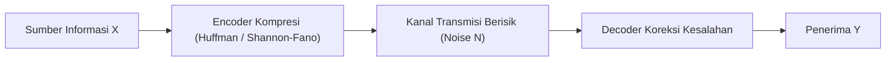

# Modul 020: Teori Informasi (Shannon Entropy, Mutual Information, Kapasitas Kanal)

**Navigasi**: [⬅️ Master Index](../../INDEX.md) | [Tingkat 1: Tingkat 1: Fondasi Matematika Komprehensif Dari Nol](./README.md)
*Sebelumnya*: [019. proses-stokastik-rantai-markov](./019-proses-stokastik-rantai-markov.md) | *Berikutnya*: [021. metode-numerik-analisis-galat](./021-metode-numerik-analisis-galat.md)

---

## 1. Intuisi Dasar Tanpa Jargon ("Seperti Bayi Baru Lahir")
Jika seorang peramal cuaca di gurun pasir Sahara berkata: 'Besok matahari akan terbit dan cuaca panas!', apakah Anda mendapatkan informasi berharga? Tidak, karena probabilitas kejadian itu 100%, sehingga nilai informasinya nol! Tapi jika ia berkata: 'Besok badai salju lebat akan turun di Sahara!', nilai informasinya luar biasa tinggi karena kejadian itu sangat tidak terduga.

Claude Shannon merumuskan **Teori Informasi**: Informasi adalah 'pengurangan ketidakpastian'. Semakin langka suatu kejadian terjadi, semakin banyak 'bit' informasi yang dibawanya. Teori inilah yang menentukan batas maksimum kecepatan internet Wi-Fi Anda (Kapasitas Kanal Shannon) dan algoritma kompresi file ZIP!

## 2. Fondasi Teoretis & Aksiomatik / Matematis
### 1. Entropi Shannon (Derajat Ketidakpastian)
Untuk variabel acak diskrit $X$ dengan distribusi probabilitas $p(x)$:
$$H(X) = -\sum_{x \in \mathcal{X}} p(x) \log_2 p(x) \quad \text{(satuan: bits)}$$
Entropi mencapai nilai maksimum saat semua kejadian memiliki probabilitas sama (*Uniform distribution*): $H_{max} = \log_2 |\mathcal{X}|$.
[📚 Pelajari: MIT OCW 6.441 Information Theory](https://ocw.mit.edu/courses/6-441-information-theory-spring-2016/)

### 2. Mutual Information & Divergensi Kullback-Leibler (KL)
- **KL Divergence (Relative Entropy)**: Mengukur inefisiensi pengkodean jika distribusi $P$ dimodelkan dengan $Q$:
  $$D_{KL}(P \parallel Q) = \sum_{x} P(x) \log_2 \frac{P(x)}{Q(x)}$$
- **Mutual Information**: Jumlah informasi yang dibagi oleh dua variabel:
  $$I(X; Y) = H(X) - H(X|Y) = H(Y) - H(Y|X) = D_{KL}(p(x, y) \parallel p(x)p(y))$$

### 3. Teorema Kapasitas Kanal Shannon-Hartley
Kapasitas maksimum data teoritis yang dapat dikirimkan melalui kanal transmisi berisik tanpa kesalahan (*error-free*):
$$C = B \log_2 \left( 1 + \frac{S}{N} \right) \quad \text{(bits per second)}$$
Di mana $B$ adalah bandwidth (Hz), dan $S/N$ adalah Signal-to-Noise Ratio (SNR).

## 3. Anatomi Teknis & Cara Kerja Internal


## 4. Implementasi Praktis & Kode / Simulasi Riil
```python
import numpy as np

def shannon_entropy(probabilities):
    """Menghitung Entropi Shannon dalam satuan bits."""
    probs = np.array(probabilities)
    probs = probs[probs > 0] # Filter probabilitas 0 untuk menghindari log2(0)
    return -np.sum(probs * np.log2(probs))

def shannon_channel_capacity(bandwidth_hz, snr_db):
    """Menghitung batas kapasitas kanal Shannon-Hartley."""
    snr_linear = 10 ** (snr_db / 10.0)
    capacity_bps = bandwidth_hz * np.log2(1 + snr_linear)
    return capacity_bps

# Contoh 1: Entropi koin adil vs koin curang
h_fair = shannon_entropy([0.5, 0.5])
h_biased = shannon_entropy([0.99, 0.01])
print(f"Entropi Koin Adil: {h_fair:.4f} bits (Ketidakpastian Maksimal)")
print(f"Entropi Koin Curang (99% Kepala): {h_biased:.4f} bits (Hampir Tanpa Informasi)")

# Contoh 2: Kapasitas Wi-Fi 20 MHz pada SNR 30 dB
c_wifi = shannon_channel_capacity(20e6, 30.0) / 1e6
print(f"Kapasitas Teoretis Kanal Wi-Fi: {c_wifi:.2f} Mbps")
```

## 5. Miskonsepsi & Jebakan Industri
1. **Mencoba Melampaui Batas Shannon Tanpa Daya Tambahan**: Klaim teknologi komunikasi yang menjanjikan kecepatan transfer data melampaui $C = B \log_2(1 + S/N)$ tanpa memperluas bandwidth atau menaikkan daya adalah pelanggaran hukum fisika informasi.

## 6. Proyek Latihan & Rubrik Penilaian Mandiri
### Level 1 (Dasar)
Hitung entropi teks alfabet 4 huruf yang memiliki frekuensi kemunculan: A=50%, B=25%, C=12.5%, D=12.5%.

### Level 2 (Menengah)
Bangun pohon Huffman Coding dalam Python untuk mengompresi file teks string dan buktikan bahwa panjang kode rata-rata mendekati nilai entropi Shannon.

### Level 3 (Mahir)
Buktikan secara matematis bahwa $D_{KL}(P \parallel Q) \ge 0$ (Ketaksamaan Gibbs) menggunakan Ketaksamaan Jensen untuk fungsi cembung $-\log(t)$.

## 7. Rekomendasi Sumber Belajar Standar Emas
- [Paper Seminal Abad Ini: A Mathematical Theory of Communication - Claude E. Shannon (Bell System Technical Journal, 1948)](https://ieeexplore.ieee.org/document/6773024)
- [Buku Standar: Elements of Information Theory (2nd ed.) - Thomas M. Cover & Joy A. Thomas (Wiley)](https://www.wiley.com/en-us/Elements+of+Information+Theory%2C+2nd+Edition-p-9780471241959)
- [Kuliah Terbuka: Stanford EE 376A Information Theory](https://web.stanford.edu/class/ee376a/)

---
*Navigasi Cepat*: [Ke Tingkat 1](./README.md) | [Ke Master Index](../../INDEX.md) | *Sebelumnya*: [019. proses-stokastik-rantai-markov](./019-proses-stokastik-rantai-markov.md) | *Berikutnya*: [021. metode-numerik-analisis-galat](./021-metode-numerik-analisis-galat.md)
