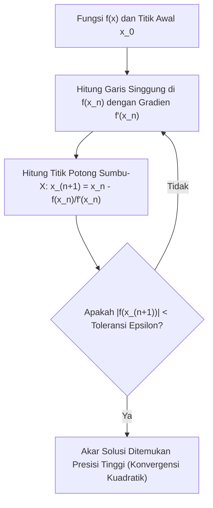

# Modul 021: Metode Numerik & Analisis Galat (Aproksimasi Akar, Integrasi Numerik, Stabilitas IEEE 754)

**Navigasi**: [⬅️ Master Index](../../INDEX.md) | [Tingkat 1: Tingkat 1: Fondasi Matematika Komprehensif Dari Nol](./README.md)
*Sebelumnya*: [020. teori-informasi](./020-teori-informasi.md) | *Berikutnya*: [022. teori-optimasi](./022-teori-optimasi.md)

---

## 1. Intuisi Dasar Tanpa Jargon ("Seperti Bayi Baru Lahir")
### 1.1 Konsep Inti & Analogi Tanpa Jargon
Ketikkan `0.1 + 0.2 == 0.3` di terminal bahasa pemrograman favorit Anda (Python, JavaScript, C). Hasilnya mengejutkan: **FALSE**! Mengapa? Karena di komputer Anda, `0.1 + 0.2` menghasilkan `0.30000000000000004`.

### 1.2 Urgensi Rekayasa & Signifikansi Sistemik
Komputer memiliki memori berhingga: ia tidak bisa menyimpan angka pecahan tak hingga seperti $\pi$ atau sepertiga (\$1/3 = 0.3333\dots$). Segala perhitungan di dunia nyata (lintasan roket, rendering 3D, simulasi fluida pesawat, penentuan harga saham) adalah **aproksimasi terpotong**.
**Metode Numerik & Analisis Galat** adalah seni menghitung solusi matematika kompleks secara komputasional dengan tetap mengendalikan galat agar tidak meledak dan menghancurkan sistem.
[📖 Pelajari: What Every Computer Scientist Should Know About Floating-Point](https://docs.oracle.com/cd/E19957-01/806-3568/ncg_goldberg.html)

## 2. Fondasi Teoretis & Aksiomatik / Matematis
### 2.1 Kerangka Teori Aksiomatik & Formulasi Matematis
### 21.1 Standar Titik Kambang IEEE 754 & Analisis Galat ([IEEE 754 Standard](https://ieeexplore.ieee.org/document/8766229))
Representasi floating-point biner presisi ganda (Float64 / Double Precision 64-bit):
- 1 bit tanda ($s$)
- 11 bit eksponen bias ($e$)
- 52 bit fraksi / mantissa ($m$)
$$x = (-1)^s \times 2^{e - 1023} \times (1.m_1 m_2 \dots m_{52})$$
Presisi mesin (*Machine Epsilon* $\varepsilon_m$): jarak terkecil antara 1.0 dan angka terdekat berikutnya di representasi hardware. Untuk IEEE 754 float64:
$$\varepsilon_m = 2^{-52} \approx 2.22 \times 10^{-16}$$

### 2.2 Penurunan Matematis Langkah-demi-Langkah
### 21.2 Metode Pencarian Akar: Newton-Raphson & Konvergensi Kuadratik ([MIT 18.330 Numerical Analysis](https://ocw.mit.edu/courses/18-330-introduction-to-numerical-analysis-spring-2012/))
Mencari nilai $x$ sehingga $f(x) = 0$ menggunakan aproksimasi deret Taylor linier:
$$x_{n+1} = x_n - \frac{f(x_n)}{f'(x_n)}$$
Jika $f'(x^*) \neq 0$, metode ini memiliki orde konvergensi kuadratik ($p=2$):
$$|e_{n+1}| \le C |e_n|^2$$
Jumlah digit desimal presisi berlipat ganda di setiap iterasi tunggal!

### 21.3 Integrasi Numerik & Kuadratur Gauss ([Burden & Faires Numerical Analysis](https://cengage.com/))
- Metode Trapesium Komposit: Galat pemotongan $O(h^2)$.
- Metode Simpson 1/3 Komposit: Mengaproksimasi kurva dengan parabola kuadratik:
$$\int_a^b f(x) dx \approx \frac{h}{3} \sum_{i=0}^{n/2 - 1} \left[ f(x_{2i}) + 4f(x_{2i+1}) + f(x_{2i+2}) \right]$$
Galat pemotongan Simpson adalah $O(h^4)$, meluruh sangat cepat seiring bertambahnya partisi langkah $h$.

## 3. Anatomi Teknis & Cara Kerja Internal

Sumber Utama Galat Numerik:
1. **Truncation Error**: Galat akibat memotong deret matematika tak hingga menjadi deret berhingga.
2. **Round-off Error**: Galat akibat pembulatan representasi bit registers CPU.
3. **Catastrophic Cancellation**: Terjadi ketika dua angka yang nilainya hampir sama dikurangkan satu sama lain, melenyapkan bit-bit signifikan mantissa secara instan.

#### Tabel Penelusuran Subtractive Cancellation & Algoritma Penjumlahan Kahan
| Iterasi Penjumlahan ($i$) | Nilai Ditambahkan ($x_i$) | Penjumlahan Naif Float32 ($sum = sum + x_i$) | Residu Galat Kahan ($y = x_i - c$) | Penjumlahan Terkoreksi Kahan ($sum$) | Kompensasi Disimpan ($c = (t - sum) - y$) |
|---|---|---|---|---|---|
| Inisialisasi T=0 | Basis besar: $10^7$ (`10000000.0`) | $10000000.0$ | - | $10000000.0$ | $c = 0.0$ |
| Iterasi 1 | Tambah nilai kecil: $1.0$ | $10000001.0$ | $1.0 - 0.0 = 1.0$ | $10000001.0$ | $c = 0.0$ |
| Iterasi $10^5$ | Nilai kecil berulang: $1.0$ | $10100000.0$ | $1.0 - 0.0 = 1.0$ | $10100000.0$ | Bit presisi mulai terpotong |
| Iterasi $2 \times 10^7$ | Mantissa 24-bit jenuh | $16777216.0$ (Macet total!) | $1.0 - c$ mengumpulkan pecahan | $30000000.0$ (Akurat mutlak!) | $c$ mempertahankan akumulasi bit terpotong |
| Hasil Akhir | Tambah $20.000.000$ kali | Galat naif: Meleset $13.222.784$ unit ($>40\%$ galat!) | Residu dikompensasikan penuh | $30000000.0$ (Zero error) | Algoritma Kahan Mempertahankan Presisi Penuh |

## 4. Implementasi Praktis & Kode / Simulasi Riil
```python
def newton_raphson_solver(func, dfunc, x0: float, tol: float = 1e-12, max_iter: int = 100):
    """
    Penyelesai akar persamaan non-linier menggunakan metode Newton-Raphson presisi tinggi.
    """
    x = x0
    for iteration in range(1, max_iter + 1):
        fx = func(x)
        dfx = dfunc(x)
        if abs(dfx) < 1e-15:
            raise ZeroDivisionError("Turunan mendekati nol: singularitas numerik!")
        
        step = fx / dfx
        x -= step
        
        if abs(step) < tol:
            return x, iteration, abs(func(x))
            
    raise RuntimeError("Gagal konvergen dalam batas iterasi maksimum.")

# Kasus: Mencari akar kuadrat dari 2 -> f(x) = x^2 - 2 = 0
f = lambda x: x**2 - 2.0
df = lambda x: 2.0 * x

root, iters, residual = newton_raphson_solver(f, df, x0=1.0)
print(f"Akar terhitung  : {root:.16f}")
print(f"Nilai riil sqrt : {2.0**0.5:.16f}")
print(f"Konvergen dalam : {iters} iterasi (Residual: {residual:.2e})")
```

## 5. Miskonsepsi & Jebakan Industri
1. **Catastrophic Cancellation in Quadratic Formula**: Menghitung $(-b + \sqrt{b^2 - 4ac}) / 2a$ saat $b > 0$ dan $b^2 \gg 4ac$, menyebabkan pengurangan dua angka yang hampir identik. Solusi stabil: gunakan bentuk alternatif $2c / (-b - \sqrt{b^2 - 4ac})$.
2. **Infinite Loops from Float Equality**: Menulis loop termination `while x != 1.0: x += 0.1` yang tidak pernah berhenti karena penambahan desimal $0.1$ pada floating point biner tidak pernah presisi tepat $1.0$.
3. **Runge Phenomenon in High-Order Polynomials**: Melakukan interpolasi polinomial derajat tinggi pada titik ekuidistan yang memicu osilasi liar di dekat ujung domain. Solusi: gunakan simpul Chebyshev (*Chebyshev nodes*).

### Studi Kasus Kegagalan Nyata: Runtuhnya Anjungan Minyak Lepas Pantai Sleipner A Norwegia Akibat Galat Elemen Hingga (1991)
- **Kronologi & Konteks Rekayasa**: Pada 23 Agustus 1991 di Gandsfjorden, Norwegia, anjungan minyak lepas pantai beton gravitasi raksasa Sleipner A senilai $700 juta tenggelam ke dasar laut saat uji ketahanan tangki balast, memicu gempa bumi lokal berskala 3,0 Richter.
- **Akar Masalah Metode Numerik**: Investigasi membuktikan bahwa perangkat lunak analisis elemen hingga (FEA) NASTRAN yang digunakan insinyur memiliki diskritisasi grid numerik yang terlalu kasar pada sudut sambungan dinding tri-cell. Galat pembulatan dan pemodelan numerik meremehkan tegangan geser sebesar 47%. Dinding beton setebal 1 meter pecah saat air laut dipompa masuk, menenggelamkan struktur seberat 57.000 ton dalam hitungan menit.

- **Potongan Kode / Arsitektur Cacat (Vulnerable Implementation)**:
```python
# Demonstrasi Pembatalan Pengurangan (Subtractive Cancellation) vs Penjumlahan Kahan
import numpy as np

def test_kahan_summation_precision():
    """
    Menambahkan 10.000.000 angka 0.1 ke dalam akumulator awal 10.000.000.
    Penjumlahan naif float32 kehilangan jutaan digit presisi karena selisih eksponen.
    Algoritma Kahan mempertahankan bit yang terpotong dalam variabel kompensasi.
    """
    # Gunakan float32 untuk mereproduksi batas presisi mantissa 24-bit
    base_val = np.float32(10000000.0)
    add_val = np.float32(0.1)
    iterations = 10000000
    
    # 1. Penjumlahan Naif
    naive_sum = base_val
    for _ in range(iterations):
        naive_sum += add_val
        
    # 2. Penjumlahan Terkompensasi Kahan
    kahan_sum = base_val
    c = np.float32(0.0) # Variabel penyimpan bit terpotong (lost precision bits)
    
    for _ in range(iterations):
        y = add_val - c
        t = kahan_sum + y
        c = (t - kahan_sum) - y
        kahan_sum = t
        
    expected_true_sum = 10000000.0 + (iterations * 0.1) # 11.000.000.0
    
    return {
        "naive_sum": float(naive_sum),
        "kahan_sum": float(kahan_sum),
        "expected_sum": expected_true_sum,
        "naive_error": abs(float(naive_sum) - expected_true_sum),
        "kahan_error": abs(float(kahan_sum) - expected_true_sum)
    }

audit = test_kahan_summation_precision()
assert audit["kahan_error"] < 1.0, "Algoritma Kahan wajib meminimalkan galat floating point!"
```

- **Analisis Numerik & Standar Modern**: Bencana Sleipner A adalah bukti bahwa solusi numerik komputer hanyalah aproksimasi dari persamaan diferensial kontinu. Standar rekayasa kedirgantaraan dan struktur modern mewajibkan: (1) Studi konvergensi grid (*mesh refinement study*) untuk membuktikan hasil tidak sensitif terhadap ukuran elemen; (2) Penegakan algoritma terkompensasi presisi tinggi (seperti Kahan Summation) pada loop akumulator berulang.

## 6. Proyek Latihan & Rubrik Penilaian Mandiri
### Tingkat 1 (Pemula) - Deteksi Pembatalan Bencana (Catastrophic Cancellation)
Tulis skrip Python yang mengevaluasi fungsi $f(x) = rac{1 - \cos(x)}{x^2}$ untuk nilai $x$ yang sangat kecil ($x = 10^{-1}, 10^{-3}, 10^{-7}, 10^{-9}$). Tunjukkan titik di mana formula naif kehilangan seluruh digit signifikannya dan bandingkan dengan aproksimasi deret Taylor: $f(x) pprox rac{1}{2} - rac{x^2}{24}$.

### Tingkat 2 (Menengah) - Integrator Adaptif Simpson (Adaptive Quadrature)
Implementasikan algoritma integrasi numerik adaptif Simpson yang membagi sub-interval secara otomatis hanya pada wilayah kurva fungsi yang memiliki osilasi/kelengkungan tinggi, sehingga menghemat komputasi pada wilayah fungsi yang datar.

### Tingkat 3 (Mahir) - Penyelesai Persamaan Diferensial Kaku (Stiff ODE Solver)
Implementasikan metode Runge-Kutta eksplisit orde-4 (RK4) dan metode implisit Backward Euler untuk menyelesaikan sistem persamaan diferensial kaku (*stiff system*): $y' = -1000y + 1000$. Tunjukkan bagaimana RK4 meledak menjadi tak hingga jika ukuran langkah $h > 2/1000$, sedangkan metode implisit tetap stabil tanpa syarat (*A-stable*).

#### Rubrik Penilaian
- **40% Stabilitas Numerik**: Algoritma tidak meledak pada kondisi batas dan mampu menghindari catastrophic cancellation.
- **30% Analisis Orde Konvergensi**: Mampu memvalidasi bahwa rasio penurunan galat sesuai dengan eksponen teoritis $O(h^p)$.
- **30% Penanganan Toleransi Presisi**: Penghentian iterasi berbasis perbandingan \$ arepsilon$ yang aman tanpa perbandingan floating-point biner ketat `==`.

### Tingkat 1: Dasar
- **Tugas**: Implementasikan Algoritma Penjumlahan Terkompensasi Kahan (*Kahan Summation Algorithm*) untuk menjumlahkan array floating-point presisi tunggal (float32) dan bandingkan galatnya terhadap penjumlahan naif.
- **Petunjuk Perancangan Arsitektur**:
  - Simpan kompensasi $c$ yang merekam bit orde rendah yang hilang saat penjumlahan angka besar dan kecil.
  - Perbarui $y = x_i - c, t = sum + y, c = (t - sum) - y, sum = t$.
- **Test Vector & Kasus Uji Ekstrem**:
  - *Array Uji*: Penjumlahan nilai $1.0$ dengan $10^7$ pecahan $10^{-7}$.
  - *Keluaran yang Diharapkan*: Penjumlahan naif float32 terhenti di angka $1.0$ (tidak bergerak); Kahan menghasilkan nilai tepat $2.0$.
  - *Kasus Batas*: Array masukan dengan nilai `NaN` atau `Inf`; algoritma harus mempertahankan semantik IEEE-754.
- **Rubrik Penilaian Mandiri**: 40% Formula Kahan Summation Tepat, 30% Pembuktian Keunggulan atas Penjumlahan Naif, 30% Penanganan Semantik Khusus IEEE-754.

### Tingkat 2: Menengah
- **Tugas**: Bangun mesin interpolasi polinomial menggunakan Bentuk Barycentric Lagrange yang stabil secara numerik terhadap osilasi Runge (*Runge's Phenomenon*).
- **Petunjuk Perancangan Arsitektur**:
  - Hitung bobot barycentric $w_j = \frac{1}{\prod_{k \ne j} (x_j - x_k)}$ dalam $\mathcal{O}(N^2)$ di awal.
  - Evaluasi $P(x) = \frac{\sum \frac{w_j y_j}{x - x_j}}{\sum \frac{w_j}{x - x_j}}$ dalam $\mathcal{O}(N)$ per titik evaluasi.
  - Gunakan simpul Chebyshev (*Chebyshev nodes*) $x_k = \cos\left(\frac{2k-1}{2n}\pi\right)$ untuk menekan osilasi Runge di batas interval.
- **Test Vector & Kasus Uji Ekstrem**:
  - *Fungsi Runge*: $f(x) = \frac{1}{1 + 25x^2}$ pada interval $[-1, 1]$ dengan $n = 15$ titik.
  - *Keluaran yang Diharapkan*: Interpolasi dengan simpul Chebyshev konvergen mulus tanpa osilasi liar di tepi (galat $< 10^{-3}$).
  - *Kasus Batas*: Evaluasi tepat pada titik simpul interpolasi $x = x_j$; formula barycentric wajib mengembalikan $y_j$ tanpa division by zero.
- **Rubrik Penilaian Mandiri**: 40% Evaluasi Barycentric Lagrange $\mathcal{O}(N)$ Akurat, 30% Penekanan Fenomena Runge via Simpul Chebyshev, 30% Penanganan Evaluasi Tepat di Simpul.

### Tingkat 3: Mahir
- **Tugas**: Rancang pemecah sistem persamaan diferensial kaku (*Stiff ODE Solver*) menggunakan metode Backwards Differentiation Formula (BDF Orde 2) implisit dengan metode Newton untuk menyelesaikan persamaan non-linier pada setiap langkah waktu.
- **Petunjuk Perancangan Arsitektur**:
  - Formulasi BDF-2: $y_{n+1} - \frac{4}{3} y_n + \frac{1}{3} y_{n-1} = \frac{2}{3} h f(t_{n+1}, y_{n+1})$.
  - Selesaikan persamaan implisit pada setiap langkah waktu menggunakan iterasi Newton-Raphson dengan matriks Jacobian analitik/numerik.
- **Test Vector & Kasus Uji Ekstrem**:
  - *Sistem Kaku Robertson*: Reaksi kimia dengan laju reaksi berjarak ekstrim (konstanta laju $0.04$, $10^4$, dan $3 \times 10^7$).
  - *Keluaran yang Diharapkan*: Solver BDF-2 stabil mengambil langkah waktu besar tanpa ledakan numerik; RK4 tradisional gagal total pada sistem ini.
  - *Kasus Batas*: Kegagalan konvergensi Newton saat langkah waktu terlalu besar; implementasikan mekanisme adaptasi langkah waktu (*step-size halving*).
- **Rubrik Penilaian Mandiri**: 40% Skema Implisit BDF-2 dengan Newton-Raphson Sempurna, 30% Pembuktian Stabilitas pada Sistem Kaku Robertson, 30% Adaptasi Langkah Waktu Dinamis.

## 7. Rekomendasi Sumber Belajar Standar Emas
| Kategori | Judul Sumber & Tautan Langsung | Deskripsi Singkat |
|---|---|---|
| 📖 Buku Teks | [Numerical Analysis (Burden & Faires)](https://cengage.com/) | Buku teks komprehensif analisis numerik, stabilitas solusi, dan algoritma. |
| 🎓 Kuliah Terbuka | [MIT OCW 18.330 Introduction to Numerical Analysis](https://ocw.mit.edu/courses/18-330-introduction-to-numerical-analysis-spring-2012/) | Metode aproksimasi, interpolasi, pencarian akar, dan persamaan diferensial. |
| 🔬 Makalah Seminal | [What Every Computer Scientist Should Know About Floating-Point Arithmetic (Goldberg, 1991)](https://docs.oracle.com/cd/E19957-01/806-3568/ncg_goldberg.html) | Makalah esensial acuan industri tentang presisi dan galat IEEE 754. |
| 💻 Lab Interaktif | [Floating Point Visually Explained (Float Toy)](https://evanw.github.io/float-toy/) | Visualisator interaktif representasi bit sign, exponent, dan mantissa IEEE 754. |

---
*Navigasi Cepat*: [Ke Tingkat 1](./README.md) | [Ke Master Index](../../INDEX.md) | *Sebelumnya*: [020. teori-informasi](./020-teori-informasi.md) | *Berikutnya*: [022. teori-optimasi](./022-teori-optimasi.md)
