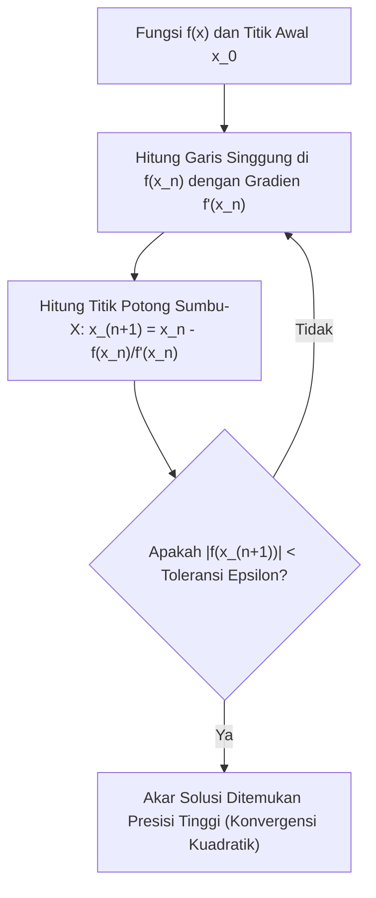

# Modul 021: Metode Numerik & Analisis Galat (Aproksimasi Akar, Integrasi Numerik, Stabilitas IEEE 754)

**Navigasi**: [⬅️ Master Index](../../INDEX.md) | [Tingkat 1: Tingkat 1: Fondasi Matematika Komprehensif Dari Nol](./README.md)
*Sebelumnya*: [020. teori-informasi](./020-teori-informasi.md) | *Berikutnya*: [022. teori-optimasi](./022-teori-optimasi.md)

---

## 1. Intuisi Dasar Tanpa Jargon ("Seperti Bayi Baru Lahir")
Ketikkan `0.1 + 0.2 == 0.3` di terminal bahasa pemrograman favorit Anda (Python, JavaScript, C). Hasilnya mengejutkan: **FALSE**! Mengapa? Karena di komputer Anda, `0.1 + 0.2` menghasilkan `0.30000000000000004`.

Komputer memiliki memori berhingga: ia tidak bisa menyimpan angka pecahan tak hingga seperti $\pi$ atau sepertiga ($1/3 = 0.3333\dots$). Segala perhitungan di dunia nyata (lintasan roket, rendering 3D, simulasi fluida pesawat, penentuan harga saham) adalah **aproksimasi terpotong**.
**Metode Numerik & Analisis Galat** adalah seni menghitung solusi matematika kompleks secara komputasional dengan tetap mengendalikan galat agar tidak meledak dan menghancurkan sistem.
[📖 Pelajari: What Every Computer Scientist Should Know About Floating-Point](https://docs.oracle.com/cd/E19957-01/806-3568/ncg_goldberg.html)

## 2. Fondasi Teoretis & Aksiomatik / Matematis
### 21.1 Standar Titik Kambang IEEE 754 & Analisis Galat ([IEEE 754 Standard](https://ieeexplore.ieee.org/document/8766229))
Representasi floating-point biner presisi ganda (Float64 / Double Precision 64-bit):
- 1 bit tanda ($s$)
- 11 bit eksponen bias ($e$)
- 52 bit fraksi / mantissa ($m$)
$$x = (-1)^s \times 2^{e - 1023} \times (1.m_1 m_2 \dots m_{52})$$
Presisi mesin (*Machine Epsilon* $\varepsilon_m$): jarak terkecil antara 1.0 dan angka terdekat berikutnya di representasi hardware. Untuk IEEE 754 float64:
$$\varepsilon_m = 2^{-52} \approx 2.22 \times 10^{-16}$$

### 21.2 Metode Pencarian Akar: Newton-Raphson & Konvergensi Kuadratik ([MIT 18.330 Numerical Analysis](https://ocw.mit.edu/courses/18-330-introduction-to-numerical-analysis-spring-2012/))
Mencari nilai $x$ sehingga $f(x) = 0$ menggunakan aproksimasi deret Taylor linier:
$$x_{n+1} = x_n - \frac{f(x_n)}{f'(x_n)}$$
Jika $f'(x^*) \neq 0$, metode ini memiliki orde konvergensi kuadratik ($p=2$):
$$|e_{n+1}| \le C |e_n|^2$$
Jumlah digit desimal presisi berlipat ganda di setiap iterasi tunggal!

### 21.3 Integrasi Numerik & Kuadratur Gauss ([Burden & Faires Numerical Analysis](https://cengage.com/))
- Metode Trapesium Komposit: Galat pemotongan $O(h^2)$.
- Metode Simpson 1/3 Komposit: Mengaproksimasi kurva dengan parabola kuadratik:
$$\int_a^b f(x) dx \approx \frac{h}{3} \sum_{i=0}^{n/2 - 1} \left[ f(x_{2i}) + 4f(x_{2i+1}) + f(x_{2i+2}) \right]$$
Galat pemotongan Simpson adalah $O(h^4)$, meluruh sangat cepat seiring bertambahnya partisi langkah $h$.

## 3. Anatomi Teknis & Cara Kerja Internal

Sumber Utama Galat Numerik:
1. **Truncation Error**: Galat akibat memotong deret matematika tak hingga menjadi deret berhingga.
2. **Round-off Error**: Galat akibat pembulatan representasi bit registers CPU.
3. **Catastrophic Cancellation**: Terjadi ketika dua angka yang nilainya hampir sama dikurangkan satu sama lain, melenyapkan bit-bit signifikan mantissa secara instan.

## 4. Implementasi Praktis & Kode / Simulasi Riil
def newton_raphson_solver(func, dfunc, x0: float, tol: float = 1e-12, max_iter: int = 100):
    """
    Penyelesai akar persamaan non-linier menggunakan metode Newton-Raphson presisi tinggi.
    """
    x = x0
    for iteration in range(1, max_iter + 1):
        fx = func(x)
        dfx = dfunc(x)
        if abs(dfx) < 1e-15:
            raise ZeroDivisionError("Turunan mendekati nol: singularitas numerik!")
        
        step = fx / dfx
        x -= step
        
        if abs(step) < tol:
            return x, iteration, abs(func(x))
            
    raise RuntimeError("Gagal konvergen dalam batas iterasi maksimum.")

# Kasus: Mencari akar kuadrat dari 2 -> f(x) = x^2 - 2 = 0
f = lambda x: x**2 - 2.0
df = lambda x: 2.0 * x

root, iters, residual = newton_raphson_solver(f, df, x0=1.0)
print(f"Akar terhitung  : {root:.16f}")
print(f"Nilai riil sqrt : {2.0**0.5:.16f}")
print(f"Konvergen dalam : {iters} iterasi (Residual: {residual:.2e})")

## 5. Miskonsepsi & Jebakan Industri
1. **Catastrophic Cancellation in Quadratic Formula**: Menghitung $(-b + \sqrt{b^2 - 4ac}) / 2a$ saat $b > 0$ dan $b^2 \gg 4ac$, menyebabkan pengurangan dua angka yang hampir identik. Solusi stabil: gunakan bentuk alternatif $2c / (-b - \sqrt{b^2 - 4ac})$.
2. **Infinite Loops from Float Equality**: Menulis loop termination `while x != 1.0: x += 0.1` yang tidak pernah berhenti karena penambahan desimal $0.1$ pada floating point biner tidak pernah presisi tepat $1.0$.
3. **Runge Phenomenon in High-Order Polynomials**: Melakukan interpolasi polinomial derajat tinggi pada titik ekuidistan yang memicu osilasi liar di dekat ujung domain. Solusi: gunakan simpul Chebyshev (*Chebyshev nodes*).

## 6. Proyek Latihan & Rubrik Penilaian Mandiri
### Tingkat 1 (Pemula) - Deteksi Pembatalan Bencana (Catastrophic Cancellation)
Tulis skrip Python yang mengevaluasi fungsi $f(x) = rac{1 - \cos(x)}{x^2}$ untuk nilai $x$ yang sangat kecil ($x = 10^{-1}, 10^{-3}, 10^{-7}, 10^{-9}$). Tunjukkan titik di mana formula naif kehilangan seluruh digit signifikannya dan bandingkan dengan aproksimasi deret Taylor: $f(x) pprox rac{1}{2} - rac{x^2}{24}$.

### Tingkat 2 (Menengah) - Integrator Adaptif Simpson (Adaptive Quadrature)
Implementasikan algoritma integrasi numerik adaptif Simpson yang membagi sub-interval secara otomatis hanya pada wilayah kurva fungsi yang memiliki osilasi/kelengkungan tinggi, sehingga menghemat komputasi pada wilayah fungsi yang datar.

### Tingkat 3 (Mahir) - Penyelesai Persamaan Diferensial Kaku (Stiff ODE Solver)
Implementasikan metode Runge-Kutta eksplisit orde-4 (RK4) dan metode implisit Backward Euler untuk menyelesaikan sistem persamaan diferensial kaku (*stiff system*): $y' = -1000y + 1000$. Tunjukkan bagaimana RK4 meledak menjadi tak hingga jika ukuran langkah $h > 2/1000$, sedangkan metode implisit tetap stabil tanpa syarat (*A-stable*).

#### Rubrik Penilaian
- **40% Stabilitas Numerik**: Algoritma tidak meledak pada kondisi batas dan mampu menghindari catastrophic cancellation.
- **30% Analisis Orde Konvergensi**: Mampu memvalidasi bahwa rasio penurunan galat sesuai dengan eksponen teoritis $O(h^p)$.
- **30% Penanganan Toleransi Presisi**: Penghentian iterasi berbasis perbandingan $arepsilon$ yang aman tanpa perbandingan floating-point biner ketat `==`.

## 7. Rekomendasi Sumber Belajar Standar Emas
| Kategori | Judul Sumber & Tautan Langsung | Deskripsi Singkat |
|---|---|---|
| 📖 Buku Teks | [Numerical Analysis (Burden & Faires)](https://cengage.com/) | Buku teks komprehensif analisis numerik, stabilitas solusi, dan algoritma. |
| 🎓 Kuliah Terbuka | [MIT OCW 18.330 Introduction to Numerical Analysis](https://ocw.mit.edu/courses/18-330-introduction-to-numerical-analysis-spring-2012/) | Metode aproksimasi, interpolasi, pencarian akar, dan persamaan diferensial. |
| 🔬 Makalah Seminal | [What Every Computer Scientist Should Know About Floating-Point Arithmetic (Goldberg, 1991)](https://docs.oracle.com/cd/E19957-01/806-3568/ncg_goldberg.html) | Makalah esensial acuan industri tentang presisi dan galat IEEE 754. |
| 💻 Lab Interaktif | [Floating Point Visually Explained (Float Toy)](https://evanw.github.io/float-toy/) | Visualisator interaktif representasi bit sign, exponent, dan mantissa IEEE 754. |

---
*Navigasi Cepat*: [Ke Tingkat 1](./README.md) | [Ke Master Index](../../INDEX.md) | *Sebelumnya*: [020. teori-informasi](./020-teori-informasi.md) | *Berikutnya*: [022. teori-optimasi](./022-teori-optimasi.md)
