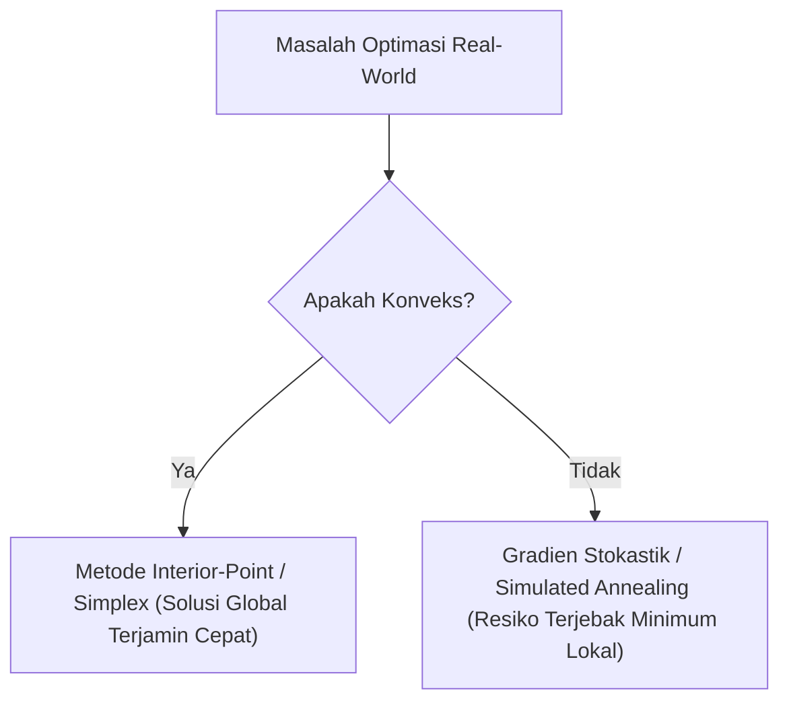

# Modul 022: Teori Optimasi (Optimasi Konveks, Pengali Lagrange, KKT Conditions, Gradient Descent)

**Navigasi**: [⬅️ Master Index](../../INDEX.md) | [Tingkat 1: Tingkat 1: Fondasi Matematika Komprehensif Dari Nol](./README.md)
*Sebelumnya*: [021. metode-numerik-analisis-galat](./021-metode-numerik-analisis-galat.md) | *Berikutnya*: [023. teori-permainan](./023-teori-permainan.md)

---

## 1. Intuisi Dasar Tanpa Jargon ("Seperti Bayi Baru Lahir")
Bayangkan Anda adalah seorang koki yang ingin memasak kue paling lezat di dunia (Target Maksimal), namun Anda memiliki anggaran belanja terbatas dan batas kalori ketat dari dokter (Kendala / *Constraints*). Jika Anda bebas tanpa aturan, Anda bisa menambahkan gula sebanyak mungkin. Tetapi karena ada kendala, titik optimal Anda berada di perbatasan yang paling efisien!

**Teori Optimasi** adalah sains mencari keputusan terbaik di bawah keterbatasan sumber daya. Mulai dari melatih bobot model AI milyaran parameter, menjadwalkan armada pesawat maskapai internasional, hingga memotong biaya logistik pabrik, semuanya dirumuskan sebagai masalah meminimalkan fungsi biaya ($f(x)$) di bawah batasan hukum fisika dan ekonomi!

## 2. Fondasi Teoretis & Aksiomatik / Matematis
### 1. Formulasi Standar Optimasi Konveks
$$\min_{\mathbf{x} \in \mathbb{R}^n} f_0(\mathbf{x})$$
$$\text{dengan kendala: } f_i(\mathbf{x}) \le 0 \; (i=1,\dots,m), \quad h_j(\mathbf{x}) = 0 \; (j=1,\dots,p)$$
Di mana fungsi tujuan $f_0$ dan fungsi kendala pertidaksamaan $f_i$ adalah fungsi konveks:
$$f(\theta \mathbf{x} + (1-\theta)\mathbf{y}) \le \theta f(\mathbf{x}) + (1-\theta) f(\mathbf{y}), \quad \forall \theta \in [0, 1]$$
Keuntungan mendasar masalah konveks: **Setiap titik minimum lokal PASTI merupakan minimum global!**
[📚 Pelajari: Stanford EE364a Convex Optimization I - Stephen Boyd](https://web.stanford.edu/class/ee364a/)

### 2. Pengali Lagrange & Kondisi Karush-Kuhn-Tucker (KKT)
Fungsi Lagrangian:
$$\mathcal{L}(\mathbf{x}, \boldsymbol{\lambda}, \boldsymbol{\nu}) = f_0(\mathbf{x}) + \sum_{i=1}^m \lambda_i f_i(\mathbf{x}) + \sum_{j=1}^p \nu_j h_j(\mathbf{x})$$
Kondisi KKT (Syarat Perlu dan Cukup untuk Titik Optimal $\mathbf{x}^*, \boldsymbol{\lambda}^*, \boldsymbol{\nu}^*$):
1. **Stationarity**: $\nabla_{\mathbf{x}} \mathcal{L}(\mathbf{x}^*, \boldsymbol{\lambda}^*, \boldsymbol{\nu}^*) = 0$
2. **Primal Feasibility**: $f_i(\mathbf{x}^*) \le 0, \; h_j(\mathbf{x}^*) = 0$
3. **Dual Feasibility**: $\lambda_i^* \ge 0$
4. **Complementary Slackness**: $\lambda_i^* f_i(\mathbf{x}^*) = 0$

## 3. Anatomi Teknis & Cara Kerja Internal


## 4. Implementasi Praktis & Kode / Simulasi Riil
```python
import scipy.optimize as opt
import numpy as np

# Contoh Masalah Optimasi Portofolio Finansial:
# Meminimalkan varians risiko x^T * Sigma * x
# Kendala: Total alokasi sum(x) = 1, return rata-rata >= 8%, tidak boleh short selling (x >= 0)

cov_matrix = np.array([
    [0.10, 0.02, 0.04],
    [0.02, 0.08, 0.01],
    [0.04, 0.01, 0.12]
])
expected_returns = np.array([0.12, 0.07, 0.10])

def objective(x):
    return 0.5 * np.dot(x.T, np.dot(cov_matrix, x))

def gradient(x):
    return np.dot(cov_matrix, x)

constraints = [
    {'type': 'eq', 'fun': lambda x: np.sum(x) - 1.0},          # sum(x) = 1
    {'type': 'ineq', 'fun': lambda x: np.dot(x, expected_returns) - 0.09} # return >= 9%
]
bounds = [(0.0, 1.0) for _ in range(3)] # x >= 0

x0 = np.array([1/3, 1/3, 1/3])
result = opt.minimize(objective, x0, jac=gradient, constraints=constraints, bounds=bounds, method='SLSQP')

print("Hasil Optimasi Alokasi Portofolio Berhasil:")
print("Bobot Aset Optimal (x*):", np.round(result.x, 4))
print(f"Expected Return: {np.dot(result.x, expected_returns)*100:.2f}% | Varians Risiko: {result.fun:.5f}")
```

## 5. Miskonsepsi & Jebakan Industri
1. **Mengasumsikan Semua Masalah Memiliki Solusi Analitik Tertutup**: Banyak masalah di dunia nyata adalah non-konveks NP-hard (misal integer programming). Memaksakan metode gradien pada fungsi diskrit non-smooth akan menghasilkan kegagalan konvergensi total.

## 6. Proyek Latihan & Rubrik Penilaian Mandiri
### Level 1 (Dasar)
Gunakan metode pengali Lagrange untuk mencari luas maksimum persegi panjang yang memiliki keliling tetap $2x + 2y = 40$.

### Level 2 (Menengah)
Buktikan bahwa fungsi linear $f(\mathbf{x}) = \mathbf{c}^T \mathbf{x}$ dan fungsi kuadratik positif semi-definit $f(\mathbf{x}) = \mathbf{x}^T A \mathbf{x}$ ($A \succeq 0$) adalah fungsi konveks.

### Level 3 (Mahir)
Implementasikan algoritma Proximal Gradient Descent untuk menyelesaikan regresi Lasso ($L_1$ regularization / sparse recovery) dalam Python.

## 7. Rekomendasi Sumber Belajar Standar Emas
- [Buku Standar: Convex Optimization - Stephen Boyd & Lieven Vandenberghe (Cambridge University Press)](https://web.stanford.edu/~boyd/cvxbook/)
- [Kuliah Video Terbuka: Stephen Boyd - Convex Optimization (Stanford YouTube)](https://www.youtube.com/playlist?list=PL3940DD956CDF0522)
- [Framework Komputasi: CVXPY - Python-embedded Modeling Language for Convex Optimization](https://www.cvxpy.org/)

---
*Navigasi Cepat*: [Ke Tingkat 1](./README.md) | [Ke Master Index](../../INDEX.md) | *Sebelumnya*: [021. metode-numerik-analisis-galat](./021-metode-numerik-analisis-galat.md) | *Berikutnya*: [023. teori-permainan](./023-teori-permainan.md)
