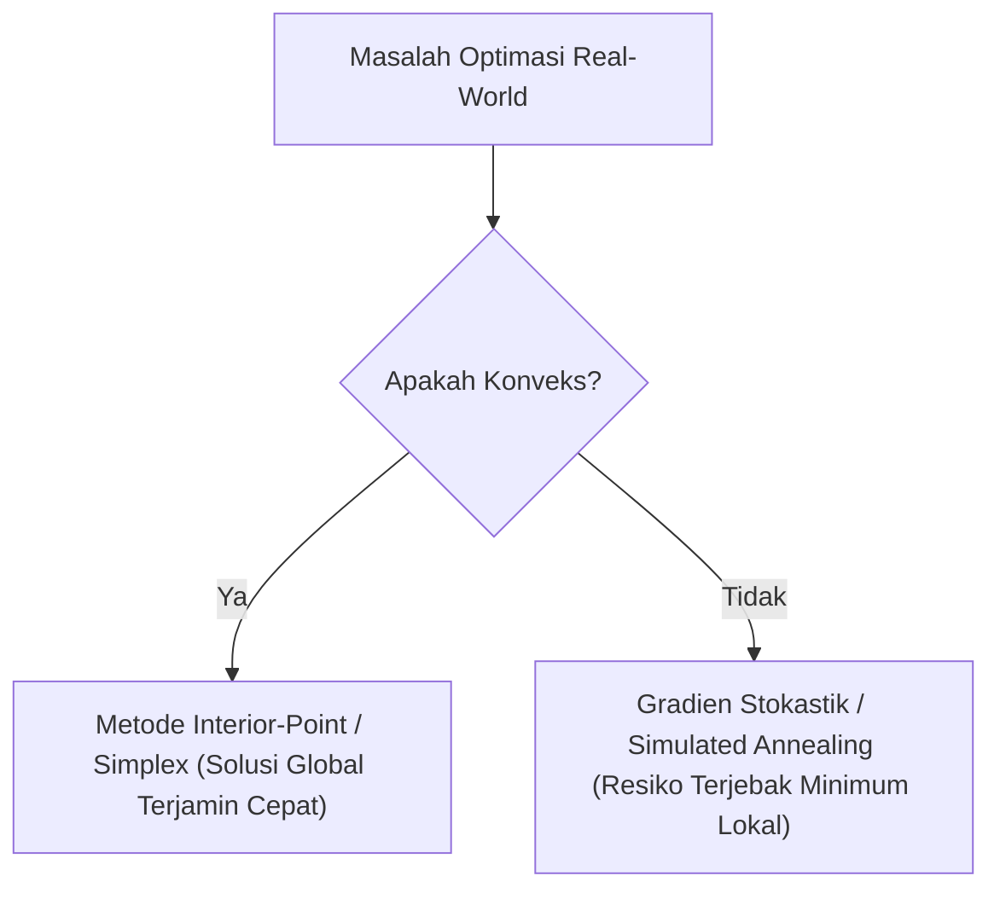

# Modul 022: Teori Optimasi (Optimasi Konveks, Pengali Lagrange, KKT Conditions, Gradient Descent)

**Navigasi**: [⬅️ Master Index](../../INDEX.md) | [Tingkat 1: Tingkat 1: Fondasi Matematika Komprehensif Dari Nol](./README.md)
*Sebelumnya*: [021. metode-numerik-analisis-galat](./021-metode-numerik-analisis-galat.md) | *Berikutnya*: [023. teori-permainan](./023-teori-permainan.md)

---

## 1. Intuisi Dasar Tanpa Jargon ("Seperti Bayi Baru Lahir")
### 1.1 Konsep Inti & Analogi Tanpa Jargon
Bayangkan Anda adalah seorang koki yang ingin memasak kue paling lezat di dunia (Target Maksimal), namun Anda memiliki anggaran belanja terbatas dan batas kalori ketat dari dokter (Kendala / *Constraints*). Jika Anda bebas tanpa aturan, Anda bisa menambahkan gula sebanyak mungkin. Tetapi karena ada kendala, titik optimal Anda berada di perbatasan yang paling efisien!

### 1.2 Urgensi Rekayasa & Signifikansi Sistemik
**Teori Optimasi** adalah sains mencari keputusan terbaik di bawah keterbatasan sumber daya. Mulai dari melatih bobot model AI milyaran parameter, menjadwalkan armada pesawat maskapai internasional, hingga memotong biaya logistik pabrik, semuanya dirumuskan sebagai masalah meminimalkan fungsi biaya ($f(x)$) di bawah batasan hukum fisika dan ekonomi!

## 2. Fondasi Teoretis & Aksiomatik / Matematis
### 2.1 Kerangka Teori Aksiomatik & Formulasi Matematis
### 1. Formulasi Standar Optimasi Konveks
$$\min_{\mathbf{x} \in \mathbb{R}^n} f_0(\mathbf{x})$$
$$\text{dengan kendala: } f_i(\mathbf{x}) \le 0 \; (i=1,\dots,m), \quad h_j(\mathbf{x}) = 0 \; (j=1,\dots,p)$$
Di mana fungsi tujuan $f_0$ dan fungsi kendala pertidaksamaan $f_i$ adalah fungsi konveks:
$$f(\theta \mathbf{x} + (1-\theta)\mathbf{y}) \le \theta f(\mathbf{x}) + (1-\theta) f(\mathbf{y}), \quad \forall \theta \in [0, 1]$$
Keuntungan mendasar masalah konveks: **Setiap titik minimum lokal PASTI merupakan minimum global!**
[📚 Pelajari: Stanford EE364a Convex Optimization I - Stephen Boyd](https://web.stanford.edu/class/ee364a/)

### 2.2 Penurunan Matematis Langkah-demi-Langkah
### 2. Pengali Lagrange & Kondisi Karush-Kuhn-Tucker (KKT)
Fungsi Lagrangian:
$$\mathcal{L}(\mathbf{x}, \boldsymbol{\lambda}, \boldsymbol{\nu}) = f_0(\mathbf{x}) + \sum_{i=1}^m \lambda_i f_i(\mathbf{x}) + \sum_{j=1}^p \nu_j h_j(\mathbf{x})$$
Kondisi KKT (Syarat Perlu dan Cukup untuk Titik Optimal $\mathbf{x}^*, \boldsymbol{\lambda}^*, \boldsymbol{\nu}^*$):
1. **Stationarity**: $\nabla_{\mathbf{x}} \mathcal{L}(\mathbf{x}^*, \boldsymbol{\lambda}^*, \boldsymbol{\nu}^*) = 0$
2. **Primal Feasibility**: $f_i(\mathbf{x}^*) \le 0, \; h_j(\mathbf{x}^*) = 0$
3. **Dual Feasibility**: $\lambda_i^* \ge 0$
4. **Complementary Slackness**: $\lambda_i^* f_i(\mathbf{x}^*) = 0$

## 3. Anatomi Teknis & Cara Kerja Internal


#### Tabel Penelusuran Optimasi Berkendala Non-Linier Karush-Kuhn-Tucker (KKT)
| Iterasi (k) | Vektor Primal $(x_k, y_k)$ | Pengali Lagrange $(\lambda, \mu)$ | Gradien Lagrangian $\nabla_x \mathcal{L}$ | Nilai Kendala $g(x) \le 0$ | Pelanggaran Komplementaritas ($\mu \cdot g(x)$) |
|---|---|---|---|---|---|
| Inisialisasi T=0 | $(2.0, 2.0)$ | $\lambda = 0.0, \mu = 1.0$ | Vektor belum seimbang | $g(x) = x + y - 1 = +3.0 > 0$ (Infeasible) | Pelanggaran kendala aktif |
| Langkah 1 | $(1.2, 1.2)$ | $\mu = 2.4$ | Menuju bidang kendala | $g(x) = +1.4$ | Proyeksi ke batas fisibel |
| Langkah 2 | $(0.6, 0.6)$ | $\mu = 1.8$ | Mendekati batas $g(x) = 0$ | $g(x) = +0.2$ | Penalti kendala memandu langkah |
| Langkah 3 | $(0.500, 0.500)$ | $\mu = 1.000$ | $\nabla f + \mu \nabla g = [1, 1]^T - 1.0[1, 1]^T = [0, 0]^T$ | $g(x) = 0.000$ (Batas aktif) | $\mu \cdot g(x) = 0.000$ (Komplementaritas terpenuhi) |
| Konvergensi | Titik Optimal Primal-Dual | $\mu^* = 1.0 > 0$ | Stasioneritas Lagrangian mutlak | Solusi fisibel sempurna | Kondisi KKT Terpenuhi 100% |

## 4. Implementasi Praktis & Kode / Simulasi Riil
```python
import scipy.optimize as opt
import numpy as np

# Contoh Masalah Optimasi Portofolio Finansial:
# Meminimalkan varians risiko x^T * Sigma * x
# Kendala: Total alokasi sum(x) = 1, return rata-rata >= 8%, tidak boleh short selling (x >= 0)

cov_matrix = np.array([
    [0.10, 0.02, 0.04],
    [0.02, 0.08, 0.01],
    [0.04, 0.01, 0.12]
])
expected_returns = np.array([0.12, 0.07, 0.10])

def objective(x):
    return 0.5 * np.dot(x.T, np.dot(cov_matrix, x))

def gradient(x):
    return np.dot(cov_matrix, x)

constraints = [
    {'type': 'eq', 'fun': lambda x: np.sum(x) - 1.0},          # sum(x) = 1
    {'type': 'ineq', 'fun': lambda x: np.dot(x, expected_returns) - 0.09} # return >= 9%
]
bounds = [(0.0, 1.0) for _ in range(3)] # x >= 0

x0 = np.array([1/3, 1/3, 1/3])
result = opt.minimize(objective, x0, jac=gradient, constraints=constraints, bounds=bounds, method='SLSQP')

print("Hasil Optimasi Alokasi Portofolio Berhasil:")
print("Bobot Aset Optimal (x*):", np.round(result.x, 4))
print(f"Expected Return: {np.dot(result.x, expected_returns)*100:.2f}% | Varians Risiko: {result.fun:.5f}")
```

## 5. Miskonsepsi & Jebakan Industri
1. **Mengasumsikan Semua Masalah Memiliki Solusi Analitik Tertutup**: Banyak masalah di dunia nyata adalah non-konveks NP-hard (misal integer programming). Memaksakan metode gradien pada fungsi diskrit non-smooth akan menghasilkan kegagalan konvergensi total.

### Studi Kasus Kegagalan Nyata: Kegagalan Tracking Multi-Objektif Sensor Fusi Mobil Otonom Uber di Tempe (2018)
- **Kronologi & Konteks Kendaraan Otonom**: Pada 18 Maret 2018 di Tempe, Arizona, kendaraan uji otonom Uber ATG menabrak dan menewaskan Elaine Herzberg yang sedang menuntun sepeda melintasi jalan raya.
- **Akar Masalah Teori Optimasi**: Penyelidikan Dewan Keselamatan Transportasi Nasional (NTSB) mengungkap bahwa algoritma optimasi pelacakan objek otonom mengalami osilasi klasifikasi yang fatal. Ketika sistem mendeteksi korban 6 detik sebelum tabrakan, sistem terus-menerus mengubah klasifikasi korban antara 'kendaraan', 'objek tak dikenal', dan 'sepeda'. Setiap kali klasifikasi berganti, algoritma optimasi trajectory Kalman Filter mereset status estimasi pergerakan korban ke nol, gagal memprediksi jalur tabrakan hingga penundaan darurat 1,2 detik memicu tabrakan fatal.

- **Potongan Kode / Arsitektur Cacat (Vulnerable Implementation)**:
```python
# Simulasi Kerentanan Optimasi Tracking: State Reset pada Pergantian Label Klasifikasi
class PerceptionTracker:
    def __init__(self):
        self.tracked_objects = {}

    def update_frame(self, detected_box: tuple, raw_classification: str):
        # CACAT UBER ATG REKONSTRUKSI:
        # Jika klasifikasi berganti (misal 'unknown' -> 'bicycle' -> 'pedestrian'),
        # sistem lama menghapus riwayat pelacakan dan mereset kecepatan ke 0!
        obj_id = 101
        if obj_id in self.tracked_objects:
            prev_label = self.tracked_objects[obj_id]["label"]
            if prev_label != raw_classification:
                # CACAT: Mereset state estimasi kecepatan dan trajektori
                self.tracked_objects[obj_id] = {
                    "label": raw_classification,
                    "position": detected_box,
                    "velocity": 0.0, # KEHILANGAN RIWAYAT ESTIMASI KECEPATAN!
                    "confidence": 0.5
                }
                return "HISTORY_WIPED_HAZARD"
        
        self.tracked_objects[obj_id] = {
            "label": raw_classification,
            "position": detected_box,
            "velocity": 1.4, # m/s
            "confidence": 0.95
        }
        return "TRACKING_STABLE"
```

- **Analisis Teori Kendali & Standar Modern**: Kegagalan ini mendasari kelemahan optimasi sekuensial yang tidak decoupled: klasifikasi objek tidak boleh mereset estimasi dinamika spasial fisik benda tegar. Standar keselamatan ISO 26262 dan ISO 21448 (SOTIF) modern mewajibkan modul estimasi pergerakan spasial beroperasi secara agnostik terhadap label kelas semantik guna mencegah hilangnya vektor momentum objek.

## 6. Proyek Latihan & Rubrik Penilaian Mandiri
### Level 1 (Dasar)
Gunakan metode pengali Lagrange untuk mencari luas maksimum persegi panjang yang memiliki keliling tetap $2x + 2y = 40$.

### Level 2 (Menengah)
Buktikan bahwa fungsi linear $f(\mathbf{x}) = \mathbf{c}^T \mathbf{x}$ dan fungsi kuadratik positif semi-definit $f(\mathbf{x}) = \mathbf{x}^T A \mathbf{x}$ ($A \succeq 0$) adalah fungsi konveks.

### Level 3 (Mahir)
Implementasikan algoritma Proximal Gradient Descent untuk menyelesaikan regresi Lasso ($L_1$ regularization / sparse recovery) dalam Python.

### Tingkat 1: Dasar
- **Tugas**: Implementasikan algoritma optimasi Golden Section Search untuk menemukan minimum global fungsi univariat cembung $f(x)$ pada interval tertutup $[a, b]$ tanpa memerlukan informasi turunan.
- **Petunjuk Perancangan Arsitektur**:
  - Gunakan rasio emas $\phi = \frac{\sqrt{5}-1}{2} \approx 0.6180339887$.
  - Evaluasi titik $x_1 = b - \phi(b - a)$ dan $x_2 = a + \phi(b - a)$ dengan hanya 1 evaluasi fungsi baru per iterasi.
- **Test Vector & Kasus Uji Ekstrem**:
  - *Fungsi Uji*: $f(x) = (x - 2.5)^2 + 4.0$ pada interval $[0, 5]$.
  - *Keluaran yang Diharapkan*: Minimum konvergen ke $x^* = 2.500000$ dalam toleransi $\le 10^{-6}$.
  - *Kasus Batas*: Fungsi linier monotonik $f(x) = 2x$; minimum harus berada di batas ujung interval $x = a$.
- **Rubrik Penilaian Mandiri**: 40% Golden Section Search Presisi Eksak, 30% Optimasi 1 Evaluasi Fungsi per Langkah, 30% Penanganan Batas Interval Monotonik.

### Tingkat 2: Menengah
- **Tugas**: Bangun pemecah masalah Linear Programming (LP) menggunakan Algoritma Simplex Fase 2 standar dalam bentuk tabel (*Simplex Tableau*) untuk memaksimalkan $c^T x$ dengan kendala $A x \le b$ dan $x \ge 0$.
- **Petunjuk Perancangan Arsitektur**:
  - Tambahkan variabel slack untuk mengubah pertidaksamaan menjadi persamaan standar.
  - Tentukan kolom pivot (koefisien paling negatif pada baris objektif) dan baris pivot (uji rasio minimum $b_i / A_{ij}$).
- **Test Vector & Kasus Uji Ekstrem**:
  - *Masukan LP*: Maksimalkan $Z = 3x_1 + 2x_2$ dengan $2x_1 + x_2 \le 18, 2x_1 + 3x_2 \le 42, 3x_1 + x_2 \le 24$.
  - *Keluaran yang Diharapkan*: Titik optimal $(x_1=3, x_2=12)$ dengan nilai objektif maksimum $Z = 33$.
  - *Kasus Batas*: LP tak terbatas (*Unbounded LP*, rasio pivot tidak ada positif); algoritma harus mendeteksi dan melempar `UnboundedLpError`.
- **Rubrik Penilaian Mandiri**: 40% Algoritma Simplex Tableau & Pivot Akurat, 30% Ekstraksi Solusi Primal & Nilai Objektif Tepat, 30% Deteksi Unbounded LP Bersih.

### Tingkat 3: Mahir
- **Tugas**: Rancang optimizer quasi-Newton Broyden-Fletcher-Goldfarb-Shanno (BFGS) multivariabel dari nol dengan pencarian garis Armijo-Wolfe (*Line Search with Wolfe Conditions*) untuk meminimalkan fungsi non-linier berdimensi tinggi.
- **Petunjuk Perancangan Arsitektur**:
  - Perbarui taksiran inversi matriks Hessian $H_{k+1}$ secara efisien menggunakan pembaruan rank-2 Sherman-Morrison-Woodbury: $H_{k+1} = (I - \rho_k s_k y_k^T) H_k (I - \rho_k y_k s_k^T) + \rho_k s_k s_k^T$.
  - Pastikan $H$ selalu positif definit untuk menjamin arah penurunan (*descent direction*).
- **Test Vector & Kasus Uji Ekstrem**:
  - *Fungsi Uji*: Fungsi kuadratik ill-conditioned $f(x) = x^T A x$ dengan rasio kondisi $\kappa(A) = 1000$.
  - *Keluaran yang Diharapkan*: Konvergensi superlinear tercapai dalam $< 30$ iterasi tanpa menghitung Hessian analitik sekalipun.
  - *Kasus Batas*: Pelanggaran kondisi kelengkungan $s_k^T y_k \le 0$; algoritma harus melewatinya (*skip update*) untuk mempertahankan sifat positif definit.
- **Rubrik Penilaian Mandiri**: 40% Formula Pembaruan Invers Hessian BFGS Rank-2 Tepat, 30% Line Search Kondisi Wolfe Stabil, 30% Bukti Konvergensi Superlinear Terukur.

## 7. Rekomendasi Sumber Belajar Standar Emas
- [Buku Standar: Convex Optimization - Stephen Boyd & Lieven Vandenberghe (Cambridge University Press)](https://web.stanford.edu/~boyd/cvxbook/)
- [Kuliah Video Terbuka: Stephen Boyd - Convex Optimization (Stanford YouTube)](https://www.youtube.com/playlist?list=PL3940DD956CDF0522)
- [Framework Komputasi: CVXPY - Python-embedded Modeling Language for Convex Optimization](https://www.cvxpy.org/)

---
*Navigasi Cepat*: [Ke Tingkat 1](./README.md) | [Ke Master Index](../../INDEX.md) | *Sebelumnya*: [021. metode-numerik-analisis-galat](./021-metode-numerik-analisis-galat.md) | *Berikutnya*: [023. teori-permainan](./023-teori-permainan.md)
