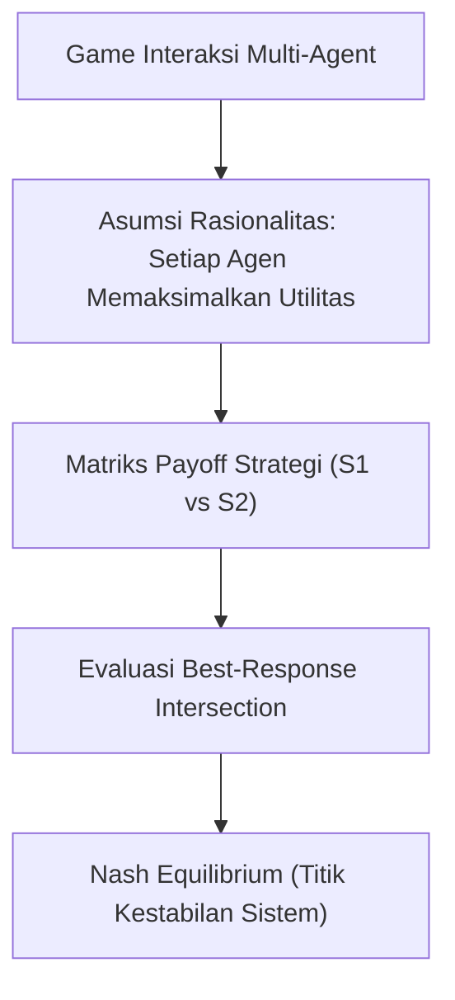

# Modul 023: Teori Permainan (Game Theory, Nash Equilibrium, Minimax, Mechanism Design)

**Navigasi**: [⬅️ Master Index](../../INDEX.md) | [Tingkat 1: Tingkat 1: Fondasi Matematika Komprehensif Dari Nol](./README.md)
*Sebelumnya*: [022. teori-optimasi](./022-teori-optimasi.md) | *Berikutnya*: [024. metroloji-standar-pengukuran-fisika](../02-fisika-semikonduktor/024-metroloji-standar-pengukuran-fisika.md)

---

## 1. Intuisi Dasar Tanpa Jargon ("Seperti Bayi Baru Lahir")
### 1.1 Konsep Inti & Analogi Tanpa Jargon
Dua orang tersangka kriminal ditangkap polisi dan diinterogasi di ruangan terpisah (Dilema Tahanan / *Prisoner's Dilemma*). Jika keduanya bungkam, polisi hanya bisa memenjarakan mereka 1 tahun. Jika salah satu mengkhianati temannya, ia langsung bebas dan temannya dipenjara 10 tahun. Tetapi jika keduanya saling mengkhianati, keduanya dipenjara 5 tahun. Apa yang terjadi secara rasional?

### 1.2 Urgensi Rekayasa & Signifikansi Sistemik
Keduanya akan saling mengkhianati dan menerima hukuman 5 tahun! Inilah **Teori Permainan (Game Theory)**: studi matematika tentang interaksi strategis di mana keputusan Anda bergantung pada apa yang Anda duga akan diputuskan oleh lawan Anda. Keseimbangan Nash (*Nash Equilibrium*) adalah kondisi di mana tidak ada satu pun pemain yang dapat memperbaiki nasibnya dengan mengubah strateginya sendirian!

## 2. Fondasi Teoretis & Aksiomatik / Matematis
### 2.1 Kerangka Teori Aksiomatik & Formulasi Matematis
### 1. Formulasi Game Bentuk Normal & Keseimbangan Nash
Game strategis didefinisikan oleh tuple $\Gamma = (N, (S_i)_{i \in N}, (u_i)_{i \in N})$:
- $N = \{1, 2, \dots, n\}$: Himpunan pemain.
- $S_i$: Himpunan strategi untuk pemain $i$.
- $u_i: S \to \mathbb{R}$: Fungsi utilitas payoff.

### 2.2 Penurunan Matematis Langkah-demi-Langkah
Profil strategi $s^* = (s_1^*, \dots, s_n^*) \in S$ adalah **Nash Equilibrium** jika:
$$\forall i \in N, \quad \forall s_i \in S_i, \quad u_i(s_i^*, s_{-i}^*) \ge u_i(s_i, s_{-i}^*)$$
Teorema John Nash (1950): Setiap game berhingga dengan jumlah pemain dan aksi terbatas memiliki minimal satu Keseimbangan Nash pada strategi campuran (*mixed strategies*).
[📚 Pelajari: Stanford/Yale Game Theory Online - Open Yale Courses](https://oyc.yale.edu/economics/econ-159)

### 2. Minimax Theorem & Mechanism Design
- **Teorema Minimax von Neumann (Zero-Sum Games)**:
  $$\max_{p} \min_{q} p^T A q = \min_{q} \max_{p} p^T A q = V$$
- **Mechanism Design (Reverse Game Theory)**:
  Merancang aturan main pasar (seperti lelang Vickrey Second-Price Auction) sedemikian rupa sehingga strategi dominan setiap peserta adalah berkata jujur (*Dominant-Strategy Incentive-Compatible / Truthful Bidding*).

## 3. Anatomi Teknis & Cara Kerja Internal


#### Tabel Penelusuran Ekuilibrium Nash & Matriks Payoff Dilema Tahanan (Rating Agency Collapse)
| Strategi Lembaga A | Strategi Lembaga B | Profil Strategi $(s_A, s_B)$ | Payoff Finansial $(u_A, u_B)$ | Insentif Deviasi Unilateral | Status Stabilitas Ekuilibrium Nash |
|---|---|---|---|---|---|
| Rating Ketat (Kooperatif) | Rating Ketat (Kooperatif) | $(\text{Ketat}, \text{Ketat})$ | $(+50, +50)$ | Lembaga A dapat untung $+100$ jika melonggarkan rating | Pareto Optimal, tetapi TIDAK stabil Nash! |
| Rating Ketat | Longgarkan Rating (Defeksi) | $(\text{Ketat}, \text{Longgar})$ | $(0, +100)$ | Klien bank pindah ke Lembaga B; Lembaga A rugi total | Lembaga B mendominasi pasar obligasi |
| Longgarkan Rating (Defeksi) | Rating Ketat | $(\text{Longgar}, \text{Ketat})$ | $(+100, 0)$ | Klien bank pindah ke Lembaga A; Lembaga B rugi total | Lembaga A mendominasi pasar obligasi |
| Longgarkan Rating (Defeksi) | Longgarkan Rating (Defeksi) | $(\text{Longgar}, \text{Longgar})$ | $(+10, +10)$ | Deviasi ke 'Ketat' merugi ke $0$; tidak ada insentif berubah | **Nash Equilibrium Murni (Destruktif!)** |
| Hasil Sistemik | Runtuhnya Standar Kredit | Seluruh agensi melabeli sampah jadi AAA | Krisis subprime 2008 meledak | Triliunan dolar kerugian sistemik global | Tragedi Dilema Tahanan Tak Teregulasi |

## 4. Implementasi Praktis & Kode / Simulasi Riil
```python
import numpy as np

def find_pure_nash_equilibria(payoff_player1, payoff_player2):
    """
    Mencari seluruh Pure Strategy Nash Equilibria dari matriks payoff 2 pemain.
    """
    P1 = np.array(payoff_player1)
    P2 = np.array(payoff_player2)
    rows, cols = P1.shape
    
    # Cari best response P1 untuk setiap aksi P2 (kolom)
    best_p1 = np.zeros_like(P1, dtype=bool)
    for c in range(cols):
        max_val = np.max(P1[:, c])
        best_p1[P1[:, c] == max_val, c] = True
        
    # Cari best response P2 untuk setiap aksi P1 (baris)
    best_p2 = np.zeros_like(P2, dtype=bool)
    for r in range(rows):
        max_val = np.max(P2[r, :])
        best_p2[r, P2[r, :] == max_val] = True
        
    # Keseimbangan Nash adalah irisan best response keduanya
    nash_points = []
    for r in range(rows):
        for c in range(cols):
            if best_p1[r, c] and best_p2[r, c]:
                nash_points.append(((r, c), (P1[r, c], P2[r, c])))
    return nash_points

# Matriks Prisoner's Dilemma:
# Aksi: 0 = Kerja Sama (Bungkam), 1 = Khianat
# Payoffs (Tahun Hukuman dalam nilai negatif):
# Keduanya Bungkam: (-1, -1) | P1 Khianat: (0, -10) | P2 Khianat: (-10, 0) | Keduanya Khianat: (-5, -5)
P1_payoff = [[-1, -10],
             [ 0,  -5]]
P2_payoff = [[-1,   0],
             [-10, -5]]

nash = find_pure_nash_equilibria(P1_payoff, P2_payoff)
print("Titik Keseimbangan Nash Ditemukan:")
for action_pair, payoffs in nash:
    p1_act = "Khianat" if action_pair[0] == 1 else "Bungkam"
    p2_act = "Khianat" if action_pair[1] == 1 else "Bungkam"
    print(f" -> Strategi: (P1={p1_act}, P2={p2_act}) dengan Payoff={payoffs}")
assert nash[0][0] == (1, 1)
print("Terbukti: Keduanya saling mengkhianati adalah Keseimbangan Nash Dominan!")
```

## 5. Miskonsepsi & Jebakan Industri
1. **Mengira Nash Equilibrium Selalu Menghasilkan Kebaikan Bersama (Pareto Optimal)**: Pada Prisoner's Dilemma, hasil Nash Equilibrium (-5, -5) jauh lebih buruk bagi kedua pemain daripada hasil kerja sama (-1, -1). Rasionalitas individual seringkali berujung pada inefisiensi kolektif!

### Studi Kasus Kegagalan Nyata: Keruntuhan Pasar Hipotek Subprime Akibat Dilema Tahanan Lembaga Pemeringkat Kredit (2008)
- **Kronologi & Konteks Krisis Global**: Menjelang krisis keuangan 2008, lembaga pemeringkat kredit terkemuka (Moody's, S&P, Fitch) memberi peringkat tertinggi 'AAA' pada sekuritas hipotek subprime (Collateralized Debt Obligations / CDO) yang sebenarnya berkualitas sampah.
- **Akar Masalah Teori Permainan**: Model bisnis lembaga pemeringkat menggunakan sistem 'Issuer-Pays' (bank penerbit obligasi yang membayar lembaga pemeringkat). Struktur insentif ini menciptakan Dilema Tahanan (*Prisoner's Dilemma*) non-kooperatif klasik: jika Moody's menerapkan standar ketat dan menolak memberi AAA, bank akan membatalkan kontrak dan membawa bisnis jutaan dolarnya ke S&P. Strategi dominan bagi setiap lembaga pemeringkat adalah menurunkan standar audit demi mempertahankan pangsa pasar. Ekuilibrium Nash yang terbentuk adalah kedua lembaga bersaing melonggarkan standar ke level terendah, menghasilkan keruntuhan finansial global $2 triliun saat gelembung perumahan meletus.

- **Potongan Kode / Arsitektur Cacat (Vulnerable Implementation)**:
```python
# Evaluasi Teori Permainan: Penyelesaian Ekuilibrium Nash Matriks Payoff Bentuk Normal 2x2
import numpy as np

def find_pure_nash_equilibria(payoff_matrix_A: np.ndarray, payoff_matrix_B: np.ndarray):
    """
    Mencari seluruh Pure Strategy Nash Equilibria pada permainan bentuk normal 2 pemain:
    Profil strategi (i, j) adalah ekuilibrium Nash jika:
    u_A(i, j) >= u_A(k, j) untuk semua k, dan u_B(i, j) >= u_B(i, l) untuk semua l.
    """
    rows, cols = payoff_matrix_A.shape
    nash_equilibria = []
    
    for i in range(rows):
        for j in range(cols):
            # Best response pemain A terhadap pilihan j pemain B
            is_best_A = payoff_matrix_A[i, j] >= np.max(payoff_matrix_A[:, j])
            # Best response pemain B terhadap pilihan i pemain A
            is_best_B = payoff_matrix_B[i, j] >= np.max(payoff_matrix_B[i, :])
            
            if is_best_A and is_best_B:
                nash_equilibria.append({
                    "strategy_profile": (i, j),
                    "payoffs": (payoff_matrix_A[i, j], payoff_matrix_B[i, j])
                })
                
    return nash_equilibria

# Matriks Dilema Pemeringkat Kredit (0: Ketat, 1: Longgar / Defeksi)
# Baris: Agensi A, Kolom: Agensi B
payoff_A = np.array([
    [50,   0],  # Ketat vs (Ketat, Longgar)
    [100, 10]   # Longgar vs (Ketat, Longgar)
])
payoff_B = np.array([
    [50, 100],
    [0,   10]
])

equilibria = find_pure_nash_equilibria(payoff_A, payoff_B)
# Ekuilibrium Nash tunggal terbentuk pada (1, 1) -> (Longgar, Longgar) bernilai (10, 10)
# Meskipun (0, 0) Pareto optimal bernilai (50, 50)!
```

- **Analisis Teori Permainan & Regulasi**: Ekuilibrium Nash pada permainan non-kooperatif membuktikan bahwa aktor-aktor rasional yang bertindak demi kepentingan diri sendiri dapat terkunci dalam hasil kolektif yang menghancurkan semua pihak. Menyadari hal ini, regulasi Dodd-Frank Wall Street Reform Act 2010 mengubah mekanisme tata kelola pemeringkat kredit dan menuntut akuntabilitas liabilitas hukum independen untuk merestrukturisasi matriks payoff permainan.

## 6. Proyek Latihan & Rubrik Penilaian Mandiri
### Level 1 (Dasar)
Analisis game batu-gunting-kertas: Jelaskan mengapa tidak ada keseimbangan Nash strategi murni, dan tentukan probabilitas strategi campuran optimalnya.

### Level 2 (Menengah)
Buktikan bahwa pada Lelang Vickrey (Second-Price Sealed-Bid Auction), menawar sesuai dengan nilai sebenarnya dari barang tersebut (*true valuation*) adalah strategi dominan yang tidak terkalahkan.

### Level 3 (Mahir)
Implementasikan simulasi algoritma Iterated Prisoner's Dilemma dengan turnamen strategi (Tit-for-Tat, Grudger, Random) untuk mengamati evolusi kerja sama (Teori Robert Axelrod).

### Tingkat 1: Dasar
- **Tugas**: Buat fungsi pencari strategi dominan murni (*Strictly Dominant Strategy*) dan eliminasi strategi terdominasi berulang (*Iterated Elimination of Strictly Dominated Strategies* / IESDS) untuk matriks permainan normal-form 2-pemain.
- **Petunjuk Perancangan Arsitektur**:
  - Identifikasi apakah ada baris pemain A yang selalu memberikan payoff lebih kecil dari baris lain untuk seluruh pilihan kolom lawan.
  - Hapus baris/kolom terdominasi secara berulang hingga tidak ada lagi strategi yang dapat dieliminasi.
- **Test Vector & Kasus Uji Ekstrem**:
  - *Matriks Dilema Tahanan Standar*: Payoff $[[3, 0], [5, 1]]$ untuk pemain baris.
  - *Keluaran yang Diharapkan*: IESDS mengeliminasi strategi kooperatif dalam 1 iterasi dan menyisakan defeksi sebagai strategi dominan tunggal.
  - *Kasus Batas*: Permainan koordinasi (*Battle of the Sexes*) tanpa strategi dominan murni; IESDS tidak boleh menghapus baris/kolom apa pun.
- **Rubrik Penilaian Mandiri**: 40% Algoritma IESDS Lengkap & Deterministik, 30% Deteksi Strategi Dominan Murni Tepat, 30% Konservasi Matriks Berimbang.

### Tingkat 2: Menengah
- **Tugas**: Implementasikan solver Ekuilibrium Nash Campuran (*Mixed Strategy Nash Equilibrium*) untuk permainan 2x2 tanpa ekuilibrium murni (seperti *Matching Pennies* atau *Inspection Game*).
- **Petunjuk Perancangan Arsitektur**:
  - Hitung probabilitas $p$ pemain baris dan $q$ pemain kolom yang membuat lawan indiferen terhadap kedua pilihannya: $\mathbb{E}[u_B(1)] = \mathbb{E}[u_B(2)]$.
  - Validasi bahwa probabilitas $p, q \in [0.0, 1.0]$.
- **Test Vector & Kasus Uji Ekstrem**:
  - *Permainan Matching Pennies*: Payoff $[[1, -1], [-1, 1]]$ dan $[-1, 1], [1, -1]$.
  - *Keluaran yang Diharapkan*: Ekuilibrium Nash campuran unik $p^* = 0.5, q^* = 0.5$ dengan nilai ekspektasi payoff 0.
  - *Kasus Batas*: Permainan dengan payoff identik di semua sel; seluruh distribusi campuran valid (himpunan tak hingga).
- **Rubrik Penilaian Mandiri**: 40% Kalkulasi Indiferensi Probabilitas Campuran Tepat, 30% Verifikasi Batas Probabilitas $[0, 1]$, 30% Evaluasi Nilai Permainan Ekspektasi.

### Tingkat 3: Mahir
- **Tugas**: Rancang simulator dinamika evolusioner permainan populasi (*Evolutionary Game Theory / Replicator Dynamics*) yang memodelkan evolusi frekuensi strategi Elang-Merpati (*Hawk-Dove Game*) sepanjang waktu.
- **Petunjuk Perancangan Arsitektur**:
  - Formulasikan persamaan replikator diferensial: $\dot{x}_i = x_i (u(s_i, x) - \bar{u}(x))$, di mana $\bar{u}(x)$ adalah rerata kebugaran (*average fitness*) populasi.
  - Integrasikan sistem ODE menggunakan RK4 dan temukan Titik Keseimbangan Stabil Evolusioner (*Evolutionarily Stable Strategy* / ESS).
- **Test Vector & Kasus Uji Ekstrem**:
  - *Hawk-Dove Game*: Nilai sumber daya $V = 2$, biaya luka parah $C = 6$.
  - *Keluaran yang Diharapkan*: Proporsi populasi elang konvergen stabil ke titik ESS $x^* = V / C = 2 / 6 \approx 0.3333$ dari sembarang kondisi awal non-nol.
  - *Kasus Batas*: $V > C$ (manfaat menang lebih besar dari biaya luka); strategi elang mendominasi populasi hingga $x^* = 1.0$ (monokultur elang).
- **Rubrik Penilaian Mandiri**: 40% Persamaan Diferensial Replicator Dynamics Tepat, 30% Pembuktian Konvergensi Stabil ke ESS Teoretis, 30% Visualisasi Trajektori Ruang Fase.

## 7. Rekomendasi Sumber Belajar Standar Emas
- [Buku Standar: Game Theory - Drew Fudenberg & Jean Tirole (MIT Press)](https://mitpress.mit.edu/9780262061414/game-theory/)
- [Kuliah Video Terbuka: Game Theory - Ben Polak (Yale University ECON 159)](https://oyc.yale.edu/economics/econ-159)
- [Paper Seminal: Equilibrium Points in N-Person Games - John F. Nash (PNAS, 1950)](https://www.pnas.org/doi/10.1073/pnas.36.1.48)

---
*Navigasi Cepat*: [Ke Tingkat 1](./README.md) | [Ke Master Index](../../INDEX.md) | *Sebelumnya*: [022. teori-optimasi](./022-teori-optimasi.md) | *Berikutnya*: [024. metroloji-standar-pengukuran-fisika](../02-fisika-semikonduktor/024-metroloji-standar-pengukuran-fisika.md)
