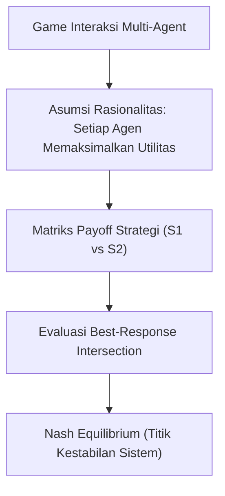

# Modul 023: Teori Permainan (Game Theory, Nash Equilibrium, Minimax, Mechanism Design)

**Navigasi**: [⬅️ Master Index](../../INDEX.md) | [Tingkat 1: Tingkat 1: Fondasi Matematika Komprehensif Dari Nol](./README.md)
*Sebelumnya*: [022. teori-optimasi](./022-teori-optimasi.md) | *Berikutnya*: [024. metroloji-standar-pengukuran-fisika](../02-fisika-semikonduktor/024-metroloji-standar-pengukuran-fisika.md)

---

## 1. Intuisi Dasar Tanpa Jargon ("Seperti Bayi Baru Lahir")
Dua orang tersangka kriminal ditangkap polisi dan diinterogasi di ruangan terpisah (Dilema Tahanan / *Prisoner's Dilemma*). Jika keduanya bungkam, polisi hanya bisa memenjarakan mereka 1 tahun. Jika salah satu mengkhianati temannya, ia langsung bebas dan temannya dipenjara 10 tahun. Tetapi jika keduanya saling mengkhianati, keduanya dipenjara 5 tahun. Apa yang terjadi secara rasional? 

Keduanya akan saling mengkhianati dan menerima hukuman 5 tahun! Inilah **Teori Permainan (Game Theory)**: studi matematika tentang interaksi strategis di mana keputusan Anda bergantung pada apa yang Anda duga akan diputuskan oleh lawan Anda. Keseimbangan Nash (*Nash Equilibrium*) adalah kondisi di mana tidak ada satu pun pemain yang dapat memperbaiki nasibnya dengan mengubah strateginya sendirian!

## 2. Fondasi Teoretis & Aksiomatik / Matematis
### 1. Formulasi Game Bentuk Normal & Keseimbangan Nash
Game strategis didefinisikan oleh tuple $\Gamma = (N, (S_i)_{i \in N}, (u_i)_{i \in N})$:
- $N = \{1, 2, \dots, n\}$: Himpunan pemain.
- $S_i$: Himpunan strategi untuk pemain $i$.
- $u_i: S \to \mathbb{R}$: Fungsi utilitas payoff.

Profil strategi $s^* = (s_1^*, \dots, s_n^*) \in S$ adalah **Nash Equilibrium** jika:
$$\forall i \in N, \quad \forall s_i \in S_i, \quad u_i(s_i^*, s_{-i}^*) \ge u_i(s_i, s_{-i}^*)$$
Teorema John Nash (1950): Setiap game berhingga dengan jumlah pemain dan aksi terbatas memiliki minimal satu Keseimbangan Nash pada strategi campuran (*mixed strategies*).
[📚 Pelajari: Stanford/Yale Game Theory Online - Open Yale Courses](https://oyc.yale.edu/economics/econ-159)

### 2. Minimax Theorem & Mechanism Design
- **Teorema Minimax von Neumann (Zero-Sum Games)**:
  $$\max_{p} \min_{q} p^T A q = \min_{q} \max_{p} p^T A q = V$$
- **Mechanism Design (Reverse Game Theory)**:
  Merancang aturan main pasar (seperti lelang Vickrey Second-Price Auction) sedemikian rupa sehingga strategi dominan setiap peserta adalah berkata jujur (*Dominant-Strategy Incentive-Compatible / Truthful Bidding*).

## 3. Anatomi Teknis & Cara Kerja Internal


## 4. Implementasi Praktis & Kode / Simulasi Riil
```python
import numpy as np

def find_pure_nash_equilibria(payoff_player1, payoff_player2):
    """
    Mencari seluruh Pure Strategy Nash Equilibria dari matriks payoff 2 pemain.
    """
    P1 = np.array(payoff_player1)
    P2 = np.array(payoff_player2)
    rows, cols = P1.shape
    
    # Cari best response P1 untuk setiap aksi P2 (kolom)
    best_p1 = np.zeros_like(P1, dtype=bool)
    for c in range(cols):
        max_val = np.max(P1[:, c])
        best_p1[P1[:, c] == max_val, c] = True
        
    # Cari best response P2 untuk setiap aksi P1 (baris)
    best_p2 = np.zeros_like(P2, dtype=bool)
    for r in range(rows):
        max_val = np.max(P2[r, :])
        best_p2[r, P2[r, :] == max_val] = True
        
    # Keseimbangan Nash adalah irisan best response keduanya
    nash_points = []
    for r in range(rows):
        for c in range(cols):
            if best_p1[r, c] and best_p2[r, c]:
                nash_points.append(((r, c), (P1[r, c], P2[r, c])))
    return nash_points

# Matriks Prisoner's Dilemma:
# Aksi: 0 = Kerja Sama (Bungkam), 1 = Khianat
# Payoffs (Tahun Hukuman dalam nilai negatif):
# Keduanya Bungkam: (-1, -1) | P1 Khianat: (0, -10) | P2 Khianat: (-10, 0) | Keduanya Khianat: (-5, -5)
P1_payoff = [[-1, -10],
             [ 0,  -5]]
P2_payoff = [[-1,   0],
             [-10, -5]]

nash = find_pure_nash_equilibria(P1_payoff, P2_payoff)
print("Titik Keseimbangan Nash Ditemukan:")
for action_pair, payoffs in nash:
    p1_act = "Khianat" if action_pair[0] == 1 else "Bungkam"
    p2_act = "Khianat" if action_pair[1] == 1 else "Bungkam"
    print(f" -> Strategi: (P1={p1_act}, P2={p2_act}) dengan Payoff={payoffs}")
assert nash[0][0] == (1, 1)
print("Terbukti: Keduanya saling mengkhianati adalah Keseimbangan Nash Dominan!")
```

## 5. Miskonsepsi & Jebakan Industri
1. **Mengira Nash Equilibrium Selalu Menghasilkan Kebaikan Bersama (Pareto Optimal)**: Pada Prisoner's Dilemma, hasil Nash Equilibrium (-5, -5) jauh lebih buruk bagi kedua pemain daripada hasil kerja sama (-1, -1). Rasionalitas individual seringkali berujung pada inefisiensi kolektif!

## 6. Proyek Latihan & Rubrik Penilaian Mandiri
### Level 1 (Dasar)
Analisis game batu-gunting-kertas: Jelaskan mengapa tidak ada keseimbangan Nash strategi murni, dan tentukan probabilitas strategi campuran optimalnya.

### Level 2 (Menengah)
Buktikan bahwa pada Lelang Vickrey (Second-Price Sealed-Bid Auction), menawar sesuai dengan nilai sebenarnya dari barang tersebut (*true valuation*) adalah strategi dominan yang tidak terkalahkan.

### Level 3 (Mahir)
Implementasikan simulasi algoritma Iterated Prisoner's Dilemma dengan turnamen strategi (Tit-for-Tat, Grudger, Random) untuk mengamati evolusi kerja sama (Teori Robert Axelrod).

## 7. Rekomendasi Sumber Belajar Standar Emas
- [Buku Standar: Game Theory - Drew Fudenberg & Jean Tirole (MIT Press)](https://mitpress.mit.edu/9780262061414/game-theory/)
- [Kuliah Video Terbuka: Game Theory - Ben Polak (Yale University ECON 159)](https://oyc.yale.edu/economics/econ-159)
- [Paper Seminal: Equilibrium Points in N-Person Games - John F. Nash (PNAS, 1950)](https://www.pnas.org/doi/10.1073/pnas.36.1.48)

---
*Navigasi Cepat*: [Ke Tingkat 1](./README.md) | [Ke Master Index](../../INDEX.md) | *Sebelumnya*: [022. teori-optimasi](./022-teori-optimasi.md) | *Berikutnya*: [024. metroloji-standar-pengukuran-fisika](../02-fisika-semikonduktor/024-metroloji-standar-pengukuran-fisika.md)
