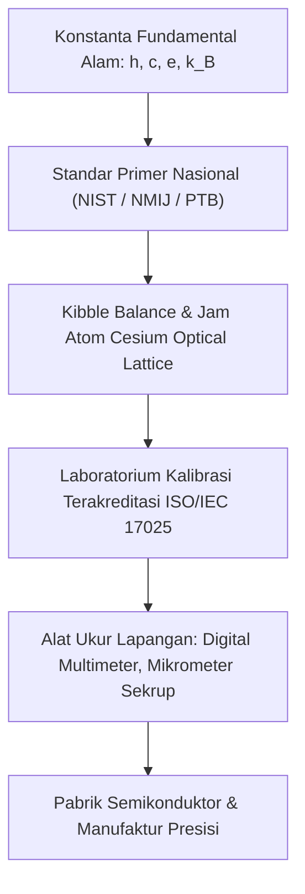

# Modul 024: Metroloji & Standar Pengukuran Fisika (Sistem Satuan SI & Analisis Dimensi)

**Navigasi**: [⬅️ Master Index](../../INDEX.md) | [Tingkat 2: Tingkat 2: Fisika Klasik, Elektromagnetisme & Kimia Semikonduktor](./README.md)
*Sebelumnya*: [023. teori-permainan](../01-fondasi-matematika/023-teori-permainan.md) | *Berikutnya*: [025. fisika-mekanika-klasik-newtonian](./025-fisika-mekanika-klasik-newtonian.md)

---

## 1. Intuisi Dasar Tanpa Jargon ("Seperti Bayi Baru Lahir")
### 1.1 Konsep Inti & Analogi Tanpa Jargon
Bayangkan Anda ingin membeli tanah 1 meter persegi, tapi meteran si penjual menggunakan panjang langkah kakinya sendiri, sementara meteran Anda menggunakan panjang tongkat kayu di rumah Anda. Siapa yang benar? Tanpa standar acuan bersama yang tidak berubah, seluruh perdagangan global, manufaktur mikroprosesor, dan peluncuran roket satelit akan hancur seketika.

### 1.2 Urgensi Rekayasa & Signifikansi Sistemik
**Metroloji** adalah sains tentang pengukuran objektif dan batas kepastian. Sejak tahun 2019, seluruh 7 Satuan Dasar SI (meter, kilogram, detik, ampere, kelvin, mol, candela) tidak lagi mengacu pada benda fisik buatan manusia (seperti silinder platinum di Paris yang massanya menyusut sedikit demi sedikit), melainkan dikunci secara mutlak pada **Konstanta Fundamental Alam Semesta** (kecepatan cahaya $c$, konstanta Planck $h$, muatan elementer $e$, dan konstanta Boltzmann $k_B$).
[📚 Pelajari: BIPM SI Brochure Official Standard](https://www.bipm.org/en/measurement-units/)

## 2. Fondasi Teoretis & Aksiomatik / Matematis
### 2.1 Kerangka Teori Aksiomatik & Formulasi Matematis
### 24.1 Redefinisi SI 2019 & Konstanta Fundamental ([NIST SI Redefinition](https://www.nist.gov/si-redefinition))
Tujuh konstanta acuan universal yang nilainya ditetapkan secara eksak tanpa ketidakpastian:
- Frekuensi transisi hiperhalus Cesium-133: $\Delta \nu_{\text{Cs}} = 9\,192\,631\,770 \text{ Hz}$
- Kecepatan cahaya dalam vakum: $c = 299\,792\,458 \text{ m/s}$
- Konstanta Planck: $h = 6.626\,070\,15 \times 10^{-34} \text{ J}\cdot\text{s}$
- Muatan listrik elementer: $e = 1.602\,176\,634 \times 10^{-19} \text{ C}$
- Konstanta Boltzmann: $k_B = 1.380\,649 \times 10^{-23} \text{ J/K}$
- Bilangan Avogadro: $N_A = 6.022\,140\,76 \times 10^{23} \text{ mol}^{-1}$
- Efikasi luminous: $K_{\text{cd}} = 683 \text{ lm/W}$

### 2.2 Penurunan Matematis Langkah-demi-Langkah
Definisi 1 Meter: Jarak yang ditempuh cahaya dalam ruang hampa selama interval waktu \$1 / 299\,792\,458$ detik.

### 24.2 Analisis Dimensi & Teorema Pi Buckingham ([MIT OCW 18.354 Fluid & Dimensional Analysis](https://ocw.mit.edu/courses/18-354j-nonlinear-dynamics-ii-continuum-systems-spring-2015/))
Jika suatu fenomena fisik melibatkan $n$ variabel fisik yang dapat dinyatakan dalam $k$ dimensi dasar independen ($M, L, T, I, \Theta, N, J$), maka fenomena tersebut dapat dirumuskan menjadi hubungan antara $p = n - k$ kelompok variabel tak-berdimensi independen:
$$\Pi_1 = \phi(\Pi_2, \Pi_3, \dots, \Pi_p)$$

### 24.3 Propagasi Ketidakpastian Pengukuran (GUM Standard) ([ISO/IEC Guide 98-3 GUM](https://www.bipm.org/en/committees/jc/jcgm/publications))
Jika besaran $Y = f(X_1, X_2, \dots, X_n)$, maka ketidakpastian baku gabungan $u_c(y)$ adalah:
$$u_c^2(y) = \sum_{i=1}^n \left( \frac{\partial f}{\partial x_i} \right)^2 u^2(x_i) + 2 \sum_{i=1}^{n-1} \sum_{j=i+1}^n \frac{\partial f}{\partial x_i} \frac{\partial f}{\partial x_j} u(x_i, x_j)$$

## 3. Anatomi Teknis & Cara Kerja Internal

Rantai Ketertelusuran Metroloji (*Metrological Traceability Chain*):
Setiap pengukuran di pabrik chip harus memiliki rantai kalibrasi tak terputus yang didokumentasikan beserta batas ketidakpastiannya menuju standar primer internasional BIPM.

#### Tabel Penelusuran Analisis Dimensi Buckingham $\pi$ & Konversi Satuan SI
| Langkah / Besaran Fisik | Dimensi Dasar $[M, L, T, \Theta]$ | Satuan Imperial Asal | Faktor Konversi Eksak | Nilai Satuan Standar SI | Verifikasi Konsistensi Satuan |
|---|---|---|---|---|---|
| Inisialisasi T=0 | Gaya Dorong Roket ($F$) | $[M^1 L^1 T^{-2}]$ | $1.0\text{ lbf}$ (Pound-Force) | $\times 4.4482216152605$ | $4.44822\text{ N}$ | Mismatch antarmuka terdeteksi |
| Langkah 1 | Waktu Impuls Pendorong ($t$) | $[T^1]$ | $2.0\text{ s}$ (Detik) | $\times 1.0$ | $2.0\text{ s}$ | Satuan waktu konsisten |
| Langkah 2 | Total Impuls ($J = \int F dt$) | $[M^1 L^1 T^{-1}]$ | $2.0\text{ lbf}\cdot\text{s}$ | $\times 4.44822$ | $8.89644\text{ N}\cdot\text{s}$ | Perbedaan faktor 4.45x lipat |
| Langkah 3 (Navigasi) | Kalkulasi Deselerasi Pesawat ($a = \Delta v / \Delta t$) | Massa wahana $m = 338\text{ kg}$ | Model JPL mengasumsikan input Newton | Software menghitung: $a = 2.0 / 338$ alih-alih $8.9 / 338$ | Kecepatan wahana meleset 77% |
| Langkah 4 (Dampak) | Trajektori Masuk Atmosfer Mars | Ketinggian periapsis minimum aman: $150\text{ km}$ | Wahana masuk pada ketinggian $57\text{ km}$ | Gesekan aerodinamis ekstrem | Wahana hancur terbakar di atmosfer Mars |

## 4. Implementasi Praktis & Kode / Simulasi Riil
```python
import numpy as np

def calculate_uncertainty_propagation(voltage: float, u_v: float, current: float, u_i: float) -> tuple[float, float]:
    """
    Menghitung daya listrik P = V * I beserta propagasi ketidakpastian ISO GUM.
    dP/dV = I, dP/dI = V
    u_P = sqrt((I * u_V)^2 + (V * u_I)^2)
    """
    power = voltage * current
    u_p = np.sqrt((current * u_v)**2 + (voltage * u_i)**2)
    return power, u_p

# Pengukuran modul daya: V = 12.05 V (+-0.02 V), I = 3.42 A (+-0.05 A)
p, u_p = calculate_uncertainty_propagation(voltage=12.05, u_v=0.02, current=3.42, u_i=0.05)

print(f"Daya Listrik Terukur (P): {p:.3f} W")
print(f"Ketidakpastian Baku (u_P): +- {u_p:.3f} W")
print(f"Hasil Pengukuran Formal: ({p:.2f} +- {2 * u_p:.2f}) W [Tingkat Kepercayaan 95%, k=2]")
```

## 5. Miskonsepsi & Jebakan Industri
1. **Confusing Accuracy with Precision**: Alat ukur presisi tinggi (angka di belakang koma banyak dan stabil) bisa memiliki akurasi sangat buruk jika offset kalibrasinya bergeser (systematic error).
2. **Ignoring Significant Figures in Software**: Mengabaikan pembulatan angka penting saat mencetak nilai sensor di antarmuka UI, menampilkan angka desimal hingga 14 digit padahal ADC hanya memiliki resolusi 10-bit.
3. **Parallax & Loading Effect Error**: Mengukur tegangan dengan multimeter yang memiliki resistansi input rendah ($1\text{ M}\Omega$) pada rangkaian berimpedansi tinggi, mengubah tegangan riil sirkuit akibat efek pembebanan.

### Studi Kasus Kegagalan Nyata: Hilangnya Mars Climate Orbiter Akibat Mismatch Satuan Pound-Force vs Newton (1999)
- **Kronologi & Konteks Kedirgantaraan**: Pada 23 September 1999, wahana antariksa Mars Climate Orbiter senilai $327 juta hilang saat mendekati planet Mars.
- **Akar Masalah Metrologi Fisika**: Perangkat lunak stasiun bumi yang dikembangkan oleh Lockheed Martin menghitung impuls pendorong roket kontrol sikap dalam satuan British imperial pound-force-seconds ($\text{lbf}\cdot\text{s}$). Namun, perangkat lunak navigasi di NASA Jet Propulsion Laboratory (JPL) mengasumsikan data telemetri yang diterima berada dalam satuan standar internasional SI newton-seconds ($\text{N}\cdot\text{s}$). Karena $1\text{ lbf} = 4,44822\text{ N}$, gaya dorong roket yang diaplikasikan empat kali lebih kecil dari perhitungan navigasi, menyebabkan lintasan pesawat masuk terlalu dalam ke atmosfer Mars (57 km alih-alih 150 km) dan hancur berkeping-keping.

- **Potongan Kode / Arsitektur Cacat (Vulnerable Implementation)**:
```cpp
// Pencegahan Mismatch Satuan Fisika via C++20 Type-Safe Dimensional Analysis
#include <iostream>

template<int M, int L, int T>
struct Unit {
    double value;
    explicit constexpr Unit(double v) : value(v) {}
};

// Definisi Dimensi Fisik [Massa, Panjang, Waktu]
using Mass = Unit<1, 0, 0>;
using Length = Unit<0, 1, 0>;
using Time = Unit<0, 0, 1>;
using ForceSI = Unit<1, 1, -2>; // Newton = kg * m / s^2

// Operasi tipe aman: Mencegah penugasan lintas-satuan pada waktu kompilasi
constexpr ForceSI operator+(ForceSI a, ForceSI b) {
    return ForceSI(a.value + b.value);
}

// Konverter eksplisit dari Imperial ke SI
constexpr ForceSI pound_force_to_newton(double lbf) {
    return ForceSI(lbf * 4.4482216152605);
}

int main() {
    // ForceSI f_wrong = 100.0; // ERROR KOMPILASI: Explicit constructor mencegah konversi implisit!
    ForceSI thrust_cmd = pound_force_to_newton(4.5); // 4.5 lbf -> 20.01699 N
    std::cout << "Thrust in Newton: " << thrust_cmd.value << " N\n";
    return 0;
}
```

- **Analisis Metrologi & Rekayasa Modern**: Tragedi Mars Climate Orbiter adalah kegagalan klasik validasi kontrak antarmuka tipe data. Dalam rekayasa perangkat lunak modern, penggunaan tipe data primitif `double` telanjang untuk merepresentasikan besaran fisika dianggap sebagai anti-pattern. Bahasa modern menerapkan *type-safe dimensional analysis* (misal Boost.Units di C++, atau tipe wrapper baru di Rust) yang memverifikasi keselarasan dimensi fisik $[M, L, T]$ pada saat kompilasi (*compile-time assertion*).

## 6. Proyek Latihan & Rubrik Penilaian Mandiri
### Tingkat 1 (Pemula) - Verifikasi Analisis Dimensi Persamaan Gelombang
Gunakan metode analisis dimensi dasar ($M, L, T$) untuk membuktikan bahwa kecepatan gelombang transversal pada dawai tegang memenuhi hubungan $v = C \sqrt{T / \mu}$, di mana $T$ adalah gaya tegangan tali (Newton) dan $\mu$ adalah massa linier tali (\$ ext{kg/m}$).

### Tingkat 2 (Menengah) - Perhitungan Budget Ketidakpastian Tipe A dan B
Lakukan 10 kali pengukuran resistansi resistor menggunakan jembatan Wheatstone. Hitung ketidakpastian tipe A (deviasi standar rata-rata statistik) dan gabungkan dengan ketidakpastian tipe B dari sertifikat kalibrasi instrumen untuk menghasilkan laporan ketidakpastian expanded $U_{95\%}$.

### Tingkat 3 (Mahir) - Simulasi Timbangan Kibble (Watt Balance)
Tulis simulasi numerik neraca Kibble yang menghubungkan daya mekanik ($P_{	ext{mech}} = m g v$) dengan daya listrik kuantum ($P_{	ext{elec}} = V I$) yang menggunakan efek Josephson ($V = n f / K_J$) dan efek Hall kuantum ($R = R_K / i$). Buktikan hubungan massa 1 kilogram dengan konstanta Planck $h$.

#### Rubrik Penilaian
- **40% Ketertelusuran Rantai Satuan**: Menggunakan 7 konstanta fundamental SI baru secara presisi.
- **30% Ketelitian Propagasi Galat**: Mengimplementasikan matriks kovariansi dan turunan parsial GUM.
- **30% Dokumentasi Angka Penting**: Menuliskan laporan pengukuran lengkap dengan coverage factor $k=2$.

### Tingkat 1: Dasar
- **Tugas**: Bangun pustaka konversi besaran fisika sistem metrik (SI) dan imperial (FPS) dengan verifikasi konsistensi analisis dimensi matriks Buckingham $\pi$.
- **Petunjuk Perancangan Arsitektur**:
  - Simpan vektor dimensi dasar $[M, L, T, \Theta, I]$.
  - Implementasikan fungsi validasi kompatibilitas penambahan/pengurangan: hanya besaran dengan vektor dimensi identik yang dapat dijumlahkan.
- **Test Vector & Kasus Uji Ekstrem**:
  - *Penjumlahan Kompatibel*: $10.0\text{ meter} + 50.0\text{ cm} = 10.5\text{ meter}$.
  - *Pelanggaran Dimensi*: Coba jumlahkan $5.0\text{ kilogram} + 2.0\text{ second}$; sistem wajib melempar `DimensionalMismatchError`.
  - *Kasus Batas*: Angka tanpa dimensi (*dimensionless scalar*, misal bilangan Reynolds); vektor dimensi bernilai $[0, 0, 0, 0, 0]$.
- **Rubrik Penilaian Mandiri**: 40% Vektor Analisis Dimensi Lengkap, 30% Proteksi Penjumlahan Lintas-Dimensi, 30% Konverter Satuan Eksak.

### Tingkat 2: Menengah
- **Tugas**: Kembangkan kelas wrapper numerik di Python `PhysicalQuantity` yang menerapkan *operator overloading* perkalian dan pembagian dengan pembaruan vektor dimensi otomatis (misal Panjang / Waktu = Kecepatan).
- **Petunjuk Perancangan Arsitektur**:
  - Perkalian: $\text{dim}(A \times B) = \text{dim}(A) + \text{dim}(B)$.
  - Pembagian: $\text{dim}(A / B) = \text{dim}(A) - \text{dim}(B)$.
- **Test Vector & Kasus Uji Ekstrem**:
  - *Penurunan Satuan Gaya*: Kalikan massa $[1, 0, 0]$ dengan percepatan $[0, 1, -2]$; hasilnya wajib memiliki dimensi gaya $[1, 1, -2]$ (Newton).
  - *Penurunan Energi*: Kalikan gaya $[1, 1, -2]$ dengan jarak $[0, 1, 0]$; hasilnya berdimensi energi $[1, 2, -2]$ (Joule).
  - *Kasus Batas*: Pembagian dua besaran berdimensi sama menghasilkan skalar murni $[0, 0, 0]$.
- **Rubrik Penilaian Mandiri**: 40% Aljabar Vektor Dimensi Perkalian & Pembagian Tepat, 30% Operator Overloading Python Bersih, 30% Representasi Satuan String Otomatis.

### Tingkat 3: Mahir
- **Tugas**: Rancang simulator penerbangan lintasan roket 2D dengan integrasi gaya aerodinamis seret ($F_d = \frac{1}{2} \rho v^2 C_d A$) dan gaya gravitasi variabel ketinggian ($g(h) = G \frac{M}{(R+h)^2}$) yang memvalidasi integritas hukum konservasi energi mekanik.
- **Petunjuk Perancangan Arsitektur**:
  - Gunakan skema integrasi simplektik Verlet untuk menjamin kekekalan energi mekanik pada fase balistik tanpa hambatan udara.
  - Terapkan model atmosfer barometrik bertingkat untuk massa jenis udara $\rho(h)$.
- **Test Vector & Kasus Uji Ekstrem**:
  - *Uji Konservasi Energi*: Matikan gaya seret ($C_d = 0$); buktikan total energi mekanik $E = \frac{1}{2} m v^2 + m g h$ konstan dalam fluktuasi $< 10^{-5}$ sepanjang orbit eliptik.
  - *Uji Hambatan Atmosfer*: Pada kecepatan hipersonik Mach 5, gaya seret melambatkan wahana dan memanaskan suhu permukaan.
  - *Kasus Batas*: Ketinggian $h = 0$; pendaratan wajib mendeteksi tabrakan tanah (*ground impact*) tanpa integrasi ke dalam tanah.
- **Rubrik Penilaian Mandiri**: 40% Integrator Simplektik Verlet Tepat, 30% Konservasi Energi Terbukti Eksak, 30% Model Atmosfer Barometrik Realistis.

## 7. Rekomendasi Sumber Belajar Standar Emas
| Kategori | Judul Sumber & Tautan Langsung | Deskripsi Singkat |
|---|---|---|
| 📖 Buku Teks | [NIST Special Publication 330: The International System of Units (SI)](https://www.nist.gov/pml/special-publication-330) | Dokumen resmi acuan standar metrik internasional NIST/BIPM. |
| 🎓 Kuliah Terbuka | [MIT OCW 18.354J Nonlinear Dynamics & Dimensional Analysis](https://ocw.mit.edu/courses/18-354j-nonlinear-dynamics-ii-continuum-systems-spring-2015/) | Metode formal Teorema Pi Buckingham dan reduksi dimensi fisika. |
| 🔬 Makalah Seminal | [The 2018 Revision of the SI (Newell, 2019)](https://doi.org/10.1063/PT.3.4183) | Laporan historis penguncian kilogram dan ampere ke konstanta alam. |
| 💻 Lab Interaktif | [BIPM Metrology Interactive Portal](https://www.bipm.org/en/measurement-units/) | Eksplorasi interaktif definisi 7 satuan pokok dan konstanta fundamental. |

---
*Navigasi Cepat*: [Ke Tingkat 2](./README.md) | [Ke Master Index](../../INDEX.md) | *Sebelumnya*: [023. teori-permainan](../01-fondasi-matematika/023-teori-permainan.md) | *Berikutnya*: [025. fisika-mekanika-klasik-newtonian](./025-fisika-mekanika-klasik-newtonian.md)
