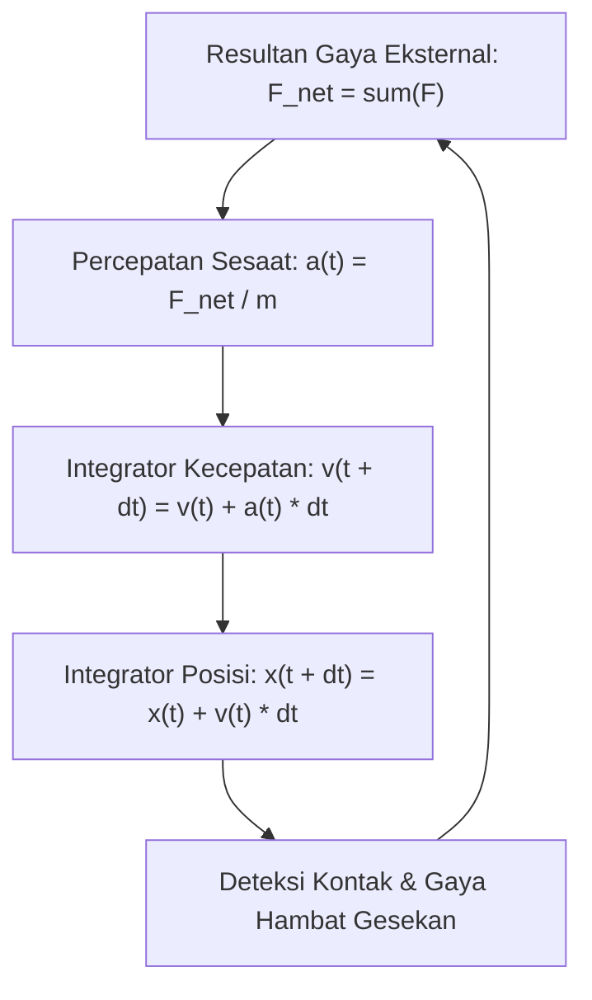

# Modul 025: Fisika Mekanika Klasik Newtonian (Kinematika, Dinamika Newton, Kekekalan Momentum)

**Navigasi**: [⬅️ Master Index](../../INDEX.md) | [Tingkat 2: Tingkat 2: Fisika Klasik, Elektromagnetisme & Kimia Semikonduktor](./README.md)
*Sebelumnya*: [024. metroloji-standar-pengukuran-fisika](./024-metroloji-standar-pengukuran-fisika.md) | *Berikutnya*: [026. mekanika-analitik-lanjut](./026-mekanika-analitik-lanjut.md)

---

## 1. Intuisi Dasar Tanpa Jargon ("Seperti Bayi Baru Lahir")
### 1.1 Konsep Inti & Analogi Tanpa Jargon
Pernahkah Anda berdiri di dalam bus yang tiba-tiba mengerem mendadak? Tubuh Anda terdorong keras ke depan seolah ada 'kekuatan gaib' yang mendorong Anda. Padahal sebenarnya tidak ada yang mendorong Anda! Tubuh Anda hanya ingin terus bergerak maju dengan kecepatan bus sebelum rem diinjak. Bus yang melambat di bawah kaki Anda, bukan tubuh Anda yang dipercepat.

### 1.2 Urgensi Rekayasa & Signifikansi Sistemik
Ini adalah **Hukum Kelembaman (Inersia) Newton**: Benda yang sedang diam akan tetap diam, dan benda yang sedang bergerak akan terus bergerak lurus beraturan, KECUALI jika dipaksa berubah oleh resultan gaya dari luar.
Mekanika klasik adalah hukum gerak yang mengatur dunia kasat mata: dari ayunan bandul jam, tabrakan mobil balap, hingga orbit satelit GPS yang mengitari planet bumi.
[📚 Pelajari: MIT OCW 8.01 Classical Mechanics](https://ocw.mit.edu/courses/8-01sc-classical-mechanics-fall-2016/)

## 2. Fondasi Teoretis & Aksiomatik / Matematis
### 2.1 Kerangka Teori Aksiomatik & Formulasi Matematis
### 25.1 Hukum Gerak Newton & Formulasi Vektorial ([HyperPhysics Mechanics](http://hyperphysics.phy-astr.gsu.edu/hbase/newt.html))
Tiga hukum dasar mekanika translasi:
1. **Hukum I**: $\sum \mathbf{F} = \mathbf{0} \implies \frac{d\mathbf{v}}{dt} = \mathbf{0}$
2. **Hukum II**: Gaya netto adalah laju perubahan momentum linier $\mathbf{p} = m\mathbf{v}$:
   $$\mathbf{F}_{\text{net}} = \frac{d\mathbf{p}}{dt} = m \frac{d\mathbf{v}}{dt} + \mathbf{v} \frac{dm}{dt}$$
   Untuk massa konstan ($dm/dt = 0$): $\mathbf{F} = m \mathbf{a}$.
3. **Hukum III**: Aksi dan Reaksi:
   $$\mathbf{F}_{A \to B} = -\mathbf{F}_{B \to A}$$

### 2.2 Penurunan Matematis Langkah-demi-Langkah
### 25.2 Usaha, Energi Kinetik & Teorema Kekekalan ([MIT OCW 8.01](https://ocw.mit.edu/courses/8-01sc-classical-mechanics-fall-2016/))
Usaha infinitesimal yang dilakukan gaya $\mathbf{F}$ sepanjang lintasan $d\mathbf{r}$:
$$W = \int_{r_1}^{r_2} \mathbf{F} \cdot d\mathbf{r} = \Delta E_k = \frac{1}{2} m v_2^2 - \frac{1}{2} m v_1^2$$
Gaya Konservatif memiliki curl nol ($\nabla \times \mathbf{F} = \mathbf{0}$), sehingga dapat dinyatakan sebagai gradien energi potensial $U$:
$$\mathbf{F} = -\nabla U$$
Hukum Kekekalan Energi Mekanik Total:
$$E_{\text{total}} = E_k + U = \text{konstan}$$

### 25.3 Kekekalan Momentum Linier & Sudut ([Goldstein Classical Mechanics](https://www.pearson.com/))
- **Momentum Linier**: Jika resultan gaya eksternal $\sum \mathbf{F}_{\text{ext}} = \mathbf{0}$, maka $\sum \mathbf{p} = \text{konstan}$.
- **Momentum Sudut (Angular Momentum $\mathbf{L} = \mathbf{r} \times \mathbf{p}$)**:
  $$\boldsymbol{\tau} = \frac{d\mathbf{L}}{dt} = \mathbf{r} \times \mathbf{F}$$
  Jika torsi eksternal $\boldsymbol{\tau}_{\text{ext}} = \mathbf{0}$, maka $\mathbf{L}$ kekal.

## 3. Anatomi Teknis & Cara Kerja Internal

Arsitektur Physics Engine (Verlet vs Euler Integration):
- **Explicit Forward Euler**: Tidak stabil secara energi ($E_{	ext{total}}$ meledak seiring waktu).
- **Symplectic Velocity Verlet**: Mempertahankan kekekalan volume ruang fase (fase Liouville) sehingga orbit benda angkasa stabil ribuan siklus tanpa drift energi fiktif.

#### Tabel Penelusuran Beban Statis & Tegangan Geser Sambungan Balok (Hyatt Regency)
| Komponen Sambungan | Desain Awal Asli (Batang Tunggal) | Desain Modifikasi Fabrikasi (Batang Ganda) | Beban Geser Baut ($V$) | Kapasitas Luluh Maksimum Balok ($V_{cap}$) | Status Keamanan Struktur |
|---|---|---|---|---|---|
| Lantai 4 (Walkway Atas) | Menopang berat sendiri: $W_4 = 90\text{ kN}$ | Menopang berat sendiri + Walkway Lantai 2: $W_4 + W_2 = 180\text{ kN}$ | $V = 180\text{ kN}$ | $V_{cap} = 95\text{ kN}$ | Beban geser melipatgandakan tegangan 2x lipat! |
| Sambungan Box Beam | Baut menembus 1 mur di bawah balok | Baut kedua menggantung di mur yang sama | Tegangan geser lokal terkonsentrasi | Plat baja ketebalan hanya $6.3\text{ mm}$ | Deformasi plastis permanen dimulai |
| Titik Puncak T=Pesta | Walkway dipenuhi 2.000 pengunjung | Beban hidup dinamis bertambah | $V_{total} \approx 214\text{ kN}$ | Melebihi kapasitas batas runtuh $> 220\%$ | Robekan geser (*punching shear*) pada balok |
| Detik Keruntuhan | Mur terlepas menembus pelat baja | Kaskade kegagalan mekanis | Beban runtuh tak tertahan | Runtuh bebas 4 lantai | 114 korban jiwa; Bencana struktural terbesar |

## 4. Implementasi Praktis & Kode / Simulasi Riil
```python
import numpy as np

def simulate_orbital_motion_verlet(mass_planet: float, mass_sun: float, 
                                    r0: np.ndarray, v0: np.ndarray, 
                                    dt: float, steps: int):
    """
    Simulasi mekanika orbit 2-benda menggunakan Velocity-Verlet Integration (Symplectic).
    Gaya Gravitasi: F = -G * M * m / r^3 * r
    """
    G = 6.67430e-11
    positions = np.zeros((steps, 2))
    velocities = np.zeros((steps, 2))
    
    r = r0.copy()
    v = v0.copy()
    
    def compute_acceleration(pos):
        dist = np.linalg.norm(pos)
        return -G * mass_sun * pos / (dist**3)
    
    a = compute_acceleration(r)
    
    for i in range(steps):
        positions[i] = r
        velocities[i] = v
        # Langkah 1: Update posisi setengah langkah
        r += v * dt + 0.5 * a * (dt**2)
        # Langkah 2: Hitung percepatan baru di posisi r(t + dt)
        a_new = compute_acceleration(r)
        # Langkah 3: Update kecepatan simlektik
        v += 0.5 * (a + a_new) * dt
        a = a_new
        
    return positions, velocities

# Simulasi orbit bumi mengelilingi matahari (1 AU = 1.496e11 m, v0 = 29780 m/s)
pos, vel = simulate_orbital_motion_verlet(mass_planet=5.972e24, mass_sun=1.989e30,
                                          r0=np.array([1.496e11, 0.0]),
                                          v0=np.array([0.0, 29780.0]),
                                          dt=3600.0 * 24.0, steps=365)

print(f"Posisi Awal Hari 0   : {pos[0] / 1e11} * 10^11 m")
print(f"Posisi Akhir Hari 365: {pos[-1] / 1e11} * 10^11 m (Siklus 1 Tahun Lengkap!)")
```

## 5. Miskonsepsi & Jebakan Industri
1. **Confusing Mass with Weight**: Massa adalah kuantitas skalar inersia materi (kg), sedangkan berat adalah gaya tarik gravitasi vektor lokal ($W = mg$ dalam Newton).
2. **Centrifugal Force Illusion**: Menganggap gaya sentrifugal adalah gaya nyata yang mendorong ke luar lingkaran, padahal itu adalah gaya fiktif (*inertial pseudo-force*) yang hanya muncul jika Anda mengamati dari kerangka acuan non-inersia yang berotasi.
3. **Euler Integration Instability in Physics Engines**: Menggunakan integrasi forward Euler sederhana `x += v*dt` untuk sistem pegas elastis, yang menghasilkan energi fiktif hingga pegas bergetar semakin cepat dan objek melesat ke tak hingga.

### Studi Kasus Kegagalan Nyata: Runtuhnya Jembatan Gantung Hyatt Regency Kansas City (1981)
- **Kronologi & Konteks Rekayasa**: Pada 17 Juli 1981, dua jembatan gantung layang (*skywalks*) di atrium hotel Hyatt Regency Kansas City runtuh menimpa pesta dansa di bawahnya, menewaskan 114 orang dan melukai 216 lainnya.
- **Akar Masalah Mekanika Statis**: Desain awal arsitek menggunakan batang penggantung baja tunggal panjang yang membentang dari atap melintasi lantai 4 hingga lantai 2. Pihak fabrikator baja mengubah desain menjadi dua batang pendek terpisah untuk memudahkan perakitan tanpa persetujuan insinyur struktur. Perubahan ini secara radikal mengubah diagram kesetimbangan gaya bebas (*free-body diagram*): mur pada balok lantai 4 kini harus menahan berat jembatan lantai 4 PLUS berat jembatan lantai 2 di bawahnya, menggandakan beban geser sambungan hingga dua kali lipat melampaui batas luluh material.

- **Potongan Kode / Arsitektur Cacat (Vulnerable Implementation)**:
```python
# Analisis Kesetimbangan Gaya Statis: Desain Asli vs Modifikasi Fatal Hyatt Regency
def evaluate_hyatt_regency_connection(load_floor_4_kN: float, load_floor_2_kN: float) -> dict:
    """
    Menghitung beban geser yang dialami oleh mur sambungan box beam di Lantai 4.
    Kapasitas desain luluh geser sambungan = 95.0 kN.
    """
    shear_capacity_kN = 95.0
    
    # 1. Desain Asli Batang Tunggal (Single Rod):
    # Mur lantai 4 hanya menahan beban lantai 4; lantai 2 digantung langsung ke atap
    shear_original_design = load_floor_4_kN
    
    # 2. Modifikasi Desain Lapangan Fatal (Double Rod):
    # Batang lantai 2 digantungkan pada balok lantai 4!
    # Sambungan lantai 4 menanggung beban kedua lantai secara kumulatif
    shear_modified_design = load_floor_4_kN + load_floor_2_kN
    
    safety_factor_original = shear_capacity_kN / shear_original_design
    safety_factor_modified = shear_capacity_kN / shear_modified_design
    
    return {
        "original_shear_kN": shear_original_design,
        "modified_shear_kN": shear_modified_design,
        "safety_factor_original": safety_factor_original,
        "safety_factor_modified": safety_factor_modified,
        "structural_collapse": safety_factor_modified < 1.0 # SF < 1.0 = Keruntuhan katastropik!
    }

# Evaluasi beban mati + beban hidup pengunjung (L4 = 90 kN, L2 = 90 kN)
audit = evaluate_hyatt_regency_connection(90.0, 90.0)
assert audit["structural_collapse"] is True, "Modifikasi sambungan melipatgandakan beban melampaui SF!"
```

- **Analisis Mekanika & Etika Rekayasa**: Tragedi Hyatt Regency adalah studi kasus paling fundamental tentang penegakan diagram benda bebas (*Free Body Diagram*) dan integritas rantai tanggung jawab rekayasa. Perubahan kecil yang tampak sepele dalam proses manufaktur dapat mengubah topologi kesetimbangan statis secara drastis, mengubah struktur stabil menjadi keruntuhan katastropik instan.

## 6. Proyek Latihan & Rubrik Penilaian Mandiri
### Tingkat 1 (Pemula) - Trajektori Proyektil dengan Gaya Hambat Udara
Tulis skrip Python untuk mensimulasikan gerak peluru meriam dengan hambatan udara kuadratik ($F_{	ext{drag}} = rac{1}{2} 
ho C_d A v^2$). Bandingkan jarak tembak maksimum peluru tanpa hambatan udara (\$ heta = 45^\circ$) dengan adanya hambatan udara nyata.

### Tingkat 2 (Menengah) - Tumbukan Benda Tegar 2D Non-Elastis
Bangun modul simulasi tabrakan dua bola biliar di atas bidang datar 2D dengan koefisien restitusi $e \in [0, 1]$. Hitung vektor kecepatan akhir kedua bola dan buktikan secara numerik kekekalan momentum total sistem.

### Tingkat 3 (Mahir) - Simulasi N-Body Gravitasi Barnes-Hut
Implementasikan algoritma simulasi gravitasi $N$-benda (*N-Body Simulation*) untuk 10.000 bintang galaksi menggunakan struktur data Quadtree (Barnes-Hut) yang memangkas kompleksitas gaya pairwise dari $O(N^2)$ menjadi $O(N \log N)$ dengan parameter aproksimasi sudut \$ heta = 0.5$.

#### Rubrik Penilaian
- **40% Kestabilan Konservasi Energi**: Menggunakan integrator simplektik (Verlet/Leapfrog) dengan drift energi $< 0.1\%$.
- **30% Validitas Vektor Dinamika**: Penanganan gaya normal, gesek kinetik/statis, dan torsi angular konsisten.
- **30% Performa Algoritmik**: Simulasi mampu berjalan interaktif pada frame rate real-time tanpa stuttering.

### Tingkat 1: Dasar
- **Tugas**: Bangun pemecah kesetimbangan statis 2D (*2D Static Equilibrium Solver*) untuk struktur rangka batang (*truss*) sederhana menggunakan Metode Sambungan Simpul (*Method of Joints*).
- **Petunjuk Perancangan Arsitektur**:
  - Bentuk sistem persamaan linear kesetimbangan simpul: $\sum F_x = 0$ dan $\sum F_y = 0$ untuk setiap simpul.
  - Selesaikan matriks gaya batang $A \cdot T = F_{ext}$ menggunakan eliminasi Gauss atau `numpy.linalg.solve`.
- **Test Vector & Kasus Uji Ekstrem**:
  - *Struktur Rangka Segitiga*: Rangka 3 batang menahan beban vertikal $10\text{ kN}$ di puncak.
  - *Keluaran yang Diharapkan*: Batang bawah mengalami gaya tarik murni ($T > 0$), batang samping mengalami gaya tekan ($T < 0$).
  - *Kasus Batas*: Rangka tidak stabil mekanis (*mechanism / underconstrained*); determinan matriks kesetimbangan harus bernilai 0 (singular).
- **Rubrik Penilaian Mandiri**: 40% Formulasi Matriks Kesetimbangan Simpul Tepat, 30% Klasifikasi Tarik vs Tekan Akurat, 30% Deteksi Ketidakstabilan Mekanis.

### Tingkat 2: Menengah
- **Tugas**: Implementasikan solver diagram gaya geser (*Shear Force Diagram* / SFD) dan momen lentur (*Bending Moment Diagram* / BMD) untuk balok tumpuan sederhana (*simply supported beam*) dengan variasi beban titik dan beban merata.
- **Petunjuk Perancangan Arsitektur**:
  - Hitung gaya reaksi tumpuan dengan kesetimbangan momen global $\sum M_A = 0$ dan gaya vertikal $\sum F_y = 0$.
  - Integrasikan persamaan diferensial balok: $V(x) = -\int w(x) dx$ dan $M(x) = \int V(x) dx$.
- **Test Vector & Kasus Uji Ekstrem**:
  - *Balok Panjang $L = 10\text{ m}$*: Beban merata $q = 2\text{ kN/m}$.
  - *Keluaran yang Diharapkan*: Momen maksimum tepat berada di tengah bentang $x = L/2$ dengan nilai $M_{max} = \frac{q L^2}{8} = 25.0\text{ kN}\cdot\text{m}$.
  - *Kasus Batas*: Beban kantilever ujung; momen maksimum berada di tumpuan jepit.
- **Rubrik Penilaian Mandiri**: 40% Perhitungan SFD & BMD Tepat, 30% Identifikasi Momen Maksimum di $V=0$, 30% Visualisasi Diagram Bersih.

### Tingkat 3: Mahir
- **Tugas**: Rancang simulator dinamika benda tegar 3D (*Rigid Body 6-DoF Dynamics Simulator*) yang mengintegrasikan translasi Hukum Newton II ($F = m a$) dan rotasi Persamaan Euler ($M = I \dot{\omega} + \omega \times (I \omega)$) dengan tensor inersia penuh $3 \times 3$.
- **Petunjuk Perancangan Arsitektur**:
  - Integrasikan orientasi sudut menggunakan kuaternion unit untuk mencegah gimbal lock.
  - Terapkan skema Runge-Kutta Orde 4 (RK4) untuk kecepatan sudut $\omega$ dan posisi spasial $r$.
- **Test Vector & Kasus Uji Ekstrem**:
  - *Uji Efek Dzhanibekov*: Benda tegar dengan momen inersia $I_1 < I_2 < I_3$ diputar pada sumbu menengah $I_2$.
  - *Keluaran yang Diharapkan*: Terjadi pembalikan kutub orientasi periodik (*flipping anomaly*) yang membuktikan instabilitas sumbu inersia menengah.
  - *Kasus Batas*: Rotasi di sekitar sumbu inersia utama $I_1$ atau $I_3$; rotasi wajib stabil tanpa flipping.
- **Rubrik Penilaian Mandiri**: 40% Persamaan Rotasi Euler 3D dengan Tensor Inersia Tepat, 30% Reproduksi Efek Dzhanibekov Riil, 30% Integrasi Kuaternion Stabil.

## 7. Rekomendasi Sumber Belajar Standar Emas
| Kategori | Judul Sumber & Tautan Langsung | Deskripsi Singkat |
|---|---|---|
| 📖 Buku Teks | [Classical Mechanics (John R. Taylor)](https://uscibooks.aip.org/books/classical-mechanics/) | Buku teks modern pengantar mekanika Newtonian dan osilasi teredam. |
| 🎓 Kuliah Terbuka | [MIT OCW 8.01SC Classical Mechanics](https://ocw.mit.edu/courses/8-01sc-classical-mechanics-fall-2016/) | Kuliah video komprehensif kinematika, hukum Newton, momentum, dan torsi. |
| 🔬 Makalah Seminal | [Philosophiae Naturalis Principia Mathematica (Isaac Newton, 1687)](https://www.gutenberg.org/ebooks/28233) | Karya pendiri seluruh fisika mekanika dan kalkulus klasik manusia. |
| 💻 Lab Interaktif | [PhET Physics Simulation: Forces and Motion](https://phet.colorado.edu/en/simulations/forces-and-motion-basics) | Simulator interaktif visual hukum Newton, gesekan, dan percepatan benda. |

---
*Navigasi Cepat*: [Ke Tingkat 2](./README.md) | [Ke Master Index](../../INDEX.md) | *Sebelumnya*: [024. metroloji-standar-pengukuran-fisika](./024-metroloji-standar-pengukuran-fisika.md) | *Berikutnya*: [026. mekanika-analitik-lanjut](./026-mekanika-analitik-lanjut.md)
