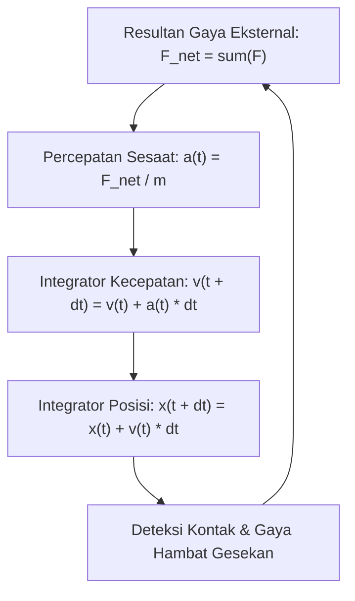

# Modul 025: Fisika Mekanika Klasik Newtonian (Kinematika, Dinamika Newton, Kekekalan Momentum)

**Navigasi**: [⬅️ Master Index](../../INDEX.md) | [Tingkat 2: Tingkat 2: Fisika Klasik, Elektromagnetisme & Kimia Semikonduktor](./README.md)
*Sebelumnya*: [024. metroloji-standar-pengukuran-fisika](./024-metroloji-standar-pengukuran-fisika.md) | *Berikutnya*: [026. mekanika-analitik-lanjut](./026-mekanika-analitik-lanjut.md)

---

## 1. Intuisi Dasar Tanpa Jargon ("Seperti Bayi Baru Lahir")
Pernahkah Anda berdiri di dalam bus yang tiba-tiba mengerem mendadak? Tubuh Anda terdorong keras ke depan seolah ada 'kekuatan gaib' yang mendorong Anda. Padahal sebenarnya tidak ada yang mendorong Anda! Tubuh Anda hanya ingin terus bergerak maju dengan kecepatan bus sebelum rem diinjak. Bus yang melambat di bawah kaki Anda, bukan tubuh Anda yang dipercepat.

Ini adalah **Hukum Kelembaman (Inersia) Newton**: Benda yang sedang diam akan tetap diam, dan benda yang sedang bergerak akan terus bergerak lurus beraturan, KECUALI jika dipaksa berubah oleh resultan gaya dari luar.
Mekanika klasik adalah hukum gerak yang mengatur dunia kasat mata: dari ayunan bandul jam, tabrakan mobil balap, hingga orbit satelit GPS yang mengitari planet bumi.
[📚 Pelajari: MIT OCW 8.01 Classical Mechanics](https://ocw.mit.edu/courses/8-01sc-classical-mechanics-fall-2016/)

## 2. Fondasi Teoretis & Aksiomatik / Matematis
### 25.1 Hukum Gerak Newton & Formulasi Vektorial ([HyperPhysics Mechanics](http://hyperphysics.phy-astr.gsu.edu/hbase/newt.html))
Tiga hukum dasar mekanika translasi:
1. **Hukum I**: $\sum \mathbf{F} = \mathbf{0} \implies \frac{d\mathbf{v}}{dt} = \mathbf{0}$
2. **Hukum II**: Gaya netto adalah laju perubahan momentum linier $\mathbf{p} = m\mathbf{v}$:
   $$\mathbf{F}_{\text{net}} = \frac{d\mathbf{p}}{dt} = m \frac{d\mathbf{v}}{dt} + \mathbf{v} \frac{dm}{dt}$$
   Untuk massa konstan ($dm/dt = 0$): $\mathbf{F} = m \mathbf{a}$.
3. **Hukum III**: Aksi dan Reaksi:
   $$\mathbf{F}_{A \to B} = -\mathbf{F}_{B \to A}$$

### 25.2 Usaha, Energi Kinetik & Teorema Kekekalan ([MIT OCW 8.01](https://ocw.mit.edu/courses/8-01sc-classical-mechanics-fall-2016/))
Usaha infinitesimal yang dilakukan gaya $\mathbf{F}$ sepanjang lintasan $d\mathbf{r}$:
$$W = \int_{r_1}^{r_2} \mathbf{F} \cdot d\mathbf{r} = \Delta E_k = \frac{1}{2} m v_2^2 - \frac{1}{2} m v_1^2$$
Gaya Konservatif memiliki curl nol ($\nabla \times \mathbf{F} = \mathbf{0}$), sehingga dapat dinyatakan sebagai gradien energi potensial $U$:
$$\mathbf{F} = -\nabla U$$
Hukum Kekekalan Energi Mekanik Total:
$$E_{\text{total}} = E_k + U = \text{konstan}$$

### 25.3 Kekekalan Momentum Linier & Sudut ([Goldstein Classical Mechanics](https://www.pearson.com/))
- **Momentum Linier**: Jika resultan gaya eksternal $\sum \mathbf{F}_{\text{ext}} = \mathbf{0}$, maka $\sum \mathbf{p} = \text{konstan}$.
- **Momentum Sudut (Angular Momentum $\mathbf{L} = \mathbf{r} \times \mathbf{p}$)**:
  $$\boldsymbol{\tau} = \frac{d\mathbf{L}}{dt} = \mathbf{r} \times \mathbf{F}$$
  Jika torsi eksternal $\boldsymbol{\tau}_{\text{ext}} = \mathbf{0}$, maka $\mathbf{L}$ kekal.

## 3. Anatomi Teknis & Cara Kerja Internal

Arsitektur Physics Engine (Verlet vs Euler Integration):
- **Explicit Forward Euler**: Tidak stabil secara energi ($E_{	ext{total}}$ meledak seiring waktu).
- **Symplectic Velocity Verlet**: Mempertahankan kekekalan volume ruang fase (fase Liouville) sehingga orbit benda angkasa stabil ribuan siklus tanpa drift energi fiktif.

## 4. Implementasi Praktis & Kode / Simulasi Riil
import numpy as np

def simulate_orbital_motion_verlet(mass_planet: float, mass_sun: float, 
                                    r0: np.ndarray, v0: np.ndarray, 
                                    dt: float, steps: int):
    """
    Simulasi mekanika orbit 2-benda menggunakan Velocity-Verlet Integration (Symplectic).
    Gaya Gravitasi: F = -G * M * m / r^3 * r
    """
    G = 6.67430e-11
    positions = np.zeros((steps, 2))
    velocities = np.zeros((steps, 2))
    
    r = r0.copy()
    v = v0.copy()
    
    def compute_acceleration(pos):
        dist = np.linalg.norm(pos)
        return -G * mass_sun * pos / (dist**3)
    
    a = compute_acceleration(r)
    
    for i in range(steps):
        positions[i] = r
        velocities[i] = v
        # Langkah 1: Update posisi setengah langkah
        r += v * dt + 0.5 * a * (dt**2)
        # Langkah 2: Hitung percepatan baru di posisi r(t + dt)
        a_new = compute_acceleration(r)
        # Langkah 3: Update kecepatan simlektik
        v += 0.5 * (a + a_new) * dt
        a = a_new
        
    return positions, velocities

# Simulasi orbit bumi mengelilingi matahari (1 AU = 1.496e11 m, v0 = 29780 m/s)
pos, vel = simulate_orbital_motion_verlet(mass_planet=5.972e24, mass_sun=1.989e30,
                                          r0=np.array([1.496e11, 0.0]),
                                          v0=np.array([0.0, 29780.0]),
                                          dt=3600.0 * 24.0, steps=365)

print(f"Posisi Awal Hari 0   : {pos[0] / 1e11} * 10^11 m")
print(f"Posisi Akhir Hari 365: {pos[-1] / 1e11} * 10^11 m (Siklus 1 Tahun Lengkap!)")

## 5. Miskonsepsi & Jebakan Industri
1. **Confusing Mass with Weight**: Massa adalah kuantitas skalar inersia materi (kg), sedangkan berat adalah gaya tarik gravitasi vektor lokal ($W = mg$ dalam Newton).
2. **Centrifugal Force Illusion**: Menganggap gaya sentrifugal adalah gaya nyata yang mendorong ke luar lingkaran, padahal itu adalah gaya fiktif (*inertial pseudo-force*) yang hanya muncul jika Anda mengamati dari kerangka acuan non-inersia yang berotasi.
3. **Euler Integration Instability in Physics Engines**: Menggunakan integrasi forward Euler sederhana `x += v*dt` untuk sistem pegas elastis, yang menghasilkan energi fiktif hingga pegas bergetar semakin cepat dan objek melesat ke tak hingga.

## 6. Proyek Latihan & Rubrik Penilaian Mandiri
### Tingkat 1 (Pemula) - Trajektori Proyektil dengan Gaya Hambat Udara
Tulis skrip Python untuk mensimulasikan gerak peluru meriam dengan hambatan udara kuadratik ($F_{	ext{drag}} = rac{1}{2} 
ho C_d A v^2$). Bandingkan jarak tembak maksimum peluru tanpa hambatan udara ($	heta = 45^\circ$) dengan adanya hambatan udara nyata.

### Tingkat 2 (Menengah) - Tumbukan Benda Tegar 2D Non-Elastis
Bangun modul simulasi tabrakan dua bola biliar di atas bidang datar 2D dengan koefisien restitusi $e \in [0, 1]$. Hitung vektor kecepatan akhir kedua bola dan buktikan secara numerik kekekalan momentum total sistem.

### Tingkat 3 (Mahir) - Simulasi N-Body Gravitasi Barnes-Hut
Implementasikan algoritma simulasi gravitasi $N$-benda (*N-Body Simulation*) untuk 10.000 bintang galaksi menggunakan struktur data Quadtree (Barnes-Hut) yang memangkas kompleksitas gaya pairwise dari $O(N^2)$ menjadi $O(N \log N)$ dengan parameter aproksimasi sudut $	heta = 0.5$.

#### Rubrik Penilaian
- **40% Kestabilan Konservasi Energi**: Menggunakan integrator simplektik (Verlet/Leapfrog) dengan drift energi $< 0.1\%$.
- **30% Validitas Vektor Dinamika**: Penanganan gaya normal, gesek kinetik/statis, dan torsi angular konsisten.
- **30% Performa Algoritmik**: Simulasi mampu berjalan interaktif pada frame rate real-time tanpa stuttering.

## 7. Rekomendasi Sumber Belajar Standar Emas
| Kategori | Judul Sumber & Tautan Langsung | Deskripsi Singkat |
|---|---|---|
| 📖 Buku Teks | [Classical Mechanics (John R. Taylor)](https://uscibooks.aip.org/books/classical-mechanics/) | Buku teks modern pengantar mekanika Newtonian dan osilasi teredam. |
| 🎓 Kuliah Terbuka | [MIT OCW 8.01SC Classical Mechanics](https://ocw.mit.edu/courses/8-01sc-classical-mechanics-fall-2016/) | Kuliah video komprehensif kinematika, hukum Newton, momentum, dan torsi. |
| 🔬 Makalah Seminal | [Philosophiae Naturalis Principia Mathematica (Isaac Newton, 1687)](https://www.gutenberg.org/ebooks/28233) | Karya pendiri seluruh fisika mekanika dan kalkulus klasik manusia. |
| 💻 Lab Interaktif | [PhET Physics Simulation: Forces and Motion](https://phet.colorado.edu/en/simulations/forces-and-motion-basics) | Simulator interaktif visual hukum Newton, gesekan, dan percepatan benda. |

---
*Navigasi Cepat*: [Ke Tingkat 2](./README.md) | [Ke Master Index](../../INDEX.md) | *Sebelumnya*: [024. metroloji-standar-pengukuran-fisika](./024-metroloji-standar-pengukuran-fisika.md) | *Berikutnya*: [026. mekanika-analitik-lanjut](./026-mekanika-analitik-lanjut.md)
