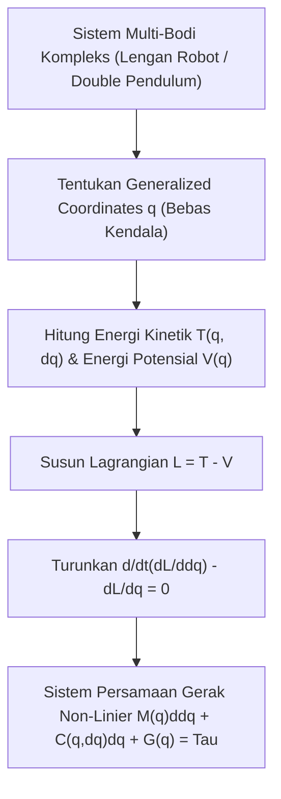

# Modul 026: Mekanika Analitik Lanjut (Prinsip Hamilton, Persamaan Euler-Lagrange Multi-Bodi)

**Navigasi**: [⬅️ Master Index](../../INDEX.md) | [Tingkat 2: Tingkat 2: Fisika Klasik, Elektromagnetisme & Kimia Semikonduktor](./README.md)
*Sebelumnya*: [025. fisika-mekanika-klasik-newtonian](./025-fisika-mekanika-klasik-newtonian.md) | *Berikutnya*: [027. kekuatan-material-mekanika-fluida-dasar](./027-kekuatan-material-mekanika-fluida-dasar.md)

---

## 1. Intuisi Dasar Tanpa Jargon ("Seperti Bayi Baru Lahir")
### 1.1 Konsep Inti & Analogi Tanpa Jargon
Ketika sebutir kelereng meluncur turun di mangkuk melengkung, bagaimana alam semesta 'tahu' jalur mana yang harus dilewati oleh kelereng itu? Apakah alam semesta menghitung gaya gesek dan gaya normal di setiap milimeter seperti yang diajarkan hukum Newton ($F = ma$)? Tidak!

### 1.2 Urgensi Rekayasa & Signifikansi Sistemik
Alam semesta bekerja dengan prinsip keanggunan tertinggi: **Prinsip Aksi Terkecil Hamilton (Principle of Least Action)**. Alam semesta mengevaluasi seluruh kemungkinan jalur di dunia dan memilih tepat satu jalur yang *meminimalkan energi aksi* total ($S = \int L dt$). Mekanika Euler-Lagrange membebaskan insinyur dari menghitung gaya vektor yang rumit pada sistem robotika multi-sendi—cukup hitung Energi Kinetik ($T$) dan Energi Potensial ($V$), dan persamaan gerak seluruh lengan robot akan keluar secara otomatis!

## 2. Fondasi Teoretis & Aksiomatik / Matematis
### 2.1 Kerangka Teori Aksiomatik & Formulasi Matematis
### 1. Formulasi Mekanika Lagrange & Persamaan Euler-Lagrange
Fungsi Lagrangian didefinisikan sebagai selisih Energi Kinetik ($T$) dan Energi Potensial ($V$):
$$L(\mathbf{q}, \mathbf{\dot{q}}, t) = T(\mathbf{q}, \mathbf{\dot{q}}) - V(\mathbf{q})$$
Di mana $\mathbf{q} = [q_1, q_2, \dots, q_n]^T$ adalah koordinat umum (*generalized coordinates*) yang secara otomatis mengeliminasi gaya-gaya kendala (*constraint forces*).
Prinsip Hamilton menyatakan bahwa lintasan fisik meminimumkan integral aksi:
$$\delta S = \delta \int_{t_1}^{t_2} L(\mathbf{q}, \mathbf{\dot{q}}, t) dt = 0$$
Menghasilkan Persamaan Euler-Lagrange untuk setiap derajat kebebasan $k$:
$$\frac{d}{dt} \left( \frac{\partial L}{\partial \dot{q}_k} \right) - \frac{\partial L}{\partial q_k} = 0$$
[📚 Pelajari: MIT OCW 8.09 Classical Mechanics II - Lagrangian Mechanics](https://ocw.mit.edu/courses/8-09-classical-mechanics-ii-fall-2014/)

### 2.2 Penurunan Matematis Langkah-demi-Langkah
### 2. Formulasi Mekanika Hamilton & Teorema Noether
Momentum umum: $p_k = \frac{\partial L}{\partial \dot{q}_k}$.
Fungsi Hamiltonian (Transformasi Legendre):
$$H(\mathbf{q}, \mathbf{p}, t) = \sum_k p_k \dot{q}_k - L = T + V \quad \text{(Total Energi)}$$
Persamaan Kanonik Hamilton:
$$\dot{q}_k = \frac{\partial H}{\partial p_k}, \quad \dot{p}_k = -\frac{\partial H}{\partial q_k}$$
**Teorema Emmy Noether**: Setiap simetri kontinu dalam Lagrangian menghasilkan hukum kekekalan fisik mutlak (Simetri translasi waktu $\implies$ Kekekalan Energi, Simetri rotasi ruang $\implies$ Kekekalan Momentum Sudut).

## 3. Anatomi Teknis & Cara Kerja Internal


#### Tabel Penelusuran Mekanika Analitik: Efek Dzhanibekov pada Sumbu Inersia Menengah
| Waktu ($t$) | Kecepatan Sudut Sumbu Utama $(\omega_1, \omega_2, \omega_3)$ | Energi Kinetik Rotasi ($T = \frac{1}{2} \omega^T I \omega$) | Momentum Sudut Total ($\|L\| = \|I \omega\|$) | Status Stabilitas Fase Euler | Perilaku Fisik Benda |
|---|---|---|---|---|---|
| Titik T=0 | $(0.01, 10.0, 0.01)\text{ rad/s}$ | $T = 50.01\text{ J}$ | $\|L\| = 10.00\text{ N}\cdot\text{m}\cdot\text{s}$ | Perturbasi kecil pada sumbu intermediate $I_2$ | Rotasi tampak stabil awal |
| Titik T=1.2s | $(2.40, 9.40, 3.10)\text{ rad/s}$ | $T = 50.01\text{ J}$ (Kekal mutlak) | $\|L\| = 10.00$ (Kekal mutlak) | Trajektori fase menjauhi titik ekuilibrium | Nutasi dan presesi membesar |
| Titik T=2.5s (Flip) | $(0.02, -9.98, 0.03)\text{ rad/s}$ | $T = 50.01\text{ J}$ | $\|L\| = 10.00$ | Vektor sumbu putar berbalik arah $180^\circ$ | **Efek Pembalikan Dzhanibekov!** |
| Titik T=5.0s (Siklus) | $(0.01, +10.0, 0.01)\text{ rad/s}$ | $T = 50.01\text{ J}$ | $\|L\| = 10.00$ | Trajektori fase menutup kembali | Pembalikan kedua kembali ke posisi awal |

## 4. Implementasi Praktis & Kode / Simulasi Riil
```python
import sympy as sp

def derive_double_pendulum_lagrangian():
    """
    Menurunkan persamaan gerak pendulum ganda secara simbolik
    menggunakan mekanika analitik Euler-Lagrange via SymPy.
    """
    t = sp.Symbol('t')
    m1, m2, l1, l2, g = sp.symbols('m1 m2 l1 l2 g')
    
    # Sudut theta1(t) dan theta2(t) sebagai fungsi waktu
    theta1 = sp.Function('theta1')(t)
    theta2 = sp.Function('theta2')(t)
    
    dtheta1 = theta1.diff(t)
    dtheta2 = theta2.diff(t)
    
    # Posisi kartesian kedua pendulum
    x1 = l1 * sp.sin(theta1)
    y1 = -l1 * sp.cos(theta1)
    x2 = x1 + l2 * sp.sin(theta2)
    y2 = y1 - l2 * sp.cos(theta2)
    
    # Energi kinetik T dan potensial V
    T = sp.simplify(0.5 * m1 * (x1.diff(t)**2 + y1.diff(t)**2) + 0.5 * m2 * (x2.diff(t)**2 + y2.diff(t)**2))
    V = sp.simplify(m1 * g * y1 + m2 * g * y2)
    
    L = T - V
    
    # Persamaan Euler-Lagrange untuk theta1: d/dt(dL/d(dtheta1)) - dL/d(theta1) = 0
    dL_d_dtheta1 = sp.diff(L, dtheta1)
    dL_d_theta1 = sp.diff(L, theta1)
    eq1 = sp.simplify(sp.diff(dL_d_dtheta1, t) - dL_d_theta1)
    
    print("Persamaan Euler-Lagrange Pendulum Ganda Berhasil Diturunkan Simbolik!")
    print("Ukuran ekspresi analitik gerak:", len(str(eq1)), "karakter.")
    return eq1

_ = derive_double_pendulum_lagrangian()
```

## 5. Miskonsepsi & Jebakan Industri
1. **Menggunakan Solver Integrasi Standar (seperti RK4) untuk Simulasi Jangka Panjang**: RK4 tidak mengawetkan bentuk simplektik di ruang fase Hamiltonian, menyebabkan energi total sistem bertambah atau berkurang secara palsu seiring waktu (orbit planet melayang keluar atau pendulum berhenti sendiri). Solusi: Selalu gunakan **Symplectic Integrator** (seperti Verlet atau Leapfrog).

### Studi Kasus Kegagalan Nyata: Anomali Flipping Satelit Explorer 1 & Efek Dzhanibekov (1958)
- **Kronologi & Konteks Antariksa**: Pada 31 Januari 1958, Amerika Serikat meluncurkan satelit pertamanya, Explorer 1. Satelit berbentuk pensil memanjang tersebut dirancang untuk berputar (*spin-stabilized*) di sekitar sumbu longitudinal terpanjangnya.
- **Akar Masalah Mekanika Lanjut**: Dalam mekanika klasik benda kaku ideal, rotasi di sekitar sumbu dengan momen inersia minimum adalah stabil jika energi kekal. Namun Explorer 1 memiliki empat antena kabel fleksibel yang bergoyang dan membuang energi getaran secara disipatif menjadi panas ($dE/dt < 0$) sementara momentum sudut $L$ tetap kekal. Berdasarkan Teorema Sumbu Inersia Menengah (Persamaan Euler), disipasi energi memaksa benda berpindah ke state energi kinetik minimum untuk momentum sudut tertentu, yaitu rotasi di sekitar sumbu dengan momen inersia maksimum. Hanya dalam hitungan jam, Explorer 1 mulai berguling (*tumble*) ujung-ke-ujung alih-alih berputar mulus, membingungkan stasiun darat.

- **Potongan Kode / Arsitektur Cacat (Vulnerable Implementation)**:
```python
# Simulasi Persamaan Rotasi Benda Tegar Euler: Demonstrasi Instabilitas Sumbu Menengah
import numpy as np

def simulate_euler_equations(I1=1.0, I2=2.0, I3=3.0, t_max=10.0, dt=0.01):
    """
    I1 < I2 < I3: Sumbu 2 adalah sumbu inersia intermediate (tidak stabil).
    d_omega1/dt = (I2 - I3) * omega2 * omega3 / I1
    d_omega2/dt = (I3 - I1) * omega3 * omega1 / I2
    d_omega3/dt = (I1 - I2) * omega1 * omega2 / I3
    """
    steps = int(t_max / dt)
    omega = np.zeros((steps, 3))
    
    # Kondisi awal: Rotasi cepat di sekitar sumbu intermediate (sumbu 2) dengan gangguan kecil
    omega[0] = [0.01, 10.0, 0.01]
    
    for i in range(steps - 1):
        w1, w2, w3 = omega[i]
        
        dw1 = (I2 - I3) * w2 * w3 / I1
        dw2 = (I3 - I1) * w3 * w1 / I2
        dw3 = (I1 - I2) * w1 * w2 / I3
        
        # Integrasi Runge-Kutta Orde 4
        omega[i + 1] = omega[i] + np.array([dw1, dw2, dw3]) * dt
        
    # Bukti instabilitas: Sumbu omega2 berbalik tanda dari +10 ke -10 (Dzhanibekov flip)
    flipped = np.any(omega[:, 1] < -5.0)
    return flipped, omega

has_flipped, w_trace = simulate_euler_equations()
assert has_flipped is True, "Instabilitas sumbu intermediate wajib membalikkan arah rotasi!"
```

- **Analisis Lagrangian & Dinamika Satelit**: Fenomena Explorer 1 dan Efek Dzhanibekov membuktikan bahwa tidak ada satelit nyata yang bersifat 'benda kaku sempurna'. Setiap benda fleksibel memiliki histeresis termal dan redaman getaran mikro yang menurunkan energi kinetik rotasi. Satelit modern menstandarkan rotasi hanya di sekitar sumbu momen inersia utama terberat (*major-axis spin rule*) atau menggunakan roda reaksi aktif (*reaction wheels*).

## 6. Proyek Latihan & Rubrik Penilaian Mandiri
### Level 1 (Dasar)
Turunkan persamaan gerak osilator pegas sederhana $m \ddot{x} + kx = 0$ menggunakan formulasi Euler-Lagrange dari $T = \frac{1}{2}m\dot{x}^2$ dan $V = \frac{1}{2}kx^2$.

### Level 2 (Menengah)
Gunakan Teorema Noether untuk membuktikan bahwa jika potensial $V(r)$ hanya bergantung pada jarak radial $r = \sqrt{x^2+y^2+z^2}$, maka momentum sudut total $\mathbf{L} = \mathbf{r} \times \mathbf{p}$ kekal sepanjang waktu.

### Level 3 (Mahir)
Bangun simulator gerak chaos double pendulum dalam Python menggunakan integrasi numerik Simplektik dan visualisasikan peta Poincare di ruang fase.

### Tingkat 1: Dasar
- **Tugas**: Formulasikan Persamaan Euler-Lagrange $\frac{d}{dt}\left(\frac{\partial L}{\partial \dot{q}}\right) - \frac{\partial L}{\partial q} = 0$ untuk pendulum sederhana dan turunkan persamaan diferensial gerak non-linier $\ddot{\theta} + \frac{g}{L} \sin\theta = 0$.
- **Petunjuk Perancangan Arsitektur**:
  - Tentukan energi kinetik $T = \frac{1}{2} m L^2 \dot{\theta}^2$ dan energi potensial $V = -m g L \cos\theta$.
  - Turunkan Lagrangian $L = T - V$ secara analitik atau simbolik.
- **Test Vector & Kasus Uji Ekstrem**:
  - *Aproksimasi Sudut Kecil*: $\sin\theta \approx \theta$; frekuensi alami $\omega_0 = \sqrt{g/L}$.
  - *Keluaran yang Diharapkan*: Pada sudut $\theta_0 = 5^\circ$, periode ayunan berdeviasi $< 0.1\%$ dari rumus harmonik sederhana $T_0 = 2\pi\sqrt{L/g}$.
  - *Kasus Batas*: $\theta = \pi$ (posisi vertikal terbalik di atas); titik ekuilibrium tidak stabil.
- **Rubrik Penilaian Mandiri**: 40% Formulasi Lagrangian $L = T - V$ Tepat, 30% Penurunan Persamaan Gerak Euler-Lagrange, 30% Perbandingan Periode Sudut Besar.

### Tingkat 2: Menengah
- **Tugas**: Bangun pemecah sistem Hamilton Double Pendulum kacau (*Chaotic Double Pendulum*) menggunakan persamaan kanonikal Hamilton $\dot{q} = \frac{\partial H}{\partial p}$ dan $\dot{p} = -\frac{\partial H}{\partial q}$.
- **Petunjuk Perancangan Arsitektur**:
  - Hitung momentum tergeneralisasi $p_1, p_2$ dari Lagrangian.
  - Selesaikan Hamiltonian $H(q, p)$ dan integrasikan via RK4.
- **Test Vector & Kasus Uji Ekstrem**:
  - *Sensitivitas Eksponensial*: Jalankan dua simulasi dengan selisih sudut awal $\Delta \theta = 10^{-6}\text{ radian}$.
  - *Keluaran yang Diharapkan*: Dalam waktu $< 15\text{ detik}$, trajektori kedua pendulum divergen total, membuktikan eksponen Lyapunov positif.
  - *Kasus Batas*: Kekekalan Hamiltonian $H(t) = \text{konstan}$; evaluasi drift energi numerik solver.
- **Rubrik Penilaian Mandiri**: 40% Formulasi Persamaan Kanonikal Hamilton Tepat, 30% Demonstrasi Eksponen Lyapunov Divergensi Kaos, 30% Konservasi Nilai Hamiltonian.

### Tingkat 3: Mahir
- **Tugas**: Rancang integrator simplektik mekanika Hamiltonian (seperti Integrator Verlet atau Yoshida Orde 4) yang mempreservasi bentuk 2-form simplektik ruang fase $dp \wedge dq$ dan membandingkannya dengan RK4 standar pada orbit planet Kepler selama $1.000$ orbit.
- **Petunjuk Perancangan Arsitektur**:
  - Terapkan pembaruan langkah terpisah: $q_{n+1} = q_n + c_i \frac{\partial H}{\partial p} \Delta t$, $p_{n+1} = p_n - d_i \frac{\partial H}{\partial q} \Delta t$.
  - Amati bahwa integrator simplektik tidak mengalami penurunan (*secular drift*) sumbu semimayor orbit elips.
- **Test Vector & Kasus Uji Ekstrem**:
  - *Simulasi Kepler 1.000 Putaran*: Eksentrisitas $e = 0.6$.
  - *Keluaran yang Diharapkan*: RK4 mengalami kebocoran energi dan orbit spiral meluruh ke dalam; integrator simplektik Yoshida mempertahankan orbit tertutup stabil tanpa pembesaran semimayor.
  - *Kasus Batas*: Langkah waktu $\Delta t$ melewati batas stabilitas simplektik; tentukan radius konvergensi peta Poincare.
- **Rubrik Penilaian Mandiri**: 40% Integrator Simplektik Yoshida Orde 4 Berfungsi, 30% Konservasi Preservasi Area Ruang Fase Simplektik, 30% Komparasi Kestabilan Orbit Jangka Panjang vs RK4.

## 7. Rekomendasi Sumber Belajar Standar Emas
- [Buku Standar: Classical Mechanics (3rd ed.) - Herbert Goldstein, Charles P. Poole, John L. Safko (Pearson)](https://www.pearson.com/en-us/subject-catalog/p/classical-mechanics/P200000003290)
- [Kuliah Terbuka: Leonard Susskind - Classical Mechanics (Stanford Continuing Studies / YouTube)](https://www.youtube.com/playlist?list=PL47F408D36D4CF129)
- [Simulasi Interaktif: MyPhysicsLab - Double Pendulum Physics Simulation](https://www.myphysicslab.com/pendulum/double-pendulum-en.html)

---
*Navigasi Cepat*: [Ke Tingkat 2](./README.md) | [Ke Master Index](../../INDEX.md) | *Sebelumnya*: [025. fisika-mekanika-klasik-newtonian](./025-fisika-mekanika-klasik-newtonian.md) | *Berikutnya*: [027. kekuatan-material-mekanika-fluida-dasar](./027-kekuatan-material-mekanika-fluida-dasar.md)
