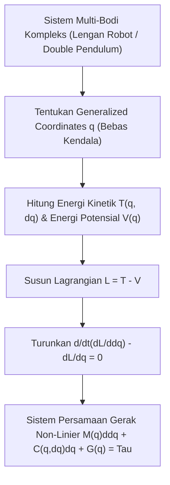

# Modul 026: Mekanika Analitik Lanjut (Prinsip Hamilton, Persamaan Euler-Lagrange Multi-Bodi)

**Navigasi**: [⬅️ Master Index](../../INDEX.md) | [Tingkat 2: Tingkat 2: Fisika Klasik, Elektromagnetisme & Kimia Semikonduktor](./README.md)
*Sebelumnya*: [025. fisika-mekanika-klasik-newtonian](./025-fisika-mekanika-klasik-newtonian.md) | *Berikutnya*: [027. kekuatan-material-mekanika-fluida-dasar](./027-kekuatan-material-mekanika-fluida-dasar.md)

---

## 1. Intuisi Dasar Tanpa Jargon ("Seperti Bayi Baru Lahir")
Ketika sebutir kelereng meluncur turun di mangkuk melengkung, bagaimana alam semesta 'tahu' jalur mana yang harus dilewati oleh kelereng itu? Apakah alam semesta menghitung gaya gesek dan gaya normal di setiap milimeter seperti yang diajarkan hukum Newton ($F = ma$)? Tidak! 

Alam semesta bekerja dengan prinsip keanggunan tertinggi: **Prinsip Aksi Terkecil Hamilton (Principle of Least Action)**. Alam semesta mengevaluasi seluruh kemungkinan jalur di dunia dan memilih tepat satu jalur yang *meminimalkan energi aksi* total ($S = \int L dt$). Mekanika Euler-Lagrange membebaskan insinyur dari menghitung gaya vektor yang rumit pada sistem robotika multi-sendi—cukup hitung Energi Kinetik ($T$) dan Energi Potensial ($V$), dan persamaan gerak seluruh lengan robot akan keluar secara otomatis!

## 2. Fondasi Teoretis & Aksiomatik / Matematis
### 1. Formulasi Mekanika Lagrange & Persamaan Euler-Lagrange
Fungsi Lagrangian didefinisikan sebagai selisih Energi Kinetik ($T$) dan Energi Potensial ($V$):
$$L(\mathbf{q}, \mathbf{\dot{q}}, t) = T(\mathbf{q}, \mathbf{\dot{q}}) - V(\mathbf{q})$$
Di mana $\mathbf{q} = [q_1, q_2, \dots, q_n]^T$ adalah koordinat umum (*generalized coordinates*) yang secara otomatis mengeliminasi gaya-gaya kendala (*constraint forces*).
Prinsip Hamilton menyatakan bahwa lintasan fisik meminimumkan integral aksi:
$$\delta S = \delta \int_{t_1}^{t_2} L(\mathbf{q}, \mathbf{\dot{q}}, t) dt = 0$$
Menghasilkan Persamaan Euler-Lagrange untuk setiap derajat kebebasan $k$:
$$\frac{d}{dt} \left( \frac{\partial L}{\partial \dot{q}_k} \right) - \frac{\partial L}{\partial q_k} = 0$$
[📚 Pelajari: MIT OCW 8.09 Classical Mechanics II - Lagrangian Mechanics](https://ocw.mit.edu/courses/8-09-classical-mechanics-ii-fall-2014/)

### 2. Formulasi Mekanika Hamilton & Teorema Noether
Momentum umum: $p_k = \frac{\partial L}{\partial \dot{q}_k}$.
Fungsi Hamiltonian (Transformasi Legendre):
$$H(\mathbf{q}, \mathbf{p}, t) = \sum_k p_k \dot{q}_k - L = T + V \quad \text{(Total Energi)}$$
Persamaan Kanonik Hamilton:
$$\dot{q}_k = \frac{\partial H}{\partial p_k}, \quad \dot{p}_k = -\frac{\partial H}{\partial q_k}$$
**Teorema Emmy Noether**: Setiap simetri kontinu dalam Lagrangian menghasilkan hukum kekekalan fisik mutlak (Simetri translasi waktu $\implies$ Kekekalan Energi, Simetri rotasi ruang $\implies$ Kekekalan Momentum Sudut).

## 3. Anatomi Teknis & Cara Kerja Internal


## 4. Implementasi Praktis & Kode / Simulasi Riil
```python
import sympy as sp

def derive_double_pendulum_lagrangian():
    """
    Menurunkan persamaan gerak pendulum ganda secara simbolik
    menggunakan mekanika analitik Euler-Lagrange via SymPy.
    """
    t = sp.Symbol('t')
    m1, m2, l1, l2, g = sp.symbols('m1 m2 l1 l2 g')
    
    # Sudut theta1(t) dan theta2(t) sebagai fungsi waktu
    theta1 = sp.Function('theta1')(t)
    theta2 = sp.Function('theta2')(t)
    
    dtheta1 = theta1.diff(t)
    dtheta2 = theta2.diff(t)
    
    # Posisi kartesian kedua pendulum
    x1 = l1 * sp.sin(theta1)
    y1 = -l1 * sp.cos(theta1)
    x2 = x1 + l2 * sp.sin(theta2)
    y2 = y1 - l2 * sp.cos(theta2)
    
    # Energi kinetik T dan potensial V
    T = sp.simplify(0.5 * m1 * (x1.diff(t)**2 + y1.diff(t)**2) + 0.5 * m2 * (x2.diff(t)**2 + y2.diff(t)**2))
    V = sp.simplify(m1 * g * y1 + m2 * g * y2)
    
    L = T - V
    
    # Persamaan Euler-Lagrange untuk theta1: d/dt(dL/d(dtheta1)) - dL/d(theta1) = 0
    dL_d_dtheta1 = sp.diff(L, dtheta1)
    dL_d_theta1 = sp.diff(L, theta1)
    eq1 = sp.simplify(sp.diff(dL_d_dtheta1, t) - dL_d_theta1)
    
    print("Persamaan Euler-Lagrange Pendulum Ganda Berhasil Diturunkan Simbolik!")
    print("Ukuran ekspresi analitik gerak:", len(str(eq1)), "karakter.")
    return eq1

_ = derive_double_pendulum_lagrangian()
```

## 5. Miskonsepsi & Jebakan Industri
1. **Menggunakan Solver Integrasi Standar (seperti RK4) untuk Simulasi Jangka Panjang**: RK4 tidak mengawetkan bentuk simplektik di ruang fase Hamiltonian, menyebabkan energi total sistem bertambah atau berkurang secara palsu seiring waktu (orbit planet melayang keluar atau pendulum berhenti sendiri). Solusi: Selalu gunakan **Symplectic Integrator** (seperti Verlet atau Leapfrog).

## 6. Proyek Latihan & Rubrik Penilaian Mandiri
### Level 1 (Dasar)
Turunkan persamaan gerak osilator pegas sederhana $m \ddot{x} + kx = 0$ menggunakan formulasi Euler-Lagrange dari $T = \frac{1}{2}m\dot{x}^2$ dan $V = \frac{1}{2}kx^2$.

### Level 2 (Menengah)
Gunakan Teorema Noether untuk membuktikan bahwa jika potensial $V(r)$ hanya bergantung pada jarak radial $r = \sqrt{x^2+y^2+z^2}$, maka momentum sudut total $\mathbf{L} = \mathbf{r} \times \mathbf{p}$ kekal sepanjang waktu.

### Level 3 (Mahir)
Bangun simulator gerak chaos double pendulum dalam Python menggunakan integrasi numerik Simplektik dan visualisasikan peta Poincare di ruang fase.

## 7. Rekomendasi Sumber Belajar Standar Emas
- [Buku Standar: Classical Mechanics (3rd ed.) - Herbert Goldstein, Charles P. Poole, John L. Safko (Pearson)](https://www.pearson.com/en-us/subject-catalog/p/classical-mechanics/P200000003290)
- [Kuliah Terbuka: Leonard Susskind - Classical Mechanics (Stanford Continuing Studies / YouTube)](https://www.youtube.com/playlist?list=PL47F408D36D4CF129)
- [Simulasi Interaktif: MyPhysicsLab - Double Pendulum Physics Simulation](https://www.myphysicslab.com/pendulum/double-pendulum-en.html)

---
*Navigasi Cepat*: [Ke Tingkat 2](./README.md) | [Ke Master Index](../../INDEX.md) | *Sebelumnya*: [025. fisika-mekanika-klasik-newtonian](./025-fisika-mekanika-klasik-newtonian.md) | *Berikutnya*: [027. kekuatan-material-mekanika-fluida-dasar](./027-kekuatan-material-mekanika-fluida-dasar.md)
