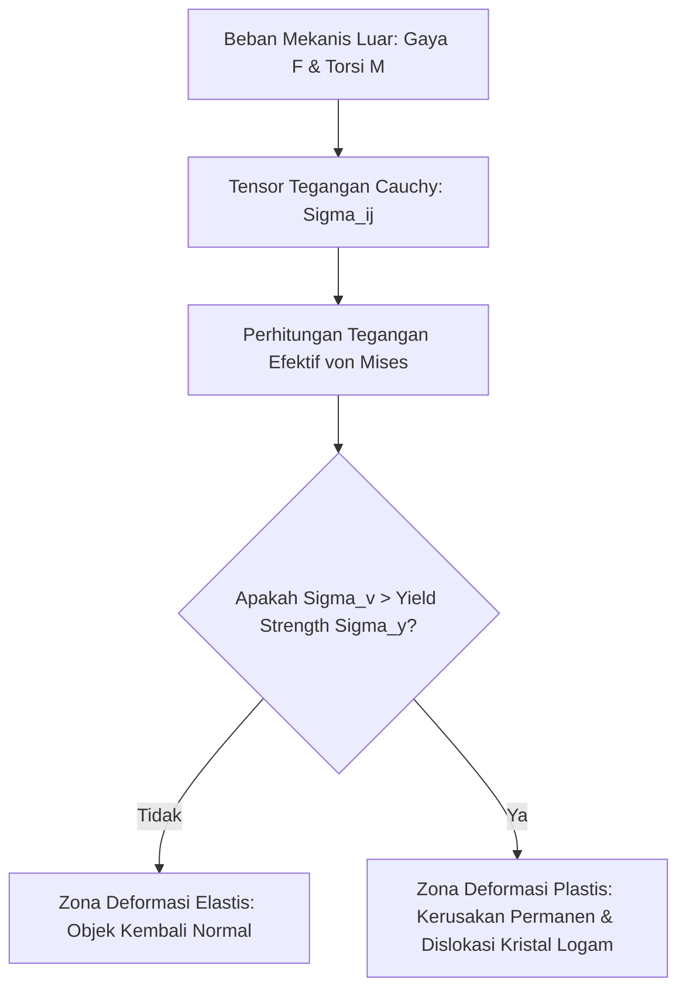

# Modul 027: Kekuatan Material & Mekanika Fluida Dasar (Stress-Strain, Modulus Elastisitas, Viskositas)

**Navigasi**: [⬅️ Master Index](../../INDEX.md) | [Tingkat 2: Tingkat 2: Fisika Klasik, Elektromagnetisme & Kimia Semikonduktor](./README.md)
*Sebelumnya*: [026. mekanika-analitik-lanjut](./026-mekanika-analitik-lanjut.md) | *Berikutnya*: [028. getaran-gelombang-mekanik-akustik](./028-getaran-gelombang-mekanik-akustik.md)

---

## 1. Intuisi Dasar Tanpa Jargon ("Seperti Bayi Baru Lahir")
Pernahkah Anda menarik sebatang karet gelang? Awalnya ia mulur, dan jika dilepas, ia kembali ke bentuk semula. Tetapi jika Anda menariknya terlalu kuat, karet tersebut putus! Begitu pula dengan sayap pesawat terbang dari logam: ia didesain untuk sedikit melentur saat terkena turbulensi udara, tetapi tidak boleh bengkok permanen apalagi patah.

Di sisi lain, perhatikan saat Anda menuang madu vs menuang air. Mengapa madu mengalir sangat lambat? Karena madu memiliki 'gesekan internal' antar lapisan molekulnya yang tinggi.
**Kekuatan Material & Mekanika Fluida** mempelajari bagaimana benda padat menahan beban tanpa retak, dan bagaimana zat cair serta gas mengalir melewati pipa, baling-baling kapal, dan badan mobil balap F1.
[📚 Pelajari: MIT OCW Mechanics of Materials](https://ocw.mit.edu/courses/3-11-mechanics-of-materials-fall-1999/)

## 2. Fondasi Teoretis & Aksiomatik / Matematis
### 27.1 Tegangan, Regangan & Hukum Hooke Tensor ([Engineering ToolBox Solid Mechanics](https://www.engineeringtoolbox.com/))
- **Tegangan Normal ($\sigma$)**: Gaya tegak lurus per satuan luas: $\sigma = \lim_{\Delta A \to 0} \frac{\Delta F_\perp}{\Delta A}$
- **Regangan Normal ($\epsilon$)**: Rasio perubahan dimensi: $\epsilon = \frac{\Delta L}{L_0}$
- **Hukum Hooke 1D**:
  $$\sigma = E \cdot \epsilon$$
  Di mana $E$ adalah Modulus Elastisitas Young (GigaPascal).
- **Rasio Poisson ($\nu$)**: Kontraksi lateral per regangan longitudinal: $\nu = -\frac{\epsilon_{\text{lateral}}}{\epsilon_{\text{aksial}}}$

Tegangan Geser ($\tau$) dan Modulus Geser ($G$):
$$\tau = G \cdot \gamma, \quad G = \frac{E}{2(1 + \nu)}$$

### 27.2 Diagram Tegangan-Regangan & Kriteria Kegagalan von Mises ([MIT 3.11](https://ocw.mit.edu/courses/3-11-mechanics-of-materials-fall-1999/))
Kriteria von Mises untuk material ulet (logam) menentukan batas luluh (*yielding*) di bawah beban multi-aksial 3D:
$$\sigma_v = \sqrt{\frac{1}{2} \left[ (\sigma_1 - \sigma_2)^2 + (\sigma_2 - \sigma_3)^2 + (\sigma_3 - \sigma_1)^2 \right]} \ge \sigma_y$$

### 27.3 Mekanika Fluida & Persamaan Navier-Stokes ([MIT OCW 2.06 Fluid Dynamics](https://ocw.mit.edu/courses/2-06-fluid-dynamics-spring-2013/))
Persamaan kontinuitas fluida inkompresibel:
$$\nabla \cdot \mathbf{u} = 0$$
Persamaan Navier-Stokes (Kekekalan momentum fluida Newton):
$$\rho \left( \frac{\partial \mathbf{u}}{\partial t} + (\mathbf{u} \cdot \nabla)\mathbf{u} \right) = -\nabla p + \mu \nabla^2 \mathbf{u} + \rho \mathbf{g}$$
Bilangan Reynolds tak-berdimensi (penentu aliran laminer vs turbulen):
$$Re = \frac{\rho u L}{\mu}$$
Jika $Re < 2300$, aliran dalam pipa bersifat **Laminer** halus; jika $Re > 4000$, aliran menjadi **Turbulen** kacau bergolak.

## 3. Anatomi Teknis & Cara Kerja Internal

Mekanisme Dislokasi Logam:
Deformasi plastis terjadi ketika bidang atom kisi kristal logam tergelincir (*slip planes*) di sepanjang dislokasi garis tepi dan sekrup di bawah tegangan geser kritis.

## 4. Implementasi Praktis & Kode / Simulasi Riil
import numpy as np

def calculate_pipe_pressure_drop(flow_rate_m3_s: float, diameter_m: float, 
                                 length_m: float, density: float = 1000.0, 
                                 viscosity: float = 0.001) -> dict:
    """
    Menghitung kehilangan tekanan (pressure drop) aliran fluida dalam pipa menggunakan rumus Darcy-Weisbach.
    Delta P = f * (L/D) * (rho * v^2 / 2)
    """
    area = np.pi * (diameter_m / 2.0)**2
    velocity = flow_rate_m3_s / area
    
    # Bilangan Reynolds
    reynolds = (density * velocity * diameter_m) / viscosity
    
    # Faktor gesekan Darcy (f)
    if reynolds < 2300:
        flow_regime = "Laminer"
        friction_factor = 64.0 / reynolds
    else:
        flow_regime = "Turbulen"
        # Aproksimasi Blasius untuk pipa halus
        friction_factor = 0.3164 / (reynolds**0.25)
        
    delta_p = friction_factor * (length_m / diameter_m) * (0.5 * density * velocity**2)
    return {
        "velocity_m_s": velocity,
        "reynolds": reynolds,
        "regime": flow_regime,
        "friction_factor": friction_factor,
        "pressure_drop_pa": delta_p
    }

res = calculate_pipe_pressure_drop(flow_rate_m3_s=0.005, diameter_m=0.05, length_m=50.0)
print(f"Kecepatan Aliran : {res['velocity_m_s']:.2f} m/s")
print(f"Bilangan Reynolds: {res['reynolds']:.0f} ({res['regime']})")
print(f"Penurunan Tekanan: {res['pressure_drop_pa'] / 1000.0:.2f} kPa")

## 5. Miskonsepsi & Jebakan Industri
1. **Ignoring Stress Concentrations at Sharp Notches**: Membuat sudut tajam 90 derajat pada sambungan struktural logam, yang melipatgandakan tegangan lokal 3-5x lipat (*stress concentration factor* $K_t$) dan memicu patah getas lelah (*fatigue failure*).
2. **Confusing Viscosity with Density**: Mengira minyak pelumas lebih padat dari air karena lebih lambat mengalir, padahal minyak mengapung di atas air (densitas minyak $\approx 850 \text{ kg/m}^3$ < air $1000 \text{ kg/m}^3$). Hambatan alirnya disebabkan oleh viskositas dinamik, bukan massa jenis.
3. **Cavitation in Liquid Pumps**: Mengabaikan penurunan tekanan lokal di bawah tekanan uap jenuh cairan pada bilah impeller pompa, memicu gelembung uap mikro yang runtuh seketika dan mengikis logam impeller seperti dinamit mini.

## 6. Proyek Latihan & Rubrik Penilaian Mandiri
### Tingkat 1 (Pemula) - Defleksi Balok Kantilever
Gunakan rumus defleksi balok Euler-Bernoulli untuk menghitung lendutan maksimum di ujung balok kantilever baja penampang persegi ($L = 2\text{ m}, b=0.05\text{ m}, h=0.1\text{ m}$) yang diberi beban terpusat $F = 5000\text{ N}$ ($E_{\text{baja}} = 200\text{ GPa}$).

### Tingkat 2 (Menengah) - Simulasi Patah Lelah Poros Transmisi (S-N Curve)
Implementasikan estimasi masa pakai kelelahan material (*Fatigue Life Estimation*) menggunakan aturan akumulasi kerusakan linier Palmgren-Miner. Diberikan riwayat beban siklus berulang, hitung persentase konsumsi umur pakai poros sebelum terjadi inisiasi retak mikro.

### Tingkat 3 (Mahir) - Simulasi Aliran Fluida 2D Lattice Boltzmann Method (LBM)
Tulis simulasi aliran fluida 2D skema D2Q9 Lattice Boltzmann Method dalam Python/NumPy untuk mensimulasikan aliran melewati rintangan silinder dan memvisualisasikan pembentukan pusaran periodik Von Kármán vortex street pada bilangan Reynolds $Re = 100$.

#### Rubrik Penilaian
- **40% Ketepatan Teori Kontinum**: Formulasi tensor tegangan dan batas luluh von Mises akurat.
- **30% Validitas Navier-Stokes**: Memastikan kekekalan massa dan konservasi momentum fluida terpenuhi.
- **30% Penanganan Kondisi Batas**: Penerapan kondisi no-slip boundary condition pada dinding fluida secara benar.

## 7. Rekomendasi Sumber Belajar Standar Emas
| Kategori | Judul Sumber & Tautan Langsung | Deskripsi Singkat |
|---|---|---|
| 📖 Buku Teks | [Mechanics of Materials (Gere & Goodno)](https://www.cengage.com/) | Buku standar rujukan mekanika material, balok lentur, dan tegangan luluh. |
| 🎓 Kuliah Terbuka | [MIT OCW 2.06 Fluid Dynamics](https://ocw.mit.edu/courses/2.06-fluid-dynamics-spring-2013/) | Kuliah komprehensif dinamika fluida, persamaan Navier-Stokes, dan vortex. |
| 🔬 Makalah Seminal | [Sur les lois du mouvement des fluides (Navier, 1822)](https://gallica.bnf.fr/ark:/12148/bpt6k565268) | Makalah asli Claude-Louis Navier yang meletakkan dasar mekanika fluida viskos. |
| 💻 Lab Interaktif | [SimScale Cloud FEA & CFD Simulator](https://www.simscale.com/) | Platform simulasi elemen hingga (FEA) dan fluida (CFD) interaktif di cloud. |

---
*Navigasi Cepat*: [Ke Tingkat 2](./README.md) | [Ke Master Index](../../INDEX.md) | *Sebelumnya*: [026. mekanika-analitik-lanjut](./026-mekanika-analitik-lanjut.md) | *Berikutnya*: [028. getaran-gelombang-mekanik-akustik](./028-getaran-gelombang-mekanik-akustik.md)
