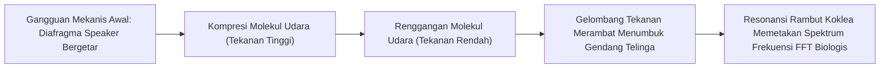

# Modul 028: Getaran, Gelombang Mekanik & Akustik (Osilasi Teredam, Resonansi, Perambatan Akustik)

**Navigasi**: [⬅️ Master Index](../../INDEX.md) | [Tingkat 2: Tingkat 2: Fisika Klasik, Elektromagnetisme & Kimia Semikonduktor](./README.md)
*Sebelumnya*: [027. kekuatan-material-mekanika-fluida-dasar](./027-kekuatan-material-mekanika-fluida-dasar.md) | *Berikutnya*: [029. termodinamika-perpindahan-panas](./029-termodinamika-perpindahan-panas.md)

---

## 1. Intuisi Dasar Tanpa Jargon ("Seperti Bayi Baru Lahir")
### 1.1 Konsep Inti & Analogi Tanpa Jargon
Pernahkah Anda berbisik di ujung ruangan berkubah besar dan teman Anda di ujung ruangan lain yang berjarak 30 meter bisa mendengar bisikan Anda dengan sangat jelas seolah Anda berbisik tepat di telinganya? Atau bagaimana suara penyanyi opera dengan nada tinggi bisa memecahkan gelas kaca kristal tanpa menyentuhnya sama sekali?

### 1.2 Urgensi Rekayasa & Signifikansi Sistemik
Ini adalah fenomena **Getaran, Gelombang & Resonansi**:
Ketika frekuensi dorongan eksternal cocok persis dengan frekuensi alami getar (*natural frequency*) suatu benda, energi terserap dan terakumulasi tanpa henti hingga amplitudonya meledak jutaan kali lipat.
Gelombang bukan perpindahan materi (air laut tidak terbang melintasi samudra menuju pantai), melainkan **perpindahan energi dan informasi** yang merambat melalui medium perantara.
[📚 Pelajari: MIT OCW 8.03 Physics of Vibrations and Waves](https://ocw.mit.edu/courses/8-03sc-physics-iii-vibrations-and-waves-fall-2016/)

## 2. Fondasi Teoretis & Aksiomatik / Matematis
### 2.1 Kerangka Teori Aksiomatik & Formulasi Matematis
### 28.1 Osilator Harmonik Sederhana & Teredam ([HyperPhysics Waves](http://hyperphysics.phy-astr.gsu.edu/hbase/hframe.html))
Persamaan diferensial gerak osilator harmonik teredam dengan gaya pendorong periodik:
$$m \frac{d^2 x}{dt^2} + \gamma \frac{dx}{dt} + k x = F_0 \cos(\omega t)$$
Bagi dengan massa $m$:
$$\ddot{x} + 2\zeta \omega_0 \dot{x} + \omega_0^2 x = \frac{F_0}{m} \cos(\omega t)$$
Di mana:
- Frekuensi sudut alami tak-teredam: $\omega_0 = \sqrt{k / m}$
- Rasio redaman: $\zeta = \frac{\gamma}{2\sqrt{km}}$
  - $\zeta < 1$: Teredam Kurang (*Underdamped* - berosilasi dengan peluruhan eksponensial $e^{-\zeta \omega_0 t}$).
  - $\zeta = 1$: Teredam Kritis (*Critically Damped* - kembali ke nol paling cepat tanpa berosilasi).
  - $\zeta > 1$: Teredam Lebih (*Overdamped* - kembali ke nol sangat lambat).

### 2.2 Penurunan Matematis Langkah-demi-Langkah
Faktor Kualitas Resonansi ($Q$-factor):
$$Q = \frac{1}{2\zeta} = \frac{\omega_0}{\Delta \omega}$$

### 28.2 Persamaan Gelombang 1D & Prinsip Superposisi ([MIT 8.03](https://ocw.mit.edu/courses/8-03sc-physics-iii-vibrations-and-waves-fall-2016/))
Persamaan diferensial parsial gelombang klasik:
$$\frac{\partial^2 \psi}{\partial x^2} = \frac{1}{v^2} \frac{\partial^2 \psi}{\partial t^2}$$
Solusi umum d'Alembert untuk medium linier nondispersif:
$$\psi(x, t) = f(x - vt) + g(x + vt)$$
Di mana $v$ adalah kecepatan rambat gelombang ($v = \lambda \cdot f$). Kecepatan suara di udara ideal:
$$v_{\text{akustik}} = \sqrt{\frac{\gamma R T}{M}}$$

## 3. Anatomi Teknis & Cara Kerja Internal

Mekanisme Interferensi Gelombang:
- **Konstruktif**: Beda fase $\Delta \phi = 2n\pi \implies$ Amplitudo saling menjumlah ($A_{	ext{total}} = 2A$).
- **Destruktif**: Beda fase $\Delta \phi = (2n + 1)\pi \implies$ Amplitudo saling meniadakan ($A_{	ext{total}} = 0$, dasar kerja headphone *Active Noise Cancelling* ANC).

#### Tabel Penelusuran Resonansi Terinduksi Pejalan Kaki (Lateral Synchronous Excitation)
| Waktu Simulasi ($t$) | Sudut Fasa Jembatan ($\theta_b$) | Fasa Langkah Pejalan Kaki ($\theta_p$) | Gaya Dorong Lateral Kumulatif ($F_{lat}$) | Amplitudo Goyangan Jembatan ($X_0$) | Status Resonansi & Umpan Balik Positif |
|---|---|---|---|---|---|
| $t = 0.0\text{ s}$ | $0.00\text{ rad}$ | Acak terdistribusi seragam ($[- \pi, \pi]$) | $12.4\text{ N}$ (Saling menghilangkan) | $0.2\text{ mm}$ (Getaran latar belakang) | Rezim stabil; getaran teredam alami |
| $t = 5.0\text{ s}$ | $0.45\text{ rad}$ | Mulai terjadi penguncian fasa sebagian | $185.0\text{ N}$ | $4.8\text{ mm}$ | Pejalan kaki mulai merasakan goyangan lateral |
| $t = 15.0\text{ s}$ | $1.20\text{ rad}$ | Penguncian fasa sinkron $\Delta \theta \approx 0$ | $1450.0\text{ N}$ (Resonansi koheren) | $28.5\text{ mm}$ | Pejalan kaki melebarkan langkah untuk seimbang |
| $t = 30.0\text{ s}$ | $2.85\text{ rad}$ | Sinkronisasi penuh 200 pejalan kaki | $3800.0\text{ N}$ | $75.0\text{ mm}$ (Batas kritis keselamatan) | Redaman struktural $\zeta = 0.005$ terlampaui masif |
| $t = 45.0\text{ s}$ | Stabil goyang | Goyangan self-excited limit cycle | $4200.0\text{ N}$ konstan | $82.0\text{ mm}$ (Osilasi lateral persisten) | Jembatan bergoyang hebat; evakuasi publik |

## 4. Implementasi Praktis & Kode / Simulasi Riil
```python
import numpy as np

def simulate_damped_forced_oscillator(m=1.0, k=100.0, gamma=2.0, F0=10.0, 
                                      omega_drive=9.8, duration=5.0, dt=0.001):
    """
    Simulasi respons osilator teredam di dekat titik resonansi (omega_0 = sqrt(k/m) = 10 rad/s).
    """
    omega_0 = np.sqrt(k / m)
    steps = int(duration / dt)
    t = np.linspace(0, duration, steps)
    
    x = np.zeros(steps)
    v = np.zeros(steps)
    
    for i in range(steps - 1):
        # Gaya netto: Pegas (-kx) + Redaman (-gamma*v) + Pendorong (F0*cos(omega*t))
        f_net = -k * x[i] - gamma * v[i] + F0 * np.cos(omega_drive * t[i])
        a = f_net / m
        v[i + 1] = v[i] + a * dt
        x[i + 1] = x[i] + v[i + 1] * dt
        
    amplitude_peak = np.max(np.abs(x[int(steps * 0.7):])) # Amplitudo steady state
    return t, x, omega_0, amplitude_peak

t, x, w0, amp_peak = simulate_damped_forced_oscillator()
print(f"Frekuensi Alami Resonansi w0: {w0:.2f} rad/s")
print(f"Amplitudo Puncak Steady-State: {amp_peak:.3f} meter")
```

## 5. Miskonsepsi & Jebakan Industri
1. **Confusing Phase Velocity with Group Velocity**: Pada medium dispersif (seperti gelombang air laut dalam), kecepatan fase individual puncak gelombang ($v_p = \omega / k$) berbeda dengan kecepatan grup paket gelombang ($v_g = d\omega / dk$) yang membawa energi dan informasi.
2. **Ignoring Mechanical Resonance in Civil/Hardware Design**: Runtuhnya jembatan Tacoma Narrows akibat aeroelastic flutter dan getaran kipas pendingin server yang menghancurkan bantalan HDD mekanis akibat getaran resonansi sasis.
3. **Sound Decibel Linearity Misconception**: Mengira suara 80 dB hanya sedikit lebih bising dari 70 dB, padahal desibel adalah skala logaritmik: peningkatan 10 dB merepresentasikan peningkatan intensitas daya akustik 10x lipat dan persepsi subjektif 2x lipat lebih keras.

### Studi Kasus Kegagalan Nyata: Fenomena Goyangan Lateral Jembatan Millennium London (2000)
- **Kronologi Pembukaan**: Jembatan Millennium London dibuka pada 10 Juni 2000. Saat dinaiki oleh ribuan pejalan kaki, jembatan mulai bergoyang ke kiri dan ke kanan secara hebat hingga pejalan kaki terpaksa berpegangan pada pagar pembatas. Jembatan terpaksa ditutup hanya dua hari kemudian.
- **Akar Masalah Dinamika Struktur**: Desain jembatan gantung kabel dangkal memiliki frekuensi alami lateral pertama pada $0,77\text{ Hz}$. Frekuensi langkah kaki manusia saat berjalan normal adalah $\approx 2\text{ Hz}$ vertikal dan $\approx 1\text{ Hz}$ lateral. Ketika jembatan sedikit bergoyang, pejalan kaki secara naluriah menyesuaikan langkah dan frekuensi kaki mereka agar tidak jatuh, menyelaraskan fasa dorongan kaki lateral mereka dengan frekuensi alami jembatan. Fenomena ini menciptakan umpan balik positif (*positive feedback / synchronous lateral excitation*).

- **Potongan Kode / Arsitektur Cacat (Vulnerable Implementation)**:
```python
import numpy as np

def simulate_millennium_bridge_sway(pedestrians=200, t_max=30.0, dt=0.01):
    # Parameter struktur jembatan Millennium
    M_modal = 1.13e5  # Massa modal jembatan (kg)
    f_natural = 0.77  # Frekuensi alami lateral (Hz)
    omega_n = 2 * np.pi * f_natural
    zeta = 0.005      # Rasio redaman struktur sangat rendah (0.5%)
    c = 2 * zeta * M_modal * omega_n
    k = M_modal * (omega_n ** 2)

    steps = int(t_max / dt)
    x = np.zeros(steps)
    v = np.zeros(steps)
    
    # Fasa pejalan kaki acak pada awalnya
    phi_ped = np.random.uniform(0, 2 * np.pi, pedestrians)
    omega_ped = 2 * np.pi * 0.8  # Frekuensi langkah lateral ~0.8 Hz
    G_ped = 35.0  # Gaya dorong lateral per langkah (N)

    for i in range(1, steps):
        # Penguncian fasa: laju penyesuaian fasa pejalan kaki terhadap kecepatan jembatan
        phi_ped += (omega_ped + 0.15 * v[i-1] * np.cos(phi_ped)) * dt
        F_total = np.sum(G_ped * np.sin(phi_ped))
        
        # Persamaan gerak getaran teredam: M*a + C*v + K*x = F_total
        a = (F_total - c * v[i-1] - k * x[i-1]) / M_modal
        v[i] = v[i-1] + a * dt
        x[i] = x[i-1] + v[i] * dt

    return {"max_amplitude_mm": np.max(np.abs(x)) * 1000.0}

res = simulate_millennium_bridge_sway()
# Amplitudo meningkat pesat melampaui batas toleransi kenyamanan pejalan kaki
```

- **Solusi & Retrofit Rekayasa**: Tim insinyur Arup memasang 37 peredam cairan kental (*fluid viscous dampers*) dan 52 peredam massa tertala (*tuned mass dampers*) di bawah gelagar jembatan untuk menaikkan rasio redaman $\zeta$ dari 0,5% ke hampir 20%, menyerap energi lateral pejalan kaki dan menghentikan resonansi.

## 6. Proyek Latihan & Rubrik Penilaian Mandiri
### Tingkat 1 (Pemula) - Generator Nada Sinus Murni & Gelombang Berdiri
Tulis skrip Python yang membangkitkan sinyal audio 44.1 kHz untuk tangga nada A4 (440 Hz) dan harmonik atasnya (880 Hz, 1320 Hz). Simpan sebagai file `.wav` dan dengarkan perbedaan timbre saat harmonik ditambahkan.

### Tingkat 2 (Menengah) - Simulasi Algoritma Active Noise Cancelling (ANC)
Implementasikan simulasi pemrosesan sinyal peredam bising aktif (ANC). Buat sinyal suara lingkungan sintetik (suara mesin pesawat derau rendah) dan rancang filter adaptif LMS (Least Mean Squares) yang menggenerasi sinyal anti-fase 180 derajat untuk membatalkan suara derau tersebut hingga residu $< -30	ext{ dB}$.

### Tingkat 3 (Mahir) - Penyelesai Persamaan Gelombang 2D Finite Difference (FDTD)
Implementasikan simulasi persamaan gelombang membran 2D (seperti kulit drum) menggunakan skema beda hingga FDTD (Finite-Difference Time-Domain). Visualisasikan bentuk mode normal pola nodal Chladni 2D untuk berbagai frekuensi resonansi eigen.

#### Rubrik Penilaian
- **40% Ketepatan Pemodelan Resonansi**: Perhitungan frekuensi alami, rasio redaman $\zeta$, dan kurva respons Bode akurat.
- **30% Integritas Persamaan Gelombang**: Diskritisasi FDTD stabil menurut kriteria Courant-Friedrichs-Lewy (CFL: $v \Delta t / \Delta x \le 1/\sqrt{2}$).
- **30% Penanganan Refleksi Batas**: Menerapkan kondisi batas bebas atau jepit Dirichlet secara konsisten.

### Tingkat 1: Dasar
- **Tugas**: Bangun simulator osilator harmonik teredam sederhana dengan gaya dorong sinusoidal eksternal menggunakan metode integrasi Runge-Kutta 4 (RK4).
- **Petunjuk Perancangan Arsitektur**:
  - Formulasikan sistem ODE orde 2: $\ddot{x} + 2\zeta\omega_0 \dot{x} + \omega_0^2 x = \frac{F_0}{m} \cos(\omega t)$.
  - Uji kurva respons frekuensi amplitudo stasioner terhadap rasio frekuensi $\beta = \omega / \omega_0$.
- **Test Vector & Kasus Uji Ekstrem**:
  - *Kondisi Resonansi Murni*: $\omega = \omega_0$, $\zeta = 0.01$; amplitudo resonansi teoritis $Q = \frac{1}{2\zeta} = 50.0$.
  - *Kondisi Overdamped*: $\zeta = 2.0$; verifikasi tidak ada osilasi (respons meluruh monotonik).
- **Rubrik Penilaian Mandiri**: 40% Formulasi ODE RK4 Presisi, 30% Perhitungan Faktor Kualitas $Q$, 30% Verifikasi Kurva Respons Frekuensi.

### Tingkat 2: Menengah
- **Tugas**: Implementasikan model Kuramoto untuk sinkronisasi fase non-linier antara $N$ osilator pejalan kaki yang berinteraksi dengan kecepatan gerak struktur pendukung.
- **Petunjuk Perancangan Arsitektur**:
  - Persamaan fase: $\dot{\theta}_i = \omega_i + \frac{K}{N} \sum_{j=1}^N \sin(\theta_j - \theta_i) + \alpha \dot{X}_{bridge} \cos(\theta_i)$.
  - Hitung parameter keteraturan Kuramoto $r(t) = \left|\frac{1}{N} \sum_{j=1}^N e^{i\theta_j}\right| \in [0, 1]$.
- **Test Vector & Kasus Uji Ekstrem**:
  - *Fasa Acak Awal*: $r(0) \approx \frac{1}{\sqrt{N}} \le 0.15$ untuk $N = 100$.
  - *Kondisi Sinkron Penuh*: $r(t) > 0.90$ saat kopling $K > K_c$; semua osilator mengunci frekuensi bersama.
- **Rubrik Penilaian Mandiri**: 40% Solver Kuramoto Model Akurat, 30% Kalkulasi Parameter Keteraturan $r(t)$, 30% Evaluasi Batas Ambang Kopling Kritis $K_c$.

### Tingkat 3: Mahir
- **Tugas**: Rancang algoritma perancangan dan optimasi Tuned Mass Damper (TMD) multi-derajat-kebebasan (MDOF) menggunakan kriteria optimal Den Hartog untuk meredam mode getaran dominan jembatan.
- **Petunjuk Perancangan Arsitektur**:
  - Tentukan rasio frekuensi optimal: $g_{opt} = \frac{1}{1 + \mu}$.
  - Tentukan rasio redaman TMD optimal: $\xi_{tmd\_opt} = \sqrt{\frac{3\mu}{8(1 + \mu)^3}}$ dengan $\mu = m_{tmd} / M_{main}$.
- **Test Vector & Kasus Uji Ekstrem**:
  - *Rasio Massa $\mu = 0.05$*: $g_{opt} \approx 0.9523$, $\xi_{tmd\_opt} \approx 0.128$.
  - *Evaluasi Reduksi Resonansi*: Puncak amplifikasi transfer function sistem berkurang $\ge 75\%$ dibanding sistem tanpa TMD.
- **Rubrik Penilaian Mandiri**: 40% Formulasi Optimasi Den Hartog MDOF Tepat, 30% Solver Fungsi Alih Respons Frekuensi, 30% Verifikasi Reduksi Puncak Resonansi $\ge 75\%$.

## 7. Rekomendasi Sumber Belajar Standar Emas
| Kategori | Judul Sumber & Tautan Langsung | Deskripsi Singkat |
|---|---|---|
| 📖 Buku Teks | [The Physics of Waves and Oscillations (H.J. Pain)](https://www.wiley.com/) | Buku referensi standar universal getaran mekanik, akustik, dan optik gelombang. |
| 🎓 Kuliah Terbuka | [MIT OCW 8.03SC Physics III: Vibrations and Waves](https://ocw.mit.edu/courses/8-03sc-physics-iii-vibrations-and-waves-fall-2016/) | Seri kuliah terkenal Yen-Jie Lee tentang osilasi teredam, resonansi, dan dispersi. |
| 🔬 Makalah Seminal | [Sur le mouvement des corps élastiques (Poisson, 1829)](https://gallica.bnf.fr/) | Penurunan matematis kecepatan gelombang transversal dan longitudinal pada zat padat. |
| 💻 Lab Interaktif | [Falstad Ripple Tank 2D Wave Simulator](https://www.falstad.com/ripple/) | Simulator interaktif 2D refleksi, refraksi, difraksi, dan interferensi gelombang. |

---
*Navigasi Cepat*: [Ke Tingkat 2](./README.md) | [Ke Master Index](../../INDEX.md) | *Sebelumnya*: [027. kekuatan-material-mekanika-fluida-dasar](./027-kekuatan-material-mekanika-fluida-dasar.md) | *Berikutnya*: [029. termodinamika-perpindahan-panas](./029-termodinamika-perpindahan-panas.md)
