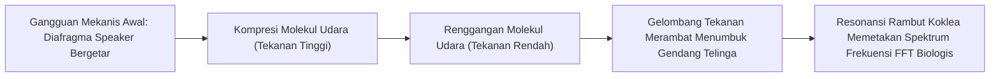

# Modul 028: Getaran, Gelombang Mekanik & Akustik (Osilasi Teredam, Resonansi, Perambatan Akustik)

**Navigasi**: [⬅️ Master Index](../../INDEX.md) | [Tingkat 2: Tingkat 2: Fisika Klasik, Elektromagnetisme & Kimia Semikonduktor](./README.md)
*Sebelumnya*: [027. kekuatan-material-mekanika-fluida-dasar](./027-kekuatan-material-mekanika-fluida-dasar.md) | *Berikutnya*: [029. termodinamika-perpindahan-panas](./029-termodinamika-perpindahan-panas.md)

---

## 1. Intuisi Dasar Tanpa Jargon ("Seperti Bayi Baru Lahir")
Pernahkah Anda berbisik di ujung ruangan berkubah besar dan teman Anda di ujung ruangan lain yang berjarak 30 meter bisa mendengar bisikan Anda dengan sangat jelas seolah Anda berbisik tepat di telinganya? Atau bagaimana suara penyanyi opera dengan nada tinggi bisa memecahkan gelas kaca kristal tanpa menyentuhnya sama sekali?

Ini adalah fenomena **Getaran, Gelombang & Resonansi**:
Ketika frekuensi dorongan eksternal cocok persis dengan frekuensi alami getar (*natural frequency*) suatu benda, energi terserap dan terakumulasi tanpa henti hingga amplitudonya meledak jutaan kali lipat.
Gelombang bukan perpindahan materi (air laut tidak terbang melintasi samudra menuju pantai), melainkan **perpindahan energi dan informasi** yang merambat melalui medium perantara.
[📚 Pelajari: MIT OCW 8.03 Physics of Vibrations and Waves](https://ocw.mit.edu/courses/8-03sc-physics-iii-vibrations-and-waves-fall-2016/)

## 2. Fondasi Teoretis & Aksiomatik / Matematis
### 28.1 Osilator Harmonik Sederhana & Teredam ([HyperPhysics Waves](http://hyperphysics.phy-astr.gsu.edu/hbase/hframe.html))
Persamaan diferensial gerak osilator harmonik teredam dengan gaya pendorong periodik:
$$m \frac{d^2 x}{dt^2} + \gamma \frac{dx}{dt} + k x = F_0 \cos(\omega t)$$
Bagi dengan massa $m$:
$$\ddot{x} + 2\zeta \omega_0 \dot{x} + \omega_0^2 x = \frac{F_0}{m} \cos(\omega t)$$
Di mana:
- Frekuensi sudut alami tak-teredam: $\omega_0 = \sqrt{k / m}$
- Rasio redaman: $\zeta = \frac{\gamma}{2\sqrt{km}}$
  - $\zeta < 1$: Teredam Kurang (*Underdamped* - berosilasi dengan peluruhan eksponensial $e^{-\zeta \omega_0 t}$).
  - $\zeta = 1$: Teredam Kritis (*Critically Damped* - kembali ke nol paling cepat tanpa berosilasi).
  - $\zeta > 1$: Teredam Lebih (*Overdamped* - kembali ke nol sangat lambat).

Faktor Kualitas Resonansi ($Q$-factor):
$$Q = \frac{1}{2\zeta} = \frac{\omega_0}{\Delta \omega}$$

### 28.2 Persamaan Gelombang 1D & Prinsip Superposisi ([MIT 8.03](https://ocw.mit.edu/courses/8-03sc-physics-iii-vibrations-and-waves-fall-2016/))
Persamaan diferensial parsial gelombang klasik:
$$\frac{\partial^2 \psi}{\partial x^2} = \frac{1}{v^2} \frac{\partial^2 \psi}{\partial t^2}$$
Solusi umum d'Alembert untuk medium linier nondispersif:
$$\psi(x, t) = f(x - vt) + g(x + vt)$$
Di mana $v$ adalah kecepatan rambat gelombang ($v = \lambda \cdot f$). Kecepatan suara di udara ideal:
$$v_{\text{akustik}} = \sqrt{\frac{\gamma R T}{M}}$$

## 3. Anatomi Teknis & Cara Kerja Internal

Mekanisme Interferensi Gelombang:
- **Konstruktif**: Beda fase $\Delta \phi = 2n\pi \implies$ Amplitudo saling menjumlah ($A_{	ext{total}} = 2A$).
- **Destruktif**: Beda fase $\Delta \phi = (2n + 1)\pi \implies$ Amplitudo saling meniadakan ($A_{	ext{total}} = 0$, dasar kerja headphone *Active Noise Cancelling* ANC).

## 4. Implementasi Praktis & Kode / Simulasi Riil
import numpy as np

def simulate_damped_forced_oscillator(m=1.0, k=100.0, gamma=2.0, F0=10.0, 
                                      omega_drive=9.8, duration=5.0, dt=0.001):
    """
    Simulasi respons osilator teredam di dekat titik resonansi (omega_0 = sqrt(k/m) = 10 rad/s).
    """
    omega_0 = np.sqrt(k / m)
    steps = int(duration / dt)
    t = np.linspace(0, duration, steps)
    
    x = np.zeros(steps)
    v = np.zeros(steps)
    
    for i in range(steps - 1):
        # Gaya netto: Pegas (-kx) + Redaman (-gamma*v) + Pendorong (F0*cos(omega*t))
        f_net = -k * x[i] - gamma * v[i] + F0 * np.cos(omega_drive * t[i])
        a = f_net / m
        v[i + 1] = v[i] + a * dt
        x[i + 1] = x[i] + v[i + 1] * dt
        
    amplitude_peak = np.max(np.abs(x[int(steps * 0.7):])) # Amplitudo steady state
    return t, x, omega_0, amplitude_peak

t, x, w0, amp_peak = simulate_damped_forced_oscillator()
print(f"Frekuensi Alami Resonansi w0: {w0:.2f} rad/s")
print(f"Amplitudo Puncak Steady-State: {amp_peak:.3f} meter")

## 5. Miskonsepsi & Jebakan Industri
1. **Confusing Phase Velocity with Group Velocity**: Pada medium dispersif (seperti gelombang air laut dalam), kecepatan fase individual puncak gelombang ($v_p = \omega / k$) berbeda dengan kecepatan grup paket gelombang ($v_g = d\omega / dk$) yang membawa energi dan informasi.
2. **Ignoring Mechanical Resonance in Civil/Hardware Design**: Runtuhnya jembatan Tacoma Narrows akibat aeroelastic flutter dan getaran kipas pendingin server yang menghancurkan bantalan HDD mekanis akibat getaran resonansi sasis.
3. **Sound Decibel Linearity Misconception**: Mengira suara 80 dB hanya sedikit lebih bising dari 70 dB, padahal desibel adalah skala logaritmik: peningkatan 10 dB merepresentasikan peningkatan intensitas daya akustik 10x lipat dan persepsi subjektif 2x lipat lebih keras.

## 6. Proyek Latihan & Rubrik Penilaian Mandiri
### Tingkat 1 (Pemula) - Generator Nada Sinus Murni & Gelombang Berdiri
Tulis skrip Python yang membangkitkan sinyal audio 44.1 kHz untuk tangga nada A4 (440 Hz) dan harmonik atasnya (880 Hz, 1320 Hz). Simpan sebagai file `.wav` dan dengarkan perbedaan timbre saat harmonik ditambahkan.

### Tingkat 2 (Menengah) - Simulasi Algoritma Active Noise Cancelling (ANC)
Implementasikan simulasi pemrosesan sinyal peredam bising aktif (ANC). Buat sinyal suara lingkungan sintetik (suara mesin pesawat derau rendah) dan rancang filter adaptif LMS (Least Mean Squares) yang menggenerasi sinyal anti-fase 180 derajat untuk membatalkan suara derau tersebut hingga residu $< -30	ext{ dB}$.

### Tingkat 3 (Mahir) - Penyelesai Persamaan Gelombang 2D Finite Difference (FDTD)
Implementasikan simulasi persamaan gelombang membran 2D (seperti kulit drum) menggunakan skema beda hingga FDTD (Finite-Difference Time-Domain). Visualisasikan bentuk mode normal pola nodal Chladni 2D untuk berbagai frekuensi resonansi eigen.

#### Rubrik Penilaian
- **40% Ketepatan Pemodelan Resonansi**: Perhitungan frekuensi alami, rasio redaman $\zeta$, dan kurva respons Bode akurat.
- **30% Integritas Persamaan Gelombang**: Diskritisasi FDTD stabil menurut kriteria Courant-Friedrichs-Lewy (CFL: $v \Delta t / \Delta x \le 1/\sqrt{2}$).
- **30% Penanganan Refleksi Batas**: Menerapkan kondisi batas bebas atau jepit Dirichlet secara konsisten.

## 7. Rekomendasi Sumber Belajar Standar Emas
| Kategori | Judul Sumber & Tautan Langsung | Deskripsi Singkat |
|---|---|---|
| 📖 Buku Teks | [The Physics of Waves and Oscillations (H.J. Pain)](https://www.wiley.com/) | Buku referensi standar universal getaran mekanik, akustik, dan optik gelombang. |
| 🎓 Kuliah Terbuka | [MIT OCW 8.03SC Physics III: Vibrations and Waves](https://ocw.mit.edu/courses/8-03sc-physics-iii-vibrations-and-waves-fall-2016/) | Seri kuliah terkenal Yen-Jie Lee tentang osilasi teredam, resonansi, dan dispersi. |
| 🔬 Makalah Seminal | [Sur le mouvement des corps élastiques (Poisson, 1829)](https://gallica.bnf.fr/) | Penurunan matematis kecepatan gelombang transversal dan longitudinal pada zat padat. |
| 💻 Lab Interaktif | [Falstad Ripple Tank 2D Wave Simulator](https://www.falstad.com/ripple/) | Simulator interaktif 2D refleksi, refraksi, difraksi, dan interferensi gelombang. |

---
*Navigasi Cepat*: [Ke Tingkat 2](./README.md) | [Ke Master Index](../../INDEX.md) | *Sebelumnya*: [027. kekuatan-material-mekanika-fluida-dasar](./027-kekuatan-material-mekanika-fluida-dasar.md) | *Berikutnya*: [029. termodinamika-perpindahan-panas](./029-termodinamika-perpindahan-panas.md)
