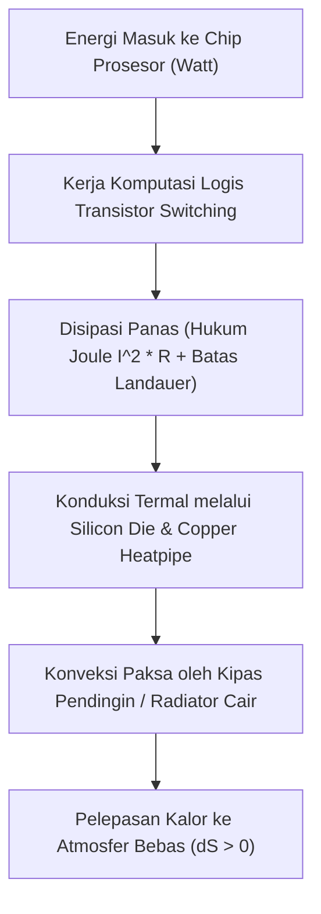

# Modul 029: Termodinamika & Perpindahan Panas (Entropi Termal, Konduksi/Konveksi/Radiasi, Prinsip Landauer)

**Navigasi**: [⬅️ Master Index](../../INDEX.md) | [Tingkat 2: Tingkat 2: Fisika Klasik, Elektromagnetisme & Kimia Semikonduktor](./README.md)
*Sebelumnya*: [028. getaran-gelombang-mekanik-akustik](./028-getaran-gelombang-mekanik-akustik.md) | *Berikutnya*: [030. elektrostatika-medan-listrik](./030-elektrostatika-medan-listrik.md)

---

## 1. Intuisi Dasar Tanpa Jargon ("Seperti Bayi Baru Lahir")
Mengapa kopi panas yang ditaruh di atas meja selalu mendingin dengan sendirinya, tetapi kopi dingin di atas meja tidak pernah tiba-tiba menyerap panas dari udara sekitar dan mendidih spontan? Mengapa waktu hanya bergerak maju ke masa depan dan tidak pernah mundur ke masa lalu? 

Jawabannya adalah **Termodinamika & Hukum Kedua Entropi**: Alam semesta memiliki arah panah waktu yang ditentukan oleh *kekacauan molekuler (Entropi)*. Dan di era komputasi modern, fisikawan Rolf Landauer membuktikan fakta mengejutkan: menghapus 1 bit informasi di dalam memori komputer memicu pembuangan energi panas minimum ($k_B T \ln 2$) ke udara bebas (**Prinsip Landauer**)!

## 2. Fondasi Teoretis & Aksiomatik / Matematis
### 1. Empat Hukum Termodinamika
- **Hukum Ke-0**: Transitivitas Kesetimbangan Termal (Konsep Suhu $T$).
- **Hukum Ke-1 (Kekekalan Energi)**: $dU = \delta Q - \delta W$ (Perubahan energi dalam = kalor masuk dikurangi kerja yang dilakukan sistem).
- **Hukum Ke-2 (Entropi Semesta Selalu Meningkat)**:
  $$dS \ge \frac{\delta Q}{T}, \quad \Delta S_{semesta} = \Delta S_{sistem} + \Delta S_{lingkungan} \ge 0$$
  Definisi Statistik Ludwig Boltzmann:
  $$S = k_B \ln \Omega$$
  Di mana $k_B = 1.380649 \times 10^{-23} \text{ J/K}$ dan $\Omega$ adalah jumlah status mikro (*microstates*).
- **Hukum Ke-3**: Entropi kristal murni mendekati nol absolut saat $T \to 0\text{ Kelvin}$.

### 2. Batas Fisika Informasi: Prinsip Landauer
Penghapusan 1 bit informasi secara logis (*irreversible computation*) menyebabkan peningkatan entropi lingkungan minimum sebesar $\Delta S = k_B \ln 2$, yang setara dengan disipasi energi panas minimum:
$$E_{min} = k_B T \ln 2 \approx 2.87 \times 10^{-21} \text{ Joule pada suhu ruang } (T = 300\text{ K})$$
[📚 Pelajari: MIT OCW 8.044 Statistical Physics I](https://ocw.mit.edu/courses/8-044-statistical-physics-i-spring-2013/)

## 3. Anatomi Teknis & Cara Kerja Internal


## 4. Implementasi Praktis & Kode / Simulasi Riil
```python
import math

def calculate_landauer_limit(temperature_kelvin: float = 300.0, num_operations_per_sec: float = 1e18):
    """
    Menghitung batas konsumsi daya teoritis minimum (Batas Landauer)
    untuk superkomputer yang memproses 1 ExaFLOP (10^18 operasi per detik).
    """
    k_B = 1.380649e-23  # J/K (Konstanta Boltzmann)
    landauer_energy_per_bit = k_B * temperature_kelvin * math.log(2)
    
    # Daya minimum mutlak jika setiap operasi menghapus 1 bit informasi
    minimum_power_watts = landauer_energy_per_bit * num_operations_per_sec
    
    return {
        "temperature_K": temperature_kelvin,
        "energy_per_bit_joules": landauer_energy_per_bit,
        "power_for_1_exaflop_watts": minimum_power_watts
    }

res = calculate_landauer_limit()
print("Batas Termodinamika Informasi Landauer:")
print(f" - Energi Minimum per Bit Dihapus (300K): {res['energy_per_bit_joules']:.3e} Joule")
print(f" - Daya Teoritis Minimum 1 ExaFLOP: {res['power_for_1_exaflop_watts']:.3f} Watt")
print("Superkomputer Frontier saat ini mengonsumsi ~21 Megawatt (jutaan kali di atas batas Landauer).")
```

## 5. Miskonsepsi & Jebakan Industri
1. **Thermal Throttling pada Desain Perangkat Elektronik**: Mengabaikan pemodelan resistansi termal $\theta_{JA}$ (Junction-to-Ambient): jika chip menghasilkan 15 Watt dan pendingin memiliki resistansi termal $8^\circ\text{C/W}$, suhu inti silikon akan melonjak $120^\circ\text{C}$ di atas suhu ruang hingga memicu lelehan termal atau proteksi shutdown instan.

## 6. Proyek Latihan & Rubrik Penilaian Mandiri
### Level 1 (Dasar)
Hitung efisiensi mesin panas Carnot ideal yang beroperasi antara reservoir panas $T_H = 500\text{ K}$ dan reservoir dingin $T_C = 300\text{ K}$.

### Level 2 (Menengah)
Turunkan rumus konduksi panas satu dimensi Fourier $q = -k A \frac{dT}{dx}$ dan hitung perpindahan panas melintasi pasta termal prosesor setebal 0.1 mm.

### Level 3 (Mahir)
Analisis paradigma komputasi reversibel (*Reversible Computing*) berbasis gerbang Fredkin dan Toffoli: Jelaskan bagaimana komputasi tanpa penghapusan bit dapat secara teoretis menembus batas disipasi Landauer.

## 7. Rekomendasi Sumber Belajar Standar Emas
- [Buku Standar: Thermal Physics - Charles Kittel & Herbert Kroemer (W. H. Freeman)](https://www.macmillanlearning.com/college/us/product/Thermal-Physics/p/0716710889)
- [Paper Seminal: Irreversibility and Heat Generation in the Computing Process - Rolf Landauer (IBM Journal, 1961)](https://ieeexplore.ieee.org/document/5392446)
- [Kuliah Terbuka: MIT OCW 5.60 Thermodynamics & Kinetics](https://ocw.mit.edu/courses/5-60-thermodynamics-kinetics-spring-2008/)

---
*Navigasi Cepat*: [Ke Tingkat 2](./README.md) | [Ke Master Index](../../INDEX.md) | *Sebelumnya*: [028. getaran-gelombang-mekanik-akustik](./028-getaran-gelombang-mekanik-akustik.md) | *Berikutnya*: [030. elektrostatika-medan-listrik](./030-elektrostatika-medan-listrik.md)
