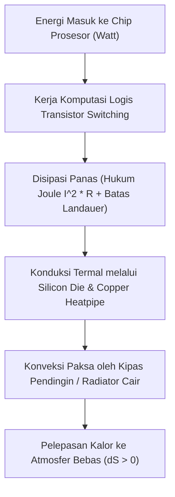

# Modul 029: Termodinamika & Perpindahan Panas (Entropi Termal, Konduksi/Konveksi/Radiasi, Prinsip Landauer)

**Navigasi**: [⬅️ Master Index](../../INDEX.md) | [Tingkat 2: Tingkat 2: Fisika Klasik, Elektromagnetisme & Kimia Semikonduktor](./README.md)
*Sebelumnya*: [028. getaran-gelombang-mekanik-akustik](./028-getaran-gelombang-mekanik-akustik.md) | *Berikutnya*: [030. elektrostatika-medan-listrik](./030-elektrostatika-medan-listrik.md)

---

## 1. Intuisi Dasar Tanpa Jargon ("Seperti Bayi Baru Lahir")
### 1.1 Konsep Inti & Analogi Tanpa Jargon
Mengapa kopi panas yang ditaruh di atas meja selalu mendingin dengan sendirinya, tetapi kopi dingin di atas meja tidak pernah tiba-tiba menyerap panas dari udara sekitar dan mendidih spontan? Mengapa waktu hanya bergerak maju ke masa depan dan tidak pernah mundur ke masa lalu?

### 1.2 Urgensi Rekayasa & Signifikansi Sistemik
Jawabannya adalah **Termodinamika & Hukum Kedua Entropi**: Alam semesta memiliki arah panah waktu yang ditentukan oleh *kekacauan molekuler (Entropi)*. Dan di era komputasi modern, fisikawan Rolf Landauer membuktikan fakta mengejutkan: menghapus 1 bit informasi di dalam memori komputer memicu pembuangan energi panas minimum ($k_B T \ln 2$) ke udara bebas (**Prinsip Landauer**)!

## 2. Fondasi Teoretis & Aksiomatik / Matematis
### 2.1 Kerangka Teori Aksiomatik & Formulasi Matematis
### 1. Empat Hukum Termodinamika
- **Hukum Ke-0**: Transitivitas Kesetimbangan Termal (Konsep Suhu $T$).
- **Hukum Ke-1 (Kekekalan Energi)**: $dU = \delta Q - \delta W$ (Perubahan energi dalam = kalor masuk dikurangi kerja yang dilakukan sistem).
- **Hukum Ke-2 (Entropi Semesta Selalu Meningkat)**:
  $$dS \ge \frac{\delta Q}{T}, \quad \Delta S_{semesta} = \Delta S_{sistem} + \Delta S_{lingkungan} \ge 0$$
  Definisi Statistik Ludwig Boltzmann:
  $$S = k_B \ln \Omega$$
  Di mana $k_B = 1.380649 \times 10^{-23} \text{ J/K}$ dan $\Omega$ adalah jumlah status mikro (*microstates*).
- **Hukum Ke-3**: Entropi kristal murni mendekati nol absolut saat $T \to 0\text{ Kelvin}$.

### 2.2 Penurunan Matematis Langkah-demi-Langkah
### 2. Batas Fisika Informasi: Prinsip Landauer
Penghapusan 1 bit informasi secara logis (*irreversible computation*) menyebabkan peningkatan entropi lingkungan minimum sebesar $\Delta S = k_B \ln 2$, yang setara dengan disipasi energi panas minimum:
$$E_{min} = k_B T \ln 2 \approx 2.87 \times 10^{-21} \text{ Joule pada suhu ruang } (T = 300\text{ K})$$
[📚 Pelajari: MIT OCW 8.044 Statistical Physics I](https://ocw.mit.edu/courses/8-044-statistical-physics-i-spring-2013/)

## 3. Anatomi Teknis & Cara Kerja Internal


#### Tabel Penelusuran Penurunan Elastisitas O-Ring Fluoroelastomer Terhadap Temperatur
| Titik Uji / Suhu Ambien ($T$) | Tegangan Kompresi Terjaga ($\sigma_c$) | Waktu Pemulihan Celah ($\Delta t_{seal}$) | Laju Aliran Gas Panas Tekanan Tinggi | Status Integritas Cincin Segel | Efek Sistem Roket Pendorong (SRB) |
|---|---|---|---|---|---|
| $T = +25^\circ\text{C}$ (Lab) | $2.4\text{ MPa}$ | $8\text{ ms}$ (Seketika mengisi celah) | $0.0\text{ kg/s}$ (Tersegel rapat) | Elastisitas sempurna di atas $T_g$ | Pembakaran normal; segel primer menahan 6.9 MPa |
| $T = +15^\circ\text{C}$ (Normal) | $2.1\text{ MPa}$ | $18\text{ ms}$ | $0.0\text{ kg/s}$ | Elastisitas terjaga baik | Segel primer berfungsi penuh |
| $T = +5^\circ\text{C}$ (Dingin) | $1.2\text{ MPa}$ | $120\text{ ms}$ | $0.02\text{ kg/s}$ (Puff asap mikro) | Mulai getas; pemulihan terlambat | Segel sekunder menahan kebocoran sementara |
| $T = -1^\circ\text{C}$ (Challenger) | $0.15\text{ MPa}$ | $> 2500\text{ ms}$ (Gagal pulih) | $45.0\text{ kg/s}$ (Blow-by masif) | Melintasi suhu transisi gelas $T_g$; O-ring mengeras kaku | Lidah api 2800°C meniup tangki hidrogen cair |
| $T = -10^\circ\text{C}$ (Kriogenik) | $0.0\text{ MPa}$ | $\infty$ (Pecah getas) | Buka penuh | Struktur amorf membeku kaca | Erosi total sambungan roket dalam milidetik |

## 4. Implementasi Praktis & Kode / Simulasi Riil
```python
import math

def calculate_landauer_limit(temperature_kelvin: float = 300.0, num_operations_per_sec: float = 1e18):
    """
    Menghitung batas konsumsi daya teoritis minimum (Batas Landauer)
    untuk superkomputer yang memproses 1 ExaFLOP (10^18 operasi per detik).
    """
    k_B = 1.380649e-23  # J/K (Konstanta Boltzmann)
    landauer_energy_per_bit = k_B * temperature_kelvin * math.log(2)
    
    # Daya minimum mutlak jika setiap operasi menghapus 1 bit informasi
    minimum_power_watts = landauer_energy_per_bit * num_operations_per_sec
    
    return {
        "temperature_K": temperature_kelvin,
        "energy_per_bit_joules": landauer_energy_per_bit,
        "power_for_1_exaflop_watts": minimum_power_watts
    }

res = calculate_landauer_limit()
print("Batas Termodinamika Informasi Landauer:")
print(f" - Energi Minimum per Bit Dihapus (300K): {res['energy_per_bit_joules']:.3e} Joule")
print(f" - Daya Teoritis Minimum 1 ExaFLOP: {res['power_for_1_exaflop_watts']:.3f} Watt")
print("Superkomputer Frontier saat ini mengonsumsi ~21 Megawatt (jutaan kali di atas batas Landauer).")
```

## 5. Miskonsepsi & Jebakan Industri
1. **Thermal Throttling pada Desain Perangkat Elektronik**: Mengabaikan pemodelan resistansi termal $\theta_{JA}$ (Junction-to-Ambient): jika chip menghasilkan 15 Watt dan pendingin memiliki resistansi termal $8^\circ\text{C/W}$, suhu inti silikon akan melonjak \$120^\circ\text{C}$ di atas suhu ruang hingga memicu lelehan termal atau proteksi shutdown instan.

### Studi Kasus Kegagalan Nyata: Bencana Pesawat Ulang-Alik Challenger & Transisi Gelas O-Ring (1986)
- **Kronologi Bencana**: Pada 28 Januari 1986, Space Shuttle Challenger meledak 73 detik setelah lepas landas dari Cape Canaveral, menewaskan seluruh 7 awak pesawat.
- **Akar Masalah Termodinamika & Fisika Polimer**: Suhu udara pada pagi hari peluncuran berada pada $-1^\circ\text{C}$ ($31^\circ\text{F}$), 15°C lebih dingin dari peluncuran sebelumnya. Cincin penyegel O-ring sambungan Solid Rocket Booster (SRB) terbuat dari karet sintetis fluoroelastomer (FKM/Viton). Pada suhu mendekati $0^\circ\text{C}$, elastomer mendekati temperatur transisi gelasnya ($T_g$). Modulus elastisitas polimer melonjak tajam, menyebabkan waktu pemulihan bentuk elastis melambat ratusan kali lipat. Ketika tekanan pembakaran 6,9 MPa menggembungkan dinding roket, O-ring yang kaku tidak mampu menutup celah sambungan, memungkinkan gas pembakaran bersuhu 2.800°C membakar dinding tangki eksternal.

- **Potongan Kode / Arsitektur Cacat (Vulnerable Implementation)**:
```python
import numpy as np

def simulate_oring_resilience(temp_celsius):
    # Model WLF (Williams-Landel-Ferry) untuk relaksasi viskoelastis elastomer
    Tg = -5.0  # Suhu transisi gelas fluoroelastomer (°C)
    C1 = 17.44
    C2 = 51.6
    
    T_K = temp_celsius + 273.15
    Tg_K = Tg + 273.15
    
    if temp_celsius < Tg:
        # Material membeku kaku seperti kaca (glassy state)
        log_aT = 15.0
    else:
        # Faktor pergeseran waktu WLF
        log_aT = -C1 * (temp_celsius - Tg) / (C2 + (temp_celsius - Tg))
        
    recovery_time_ms = 10.0 * (10.0 ** (-log_aT))
    # Batas celah roket menutup dalam 100 ms saat tekanan meledak
    safe_seal = recovery_time_ms < 100.0
    
    return {
        "temperature_C": temp_celsius,
        "recovery_time_ms": recovery_time_ms,
        "seal_success": safe_seal
    }

# Evaluasi pada suhu peluncuran normal (20°C) vs Challenger (-1°C)
normal = simulate_oring_resilience(20.0)    # recovery: ~8 ms (Aman)
disaster = simulate_oring_resilience(-1.0)  # recovery: >2000 ms (GAGAL TOTAL)
```

- **Komisi Rogers & Demonstrasi Feynman**: Fisikawan Richard Feynman mendemonstrasikan akar masalah termodinamika ini secara elegan di depan siaran televisi langsung dengan mencelupkan sampel karet O-ring ke dalam segelas air es dan menunjukkan bahwa karet tersebut kehilangan elastisitasnya secara permanen selama berada pada suhu dingin.

## 6. Proyek Latihan & Rubrik Penilaian Mandiri
### Level 1 (Dasar)
Hitung efisiensi mesin panas Carnot ideal yang beroperasi antara reservoir panas $T_H = 500\text{ K}$ dan reservoir dingin $T_C = 300\text{ K}$.

### Level 2 (Menengah)
Turunkan rumus konduksi panas satu dimensi Fourier $q = -k A \frac{dT}{dx}$ dan hitung perpindahan panas melintasi pasta termal prosesor setebal 0.1 mm.

### Level 3 (Mahir)
Analisis paradigma komputasi reversibel (*Reversible Computing*) berbasis gerbang Fredkin dan Toffoli: Jelaskan bagaimana komputasi tanpa penghapusan bit dapat secara teoretis menembus batas disipasi Landauer.

### Tingkat 1: Dasar
- **Tugas**: Buat kalkulator perpindahan panas konduksi 1D dan tahanan termal rangkaian ekuivalen untuk dinding multi-lapis isolasi termal pesawat antariksa.
- **Petunjuk Perancangan Arsitektur**:
  - Hitung fluks panas Fourier: $q = \frac{\Delta T}{R_{total}}$ dengan $R_i = \frac{L_i}{k_i A}$.
  - Evaluasi temperatur antarmuka antar-lapisan insulasi keramik, aerogel, dan paduan titanium.
- **Test Vector & Kasus Uji Ekstrem**:
  - *Lapisan Tunggal*: $L = 0.05\text{ m}$, $k = 0.04\text{ W/m}\cdot\text{K}$, $A = 1.0\text{ m}^2$, $\Delta T = 500\text{ K}$; fluks $q = 400.0\text{ W}$.
  - *Batas Konduktivitas Super-Isolator*: $k \to 0.001\text{ W/m}\cdot\text{K}$; verifikasi gradien suhu curam tanpa luapan numerik.
- **Rubrik Penilaian Mandiri**: 40% Formula Konduksi Fourier Tepat, 30% Perhitungan Jaringan Resistansi Termal Multi-Lapis, 30% Verifikasi Profil Suhu Antarmuka.

### Tingkat 2: Menengah
- **Tugas**: Implementasikan solver persamaan difusi panas non-stasioner 1D $\frac{\partial T}{\partial t} = \alpha \frac{\partial^2 T}{\partial x^2}$ menggunakan skema implisit Crank-Nicolson untuk simulasi perambatan dingin ke segel O-ring.
- **Petunjuk Perancangan Arsitektur**:
  - Diskritisasi menghasilkan sistem matriks tridiagonal $A \cdot T^{n+1} = B \cdot T^n$.
  - Selesaikan menggunakan algoritma Thomas (Tridiagonal Matrix Algorithm / TDMA) dengan stabilitas tanpa syarat ($\Delta t$ bebas).
- **Test Vector & Kasus Uji Ekstrem**:
  - *Kondisi Batas*: $T(0, t) = -5^\circ\text{C}$, $T(L, t) = 20^\circ\text{C}$, difusivitas termal $\alpha = 1.2 \times 10^{-7}\text{ m}^2/\text{s}$.
  - *Konvergensi Steady-State*: Profil suhu mendekati garis linier sempurna saat $t \to \infty$.
- **Rubrik Penilaian Mandiri**: 40% Formulasi Matriks Crank-Nicolson Tepat, 30% Solver Thomas TDMA Efisien $\mathcal{O}(N)$, 30% Uji Konservasi Energi & Konvergensi.

### Tingkat 3: Mahir
- **Tugas**: Bangun model persamaan WLF viskoelastisitas polimer non-linier terkopel dengan persamaan perpindahan panas radiasi-konduksi Stefan-Boltzmann untuk memprediksi failure boundary O-ring cryogenic.
- **Petunjuk Perancangan Arsitektur**:
  - Integrasikan persamaan laju deformasi creep-recovery dengan hukum temperatur shift WLF.
  - Tambahkan kondisi batas radiasi radiasi non-linier $q_{rad} = \epsilon \sigma (T^4 - T_{amb}^4)$ melalui iterasi Newton-Raphson.
- **Test Vector & Kasus Uji Ekstrem**:
  - *Transisi Gelas*: Pada $T = T_g - 5\text{ K}$, modulus relaksasi melonjak $\ge 1000\times$.
  - *Validasi Batas Kritis*: Identifikasi suhu kritis $T_{crit}$ di mana recovery time melampaui waktu ekspansi mekanis $t_{gap} = 100\text{ ms}$.
- **Rubrik Penilaian Mandiri**: 40% Integrasi Termo-Viskoelastik WLF Presisi, 30% Solver Newton-Raphson Kondisi Batas Radiasi Non-Linier, 30% Penentuan Ambang Batas Kegagalan Kritis.

## 7. Rekomendasi Sumber Belajar Standar Emas
- [Buku Standar: Thermal Physics - Charles Kittel & Herbert Kroemer (W. H. Freeman)](https://www.macmillanlearning.com/college/us/product/Thermal-Physics/p/0716710889)
- [Paper Seminal: Irreversibility and Heat Generation in the Computing Process - Rolf Landauer (IBM Journal, 1961)](https://ieeexplore.ieee.org/document/5392446)
- [Kuliah Terbuka: MIT OCW 5.60 Thermodynamics & Kinetics](https://ocw.mit.edu/courses/5-60-thermodynamics-kinetics-spring-2008/)

---
*Navigasi Cepat*: [Ke Tingkat 2](./README.md) | [Ke Master Index](../../INDEX.md) | *Sebelumnya*: [028. getaran-gelombang-mekanik-akustik](./028-getaran-gelombang-mekanik-akustik.md) | *Berikutnya*: [030. elektrostatika-medan-listrik](./030-elektrostatika-medan-listrik.md)
