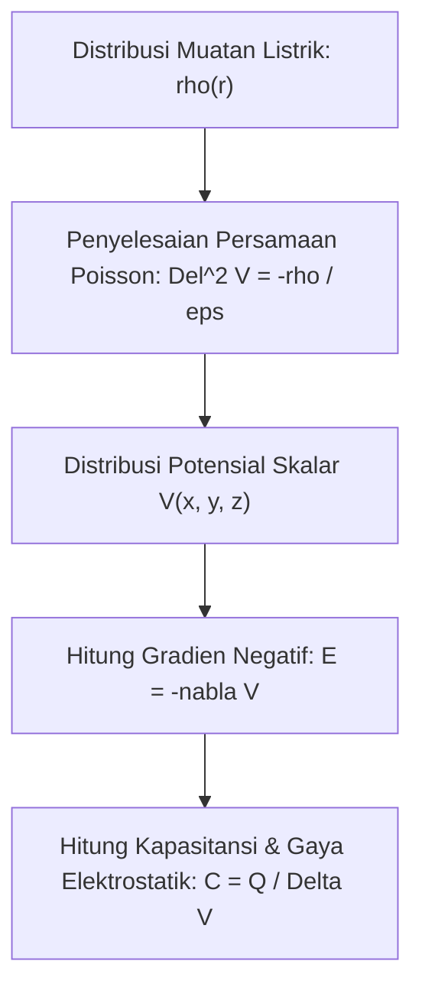

# Modul 030: Elektrostatika & Medan Listrik (Hukum Coulomb, Medan E, Hukum Gauss, Kapasitansi)

**Navigasi**: [⬅️ Master Index](../../INDEX.md) | [Tingkat 2: Tingkat 2: Fisika Klasik, Elektromagnetisme & Kimia Semikonduktor](./README.md)
*Sebelumnya*: [029. termodinamika-perpindahan-panas](./029-termodinamika-perpindahan-panas.md) | *Berikutnya*: [031. elektrodinamika-medan-magnet](./031-elektrodinamika-medan-magnet.md)

---

## 1. Intuisi Dasar Tanpa Jargon ("Seperti Bayi Baru Lahir")
Pernahkah Anda menggosokkan balon karet ke rambut Anda di hari yang kering, lalu menempelkan balon tersebut ke dinding dan ia menempel kuat tanpa lem sama sekali? Atau pernahkah Anda tersengat sedikit listrik statis saat menyentuh gagang pintu logam setelah berjalan di atas karpet wol?

Ini adalah **Elektrostatika**: sains tentang muatan listrik yang diam.
Di alam semesta ini, ada dua jenis muatan: positif ($+$) dan negatif ($-$). Muatan sejenis tolak-menolak, muatan berlawanan tarik-menarik. Gaya tarik elektrostatik antar atom inilah yang sesungguhnya membuat meja Anda terasa padat: ketika Anda memukul meja, elektron di jari Anda ditolak keras oleh elektron di meja, mencegah tangan Anda menembus meja!
[📚 Pelajari: MIT OCW 8.02 Electricity and Magnetism](https://ocw.mit.edu/courses/8-02-physics-ii-electricity-and-magnetism-spring-2019/)

## 2. Fondasi Teoretis & Aksiomatik / Matematis
### 30.1 Hukum Coulomb & Medan Listrik Vektorial ([HyperPhysics Electrostatics](http://hyperphysics.phy-astr.gsu.edu/hbase/electric/elefield.html))
Gaya elektrostatik antara dua muatan titik $q_1$ dan $q_2$ yang terpisah sejauh $r$:
$$\mathbf{F} = \frac{1}{4\pi \varepsilon_0} \frac{q_1 q_2}{r^2} \hat{\mathbf{r}}$$
Di mana permitivitas ruang hampa $\varepsilon_0 = 8.854 \times 10^{-12} \text{ F/m}$.
Medan Listrik $\mathbf{E}$ didefinisikan sebagai gaya per satuan muatan uji positif $q_0$:
$$\mathbf{E} = \lim_{q_0 \to 0} \frac{\mathbf{F}}{q_0} = \frac{1}{4\pi \varepsilon_0} \frac{q}{r^2} \hat{\mathbf{r}}$$

### 30.2 Hukum Gauss (Bentuk Integral & Diferensial) ([MIT 8.02](https://ocw.mit.edu/courses/8-02-physics-ii-electricity-and-magnetism-spring-2019/))
Fluks listrik total yang menembus sembarang permukaan tertutup Gauss $\mathcal{S}$ sebanding dengan muatan bersih yang dilingkupinya:
$$\Phi_E = \oint_{\mathcal{S}} \mathbf{E} \cdot d\mathbf{A} = \frac{Q_{\text{enclosed}}}{\varepsilon_0}$$
Berdasarkan Teorema Divergensi Gauss, bentuk diferensial lokal (Persamaan Maxwell I):
$$\nabla \cdot \mathbf{E} = \frac{\rho}{\varepsilon_0}$$
Di mana $\rho$ adalah densitas muatan volume ($\text{C/m}^3$).

### 30.3 Potensial Elektrostatik & Persamaan Poisson ([Griffiths Electrodynamics](https://www.cambridge.org/))
Karena medan elektrostatik konservatif ($\nabla \times \mathbf{E} = \mathbf{0}$), ia dapat dinyatakan sebagai gradien potensial skalar $V$:
$$\mathbf{E} = -\nabla V$$
Substitusi ke Hukum Gauss diferensial menghasilkan **Persamaan Poisson**:
$$\nabla^2 V = -\frac{\rho}{\varepsilon_0}$$
Jika di dalam ruang tidak ada muatan bebas ($\rho = 0$), persamaan mereduksi menjadi **Persamaan Laplace**:
$$\nabla^2 V = \frac{\partial^2 V}{\partial x^2} + \frac{\partial^2 V}{\partial y^2} + \frac{\partial^2 V}{\partial z^2} = 0$$

Kapasitansi dua konduktor yang menyimpan muatan $Q$ dengan beda potensial $V$:
$$C = \frac{Q}{V}, \quad C_{\text{pelat sejajar}} = \varepsilon_r \varepsilon_0 \frac{A}{d}$$
Energi yang tersimpan di dalam medan listrik kapasitor:
$$U_E = \frac{1}{2} C V^2 = \frac{1}{2} \int \varepsilon |\mathbf{E}|^2 dV$$

## 3. Anatomi Teknis & Cara Kerja Internal

Mekanisme Sangkar Faraday (*Faraday Cage*):
Di dalam konduktor statis sempurna, elektron bebas berpindah seketika hingga menetralkan medan listrik internal, sehingga $\mathbf{E}_{	ext{internal}} = \mathbf{0}$ dan muatan listrik hanya berkumpul di permukaan luar konduktor.

## 4. Implementasi Praktis & Kode / Simulasi Riil
import numpy as np

def solve_laplace_2d_electrostatics(grid_size=50, max_iter=2000, tol=1e-5):
    """
    Menyelesaikan Persamaan Laplace Del^2 V = 0 pada bidang 2D menggunakan metode relaksasi Jacobi.
    Kondisi Batas: Pelat atas V = 100 V, pelat bawah V = 0 V, dinding samping V = 0 V.
    """
    V = np.zeros((grid_size, grid_size))
    # Boundary Conditions
    V[0, :] = 100.0 # Pelat atas
    V[-1, :] = 0.0  # Pelat bawah
    V[:, 0] = 0.0   # Sisi kiri
    V[:, -1] = 0.0  # Sisi kanan
    
    for iteration in range(max_iter):
        V_old = V.copy()
        # Pembaruan 5-point finite difference stencil
        V[1:-1, 1:-1] = 0.25 * (V_old[:-2, 1:-1] + V_old[2:, 1:-1] + 
                                V_old[1:-1, :-2] + V_old[1:-1, 2:])
        diff = np.max(np.abs(V - V_old))
        if diff < tol:
            break
            
    # Hitung Medan Listrik E = -grad(V)
    Ey, Ex = np.gradient(-V)
    return V, Ex, Ey, iteration

V_pot, Ex, Ey, iters = solve_laplace_2d_electrostatics()
print(f"Potensial di Pusat Grid: {V_pot[25, 25]:.2f} Volt")
print(f"Besar Medan Listrik E Pusat: {np.hypot(Ex[25, 25], Ey[25, 25]):.2f} V/m")
print(f"Konvergen Dalam: {iters} iterasi.")

## 5. Miskonsepsi & Jebakan Industri
1. **Electrostatic Discharge (ESD) Danger to MOSFETs**: Mengabaikan perlindungan ESD saat memegang chip CMOS. Tubuh manusia dapat menyimpan muatan statis $10.000\text{ V}$ yang cukup tipis untuk menembus dan menghancurkan lapisan oksida gerbang silikon setebal nanometer seketika.
2. **Confusing Electric Potential with Electric Field**: Mengira bahwa di titik di mana potensial $V = 0$, medan listrik $\mathbf{E}$ juga pasti nol (padahal medan adalah turunan potensial; jika $V$ berubah curam melintasi titik nol, medannya justru sangat kuat).
3. **Capacitor Dielectric Breakdown**: Melebihi batas kekuatan dielektrik material (misal udara $\approx 3\text{ MV/m}$), menyebabkan udara terionisasi menjadi busur plasma petir mini (*dielectric arcing*).

## 6. Proyek Latihan & Rubrik Penilaian Mandiri
### Tingkat 1 (Pemula) - Garis Gaya Listrik Sistem Dipol
Tulis skrip Python yang menghitung vektor medan listrik $\mathbf{E}(x, y)$ yang dihasilkan oleh dua muatan berlawanan tanda $+q$ dan $-q$ yang terpisah sejauh $2d$. Plot garis medan listrik dan kontur ekuipotensial menggunakan Matplotlib streamplot.

### Tingkat 2 (Menengah) - Perhitungan Kapasitansi Jalur Microstrip PCB
Gunakan rumus aproksimasi analitik Wheeler dan konformal IPC-2141 untuk menghitung kapasitansi parasitik per satuan panjang ($C_0$) dan impedansi karakteristik ($Z_0$) dari jalur trace microstrip PCB FR-4 dengan lebar jalur $W$, tinggi dielektrik $H$, dan konstanta dielektrik relatif $arepsilon_r = 4.4$.

### Tingkat 3 (Mahir) - Pemecah Persamaan Poisson 2D Metode Elemen Hingga (FEM)
Implementasikan pemecah persamaan Poisson elektrostatika 2D menggunakan metode elemen hingga (*Finite Element Method* / FEM) dengan mesh segitiga linier. Hitung distribusi muatan induksi pada pelat tanah di bawah konduktor bertegangan tinggi.

#### Rubrik Penilaian
- **40% Ketepatan Teori Hukum Gauss & Poisson**: Penurunan matematis dari hukum Coulomb ke persamaan diferensial medan akurat.
- **30% Konvergensi Solusi Numerik**: Implementasi relaksasi Jacobi/Gauss-Seidel atau FEM konvergen stabil.
- **30% Validitas Kondisi Batas**: Penanganan konduktor ekuipotensial Dirichlet dan batas simetri Neumann konsisten.

## 7. Rekomendasi Sumber Belajar Standar Emas
| Kategori | Judul Sumber & Tautan Langsung | Deskripsi Singkat |
|---|---|---|
| 📖 Buku Teks | [Introduction to Electrodynamics (David J. Griffiths)](https://www.cambridge.org/) | Kitab rujukan standar emas elektromagnetika universitas di seluruh dunia. |
| 🎓 Kuliah Terbuka | [MIT OCW 8.02 Physics II: Electricity and Magnetism](https://ocw.mit.edu/courses/8-02-physics-ii-electricity-and-magnetism-spring-2019/) | Kuliah video komprehensif hukum Gauss, potensial listrik, dan kapasitor. |
| 🔬 Makalah Seminal | [Sur l'Électricité et le Magnétisme (Charles-Augustin de Coulomb, 1785)](https://gallica.bnf.fr/) | Eksperimen neraca torsi yang menemukan hukum kuadrat terbalik gaya elektrostatik. |
| 💻 Lab Interaktif | [Falstad 2D Electrostatic Field Simulator](https://www.falstad.com/emstatic/) | Simulator visual interaktif muatan elektrostatika, potensial, dan medan listrik. |

---
*Navigasi Cepat*: [Ke Tingkat 2](./README.md) | [Ke Master Index](../../INDEX.md) | *Sebelumnya*: [029. termodinamika-perpindahan-panas](./029-termodinamika-perpindahan-panas.md) | *Berikutnya*: [031. elektrodinamika-medan-magnet](./031-elektrodinamika-medan-magnet.md)
