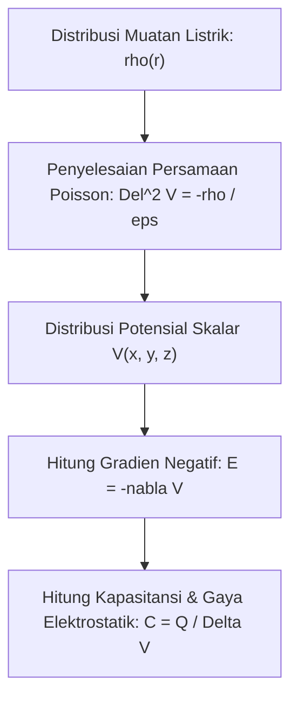

# Modul 030: Elektrostatika & Medan Listrik (Hukum Coulomb, Medan E, Hukum Gauss, Kapasitansi)

**Navigasi**: [⬅️ Master Index](../../INDEX.md) | [Tingkat 2: Tingkat 2: Fisika Klasik, Elektromagnetisme & Kimia Semikonduktor](./README.md)
*Sebelumnya*: [029. termodinamika-perpindahan-panas](./029-termodinamika-perpindahan-panas.md) | *Berikutnya*: [031. elektrodinamika-medan-magnet](./031-elektrodinamika-medan-magnet.md)

---

## 1. Intuisi Dasar Tanpa Jargon ("Seperti Bayi Baru Lahir")
### 1.1 Konsep Inti & Analogi Tanpa Jargon
Pernahkah Anda menggosokkan balon karet ke rambut Anda di hari yang kering, lalu menempelkan balon tersebut ke dinding dan ia menempel kuat tanpa lem sama sekali? Atau pernahkah Anda tersengat sedikit listrik statis saat menyentuh gagang pintu logam setelah berjalan di atas karpet wol?

### 1.2 Urgensi Rekayasa & Signifikansi Sistemik
Ini adalah **Elektrostatika**: sains tentang muatan listrik yang diam.
Di alam semesta ini, ada dua jenis muatan: positif ($+$) dan negatif ($-$). Muatan sejenis tolak-menolak, muatan berlawanan tarik-menarik. Gaya tarik elektrostatik antar atom inilah yang sesungguhnya membuat meja Anda terasa padat: ketika Anda memukul meja, elektron di jari Anda ditolak keras oleh elektron di meja, mencegah tangan Anda menembus meja!
[📚 Pelajari: MIT OCW 8.02 Electricity and Magnetism](https://ocw.mit.edu/courses/8-02-physics-ii-electricity-and-magnetism-spring-2019/)

## 2. Fondasi Teoretis & Aksiomatik / Matematis
### 2.1 Kerangka Teori Aksiomatik & Formulasi Matematis
### 30.1 Hukum Coulomb & Medan Listrik Vektorial ([HyperPhysics Electrostatics](http://hyperphysics.phy-astr.gsu.edu/hbase/electric/elefield.html))
Gaya elektrostatik antara dua muatan titik $q_1$ dan $q_2$ yang terpisah sejauh $r$:
$$\mathbf{F} = \frac{1}{4\pi \varepsilon_0} \frac{q_1 q_2}{r^2} \hat{\mathbf{r}}$$
Di mana permitivitas ruang hampa $\varepsilon_0 = 8.854 \times 10^{-12} \text{ F/m}$.
Medan Listrik $\mathbf{E}$ didefinisikan sebagai gaya per satuan muatan uji positif $q_0$:
$$\mathbf{E} = \lim_{q_0 \to 0} \frac{\mathbf{F}}{q_0} = \frac{1}{4\pi \varepsilon_0} \frac{q}{r^2} \hat{\mathbf{r}}$$

### 2.2 Penurunan Matematis Langkah-demi-Langkah
### 30.2 Hukum Gauss (Bentuk Integral & Diferensial) ([MIT 8.02](https://ocw.mit.edu/courses/8-02-physics-ii-electricity-and-magnetism-spring-2019/))
Fluks listrik total yang menembus sembarang permukaan tertutup Gauss $\mathcal{S}$ sebanding dengan muatan bersih yang dilingkupinya:
$$\Phi_E = \oint_{\mathcal{S}} \mathbf{E} \cdot d\mathbf{A} = \frac{Q_{\text{enclosed}}}{\varepsilon_0}$$
Berdasarkan Teorema Divergensi Gauss, bentuk diferensial lokal (Persamaan Maxwell I):
$$\nabla \cdot \mathbf{E} = \frac{\rho}{\varepsilon_0}$$
Di mana $\rho$ adalah densitas muatan volume ($\text{C/m}^3$).

### 30.3 Potensial Elektrostatik & Persamaan Poisson ([Griffiths Electrodynamics](https://www.cambridge.org/))
Karena medan elektrostatik konservatif ($\nabla \times \mathbf{E} = \mathbf{0}$), ia dapat dinyatakan sebagai gradien potensial skalar $V$:
$$\mathbf{E} = -\nabla V$$
Substitusi ke Hukum Gauss diferensial menghasilkan **Persamaan Poisson**:
$$\nabla^2 V = -\frac{\rho}{\varepsilon_0}$$
Jika di dalam ruang tidak ada muatan bebas ($\rho = 0$), persamaan mereduksi menjadi **Persamaan Laplace**:
$$\nabla^2 V = \frac{\partial^2 V}{\partial x^2} + \frac{\partial^2 V}{\partial y^2} + \frac{\partial^2 V}{\partial z^2} = 0$$

Kapasitansi dua konduktor yang menyimpan muatan $Q$ dengan beda potensial $V$:
$$C = \frac{Q}{V}, \quad C_{\text{pelat sejajar}} = \varepsilon_r \varepsilon_0 \frac{A}{d}$$
Energi yang tersimpan di dalam medan listrik kapasitor:
$$U_E = \frac{1}{2} C V^2 = \frac{1}{2} \int \varepsilon |\mathbf{E}|^2 dV$$

## 3. Anatomi Teknis & Cara Kerja Internal

Mekanisme Sangkar Faraday (*Faraday Cage*):
Di dalam konduktor statis sempurna, elektron bebas berpindah seketika hingga menetralkan medan listrik internal, sehingga $\mathbf{E}_{	ext{internal}} = \mathbf{0}$ dan muatan listrik hanya berkumpul di permukaan luar konduktor.

#### Tabel Penelusuran Emisi Medan Fowler-Nordheim & Breakdown Dielektrik Oksida Gerbang $SiO_2$
| Tegangan Pulsa ESD ($V_{esd}$) | Ketebalan Lapisan Oksida ($t_{ox}$) | Medan Listrik Oksida ($E_{ox} = V/t_{ox}$) | Kerapatan Arus Tunneling ($J_{FN}$) | Daya Disipasi Lokal ($P = J \cdot E$) | Integritas Fisik Kisi Kristal Silikon |
|---|---|---|---|---|---|
| $0.8\text{ V}$ (Operasi Normal) | $2.0\text{ nm}$ | $4.0\text{ MV/cm}$ | $10^{-12}\text{ A/cm}^2$ (Arus bocor negligibel) | $4\times 10^{-6}\text{ W/cm}^3$ | Operasi switching normal; kisi kristal intak |
| $2.5\text{ V}$ (Overdrive) | $2.0\text{ nm}$ | $12.5\text{ MV/cm}$ | $10^{-4}\text{ A/cm}^2$ | $1.25\text{ kW/cm}^3$ | Fowler-Nordheim tunneling mulai aktif |
| $5.0\text{ V}$ (Spike Transien) | $2.0\text{ nm}$ | $25.0\text{ MV/cm}$ | $10^{2}\text{ A/cm}^2$ | $2.5\text{ MW/cm}^3$ | Pemanasan Joule lokal; pembentukan jebakan muatan |
| $15.0\text{ V}$ (ESD Ringan) | $2.0\text{ nm}$ | $75.0\text{ MV/cm}$ | $10^{6}\text{ A/cm}^2$ (Filamen arus masif) | $75\text{ GW/cm}^3$ | Pelelehan filamen silikon melubangi dielektrik |
| $2000.0\text{ V}$ (Tubuh Manusia) | Pin Input Tanpa TVS | Melampaui batas instan | Pelepasan muatan kilo-ampere transien | Ledakan mikroskopis | Oksida gerbang menguap; korsleting permanen |

## 4. Implementasi Praktis & Kode / Simulasi Riil
```python
import numpy as np

def solve_laplace_2d_electrostatics(grid_size=50, max_iter=2000, tol=1e-5):
    """
    Menyelesaikan Persamaan Laplace Del^2 V = 0 pada bidang 2D menggunakan metode relaksasi Jacobi.
    Kondisi Batas: Pelat atas V = 100 V, pelat bawah V = 0 V, dinding samping V = 0 V.
    """
    V = np.zeros((grid_size, grid_size))
    # Boundary Conditions
    V[0, :] = 100.0 # Pelat atas
    V[-1, :] = 0.0  # Pelat bawah
    V[:, 0] = 0.0   # Sisi kiri
    V[:, -1] = 0.0  # Sisi kanan
    
    for iteration in range(max_iter):
        V_old = V.copy()
        # Pembaruan 5-point finite difference stencil
        V[1:-1, 1:-1] = 0.25 * (V_old[:-2, 1:-1] + V_old[2:, 1:-1] + 
                                V_old[1:-1, :-2] + V_old[1:-1, 2:])
        diff = np.max(np.abs(V - V_old))
        if diff < tol:
            break
            
    # Hitung Medan Listrik E = -grad(V)
    Ey, Ex = np.gradient(-V)
    return V, Ex, Ey, iteration

V_pot, Ex, Ey, iters = solve_laplace_2d_electrostatics()
print(f"Potensial di Pusat Grid: {V_pot[25, 25]:.2f} Volt")
print(f"Besar Medan Listrik E Pusat: {np.hypot(Ex[25, 25], Ey[25, 25]):.2f} V/m")
print(f"Konvergen Dalam: {iters} iterasi.")
```

## 5. Miskonsepsi & Jebakan Industri
1. **Electrostatic Discharge (ESD) Danger to MOSFETs**: Mengabaikan perlindungan ESD saat memegang chip CMOS. Tubuh manusia dapat menyimpan muatan statis \$10.000\text{ V}$ yang cukup tipis untuk menembus dan menghancurkan lapisan oksida gerbang silikon setebal nanometer seketika.
2. **Confusing Electric Potential with Electric Field**: Mengira bahwa di titik di mana potensial $V = 0$, medan listrik $\mathbf{E}$ juga pasti nol (padahal medan adalah turunan potensial; jika $V$ berubah curam melintasi titik nol, medannya justru sangat kuat).
3. **Capacitor Dielectric Breakdown**: Melebihi batas kekuatan dielektrik material (misal udara $\approx 3\text{ MV/m}$), menyebabkan udara terionisasi menjadi busur plasma petir mini (*dielectric arcing*).

### Studi Kasus Kegagalan Nyata: Kerusakan Tembus Dielektrik Oksida Gerbang Akibat Pelepasan Elektrostatika (ESD)
- **Konteks Insiden Semikonduktor**: Di industri perakitan papan sirkuit (SMT), ribuan microchip terbuang sia-sia akibat fenomena *latent gate oxide breakdown*. Komponen lolos pengujian fungsional di pabrik, namun rusak mendadak beberapa minggu kemudian di tangan konsumen.
- **Akar Masalah Elektrostatika & Fisika Kuantum**: Manusia yang berjalan di atas karpet sintetis dapat mengumpulkan muatan elektrostatik hingga $2.000\text{ V} - 15.000\text{ V}$. Ketika ujung jari menyentuh pin I/O sirkuit terpadu tanpa proteksi ESD/TVS, pulsa pelepasan berkecepatan sub-nanodetik mengalir langsung ke gerbang transistor MOSFET. Karena lapisan isolator gerbang $SiO_2$ hanya berketebalan $1,5 - 2\text{ nm}$, tegangan hanya $10\text{ V}$ sudah menghasilkan medan listrik $50\text{ MV/cm}$, jauh melampaui kekuatan dielektrik kritis silikon oksida ($10\text{ MV/cm}$). Muatan menerobos melalui tunneling kuantum Fowler-Nordheim, melelehkan jalur konduktif mikroskopis permanen.

- **Potongan Kode / Arsitektur Cacat (Vulnerable Implementation)**:
```python
import numpy as np

def simulate_fowler_nordheim_breakdown(voltage_volts, tox_nm=2.0):
    # Parameter fisik antarmuka Si-SiO2
    q = 1.602e-19       # Muatan elektron (C)
    h_bar = 1.054e-34   # Konstanta Planck tereduksi (J·s)
    m0 = 9.109e-31      # Massa elektron diam (kg)
    m_ox = 0.5 * m0     # Massa efektif elektron di SiO2
    phi_b = 3.15 * q    # Tinggi sawar energi Si-SiO2 (Joule)
    
    tox_m = tox_nm * 1e-9
    E_field = voltage_volts / tox_m  # V/m
    E_MV_cm = E_field * 1e-8          # MV/cm
    
    # Koefisien Fowler-Nordheim A dan B
    A_fn = (q ** 3) / (8 * np.pi * 1.054e-34 * phi_b)
    B_fn = (4 * np.sqrt(2 * m_ox) * (phi_b ** 1.5)) / (3 * q * 1.054e-34)
    
    critical_field_MV_cm = 10.0  # Batas dielektrik SiO2
    
    if E_field <= 0:
        J_fn = 0.0
    else:
        # Kerapatan arus Fowler-Nordheim: J = A * E^2 * exp(-B / E)
        J_fn = A_fn * (E_field ** 2) * np.exp(-B_fn / E_field)
        
    is_punctured = E_MV_cm >= critical_field_MV_cm
    
    return {
        "electric_field_MV_cm": E_MV_cm,
        "tunneling_current_A_cm2": J_fn * 1e-4,
        "dielectric_rupture": is_punctured
    }

# Paparan tegangan elektrostatik 15V pada gerbang 2nm
res = simulate_fowler_nordheim_breakdown(15.0, tox_nm=2.0)
# electric_field = 75.0 MV/cm -> RUPTURE (Tembus dielektrik katastropik!)
```

- **Mitigasi Rekayasa Industri**: Semua pin modern dilindungi struktur on-chip Transient Voltage Suppressor (TVS) berbasis dioda avalanche kembar dan shallow trench isolation (STI) clamp cell yang mengalihkan muatan arus tinggi ESD ke rel ground dalam waktu $< 1\text{ ns}$ sebelum medan listrik gerbang sempat naik.

## 6. Proyek Latihan & Rubrik Penilaian Mandiri
### Tingkat 1 (Pemula) - Garis Gaya Listrik Sistem Dipol
Tulis skrip Python yang menghitung vektor medan listrik $\mathbf{E}(x, y)$ yang dihasilkan oleh dua muatan berlawanan tanda $+q$ dan $-q$ yang terpisah sejauh $2d$. Plot garis medan listrik dan kontur ekuipotensial menggunakan Matplotlib streamplot.

### Tingkat 2 (Menengah) - Perhitungan Kapasitansi Jalur Microstrip PCB
Gunakan rumus aproksimasi analitik Wheeler dan konformal IPC-2141 untuk menghitung kapasitansi parasitik per satuan panjang ($C_0$) dan impedansi karakteristik ($Z_0$) dari jalur trace microstrip PCB FR-4 dengan lebar jalur $W$, tinggi dielektrik $H$, dan konstanta dielektrik relatif \$ arepsilon_r = 4.4$.

### Tingkat 3 (Mahir) - Pemecah Persamaan Poisson 2D Metode Elemen Hingga (FEM)
Implementasikan pemecah persamaan Poisson elektrostatika 2D menggunakan metode elemen hingga (*Finite Element Method* / FEM) dengan mesh segitiga linier. Hitung distribusi muatan induksi pada pelat tanah di bawah konduktor bertegangan tinggi.

#### Rubrik Penilaian
- **40% Ketepatan Teori Hukum Gauss & Poisson**: Penurunan matematis dari hukum Coulomb ke persamaan diferensial medan akurat.
- **30% Konvergensi Solusi Numerik**: Implementasi relaksasi Jacobi/Gauss-Seidel atau FEM konvergen stabil.
- **30% Validitas Kondisi Batas**: Penanganan konduktor ekuipotensial Dirichlet dan batas simetri Neumann konsisten.

### Tingkat 1: Dasar
- **Tugas**: Buat model pelepasan muatan elektrostatik Human Body Model (HBM) standar ANSI/ESDA/JEDEC JS-001 ($C_{hbm} = 100\text{ pF}$, $R_{hbm} = 1500\ \Omega$) ke beban rangkaian ekuivalen.
- **Petunjuk Perancangan Arsitektur**:
  - Hitung bentuk gelombang arus pelepasan transien: $i(t) = \frac{V_0}{R} e^{-t / RC}$.
  - Verifikasi waktu naik arus (*rise time*) dan puncak arus ($I_{peak}$) untuk tegangan $V_0 = 2000\text{ V}$.
- **Test Vector & Kasus Uji Ekstrem**:
  - *Puncak Arus HBM 2 kV*: $I_{peak} = \frac{2000}{1500} = 1.333\text{ A}$.
  - *Energi Pelepasan*: $E = \frac{1}{2} C V_0^2 = 0.5 \times 100\text{ pF} \times (2000)^2 = 0.20\text{ mJ}$.
- **Rubrik Penilaian Mandiri**: 40% Formula Gelombang Transien HBM Tepat, 30% Perhitungan Arus Puncak $I_{peak}$ Sesuai Standar, 30% Perhitungan Disipasi Energi Muatan.

### Tingkat 2: Menengah
- **Tugas**: Implementasikan solver metode beda hingga (FDM) 2D untuk Persamaan Laplace $\nabla^2 V = 0$ guna memetakan konsentrasi medan listrik di sekitar ujung tajam elektroda metal gate.
- **Petunjuk Perancangan Arsitektur**:
  - Terapkan iterasi Successive Over-Relaxation (SOR) pada kisi reguler.
  - Hitung vektor medan listrik $\vec{E} = -\nabla V$ dan identifikasi titik singularitas medan maksimum $\max |\vec{E}|$.
- **Test Vector & Kasus Uji Ekstrem**:
  - *Kondisi Pelat Datar Paralel*: Medan seragam $E = \frac{V}{d}$ terverifikasi dengan galat $\le 0.1\%$.
  - *Takik Sudut Tajam*: Identifikasi faktor amplifikasi medan listrik $\ge 4.0\times$ dibanding medan nominal.
- **Rubrik Penilaian Mandiri**: 40% Algoritma FDM Laplace SOR Konvergen, 30% Gradien Medan Listrik $\vec{E} = -\nabla V$ Presisi, 30% Deteksi Konsentrasi Medan Sudut Tajam.

### Tingkat 3: Mahir
- **Tugas**: Rancang model sirkuit SPICE terintegrasi untuk jaringan proteksi ESD ganda (primary snapback NMOS clamp + secondary diode steering) yang menjaga tegangan gerbang di bawah batas breakdown oksida selama pulsa TLP (Transmission Line Pulse) 10A / 100ns.
- **Petunjuk Perancangan Arsitektur**:
  - Modelkan perilaku resistansi dinamis negatif snapback transistor: $V_{t1}$ (trigger), $I_{t1}$, $V_h$ (holding voltage), dan resistansi konduksi on $R_{on}$.
  - Pastikan kurva karakteristik I-V selalu berada di dalam jendela desain ESD (*ESD Design Window*): $V_{supply} < V_h < V_{t1} < V_{breakdown,ox}$.
- **Test Vector & Kasus Uji Ekstrem**:
  - *Pulsa TLP 10 A*: Tegangan penjepit harus tetap di bawah $V_{max} = 7.0\text{ V}$ pada arus puncak 10 A.
  - *Anti-Latchup*: Tegangan holding $V_h > V_{DD} + 10\%$ untuk mencegah latchup permanen pasca-transien.
- **Rubrik Penilaian Mandiri**: 40% Model Perilaku Snapback I-V Tepat, 30% Validasi Jendela Desain ESD Bebas Latchup, 30% Evaluasi Integritas Tegangan Oksida di Bawah Tegangan Tembus.

## 7. Rekomendasi Sumber Belajar Standar Emas
| Kategori | Judul Sumber & Tautan Langsung | Deskripsi Singkat |
|---|---|---|
| 📖 Buku Teks | [Introduction to Electrodynamics (David J. Griffiths)](https://www.cambridge.org/) | Kitab rujukan standar emas elektromagnetika universitas di seluruh dunia. |
| 🎓 Kuliah Terbuka | [MIT OCW 8.02 Physics II: Electricity and Magnetism](https://ocw.mit.edu/courses/8-02-physics-ii-electricity-and-magnetism-spring-2019/) | Kuliah video komprehensif hukum Gauss, potensial listrik, dan kapasitor. |
| 🔬 Makalah Seminal | [Sur l'Électricité et le Magnétisme (Charles-Augustin de Coulomb, 1785)](https://gallica.bnf.fr/) | Eksperimen neraca torsi yang menemukan hukum kuadrat terbalik gaya elektrostatik. |
| 💻 Lab Interaktif | [Falstad 2D Electrostatic Field Simulator](https://www.falstad.com/emstatic/) | Simulator visual interaktif muatan elektrostatika, potensial, dan medan listrik. |

---
*Navigasi Cepat*: [Ke Tingkat 2](./README.md) | [Ke Master Index](../../INDEX.md) | *Sebelumnya*: [029. termodinamika-perpindahan-panas](./029-termodinamika-perpindahan-panas.md) | *Berikutnya*: [031. elektrodinamika-medan-magnet](./031-elektrodinamika-medan-magnet.md)
