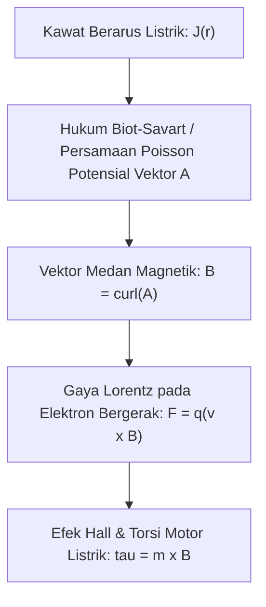

# Modul 031: Elektrodinamika & Medan Magnet (Densitas Arus, Hukum Biot-Savart, Hukum Ampere, Gaya Lorentz)

**Navigasi**: [⬅️ Master Index](../../INDEX.md) | [Tingkat 2: Tingkat 2: Fisika Klasik, Elektromagnetisme & Kimia Semikonduktor](./README.md)
*Sebelumnya*: [030. elektrostatika-medan-listrik](./030-elektrostatika-medan-listrik.md) | *Berikutnya*: [032. induksi-elektromagnetik-persamaan-maxwell](./032-induksi-elektromagnetik-persamaan-maxwell.md)

---

## 1. Intuisi Dasar Tanpa Jargon ("Seperti Bayi Baru Lahir")
Pernahkah Anda bertanya mengapa jarum kompas Anda selalu menunjuk ke arah kutub utara bumi? Atau bagaimana dinamo sepeda kecil bisa menyalakan lampu terang benderang hanya dari putaran roda tanpa baterai apa pun?

Ketika muatan listrik diam, ia hanya menghasilkan medan listrik elektrostatik. Namun, saat muatan listrik tersebut **mulai bergerak (mengalir sebagai arus listrik)**, sebuah keajaiban alam semesta terjadi: ia memunculkan medan misterius baru yang disebut **Medan Magnet**!
Magnet bukanlah fenomena yang terpisah dari listrik: magnetisme adalah konsekuensi langsung dari teori relativitas khusus Einstein ketika arus elektron bergerak melalui kawat.
[📚 Pelajari: MIT OCW 8.02 Magnetic Fields](https://ocw.mit.edu/courses/8-02-physics-ii-electricity-and-magnetism-spring-2019/)

## 2. Fondasi Teoretis & Aksiomatik / Matematis
### 31.1 Gaya Lorentz & Gerak Partikel Bermuatan ([Griffiths Electrodynamics](https://www.cambridge.org/))
Gaya elektromagnetik total yang bekerja pada muatan $q$ yang bergerak dengan kecepatan $\mathbf{v}$ di dalam medan listrik $\mathbf{E}$ dan medan magnet $\mathbf{B}$:
$$\mathbf{F} = q(\mathbf{E} + \mathbf{v} \times \mathbf{B})$$
Ciri mendasar gaya magnet:
- Gaya selalu tegak lurus terhadap vektor kecepatan ($\mathbf{F}_B \perp \mathbf{v}$).
- Medan magnet tidak pernah melakukan usaha mekanis pada partikel bermuatan ($W = \int \mathbf{F}_B \cdot d\mathbf{r} = 0$), ia hanya membelokkan arah lintasan tanpa mengubah laju kinetik partikel.
- Jari-jari siklotron partikel: $r = \frac{mv}{qB}$, frekuensi siklotron: $\omega_c = \frac{qB}{m}$.

### 31.2 Hukum Biot-Savart & Hukum Ampère ([HyperPhysics Magnetism](http://hyperphysics.phy-astr.gsu.edu/hbase/magnetic/magfld.html))
- **Hukum Biot-Savart**: Medan magnetik infinitesimal $d\mathbf{B}$ yang dihasilkan oleh elemen arus $I d\boldsymbol{\ell}$:
  $$d\mathbf{B} = \frac{\mu_0}{4\pi} \frac{I d\boldsymbol{\ell} \times \hat{\mathbf{r}}}{r^2}$$
  Di mana permeabilitas ruang hampa $\mu_0 = 4\pi \times 10^{-7} \text{ T}\cdot\text{m/A}$.
- **Hukum Ampère (Bentuk Integral)**:
  $$\oint_{\mathcal{C}} \mathbf{B} \cdot d\boldsymbol{\ell} = \mu_0 I_{\text{enclosed}}$$
  Medan magnet di sekitar kawat lurus panjang berarus: $B = \frac{\mu_0 I}{2\pi r}$.
  Medan magnet di dalam solenoida ideal: $B = \mu_0 n I$.

### 31.3 Hukum Gauss untuk Magnetisme & Vektor Potensial Magnetik $\mathbf{A}$ ([MIT 8.02](https://ocw.mit.edu/courses/8-02-physics-ii-electricity-and-magnetism-spring-2019/))
Tidak adanya monopol magnetik (Persamaan Maxwell II):
$$\nabla \cdot \mathbf{B} = 0 \iff \oint_{\mathcal{S}} \mathbf{B} \cdot d\mathbf{A} = 0$$
Karena divergensi curl identik nol ($\nabla \cdot (\nabla \times \mathbf{A}) \equiv 0$), medan magnet $\mathbf{B}$ selalu dapat dinyatakan sebagai curl dari Vektor Potensial Magnetik $\mathbf{A}$:
$$\mathbf{B} = \nabla \times \mathbf{A}$$
Dalam Teraan Coulomb ($\nabla \cdot \mathbf{A} = 0$), persamaan magnetostatik menjadi:
$$\nabla^2 \mathbf{A} = -\mu_0 \mathbf{J}$$

## 3. Anatomi Teknis & Cara Kerja Internal

Mekanisme Mikroskopis Efek Hall:
Ketika arus $I$ mengalir melintasi pelat konduktor di bawah medan magnet tegak lurus $B_z$, gaya Lorentz membelokkan elektron ke satu sisi pelat, menciptakan beda tegangan transversal (*Hall Voltage* $V_H$) yang digunakan sebagai sensor arus non-invasif dan sensor posisi magnetik industri.

## 4. Implementasi Praktis & Kode / Simulasi Riil
import numpy as np

def calculate_solenoid_magnetic_field(turns: int, length_m: float, 
                                      current_a: float, radius_m: float) -> dict:
    """
    Menghitung medan magnet B di pusat solenoida dan induktansi ideal L.
    B = mu_0 * (N / L) * I
    L = mu_0 * (N^2 * A) / L
    """
    mu_0 = 4.0 * np.pi * 1e-7 # H/m
    n_density = turns / length_m
    area = np.pi * (radius_m**2)
    
    b_field = mu_0 * n_density * current_a
    inductance = mu_0 * (turns**2) * area / length_m
    energy_stored = 0.5 * inductance * (current_a**2)
    
    return {
        "b_field_tesla": b_field,
        "b_field_gauss": b_field * 10000.0,
        "inductance_henry": inductance,
        "stored_energy_joules": energy_stored
    }

res = calculate_solenoid_magnetic_field(turns=500, length_m=0.1, current_a=2.0, radius_m=0.015)
print(f"Medan Magnet Solenoida : {res['b_field_tesla']:.4f} Tesla ({res['b_field_gauss']:.1f} Gauss)")
print(f"Induktansi Diri (L)    : {res['inductance_henry']*1e3:.2f} mH")
print(f"Energi Magnetik (U_B)  : {res['stored_energy_joules']*1e3:.2f} mJ")

## 5. Miskonsepsi & Jebakan Industri
1. **Confusing Magnetic Field B with H**: Mengabaikan saturasi material inti magnetik ferit/besi. Medan $B = \mu_r \mu_0 H$ tidak linier selamanya; pada kerapatan fluks tertentu (misal $1.5\text{ T}$ pada baja silikon), material inti mengalami saturasi, menyebabkan induktansi anjlok dan arus transformator meledak (*overcurrent trip*).
2. **Assuming Magnetic Monopoles Exist**: Memotong magnet batang menjadi dua dengan harapan memisahkan kutub utara dan selatan; setiap potongan akan selalu menghasilkan kutub utara dan selatan baru ($
abla \cdot \mathbf{B} = 0$).
3. **Inductive Kickback Voltage**: Memutus arus koil relai/motor secara tiba-tiba tanpa dioda flyback proteksi ($V = -L rac{di}{dt}$), memicu lonjakan tegangan ratusan volt yang merusak transistor switching seketika.

## 6. Proyek Latihan & Rubrik Penilaian Mandiri
### Tingkat 1 (Pemula) - Lintasan Partikel Heliks di Dalam Spektrometer Massa
Tulis skrip Python untuk menghitung dan memplot lintasan 3D partikel bermuatan (proton dan elektron) yang ditembakkan ke dalam medan magnet seragam $\mathbf{B} = (0, 0, B_z)$ dengan kecepatan awal $\mathbf{v}_0 = (v_x, 0, v_z)$. Buktikan bentuk lintasan heliks dan hitung jari-jari siklotronnya.

### Tingkat 2 (Menengah) - Simulasi Sensor Efek Hall Industri
Bangun model matematis tegangan Hall ($V_H = rac{I B}{n q t}$) untuk semikonduktor silikon tipe-N dengan konsentrasi pembawa muatan $n = 10^{21} 	ext{ m}^{-3}$ dan ketebalan $t = 10 \, \mu	ext{m}$. Hitung sensitivitas tegangan per milliTesla dan rancang rangkaian penguat instrumentasinya.

### Tingkat 3 (Mahir) - Perhitungan Medan Magnet Spasial Kumparan Helmholtz via Biot-Savart
Implementasikan integrasi numerik Hukum Biot-Savart untuk menghitung distribusi vektor medan magnet $\mathbf{B}(x, y, z)$ dari sepasang kumparan Helmholtz berjarak $R$. Buktikan bahwa medan magnet di sepanjang sumbu di antara kedua kumparan memiliki homogenitas tinggi ($rac{\partial B}{\partial z} = 0$ dan $rac{\partial^2 B}{\partial z^2} = 0$).

#### Rubrik Penilaian
- **40% Ketepatan Teori Magnetostatik**: Formulasi perkalian silang gaya Lorentz dan Biot-Savart akurat.
- **30% Pemodelan Inti Feromagnetik**: Memahami histeresis magnetik ($B-H$ curve) dan saturasi inti induktor.
- **30% Validitas Integrasi Vektor**: Integrasi numerik segmen arus loop lingkaran mematuhi hukum simetri Ampere.

## 7. Rekomendasi Sumber Belajar Standar Emas
| Kategori | Judul Sumber & Tautan Langsung | Deskripsi Singkat |
|---|---|---|
| 📖 Buku Teks | [Classical Electrodynamics (John David Jackson)](https://www.wiley.com/) | Buku teks lanjutan paling otoritatif di dunia untuk teori medan elektromagnetik. |
| 🎓 Kuliah Terbuka | [MIT OCW 8.02 Physics II: Electricity & Magnetism](https://ocw.mit.edu/courses/8-02-physics-ii-electricity-and-magnetism-spring-2019/) | Kuliah video komprehensif gaya Lorentz, hukum Biot-Savart, dan hukum Ampere. |
| 🔬 Makalah Seminal | [On the Hall Effect in a Magnetic Field (Edwin H. Hall, 1879)](https://doi.org/10.2307/2369245) | Penemuan historis perbedaan potensial transversal pada konduktor berarus dalam medan magnet. |
| 💻 Lab Interaktif | [PhET Simulation: Magnet and Electromagnet](https://phet.colorado.edu/en/simulations/magnet-and-electromagnet) | Eksplorasi interaktif kompas, solenoida elektromagnetik, dan garis fluks magnet. |

---
*Navigasi Cepat*: [Ke Tingkat 2](./README.md) | [Ke Master Index](../../INDEX.md) | *Sebelumnya*: [030. elektrostatika-medan-listrik](./030-elektrostatika-medan-listrik.md) | *Berikutnya*: [032. induksi-elektromagnetik-persamaan-maxwell](./032-induksi-elektromagnetik-persamaan-maxwell.md)
