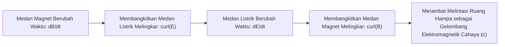

# Modul 032: Induksi Elektromagnetik & Persamaan Maxwell (Hukum Faraday-Lenz & 4 Persamaan Maxwell)

**Navigasi**: [⬅️ Master Index](../../INDEX.md) | [Tingkat 2: Tingkat 2: Fisika Klasik, Elektromagnetisme & Kimia Semikonduktor](./README.md)
*Sebelumnya*: [031. elektrodinamika-medan-magnet](./031-elektrodinamika-medan-magnet.md) | *Berikutnya*: [033. gelombang-elektromagnetik-optik-fotonika](./033-gelombang-elektromagnetik-optik-fotonika.md)

---

## 1. Intuisi Dasar Tanpa Jargon ("Seperti Bayi Baru Lahir")
### 1.1 Konsep Inti & Analogi Tanpa Jargon
Bayangkan Anda memegang sebuah cincin kawat tembaga biasa tanpa baterai sama sekali. Lalu Anda mendekatkan sebuah magnet batang ke arah cincin tersebut. Tiba-tiba jarum amperemeter menyentak: arus listrik mengalir di dalam kawat! Jika Anda diamkan magnet tersebut di dalam cincin, arus listrik mati. Saat Anda tarik magnet tersebut menjauh, arus kembali mengalir ke arah sebaliknya.

### 1.2 Urgensi Rekayasa & Signifikansi Sistemik
Ini adalah **Induksi Elektromagnetik**:
Bukan keberadaan medan magnet yang menciptakan listrik, melainkan **PERUBAHAN medan magnet seiring waktu**!
Dan penemuan puncak sains fisika abad ke-19 adalah **4 Persamaan Maxwell**: rumus yang menyatukan listrik, magnet, dan cahaya menjadi satu teori agung tunggal. Dari generator bendungan raksasa yang menyalakan kota, transformator listrik bertegangan tinggi, hingga sinyal Wi-Fi di ponsel Anda, semuanya bekerja atas dasar 4 persamaan ini.
[📚 Pelajari: MIT OCW 8.02 Faraday's Law & Maxwell's Equations](https://ocw.mit.edu/courses/8-02-physics-ii-electricity-and-magnetism-spring-2019/)

## 2. Fondasi Teoretis & Aksiomatik / Matematis
### 2.1 Kerangka Teori Aksiomatik & Formulasi Matematis
### 32.1 Hukum Induksi Faraday-Lenz ([HyperPhysics Faraday](http://hyperphysics.phy-astr.gsu.edu/hbase/electric/farlaw.html))
Gaya gerak listrik (GGL / EMF $\mathcal{E}$) yang diinduksikan dalam suatu loop tertutup sebanding dengan laju perubahan fluks magnetik $\Phi_B = \int \mathbf{B} \cdot d\mathbf{A}$:
$$\mathcal{E} = -\frac{d\Phi_B}{dt} = -\frac{d}{dt} \int_{\mathcal{S}} \mathbf{B} \cdot d\mathbf{A}$$
Tanda negatif (Hukum Lenz) menyatakan bahwa arus induksi selalu menghasilkan medan magnet yang melawan perubahan fluks yang menghasilkannya (konservasi energi).
Bentuk diferensial (Persamaan Maxwell III / Faraday):
$$\nabla \times \mathbf{E} = -\frac{\partial \mathbf{B}}{\partial t}$$

### 2.2 Penurunan Matematis Langkah-demi-Langkah
### 32.2 Arus Pergeseran Maxwell & 4 Persamaan Maxwell Lengkap ([MIT 8.02](https://ocw.mit.edu/courses/8-02-physics-ii-electricity-and-magnetism-spring-2019/))
James Clerk Maxwell menyadari bahwa Hukum Ampère murni ($\nabla \times \mathbf{B} = \mu_0 \mathbf{J}$) melanggar kekekalan muatan kontinuitas ($\nabla \cdot \mathbf{J} + \frac{\partial \rho}{\partial t} = 0$) pada kapasitor saat pengisian muatan.
Maxwell menambahkan suku **Arus Pergeseran** (*Displacement Current* $\mathbf{J}_D = \varepsilon_0 \frac{\partial \mathbf{E}}{\partial t}$):

**Empat Persamaan Maxwell Klasik (Bentuk Diferensial di Ruang Hampa):**
1. **Hukum Gauss Listrik**: $\nabla \cdot \mathbf{E} = \frac{\rho}{\varepsilon_0}$
2. **Hukum Gauss Magnetik**: $\nabla \cdot \mathbf{B} = 0$
3. **Hukum Induksi Faraday**: $\nabla \times \mathbf{E} = -\frac{\partial \mathbf{B}}{\partial t}$
4. **Hukum Ampère-Maxwell**: $\nabla \times \mathbf{B} = \mu_0 \mathbf{J} + \mu_0 \varepsilon_0 \frac{\partial \mathbf{E}}{\partial t}$

### 32.3 Penurunan Persamaan Gelombang Elektromagnetik & Kecepatan Cahaya ([Feynman Lectures on Physics Vol II](https://www.feynmanlectures.caltech.edu/II_toc.html))
Di dalam ruang hampa tanpa muatan ($\rho = 0, \mathbf{J} = \mathbf{0}$):
$$\nabla \times (\nabla \times \mathbf{E}) = \nabla(\nabla \cdot \mathbf{E}) - \nabla^2 \mathbf{E} = -\nabla^2 \mathbf{E}$$
Substitusikan Hukum Faraday dan Ampère-Maxwell:
$$\nabla^2 \mathbf{E} = \mu_0 \varepsilon_0 \frac{\partial^2 \mathbf{E}}{\partial t^2}$$
Ini adalah persamaan gelombang 3D dengan kecepatan rambat $c$:
$$c = \frac{1}{\sqrt{\mu_0 \varepsilon_0}} = \frac{1}{\sqrt{(4\pi \times 10^{-7})(8.854 \times 10^{-12})}} \approx 299\,792\,458 \text{ m/s}$$
Inilah momen agung di mana Maxwell membuktikan bahwa **cahaya itu sendiri adalah gelombang elektromagnetik!**

## 3. Anatomi Teknis & Cara Kerja Internal

Mekanisme Arus Eddy (*Eddy Currents*):
Fluks magnetik bolak-balik di dalam inti transformator menginduksikan pusaran arus sirkuler mikro di dalam logam konduktor, menghasilkan panas kerugian Joule ($I^2 R$). Mitigasi industri: inti transformator dilaminasi menjadi lempengan tipis terisolasi pernis atau menggunakan bahan keramik ferit.

#### Tabel Penelusuran 1D Yee-Cell FDTD Perambatan Gelombang Elektromagnetik Maxwell & Penetrasi Medan GIC
| Langkah Waktu ($n \cdot \Delta t$) | Komponen Medan Listrik ($E_x$) | Posisi Kisi FDTD ($k \cdot \Delta z$) | Komponen Medan Magnet ($H_y$) | Medan Semu Induksi Tanah ($E_{induced}$) | Arus Terinduksi Geomagnetik (GIC) |
|---|---|---|---|---|---|
| Langkah 0 ($t = 0\text{ s}$) | $0.00\text{ V/m}$ | Titik $z = 0$ (Kerak Bumi) | $0.00\text{ A/m}$ | $0.00\text{ V/km}$ | Saluran transmisi seimbang; fluks tenang |
| Langkah 50 ($t = 10\text{ s}$) | Badai Matahari Menghantam | Ionosfer $z = 100\text{ km}$ | $dB/dt = 500\text{ nT/min}$ | $0.45\text{ V/km}$ | Dimulainya perambatan pulsa difusif medan E |
| Langkah 150 ($t = 30\text{ s}$) | $-2.80\text{ V/m}$ | Kerak Resistif Canadian Shield | $H_y = 120.0\text{ A/m}$ | $4.20\text{ V/km}$ | Beda potensial bumi terakumulasi antar gardu |
| Langkah 300 ($t = 60\text{ s}$) | $-7.50\text{ V/m}$ | Masuk ke Jaringan Transmisi | $H_y = 350.0\text{ A/m}$ | $9.80\text{ V/km}$ (Tegangan semu 9.8 V per km) | GIC mengalir $150\text{ A}$ melalui netral pentanahan |
| Langkah 450 ($t = 90\text{ s}$) | Gelombang Terpantul | Saturasi transformator total | Medan H melonjak liar | Saluran tripping | Jaringan Hydro-Québec blackout total 6 juta jiwa |

## 4. Implementasi Praktis & Kode / Simulasi Riil
```python
import numpy as np

def calculate_induced_emf_transformer(primary_turns: int, secondary_turns: int, 
                                      input_voltage_rms: float, frequency_hz: float, 
                                      core_area_m2: float) -> dict:
    """
    Menghitung tegangan sekunder dan kerapatan fluks magnetik puncak transformator.
    V1 / V2 = N1 / N2
    V1_rms = 4.44 * f * N1 * B_max * A
    """
    turn_ratio = secondary_turns / primary_turns
    secondary_voltage_rms = input_voltage_rms * turn_ratio
    
    # Kerapatan fluks puncak B_max di inti (T)
    b_max = input_voltage_rms / (4.44 * frequency_hz * primary_turns * core_area_m2)
    
    is_saturated = b_max > 1.6 # Batas saturasi baja silikon standar
    return {
        "secondary_voltage_rms": secondary_voltage_rms,
        "peak_flux_density_tesla": b_max,
        "core_saturation_risk": is_saturated
    }

res = calculate_induced_emf_transformer(primary_turns=1000, secondary_turns=100, 
                                        input_voltage_rms=220.0, frequency_hz=50.0, 
                                        core_area_m2=0.002)

print(f"Tegangan Input Primer   : 220 V AC")
print(f"Tegangan Output Sekunder: {res['secondary_voltage_rms']:.1f} V AC (Step-Down 10:1)")
print(f"Kerapatan Fluks Inti    : {res['peak_flux_density_tesla']:.2f} Tesla")
print(f"Risiko Saturasi Inti    : {res['core_saturation_risk']}")
```

## 5. Miskonsepsi & Jebakan Industri
1. **Confusing Static Voltage with Induced Voltage**: Mengukur loop kawat yang mengalami perubahan fluks magnet dengan voltmeter biasa. Hasil bacaan voltmeter bergantung pada rute kabel probe voltmeter itu sendiri karena medan listrik induksi non-konservatif ($\oint \mathbf{E} \cdot d\mathbf{r} 
eq 0$).
2. **Ignoring Skin Effect at High Frequency**: Arus bolak-balik frekuensi tinggi ($> 100	ext{ kHz}$) tidak mengalir merata di penampang kawat tembaga, melainkan terkonsentrasi di permukaan tipis (*skin depth* $\delta = \sqrt{2 / (\omega \mu \sigma)}$), melipatgandakan resistansi AC.
3. **Core Saturation Destruction**: Mengoperasikan transformator 50 Hz pada jaringan 60 Hz aman, tetapi mengoperasikan transformator 60 Hz pada 50 Hz menyebabkan fluks magnetik naik 20%, mendorong inti masuk ke saturasi dan membakar belitan kawat.

### Studi Kasus Kegagalan Nyata: Keruntuhan Jaringan Gardu Hydro-Québec Akibat Badai Geomagnetik Matahari (1989)
- **Kronologi Blackout Total**: Pada 13 Maret 1989 pukul 02:44 dini hari, seluruh jaringan listrik provinsi Québec di Kanada runtuh total hanya dalam 90 detik, memadamkan listrik untuk 6 juta penduduk selama 9 jam di tengah musim dingin yang membeku.
- **Akar Masalah Induksi Elektromagnetik & Hukum Faraday**: Ejeksi massa korona matahari (*Coronal Mass Ejection* / CME) melontarkan plasma bermuatan tinggi yang mendistorsi magnetosfer bumi, menghasilkan fluktuasi medan magnet global hingga ratusan nanotesla per menit ($dB/dt$). Berdasarkan Hukum Induksi Faraday Persamaan Maxwell $\nabla \times \vec{E} = -\frac{\partial \vec{B}}{\partial t}$, perubahan fluks magnetik ini menginduksi medan listrik semi-statis sebesar $5 - 10\text{ V/km}$ di kerak bumi. Wilayah Canadian Shield memiliki resistivitas batuan granit purba yang sangat tinggi, sehingga medan listrik memilih jalur dengan hambatan terendah: saluran transmisi listrik tegangan tinggi dan netral transformator yang ditancapkan ke tanah. Arus Geomagnetically Induced Current (GIC) sebesar ratusan ampere DC mengalir melintasi saluran, memicu saturasi magnetik transformator, distorsi harmonisa tinggi, dan penjatuhan trip otomatis relay proteksi jaringan.

- **Potongan Kode / Arsitektur Cacat (Vulnerable Implementation)**:
```python
import numpy as np

def simulate_gic_faraday_induction(line_length_km=1000.0, dB_dt_nT_per_min=500.0):
    # Hukum Induksi Faraday: Integral lintasan E . dl = - d(Phi)/dt
    # Penetrasi medan listrik kerak bumi homogen (model Cagniard)
    mu_0 = 4 * np.pi * 1e-7
    sigma_crust = 1e-4  # Konduktivitas batuan Canadian Shield sangat rendah (S/m)
    
    # Laju perubahan fluks magnetik (Tesla per detik)
    dB_dt = (dB_dt_nT_per_min * 1e-9) / 60.0
    
    # Kedalaman kulit penetrasi (skin depth) untuk frekuensi badai ~ 0.001 Hz
    f_storm = 0.001
    delta = np.sqrt(1.0 / (np.pi * f_storm * mu_0 * sigma_crust))
    
    # Medan listrik terinduksi permukaan bumi E (V/km)
    E_surface_V_m = np.sqrt(2 * np.pi * f_storm / (mu_0 * sigma_crust)) * (dB_dt / (2 * np.pi * f_storm))
    E_surface_V_km = E_surface_V_m * 1000.0
    
    # Beda potensial kuasi-DC yang dialami transmisi antar-gardu
    V_geomagnetic_induced = E_surface_V_km * line_length_km
    
    # Arus GIC melalui tahanan saluran dan pentanahan netral
    R_total_loop = 1.2  # Ohm (tahanan loop konduktor + pentanahan)
    I_gic_amps = V_geomagnetic_induced / R_total_loop
    
    return {
        "induced_E_field_V_km": E_surface_V_km,
        "total_induced_voltage_V": V_geomagnetic_induced,
        "gic_current_A": I_gic_amps,
        "grid_trip_danger": I_gic_amps > 100.0
    }

audit = simulate_gic_faraday_induction(1000.0, 500.0)
# Arus GIC melebihi 100A -> Memicu pemadaman berantai 90 detik!
```

- **Modern Spaceweather Monitoring**: Insiden ini mendorong pembentukan sistem peringatan dini cuaca luar angkasa (*NOAA Space Weather Prediction Center*) yang memantau satelit satelit observasi surya di titik Lagrange L1 (seperti SOHO dan DSCOVR) untuk memberikan waktu evakuasi operasional 30 menit bagi operator gardu listrik sebelum gelombang plasma menghantam atmosfer.

## 6. Proyek Latihan & Rubrik Penilaian Mandiri
### Tingkat 1 (Pemula) - Generator Listrik AC Loop Berputar Sederhana
Tulis skrip Python untuk memodelkan GGL induksi $\mathcal{E}(t) = N B A \omega \sin(\omega t)$ dari sebuah kumparan datar $N=200$ lilitan berputar di dalam medan magnet seragam $B=0.5	ext{ T}$ pada 3000 RPM. Plot bentuk gelombang sinus tegangan yang dihasilkan.

### Tingkat 2 (Menengah) - Simulasi Pengereman Arus Eddy Magnetik (Eddy Current Braking)
Bangun model simulasi dinamika pelambatan pelat aluminium tebal yang jatuh melewati celah sempit di antara dua kutub magnet permanen Neodymium. Hitung gaya pengereman elektromagnetik induksi sebagai fungsi kecepatan jatuh pelat dan tentukan kecepatan terminalnya.

### Tingkat 3 (Mahir) - Penyelesai 1D FDTD Gelombang Elektromagnetik Yee Cell
Implementasikan algoritma Yee Cell 1D FDTD (Finite-Difference Time-Domain) untuk menyelesaikan persamaan Maxwell interaktif di mana medan $E_z$ dan $H_y$ diselingi dalam ruang dan waktu (*staggered grid*). Simulasikan gelombang pulsa Gauss yang merambat dan terpantul sebagian saat menembus medium dielektrik kaca (\$ arepsilon_r = 4.0$).

#### Rubrik Penilaian
- **40% Ketepatan Vektor Kalkulus Maxwell**: Mengimplementasikan diskritisasi curl spasial dan update medan waktu yang stabil.
- **30% Konservasi Energi Poynting**: Menghitung vektor Poynting $\mathbf{S} = \mathbf{E} 	imes \mathbf{H}$ dan membuktikan kekekalan daya.
- **30% Penanganan Refleksi Batas**: Menggunakan kondisi batas penyerap (*Absorbing Boundary Conditions* / ABC) pada ujung domain.

### Tingkat 1: Dasar
- **Tugas**: Bangun kalkulator Hukum Induksi Faraday untuk kumparan berputar di dalam medan magnetik konstan dan loop statis di dalam medan magnetik variabel waktu ($dB/dt$).
- **Petunjuk Perancangan Arsitektur**:
  - Formulasikan GGL induksi: $\mathcal{E} = -\frac{d\Phi_B}{dt} = -N \frac{d}{dt}(B A \cos\theta)$.
  - Terapkan Hukum Lenz untuk memverifikasi arah aliran arus induksi yang melawan perubahan fluks asal.
- **Test Vector & Kasus Uji Ekstrem**:
  - *Medan Linier*: $A = 0.5\text{ m}^2$, $N = 100$, $dB/dt = 2.0\text{ T/s}$; $\mathcal{E} = -100.0\text{ V}$.
  - *Fluks Nol*: Sudut $\theta = 90^\circ$ ($\vec{B} \perp \hat{n}$); verifikasi GGL terinduksi bernilai tepat nol.
- **Rubrik Penilaian Mandiri**: 40% Formula Fluks & Turunan Waktu Faraday Presisi, 30% Verifikasi Polaritas Arah Hukum Lenz, 30% Penanganan Variasi Sudut Orientasi Rotasi.

### Tingkat 2: Menengah
- **Tugas**: Implementasikan algoritma Finite-Difference Time-Domain (FDTD) 1D skema Yee untuk Persamaan Maxwell diferensial dalam medium dielektrik dan konduktif dengan boundary condition Mur / PML.
- **Petunjuk Perancangan Arsitektur**:
  - Perbarui medan $H$ dan $E$ berselang-seling pada kisi terhuyung (*staggered spatial-temporal grid*):
    $H_y^{n+1/2}(k+1/2) = H_y^{n-1/2}(k+1/2) - \frac{\Delta t}{\mu \Delta z} [E_x^n(k+1) - E_x^n(k)]$.
    $E_x^{n+1}(k) = E_x^n(k) - \frac{\Delta t}{\epsilon \Delta z} [H_y^{n+1/2}(k+1/2) - H_y^{n+1/2}(k-1/2)]$.
  - Patuhi batas stabilitas Courant-Friedrichs-Lewy (CFL): $c \Delta t \le \Delta z$.
- **Test Vector & Kasus Uji Ekstrem**:
  - *Perambatan Ruang Hampa*: Kecepatan fase gelombang numerik terukur $v = c \pm 0.05\%$.
  - *Antarmuka Dielektrik*: Refleksi dan transmisi gelombang pada batas medium memverifikasi koefisien Fresnel.
- **Rubrik Penilaian Mandiri**: 40% Skema Yee Staggered Grid FDTD Tepat, 30% Kepatuhan Kondisi Stabilitas CFL, 30% Absorbing Boundary Condition Bebas Pantulan Liar.

### Tingkat 3: Mahir
- **Tugas**: Rancang model magnetotellurik kerak bumi multi-lapis (layered-Earth MT solver) menggunakan persamaan gelombang Helmholtz untuk menghitung fungsi impedansi transfer permukaan $Z(\omega) = \frac{E_x(\omega)}{H_y(\omega)}$ dan memprediksi medan GIC waktu riil dari data magnetogram magnetometer stasiun observatorium.
- **Petunjuk Perancangan Arsitektur**:
  - Terapkan matriks rekursif Wait-Schmucker untuk propagasi gelombang elektromagnetik difusif menembus mantel dan kerak berlapis.
  - Lakukan konvolusi domain waktu antara fluktuasi $B(t)$ dan respon impuls impedansi kerak bumi menggunakan Fast Fourier Transform (FFT).
- **Test Vector & Kasus Uji Ekstrem**:
  - *Model 1-Lapis Homogen*: Verifikasi fase impedansi konstan tepat $45^\circ$ ($\pi/4$) pada semua frekuensi.
  - *Profil Kerak Canadian Shield*: Prediksi tegangan semu $E > 5\text{ V/km}$ saat input badai $dB/dt \ge 10\text{ nT/s}$.
- **Rubrik Penilaian Mandiri**: 40% Solver Magnetotellurik Matriks Rekursif Tepat, 30% Transformasi Konvolusi FFT Domain Waktu Cepat, 30% Validasi Impedansi Permukaan & Profil Fase.

## 7. Rekomendasi Sumber Belajar Standar Emas
| Kategori | Judul Sumber & Tautan Langsung | Deskripsi Singkat |
|---|---|---|
| 📖 Buku Teks | [Introduction to Electrodynamics (David J. Griffiths)](https://www.cambridge.org/) | Rujukan standar induksi elektromagnetik, hukum Maxwell, dan potensial gelombang. |
| 🎓 Kuliah Terbuka | [MIT OCW 8.02 Physics II: Electricity & Magnetism](https://ocw.mit.edu/courses/8-02-physics-ii-electricity-and-magnetism-spring-2019/) | Demonstrasi spektakuler Walter Lewin tentang hukum Faraday dan induksi. |
| 🔬 Makalah Seminal | [A Dynamical Theory of the Electromagnetic Field (Maxwell, 1865)](https://doi.org/10.1098/rstl.1865.0008) | Makalah monumental yang menyatukan medan listrik, magnet, dan kecepatan cahaya. |
| 💻 Lab Interaktif | [Falstad EM Wave 3D Simulator](https://www.falstad.com/emwave/) | Visualisator interaktif 3D perambatan gelombang elektromagnetik dan polarisasi. |

---
*Navigasi Cepat*: [Ke Tingkat 2](./README.md) | [Ke Master Index](../../INDEX.md) | *Sebelumnya*: [031. elektrodinamika-medan-magnet](./031-elektrodinamika-medan-magnet.md) | *Berikutnya*: [033. gelombang-elektromagnetik-optik-fotonika](./033-gelombang-elektromagnetik-optik-fotonika.md)
