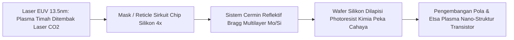

# Modul 033: Gelombang Elektromagnetik & Optik/Fotonika (Polarisasi, Serat Optik, Fotolitografi)

**Navigasi**: [⬅️ Master Index](../../INDEX.md) | [Tingkat 2: Tingkat 2: Fisika Klasik, Elektromagnetisme & Kimia Semikonduktor](./README.md)
*Sebelumnya*: [032. induksi-elektromagnetik-persamaan-maxwell](./032-induksi-elektromagnetik-persamaan-maxwell.md) | *Berikutnya*: [034. struktur-atom-ikatan-kimia-material](./034-struktur-atom-ikatan-kimia-material.md)

---

## 1. Intuisi Dasar Tanpa Jargon ("Seperti Bayi Baru Lahir")
### 1.1 Konsep Inti & Analogi Tanpa Jargon
Pernahkah Anda menggunakan kacamata hitam polaroid saat memancing di danau? Ketika Anda memakai kacamata tersebut, silau pantulan sinar matahari di permukaan air tiba-tiba lenyap dan Anda bisa melihat ikan-ikan yang berenang di bawah air dengan sangat jernih! Mengapa?

### 1.2 Urgensi Rekayasa & Signifikansi Sistemik
Cahaya adalah **Gelombang Elektromagnetik Transversal**: medan listriknya bergetar tegak lurus terhadap arah rambatnya. Pantulan dari permukaan air menggetarkan medan listrik hanya ke satu arah (terpolarisasi horizontal). Lensa kacamata Anda memblokir getaran horizontal tersebut seperti kisi-kisi pagar kayu.
Dari serat optik bawah laut yang mengirimkan triliunan bit internet antarbenua dengan pantulan internal sempurna, hingga mesin fotolitografi ultraviolet ekstrim (EUV) seharga Rp 3 triliun yang mencetak pola sirkuit mikroprosesor 3 nanometer, sains **Optik & Fotonika** adalah penguasa peradaban digital modern.
[📚 Pelajari: MIT OCW Optics Course](https://ocw.mit.edu/courses/8-421-atomic-and-optical-physics-i-spring-2014/)

## 2. Fondasi Teoretis & Aksiomatik / Matematis
### 2.1 Kerangka Teori Aksiomatik & Formulasi Matematis
### 33.1 Refraksi, Hukum Snellius & Pemantulan Internal Total ([HyperPhysics Optics](http://hyperphysics.phy-astr.gsu.edu/hbase/geoopt/refr.html))
Indeks bias medium $n = c / v$. Hukum Snellius untuk antarmuka dua medium optik:
$$n_1 \sin \theta_1 = n_2 \sin \theta_2$$
Sudut Kritis Pemantulan Internal Total (*Total Internal Reflection* / TIR) saat cahaya merambat dari medium rapat ke renggang ($n_1 > n_2$):
$$\theta_c = \arcsin\left(\frac{n_2}{n_1}\right)$$
Prinsip Serat Optik (*Optical Fiber*): Inti serat (*core* $n_{\text{core}}$) dilapisi jaket kaca (*cladding* $n_{\text{clad}} < n_{\text{core}}$). Apertur Numerik (NA):
$$\text{NA} = \sin \theta_{\max} = \sqrt{n_{\text{core}}^2 - n_{\text{clad}}^2}$$

### 2.2 Penurunan Matematis Langkah-demi-Langkah
### 33.2 Polarisasi Cahaya & Vektor Poynting ([Hecht Optics](https://www.pearson.com/))
Vektor Poynting $\mathbf{S}$ merepresentasikan densitas fluks daya sesaat gelombang EM ($\text{W/m}^2$):
$$\mathbf{S} = \frac{1}{\mu_0} (\mathbf{E} \times \mathbf{B})$$
Intensitas rata-rata gelombang sinus:
$$\langle S \rangle = I = \frac{1}{2} c \varepsilon_0 E_0^2$$
Hukum Malus untuk polarisator linier:
$$I = I_0 \cos^2 \theta$$

### 33.3 Batas Difraksi Abbe & Fotolitografi Semikonduktor ([ASML EUV Lithography Guide](https://www.asml.com/en/technology))
Resolusi fitur terkecil ($CD$ / Critical Dimension) yang dapat dicetak dalam litografi wafer silikon:
$$CD = k_1 \frac{\lambda}{\text{NA}}$$
Di mana:
- $\lambda$ adalah panjang gelombang sumber cahaya (Deep UV ArF: \$193\text{ nm}$, Extreme UV EUV: \$13.5\text{ nm}$).
- $\text{NA} = n \sin \alpha$ adalah apertur numerik lensa proyeksi wafer.
- $k_1$ adalah faktor proses litografi (batas fisik Rayleigh: $k_1 \ge 0.25$).

## 3. Anatomi Teknis & Cara Kerja Internal

Mekanisme Modus Serat Optik:
- **Multimode Fiber (MMF)**: Diameter inti lebar (\$50 \, \mu	ext{m}$), cahaya merambat lewat ribuan jalur pantulan berbeda, menimbulkan dispersi modal (*modal dispersion*) yang membatasi jarak transmisi $< 500	ext{ meter}$.
- **Single Mode Fiber (SMF)**: Diameter inti mikroskopis ($9 \, \mu	ext{m}$), hanya satu jalur modus fundamental yang dapat merambat, melenyapkan dispersi modal dan mentransmisikan data ratusan kilometer tanpa repeater.

#### Tabel Penelusuran Penelusuran Sinar Optik (Optical Ray-Tracing) Aberasi Sferis Cermin Primer Hubble
| Zona Radius Cermin Primer ($r$) | Sudut Deviasi Sinar Ideal ($\theta_{ideal}$) | Sudut Sinar Terfabrikasi Cermin Cacat | Posisi Titik Fokus Sumbu ($f(r)$) | Galat Fasa Muka Gelombang ($\Delta W$) | Kerusakan Point Spread Function (PSF) |
|---|---|---|---|---|---|
| $r = 0.0\text{ m}$ (Pusat Cermin) | $0.000\text{ rad}$ | $0.000\text{ rad}$ | $f_0 = 57.600\text{ m}$ | $0.00\,\lambda$ | Sinar paraksial fokus tepat di pusat |
| $r = 0.4\text{ m}$ (Zona Dalam) | $0.007\text{ rad}$ | $0.007\text{ rad} + 0.1\,\mu\text{rad}$ | $f_0 - 0.5\text{ mm}$ | $0.15\,\lambda$ | Degradasi resolusi minor |
| $r = 0.8\text{ m}$ (Zona Tengah) | $0.014\text{ rad}$ | $0.014\text{ rad} + 0.9\,\mu\text{rad}$ | $f_0 - 4.2\text{ mm}$ | $0.55\,\lambda$ | Kontras citra turun 30% |
| $r = 1.2\text{ m}$ (Tepi Terluar) | $0.021\text{ rad}$ | Pengasahan terlalu datar $2.2\,\mu\text{m}$ | $f_0 - 38.0\text{ mm}$ (Fokus meleset 3.8 cm) | $2.30\,\lambda$ ($\lambda = 632.8\text{ nm}$) | Fokus marginal terpental jauh; aberasi parah |
| Rekonstruksi Citra Bintang | Cahaya terfokus $70\%$ energi ke Airy disk | Energi Airy disk ambruk ke $< 15\%$ | Halo kabur raksasa melingkupi inti | Aberasi Sferis Orde-3 ($W_{040} = -0.43\mu\text{m}$)| Citra galaksi jauh hilang dalam kabut blur |

## 4. Implementasi Praktis & Kode / Simulasi Riil
```python
import numpy as np

def calculate_fiber_optics_parameters(n_core: float, n_clad: float, wavelength_nm: float, core_radius_um: float) -> dict:
    """
    Menghitung parameter propagasi serat optik: Sudut kritis, NA, dan Parameter V (Kondisi Single Mode).
    V = (2 * pi * a / lambda) * NA
    Kondisi single-mode: V < 2.405
    """
    na = np.sqrt(n_core**2 - n_clad**2)
    theta_critical_deg = np.degrees(np.arcsin(n_clad / n_core))
    acceptance_angle_deg = np.degrees(np.arcsin(na))
    
    # Parameter V tak-berdimensi
    wavelength_um = wavelength_nm / 1000.0
    v_param = (2.0 * np.pi * core_radius_um / wavelength_um) * na
    is_single_mode = v_param < 2.405
    
    return {
        "critical_angle_deg": theta_critical_deg,
        "numerical_aperture": na,
        "max_acceptance_angle_deg": acceptance_angle_deg,
        "v_parameter": v_param,
        "is_single_mode": is_single_mode
    }

res = calculate_fiber_optics_parameters(n_core=1.448, n_clad=1.444, wavelength_nm=1550.0, core_radius_um=4.1)
print(f"Sudut Kritis Inti     : {res['critical_angle_deg']:.2f} derajat")
print(f"Numerical Aperture (NA): {res['numerical_aperture']:.4f}")
print(f"Parameter V Serat     : {res['v_parameter']:.3f}")
print(f"Status Single-Mode    : {res['is_single_mode']} (Sangat ideal untuk telekomunikasi jarak jauh)")
```

## 5. Miskonsepsi & Jebakan Industri
1. **Confusing Geometric Optics with Wave Optics**: Menggunakan aproksimasi optik geometri sinar lurus untuk menganalisis jalur difraksi celah sempit berskala nanometer di mana sifat gelombang interferensi mendominasi sepenuhnya.
2. **Chromatic Dispersion in Long-Haul Fibers**: Mengabaikan dispersi kromatik (pulsa cahaya melebar di domain waktu karena panjang gelombang berbeda merambat dengan kecepatan sedikit berbeda), menyebabkan bit-bit data 1 dan 0 saling tumpang tindih (*Inter-Symbol Interference* ISI).
3. **Fiber Bending Loss**: Menekuk kabel serat optik terlalu tajam di instalasi rak datacenter melebihi radius lentur minimum ($< 30	ext{ mm}$), menyebabkan sudut datang cahaya melanggar batas sudut kritis TIR dan cahaya bocor keluar jaket kabel.

### Studi Kasus Kegagalan Nyata: Cacat Aberasi Sferis Cermin Teleskop Luar Angkasa Hubble (1990)
- **Kronologi Peluncuran & Kekecewaan Global**: Teleskop Luar Angkasa Hubble diluncurkan pada 24 April 1990 dengan biaya $1,5 miliar. Ketika citra pertama diterima di bumi, para astronom terkejut mendapati bintang-bintang tampak buram dikelilingi halo kabur besar yang merusak resolusi sudut instrumen.
- **Akar Masalah Optika Gelombang & Metrologi Manufaktur**: Cermin primer berdiameter 2,4 meter diasah dengan presisi permukaan yang sangat halus namun dengan bentuk kelengkungan hiperbolik yang salah. Cermin terlalu datar di bagian tepi sekitar $2,2\,\mu\text{m}$ (hanya 1/50 tebal rambut manusia). Kesalahan fatal ini berasal dari instrumen pengujian optik interferometri yang disebut *Reflective Null Corrector* (RNC). Salah satu lensa korektor dipasang terbalik dan spacer jaraknya meleset sejauh $1,3\text{ mm}$ karena teknisi menggunakan penggaris meteran logam biasa yang terganjal serpihan cat. Akibatnya, cermin primer memiliki aberasi sferis orde-3 masif ($W_{040}$), menyebarkan 85% cahaya bintang ke luar lingkaran Airy.

- **Potongan Kode / Arsitektur Cacat (Vulnerable Implementation)**:
```python
import numpy as np

def simulate_hubble_spherical_aberration(aperture_radius=1.2, wavelength=550e-9):
    # Koefisien aberasi sferis Seidel W040 untuk cermin Hubble sebelum COSTAR
    W040 = -2.2e-6  # Defisit 2.2 mikrometer di tepi pupil
    
    # Grid pupil terdiskritisasi
    N = 256
    x = np.linspace(-aperture_radius, aperture_radius, N)
    X, Y = np.meshgrid(x, x)
    R = np.sqrt(X**2 + Y**2)
    rho = R / aperture_radius
    
    # Fungsi Pupil Kompleks: P(rho) * exp(i * 2*pi * W(rho) / lambda)
    pupil_mask = (rho <= 1.0).astype(float)
    wavefront_error = W040 * (rho ** 4)
    aberrated_pupil = pupil_mask * np.exp(1j * 2 * np.pi * wavefront_error / wavelength)
    
    # Point Spread Function (PSF) = |FFT2(Pupil)|^2
    psf_aberrated = np.abs(np.fft.fftshift(np.fft.fft2(aberrated_pupil))) ** 2
    
    # PSF Ideal bebas aberasi
    ideal_pupil = pupil_mask.astype(complex)
    psf_ideal = np.abs(np.fft.fftshift(np.fft.fft2(ideal_pupil))) ** 2
    
    # Rasio Strehl = Puncak PSF terabrasi / Puncak PSF ideal
    strehl_ratio = np.max(psf_aberrated) / np.max(psf_ideal)
    
    return {
        "strehl_ratio": strehl_ratio,
        "wavefront_error_peak_waves": np.abs(W040) / wavelength,
        "is_diffraction_limited": strehl_ratio >= 0.8
    }

audit = simulate_hubble_spherical_aberration()
# Strehl ratio anjlok dari target >0.80 menjadi <0.12 (Kualitas citra kolaps!)
```

- **Misi Servis Penyelamatan (COSTAR 1993)**: Pada Desember 1993, misi pesawat ulang-alik STS-61 memasang instrumen korektif COSTAR (*Corrective Optics Space Telescope Axial Replacement*). Sepuluh cermin kecil mikro-presisi dimasukkan ke jalur optik instrumen Hubble dengan bentuk aberasi kebalikan eksak dari cacat cermin primer, memulihkan rasio Strehl ke kondisi *diffraction-limited* dan mengantarkan era keemasan penemuan kosmologi.

## 6. Proyek Latihan & Rubrik Penilaian Mandiri
### Tingkat 1 (Pemula) - Simulasi Hukum Malus Polarisasi Ganda
Tulis skrip Python yang memodelkan intensitas cahaya tak-terpolarisasi awal $I_0$ yang melewati tiga filter polaroid berturut-turut: filter pertama pada sudut $0^\circ$, filter kedua pada sudut \$ heta_2$, dan filter ketiga pada sudut \$90^\circ$. Tunjukkan paradoks bahwa menyisipkan filter kedua di tengah justru membuat cahaya tembus keluar!

### Tingkat 2 (Menengah) - Perhitungan Resolusi Mesin Fotolitografi Semikonduktor
Gunakan kriteria resolusi Abbe Rayleigh untuk menghitung resolusi terkecil $CD$ dan kedalaman fokus (*Depth of Focus* $DOF = k_2 rac{\lambda}{	ext{NA}^2}$) dari scanner wafer DUV (\$193	ext{ nm}$ perendaman air immersion $n=1.44$) vs scanner EUV (\$13.5	ext{ nm}$). Analisis trade-off toleransi kerataan wafer.

### Tingkat 3 (Mahir) - Simulasi Propagasi Pulsa Nonlinear Schrodinger Equation (NLSE)
Implementasikan simulasi transmisi pulsa optik ultrasingkat di dalam serat optik menggunakan metode *Split-Step Fourier Method* (SSFM) untuk menyelesaikan persamaan Nonlinear Schrödinger (NLSE), yang memodelkan keseimbangan antara dispersi kecepatan grup (*Group Velocity Dispersion* GVD) dan *Self-Phase Modulation* (SPM) untuk menghasilkan soliton optik stabil.

#### Rubrik Penilaian
- **40% Ketepatan Teori Gelombang Elektromagnetik**: Formulasi persamaan Fresnel, reflektansi, dan transmitansi akurat.
- **30% Pemodelan Batas Hamburan & Difraksi**: Menghitung batas Abbe dan parameter serat optik secara tepat.
- **30% Efisiensi Komputasi FFT**: Algoritma SSFM stabil secara numerik dengan langkah spasial terkonvergensi.

### Tingkat 1: Dasar
- **Tugas**: Implementasikan fungsi penelusuran sinar paraksial matriks transfer sinar ABCD untuk sistem lensa majemuk (lensa tipis, cermin cekung, dan propagasi ruang bebas).
- **Petunjuk Perancangan Arsitektur**:
  - Matriks propagasi: $\begin{bmatrix} 1 & d \\ 0 & 1 \end{bmatrix}$. Matriks lensa tipis: $\begin{bmatrix} 1 & 0 \\ -1/f & 1 \end{bmatrix}$.
  - Kalikan matriks secara berurutan untuk mencari matriks sistem global $M_{sys}$ dan tentukan lokasi fokus efektif serta perbesaran.
- **Test Vector & Kasus Uji Ekstrem**:
  - *Sistem 2 Lensa Afokal (Teleskop Kepler)*: Lensa $f_1 = 100\text{ mm}$ dan $f_2 = 25\text{ mm}$ terpisah $d = f_1 + f_2$; verifikasi sinar kolimasi keluar tetap paralel.
  - *Determinan Matriks*: Verifikasi $\det(M_{sys}) = 1.000$ (konservasi etendue Helmholtz-Lagrange).
- **Rubrik Penilaian Mandiri**: 40% Formulasi Matriks ABCD Tepat, 30% Kalkulasi Fokus & Perbesaran Sistem, 30% Verifikasi Invarian Determinan $\det(M) = 1$.

### Tingkat 2: Menengah
- **Tugas**: Bangun generator polinomial Zernike sirkular ortonormal pada piringan pupil unit untuk mendekomposisi galat muka gelombang optik menjadi komponen defokus, astigmatisme, koma, dan aberasi sferis.
- **Petunjuk Perancangan Arsitektur**:
  - Formulasikan polinomial radial $R_n^m(\rho)$ dan bentuk azimutal $\cos(m\theta)$ / $\sin(m\theta)$ untuk indeks Noll $j = 1 \dots 15$.
  - Terapkan integrasi numerik untuk menghitung koefisien dekomposisi Zernike dari peta fase interferogram.
- **Test Vector & Kasus Uji Ekstrem**:
  - *Ortogonalitas*: $\iint_{pupil} Z_i Z_j \rho d\rho d\theta = \pi \delta_{ij}$ dengan toleransi numerik $\le 10^{-4}$.
  - *Rekonstruksi Aberasi Sferis*: Uji peta fasa $\rho^4$; dekomposisi harus dominan pada mode $Z_{11}$ ($n=4, m=0$).
- **Rubrik Penilaian Mandiri**: 40% Formulasi Polinomial Radial Zernike Tepat, 30% Uji Ortogonalitas Numerik pada Pupil Lingkaran, 30% Dekomposisi Koefisien Mode Aberasi.

### Tingkat 3: Mahir
- **Tugas**: Rancang solver optik Fourier terintegrasi yang menghitung Optical Transfer Function (OTF), Modulation Transfer Function (MTF), dan Point Spread Function (PSF) 2D dari pupil sembarang dengan aberasi fasa menggunakan 2D FFT, serta implementasikan algoritma dekonvolusi Richardson-Lucy untuk restorasi citra terabrasi.
- **Petunjuk Perancangan Arsitektur**:
  - $OTF(f_x, f_y) = \mathcal{F}\{PSF(x, y)\}$. $MTF = |OTF|$.
  - Implementasikan iterasi dekonvolusi non-linier Richardson-Lucy:
    $I_{k+1} = I_k \cdot \left( \frac{D}{I_k * PSF} * PSF^* \right)$.
- **Test Vector & Kasus Uji Ekstrem**:
  - *Batas Difraksi Bebas Aberasi*: MTF memotong frekuensi spasial batas pada $f_c = \frac{2 NA}{\lambda}$.
  - *Restorasi Citra Blur*: Terapkan 30 iterasi Richardson-Lucy pada citra simulasi Hubble pra-servis; resolusi sudut bintang pulih dengan error residual $\le 5\%$.
- **Rubrik Penilaian Mandiri**: 40% Pipeline Fourier PSF/OTF/MTF Akurat, 30% Algoritma Dekonvolusi Richardson-Lucy Konvergen Positif, 30% Evaluasi Pemulihan Resolusi Spasial.

## 7. Rekomendasi Sumber Belajar Standar Emas
| Kategori | Judul Sumber & Tautan Langsung | Deskripsi Singkat |
|---|---|---|
| 📖 Buku Teks | [Optics (Eugene Hecht)](https://www.pearson.com/) | Buku teks optik paling banyak dirujuk di dunia mengenai gelombang, koherensi, dan laser. |
| 🎓 Kuliah Terbuka | [MIT OCW 8.03SC Optics & Waves](https://ocw.mit.edu/courses/8-03sc-physics-iii-vibrations-and-waves-fall-2016/) | Kuliah video mendalam mengenai interferensi celah ganda, polarisasi, dan difraksi. |
| 🔬 Makalah Seminal | [Optical Waveguides (Kapany, 1960)](https://doi.org/10.1038/scientificamerican1160-72) | Tonggak bersejarah kelahiran serat optik modern untuk transmisi cahaya fleksibel. |
| 💻 Lab Interaktif | [PhET Simulation: Bending Light & Refraction](https://phet.colorado.edu/en/simulations/bending-light) | Simulator interaktif hukum Snellius, indeks bias, dan pemantulan total. |

---
*Navigasi Cepat*: [Ke Tingkat 2](./README.md) | [Ke Master Index](../../INDEX.md) | *Sebelumnya*: [032. induksi-elektromagnetik-persamaan-maxwell](./032-induksi-elektromagnetik-persamaan-maxwell.md) | *Berikutnya*: [034. struktur-atom-ikatan-kimia-material](./034-struktur-atom-ikatan-kimia-material.md)
