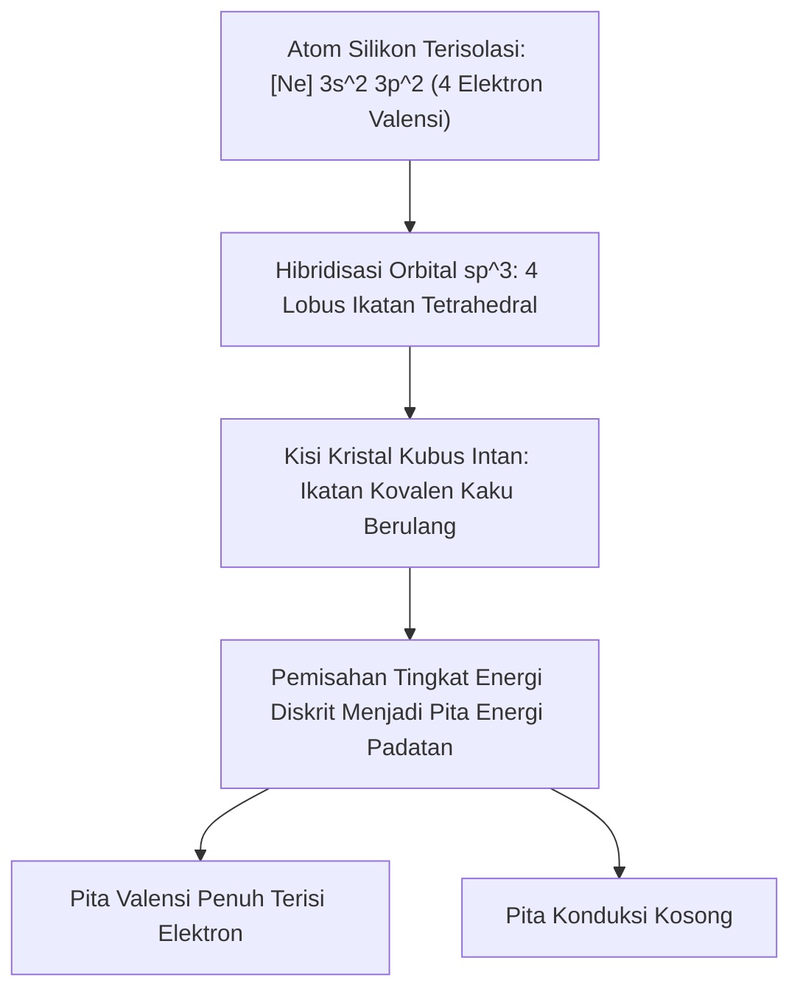

# Modul 034: Struktur Atom & Ikatan Kimia Material (Kisi Kristal Silikon & Struktur Kovalen)

**Navigasi**: [⬅️ Master Index](../../INDEX.md) | [Tingkat 2: Tingkat 2: Fisika Klasik, Elektromagnetisme & Kimia Semikonduktor](./README.md)
*Sebelumnya*: [033. gelombang-elektromagnetik-optik-fotonika](./033-gelombang-elektromagnetik-optik-fotonika.md) | *Berikutnya*: [035. elektrokimia-baterai-penyimpanan-energi](./035-elektrokimia-baterai-penyimpanan-energi.md)

---

## 1. Intuisi Dasar Tanpa Jargon ("Seperti Bayi Baru Lahir")
### 1.1 Konsep Inti & Analogi Tanpa Jargon
Pernahkah Anda membandingkan intan berlian yang paling keras di dunia dengan arang hitam di pensil Anda yang sangat rapuh? Yang menakjubkan: **keduanya terbuat dari atom yang sama persis 100%, yaitu Karbon!** Perbedaannya hanya satu: bagaimana atom-atom tersebut berikatan satu sama lain di dalam ruang 3 dimensi.

### 1.2 Urgensi Rekayasa & Signifikansi Sistemik
Di pensil, atom karbon tersusun dalam lembaran tipis yang mudah tergelincir (Grafit). Di intan, atom karbon terikat dalam piramida tetrahedron tetrahedral yang sangat kokoh.
Atom Silikon—bahan baku semua mikroprosesor di bumi—memiliki sifat serupa: ia adalah kristal yang tersusun rapi dengan 4 elektron terluar. Memahami ikatan kimia dan struktur kisi kristal adalah kunci untuk memahami bagaimana kita bisa memanipulasi atom pasir pantai biasa menjadi otak digital superkomputer.
[📚 Pelajari: MIT OCW Introduction to Solid State Chemistry](https://ocw.mit.edu/courses/3-091sc-introduction-to-solid-state-chemistry-fall-2010/)

## 2. Fondasi Teoretis & Aksiomatik / Matematis
### 2.1 Kerangka Teori Aksiomatik & Formulasi Matematis
### 34.1 Model Atom Bohr & Bilangan Kuantum Orbital ([MIT 3.091SC](https://ocw.mit.edu/courses/3-091sc-introduction-to-solid-state-chemistry-fall-2010/))
Tingkat energi elektron atom hidrogen terkuantisasi:
$$E_n = -\frac{m_e e^4}{8 \varepsilon_0^2 h^2} \frac{1}{n^2} = -\frac{13.6 \text{ eV}}{n^2}, \quad n \in \{1, 2, 3, \dots\}$$
Konfigurasi elektron dalam atom multi-elektron diatur oleh 4 bilangan kuantum $(n, \ell, m_\ell, m_s)$ dan Prinsip Larangan Pauli: tidak boleh ada dua fermion dalam atom yang memiliki himpunan keempat bilangan kuantum yang identik.

### 2.2 Penurunan Matematis Langkah-demi-Langkah
### 34.2 Ikatan Kimia: Kovalen, Ionik, Logam & Gaya van der Waals ([Chemistry LibreTexts](https://chem.libretexts.org/))
- **Ikatan Kovalen**: Pemakaian bersama pasangan elektron terluar (valensi) antara atom non-logam untuk mencapai konfigurasi oktet stabil ($s^2 p^6$). Memiliki arah spasial yang kaku (*directional bonds*).
- **Ikatan Ionik**: Transfer elektron antar atom dengan perbedaan elektronegativitas tinggi ($\Delta \chi > 2.0$), membentuk kisi kation-anion yang diikat gaya tarik Coulomb.
- **Ikatan Logam**: Kation atom logam berada di dalam lautan elektron valensi terdelokalisasi bebas (*delocalized electron sea*), menjelaskan konduktivitas listrik dan termal logam yang luar biasa.

### 34.3 Struktur Kristal Silikon: Kisi Intan (Diamond Cubic Lattice) ([Streetman Semiconductor Devices](https://www.pearson.com/))
Silikon mengkristal dalam kisi kubus intan (*Diamond Cubic Structure*) dengan parameter kisi $a = 5.431$ Å ($0.5431\text{ nm}$):
- Terdiri dari dua kisi Face-Centered Cubic (FCC) yang saling menembus (*interpenetrating*) dan bergeser sejauh $(a/4, a/4, a/4)$.
- Setiap atom Silikon terikat secara kovalen tetrahedral ($sp^3$ hybridization) dengan 4 atom tetangga terdekat dengan sudut ikatan \$109.47^\circ$.
- Kerapatan atom Silikon murni: $N_{\text{Si}} = 8 / a^3 \approx 5.0 \times 10^{22} \text{ atom/cm}^3$.
- Indeks Miller $(h, k, \ell)$: Menentukan orientasi bidang kristal wafer semikonduktor (misal wafer $\langle 100 \rangle$ vs $\langle 111 \rangle$).

## 3. Anatomi Teknis & Cara Kerja Internal

Orientasi Wafer Silikon:
- **Wafer $\langle 100 
angle$**: Memiliki kerapatan ikatan gantung permukaan (*surface dangling bonds*) lebih rendah, menjadi standar industri untuk fabrikasi transistor CMOS berkecepatan tinggi.
- **Wafer $\langle 111 
angle$**: Memiliki kerapatan bidang atom tertinggi, memiliki ketahanan mekanik tinggi dan laju etsa kimia anisotropik KOH yang sangat lambat.

#### Tabel Penelusuran Difusi Atomik Terinduksi Tegangan Kompresif & Pertumbuhan Jarum Kristal Timah (Tin Whiskers)
| Durasi Waktu Operasi ($t$) | Tegangan Kompresif Lapisan ($ \sigma_c $) | Gradien Potensial Kimia ($\nabla \mu$) | Fluks Difusi Atomik Timah ($J_{diff}$) | Panjang Jarum Kristal ($L_{whisker}$) | Potensi Hubungan Singkat Elektronik |
|---|---|---|---|---|---|
| $t = 0\text{ jam}$ (Pabrikasi) | $15.0\text{ MPa}$ (Tegangan sisa elektroplating) | $0.0\text{ J/m}$ | Inisiasi relaksasi kisi kristal | $0.0\,\mu\text{m}$ | PCB bersih; isolasi antar pin normal |
| $t = 1.000\text{ jam}$ (Uji Bakar) | $12.5\text{ MPa}$ | $1.2 \times 10^{-14}\text{ J/m}$ | Migrasi atom menuju dislokasi kisi | $8.0\,\mu\text{m}$ (Tonjolan mikro noda) | Masih di bawah batas jarak aman |
| $t = 10.000\text{ jam}$ (~1 Tahun) | $8.0\text{ MPa}$ | $3.5 \times 10^{-14}\text{ J/m}$ | Pertumbuhan monokristal kolumnar aksial | $85.0\,\mu\text{m}$ | Jarum mulai membengkok ke pin tetangga |
| $t = 30.000\text{ jam}$ (Operasi Satelit) | Relaksasi tegangan lokal | Fluks atomik terus menyuplai dasar | Jarum terus memanjang tanpa oksidasi | $1.200\,\mu\text{m}$ ($1.2\text{ mm}$!) | Menjembatani celah pitch IC $0.8\text{ mm}$ |
| $t = 30.005\text{ jam}$ (Kontak Fisik) | Menghubungkan pin 12V ke GND | Arus busur plasma $30\text{ mA}$ | Jarum menguap memicu ionisasi gas | Korsleting jalur daya utama | Komputer kontrol sikap satelit mati permanen |

## 4. Implementasi Praktis & Kode / Simulasi Riil
```python
def calculate_crystal_density(atomic_mass_g_mol: float, lattice_constant_angstrom: float, atoms_per_unit_cell: int) -> dict:
    """
    Menghitung massa jenis teoretis kristal padatan dari parameter kisi kristal unit cell.
    rho = (N_atoms * M) / (V_cell * N_A)
    """
    N_A = 6.02214076e23 # Bilangan Avogadro
    # Konversi Angstrom ke cm (1 A = 1e-8 cm)
    lattice_cm = lattice_constant_angstrom * 1e-8
    volume_cell_cm3 = lattice_cm**3
    
    mass_cell_g = (atoms_per_unit_cell * atomic_mass_g_mol) / N_A
    density_g_cm3 = mass_cell_g / volume_cell_cm3
    atomic_concentration_per_cm3 = atoms_per_unit_cell / volume_cell_cm3
    
    return {
        "density_g_cm3": density_g_cm3,
        "atomic_concentration_per_cm3": atomic_concentration_per_cm3
    }

# Parameter Kristal Silikon Murni (M = 28.0855 g/mol, a = 5.431 A, 8 atom per sel satuan FCC intan)
si_res = calculate_crystal_density(atomic_mass_g_mol=28.0855, lattice_constant_angstrom=5.431, atoms_per_unit_cell=8)
print(f"Massa Jenis Silikon Terhitung: {si_res['density_g_cm3']:.3f} g/cm^3 (Nilai Riil Laboratorium: 2.329 g/cm^3)")
print(f"Kerapatan Atom Silikon      : {si_res['atomic_concentration_per_cm3']:.2e} atom/cm^3")
```

## 5. Miskonsepsi & Jebakan Industri
1. **Confusing Amorphous with Crystalline Silicon**: Panel surya silikon amorf murah memiliki efisiensi jauh lebih rendah dan degradasi cepat dibandingkan silikon monokristalin karena kisi amorf memiliki banyak ikatan kovalen putus (*dangling bonds*) yang menjadi perangkap rekombinasi muatan.
2. **Ignoring Crystal Plane Etch Anisotropy**: Melakukan etsa basah kimia basah KOH pada wafer tanpa memperhatikan orientasi bidang indeks Miller $\langle 100 
angle$ vs $\langle 111 
angle$, menghasilkan parit V-groove dengan sudut miring \$54.74^\circ$ alih-alih dinding vertikal lurus.
3. **Interstitial vs Substitutional Defects**: Menambahkan atom asing pengotor: jika atom dopan masuk ke sela-sela kisi (*interstitial*) alih-alih menggantikan atom silikon di kisi utama (*substitutional*), atom tersebut tidak menyumbangkan elektron konduksi melainkan merusak mobilitas kristal.

### Studi Kasus Kegagalan Nyata: Fenomena Tin Whiskers pada Satelit Komunikasi Galaxy IV (1998) & ECU Otomotif
- **Kronologi Kegagalan Satelit Orbit**: Pada 19 Mei 1998, satelit komunikasi komersial Galaxy IV tiba-tiba kehilangan kontrol orientasi sikap dan mulai berputar liar di luar kendali. Akibatnya, 90% jaringan pager di seluruh Amerika Serikat padam seketika, mempengaruhi puluhan juta pelanggan dan komunikasi rumah sakit darurat.
- **Akar Masalah Fisika Material & Ikatan Kristal**: Penyebab kegagalan utama ditelusuri ke pertumbuhan jarum kristal konduktif mikroskopis (*tin whiskers*) pada lapisan timah elektroplating murni. Regulasi lingkungan global (seperti RoHS) mendorong penghapusan timbal ($Pb$) dari formula solder. Namun, atom timbal sebelumnya berfungsi menghentikan pergerakan dislokasi kisi kristal. Pada pelapisan timah murni ($100\%\ Sn$), tegangan tekan mekanis internal (*compressive stress*) dari proses pelapisan dan pembentukan senyawa antallogam ($Cu_6Sn_5$) memicu difusi atomik spontan. Atom timah bermigrasi ke titik kelemahan permukaan dan menumbuhkan jarum monokristal murni berdiameter beberapa mikrometer yang dapat tumbuh hingga beberapa milimeter, menghubung-singkatkan pin prosesor kontrol satelit.

- **Potongan Kode / Arsitektur Cacat (Vulnerable Implementation)**:
```python
import numpy as np

def simulate_tin_whisker_growth(compressive_stress_MPa=12.0, temp_K=298.15, hours=30000.0):
    # Parameter difusi atomik timah (Sn) pada batas butir
    D0 = 1.2e-9        # Koefisien difusi awal (m^2/s)
    Q = 42.0e3         # Energi aktivasi batas butir Sn (J/mol)
    R_gas = 8.314      # Konstanta gas ideal (J/mol·K)
    Omega = 2.7e-29    # Volume atomik timah (m^3)
    k_B = 1.38e-23     # Konstanta Boltzmann (J/K)
    
    # Koefisien difusi batas butir efektif
    D_eff = D0 * np.exp(-Q / (R_gas * temp_K))
    
    # Fluks difusi terinduksi gradien tegangan kompresif
    stress_Pa = compressive_stress_MPa * 1e6
    grad_sigma = stress_Pa / (10e-6)  # Gradien sepanjang tebal lapisan 10 mikron
    J_atoms = (D_eff / (k_B * temp_K)) * Omega * grad_sigma
    
    # Laju pertumbuhan linier whisker (m/s)
    growth_rate_m_s = J_atoms * Omega
    
    total_seconds = hours * 3600.0
    whisker_length_mm = (growth_rate_m_s * total_seconds) * 1000.0
    
    pitch_gap_mm = 0.8  # Jarak antar pin kemasan IC (QFP pitch)
    short_circuit = whisker_length_mm >= pitch_gap_mm
    
    return {
        "whisker_length_mm": whisker_length_mm,
        "growth_rate_um_per_year": (growth_rate_m_s * 365.25 * 86400) * 1e6,
        "is_short_circuit": short_circuit
    }

res = simulate_tin_whisker_growth(12.0, 298.15, 30000.0)
# Whisker mencapai > 1 mm melampaui celah 0.8 mm -> KORSLETING KATASTROPIK
```

- **Mitigasi Standar Kedirgantaraan**: Industri militer dan ruang angkasa (NASA/ESA) memperoleh pengecualian khusus dari larangan RoHS dan mewajibkan penambahan minimal 3% timbal ($Pb$) pada paduan timah, atau pelapisan konformal polimer tebal (*conformal coating*) seperti parylene untuk mengurung pertumbuhan jarum fisik.

## 6. Proyek Latihan & Rubrik Penilaian Mandiri
### Tingkat 1 (Pemula) - Perhitungan Jarak Antar-Bidang Indeks Miller
Tulis fungsi Python untuk menghitung jarak antar-bidang kisi ortogonal $d_{hkl} = rac{a}{\sqrt{h^2 + k^2 + l^2}}$ untuk kisi kubus kristal silikon ($a = 5.431$ Å) untuk bidang (100), (110), dan (111). Bandingkan kerapatan atom pada masing-masing bidang.

### Tingkat 2 (Menengah) - Hukum Bragg Difraksi Sinar-X (XRD)
Simulasikan pola difraksi sinar-X kristal (*X-Ray Diffraction* XRD) silikon menggunakan Hukum Bragg: $2d_{hkl} \sin	heta = n\lambda$ dengan sumber radiasi Cu-$K_lpha$ ($\lambda = 1.5406$ Å). Tentukan sudut difraksi puncak $2	heta$ untuk refleksi bidang (111) dan (220).

### Tingkat 3 (Mahir) - Simulasi Czochralski Wafer Ingot Growth Thermal Stress
Bangun model perpindahan panas 1D proses penarikan kristal tunggal Czochralski (*Czochralski crystal pulling*) dari lelehan silikon cair (\$1414^\circ	ext{C}$). Hitung gradien suhu aksial \$ rac{dT}{dz}$ dan estimasi laju penarikan kristal maksimum $v_{\max} = rac{k_s}{
ho L} rac{dT}{dz}$ agar tidak terjadi cacat dislokasi termal.

#### Rubrik Penilaian
- **40% Ketepatan Geometri Kristalografi**: Identifikasi unit cell, indeks Miller, dan ikatan sp3 tetrahedral akurat.
- **30% Pemodelan Difraksi XRD**: Menerapkan aturan seleksi sistemik kepunahan struktur intan ($h, k, l$ semua ganjil atau semua genap dan $h+k+l = 4n$).
- **30% Analisis Cacat Termodinamika**: Mampu menghitung energi pembentukan cacat Schottky dan Frenkel pada kesetimbangan termal.

### Tingkat 1: Dasar
- **Tugas**: Hitung tegangan geser kritis pembentukan dislokasi kisi kristal menggunakan Hukum Schmid untuk kristal tunggal berstruktur FCC dan BCC di bawah beban uniaksial.
- **Petunjuk Perancangan Arsitektur**:
  - Formulasikan faktor Schmid: $m = \cos(\phi) \cos(\lambda)$.
  - Tegangan geser terurai: $\tau_{rss} = \sigma \cos(\phi) \cos(\lambda)$.
  - Tentukan sistem slip kristal yang akan aktif pertama kali ketika $\tau_{rss} \ge \tau_{crss}$.
- **Test Vector & Kasus Uji Ekstrem**:
  - *Faktor Schmid Maksimum*: $\phi = 45^\circ$, $\lambda = 45^\circ$; $m = 0.500$.
  - *Beban Tegak Lurus Bidang Slip*: $\phi = 90^\circ$; $m = 0.000$ (tidak ada slip yang terjadi).
- **Rubrik Penilaian Mandiri**: 40% Formulasi Hukum Schmid Presisi, 30% Perhitungan Faktor Orientasi Kristalografi, 30% Identifikasi Sistem Slip Aktif Kritis.

### Tingkat 2: Menengah
- **Tugas**: Implementasikan model difusi atomik Hukum Fick ke-2 dengan koefisien difusi bergantung konsentrasi $D(C)$ dan tegangan kompresif menggunakan metode integrasi Crank-Nicolson 1D.
- **Petunjuk Perancangan Arsitektur**:
  - $\frac{\partial C}{\partial t} = \frac{\partial}{\partial x} \left( D(C, \sigma) \frac{\partial C}{\partial x} \right)$.
  - Terapkan fluks batas pada antarmuka pelapisan intermetalik $Cu_6Sn_5$.
- **Test Vector & Kasus Uji Ekstrem**:
  - *Difusi Difusif Fick Biasa*: Bandingkan solusi numerik terhadap solusi analitik fungsi galat $\text{erfc}(x / 2\sqrt{Dt})$ dengan galat $\le 0.5\%$.
  - *Gradien Tegangan Kompresif*: Verifikasi percepatan akumulasi atom timah di permukaan bebas.
- **Rubrik Penilaian Mandiri**: 40% Solver Fick Crank-Nicolson Non-Linier Tepat, 30% Penanganan Kondisi Batas Antarmuka Intermetalik, 30% Verifikasi Konservasi Massa Atomik.

### Tingkat 3: Mahir
- **Tugas**: Rancang simulasi dinamika kisi kristal Phase-Field Model untuk morfologi evolusi mikrostruktur padatan yang memprediksi inisiasi nukleasi dan bifurkasi cabang tin whiskers di bawah medan tegangan elastis terkopel Navier-Cauchy.
- **Petunjuk Perancangan Arsitektur**:
  - Integrasikan persamaan Cahn-Hilliard untuk parameter konsentrasi atom terkopel dengan persamaan Allen-Cahn untuk orientasi butir kristal.
  - Selesaikan persamaan kesetimbangan mekanis elastisitas mikro: $\nabla \cdot \boldsymbol{\sigma} = 0$.
- **Test Vector & Kasus Uji Ekstrem**:
  - *Nukleasi Whiskers*: Pembentukan tonjolan jarum mikro anisotropik pada titik konsentrasi tegangan batas butir.
  - *Keseimbangan Termodinamika*: Energi bebas Ginzburg-Landau menurun secara monotonik $\frac{dF}{dt} \le 0$.
- **Rubrik Penilaian Mandiri**: 40% Formulasi Phase-Field Cahn-Hilliard Terkopel Elastisitas Tepat, 30% Solver Diferensial Spektral FFT Semi-Implisit, 30% Verifikasi Monotonisitas Penurunan Energi Bebas.

## 7. Rekomendasi Sumber Belajar Standar Emas
| Kategori | Judul Sumber & Tautan Langsung | Deskripsi Singkat |
|---|---|---|
| 📖 Buku Teks | [Introduction to Solid State Physics (Charles Kittel)](https://www.wiley.com/) | Buku teks klasik paling terkenal untuk struktur kristal, fonon, dan pita energi. |
| 🎓 Kuliah Terbuka | [MIT OCW 3.091SC Introduction to Solid State Chemistry](https://ocw.mit.edu/courses/3-091sc-introduction-to-solid-state-chemistry-fall-2010/) | Kuliah legendaris Donald Sadoway mengenai ikatan kimia, kristal, dan baterai. |
| 🔬 Makalah Seminal | [Ein Verfahren zur Messung der Ziehgeschwindigkeit von Metallen (Czochralski, 1918)](https://doi.org/10.1515/zpch-1918-9212) | Penemuan metode Czochralski penarikan silikon monokristal dasar seluruh industri chip. |
| 💻 Lab Interaktif | [Materials Project: Silicon Crystal Visualizer](https://materialsproject.org/materials/mp-149) | Visualisator interaktif struktur atom dan diagram pita energi 3D kristal silikon. |

---
*Navigasi Cepat*: [Ke Tingkat 2](./README.md) | [Ke Master Index](../../INDEX.md) | *Sebelumnya*: [033. gelombang-elektromagnetik-optik-fotonika](./033-gelombang-elektromagnetik-optik-fotonika.md) | *Berikutnya*: [035. elektrokimia-baterai-penyimpanan-energi](./035-elektrokimia-baterai-penyimpanan-energi.md)
