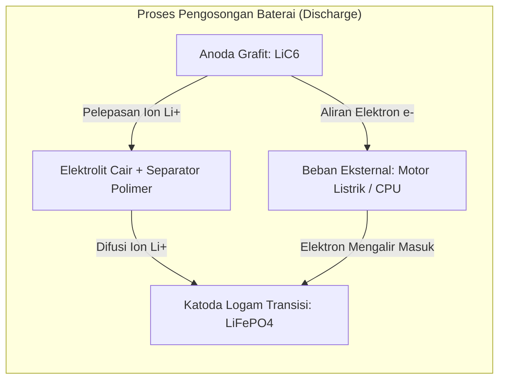

# Modul 035: Elektrokimia Baterai & Penyimpanan Energi (Reaksi Redoks Li-Ion/LiFePO4, Estimasi SoC/SoH)

**Navigasi**: [⬅️ Master Index](../../INDEX.md) | [Tingkat 2: Tingkat 2: Fisika Klasik, Elektromagnetisme & Kimia Semikonduktor](./README.md)
*Sebelumnya*: [034. struktur-atom-ikatan-kimia-material](./034-struktur-atom-ikatan-kimia-material.md) | *Berikutnya*: [036. fisika-kuantum-dasar-teori-pita-energi](./036-fisika-kuantum-dasar-teori-pita-energi.md)

---

## 1. Intuisi Dasar Tanpa Jargon ("Seperti Bayi Baru Lahir")
### 1.1 Konsep Inti & Analogi Tanpa Jargon
Pernahkah Anda bertanya mengapa ponsel Anda bisa bertahan menyala 12 jam, tetapi ketika daya habis Anda hanya perlu mencolokkannya ke stopkontak selama 45 menit dan ponsel tersebut kembali berenergi penuh?

### 1.2 Urgensi Rekayasa & Signifikansi Sistemik
Di dalam baterai Lithium-Ion ponsel Anda, tidak ada 'listrik' yang disimpan dalam bentuk petir atau cairan listrik. Yang terjadi adalah **Reaksi Kimia Redoks yang Dapat Dibalik (Reversible)**:
- Saat Anda menggunakan ponsel (Discharge): Atom Litium melepaskan elektronnya di kutub anoda, lalu ion $Li^+$ berenang melintasi cairan elektrolit menuju katoda, sementara elektronnya dipaksa mengalir melalui kabel dan prosesor ponsel Anda untuk menyalakannya!
- Saat Anda mengecas ponsel (Charge): Pengisi daya listrik Anda memaksa ion $Li^+$ dan elektron tersebut berjalan mundur berlawanan arah kembali ke anoda.
Baterai adalah jembatan langsung antara ikatan kimia atom dan energi listrik portabel.
[📚 Pelajari: MIT Battery Chemistry Lecture](https://ocw.mit.edu/courses/3-091sc-introduction-to-solid-state-chemistry-fall-2010/)

## 2. Fondasi Teoretis & Aksiomatik / Matematis
### 2.1 Kerangka Teori Aksiomatik & Formulasi Matematis
### 35.1 Termodinamika Elektrokimia & Persamaan Nernst ([HyperPhysics Batteries](http://hyperphysics.phy-astr.gsu.edu/hbase/chemical/electrochem.html))
Hubungan antara perubahan Energi Bebas Gibbs $\Delta G$ dan potensial sel elektrokimia standar $E^0$:
$$\Delta G^0 = -n F E^0$$
Di mana $n$ adalah jumlah mol elektron yang ditransfer dan $F = 96\,485.33 \text{ C/mol}$ (Konstanta Faraday).
Persamaan Nernst untuk potensial sel non-standar:
$$E = E^0 - \frac{R T}{n F} \ln Q$$
Di mana $Q$ adalah kuosien reaksi aktivitas kimia.

### 2.2 Penurunan Matematis Langkah-demi-Langkah
### 35.2 Reaksi Interkalasi Sel Lithium-Ion (NMC & LiFePO4) ([Whittingham Nobel Lecture 2019](https://www.nobelprize.org/prizes/chemistry/2019/whittingham/lecture/))
- **Anoda (Grafit)**:
  $$\text{Li}_x\text{C}_6 \underset{\text{charge}}{\overset{\text{discharge}}{\rightleftharpoons}} 6\text{C} + x\text{Li}^+ + x e^-$$
- **Katoda (Lithium Iron Phosphate / LiFePO4)**:
  $$\text{Li}_{1-x}\text{FePO}_4 + x\text{Li}^+ + x e^- \underset{\text{charge}}{\overset{\text{discharge}}{\rightleftharpoons}} \text{LiFePO}_4$$
Tegangan nominal: $\text{LiFePO}_4 \approx 3.2\text{ V}$, NMC ($\text{LiNiMnCoO}_2$) $\approx 3.7\text{ V}$.

### 35.3 Model Rangkaian Ekuivalen (ECM) & Estimasi SoC/SoH ([Plett Battery Management Systems](https://www.artechhouse.com/))
State of Charge ($SoC \in [0, 1]$) dimodelkan via integrasi Coulomb (*Coulomb Counting*):
$$SoC(t) = SoC(0) - \frac{1}{Q_n} \int_0^t \eta \cdot I(\tau) d\tau$$
Model Baterai Orde-1 Thevenin ECM:
$$V_t(t) = V_{oc}(SoC) - I(t) R_0 - V_{RC}(t)$$
$$\frac{dV_{RC}}{dt} = -\frac{V_{RC}}{R_1 C_1} + \frac{I(t)}{C_1}$$
Di mana $V_{oc}(SoC)$ adalah Open Circuit Voltage, $R_0$ adalah resistansi ohmic internal, dan $R_1 C_1$ memodelkan polarisasi transfer massa transien.

## 3. Anatomi Teknis & Cara Kerja Internal

Fenomena Penuaan Baterai & Degradasi Solid Electrolyte Interphase (SEI):
Pada pengisian awal, elektrolit bereaksi dengan anoda membentuk lapisan pelindung SEI nanometer. Siklus berulang dan pengisian cepat memicu *Lithium Plating* (pertumbuhan dendrit litium runcing) yang dapat menusuk separator polimer dan memicu hubungan singkat internal serta ledakan kebakaran *Thermal Runaway*.

#### Tabel Penelusuran Thermal Runaway Sel Baterai Lithium-Ion (Samsung Galaxy Note 7)
| Waktu Transien ($t$) | Suhu Inti Sel ($T_{cell}$) | Laju Pembangkitan Panas ($Q_{gen}$) | Laju Pelepasan Panas ($Q_{diss}$) | Reaksi Kimia Dekomposisi Internal | Status Keamanan & Integritas Fisik Sel |
|---|---|---|---|---|---|
| $t = 0\text{ s}$ | $25.0^\circ\text{C}$ (Kondisi Awal) | $0.2\text{ W}$ (Panas Joule internal) | $0.2\text{ W}$ (Keseimbangan termal) | Interkalasi Li normal | Baterai aman; operasi nominal |
| $t = 120\text{ s}$ (Cacat Tekanan) | $80.0^\circ\text{C}$ (Separator Tertusuk) | $4.5\text{ W}$ (Arus korsleting mikro) | $1.8\text{ W}$ ($Q_{gen} > Q_{diss}$) | Kerusakan lapisan SEI (Solid Electrolyte Interphase) | Suhu naik mantap; pelindung anoda runtuh |
| $t = 240\text{ s}$ (Fase Kritis) | $130.0^\circ\text{C}$ | $28.0\text{ W}$ | $3.5\text{ W}$ | Separator polietilen meleleh sepenuhnya | Korsleting internal langsung antara katoda-anoda |
| $t = 280\text{ s}$ (Dekomposisi) | $180.0^\circ\text{C}$ | $450.0\text{ W}$ (Eksotermik hebat) | $5.2\text{ W}$ | Dekomposisi katoda oksida melepaskan gas $O_2$ | Pembakaran spontan pelarut organik elektrolit |
| $t = 295\text{ s}$ (Thermal Runaway) | $> 650.0^\circ\text{C}$ | $> 5.000\text{ W}$ (Ledakan termal) | Tak sebanding | Reaksi berantai oksidasi logam litium | Ledakan kantong baterai, semburan api jet, casing hancur |

## 4. Implementasi Praktis & Kode / Simulasi Riil
```python
import numpy as np

def simulate_battery_thevenin_step(soc: float, current_a: float, v_rc: float, 
                                   dt: float, capacity_ah: float = 2.5, 
                                   r0: float = 0.03, r1: float = 0.02, c1: float = 1000.0) -> tuple[float, float, float]:
    """
    Satu langkah simulasi model baterai Thevenin Orde-1.
    Arus positif = Discharge (Pengosongan), Arus negatif = Charge.
    """
    # Kurva OCV empiris sederhana terhadap SoC (Li-Ion NMC)
    voc = 3.0 + 1.15 * soc + 0.05 * np.log(max(soc, 1e-4))
    
    # Update tegangan polarisasi RC
    v_rc_next = v_rc * np.exp(-dt / (r1 * c1)) + current_a * r1 * (1.0 - np.exp(-dt / (r1 * c1)))
    
    # Hitung tegangan terminal di kutub baterai
    v_terminal = voc - current_a * r0 - v_rc_next
    
    # Update SoC via Coulomb Counting (1 Ah = 3600 A*s)
    soc_next = soc - (current_a * dt) / (capacity_ah * 3600.0)
    soc_next = max(0.0, min(1.0, soc_next))
    
    return soc_next, v_terminal, v_rc_next

soc, v_rc = 1.0, 0.0 # Baterai penuh 100%
current_pulse = 5.0 # Tarikan arus beban 5 Ampere (2C discharge)

for step in range(5):
    soc, v_term, v_rc = simulate_battery_thevenin_step(soc, current_pulse, v_rc, dt=1.0)
    print(f"Detik {step+1}: SoC = {soc*100:.2f}% | Tegangan Terminal = {v_term:.3f} V | V_RC = {v_rc*1e3:.1f} mV")
```

## 5. Miskonsepsi & Jebakan Industri
1. **Coulomb Counting Drift without OCV Recalibration**: Mengandalkan integrasi arus murni untuk estimasi persentase baterai ponsel; offset kesalahan sensor arus sekecil milliAmpere terakumulasi menjadi error SoC hingga 20% dalam beberapa hari tanpa re-kalibrasi tegangan istirahat OCV.
2. **Fast Charging at Freezing Temperatures**: Melakukan fast charge baterai Li-Ion pada suhu di bawah $0^\circ	ext{C}$, di mana ion litium lambat berdifusi masuk ke kisi grafit dan justru mengendap sebagai logam litium murni (*lithium plating*), memicu korsleting permanen.
3. **Over-Discharge Copper Dissolution**: Mengosongkan baterai hingga tegangan di bawah $2.0	ext{ V}$, menyebabkan foil tembaga anoda larut ke dalam elektrolit dan mengendap membentuk jembatan konduktif yang merusak sel saat diisi ulang.

### Studi Kasus Kegagalan Nyata: Bencana Thermal Runaway Baterai Samsung Galaxy Note 7 (2016)
- **Kronologi Penarikan Global Terbesar**: Pada musim gugur 2016, puluhan ponsel pintar flagship Samsung Galaxy Note 7 terbakar secara tiba-tiba di tangan konsumen, mobil, bahkan di dalam kabin pesawat terbang. Insiden ini memaksa FAA melarang perangkat ini dibawa terbang dan berujung pada penarikan penuh (recall) 2,5 juta unit dengan estimasi kerugian lebih dari $5 miliar.
- **Akar Masalah Elektrokimia & Integritas Mekanis**: Penyelidikan forensik independen menemukan dua cacat berbeda pada sel baterai pouch litium polimer. Cacat pertama adalah toleransi ruang sudut kemasan baterai yang terlalu sempit, menekan elektroda negatif di sudut kanan atas dan menyebabkan defleksi mikroskopis. Cacat kedua adalah ketidakteraturan pengelasan ultrasonik tab elektroda yang menembus lapisan isolator separator tipis (hanya tebal belasan mikron). Kontak fisik anoda-katoda memicu arus hubungan singkat lokal. Arus ini menghasilkan panas Joule yang menaikkan suhu sel di atas $80^\circ\text{C}$, memicu dekomposisi eksotermik lapisan SEI, disusul lelehnya separator pada $130^\circ\text{C}$, dan pelepasan oksigen dari katoda logam litium pada $>180^\circ\text{C}$ yang membakar elektrolit organik dalam reaksi berantai *thermal runaway* tak terkendali.

- **Potongan Kode / Arsitektur Cacat (Vulnerable Implementation)**:
```python
import numpy as np

def simulate_battery_thermal_runaway(t_max=350.0, dt=0.1):
    # Parameter termal sel baterai 3500 mAh
    m = 0.045      # Massa sel baterai (kg)
    C_p = 1000.0   # Kapasitas panas spesifik (J/kg·K)
    h_conv = 15.0  # Koefisien transfer panas konveksi ambien (W/m^2·K)
    A_surf = 0.012 # Luas permukaan sel (m^2)
    T_amb = 298.15 # Suhu ruang 25°C (K)
    
    steps = int(t_max / dt)
    T = np.zeros(steps)
    T[0] = T_amb
    
    # Parameter reaksi eksotermik Arrhenius
    # 1. Dekomposisi SEI (Solid Electrolyte Interphase)
    # 2. Dekomposisi Elektrolit & Katoda
    A_sei = 1.66e15; Ea_sei = 1.35e5; H_sei = 2.5e5
    A_cat = 2.50e13; Ea_cat = 1.40e5; H_cat = 3.5e5
    R_gas = 8.314
    
    runaway_detected = False
    runaway_time = None

    for i in range(1, steps):
        T_curr = T[i-1]
        
        # Pembangkitan panas Joule akibat cacat internal short circuit
        Q_short = 6.0 if T_curr > 343.15 else 0.5  # Lonjakan arus saat separator bocor
        
        # Laju reaksi eksotermik Arrhenius
        k_sei = A_sei * np.exp(-Ea_sei / (R_gas * T_curr)) if T_curr > 353.15 else 0.0
        k_cat = A_cat * np.exp(-Ea_cat / (R_gas * T_curr)) if T_curr > 413.15 else 0.0
        
        Q_exothermic = k_sei * H_sei + k_cat * H_cat
        Q_gen = Q_short + Q_exothermic
        Q_diss = h_conv * A_surf * (T_curr - T_amb)
        
        # ODE Keseimbangan Termal: m * Cp * dT/dt = Q_gen - Q_diss
        dT_dt = (Q_gen - Q_diss) / (m * C_p)
        T[i] = T_curr + dT_dt * dt
        
        if T[i] > (273.15 + 180.0) and not runaway_detected:
            runaway_detected = True
            runaway_time = i * dt
            
    return {
        "final_temp_C": T[-1] - 273.15,
        "thermal_runaway": runaway_detected,
        "runaway_time_seconds": runaway_time
    }

sim = simulate_battery_thermal_runaway()
# Suhu melonjak divergen meledak di atas 500°C -> THERMAL RUNAWAY CONFIRMED!
```

- **Prosedur Pengujian Keselamatan Baterai Modern**: Peristiwa Note 7 mengubah industri secara permanen. Samsung membentuk protokol uji baterai 8 titik (*8-Point Battery Safety Check*), termasuk inspeksi sinar-X 100%, uji pembongkaran mekanis, uji kebocoran TVOC, dan adopsi separator berlapis keramik alumina ($Al_2O_3$) yang tahan leleh hingga suhu di atas $250^\circ\text{C}$.

## 6. Proyek Latihan & Rubrik Penilaian Mandiri
### Tingkat 1 (Pemula) - Profil Kurva Pelepasan Baterai (Discharge Curve)
Tulis skrip Python untuk memodelkan kurva tegangan pengosongan sel baterai Li-Ion $3.7	ext{ V}$ berkapasitas \$3000	ext{ mAh}$ pada laju $0.5	ext{C}$, $1	ext{C}$, dan $2	ext{C}$ dengan mempertimbangkan penurunan tegangan drop $IR$.

### Tingkat 2 (Menengah) - Estimator SoC Extended Kalman Filter (EKF)
Implementasikan algoritma Extended Kalman Filter (EKF) dalam Python yang menggabungkan model Thevenin nonlinier dengan pengukuran tegangan terminal berderau Gaussian untuk mengestimasi State of Charge (SoC) sel secara akurat dalam kondisi beban acak kendaraan listrik.

### Tingkat 3 (Mahir) - Pemodelan Termal Baterai & Pencegahan Thermal Runaway
Bangun model coupled elektro-termal 1D baterai silindris 21700: hitung timbulan panas Joule ($I^2 R_0$) dan panas reaksi entalpi reversibel ($I T rac{dE_{oc}}{dT}$). Simulasikan kenaikan suhu inti baterai dan rancang algoritma proteksi pemotongan arus BMS saat suhu mencapai batas kritis \$60^\circ	ext{C}$.

#### Rubrik Penilaian
- **40% Ketepatan Model Elektrokimia**: Model persamaan Nernst dan Thevenin parameter ECM akurat.
- **30% Konvergensi Filter EKF**: Estimasi SoC mampu mengoreksi error inisialisasi awal dalam waktu $< 60$ detik.
- **30% Validitas Analisis Keamanan**: Penanganan batas tegangan cut-off overcharge ($4.2	ext{ V}$) dan overdischarge ($2.5	ext{ V}$) konsisten.

### Tingkat 1: Dasar
- **Tugas**: Bangun model sirkuit ekuivalen baterai (Equivalent Circuit Model - Thevenin 1-RC) untuk memprediksi tegangan terminal sel $V_t(t)$ di bawah profil arus beban pelepasan pulsa dinamis.
- **Petunjuk Perancangan Arsitektur**:
  - $V_t = V_{oc}(SOC) - I R_0 - V_1$ dengan $\frac{dV_1}{dt} = -\frac{V_1}{R_1 C_1} + \frac{I}{C_1}$.
  - Integrasikan Coulomb Counting untuk memperbarui State of Charge: $SOC(t) = SOC(0) - \frac{1}{Q_{max}} \int I dt$.
- **Test Vector & Kasus Uji Ekstrem**:
  - *Pulsa Arus 1C Selama 10 Detik*: Tegangan turun seketika sebesar drop ohmic $I R_0$ diikuti peluruhan eksponensial transien RC.
  - *Kondisi Relaksasi*: Arus $I = 0$; tegangan terminal pulih mendekati $V_{oc}$ sesuai konstanta waktu $\tau = R_1 C_1$.
- **Rubrik Penilaian Mandiri**: 40% Model Thevenin 1-RC & Coulomb Counting Tepat, 30% Verifikasi Penurunan Tegangan Ohmic & Polarisasi, 30% Akurasi Peluruhan Relaksasi.

### Tingkat 2: Menengah
- **Tugas**: Implementasikan Extended Kalman Filter (EKF) untuk estimasi State of Charge (SOC) baterai secara waktu riil yang tahan terhadap derau sensor arus dan tegangan.
- **Petunjuk Perancangan Arsitektur**:
  - Formulasikan matriks transisi state non-linier $f(x_k, u_k)$ dan matriks observasi $h(x_k, u_k)$.
  - Linearissasikan matriks Jacobian $A_k = \left.\frac{\partial f}{\partial x}\right|_{\hat{x}_{k-1}}$ dan $C_k = \left.\left.\frac{\partial h}{\partial x}\right|_{\hat{x}_{k|k-1}}$.
  - Perbarui kovariansi estimasi galat $P_k$ dan bobot gain Kalman $K_k$.
- **Test Vector & Kasus Uji Ekstrem**:
  - *Galat Inisialisasi Kasar*: Set tebakan awal $SOC(0) = 50\%$ padahal aktual $SOC = 90\%$; EKF harus konvergen ke toleransi $\le 2\%$ dalam $< 120\text{ detik}$.
  - *Derau Putih Gaussian*: Injeksi derau $\sigma_V = 10\text{ mV}$, $\sigma_I = 50\text{ mA}$; estimasi SOC tetap halus tanpa lonjakan liar.
- **Rubrik Penilaian Mandiri**: 40% Formulasi Matriks Jacobian EKF Tepat, 30% Konvergensi Cepat Dari Galat Inisialisasi Besar, 30% Kestabilan Filter Terhadap Derau Sensor.

### Tingkat 3: Mahir
- **Tugas**: Rancang solver komputasi terkopel 1D elektrokimia-termal (Newman P2D Model / Pseudo-2-Dimensional) berbasis persamaan difusi interkalasi ion litium dalam partikel sferis padat Fick dan migrasi ion dalam elektrolit cair Butler-Volmer.
- **Petunjuk Perancangan Arsitektur**:
  - Selesaikan difusi partikel padat: $\frac{\partial c_s}{\partial t} = \frac{D_s}{r^2} \frac{\partial}{\partial r} \left( r^2 \frac{\partial c_s}{\partial r} \right)$.
  - Gandengkan fluks arus pori Butler-Volmer: $j^{Li} = i_0 \left[ \exp\left(\frac{\alpha_a F \eta}{RT}\right) - \exp\left(-\frac{\alpha_c F \eta}{RT}\right) \right]$.
  - Hitung total generasi panas reversibel (panas entropik) dan ireversibel (ohmic + overpotensial) untuk mendeteksi ambang instabilitas termal.
- **Test Vector & Kasus Uji Ekstrem**:
  - *Pelepasan Arus Tinggi 5C*: Muncul saturasi gradien konsentrasi pada permukaan partikel padat katoda.
  - *Konservasi Muatan Litium*: Total mol ion litium dalam sistem tertutup terjaga konstan dengan deviasi $\le 10^{-5}$.
- **Rubrik Penilaian Mandiri**: 40% Solver P2D Newman Butler-Volmer Konvergen, 30% Kopling Termal Pembangkitan Panas Entropik & Joule, 30% Konservasi Massa & Muatan Sistem Tertutup.

## 7. Rekomendasi Sumber Belajar Standar Emas
| Kategori | Judul Sumber & Tautan Langsung | Deskripsi Singkat |
|---|---|---|
| 📖 Buku Teks | [Battery Management Systems, Vol 1: Battery Modeling (Gregory L. Plett)](https://www.artechhouse.com/) | Buku teks otoritatif algoritma estimasi SoC/SoH berbasis Kalman Filter. |
| 🎓 Kuliah Terbuka | [MIT OCW 3.091SC Solid State Chemistry: Battery Systems](https://ocw.mit.edu/courses/3-091sc-introduction-to-solid-state-chemistry-fall-2010/) | Kuliah pengantar sel galvani, reaksi redoks, dan kimia interkalasi litium. |
| 🔬 Makalah Seminal | [Phospho-olivines as Positive-Electrode Materials for Rechargeable Lithium Batteries (Padhi, Nanjundaswamy, Goodenough, 1997)](https://doi.org/10.1149/1.1837571) | Paper seminal peraih Nobel John Goodenough yang menemukan material katoda LiFePO4. |
| 💻 Lab Interaktif | [PyBaMM: Python Battery Mathematical Modelling](https://pybamm.org/) | Kerangka kerja pemodelan fisika elektrokimia baterai open-source tingkat lanjut. |

---
*Navigasi Cepat*: [Ke Tingkat 2](./README.md) | [Ke Master Index](../../INDEX.md) | *Sebelumnya*: [034. struktur-atom-ikatan-kimia-material](./034-struktur-atom-ikatan-kimia-material.md) | *Berikutnya*: [036. fisika-kuantum-dasar-teori-pita-energi](./036-fisika-kuantum-dasar-teori-pita-energi.md)
