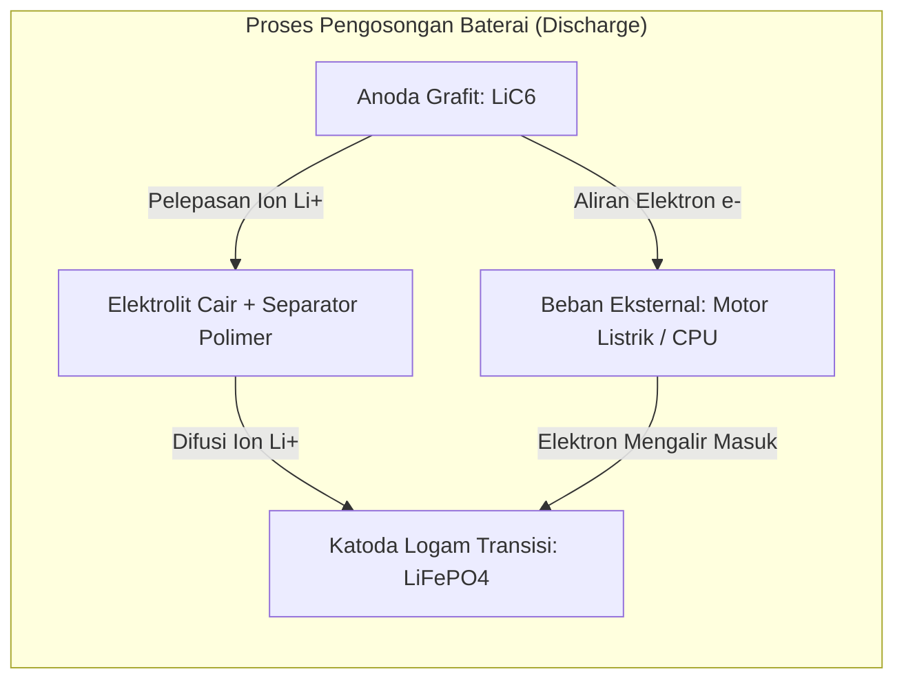

# Modul 035: Elektrokimia Baterai & Penyimpanan Energi (Reaksi Redoks Li-Ion/LiFePO4, Estimasi SoC/SoH)

**Navigasi**: [⬅️ Master Index](../../INDEX.md) | [Tingkat 2: Tingkat 2: Fisika Klasik, Elektromagnetisme & Kimia Semikonduktor](./README.md)
*Sebelumnya*: [034. struktur-atom-ikatan-kimia-material](./034-struktur-atom-ikatan-kimia-material.md) | *Berikutnya*: [036. fisika-kuantum-dasar-teori-pita-energi](./036-fisika-kuantum-dasar-teori-pita-energi.md)

---

## 1. Intuisi Dasar Tanpa Jargon ("Seperti Bayi Baru Lahir")
Pernahkah Anda bertanya mengapa ponsel Anda bisa bertahan menyala 12 jam, tetapi ketika daya habis Anda hanya perlu mencolokkannya ke stopkontak selama 45 menit dan ponsel tersebut kembali berenergi penuh?

Di dalam baterai Lithium-Ion ponsel Anda, tidak ada 'listrik' yang disimpan dalam bentuk petir atau cairan listrik. Yang terjadi adalah **Reaksi Kimia Redoks yang Dapat Dibalik (Reversible)**:
- Saat Anda menggunakan ponsel (Discharge): Atom Litium melepaskan elektronnya di kutub anoda, lalu ion $Li^+$ berenang melintasi cairan elektrolit menuju katoda, sementara elektronnya dipaksa mengalir melalui kabel dan prosesor ponsel Anda untuk menyalakannya!
- Saat Anda mengecas ponsel (Charge): Pengisi daya listrik Anda memaksa ion $Li^+$ dan elektron tersebut berjalan mundur berlawanan arah kembali ke anoda.
Baterai adalah jembatan langsung antara ikatan kimia atom dan energi listrik portabel.
[📚 Pelajari: MIT Battery Chemistry Lecture](https://ocw.mit.edu/courses/3-091sc-introduction-to-solid-state-chemistry-fall-2010/)

## 2. Fondasi Teoretis & Aksiomatik / Matematis
### 35.1 Termodinamika Elektrokimia & Persamaan Nernst ([HyperPhysics Batteries](http://hyperphysics.phy-astr.gsu.edu/hbase/chemical/electrochem.html))
Hubungan antara perubahan Energi Bebas Gibbs $\Delta G$ dan potensial sel elektrokimia standar $E^0$:
$$\Delta G^0 = -n F E^0$$
Di mana $n$ adalah jumlah mol elektron yang ditransfer dan $F = 96\,485.33 \text{ C/mol}$ (Konstanta Faraday).
Persamaan Nernst untuk potensial sel non-standar:
$$E = E^0 - \frac{R T}{n F} \ln Q$$
Di mana $Q$ adalah kuosien reaksi aktivitas kimia.

### 35.2 Reaksi Interkalasi Sel Lithium-Ion (NMC & LiFePO4) ([Whittingham Nobel Lecture 2019](https://www.nobelprize.org/prizes/chemistry/2019/whittingham/lecture/))
- **Anoda (Grafit)**:
  $$\text{Li}_x\text{C}_6 \underset{\text{charge}}{\overset{\text{discharge}}{\rightleftharpoons}} 6\text{C} + x\text{Li}^+ + x e^-$$
- **Katoda (Lithium Iron Phosphate / LiFePO4)**:
  $$\text{Li}_{1-x}\text{FePO}_4 + x\text{Li}^+ + x e^- \underset{\text{charge}}{\overset{\text{discharge}}{\rightleftharpoons}} \text{LiFePO}_4$$
Tegangan nominal: $\text{LiFePO}_4 \approx 3.2\text{ V}$, NMC ($\text{LiNiMnCoO}_2$) $\approx 3.7\text{ V}$.

### 35.3 Model Rangkaian Ekuivalen (ECM) & Estimasi SoC/SoH ([Plett Battery Management Systems](https://www.artechhouse.com/))
State of Charge ($SoC \in [0, 1]$) dimodelkan via integrasi Coulomb (*Coulomb Counting*):
$$SoC(t) = SoC(0) - \frac{1}{Q_n} \int_0^t \eta \cdot I(\tau) d\tau$$
Model Baterai Orde-1 Thevenin ECM:
$$V_t(t) = V_{oc}(SoC) - I(t) R_0 - V_{RC}(t)$$
$$\frac{dV_{RC}}{dt} = -\frac{V_{RC}}{R_1 C_1} + \frac{I(t)}{C_1}$$
Di mana $V_{oc}(SoC)$ adalah Open Circuit Voltage, $R_0$ adalah resistansi ohmic internal, dan $R_1 C_1$ memodelkan polarisasi transfer massa transien.

## 3. Anatomi Teknis & Cara Kerja Internal

Fenomena Penuaan Baterai & Degradasi Solid Electrolyte Interphase (SEI):
Pada pengisian awal, elektrolit bereaksi dengan anoda membentuk lapisan pelindung SEI nanometer. Siklus berulang dan pengisian cepat memicu *Lithium Plating* (pertumbuhan dendrit litium runcing) yang dapat menusuk separator polimer dan memicu hubungan singkat internal serta ledakan kebakaran *Thermal Runaway*.

## 4. Implementasi Praktis & Kode / Simulasi Riil
import numpy as np

def simulate_battery_thevenin_step(soc: float, current_a: float, v_rc: float, 
                                   dt: float, capacity_ah: float = 2.5, 
                                   r0: float = 0.03, r1: float = 0.02, c1: float = 1000.0) -> tuple[float, float, float]:
    """
    Satu langkah simulasi model baterai Thevenin Orde-1.
    Arus positif = Discharge (Pengosongan), Arus negatif = Charge.
    """
    # Kurva OCV empiris sederhana terhadap SoC (Li-Ion NMC)
    voc = 3.0 + 1.15 * soc + 0.05 * np.log(max(soc, 1e-4))
    
    # Update tegangan polarisasi RC
    v_rc_next = v_rc * np.exp(-dt / (r1 * c1)) + current_a * r1 * (1.0 - np.exp(-dt / (r1 * c1)))
    
    # Hitung tegangan terminal di kutub baterai
    v_terminal = voc - current_a * r0 - v_rc_next
    
    # Update SoC via Coulomb Counting (1 Ah = 3600 A*s)
    soc_next = soc - (current_a * dt) / (capacity_ah * 3600.0)
    soc_next = max(0.0, min(1.0, soc_next))
    
    return soc_next, v_terminal, v_rc_next

soc, v_rc = 1.0, 0.0 # Baterai penuh 100%
current_pulse = 5.0 # Tarikan arus beban 5 Ampere (2C discharge)

for step in range(5):
    soc, v_term, v_rc = simulate_battery_thevenin_step(soc, current_pulse, v_rc, dt=1.0)
    print(f"Detik {step+1}: SoC = {soc*100:.2f}% | Tegangan Terminal = {v_term:.3f} V | V_RC = {v_rc*1e3:.1f} mV")

## 5. Miskonsepsi & Jebakan Industri
1. **Coulomb Counting Drift without OCV Recalibration**: Mengandalkan integrasi arus murni untuk estimasi persentase baterai ponsel; offset kesalahan sensor arus sekecil milliAmpere terakumulasi menjadi error SoC hingga 20% dalam beberapa hari tanpa re-kalibrasi tegangan istirahat OCV.
2. **Fast Charging at Freezing Temperatures**: Melakukan fast charge baterai Li-Ion pada suhu di bawah $0^\circ	ext{C}$, di mana ion litium lambat berdifusi masuk ke kisi grafit dan justru mengendap sebagai logam litium murni (*lithium plating*), memicu korsleting permanen.
3. **Over-Discharge Copper Dissolution**: Mengosongkan baterai hingga tegangan di bawah $2.0	ext{ V}$, menyebabkan foil tembaga anoda larut ke dalam elektrolit dan mengendap membentuk jembatan konduktif yang merusak sel saat diisi ulang.

## 6. Proyek Latihan & Rubrik Penilaian Mandiri
### Tingkat 1 (Pemula) - Profil Kurva Pelepasan Baterai (Discharge Curve)
Tulis skrip Python untuk memodelkan kurva tegangan pengosongan sel baterai Li-Ion $3.7	ext{ V}$ berkapasitas $3000	ext{ mAh}$ pada laju $0.5	ext{C}$, $1	ext{C}$, dan $2	ext{C}$ dengan mempertimbangkan penurunan tegangan drop $IR$.

### Tingkat 2 (Menengah) - Estimator SoC Extended Kalman Filter (EKF)
Implementasikan algoritma Extended Kalman Filter (EKF) dalam Python yang menggabungkan model Thevenin nonlinier dengan pengukuran tegangan terminal berderau Gaussian untuk mengestimasi State of Charge (SoC) sel secara akurat dalam kondisi beban acak kendaraan listrik.

### Tingkat 3 (Mahir) - Pemodelan Termal Baterai & Pencegahan Thermal Runaway
Bangun model coupled elektro-termal 1D baterai silindris 21700: hitung timbulan panas Joule ($I^2 R_0$) dan panas reaksi entalpi reversibel ($I T rac{dE_{oc}}{dT}$). Simulasikan kenaikan suhu inti baterai dan rancang algoritma proteksi pemotongan arus BMS saat suhu mencapai batas kritis $60^\circ	ext{C}$.

#### Rubrik Penilaian
- **40% Ketepatan Model Elektrokimia**: Model persamaan Nernst dan Thevenin parameter ECM akurat.
- **30% Konvergensi Filter EKF**: Estimasi SoC mampu mengoreksi error inisialisasi awal dalam waktu $< 60$ detik.
- **30% Validitas Analisis Keamanan**: Penanganan batas tegangan cut-off overcharge ($4.2	ext{ V}$) dan overdischarge ($2.5	ext{ V}$) konsisten.

## 7. Rekomendasi Sumber Belajar Standar Emas
| Kategori | Judul Sumber & Tautan Langsung | Deskripsi Singkat |
|---|---|---|
| 📖 Buku Teks | [Battery Management Systems, Vol 1: Battery Modeling (Gregory L. Plett)](https://www.artechhouse.com/) | Buku teks otoritatif algoritma estimasi SoC/SoH berbasis Kalman Filter. |
| 🎓 Kuliah Terbuka | [MIT OCW 3.091SC Solid State Chemistry: Battery Systems](https://ocw.mit.edu/courses/3-091sc-introduction-to-solid-state-chemistry-fall-2010/) | Kuliah pengantar sel galvani, reaksi redoks, dan kimia interkalasi litium. |
| 🔬 Makalah Seminal | [Phospho-olivines as Positive-Electrode Materials for Rechargeable Lithium Batteries (Padhi, Nanjundaswamy, Goodenough, 1997)](https://doi.org/10.1149/1.1837571) | Paper seminal peraih Nobel John Goodenough yang menemukan material katoda LiFePO4. |
| 💻 Lab Interaktif | [PyBaMM: Python Battery Mathematical Modelling](https://pybamm.org/) | Kerangka kerja pemodelan fisika elektrokimia baterai open-source tingkat lanjut. |

---
*Navigasi Cepat*: [Ke Tingkat 2](./README.md) | [Ke Master Index](../../INDEX.md) | *Sebelumnya*: [034. struktur-atom-ikatan-kimia-material](./034-struktur-atom-ikatan-kimia-material.md) | *Berikutnya*: [036. fisika-kuantum-dasar-teori-pita-energi](./036-fisika-kuantum-dasar-teori-pita-energi.md)
