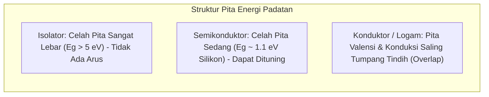

# Modul 036: Fisika Kuantum Dasar & Teori Pita Energi (Persamaan Schrödinger, Quantum Tunneling, Bandgap)

**Navigasi**: [⬅️ Master Index](../../INDEX.md) | [Tingkat 2: Tingkat 2: Fisika Klasik, Elektromagnetisme & Kimia Semikonduktor](./README.md)
*Sebelumnya*: [035. elektrokimia-baterai-penyimpanan-energi](./035-elektrokimia-baterai-penyimpanan-energi.md) | *Berikutnya*: [037. fisika-semikonduktor-rekayasa-silikon](./037-fisika-semikonduktor-rekayasa-silikon.md)

---

## 1. Intuisi Dasar Tanpa Jargon ("Seperti Bayi Baru Lahir")
### 1.1 Konsep Inti & Analogi Tanpa Jargon
Jika Anda melempar bola tenis ke dinding semen yang kokoh, bola tersebut akan selalu memantul kembali 100%. Bola tidak akan pernah menembus dinding secara gaib. Tetapi di dunia kuantum partikel sub-atomik, sebuah elektron tidak memiliki posisi pasti; elektron adalah 'gelombang probabilitas'.

### 1.2 Urgensi Rekayasa & Signifikansi Sistemik
Ketika gelombang probabilitas elektron menabrak dinding penghalang energi yang tebal, sebagian kecil dari ekor gelombang tersebut mampu merembes dan muncul di sisi lain dinding! Inilah **Quantum Tunneling**. Fenomena inilah yang membuat matahari kita bersinar (fusi nuklir pada suhu rendah) dan menjadi fondasi utama penyimpanan USB Flashdisk (NAND Flash) yang Anda gunakan setiap hari!

## 2. Fondasi Teoretis & Aksiomatik / Matematis
### 2.1 Kerangka Teori Aksiomatik & Formulasi Matematis
### 1. Persamaan Gelombang Schrödinger (Tidak Bergantung Waktu)
$$\hat{H} \psi(\mathbf{r}) = E \psi(\mathbf{r}) \implies -\frac{\hbar^2}{2m} \nabla^2 \psi(\mathbf{r}) + V(\mathbf{r}) \psi(\mathbf{r}) = E \psi(\mathbf{r})$$
Di mana:
- $\hbar = \frac{h}{2\pi} \approx 1.05457 \times 10^{-34} \text{ J}\cdot\text{s}$ (Konstanta Planck Tereduksi).
- $|\psi(\mathbf{r})|^2$ merepresentasikan kerapatan probabilitas menemukan partikel pada koordinat $\mathbf{r}$ (Interpretasi Born).

### 2.2 Penurunan Matematis Langkah-demi-Langkah
### 2. Quantum Tunneling & Teori Pita Energi Padatan
Koefisien Transmisi Tunneling melintasi potensial penghalang $V_0 > E$ setebal $a$:
$$T \approx 16 \frac{E}{V_0} \left( 1 - \frac{E}{V_0} \right) e^{-2 \kappa a}, \quad \kappa = \frac{\sqrt{2m(V_0 - E)}}{\hbar}$$
Model Kronig-Penney & Pembentukan Celah Pita Energi (*Energy Bandgap* $E_g$):
Interferensi konstruktif dan destruktif gelombang elektron Bloch di dalam kisi periodik kristal memecah tingkat energi menjadi **Pita Valensi** (terisi penuh elektron), **Bandgap** (zona terlarang energi), dan **Pita Konduksi** (elektron bebas bergerak).
[📚 Pelajari: MIT OCW 8.04 Quantum Physics I](https://ocw.mit.edu/courses/8-04-quantum-physics-i-spring-2016/)

## 3. Anatomi Teknis & Cara Kerja Internal


#### Tabel Penelusuran Wentzel-Kramers-Brillouin (WKB) Quantum Tunneling Elektron Menembus Sawar Potensial Gerbang
| Node Fabrikasi Silikon | Ketebalan Dielektrik Gerbang ($t_{ox}$) | Jumlah Lapisan Atom $SiO_2$ | Probabilitas Tunneling WKB ($T_{wkb}$) | Arus Bocor Gerbang ($I_{leak}$ / $\mu\text{m}$) | Dampak Skala Sistem & Penskalaan Dennard |
|---|---|---|---|---|---|
| $180\text{ nm}$ (Tahun 1999) | $3.5\text{ nm}$ | $\approx 12$ lapisan atom | $10^{-16}$ | $10^{-12}\text{ A}$ (Dapat diabaikan) | Penskalaan Dennard klasik bekerja sempurna |
| $130\text{ nm}$ (Tahun 2001) | $2.2\text{ nm}$ | $\approx 7$ lapisan atom | $10^{-11}$ | $10^{-8}\text{ A}$ | Daya statis mulai terdeteksi |
| $90\text{ nm}$ (Tahun 2004) | $1.4\text{ nm}$ | $\approx 4.5$ lapisan atom | $10^{-6}$ | $10^{-4}\text{ A}$ | Arus bocor menyamai arus dinamis switching |
| $65\text{ nm}$ (Tahun 2006) | $1.1\text{ nm}$ | $\approx 3$ lapisan atom (Sangat tipis) | $10^{-3}$ (1 dari 1000 elektron lolos) | $10^{-1}\text{ A}$ (Arus bocor destruktif) | Penskalaan Dennard runtuh! Silikon mendidih |
| $45\text{ nm}$ High-k Retrofit | $t_{high-k} = 3.0\text{ nm}$ ($EOT = 1.0\text{ nm}$) | $HfO_2$ permitivitas tinggi | $10^{-8}$ (Ditekan kembali $100.000\times$) | $10^{-6}\text{ A}$ | Industri beralih ke material High-k Metal Gate |

## 4. Implementasi Praktis & Kode / Simulasi Riil
```python
import numpy as np

def quantum_tunneling_probability(barrier_height_ev: float, electron_energy_ev: float, barrier_width_nm: float):
    """
    Menghitung probabilitas transmisi Quantum Tunneling elektron melintasi potensial isolator SiO2.
    """
    hbar = 1.0545718e-34 # J.s
    m_e = 9.10938356e-31 # kg (Massa elektron)
    q_e = 1.60217663e-19 # Coulomb per eV
    
    V0 = barrier_height_ev * q_e
    E = electron_energy_ev * q_e
    a = barrier_width_nm * 1e-9
    
    if E >= V0:
        return 1.0 # Di atas penghalang (propagasi klasik)
        
    kappa = np.sqrt(2 * m_e * (V0 - E)) / hbar
    transmission = np.exp(-2 * kappa * a)
    return transmission

# Contoh: Tunneling elektron pada gate oxide MOSFET 3nm vs 1nm (V0=3.1 eV, E=1.0 eV)
t_3nm = quantum_tunneling_probability(3.1, 1.0, 3.0)
t_1nm = quantum_tunneling_probability(3.1, 1.0, 1.0)

print(f"Probabilitas Tunneling pada Ketebalan 3 nm: {t_3nm:.2e}")
print(f"Probabilitas Tunneling pada Ketebalan 1 nm: {t_1nm:.2e}")
print(f"Kenaikan arus bocor kuantum sebesar: {t_1nm / t_3nm:.1f}x lipat saat tebal gerbang menyusut!")
```

## 5. Miskonsepsi & Jebakan Industri
1. **Subthreshold Leakage pada Chip Sub-5nm**: Ketika insinyur semikonduktor mengecilkan gate oxide transistor silikon di bawah 2 nanometer, efek quantum tunneling menyebabkan arus bocor tembus langsung dari Gate ke Channel meskipun saklar dalam kondisi OFF, membuang daya listrik baterai secara sia-sia (Solusi: Transisi dari planar MOSFET ke arsitektur 3D FinFET dan Gate-All-Around / GAAFET dengan High-K Metal Gate).

### Studi Kasus Kegagalan Nyata: Runtuhnya Penskalaan Dennard Akibat Kebocoran Subthreshold Quantum Tunneling (2005)
- **Krisis Daya Semikonduktor (Power Wall)**: Pada era 2004–2005, roadmap prosesor desktop Intel Pentium 4 NetBurst (Tejas) dengan target frekuensi clock 10 GHz dibatalkan secara dramatis. Chip menghasilkan panas ekstrem laksana kompor listrik hingga tidak dapat didinginkan lagi dengan heatsink konvensional.
- **Akar Masalah Mekanika Kuantum & Sifat Gelombang Partikel**: Selama 30 tahun, hukum penskalaan Dennard menyatakan bahwa memperkecil ukuran transistor akan menurunkan konsumsi daya secara proporsional sembari meningkatkan kecepatan clock. Namun, pada node $90\text{ nm}$ dan $65\text{ nm}$, ketebalan lapisan oksida isolator gerbang $SiO_2$ terpaksa dipipihkan hingga di bawah $1,2\text{ nm}$ (kurang dari 4 atom tebalnya). Berdasarkan mekanika kuantum, fungsi gelombang elektron $\psi(x)$ memiliki panjang de Broglie yang sebanding dengan sawar potensial. Menggunakan aproksimasi WKB, probabilitas transmisi tunneling kuantum melonjak eksponensial $T \approx \exp\left(-2 \int \sqrt{\frac{2m}{\hbar^2}(V(x) - E)} dx\right)$. Triliunan elektron menerobos sawar isolator tanpa hambatan, membocorkan arus miliampere bahkan saat transistor berada pada kondisi mati (*off-state*). Fenomena kuantum ini mengakhiri era lonjakan frekuensi clock tunggal dan memaksa seluruh industri bergeser ke arsitektur prosesor multi-core.

- **Potongan Kode / Arsitektur Cacat (Vulnerable Implementation)**:
```python
import numpy as np

def simulate_wkb_quantum_tunneling(tox_nm_range=[3.5, 2.2, 1.4, 1.1, 0.8]):
    # Parameter fisik elektron dan sawar energi SiO2
    q = 1.602e-19
    h_bar = 1.054e-34
    m0 = 9.109e-31
    m_eff = 0.5 * m0      # Massa efektif elektron dalam insulator
    V_barrier_eV = 3.15   # Tinggi sawar konduksi Si-SiO2 (eV)
    E_electron_eV = 0.25  # Energi kinetik elektron termal pada 300K
    
    delta_E_joules = (V_barrier_eV - E_electron_eV) * q
    k_decay = np.sqrt(2.0 * m_eff * delta_E_joules) / h_bar
    
    results = []
    for tox in tox_nm_range:
        tox_m = tox * 1e-9
        # Probabilitas transmisi WKB: T = exp(-2 * k * tox)
        prob_tunneling = np.exp(-2.0 * k_decay * tox_m)
        
        # Estimasi kerapatan arus bocor gerbang (A/cm^2)
        J_leak_A_cm2 = 1e7 * prob_tunneling
        
        results.append({
            "tox_nm": tox,
            "tunneling_probability": prob_tunneling,
            "leakage_current_A_cm2": J_leak_A_cm2,
            "dennard_scaling_viable": prob_tunneling < 1e-6
        })
    return results

# Evaluasi ketebalan dielektrik dari node 180nm hingga sub-65nm
scaling_audit = simulate_wkb_quantum_tunneling()
# Pada tox <= 1.1 nm, probabilitas tunneling melonjak drastis -> Penskalaan Dennard Mati!
```

- **Revolusi Material High-k Metal Gate (HKMG)**: Untuk mengatasi kebocoran kuantum ini tanpa mengorbankan kontrol elektrostatik kapasitansi gerbang, Intel (pada node 45nm tahun 2007) mengganti $SiO_2$ dengan material dielektrik ber-permitivitas tinggi Hafnium Oksida ($HfO_2$, $k \approx 25$ dibanding $SiO_2$ yang hanya $k \approx 3.9$). Hal ini memungkinkan insulator dibuat jauh lebih tebal secara fisik untuk menghentikan kuantum tunneling, sembari mempertahankan ketebalan oksida ekuivalen optik (*Equivalent Oxide Thickness* / EOT) yang tipis.

## 6. Proyek Latihan & Rubrik Penilaian Mandiri
### Level 1 (Dasar)
Gunakan hubungan de Broglie $\lambda = \frac{h}{p}$ untuk menghitung panjang gelombang kuantum sebuah elektron yang bergerak dengan kecepatan \$10^6\text{ m/s}$.

### Level 2 (Menengah)
Selesaikan persamaan Schrödinger untuk partikel di dalam sumur potensial tak hingga 1 dimensi (*Particle in a Box*) dan turunkan kuantisasi tingkat energinya $E_n = \frac{n^2 \pi^2 \hbar^2}{2mL^2}$.

### Level 3 (Mahir)
Gunakan pendekatan WKB (Wentzel-Kramers-Brillouin) untuk menghitung arus tunneling Fowler-Nordheim pada operasi penulisan gerbang apung sel memori Flash NAND.

### Tingkat 1: Dasar
- **Tugas**: Hitung probabilitas tunneling kuantum 1D melalui sawar potensial persegi berhingga (*finite rectangular potential barrier*) menggunakan formulasi transmisi eksak persamaan Schrödinger.
- **Petunjuk Perancangan Arsitektur**:
  - Koefisien transmisi: $T = \left[ 1 + \frac{V_0^2 \sinh^2(\kappa a)}{4 E (V_0 - E)} \right]^{-1}$ untuk $E < V_0$ dengan $\kappa = \sqrt{\frac{2m(V_0 - E)}{\hbar^2}}$.
  - Uji limit asimptotik saat lebar sawar $a \to 0$ ($T \to 1$) dan saat $a \to \infty$ ($T \to 0$).
- **Test Vector & Kasus Uji Ekstrem**:
  - *Elektron pada Sawar 1.0 nm*: $V_0 = 3.0\text{ eV}$, $E = 1.0\text{ eV}$, lebar $a = 1.0\text{ nm}$; hitung probabilitas $T$ eksak.
  - *Kondisi $E > V_0$*: Verifikasi resonansi transmisi kuantum (Ramsauer-Townsend effect) di mana $T = 1.000$.
- **Rubrik Penilaian Mandiri**: 40% Formulasi Transmisi Schrödinger Eksak Presisi, 30% Verifikasi Limit Batas Asimptotik, 30% Penanganan Resonansi Transmisi $E > V_0$.

### Tingkat 2: Menengah
- **Tugas**: Implementasikan solver persamaan Schrödinger bebas waktu (Time-Independent Schrödinger Equation / TISE) 1D untuk potensial sembarang menggunakan metode Numerov.
- **Petunjuk Perancangan Arsitektur**:
  - Diskritisasi: $\psi_{n+1} = \frac{2(1 - \frac{5}{12} h^2 k_n^2)\psi_n - (1 + \frac{1}{12} h^2 k_{n-1}^2)\psi_{n-1}}{1 + \frac{1}{12} h^2 k_{n+1}^2}$ dengan $k^2(x) = \frac{2m}{\hbar^2}(E - V(x))$.
  - Gunakan metode shooting bisection untuk mencari tingkat energi diskret terkuantisasi (*eigenenergies*) sumur potensial kuantum harmonik dan finite square well.
- **Test Vector & Kasus Uji Ekstrem**:
  - *Osilator Harmonik Kuantum*: Eigenenergi $E_n = \hbar\omega(n + 1/2)$ tereproduksi dengan presisi $\le 0.05\%$.
  - *Paritas Fungsi Gelombang*: Keadaan dasar $n=0$ simetris sempurna, keadaan tereksitasi pertama $n=1$ antisimetris murni.
- **Rubrik Penilaian Mandiri**: 40% Skema Integrasi Numerov Orde 4 Tepat, 30% Algoritma Bisection Pencarian Eigenenergy Konvergen, 30% Uji Normalisasi $\int |\psi|^2 dx = 1$.

### Tingkat 3: Mahir
- **Tugas**: Rancang model kalkulasi Non-Equilibrium Green's Function (NEGF) dalam representasi Tight-Binding 1D untuk menyimulasikan transportasi kuantum balistik dan arus bocor tunneling elektron pada kawat nano transistor FinFET sub-5nm.
- **Petunjuk Perancangan Arsitektur**:
  - Bangun matriks Hamiltonian tight-binding $H$ dan self-energy kontak elektroda sumber-saluran $\Sigma_S(E)$ dan $\Sigma_D(E)$ menggunakan decimation method.
  - Hitung fungsi Green retarded: $G(E) = [(E + i\eta)I - H - \Sigma_S - \Sigma_D]^{-1}$.
  - Integrasikan transmisi Caroli-Landauer: $T(E) = \text{Tr}[\Gamma_S G \Gamma_D G^\dagger]$ untuk menghitung arus terminal $I_{DS}$.
- **Test Vector & Kasus Uji Ekstrem**:
  - *Transportasi Balistik Murni*: Transmisi bernilai integer tepat $T(E) = 1, 2, \dots$ sesuai jumlah kanal konduksi sub-band aktif.
  - *Kekekalan Arus Kirchoff Kuantum*: Arus elektroda sumber sama dengan arus saluran ($I_S + I_D = 0$) dalam batas toleransi mesin.
- **Rubrik Penilaian Mandiri**: 40% Formulasi Matriks NEGF Tight-Binding Tepat, 30% Solver Self-Energy Elektroda Konvergen, 30% Integrasi Arus Transmisi Landauer Caroli.

## 7. Rekomendasi Sumber Belajar Standar Emas
- [Buku Standar: Introduction to Quantum Mechanics (3rd ed.) - David J. Griffiths & Darrell F. Schroeter (Cambridge University Press)](https://www.cambridge.org/highereducation/books/introduction-to-quantum-mechanics/30B37CA5E7E8B8B5B1BA799B7F76313C)
- [Kuliah Video Terbuka: Barton Zwiebach - Quantum Physics I (MIT OpenCourseWare)](https://ocw.mit.edu/courses/8-04-quantum-physics-i-spring-2016/)
- [Simulasi Interaktif: PhET Interactive Simulations - Quantum Tunneling and Wave Packets](https://phet.colorado.edu/en/simulations/quantum-tunneling)

---
*Navigasi Cepat*: [Ke Tingkat 2](./README.md) | [Ke Master Index](../../INDEX.md) | *Sebelumnya*: [035. elektrokimia-baterai-penyimpanan-energi](./035-elektrokimia-baterai-penyimpanan-energi.md) | *Berikutnya*: [037. fisika-semikonduktor-rekayasa-silikon](./037-fisika-semikonduktor-rekayasa-silikon.md)
