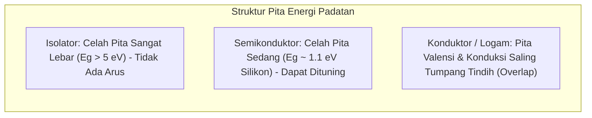

# Modul 036: Fisika Kuantum Dasar & Teori Pita Energi (Persamaan Schrödinger, Quantum Tunneling, Bandgap)

**Navigasi**: [⬅️ Master Index](../../INDEX.md) | [Tingkat 2: Tingkat 2: Fisika Klasik, Elektromagnetisme & Kimia Semikonduktor](./README.md)
*Sebelumnya*: [035. elektrokimia-baterai-penyimpanan-energi](./035-elektrokimia-baterai-penyimpanan-energi.md) | *Berikutnya*: [037. fisika-semikonduktor-rekayasa-silikon](./037-fisika-semikonduktor-rekayasa-silikon.md)

---

## 1. Intuisi Dasar Tanpa Jargon ("Seperti Bayi Baru Lahir")
Jika Anda melempar bola tenis ke dinding semen yang kokoh, bola tersebut akan selalu memantul kembali 100%. Bola tidak akan pernah menembus dinding secara gaib. Tetapi di dunia kuantum partikel sub-atomik, sebuah elektron tidak memiliki posisi pasti; elektron adalah 'gelombang probabilitas'. 

Ketika gelombang probabilitas elektron menabrak dinding penghalang energi yang tebal, sebagian kecil dari ekor gelombang tersebut mampu merembes dan muncul di sisi lain dinding! Inilah **Quantum Tunneling**. Fenomena inilah yang membuat matahari kita bersinar (fusi nuklir pada suhu rendah) dan menjadi fondasi utama penyimpanan USB Flashdisk (NAND Flash) yang Anda gunakan setiap hari!

## 2. Fondasi Teoretis & Aksiomatik / Matematis
### 1. Persamaan Gelombang Schrödinger (Tidak Bergantung Waktu)
$$\hat{H} \psi(\mathbf{r}) = E \psi(\mathbf{r}) \implies -\frac{\hbar^2}{2m} \nabla^2 \psi(\mathbf{r}) + V(\mathbf{r}) \psi(\mathbf{r}) = E \psi(\mathbf{r})$$
Di mana:
- $\hbar = \frac{h}{2\pi} \approx 1.05457 \times 10^{-34} \text{ J}\cdot\text{s}$ (Konstanta Planck Tereduksi).
- $|\psi(\mathbf{r})|^2$ merepresentasikan kerapatan probabilitas menemukan partikel pada koordinat $\mathbf{r}$ (Interpretasi Born).

### 2. Quantum Tunneling & Teori Pita Energi Padatan
Koefisien Transmisi Tunneling melintasi potensial penghalang $V_0 > E$ setebal $a$:
$$T \approx 16 \frac{E}{V_0} \left( 1 - \frac{E}{V_0} \right) e^{-2 \kappa a}, \quad \kappa = \frac{\sqrt{2m(V_0 - E)}}{\hbar}$$
Model Kronig-Penney & Pembentukan Celah Pita Energi (*Energy Bandgap* $E_g$):
Interferensi konstruktif dan destruktif gelombang elektron Bloch di dalam kisi periodik kristal memecah tingkat energi menjadi **Pita Valensi** (terisi penuh elektron), **Bandgap** (zona terlarang energi), dan **Pita Konduksi** (elektron bebas bergerak).
[📚 Pelajari: MIT OCW 8.04 Quantum Physics I](https://ocw.mit.edu/courses/8-04-quantum-physics-i-spring-2016/)

## 3. Anatomi Teknis & Cara Kerja Internal


## 4. Implementasi Praktis & Kode / Simulasi Riil
```python
import numpy as np

def quantum_tunneling_probability(barrier_height_ev: float, electron_energy_ev: float, barrier_width_nm: float):
    """
    Menghitung probabilitas transmisi Quantum Tunneling elektron melintasi potensial isolator SiO2.
    """
    hbar = 1.0545718e-34 # J.s
    m_e = 9.10938356e-31 # kg (Massa elektron)
    q_e = 1.60217663e-19 # Coulomb per eV
    
    V0 = barrier_height_ev * q_e
    E = electron_energy_ev * q_e
    a = barrier_width_nm * 1e-9
    
    if E >= V0:
        return 1.0 # Di atas penghalang (propagasi klasik)
        
    kappa = np.sqrt(2 * m_e * (V0 - E)) / hbar
    transmission = np.exp(-2 * kappa * a)
    return transmission

# Contoh: Tunneling elektron pada gate oxide MOSFET 3nm vs 1nm (V0=3.1 eV, E=1.0 eV)
t_3nm = quantum_tunneling_probability(3.1, 1.0, 3.0)
t_1nm = quantum_tunneling_probability(3.1, 1.0, 1.0)

print(f"Probabilitas Tunneling pada Ketebalan 3 nm: {t_3nm:.2e}")
print(f"Probabilitas Tunneling pada Ketebalan 1 nm: {t_1nm:.2e}")
print(f"Kenaikan arus bocor kuantum sebesar: {t_1nm / t_3nm:.1f}x lipat saat tebal gerbang menyusut!")
```

## 5. Miskonsepsi & Jebakan Industri
1. **Subthreshold Leakage pada Chip Sub-5nm**: Ketika insinyur semikonduktor mengecilkan gate oxide transistor silikon di bawah 2 nanometer, efek quantum tunneling menyebabkan arus bocor tembus langsung dari Gate ke Channel meskipun saklar dalam kondisi OFF, membuang daya listrik baterai secara sia-sia (Solusi: Transisi dari planar MOSFET ke arsitektur 3D FinFET dan Gate-All-Around / GAAFET dengan High-K Metal Gate).

## 6. Proyek Latihan & Rubrik Penilaian Mandiri
### Level 1 (Dasar)
Gunakan hubungan de Broglie $\lambda = \frac{h}{p}$ untuk menghitung panjang gelombang kuantum sebuah elektron yang bergerak dengan kecepatan $10^6\text{ m/s}$.

### Level 2 (Menengah)
Selesaikan persamaan Schrödinger untuk partikel di dalam sumur potensial tak hingga 1 dimensi (*Particle in a Box*) dan turunkan kuantisasi tingkat energinya $E_n = \frac{n^2 \pi^2 \hbar^2}{2mL^2}$.

### Level 3 (Mahir)
Gunakan pendekatan WKB (Wentzel-Kramers-Brillouin) untuk menghitung arus tunneling Fowler-Nordheim pada operasi penulisan gerbang apung sel memori Flash NAND.

## 7. Rekomendasi Sumber Belajar Standar Emas
- [Buku Standar: Introduction to Quantum Mechanics (3rd ed.) - David J. Griffiths & Darrell F. Schroeter (Cambridge University Press)](https://www.cambridge.org/highereducation/books/introduction-to-quantum-mechanics/30B37CA5E7E8B8B5B1BA799B7F76313C)
- [Kuliah Video Terbuka: Barton Zwiebach - Quantum Physics I (MIT OpenCourseWare)](https://ocw.mit.edu/courses/8-04-quantum-physics-i-spring-2016/)
- [Simulasi Interaktif: PhET Interactive Simulations - Quantum Tunneling and Wave Packets](https://phet.colorado.edu/en/simulations/quantum-tunneling)

---
*Navigasi Cepat*: [Ke Tingkat 2](./README.md) | [Ke Master Index](../../INDEX.md) | *Sebelumnya*: [035. elektrokimia-baterai-penyimpanan-energi](./035-elektrokimia-baterai-penyimpanan-energi.md) | *Berikutnya*: [037. fisika-semikonduktor-rekayasa-silikon](./037-fisika-semikonduktor-rekayasa-silikon.md)
